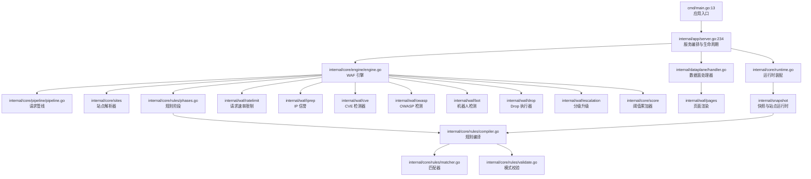
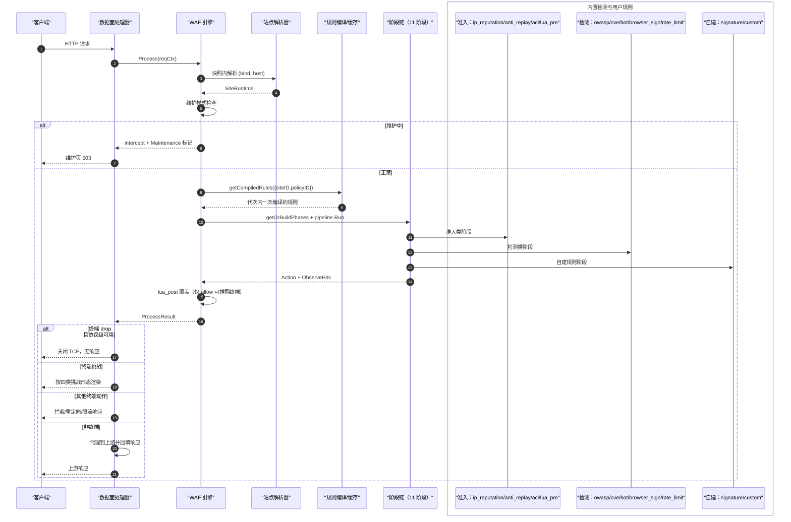
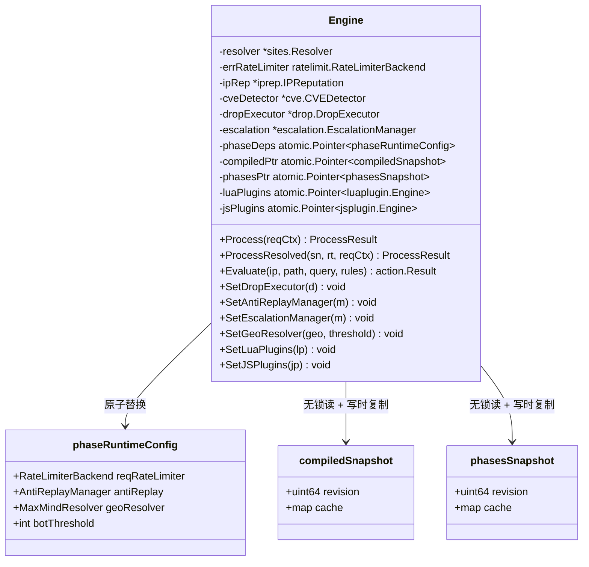
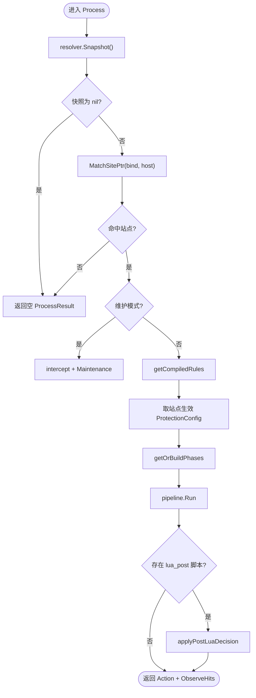
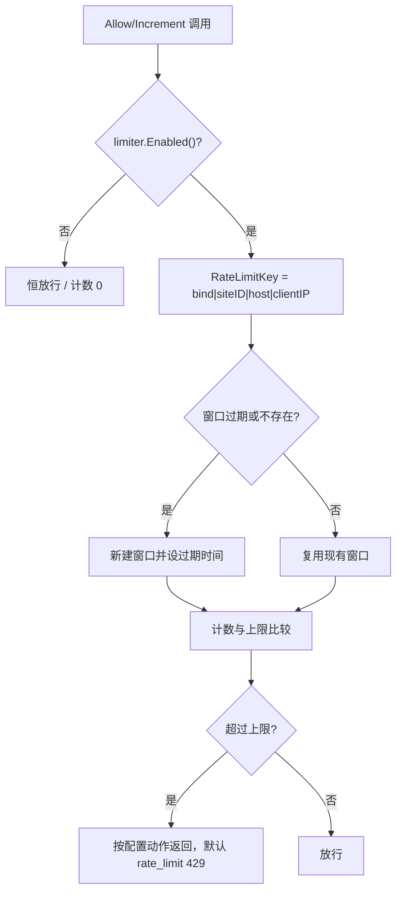
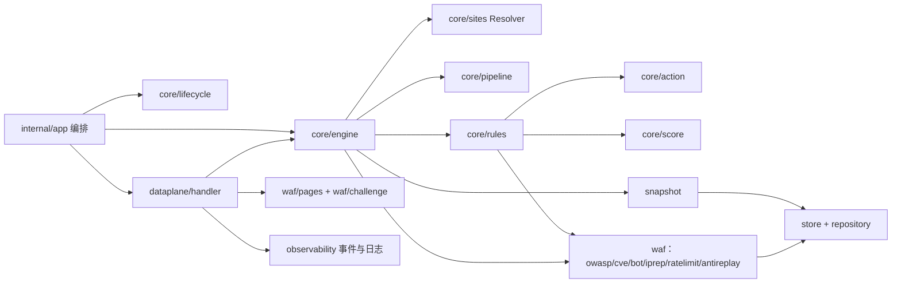

# WAF 引擎系统

<cite>
**本文档引用的文件**
- [engine.go](file://internal/core/engine/engine.go)
- [pipeline.go](file://internal/core/pipeline/pipeline.go)
- [pool.go](file://internal/core/pipeline/pool.go)
- [phases.go](file://internal/core/rules/phases.go)
- [compiler.go](file://internal/core/rules/compiler.go)
- [matcher.go](file://internal/core/rules/matcher.go)
- [validate.go](file://internal/core/rules/validate.go)
- [action.go](file://internal/core/action/action.go)
- [score.go](file://internal/core/score/score.go)
- [resolver.go](file://internal/core/sites/resolver.go)
- [snapshot.go](file://internal/snapshot/snapshot.go)
- [build.go](file://internal/snapshot/build.go)
- [policy.go](file://internal/store/policy.go)
- [protection.go](file://internal/store/protection.go)
- [handler.go](file://internal/dataplane/handler.go)
- [drop.go](file://internal/waf/drop/drop.go)
- [block.go](file://internal/waf/pages/block.go)
- [escalation.go](file://internal/waf/escalation/escalation.go)
- [README.md](file://README.md)
</cite>


> **模块架构概述**
>
> WAF 引擎系统是 My-OpenWaf 的核心安全处理单元，采用「不可变快照 + 责任链规则管线 + 代次级编译缓存」架构。它从数据平面接收请求上下文，依次完成站点解析、维护模式检查、11 阶段规则匹配（IP 信誉 → 防重放 → ACL → Lua 前置 → OWASP → CVE → 机器人 → 浏览器签名 → 速率限制 → 签名 → 自定义），再执行 Lua 后置覆盖，最终返回一个 `action.Result` 判定。引擎支持规则与阶段链的无锁热读、TLS 指纹作为匹配输入、TCP 层面丢弃（Drop）以及可观测的安全事件输出。
>
> 本篇是域索引与跨子文档的口径校准入口。**完整子文档导航表见[附录](#附录)**；各子篇的明细表（11 阶段全序、逐 kind 参数、动作落地出口）不在本篇重复。

## 目录

1. [简介](#简介)
2. [项目结构](#项目结构)
3. [核心组件](#核心组件)
4. [架构总览](#架构总览)
5. [详细组件分析](#详细组件分析)
6. [依赖关系分析](#依赖关系分析)
7. [性能考虑](#性能考虑)
8. [故障排查指南](#故障排查指南)
9. [结论](#结论)
10. [附录](#附录)

## 简介
本文件系统性阐述 My-OpenWaf 引擎核心的架构与实现口径，重点覆盖：

- 引擎整体设计理念与架构模式：不可变快照、责任链阶段、代次级缓存、无锁热读
- `Engine.Process` / `ProcessResolved` 的执行流程：站点解析 → 维护模式 → 规则取缓存 → 阶段链运行 → Lua 后置
- 引擎与子系统的协作关系：站点解析器、规则编译器与匹配器、速率限制器、IP 信誉、OWASP/CVE/Bot 检测、CVE 检测器、Drop 执行器、分级升级、数据面处理器
- 动作与结果的契约层：终止优先级、挑战类延迟保留、观察命中收集
- 配置项、性能调优建议与验证命令

**明确不在本篇展开的内容（用链接指向子篇）**：阶段内部判定算法、逐 kind 参数、CVE 规则目录与同步链路、OWASP 归一化 17 步、页面模板与净化细节、快照构建 16 步装配。

## 项目结构
My-OpenWaf 采用分层与模块化组织：`cmd` 为进程入口，`internal/app` 负责服务编排与监听器热重载，`internal/core` 提供引擎与规则能力，`internal/waf` 提供各检测算法，`internal/dataplane` 串联引擎与上游代理，`internal/snapshot` 提供不可变快照与原子切换。



**图表来源**
- [engine.go:82-127](file://internal/core/engine/engine.go#L82-L127)
- [pipeline.go:14-100](file://internal/core/pipeline/pipeline.go#L14-L100)
- [phases.go:33-129](file://internal/core/rules/phases.go#L33-L129)
- [compiler.go:40-78](file://internal/core/rules/compiler.go#L40-L78)
- [matcher.go:21-23](file://internal/core/rules/matcher.go#L21-L23)
- [validate.go:28-44](file://internal/core/rules/validate.go#L28-L44)
- [score.go:18-47](file://internal/core/score/score.go#L18-L47)
- [handler.go:632-1038](file://internal/dataplane/handler.go#L632-L1038)
- [snapshot.go:24-47](file://internal/snapshot/snapshot.go#L24-L47)
- [build.go:920-969](file://internal/snapshot/build.go#L920-L969)

### 模块清单
| 模块 | 路径 | 职责 | 核心接口/符号 | 依赖模块 | 被依赖 | 规模(行) | 测试 |
|---|---|---|---|---|---|---:|:--:|
| engine | `internal/core/engine` | 请求编排、规则与阶段链缓存、Lua 后置 | `Engine.Process`、`getOrBuildPhases` | `rules`、`pipeline`、`snapshot`、`waf/*` | `dataplane` | 646 | 有 |
| pipeline | `internal/core/pipeline` | 阶段链执行、观察收集、请求改写 | `Phase`、`Run`、`RequestCtx` | `action`、`waf/bot/tlsfp` | `rules`、`engine`、`dataplane` | 678 | 有 |
| rules | `internal/core/rules` | DSL 编译、匹配器、11 阶段实现 | `Compile`、`Matcher`、`MatchCtx` | `pipeline`、`action`、`store`、`waf/*` | `engine`、`snapshot` | 4048 | 有 |
| action | `internal/core/action` | 动作类型、结果、终止优先级、内部码 | `Type`、`Result`、`TerminalPriority` | 无 | 全链路 | 393 | 有 |
| score | `internal/core/score` | 阈值累加与危险标记 | `Accumulator`、`Count` | 无 | `waf/bot`、`waf/owasp` | 247 | 有 |
| sites | `internal/core/sites` | 快照内站点解析入口 | `Resolver.Match` | `snapshot` | `engine` | 44 | 有 |
| snapshot | `internal/snapshot` | 不可变快照构建与原子切换 | `Snapshot`、`Holder`、`CompiledRule` | `store`、`rules`（仅类型层） | `engine`、`dataplane` | 3071 | 有 |
| dataplane | `internal/dataplane` | 终态分派、页面写入、代理 | `handler`、`dropEnabled` | `engine`、`waf/pages`、`waf/challenge` | `app` | 8836 | 有 |
| waf（检测族） | `internal/waf/*` | IP 信誉、防重放、OWASP、CVE、Bot、限流、Drop、升级、页面 | 各 `Manager`/`Detector` | `core/action`、`core/score` | `rules`、`dataplane` | 各子包 | 有 |

`internal/snapshot/build.go` 不 import `internal/core/rules`，而是自带一份 30 项白名单的 `ParsePattern`（build.go:1197-1222）；引擎侧 `knownPrefixes` 有 57 项（compiler.go:119-142）。两段白名单的差集与绕过方式是"规则保存成功却毫不生效"最常见的成因，详见 [规则编译器](规则编译器.md)。

**章节来源**
- [engine.go:1-646](file://internal/core/engine/engine.go#L1-L646)
- [pipeline.go:1-565](file://internal/core/pipeline/pipeline.go#L1-L565)
- [compiler.go:119-170](file://internal/core/rules/compiler.go#L119-L170)
- [build.go:1189-1222](file://internal/snapshot/build.go#L1189-L1222)
- [score.go:1-247](file://internal/core/score/score.go#L1-L247)

## 核心组件
- 引擎 `Engine`：封装站点解析、维护模式检查、规则取缓存、阶段链运行与 Lua 后置覆盖
- 规则引擎：把持久化规则编译为排序后、匹配器就绪的 `Compiled`
- 站点解析器 `sites.Resolver`：基于当前快照把 `(bind, host)` 映射到 `SiteRuntime`
- 速率限制器：固定窗口计数，区分请求限流与错误率限流两类后端
- IP 信誉 `IPReputation`：全局黑白名单与自动封禁；站点黑白名单在阶段内优先判定
- CVE 检测器：仅 Java / PHP / Node.js 三种专用语言检测器，跨语言攻击面由 `GeneralCVEDetector` 承担
- OWASP / Bot 检测：注册表 + 归一化 + 误报抑制；Bot 为"预筛选 + 深度评分"两阶段
- TLS 指纹元数据：由数据面采集写入 `RequestCtx`，供 Bot、日志与 `tls_*` 匹配器读取
- Drop 执行器：`SetLinger(0)` + `Close`，不发送任何 HTTP 响应
- 分级升级 `EscalationManager`：按窗口命中次数把动作改严，永不改松
- 页面渲染与配置：三级兜底（站点自定义 → 全局默认 → 内嵌资源）
- 生命周期管理：统一启动、优雅关闭、信号处理与服务器协调

| 组件 | 位置 | 关键符号 | 一句话职责 |
|---|---|---|---|
| 引擎 | [engine.go:83](file://internal/core/engine/engine.go#L83) | `Process`、`ProcessResolved` | 请求编排与判定产出 |
| 阶段链构建 | [engine.go:441](file://internal/core/engine/engine.go#L441) | `getOrBuildPhases` | 按配置条件入链并缓存 |
| 管道裁决 | [pipeline.go:517](file://internal/core/pipeline/pipeline.go#L517) | `Run` | 终端立即返回、挑战延迟比较 |
| 规则编译 | [compiler.go:40](file://internal/core/rules/compiler.go#L40) | `Compile` | 解析、校验、构造、排序 |
| 匹配器 | [matcher.go:21](file://internal/core/rules/matcher.go#L21) | `Matcher`、`MatchCtx` | 单条件布尔判定 |
| 动作契约 | [action.go:127](file://internal/core/action/action.go#L127) | `Result`、`TerminalPriority` | 判定载体与严重度 |

**章节来源**
- [engine.go:82-127](file://internal/core/engine/engine.go#L82-L127)
- [engine.go:441-548](file://internal/core/engine/engine.go#L441-L548)
- [pipeline.go:517-560](file://internal/core/pipeline/pipeline.go#L517-L560)
- [compiler.go:40-78](file://internal/core/rules/compiler.go#L40-L78)
- [action.go:88-165](file://internal/core/action/action.go#L88-L165)

## 架构总览
下图给出从监听到响应的骨架关系；阶段内部判定与短路细节由子篇承载。



**图表来源**
- [engine.go:331-378](file://internal/core/engine/engine.go#L331-L378)
- [engine.go:386-431](file://internal/core/engine/engine.go#L386-L431)
- [engine.go:441-548](file://internal/core/engine/engine.go#L441-L548)
- [pipeline.go:517-560](file://internal/core/pipeline/pipeline.go#L517-L560)
- [handler.go:632-1040](file://internal/dataplane/handler.go#L632-L1040)

### 分层与依赖边界
| 层 | 组成 | 核心职责 | 允许依赖 | 禁止依赖 | 代表位置 |
|---|---|---|---|---|---|
| 接入层 | `cmd`、`internal/app`、监听器 | 协议接入、TLS、HTTP/3、生命周期 | `core`、`dataplane`、`snapshot` | 直接判定请求动作 | `internal/app/server.go:234` |
| 数据面层 | `internal/dataplane` | 请求上下文装配、终态分派、代理、日志 | `core`、`waf/pages`、`waf/challenge` | 反向依赖 `app` | `handler.go:632-1040` |
| 引擎层 | `internal/core/engine` | 编排、缓存、后置覆盖 | `core/rules`、`core/pipeline`、`snapshot` | 直接读数据库 | `engine.go:331-548` |
| 领域层 | `core/rules`、`core/action`、`core/score` | 规则编译、匹配、判定与阈值累加 | `core/pipeline`、`waf/*`（检测能力） | `admin`、`app` | `phases.go`、`action.go` |
| 检测能力层 | `internal/waf/*` | 各安全算法与页面渲染 | `core/action`、`core/score` | `core/engine` | `waf/owasp`、`waf/bot` |
| 基础设施层 | `store`、`repository`、`snapshot`、`cache`、`redis` | 持久化、快照、缓存 | 无领域逻辑 | `core/engine`、`dataplane` | `store/repository` |

**违规依赖说明**：`internal/waf/escalation` 读取 `action.TerminalPriority` 做档位比较（escalation.go:244-249），属检测层依赖契约层的正向关系，不是反向依赖。当前未发现下层反向依赖上层的实例。

**章节来源**
- [engine.go:26-113](file://internal/core/engine/engine.go#L26-L113)
- [handler.go:632-1040](file://internal/dataplane/handler.go#L632-L1040)
- [phases.go:1-31](file://internal/core/rules/phases.go#L1-L31)
- [escalation.go:244-249](file://internal/waf/escalation/escalation.go#L244-L249)
- [snapshot.go:24-47](file://internal/snapshot/snapshot.go#L24-L47)

### 阶段全序（链接，不在此重复）
11 阶段实测顺序、入链前置条件与短路行为以 [处理阶段详解 · 架构总览](处理阶段详解/处理阶段详解.md) 的全序表为唯一权威；本篇只在 简介 与上图出现阶段名序列，不复制该表。容量按 11 预分配（engine.go:467），阶段链缓存键为 `{policyID,siteID,antiReplayEnabled}` 并叠加 `prot`/`lua`/`luaRevision`/`deps` 四判据（engine.go:60-64、461）。

**章节来源**
- [engine.go:60-64](file://internal/core/engine/engine.go#L60-L64)
- [engine.go:441-548](file://internal/core/engine/engine.go#L441-L548)
- [escalation.go:244-249](file://internal/waf/escalation/escalation.go#L244-L249)
- [phases.go:146-742](file://internal/core/rules/phases.go#L146-L742)

## 详细组件分析

### 引擎 Engine：结构、依赖注入与生命周期
`Engine` 的字段构成决定了它的并发形态：可变依赖全部走 `atomic.Pointer` 整体替换，请求路径读到的始终是一致快照。



**图表来源**
- [engine.go:26-113](file://internal/core/engine/engine.go#L26-L113)
- [engine.go:116-127](file://internal/core/engine/engine.go#L116-L127)
- [engine.go:160-215](file://internal/core/engine/engine.go#L160-L215)
- [engine.go:590-621](file://internal/core/engine/engine.go#L590-L621)

要点：

- `Engine.New` 注入快照持有者、请求/错误限流后端与 IP 信誉系统，并初始化两张空缓存与 `botThreshold:80`（engine.go:116-127）
- `updatePhaseDeps` 用 CAS 循环整体替换 `phaseRuntimeConfig`，因此不存在"读到半个新配置"的窗口（engine.go:146-158）
- Lua/JS 插件引擎必须用 `atomic.Pointer` 而非裸指针：请求路径并发读、reload 路径写，裸指针会构成数据竞争（engine.go:105-112）
- 进程生命周期由 `internal/app` 与 `internal/core/lifecycle` 管理，引擎自身不管理进程

**章节来源**
- [engine.go:26-127](file://internal/core/engine/engine.go#L26-L127)
- [engine.go:146-215](file://internal/core/engine/engine.go#L146-L215)
- [engine.go:590-621](file://internal/core/engine/engine.go#L590-L621)

### Process 执行流程
- 请求上下文由数据面填充（请求 ID、`bind`、客户端 IP、方法、路径、查询、头部、体、内容类型、TLS 指纹）
- 站点解析复用数据面已完成的 `bind+host` 结果，避免第二次 `MatchSite` 及其每请求拷贝（engine.go:564-572）
- 维护模式：全局或站点级开启时立即返回 `intercept` + `Maintenance` 标记（engine.go:336-348）
- 规则与阶段链均先查代次缓存，未命中才编译/构建
- Lua 后置在管道**之外**执行：管道遇终端动作即返回，链尾阶段永远读不到"已被拦截"的判定，也就无法实现"对特定误报放行"（engine.go:217-233、366-371）



**图表来源**
- [engine.go:331-378](file://internal/core/engine/engine.go#L331-L378)
- [engine.go:550-572](file://internal/core/engine/engine.go#L550-L572)
- [pipeline.go:517-560](file://internal/core/pipeline/pipeline.go#L517-L560)

**章节来源**
- [engine.go:217-378](file://internal/core/engine/engine.go#L217-L378)
- [engine.go:550-588](file://internal/core/engine/engine.go#L550-L588)

### 规则编译与匹配
编译链的完整口径见 [规则编译器](规则编译器.md)，此处只固定三条跨篇一致的实测事实：

- `Matcher` 签名是 `Match(ctx MatchCtx) bool`（matcher.go:21-23），不存在多参数形式
- 正则缓存在 `cachedCompile`（matcher.go:1791-1808），由 `sync.RWMutex` 保护的 `map[string]*regexp.Regexp` 承载，无淘汰、无负缓存
- `validateParsedPattern` 失败时降级为 `neverMatcher`（compiler.go:50-53），方向恒为 fail-closed

规则缓存键是 `{siteID, policyID}`（engine.go:34-37），并发形态为 `atomic.Pointer` 无锁读 + `compiledWriteMu` 串行写时复制（engine.go:98-103、413-428），**不是** `RWMutex`；规则缓存没有 LRU 与 MaxCost，`ristretto` 参数属于快照层。

**章节来源**
- [compiler.go:40-78](file://internal/core/rules/compiler.go#L40-L78)
- [matcher.go:21-23](file://internal/core/rules/matcher.go#L21-L23)
- [matcher.go:1785-1808](file://internal/core/rules/matcher.go#L1785-L1808)
- [engine.go:34-37](file://internal/core/engine/engine.go#L34-L37)
- [engine.go:386-431](file://internal/core/engine/engine.go#L386-L431)

### 动作取值与终止优先级
| 动作 | 终止 | 挑战 | `TerminalPriority` | 默认状态码 | 内部码 | 落地出口 |
|---|:--:|:--:|:--:|:--:|:--:|---|
| `allow` | 否 | 否 | 0 | 0 | 0 | 阶段放行，链路继续 |
| `observe` | 否 | 否 | 10 | 0 | 1008 | 进 `ObserveHits`，请求放行 |
| `tag` | 否 | 否 | 0 | 0 | 0 | 仅打标 |
| `redirect` | 是 | 否 | 50 | 302 | 1007 | 跳转 `RedirectTo` |
| `challenge` | 是 | 是 | 60 | 403 | 1003 | JS 挑战页，可被站点/全局 `challenge_action` 决定形态 |
| `captcha_challenge` | 是 | 是 | 60 | 403 | 1004 | 渲染配置的验证码类型（`math`/`click`/`slide`/`rotate`） |
| `shield_challenge` | 是 | 是 | 60 | 403 | 1005 | 5 秒盾：PoW + 环境指纹 |
| `chain_challenge` | 是 | 是 | 60 | 403 | 1006 | 链式多步挑战 |
| `rate_limit` | 是 | 否 | 70 | 429 | 1002 | 限流页文案 |
| `intercept` | 是 | 否 | 80 | 403 | 1001 | 拦截页 |
| `drop` | 是 | 否 | 90 | 不发响应 | 1000 | 协议级关闭连接 |
| `block` / `log_only` | 归一为 `intercept` / `observe` | — | 随目标 | 随目标 | 随目标 | 历史别名兼容 |

四类挑战动作**同为 60**，同档取链上先出现者，只有严格更高才替换待定挑战（pipeline.go:533-536）。挑战类动作必须按具体 WAF action 呈现，不得写成通用状态码页面。渲染分支、管理器缺失时的回落、通行 cookie 绑定五元组等细节见 [动作与结果系统](动作与结果系统.md)。

**章节来源**
- [action.go:88-119](file://internal/core/action/action.go#L88-L119)
- [action.go:127-312](file://internal/core/action/action.go#L127-L312)
- [action.go:323-393](file://internal/core/action/action.go#L323-L393)
- [pipeline.go:517-560](file://internal/core/pipeline/pipeline.go#L517-L560)

### 检测能力族：OWASP、CVE、Bot、TLS 指纹
四族检测的内部算法均有专篇，本篇只固定跨篇一致的口径与引擎侧接缝。

| 能力 | 引擎侧入口 | 实测口径 | 专篇 |
|---|---|---|---|
| OWASP | `NewOWASPPhase(prot)`，phases.go:618-718 | 注册表 361 条 / 目录 553 条，18 类别；敏感度 6 档，默认 `mid` + `intercept`；归一化 17 步且 UTF-7 先于 URL 解码；规则 ID 带 `owasp:` 前缀 | [OWASP 检测](../安全防护功能/OWASP 检测/OWASP 检测.md) |
| CVE | `NewCVEPhase(prot, detector)`，phases.go:744-871 | 专用语言检测器仅 Java/PHP/Node.js 三种，其余走 `GeneralCVEDetector`；实现是「正则 pattern + target」，不含 CPE/受影响版本区间；同步周期 6h | [CVE 漏洞检测](../安全防护功能/CVE 漏洞检测/CVE 漏洞检测.md) |
| Bot | `NewBotPhaseWithGeoAndLimiter(...)`，phases.go:435-591 | 预筛选 + 深度评分两阶段；行为分用 `|bot` 后缀独立键；处置阈值默认 80 | [机器人检测阶段](处理阶段详解/机器人检测阶段.md) |
| TLS 指纹 | 数据面写入 `RequestCtx.TLS`，`tlsFingerprintValue` 读取 | **不是独立阶段**；仅作为 `tls_*` 匹配器与 Bot/日志的输入 | [内置匹配器](内置匹配器/内置匹配器.md) |

阈值累加与危险标记由 `internal/core/score.Accumulator` 统一实现：同一 ID 在计分通道与危险通道各去重一次，`weight <= 0` 被忽略，归因锁定在"首次把总分推过阈值的那一条"（score.go:49-209）。

**章节来源**
- [phases.go:435-871](file://internal/core/rules/phases.go#L435-L871)
- [score.go:1-247](file://internal/core/score/score.go#L1-L247)
- [matcher.go:155-204](file://internal/core/rules/matcher.go#L155-L204)

### Drop 执行器与分级升级
Drop 的落地路径、协议级降级与统计桶问题在 [动作与结果系统](动作与结果系统.md) 展开，本篇只保留跨篇一致的三条：

- `drop` 语义是立即关闭 TCP 且**不发送任何 HTTP 响应**，内部码 1000，访问日志状态记 0
- 执行器不可用或拿不到可关闭连接时降级为 403 拦截页，并写 `X-OWAF-Drop-Degraded` 响应头（handler.go:796-849）
- `escalation` 只允许把动作改严：`ActionSeverity(升级动作) > ActionSeverity(当前)` 才生效（escalation.go:244-249、handler.go:679-702）

**章节来源**
- [drop.go:19-113](file://internal/waf/drop/drop.go#L19-L113)
- [escalation.go:15-268](file://internal/waf/escalation/escalation.go#L15-L268)
- [handler.go:664-849](file://internal/dataplane/handler.go#L664-L849)

### 站点解析与快照
- `Resolver` 从当前快照查找站点，`MatchSite` 返回拷贝、`MatchSitePtr` 零拷贝（snapshot.go:345、381）
- 站点键为 `bind + NUL + host` 的哈希键（snapshot.go:293-296），至多三级查找：精确 → `*.` 单级父域 → catch-all `*`（snapshot.go:337-362），IP 主机跳过通配（441-450）。站点解析不依赖任何树形索引结构，当前代码中不存在此类实现
- `Holder` 以原子指针保存当前快照，`StoreIfNewer` 保证代次单调（snapshot.go:474-487）
- 站点路由冲突不是 first-come：不同站点争同一键直接返回 `duplicate site route`（build.go:795-799），同站点幂等 continue
- 重载链与 Redis 同步口径见 [快照系统](引擎核心架构/快照系统.md)

**章节来源**
- [snapshot.go:24-47](file://internal/snapshot/snapshot.go#L24-L47)
- [build.go:795-799](file://internal/snapshot/build.go#L795-L799)
- [engine.go:550-572](file://internal/core/engine/engine.go#L550-L572)

### 速率限制、IP 信誉与请求上下文池
- 限流键统一为 `bind|siteID|归一化 Host|clientIP`（phases.go:63-70），Bot 行为分使用带 `|bot` 后缀的独立键（phases.go:501-512）
- IP 信誉：站点白名单 `Allow` 的 `stop=false` **不短路**，全局白名单 `stop=true` 短路；自动封禁默认阈值 10、窗口 60、时长 3600（phases.go:368-433）
- 请求上下文由 `pipeline` 的对象池承载，`ReleaseCtx` 清理懒缓存与头部键名切片以复用容量（pool.go、pipeline.go:202-230）



**图表来源**
- [phases.go:63-70](file://internal/core/rules/phases.go#L63-L70)
- [phases.go:305-340](file://internal/core/rules/phases.go#L305-L340)
- [phases.go:368-433](file://internal/core/rules/phases.go#L368-L433)

**章节来源**
- [phases.go:63-70](file://internal/core/rules/phases.go#L63-L70)
- [phases.go:305-340](file://internal/core/rules/phases.go#L305-L340)
- [phases.go:368-433](file://internal/core/rules/phases.go#L368-L433)
- [pipeline.go:102-230](file://internal/core/pipeline/pipeline.go#L102-L230)

### 数据平面处理器：分派、记录与转发
数据面在管道返回后按动作出口分派，完整出口表见 [动作与结果系统](动作与结果系统.md)。三条跨篇一致的口径：

- 未命中站点**不是 404**：记 `no site match` 后回欢迎页 200 并打 `routing_error`（handler.go:152-162）
- 终端动作命中时先做挑战通行 cookie 校验，通过则把判定降级为放行（handler.go:646-657）
- Lua pre 的请求改写与 JS 改写共用同一套校验与写回，失败时放弃改写而非中断请求（handler.go:1052-1076、pipeline.go:319-388）

**章节来源**
- [handler.go:152-162](file://internal/dataplane/handler.go#L152-L162)
- [handler.go:632-1076](file://internal/dataplane/handler.go#L632-L1076)
- [pipeline.go:282-445](file://internal/core/pipeline/pipeline.go#L282-L445)

## 依赖关系分析


**图表来源**
- [engine.go:3-23](file://internal/core/engine/engine.go#L3-L23)
- [phases.go:1-31](file://internal/core/rules/phases.go#L1-L31)
- [handler.go:632-1040](file://internal/dataplane/handler.go#L632-L1040)

| 依赖 | 用途 | 接入方式 | 配置来源 | 超时 | 重试 | 降级 | 可用性影响 |
|---|---|---|---|:--:|:--:|---|---|
| SQLite（默认）/ MySQL / PostgreSQL | 配置与日志持久化 | GORM | `MY_OPENWAF_DB_DRIVER`、`MY_OPENWAF_DSN`、`MY_OPENWAF_LOG_DSN` | 未设置（风险） | 无 | 无（风险） | 无法启动与重载 |
| Redis（可选） | 分布式限流、事件扇出、KV、升级计数 | `rueidis` | `MY_OPENWAF_REDIS_ADDR`/`PASSWORD`/`DB` | 50ms（escalation） | 无 | 回落实数 | 跨节点计数退化 |
| MaxMind GeoIP | Bot 地理评分 | 本地库 | `MY_OPENWAF_GEOIP_DB` | - | 无 | 地理分恒 0 | 识别率下降 |
| 嵌入前端资源 | 页面兜底与 admin 控制台 | `adminweb.SubFS` | `MY_OPENWAF_ADMIN_STATIC_DIR` | - | 无 | 极简回退页 | 页面样式缺失 |
| NVD / GitHub Advisory | CVE 规则同步 | 周期拉取 | CVE 订阅配置 | 见 CVE 专篇 | 周期重试 | 用目录内置规则 | 新漏洞滞后 |

`MY_OPENWAF_DROP_ENABLED` 默认 `true`、`MY_OPENWAF_BOT_THRESHOLD` 默认 `80`（README.md:335-336），二者与引擎内 `botThreshold:80` 构成同一阈值的两个来源。

**章节来源**
- [engine.go:116-127](file://internal/core/engine/engine.go#L116-L127)
- [escalation.go:119-154](file://internal/waf/escalation/escalation.go#L119-L154)
- [README.md:311-346](file://README.md#L311-L346)

## 性能考虑
- 规则编译与阶段链构建都被固定到"每快照代次、每站点每策略一次"，读路径单次 `atomic.Pointer.Load()`
- 阶段链容量按 11 预分配（engine.go:467），避免运行期扩容拷贝
- 正则缓存复用（matcher.go:1791-1808），通配符四类字面量形态走 `strings`/`bytes` 快路径而非 RE2
- 请求上下文与匹配器头部缓冲池化复用；`RequestCtx` 的懒解析缓存在 `ResetMutationCaches`/`ReleaseCtx` 时清理
- 计数类模块（限流、IP 信誉、`cc_rate`、升级）都有后台或惰性清扫，条目上界由窗口长度决定，但**均无容量上限**
- CVE 检测先做原始可疑内容预筛选再按固定顺序查找首个命中，避免每请求起 goroutine
- Drop 统计使用原子计数，日志限频为"前 16 条 + 每 1024 条"
- 站点解析使用哈希键 + 至多三级查找，无树结构，站点规模增长时查找成本近似常量
- 监听器热重载只对配置漂移相关的监听器生效，降低停机面

**章节来源**
- [engine.go:380-431](file://internal/core/engine/engine.go#L380-L431)
- [engine.go:441-548](file://internal/core/engine/engine.go#L441-L548)
- [matcher.go:1301-1419](file://internal/core/rules/matcher.go#L1301-L1419)
- [drop.go:61-76](file://internal/waf/drop/drop.go#L61-L76)

## 故障排查指南
| 症状 | 可能原因 | 排查方向 | 处理 |
|---|---|---|---|
| 快照未加载、请求无判定 | 运行时未初始化或迁移失败 | 启动日志与 `/readyz`：快照非 nil ∧ `lm.Ready()` ∧ `tokenMgr.Ready()` ∧ DB Ping | 检查迁移与代次推进 |
| 请求走到欢迎页而非站点 | 站点未匹配（**不是 404**） | 访问日志 `no site match`、响应 `routing_error` | 核对监听 `bind` 与 Host 是否落在站点键集合 |
| 规则保存成功但不生效 | 编译期降级或快照侧白名单不含该 kind | `ValidateRule` 返回；对照 57 项与 30 项两张白名单 | 修正模式或改用 `compound` 叶子写法 |
| 维护页意外出现 | 全局或站点维护开关 | `ProcessResult.Maintenance`、`maintenance_global_*` | 关闭对应开关并确认重载生效 |
| 挑战页形态不对 | 动作写成 `intercept`，或对应 Manager 未挂载 | 事件 `action` 与 `challenge_type` | 按四类挑战语义选择动作 |
| drop 后收到 403 | 协议级重置不可用 | 响应头 `X-OWAF-Drop-Degraded` | 属预期降级，需真丢弃时改 h1/h3 |
| 限流误伤正常用户 | 键含 `bind` 与 `siteID`，跨 CDN 出口分裂计数 | `RateLimitKey` 与窗口配置 | 校准窗口/配额或改用站点级配置 |
| 上游不可达 | 站点无 upstream 或代理失败 | 事件与访问日志 502/503/504 | 检查上游与探活状态 |

**章节来源**
- [handler.go:152-162](file://internal/dataplane/handler.go#L152-L162)
- [engine.go:331-348](file://internal/core/engine/engine.go#L331-L348)
- [compiler.go:40-53](file://internal/core/rules/compiler.go#L40-L53)
- [build.go:1189-1222](file://internal/snapshot/build.go#L1189-L1222)

## 结论
My-OpenWaf 引擎以「不可变快照 + 责任链阶段 + 代次级无锁缓存」为核心：站点解析用哈希键加至多三级查找，规则与阶段链的构造成本被固定在每个快照代次的每个 `{siteID,policyID}` 上，请求路径只做一次原子读与线性匹配。动作层用单一 `Result` 与一组整数优先级把多阶段并发命中收敛为可判定结果——终端立即返回、挑战延迟比较、同档取先者、`allow`/`observe` 永不短路。Lua 后置与分级升级两个管道外机制都被约束为"只能放行误报或只能改严"，避免形成第二判定通道。需要长期警惕的是三类事实：`ValidateRule` 通过不代表快照放行（两段白名单）、各类计数表均无容量上限、以及 `DropStats` 的来源桶名与阶段名不一致导致按来源统计不可用。

## 附录

### 子文档导航索引
| 子域 | 文档 | 承载内容 |
|---|---|---|
| 引擎核心架构 | [引擎核心架构](引擎核心架构/引擎核心架构.md) | Engine 设计模式、依赖注入、整体架构 |
| | [请求处理流程](引擎核心架构/请求处理流程.md) | 监听器到响应的完整生命周期 |
| | [管道执行机制](引擎核心架构/管道执行机制.md) | `Phase` 接口、`Run`、短路与观察收集 |
| | [规则编译缓存](引擎核心架构/规则编译缓存.md) | `compiledRules`、两级缓存与代次控制 |
| | [快照系统](引擎核心架构/快照系统.md) | 不可变快照、构建流程、热重载与 Redis 同步 |
| | [站点解析器](引擎核心架构/站点解析器.md) | `Resolver`、精确/通配匹配与多站点 |
| 处理阶段详解 | [处理阶段详解](处理阶段详解/处理阶段详解.md) | **11 阶段全序表**（权威口径）与短路语义 |
| | [ACL 访问控制阶段](处理阶段详解/ACL 访问控制阶段.md) | 规则匹配、白/黑名单、DSL 语法 |
| | [IP 信誉检查阶段](处理阶段详解/IP 信誉检查阶段.md) | 站点与全局名单、自动封禁 |
| | [OWASP 默认检测阶段](处理阶段详解/OWASP 默认检测阶段.md) | 引擎侧执行入口与结果构造 |
| | [机器人检测阶段](处理阶段详解/机器人检测阶段.md) | 预筛选 + 深度评分、GeoIP 与 TLS |
| | [请求速率限制阶段](处理阶段详解/请求速率限制阶段.md) | 固定窗口、键与超限动作 |
| | [签名检测阶段](处理阶段详解/签名检测阶段.md) | 签名规则编译与协作关系 |
| | [自定义规则阶段](处理阶段详解/自定义规则阶段.md) | DSL/JSON、观察命中收集、前端构建器 |
| 规则与动作 | [规则编译器](规则编译器.md) | 编译流程步骤、字段映射、失败降级 |
| | [动作与结果系统](动作与结果系统.md) | 终止优先级、挑战渲染、Drop 出口、页面配置 |
| 规则匹配器 | [规则匹配器](规则匹配器/规则匹配器.md) | `Matcher`、57 kind 全集、派生输入与短路 |
| | [复合匹配器](规则匹配器/复合匹配器.md) | `and/or/not/if/cc_rate`、JSON 字段与状态机 |
| | [匹配器扩展开发](规则匹配器/匹配器扩展开发.md) | 新增 kind 的四张表同步与测试规范 |
| | [正则表达式优化](规则匹配器/正则表达式优化.md) | `cachedCompile`、通配符形态与懒缓存 |
| | [内置匹配器](内置匹配器/内置匹配器.md) | 逐 kind 参数与使用速查 |

**章节来源**
- [本节为总结，无需特定文件来源]

### 关键配置项
| 配置项 | 类型 | 默认值 | 作用域 | 生效方式 | 安全等级 | 说明 |
|---|---|---|---|---|---|---|
| `MY_OPENWAF_ADMIN_BIND` | string | `:9443` | 进程 | 重启 | 普通 | 管理 API 与 `/metrics` 监听地址 |
| `MY_OPENWAF_DB_DRIVER` | string | `sqlite` | 进程 | 重启 | 普通 | `sqlite`/`mysql`/`postgres` |
| `MY_OPENWAF_DSN` | string | `./data/waf.db` | 进程 | 重启 | 敏感 | 主库连接串 |
| `MY_OPENWAF_LOG_DSN` | string | `./data/waf_logs.db` | 进程 | 重启 | 敏感 | 独立日志库 |
| `MY_OPENWAF_REDIS_ADDR` | string | 空 | 进程 | 重启 | 敏感 | 分布式限流/事件扇出/KV |
| `MY_OPENWAF_JWT_SECRET` | string | 自动生成并持久化 | 进程 | 重启 | **机密** | 令牌签名密钥，默认值不写入文档 |
| `MY_OPENWAF_BOT_THRESHOLD` | int | `80` | 进程 | 重载 | 普通 | Bot 处置阈值 |
| `MY_OPENWAF_GEOIP_DB` | string | 空 | 进程 | 重启 | 普通 | MaxMind 库路径 |
| `MY_OPENWAF_DROP_ENABLED` | bool | `true` | 进程 | 重启 | 普通 | 是否启用 TCP drop |
| `MY_OPENWAF_ACCESSLOG_SAMPLING` | int | `1` | 进程 | 重启 | 普通 | 仅抽样正常成功访问；安全事件恒全量 |
| `Protection.ChallengeAction` | string | `challenge` | 全局 + 站点 | 重载 | 普通 | 只决定泛化 `challenge` 的渲染形态 |
| `Protection.CaptchaType` | string | `math` | 全局 + 站点 + 规则 | 重载 | 普通 | 四值白名单校验 |
| `Protection.RequestRateLimitWindow/Max` | int | `60` / `300` | 全局 + 站点 | 重载 | 普通 | 超限动作默认 `rate_limit` |

`MY_OPENWAF_JWT_SECRET` 只写配置项名与作用，不写取值。 nullable 的站点级字段必须表达为"继承全局 / 覆盖启用 / 覆盖关闭"三态，不得把空值存成 `false` 或 `0`。

**章节来源**
- [README.md:311-346](file://README.md#L311-L346)
- [protection.go:17-117](file://internal/store/protection.go#L17-L117)
- [protection.go:159-199](file://internal/store/protection.go#L159-L199)

### 构建与验证命令
| 命令 | 用途 | 来源 |
|---|---|---|
| `./scripts/build.sh` | 全量构建（前端产物自动嵌入） | README.md:298 |
| `CGO_ENABLED=1 go build -tags=quickjs -ldflags="-s -w" -o bin/my-openwaf ./cmd/...` | 后端构建（QuickJS CGO） | README.md:305 |
| `CGO_ENABLED=1 go vet -tags=quickjs ./...` | 静态检查 | README.md:432 |
| `CGO_ENABLED=1 go test -tags=quickjs -v -timeout=30m ./...` | CI 口径全量测试 | README.md:433 |
| `go test ./internal/core/engine/...` | 引擎编排与缓存回归 | 本篇验证 |
| `go test ./internal/core/rules/...` | 编译、匹配与阶段回归 | 本篇验证 |
| `go test ./internal/core/pipeline/...` | 短路、挑战延迟与观察收集 | 本篇验证 |

```bash
# 引擎侧最小回归（本次文档改造采用的验证口径）
go test ./internal/core/engine/... ./internal/core/rules/... ./internal/core/pipeline/... ./internal/core/action/...
```

**章节来源**
- [README.md:293-309](file://README.md#L293-L309)
- [README.md:422-452](file://README.md#L422-L452)
