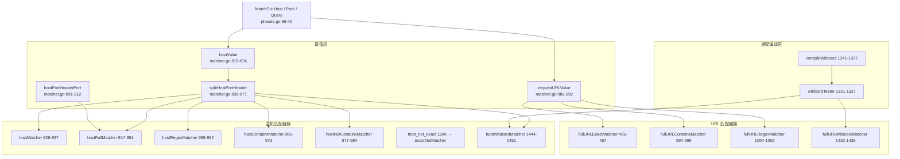
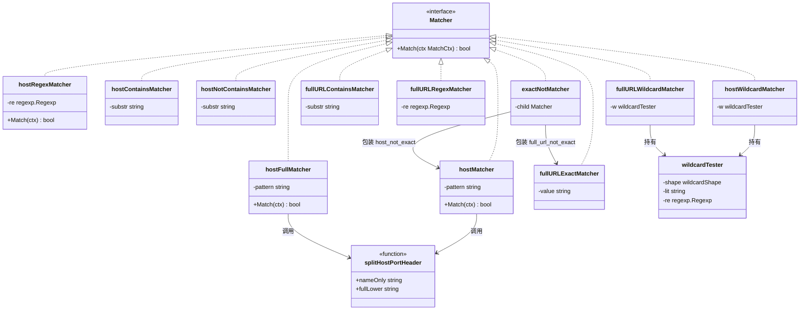
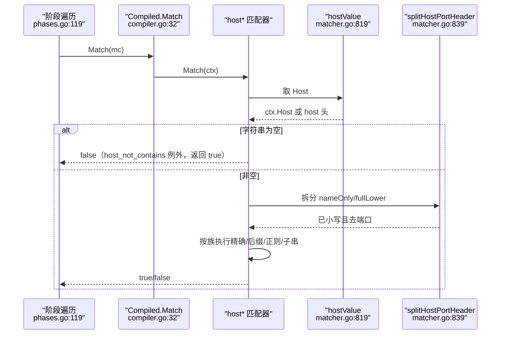
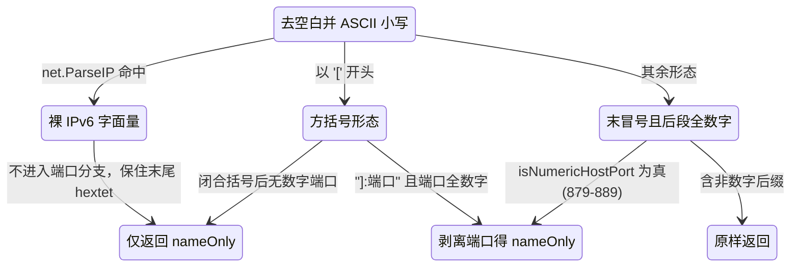
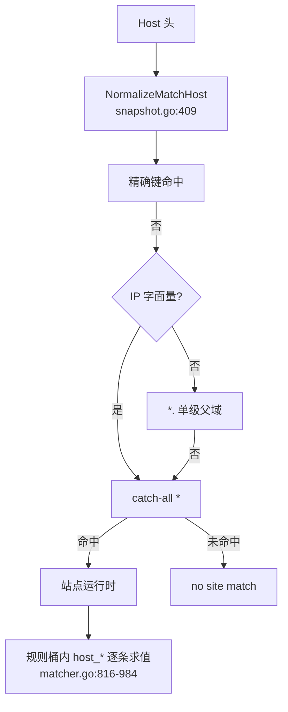
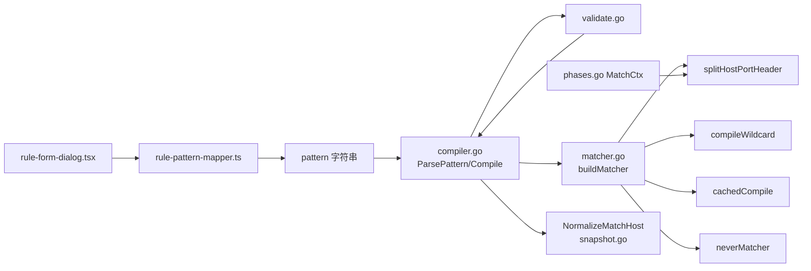
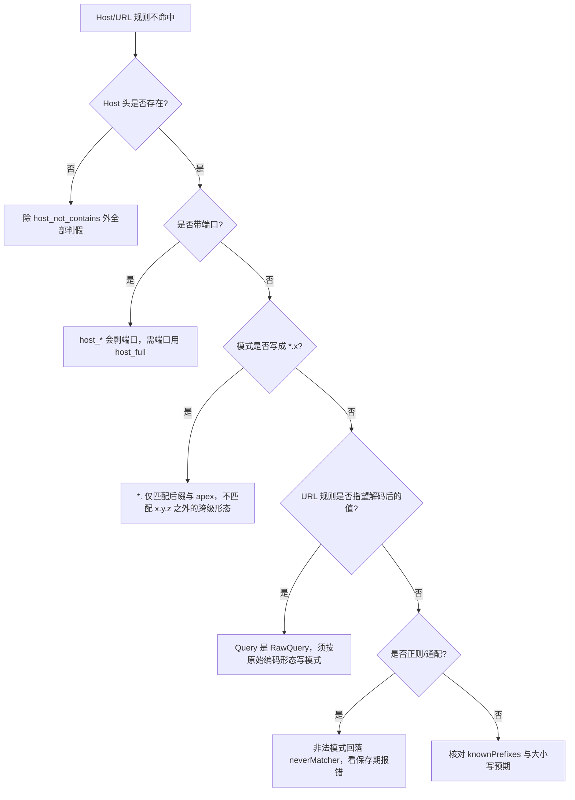

# 主机和URL匹配器

> [返回 WAF 引擎系统](../WAF %E5%BC%95%E6%93%8E%E7%B3%BB%E7%BB%9F.md)

<cite>
**本文档引用的文件**
- [matcher.go](file://internal/core/rules/matcher.go)
- [compiler.go](file://internal/core/rules/compiler.go)
- [validate.go](file://internal/core/rules/validate.go)
- [phases.go](file://internal/core/rules/phases.go)
- [snapshot.go](file://internal/snapshot/snapshot.go)
- [rule-pattern-mapper.ts](file://frontend/app/(dashboard)/rules/components/rule-pattern-mapper.ts)
- [rule-form-dialog.tsx](file://frontend/app/(dashboard)/rules/components/rule-form-dialog.tsx)
</cite>

## 目录

1. [简介](#简介)
2. [项目结构](#项目结构)
3. [核心组件](#核心组件)
4. [架构总览](#架构总览)
5. [详细组件分析](#详细组件分析)
6. [依赖关系分析](#依赖关系分析)
7. [性能考虑](#性能考虑)
8. [故障排查指南](#故障排查指南)
9. [结论](#结论)
10. [附录](#附录)

## 简介

本篇覆盖规则引擎里两族与「请求标识」直接相关的匹配器：**主机族**（`host`、`host_full`、`host_regex`、`host_contains`、`host_not_contains`、`host_wildcard`、`host_not_exact`）与 **完整 URL 族**（`full_url_contains`、`full_url_regex`、`full_url_wildcard`、`full_url_not_exact`）。两族合计 11 个 kind、11 个匹配器结构体，全部实现 `Matcher` 接口的一元方法 `Match(ctx MatchCtx) bool`（`matcher.go:20-23`）。

三件事必须先讲清楚：

1. **没有前缀树**。历史版本本篇曾引用一个已删除的数据平面主机索引文件，并称主机名会被「按标签反转后用于树形索引」。该实现已不存在，全库没有任何前缀树/字典树结构：规则侧的 Host 匹配是逐条线性求值，站点解析是哈希键查表，两者的真实实现见「与站点解析的分工」。
2. **两种 Host 归一化并存且语义不同**：规则侧用 `splitHostPortHeader`（`matcher.go:839-877`，显式保护 IPv6），限流与计数键侧用 `snapshot.NormalizeMatchHost`（`snapshot.go:409-440`，无条件剥离末段纯数字）。写规则时以前者为准。
3. **URL 匹配只看 path + 原始 query**：`requestURLValue`（`matcher.go:986-992`）拼接 `ctx.Path` 与 `ctx.Query`，其中 `ctx.Query` 取自 `RawQuery`（`phases.go:77`），**不解码**。

## 项目结构

两族匹配器全部落在 `internal/core/rules`，不依赖数据平面任何主机索引结构：

```text
internal/core/rules/
├── matcher.go        主机族 826-984、1440-1451；URL 族 463-467、986-1006、1428-1438
│                     公共归一化 819-824（hostValue）、839-912（端口处理）
├── compiler.go       knownPrefixes 119-142、ParsePattern 146-170、Compile 40-78
├── validate.go       保存期校验 123-257
└── phases.go         MatchCtx 33-52、填充 72-104、阶段遍历 112-129
internal/snapshot/
└── snapshot.go       NormalizeMatchHost 409-440、isIPAddress 442-450、MatchSite 337-362
```

### 模块清单表

| 模块 | 路径 | 职责 | 核心接口/符号 | 依赖模块 | 被依赖 | 规模(行) | 测试 |
|------|------|------|---------------|----------|--------|:--------:|:----:|
| 主机匹配器族 | `internal/core/rules/matcher.go` | Host 取值、端口剥离、精确/正则/包含/通配判定 | `hostMatcher`、`hostFullMatcher`、`splitHostPortHeader` | `net`、`strings`、`regexp` | `buildMatcher` | 1928 | 有 |
| URL 匹配器族 | `internal/core/rules/matcher.go` | path 与原始 query 拼接后的包含/正则/通配/全等判定 | `requestURLValue`、`fullURLContainsMatcher` | `strings`、`regexp` | `buildMatcher` | 1928 | 有 |
| 通配符编译 | `internal/core/rules/matcher.go` | glob 解析、形态退化、锚定正则生成 | `compileWildcard`、`wildcardTester` | `regexp` | 主机与 URL 族 | 1928 | 有 |
| 规则编译 | `internal/core/rules/compiler.go` | kind 白名单、DSL 拆分、优先级排序 | `knownPrefixes`、`ParsePattern`、`Compile` | `store`、`action` | `engine` | 170 | 有 |
| 保存期校验 | `internal/core/rules/validate.go` | 正则与通配模式合法性 | `validateSimplePattern` | `tlsmeta` | `Compile`、admin | 257 | 有 |
| 站点主机归一 | `internal/snapshot/snapshot.go` | 计数键与站点路由用的主机名归一 | `NormalizeMatchHost`、`isIPAddress`、`MatchSite` | `net`、`strings` | `phases`、`engine` | 3071 | 有 |
| 前端映射 | `frontend/app/(dashboard)/rules/components/rule-pattern-mapper.ts` | UI target/method 到 kind 的翻译 | `translateHost`、`translateHostFull`、`translateFullPath` | - | 规则表单 | 994 | 有 |

**章节来源**
- [matcher.go:816-1006](file://internal/core/rules/matcher.go#L816-L1006)
- [matcher.go:1428-1451](file://internal/core/rules/matcher.go#L1428-L1451)
- [compiler.go:119-170](file://internal/core/rules/compiler.go#L119-L170)
- [validate.go:123-257](file://internal/core/rules/validate.go#L123-L257)
- [snapshot.go:409-450](file://internal/snapshot/snapshot.go#L409-L450)
- [rule-pattern-mapper.ts:199-295](file://frontend/app/(dashboard)/rules/components/rule-pattern-mapper.ts#L199-L295)

### 结构关系



**图表来源**
- [matcher.go:816-1006](file://internal/core/rules/matcher.go#L816-L1006)
- [matcher.go:1321-1377](file://internal/core/rules/matcher.go#L1321-L1377)
- [matcher.go:1428-1451](file://internal/core/rules/matcher.go#L1428-L1451)
- [phases.go:33-52](file://internal/core/rules/phases.go#L33-L52)

**章节来源**
- [matcher.go:819-912](file://internal/core/rules/matcher.go#L819-L912)
- [matcher.go:986-1006](file://internal/core/rules/matcher.go#L986-L1006)
- [matcher.go:1341-1377](file://internal/core/rules/matcher.go#L1341-L1377)
- [matcher.go:1428-1451](file://internal/core/rules/matcher.go#L1428-L1451)
- [phases.go:33-52](file://internal/core/rules/phases.go#L33-L52)

## 核心组件

### 代码上下文表

| 符号 | 位置 | 职责 | 上游调用者 | 下游依赖 | 副作用 | 影响面 |
|------|------|------|------------|----------|--------|--------|
| `hostValue` | `matcher.go:819-824` | Host 取值，空则回落 `host` 头 | 全部主机族、`ccRateKey`（`matcher.go:108`） | `headerValue` | 无 | 高：决定所有 Host 条件成败 |
| `splitHostPortHeader` | `matcher.go:839-877` | 小写化并剥离数字端口，保护 IPv6 | 主机族 6 处 | `net.ParseIP`、`lowerASCIIIfNeeded`、`isNumericHostPort` | 无 | 高 |
| `isNumericHostPort` | `matcher.go:879-889` | 只有全数字后缀才当端口 | 上两者 | 无 | 无 | 中 |
| `hostPortHeaderPort` | `matcher.go:891-912` | 单独取端口，含方括号 IPv6 | `hostFullMatcher` | `net.ParseIP`、`isNumericHostPort` | 无 | 中 |
| `requestURLValue` | `matcher.go:986-992` | 拼 `path + "?" + query` | URL 族 4 处 | 无 | 无 | 高 |
| `compileWildcard` | `matcher.go:1341-1377` | glob 编译并选形态 | 5 个 `*_wildcard` kind | `parseGlob`、`cachedCompile` | 写正则缓存 | 中 |
| `ParsePattern` | `compiler.go:146-170` | 拆 `kind:arg`，通配族保留空白 | `Compile`、`ValidatePattern` | `knownPrefixes` | 无 | 高 |

**章节来源**
- [matcher.go:107-109](file://internal/core/rules/matcher.go#L107-L109)
- [matcher.go:819-912](file://internal/core/rules/matcher.go#L819-L912)
- [matcher.go:986-992](file://internal/core/rules/matcher.go#L986-L992)
- [matcher.go:1341-1377](file://internal/core/rules/matcher.go#L1341-L1377)
- [compiler.go:146-170](file://internal/core/rules/compiler.go#L146-L170)

### 类型体系



主机族 6 类 + URL 族 4 类 + 1 个包装类，共 11 个结构体；`splitHostPortHeader` 是主机族唯一的归一化入口，`requestURLValue`（`matcher.go:986-992`）是 URL 族唯一的取值入口。类图为兼容渲染器省略了 Go 的指针与切片标记（`*regexp.Regexp`、`[]byte`），真实类型以上表行号为准。

**图表来源**
- [matcher.go:20-23](file://internal/core/rules/matcher.go#L20-L23)
- [matcher.go:309-315](file://internal/core/rules/matcher.go#L309-L315)
- [matcher.go:463-467](file://internal/core/rules/matcher.go#L463-L467)
- [matcher.go:816-817](file://internal/core/rules/matcher.go#L816-L817)
- [matcher.go:839-841](file://internal/core/rules/matcher.go#L839-L841)
- [matcher.go:914-915](file://internal/core/rules/matcher.go#L914-L915)
- [matcher.go:953-976](file://internal/core/rules/matcher.go#L953-L976)
- [matcher.go:994-1002](file://internal/core/rules/matcher.go#L994-L1002)
- [matcher.go:1321-1327](file://internal/core/rules/matcher.go#L1321-L1327)
- [matcher.go:1428-1442](file://internal/core/rules/matcher.go#L1428-L1442)

**章节来源**
- [matcher.go:309-315](file://internal/core/rules/matcher.go#L309-L315)
- [matcher.go:463-467](file://internal/core/rules/matcher.go#L463-L467)
- [matcher.go:816-1006](file://internal/core/rules/matcher.go#L816-L1006)
- [matcher.go:1321-1442](file://internal/core/rules/matcher.go#L1321-L1442)

### 求值时序



**图表来源**
- [matcher.go:819-837](file://internal/core/rules/matcher.go#L819-L837)
- [matcher.go:977-984](file://internal/core/rules/matcher.go#L977-L984)
- [compiler.go:31-37](file://internal/core/rules/compiler.go#L31-L37)
- [phases.go:112-129](file://internal/core/rules/phases.go#L112-L129)

**章节来源**
- [matcher.go:819-837](file://internal/core/rules/matcher.go#L819-L837)
- [compiler.go:31-37](file://internal/core/rules/compiler.go#L31-L37)
- [phases.go:112-129](file://internal/core/rules/phases.go#L112-L129)

## 架构总览

两族匹配器处在阶段遍历的最内层，与站点解析层互不干涉：请求先由 `MatchSite` 用哈希键定位站点（`snapshot.go:337-362`），命中站点后其规则桶内的 `Compiled` 才被逐条求值（`phases.go:112-129`）。

| 层 | 输入 | 归一化函数 | 查找方式 | 位置 |
|----|------|------------|----------|------|
| 站点路由 | `bind` + Host 头 | `NormalizeMatchHost` | 哈希表，至多三级 | `snapshot.go:337-362` |
| 频次计数键 | `bind`、`siteID`、Host、IP | `NormalizeMatchHost` | 拼串后查 map | `phases.go:63-70` |
| 规则 Host 判定 | `ctx.Host` | `splitHostPortHeader` | 逐条线性求值 | `matcher.go:819-984` |
| 规则 URL 判定 | `ctx.Path` + `ctx.Query` | 无（原样拼接） | 逐条线性求值 | `matcher.go:986-1006` |

三层的归一化口径不完全一致，这是设计事实而非缺陷：站点路由与计数键追求稳定唯一，规则匹配追求「与客户端提交的字节尽量一致」，因此 IPv6 处理只在 `splitHostPortHeader` 里做保护。

**章节来源**
- [matcher.go:819-1006](file://internal/core/rules/matcher.go#L819-L1006)
- [phases.go:63-70](file://internal/core/rules/phases.go#L63-L70)
- [phases.go:112-129](file://internal/core/rules/phases.go#L112-L129)
- [snapshot.go:337-362](file://internal/snapshot/snapshot.go#L337-L362)

## 详细组件分析

### 匹配字段与操作符总览

| 匹配字段 | 取值来源:行 | 操作符集合 | 短路行为 | 典型用例 |
|------|------|------|------|------|
| `ctx.Host`（去端口） | `phases.go:40`，取值 `matcher.go:819-824`，归一 `matcher.go:839-877` | `eq`(`host`)、`regex`、`contains`、`not_contains`、`wildcard`、`ne` | 空 Host 判假；`host_not_contains` 空 Host 判**真** | 限定站点只接受正式域名 |
| `ctx.Host`（含端口） | `matcher.go:917-951` | 仅 `eq`（`host_full`） | 模式无端口时忽略请求端口 | 区分 8443 与 443 的虚拟主机 |
| `ctx.Path` | `phases.go:36` | 参与 URL 族拼接 | 无 | 见路径匹配器篇 |
| `ctx.Path + "?" + ctx.Query` | `matcher.go:986-992`，`Query` 为 `RawQuery`（`phases.go:77`） | `contains`、`regex`、`wildcard`、`ne` | 无 | 拦 `?debug=1` 组合 |

**章节来源**
- [matcher.go:819-877](file://internal/core/rules/matcher.go#L819-L877)
- [matcher.go:917-951](file://internal/core/rules/matcher.go#L917-L951)
- [matcher.go:986-992](file://internal/core/rules/matcher.go#L986-L992)
- [phases.go:36-43](file://internal/core/rules/phases.go#L36-L43)
- [phases.go:77](file://internal/core/rules/phases.go#L77)

### 主机族类型对照

| kind | 工厂位置 | 结构体:行 | 判定表达式 | 大小写 |
|------|----------|-----------|------------|--------|
| `host` | `matcher.go:1711` | `hostMatcher`:816 | 全等，或 `*.` 时后缀命中且允许 apex | 模式在工厂处小写（`matcher.go:1712`） |
| `host_not_exact` | `matcher.go:1546` | `exactNotMatcher`:311 | `!(hostMatcher)` | 同上 |
| `host_full` | `matcher.go:1698` | `hostFullMatcher`:914 | 主机名 + 显式端口 | 模式小写 |
| `host_regex` | `matcher.go:1714` | `hostRegexMatcher`:953 | 对去端口主机名跑 RE2 | **敏感**（无 `(?i)`） |
| `host_contains` | `matcher.go:1721` | `hostContainsMatcher`:964 | `strings.Contains` | 值已小写，模式在工厂小写 |
| `host_not_contains` | `matcher.go:1724` | `hostNotContainsMatcher`:975 | `!Contains` | 同上 |
| `host_wildcard` | `matcher.go:1671` | `hostWildcardMatcher`:1440 | 按形态退化或 RE2 | 两侧均小写，故按敏感编译 |

`hostMatcher` 的通配语义（`matcher.go:832-835`）值得注意：`*.example.com` 同时匹配 `foo.example.com` 与 `example.com` 本身，即 `strings.HasSuffix(host, ".example.com") || host == "example.com"`，只支持这一种前缀通配，模式中段出现 `*` 不会被特殊处理，会退化成字面比较。

**章节来源**
- [matcher.go:816-984](file://internal/core/rules/matcher.go#L816-L984)
- [matcher.go:1440-1451](file://internal/core/rules/matcher.go#L1440-L1451)
- [matcher.go:1540-1725](file://internal/core/rules/matcher.go#L1540-L1725)

### 端口剥离的判定路径

`splitHostPortHeader` 返回两个值：`nameOnly`（去端口）与 `fullLower`（去空白小写但保留原形态）。三条分支的先后顺序是刻意的：



**图表来源**
- [matcher.go:839-877](file://internal/core/rules/matcher.go#L839-L877)
- [matcher.go:879-889](file://internal/core/rules/matcher.go#L879-L889)

裸 IPv6 必须早于 `hostname:port` 分支判断，否则 `[::1]` 之外的裸形态 `2001:db8::1` 会被误切成 `2001:db8:`（注释见 `matcher.go:849-851`）；方括号形态只有当 `]` 之后紧跟冒号且端口全数字时才剥离（`matcher.go:857-871`）。`hostRegexMatcher`、`hostContainsMatcher`、`hostWildcardMatcher` 都只取 `nameOnly`（`matcher.go:960`、`971`、`1449`）。

**章节来源**
- [matcher.go:839-889](file://internal/core/rules/matcher.go#L839-L889)
- [matcher.go:953-984](file://internal/core/rules/matcher.go#L953-L984)
- [matcher.go:1444-1451](file://internal/core/rules/matcher.go#L1444-L1451)

### hostFullMatcher 的端口语义

`hostFullMatcher.Match`（`matcher.go:917-951`）分三种情形：

| 模式形态 | 请求形态 | 结果 | 依据 |
|----------|----------|------|------|
| `*.example.com`（无端口） | 任意端口的子域 | 真 | `matcher.go:932-935` |
| `*.example.com:8443` | 带 `:8443` 的子域 | 真；端口不同则假 | `matcher.go:936-937` |
| `www.example.com`（无端口） | `www.example.com:9443` | **真**（兼容行为） | `matcher.go:944-948` |
| `www.example.com:8443` | `www.example.com:8443` | 真 | `matcher.go:949-950` |
| 主机名不等但整串（含端口）相等 | `fullLower == patFull` | 真 | `matcher.go:940-941` |
| 模式主机名为空 | 任意 | 假 | `matcher.go:922-925` |

第三行是「不带端口的模式无论请求是否给出端口都匹配同一主机名」的兼容性设计，注释在 `matcher.go:945-947`。要真正区分端口，模式必须显式写端口。

**章节来源**
- [matcher.go:891-912](file://internal/core/rules/matcher.go#L891-L912)
- [matcher.go:914-951](file://internal/core/rules/matcher.go#L914-L951)

### URL 族取值与大小写差异

`requestURLValue` 只做 `Path` + `"?"` + `Query` 拼接，`Query` 为空时不补问号（`matcher.go:986-992`）。四个成员的差异集中在大小写与锚定方式：

| kind | 结构体:行 | 大小写处理 | 锚定 | 非法模式回落 |
|------|-----------|------------|------|--------------|
| `full_url_contains` | `fullURLContainsMatcher`:994 | `containsFoldASCII` 双侧折叠（`matcher.go:223-249`），arg 在工厂处再小写一次（`matcher.go:1702`） | 非锚定 | 无（字串） |
| `full_url_regex` | `fullURLRegexMatcher`:1001 | 由模式自带 `(?i)` | 由模式决定 | `neverMatcher`（`matcher.go:1706-1708`） |
| `full_url_wildcard` | `fullURLWildcardMatcher`:1428 | `compileWildcard(arg, true)` 大小写不敏感（`matcher.go:1665`） | 首尾锚点按星号省略 | `neverMatcher`（`matcher.go:1666-1668`） |
| `full_url_not_exact` | `fullURLExactMatcher`:463 + `exactNotMatcher`:311 | 严格全等，不折叠 | 全等 | 无 |

`full_url_not_exact` 是 `ne` 的唯一正确表达：它取反**全等**语义，而不是「不包含」，避免 UI 的「不等于」被降级成宽泛条件（`matcher.go:309-315`）。前端对 `url` 的 `eq` 则改写为锚定正则 `^转义值$`（`rule-pattern-mapper.ts:201-212`），两种写法语义等价但成本不同——正则版每次走 RE2，`full_url_not_exact` 版只做一次字符串比较。

**章节来源**
- [matcher.go:223-249](file://internal/core/rules/matcher.go#L223-L249)
- [matcher.go:463-467](file://internal/core/rules/matcher.go#L463-L467)
- [matcher.go:986-1006](file://internal/core/rules/matcher.go#L986-L1006)
- [matcher.go:1428-1438](file://internal/core/rules/matcher.go#L1428-L1438)
- [matcher.go:1543-1544](file://internal/core/rules/matcher.go#L1543-L1544)
- [matcher.go:1664-1710](file://internal/core/rules/matcher.go#L1664-L1710)
- [rule-pattern-mapper.ts:199-234](file://frontend/app/(dashboard)/rules/components/rule-pattern-mapper.ts#L199-L234)

### 通配形态退化在主机与 URL 上的表现

`compileWildcard`（`matcher.go:1341-1377`）会先解析 glob 再判形态，纯字面量模式退化为字符串操作，其余进 RE2。主机与 URL 两族可用的形态不同，因为 `wcExact`/`wcPrefix`/`wcSuffix` 只在大小写敏感时才启用（`matcher.go:1360-1365`）：

| 模式 | URL 族形态 | 主机族形态 | 说明 |
|------|------------|------------|------|
| `*` | `wcAny` | `wcAny` | 恒真 |
| `*admin*` | `wcContains`（折叠比较） | `wcContains` | 主机族两侧已小写 |
| `admin*` | `wcRegex` | `wcPrefix` | URL 族大小写不敏感，退不回前缀快路径 |
| `*admin` | `wcRegex` | `wcSuffix` | 同上 |
| `admin` | `wcContains` 之外的 `wcRegex` | `wcExact` | 同上 |
| `a?c`、`a[0-9]*` | `wcRegex` | `wcRegex` | 含 `?` 或字符类必进 RE2 |

这意味着同一个 `admin*` 写在 `full_url_wildcard` 与 `host_wildcard` 上，后者更快。未转义星号上限 8 个（`matcher.go:1027`、`1121`），空模式在保存期即被拒（`validate.go:212-223`）。

**章节来源**
- [matcher.go:1024-1121](file://internal/core/rules/matcher.go#L1024-L1121)
- [matcher.go:1341-1419](file://internal/core/rules/matcher.go#L1341-L1419)
- [matcher.go:1664-1678](file://internal/core/rules/matcher.go#L1664-L1678)
- [validate.go:212-238](file://internal/core/rules/validate.go#L212-L238)

### 与站点解析的分工

历史文档把「主机匹配有树形索引加速」写进了本篇。真实实现是哈希键加至多三级查表，且完全不在匹配器层：

| 维度 | 真实实现 | 位置 |
|------|----------|------|
| 键构造 | `bind + "\x00" + host` | `snapshot.go:289-296` |
| 第一级 | 精确键 `sn.Sites[key]` | `snapshot.go:343-346` |
| 第二级 | `*.` 加单级父域（只升一级，不逐级上溯） | `snapshot.go:348-355` |
| 第三级 | catch-all `*` | `snapshot.go:357-359` |
| IP 字面量 | 跳过第二级通配 | `snapshot.go:348`、`isIPAddress` `snapshot.go:442-450` |
| 返回值 | `MatchSite` 拷贝、`MatchSitePtr` 零拷贝 | `snapshot.go:337`、`snapshot.go:373` |

因此「`*.a.b.c.example.com` 逐级回退找父域」这类描述不成立：`strings.Index(host, ".")` 取的是**第一个**点（`snapshot.go:349`），只剥掉最左一级标签。规则侧的 `hostMatcher` 后缀比较则不受此限制，因为它直接比较 `strings.HasSuffix(host, ".example.com")`。



**图表来源**
- [snapshot.go:289-296](file://internal/snapshot/snapshot.go#L289-L296)
- [snapshot.go:337-373](file://internal/snapshot/snapshot.go#L337-L373)
- [snapshot.go:409-450](file://internal/snapshot/snapshot.go#L409-L450)
- [matcher.go:816-984](file://internal/core/rules/matcher.go#L816-L984)

**章节来源**
- [snapshot.go:289-296](file://internal/snapshot/snapshot.go#L289-L296)
- [snapshot.go:337-373](file://internal/snapshot/snapshot.go#L337-L373)
- [snapshot.go:409-450](file://internal/snapshot/snapshot.go#L409-L450)

### 从前端到运行时的落库链路

| 步 | 动作 | 执行位置 | 输入 | 输出 | 失败分支 | 可观测点 |
|:--:|------|----------|------|------|----------|----------|
| 1 | UI 选 target/method | `rule-form-dialog.tsx:55-86` | 用户输入 | `ConditionRow` | 空值即拦 | 表单校验提示 |
| 2 | 翻译为 kind | `rule-pattern-mapper.ts:257-295` | `(host, eq)` | `{kind:"host",arg}` | `ok:false` | 保存前报错 |
| 3 | 序列化 pattern | `rule-pattern-mapper.ts:568-600` | 条件组 | DSL 或 compound JSON | 抛异常 | 网络请求体 |
| 4 | 白名单核对 | `compiler.go:161-168` | pattern | `kind` | 不在 `knownPrefixes` 则整条跳过 | 规则不生效 |
| 5 | 保存期校验 | `validate.go:126-241` | `kind,arg` | `errs` | 空串或非法正则 | 422 错误文案 |
| 6 | 构造匹配器 | `matcher.go:1671-1725` | `kind,arg` | `Matcher` | 回落 `neverMatcher` | 命中日志缺失 |
| 7 | 运行期求值 | `phases.go:119-128` | `MatchCtx` | 布尔 | 假则继续下一条 | 安全事件 `Category` |

**章节来源**
- [compiler.go:146-170](file://internal/core/rules/compiler.go#L146-L170)
- [validate.go:123-241](file://internal/core/rules/validate.go#L123-L241)
- [matcher.go:1671-1725](file://internal/core/rules/matcher.go#L1671-L1725)
- [phases.go:112-129](file://internal/core/rules/phases.go#L112-L129)
- [rule-pattern-mapper.ts:257-295](file://frontend/app/(dashboard)/rules/components/rule-pattern-mapper.ts#L257-L295)
- [rule-form-dialog.tsx:55-86](file://frontend/app/(dashboard)/rules/components/rule-form-dialog.tsx#L55-L86)

## 依赖关系分析



**图表来源**
- [compiler.go:1-17](file://internal/core/rules/compiler.go#L1-L17)
- [matcher.go:1671-1808](file://internal/core/rules/matcher.go#L1671-L1808)
- [phases.go:33-52](file://internal/core/rules/phases.go#L33-L52)
- [snapshot.go:409-440](file://internal/snapshot/snapshot.go#L409-L440)

**章节来源**
- [compiler.go:1-17](file://internal/core/rules/compiler.go#L1-L17)
- [matcher.go:1671-1808](file://internal/core/rules/matcher.go#L1671-L1808)
- [phases.go:33-52](file://internal/core/rules/phases.go#L33-L52)
- [snapshot.go:409-440](file://internal/snapshot/snapshot.go#L409-L440)

## 性能考虑

| 关注点 | 现状 | 依据 | 建议 |
|--------|------|------|------|
| Host 归一化 | 每次求值都重算小写与端口剥离，无缓存 | `matcher.go:819-877` | 同站点 Host 种类少时开销可忽略 |
| 字符串形态 | `wcContains` 等快路径不进 RE2 | `matcher.go:1347-1370` | 优先 `host_wildcard:*foo*` 而非 `host_regex` |
| 正则复用 | `cachedCompile` 全局 map 共享实例 | `matcher.go:1785-1808` | 缓存无上限与淘汰，注意模式数量 |
| URL 拼接 | 每请求每规则重新拼串 | `matcher.go:986-992` | 高频规则改用 `path_contains` + 头部条件 |
| 折叠比较 | 自研逐字节 ASCII 折叠，无分配 | `matcher.go:223-279` | 优于先 `ToLower` 再比较 |
| 求值顺序 | 阶段内命中即返回 | `phases.go:119-128` | 精确 `host` 条件放在同站正则之前 |

**章节来源**
- [matcher.go:223-279](file://internal/core/rules/matcher.go#L223-L279)
- [matcher.go:819-877](file://internal/core/rules/matcher.go#L819-L877)
- [matcher.go:986-992](file://internal/core/rules/matcher.go#L986-L992)
- [matcher.go:1347-1370](file://internal/core/rules/matcher.go#L1347-L1370)
- [matcher.go:1785-1808](file://internal/core/rules/matcher.go#L1785-L1808)
- [phases.go:119-128](file://internal/core/rules/phases.go#L119-L128)

## 故障排查指南



**图表来源**
- [matcher.go:819-837](file://internal/core/rules/matcher.go#L819-L837)
- [matcher.go:914-951](file://internal/core/rules/matcher.go#L914-L951)
- [matcher.go:986-992](file://internal/core/rules/matcher.go#L986-L992)
- [compiler.go:146-170](file://internal/core/rules/compiler.go#L146-L170)

**章节来源**
- [matcher.go:819-951](file://internal/core/rules/matcher.go#L819-L951)
- [compiler.go:146-170](file://internal/core/rules/compiler.go#L146-L170)

### 常见问题与定位

| 症状 | 原因 | 排查 | 方案 |
|------|------|------|------|
| `host:8443` 类条件无效 | `host` 族剥端口 | 看 `matcher.go:826-837` | 改用 `host_full:example.com:8443` |
| `host_regex` 大小写不生效 | 主机名已被小写化 | `matcher.go:839-843` | 模式按全小写书写 |
| `*foo` 在 URL 上不命中 | `Query` 未解码，百分号编码形态不同 | `phases.go:77` | 用编码后形态或改 `full_url_regex` |
| `full_url_contains:?debug=1` 不命中 | 请求确实无查询串 | `matcher.go:986-992` 不补问号 | 增加 `path` 条件或改 `block_query_contains` |
| IPv6 Host 规则误判 | 两套归一化口径不同 | `snapshot.go:409-440` 与 `matcher.go:851-871` | 规则侧以 `splitHostPortHeader` 为准 |
| 通配规则被保存拒绝 | 星号超上限或空模式 | `matcher.go:1121`、`validate.go:214-216` | 精简星号数量 |

**章节来源**
- [matcher.go:826-871](file://internal/core/rules/matcher.go#L826-L871)
- [matcher.go:986-992](file://internal/core/rules/matcher.go#L986-L992)
- [matcher.go:1114-1121](file://internal/core/rules/matcher.go#L1114-L1121)
- [validate.go:212-216](file://internal/core/rules/validate.go#L212-L216)
- [phases.go:72-104](file://internal/core/rules/phases.go#L72-L104)
- [snapshot.go:409-440](file://internal/snapshot/snapshot.go#L409-L440)

## 结论

主机族与 URL 族共 11 个 kind，全部以线性字符串比较或 RE2 实现，配合 `splitHostPortHeader` 这一唯一归一化入口，覆盖精确、后缀通配、端口敏感、包含、正则、glob 六种判定形态。本篇原有的「树形索引加速主机匹配」表述已按代码事实删除：站点解析用 `bind+NUL+host` 哈希键与至多三级查表（`snapshot.go:289-296`、`337-362`），规则求值不共享该结构。

建议实践中遵守三条：需要端口就只用 `host_full`；需要「不等于」就只用 `*_not_exact` 系列，不要靠正则否定；Host 与 URL 条件优先写成前后缀形态，让通配器退到字符串快路径。

**章节来源**
- [matcher.go:816-1006](file://internal/core/rules/matcher.go#L816-L1006)
- [snapshot.go:289-296](file://internal/snapshot/snapshot.go#L289-L296)
- [snapshot.go:337-362](file://internal/snapshot/snapshot.go#L337-L362)

## 附录

### DSL 示例

```text
host:example.com
host:*.example.com
host_full:*.example.com:8443
host_not_exact:staging.example.com
host_contains:internal
host_not_contains:test
host_regex:^api-[0-9]+\.example\.com$
host_wildcard:*example.com
full_url_contains:?debug=1
full_url_regex:(?i)^/api/v[0-9]+/admin
full_url_wildcard:*/export?*format=csv*
full_url_not_exact:/health
```

以上 12 条覆盖本篇全部 kind。注意 `host_regex` 的目标已是小写主机名，示例中的 `example\.com` 必须保持小写；`full_url_wildcard` 与 `host_wildcard` 的参数在编译期不被 `TrimSpace`（`compiler.go:164-166`），首尾空格属于模式本身。

**章节来源**
- [compiler.go:162-168](file://internal/core/rules/compiler.go#L162-L168)
- [matcher.go:1540-1725](file://internal/core/rules/matcher.go#L1540-L1725)

### 校验要求对照

| kind | 必填校验 | 正则/通配校验 | 位置 |
|------|----------|----------------|------|
| `host`、`host_full`、`host_contains`、`host_not_contains`、`full_url_contains`、`full_url_not_exact`、`host_not_exact` | arg 非空 | 无 | `validate.go:133-139` |
| `host_regex`、`full_url_regex` | arg 非空 | `cachedCompile` 必须成功 | `validate.go:147-153` |
| `host_wildcard`、`full_url_wildcard` | arg 非空 | `globToRegexSource` + `cachedCompile` | `validate.go:212-223` |

**章节来源**
- [validate.go:133-153](file://internal/core/rules/validate.go#L133-L153)
- [validate.go:212-223](file://internal/core/rules/validate.go#L212-L223)

### 术语口径

| 术语 | 含义 | 出处 |
|------|------|------|
| 去端口主机名 | `splitHostPortHeader` 的 `nameOnly` 返回值 | `matcher.go:839-877` |
| 单级父域通配 | `*.domain` 只剥最左标签，且允许 apex | `matcher.go:832-835`、`snapshot.go:348-355` |
| 原始查询串 | `RawQuery`，未 URL 解码 | `phases.go:77` |
| 恒假兜底 | 模式非法时该规则不生效 | `matcher.go:504-508`、`1706-1708` |

**章节来源**
- [matcher.go:832-889](file://internal/core/rules/matcher.go#L832-L889)
- [matcher.go:1054-1070](file://internal/core/rules/matcher.go#L1054-L1070)
- [phases.go:77](file://internal/core/rules/phases.go#L77)
- [snapshot.go:348-355](file://internal/snapshot/snapshot.go#L348-L355)
