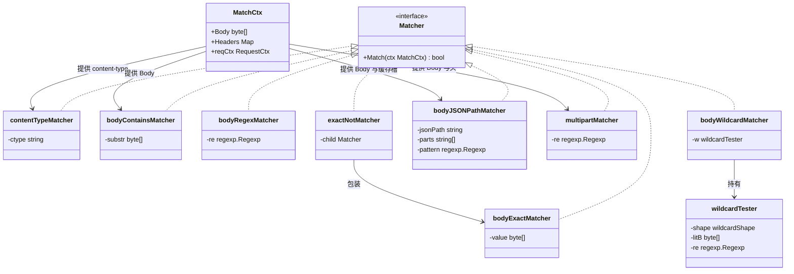
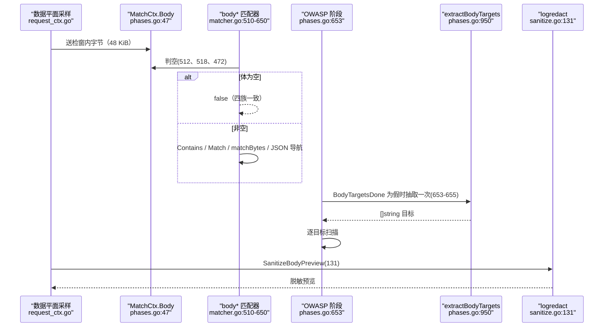
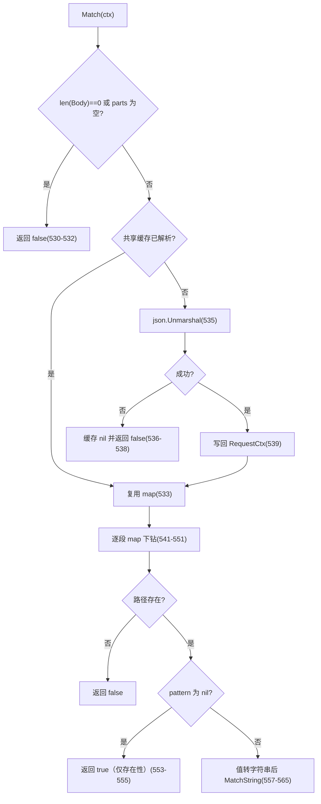
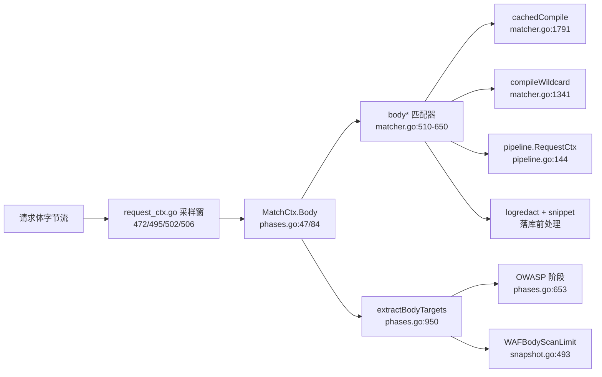
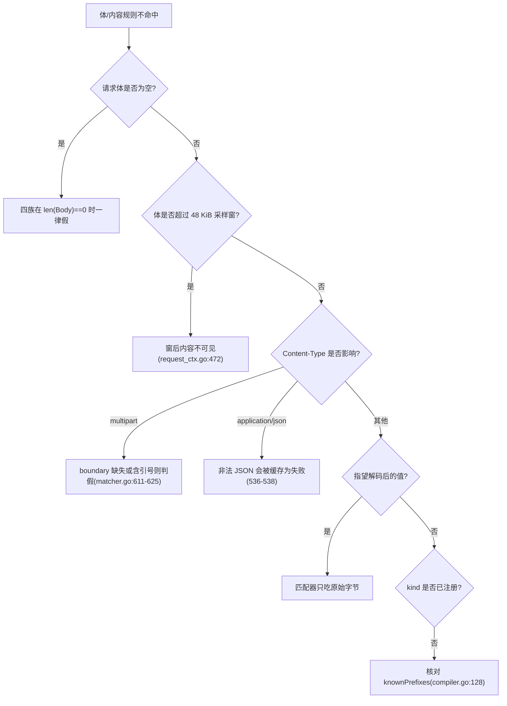

# 内容和主体匹配器

> [返回 WAF 引擎系统](../WAF %E5%BC%95%E6%93%8E%E7%B3%BB%E7%BB%9F.md)

<cite>
**本文档引用的文件**
- [matcher.go](file://internal/core/rules/matcher.go)
- [compiler.go](file://internal/core/rules/compiler.go)
- [validate.go](file://internal/core/rules/validate.go)
- [phases.go](file://internal/core/rules/phases.go)
- [pipeline.go](file://internal/core/pipeline/pipeline.go)
- [snapshot.go](file://internal/snapshot/snapshot.go)
- [request_ctx.go](file://internal/dataplane/request_ctx.go)
- [sanitize.go](file://internal/dataplane/logredact/sanitize.go)
- [snippet.go](file://internal/pkg/snippet/snippet.go)
- [owasp.go](file://internal/waf/owasp/owasp.go)
- [detectors_encoding.go](file://internal/waf/owasp/detectors_encoding.go)
- [rule-pattern-mapper.ts](file://frontend/app/(dashboard)/rules/components/rule-pattern-mapper.ts)
- [rule-form-dialog.tsx](file://frontend/app/(dashboard)/rules/components/rule-form-dialog.tsx)
</cite>

## 目录

1. [简介](#简介)
2. [项目结构](#项目结构)
3. [核心组件](#核心组件)
4. [架构总览](#架构总览)
5. [详细组件分析](#详细组件分析)
6. [依赖关系分析](#依赖关系分析)
7. [性能考虑](#性能考虑)
8. [故障排查指南](#故障排查指南)
9. [结论](#结论)
10. [附录](#附录)

## 简介

本篇覆盖「内容判定」类匹配器：**Content-Type**（`block_content_type`）、**请求体**（`body_contains`、`block_body_contains`、`body_regex`、`block_body_regex`、`body_wildcard`、`body_not_exact`）、**JSON 路径**（`block_body_json_path`）、**multipart 文件名**（`block_multipart`），共 9 个别名 kind、7 个结构体（`matcher.go:469-473`、`481-486`、`510-520`、`522-527`、`599-600`、`1453-1458`）。

三条必须订正的历史错误：

1. **`body_contains` / `body_regex` 不是「占位符匹配器」**。旧版本篇两次声称「实际检查在请求上下文中完成，匹配器本身不负责」。事实是二者直接对 `ctx.Body` 求值：`bytes.Contains`（`matcher.go:512-514`）与 `re.Match(ctx.Body)`（`matcher.go:518-520`），零拷贝、无中间层。
2. **`ctx.Body` 是受检采样窗内的字节，不是完整请求体**。上限取自 `snapshot.WAFBodyScanLimit = 48 * 1024`（`snapshot.go:493`），数据平面据此设定送检窗（`request_ctx.go:472`），压缩请求另设 64 KiB 偷读窗以保证解码器能凑到帧尾（`request_ctx.go:495`、`502`、`506`）。超出采样窗的内容匹配器根本看不到。
3. **请求体「抽取」与「匹配」是两件事**。`extractBodyTargets` 等函数（`phases.go:950-1229`）服务 OWASP 的目标扫描流水线，产出一组字符串目标；主体匹配器只吃 `ctx.Body` 原始字节。旧版本篇把两组参数混为一谈，本篇分别给出实测值。

## 项目结构

```text
internal/core/rules/matcher.go
├── 469-486   bodyExactMatcher、methodMatcher、contentTypeMatcher
├── 510-520   bodyContainsMatcher、bodyRegexMatcher
├── 522-597   bodyJSONPathMatcher + 每请求 JSON 缓存挂载
├── 599-650   multipartMatcher（原始字节按 boundary 切分）
├── 1400-1419 wildcardTester.matchBytes（避免 []byte→string 拷贝）
├── 1453-1458 bodyWildcardMatcher
└── 1619-1755 工厂分支：body_contains / body_regex / body_not_exact /
              block_body_json_path / block_multipart / block_content_type
internal/core/rules/phases.go
├── 950-1030  extractBodyTargets（按 Content-Type 分派 + 嗅探兜底）
├── 1052-1095 extractFormValues
├── 1097-1145 extractJSONValues + walkJSON
└── 1147-1235 multipart 文件名与字段值抽取
```

### 模块清单表

| 模块 | 路径 | 职责 | 核心接口/符号 | 依赖模块 | 被依赖 | 规模(行) | 测试 |
|------|------|------|---------------|----------|--------|:--------:|:----:|
| 内容类型匹配 | `internal/core/rules/matcher.go:481-486` | Content-Type 折叠包含 | `contentTypeMatcher` | `strings` | `buildMatcher` | 1928 | 有 |
| 体字面匹配 | `internal/core/rules/matcher.go:510-520` | 子串与字节正则 | `bodyContainsMatcher`、`bodyRegexMatcher` | `bytes`、`regexp` | `buildMatcher` | 1928 | 有 |
| 体全等取反 | `internal/core/rules/matcher.go:469-473` | 整段 `bytes.Equal` | `bodyExactMatcher` | `bytes` | `exactNotMatcher` | 1928 | 有 |
| 体通配匹配 | `internal/core/rules/matcher.go:1453-1458` | glob 走字节快路径 | `bodyWildcardMatcher`、`wildcardTester` | `bytes`、`regexp` | `buildMatcher` | 1928 | 有 |
| JSON 路径 | `internal/core/rules/matcher.go:522-597` | 点号路径存在性与模式 | `bodyJSONPathMatcher` | `encoding/json`、`pipeline` | `buildMatcher` | 1928 | 有 |
| multipart | `internal/core/rules/matcher.go:599-650` | 原始体扫 `filename=` | `multipartMatcher` | `strings`、`regexp` | `buildMatcher` | 1928 | 有 |
| 体目标抽取 | `internal/core/rules/phases.go:950-1235` | OWASP 扫描目标构造 | `extractBodyTargets`、`walkJSON` | `mime`、`net/url` | OWASP 阶段 | 1391 | 有 |
| 日志脱敏 | `internal/dataplane/logredact/sanitize.go` | 体与查询落库前遮蔽 | `SanitizeBodyPreview` | `mime`、`encoding/json` | 访问日志 | 325 | 有 |
| 片段截取 | `internal/pkg/snippet/snippet.go` | 命中片段截断 | `Around`、`Extract` | `regexp` | 事件详情 | 76 | 有 |

**章节来源**
- [matcher.go:469-520](file://internal/core/rules/matcher.go#L469-L520)
- [matcher.go:522-650](file://internal/core/rules/matcher.go#L522-L650)
- [matcher.go:1400-1458](file://internal/core/rules/matcher.go#L1400-L1458)
- [phases.go:950-1235](file://internal/core/rules/phases.go#L950-L1235)
- [sanitize.go:131-145](file://internal/dataplane/logredact/sanitize.go#L131-L145)
- [snippet.go:8-76](file://internal/pkg/snippet/snippet.go#L8-L76)

## 核心组件

### 代码上下文表

| 符号 | 位置 | 职责 | 上游调用者 | 下游依赖 | 副作用 | 影响面 |
|------|------|------|------------|----------|--------|--------|
| `contentTypeMatcher.Match` | `matcher.go:483-486` | Content-Type 折叠包含 | `Compiled.Match` | `lookupHeaderValueInCtx`、`containsFoldASCII` | 无 | 中 |
| `bodyContainsMatcher.Match` | `matcher.go:512-514` | 字节子串 | 同上 | `bytes.Contains` | 无 | 高 |
| `bodyRegexMatcher.Match` | `matcher.go:518-520` | 字节正则 | 同上 | `regexp.Regexp.Match` | 无 | 高 |
| `bodyJSONPathMatcher.Match` | `matcher.go:529-566` | 路径导航 + 可选模式 | 同上 | `cachedJSONBodyObject`、`json.Unmarshal` | **写请求级 JSON 缓存** | 高 |
| `multipartMatcher.Match` | `matcher.go:602-650` | boundary 切分与文件名正则 | 同上 | `headerValue`、`strings.Split` | 无（`string(ctx.Body)` 有一次拷贝） | 中 |
| `cachedJSONBodyObject` | `matcher.go:574-579` | 每请求一次 JSON 解析 | `bodyJSONPathMatcher` | `pipeline.RequestCtx` | 无 | 中 |
| `extractBodyTargets` | `phases.go:950-1013` | 按类型抽取扫描目标 | OWASP 阶段（`phases.go:653-657`） | 四个抽取函数 | 写 `ctx.BodyTargets` | 高 |
| `walkJSON` | `phases.go:1117-1145` | 递归收集键与值 | `extractJSONValues` | `sort.Strings` | 无 | 中 |

**章节来源**
- [matcher.go:483-586](file://internal/core/rules/matcher.go#L483-L586)
- [matcher.go:602-650](file://internal/core/rules/matcher.go#L602-L650)
- [phases.go:653-657](file://internal/core/rules/phases.go#L653-L657)
- [phases.go:950-1145](file://internal/core/rules/phases.go#L950-L1145)

### 类型体系



七个结构体全部只消费 `MatchCtx.Body` 与 `content-type` 头两个来源（类图内 `[]byte`、`map` 等记号已按渲染兼容规则简化，真值见上表行号）；`multipartMatcher` 额外读头以确认 MIME 类型（`matcher.go:606-607`），`bodyJSONPathMatcher` 额外依赖 `reqCtx` 缓存槽（`matcher.go:574-586`）。

**图表来源**
- [matcher.go:20-23](file://internal/core/rules/matcher.go#L20-L23)
- [matcher.go:311-315](file://internal/core/rules/matcher.go#L311-L315)
- [matcher.go:469-473](file://internal/core/rules/matcher.go#L469-L473)
- [matcher.go:510-527](file://internal/core/rules/matcher.go#L510-L527)
- [matcher.go:574-600](file://internal/core/rules/matcher.go#L574-L600)
- [matcher.go:602-607](file://internal/core/rules/matcher.go#L602-L607)
- [matcher.go:1321-1327](file://internal/core/rules/matcher.go#L1321-L1327)
- [matcher.go:1453-1458](file://internal/core/rules/matcher.go#L1453-L1458)
- [phases.go:33-52](file://internal/core/rules/phases.go#L33-L52)

**章节来源**
- [matcher.go:469-607](file://internal/core/rules/matcher.go#L469-L607)
- [matcher.go:1321-1458](file://internal/core/rules/matcher.go#L1321-L1458)
- [phases.go:33-52](file://internal/core/rules/phases.go#L33-L52)

## 架构总览

| 层 | 输入 | 处理 | 产出 | 位置 |
|----|------|------|------|------|
| 采样 | 请求体字节流 | 未压缩读 48 KiB + 1；压缩读 64 KiB 并解压到 48 KiB | `ctx.Body` | `request_ctx.go:472`、`495`、`502`、`506` |
| 匹配 | `ctx.Body`（`[]byte`） | 子串/正则/glob/JSON 路径/文件名 | 布尔 | `matcher.go:510-650` |
| 抽取 | `ctx.Body` + `ctx.ContentType` | 按类型分派 + 嗅探兜底 | `[]string` 目标 | `phases.go:950-1013` |
| 记录 | 命中片段 | 上下文截取并截断到 256 字节 | 事件详情 | `snippet.go:11`、`32-52` |
| 审计 | 体预览 | 按 MIME 结构化脱敏 | 日志字段 | `sanitize.go:131-145` |



**图表来源**
- [phases.go:47](file://internal/core/rules/phases.go#L47)
- [phases.go:512-650](file://internal/core/rules/matcher.go#L512-L650)
- [phases.go:653-655](file://internal/core/rules/phases.go#L653-L655)
- [phases.go:950](file://internal/core/rules/phases.go#L950)
- [request_ctx.go:472-506](file://internal/dataplane/request_ctx.go#L472-L506)
- [sanitize.go:131-145](file://internal/dataplane/logredact/sanitize.go#L131-L145)

## 详细组件分析

### 匹配字段与操作符总览

| 匹配字段 | 取值来源:行 | 操作符集合 | 短路行为 | 典型用例 |
|------|------|------|------|------|
| `content-type` 头 | `matcher.go:484`（经 `lookupHeaderValueInCtx`） | `contains`（折叠） | 头缺失判假 | `block_content_type:multipart/form-data` |
| `ctx.Body` | `phases.go:47`（声明）、`phases.go:84`（填充） | `contains`、`regex`、`wildcard`、整段 `ne` | **体长度为 0 直接返回假** | `body_regex:(?i)<script` |
| `ctx.Body` 的 JSON 对象 | 解析入口 `matcher.go:533-540` | 存在性、`regex` | `parts` 为空或体为空判假 | `block_body_json_path:$.user.role:(?i)admin` |
| multipart 各 part 的 `filename` | `matcher.go:606`（头）、`628`（切分） | `regex` | 非 `multipart/form-data` 或无 boundary 判假 | `block_multipart:` 空参用内置表 |

前端 `req_body` 支持 `eq`、`contains`、`regex`、`wildcard`、`ne` 五个 method（`rule-pattern-mapper.ts:400-423`），其中 **`eq` 映射为 `body_contains`**（`rule-pattern-mapper.ts:402`），并非整段全等；要整段全等语义只能反向用 `body_not_exact` 取反或改写成复合条件。`post_param`、`resp_body`、`http_req`、`http_resp` 四个 target 无后端实现，映射器直接拒绝（`rule-pattern-mapper.ts:103-124`）。

**章节来源**
- [matcher.go:484](file://internal/core/rules/matcher.go#L484)
- [matcher.go:512-650](file://internal/core/rules/matcher.go#L512-L650)
- [phases.go:47](file://internal/core/rules/phases.go#L47)
- [phases.go:84](file://internal/core/rules/phases.go#L84)
- [rule-pattern-mapper.ts:103-124](file://frontend/app/(dashboard)/rules/components/rule-pattern-mapper.ts#L103-L124)
- [rule-pattern-mapper.ts:400-423](file://frontend/app/(dashboard)/rules/components/rule-pattern-mapper.ts#L400-L423)

### 主体族类型对照

| kind | 工厂位置 | 结构体:行 | 判定 | 大小写 |
|------|----------|-----------|------|--------|
| `body_contains`、`block_body_contains` | `matcher.go:1619-1620` | `bodyContainsMatcher`:510 | `bytes.Contains(ctx.Body, substr)`（`matcher.go:513`） | 敏感 |
| `body_regex`、`block_body_regex` | `matcher.go:1625-1630` | `bodyRegexMatcher`:516 | `re.Match(ctx.Body)`（`matcher.go:519`） | 由模式 `(?i)` |
| `body_wildcard` | `matcher.go:1680-1685` | `bodyWildcardMatcher`:1454 | `w.matchBytes(ctx.Body)`（`matcher.go:1457`） | 敏感 |
| `body_not_exact` | `matcher.go:1622-1623` | `exactNotMatcher`:311 → `bodyExactMatcher`:469 | `!bytes.Equal`（`matcher.go:472`） | 敏感 |
| `block_body_json_path` | `matcher.go:1733-1744` | `bodyJSONPathMatcher`:522 | 路径导航 + 可选模式（`matcher.go:541-565`） | 由模式 |
| `block_multipart` | `matcher.go:1746-1755` | `multipartMatcher`:600 | 文件名正则（`matcher.go:643`） | 由模式 |
| `block_content_type` | `matcher.go:1552-1553` | `contentTypeMatcher`:481 | `containsFoldASCII`（`matcher.go:485`） | **ASCII 折叠** |

两对别名（`body_contains`/`block_body_contains`、`body_regex`/`block_body_regex`）在 `buildMatcher` 中是同一条 `case`（`matcher.go:1619`、`1625`），行为完全一致，只是历史命名并存，前端与规则库可任写其一（`compiler.go:128` 同时登记）。

`bytes.Equal` 与 `re.Match` 都接受 `[]byte`，因此体族全程没有 `string(ctx.Body)` 转换——只有 `multipartMatcher` 例外，它为了用 `strings.Split` 做了一次整体拷贝（`matcher.go:627`），这是本篇四个族里唯一的分配点。

**章节来源**
- [matcher.go:469-473](file://internal/core/rules/matcher.go#L469-L473)
- [matcher.go:510-527](file://internal/core/rules/matcher.go#L510-L527)
- [matcher.go:1454-1458](file://internal/core/rules/matcher.go#L1454-L1458)
- [matcher.go:1619-1630](file://internal/core/rules/matcher.go#L1619-L1630)
- [matcher.go:1680-1685](file://internal/core/rules/matcher.go#L1680-L1685)
- [matcher.go:1733-1755](file://internal/core/rules/matcher.go#L1733-L1755)
- [compiler.go:128](file://internal/core/rules/compiler.go#L128)

### JSON 路径匹配器

`block_body_json_path` 的 `arg` 是 `name:value` 形态复用 `splitHeaderArg` 拆分（`matcher.go:1735`），前段为 JSON 路径、后段为可选正则。编译期由 `splitJSONPathParts`（`matcher.go:594-597`）去掉可选 `$.` 前缀并按 `.` 切分，**空段原样保留**（注释见 `matcher.go:590-592`），因此 `$.a..b` 会按字面去找空键。



**图表来源**
- [matcher.go:529-566](file://internal/core/rules/matcher.go#L529-L566)
- [matcher.go:574-597](file://internal/core/rules/matcher.go#L574-L597)
- [pipeline.go:144-152](file://internal/core/pipeline/pipeline.go#L144-L152)

三条实测结论：

| 结论 | 依据 |
|------|------|
| 不支持数组下标，`$.items[0]` 会被当成字面键名 | `matcher.go:542-550` 只做 `map[string]any` 断言 |
| 非字符串值先 `json.Marshal` 再匹配，数字 `1` 的命中串是 `"1"`，对象则是完整 JSON | `matcher.go:557-564` |
| 解析失败也被缓存，同请求内后续同类规则不再重试解析 | `matcher.go:536-538` + `pipeline.go:150-152` |

保存期只校验路径非空与可选正则可编译（`validate.go:196-205`），不校验路径是否真的存在——这在运行期也不可校验，因此「路径写错」表现为主观的「规则没命中」。

**章节来源**
- [matcher.go:529-597](file://internal/core/rules/matcher.go#L529-L597)
- [pipeline.go:144-152](file://internal/core/pipeline/pipeline.go#L144-L152)
- [validate.go:196-205](file://internal/core/rules/validate.go#L196-L205)

### multipart 匹配器与 OWASP 上传检测的分工

`multipartMatcher` 走的是**原始字节**路径：先确认 Content-Type 折叠包含 `multipart/form-data`（`matcher.go:607`），小写化后定位 `boundary=` 并剥掉引号与分号尾（`matcher.go:611-625`），再按 `--boundary` 切块，在每块的小写副本里找 `filename=`，取原文片段裁到行尾或引号后交给正则（`matcher.go:628-648`）。空 `arg` 会启用内置扩展名正则（`matcher.go:1748-1750`）：

```text
(?i)\.(php[0-9]?|phtml|jsp|jspx|asp|aspx|exe|dll|sh|bat|cmd|cgi|pl|py|rb|war|ear)$
```

它与 OWASP 的文件上传检测互补但不重叠：

| 能力 | 规则侧 `block_multipart` | OWASP 侧 | 位置 |
|------|:------------------------:|:--------:|------|
| 判定载体 | 用户正则匹配文件名 | 固定规则集（空字节、路径遍历、双扩展名、危险扩展名） | `matcher.go:643`；`owasp.go:673-701` |
| 解析方式 | 手工按 boundary 切分 | `mime/multipart` 解析器 + 原文正则兜底 | `matcher.go:628`；`phases.go:1151`、`owasp.go:667` |
| 数量上限 | 无（遍历全部切块） | 20 段（`phases.go:1157`、`1188`）；原文正则最多 10 个命中（`owasp.go:674`） | 见左 |
| 单段读取上限 | 不读段体 | 4096 字节（`phases.go:1195`、`1203`） | 见左 |
| 递归/JSON 深度 | 不适用 | 10 层，值上限 100（`phases.go:1118`） | 见左 |
| 双扩展名 | 取决于用户正则 | 显式检测（`owasp.go:689-695`） | 见左 |
| 空字节绕过 | 取决于用户正则 | 显式检测（`owasp.go:679-681`） | 见左 |
| 归一化文件名 | 无 | `normalizeUploadFilename` 反复裁掉 ` \t;:`（`detectors_encoding.go:43-56`） | 见左 |

规则侧的强项是「任意正则 + 任意扩展名策略」，OWASP 侧的强项是已知绕过手法与解析器差异兜底（`owasp.go:663-666` 的注释明确指出 `mime/multipart` 会剥离路径或漏掉空格绕过形态）。二者都只看文件名/头部，不读文件内容——`extractMultipartFieldValues` 仅对文件段读开头 4096 字节用于查找内嵌代码（`phases.go:1193-1200`）。

**章节来源**
- [matcher.go:602-650](file://internal/core/rules/matcher.go#L602-L650)
- [matcher.go:1746-1755](file://internal/core/rules/matcher.go#L1746-L1755)
- [phases.go:1147-1235](file://internal/core/rules/phases.go#L1147-L1235)
- [owasp.go:660-701](file://internal/waf/owasp/owasp.go#L660-L701)
- [detectors_encoding.go:43-56](file://internal/waf/owasp/detectors_encoding.go#L43-L56)

### 请求体抽取的实测参数

`extractBodyTargets`（`phases.go:950-1030`）按 Content-Type 分派，并叠加与声明类型无关的嗅探：

| 分支 | 处理 | 参数 | 位置 |
|------|------|------|------|
| `application/x-www-form-urlencoded` | 逐对解码，键与值都作为目标 | 无上限，按 `&` 全切 | `phases.go:961-963`、`1052-1095` |
| `application/json` | 递归收集键与字符串值 | 深度 ≤10、累计值 ≤100 | `phases.go:964-966`、`1117-1145` |
| `multipart/form-data` | 字段值 + 段名 + 原文 `name=` | 20 段 × 4096 字节 | `phases.go:967-969`、`1177-1225` |
| `text/*`、`application/xml`、`soap` | 整段作单一目标 | 前 8192 字节 | `phases.go:970-979` |
| 其他且无 Content-Type | 整段作单一目标 | 48 KiB 采样窗 | `phases.go:978-982` |
| 其他且有 Content-Type | 先算可打印比例 | 首 512 字节，≥90% 可打印才扫 | `phases.go:983-1001` |
| 声明解析无产出 | 兜底再扫整段原始体 | 48 KiB | `phases.go:1008-1013` |
| 声明与内容不符 | 额外尝试 JSON / form 解析 | 同上各自上限 | `phases.go:1018-1026` |

两处顺序性设计值得注意：JSON 递归按**字典序**遍历键（`phases.go:1126-1131`），因为 Go 的 map 迭代顺序随机，而 OWASP 归因取「首个跨阈 target」，顺序会决定安全事件记录的规则 ID；超限剪枝也因此从「随机丢弃」变成「确定丢弃」（注释见 `phases.go:1110-1116`）。抽取结果只写一次，靠 `ctx.BodyTargetsDone` 防止重复解析（`phases.go:653-656`）。

**章节来源**
- [phases.go:653-657](file://internal/core/rules/phases.go#L653-L657)
- [phases.go:950-1013](file://internal/core/rules/phases.go#L950-L1013)
- [phases.go:1052-1095](file://internal/core/rules/phases.go#L1052-L1095)
- [phases.go:1110-1145](file://internal/core/rules/phases.go#L1110-L1145)
- [phases.go:1177-1225](file://internal/core/rules/phases.go#L1177-L1225)

### 采样窗、脱敏与片段截断

| 环节 | 取值 | 位置 |
|------|------|------|
| 送检窗（未压缩） | `WAFBodyScanLimit + 1 = 48 KiB + 1` | `request_ctx.go:502`、`snapshot.go:493` |
| 偷读窗（压缩） | 64 KiB | `request_ctx.go:495` |
| 解压产出上限 | 48 KiB | `request_ctx.go:506` |
| 日志体预览脱敏 | 按 MIME 分派 form / JSON / 纯文本 | `sanitize.go:131-145` |
| 敏感键遮蔽集 | `password`、`token`、`secret`、`api_key`、`csrf`、`ticket`、`env` 等 | `sanitize.go:15`、`190-196` |
| 头部整行遮蔽 | `authorization`、`proxy-authorization`、`cookie`、`set-cookie` | `sanitize.go:13` |
| 动态密钥端点 | `/__owaf/dynamic/key` 全量遮蔽 | `sanitize.go:34` |
| 截断标记 | `...[truncated]` | `sanitize.go:292-297` |
| 命中片段长度 | 256 字节 | `snippet.go:11` |
| 片段上下文 | 两侧各 48 字节 | `snippet.go:14` |
| 片段目标上限 | `2*16384+1` 字节 | `snippet.go:21` |

`snippet.MaxTargetLen` 与检测层的 `maxTargetLen`（16384）刻意取同一数量级：检测层对超长目标做首尾保留下采样，因此实际搜索过的最长串是 `2*16384+1`，片段层若超过该长度就拒绝再跑用户正则（`snippet.go:33`、`62`）。`sanitizeJSONValue`（`sanitize.go:156-176`）对敏感键整体替换为 `[redacted]`，非敏感字符串仍走 `SanitizeLogText`，因此嵌套 JSON 里的 `token` 值不会漏网。

**章节来源**
- [request_ctx.go:471-507](file://internal/dataplane/request_ctx.go#L471-L507)
- [snapshot.go:493](file://internal/snapshot/snapshot.go#L493)
- [sanitize.go:13-34](file://internal/dataplane/logredact/sanitize.go#L13-L34)
- [sanitize.go:131-176](file://internal/dataplane/logredact/sanitize.go#L131-L176)
- [sanitize.go:190-196](file://internal/dataplane/logredact/sanitize.go#L190-L196)
- [sanitize.go:292-297](file://internal/dataplane/logredact/sanitize.go#L292-L297)
- [snippet.go:8-76](file://internal/pkg/snippet/snippet.go#L8-L76)

## 依赖关系分析



**图表来源**
- [matcher.go:510-650](file://internal/core/rules/matcher.go#L510-L650)
- [phases.go:653-950](file://internal/core/rules/phases.go#L653-L950)
- [request_ctx.go:471-507](file://internal/dataplane/request_ctx.go#L471-L507)
- [snapshot.go:493](file://internal/snapshot/snapshot.go#L493)
- [pipeline.go:144-152](file://internal/core/pipeline/pipeline.go#L144-L152)

体族对包外的依赖有三处：`snapshot.WAFBodyScanLimit`（决定看到多少体）、`pipeline.RequestCtx`（JSON 缓存槽）、`internal/tlsmeta`（不涉及，属指纹族）。OWASP 侧的文件上传规则与 `block_multipart` 互不引用，只共享「文件名可疑」这一业务语义，因此停用任一不影响另一条路径。

**章节来源**
- [snapshot.go:493](file://internal/snapshot/snapshot.go#L493)
- [pipeline.go:144-152](file://internal/core/pipeline/pipeline.go#L144-L152)
- [matcher.go:602-650](file://internal/core/rules/matcher.go#L602-L650)

## 性能考虑

| 关注点 | 现状 | 依据 | 建议 |
|--------|------|------|------|
| 体族零拷贝 | `bytes`/`re.Match([]byte)`，无字符串化 | `matcher.go:512-520`、`1401-1419` | 保持 `body_*` 而非头部转发方案 |
| multipart 拷贝 | 整段 `string(ctx.Body)` 一次 | `matcher.go:627` | 体大时改用 OWASP 兜底或收窄条件 |
| 通配字节快路径 | `matchBytes` 走 `bytes.Contains` 等 | `matcher.go:1401-1419` | `*payload*` 优于等价正则 |
| JSON 解析复用 | 每请求一次，失败也缓存 | `matcher.go:533-540` | 多条 `block_body_json_path` 放同阶段 |
| 体抽取复用 | `BodyTargetsDone` 闸门 | `phases.go:653-656` | 勿在自研代码中重复调用抽取 |
| 递归剪枝 | 深度 10 / 值 100 | `phases.go:1118` | 深层嵌套载荷需拆目标提交 |
| 段数与段长 | 20 段 × 4096 字节 | `phases.go:1157`、`1188`、`1195` | 大文件上传不指望尾部内容命中 |
| 采样窗 | 48 KiB | `snapshot.go:493` | 超长体只保证前缀 |
| 正则缓存 | 无淘汰 | `matcher.go:1785-1808` | 控制体正则模式总数 |

**章节来源**
- [matcher.go:512-520](file://internal/core/rules/matcher.go#L512-L520)
- [matcher.go:627](file://internal/core/rules/matcher.go#L627)
- [matcher.go:1401-1419](file://internal/core/rules/matcher.go#L1401-L1419)
- [matcher.go:1785-1808](file://internal/core/rules/matcher.go#L1785-L1808)
- [phases.go:653-656](file://internal/core/rules/phases.go#L653-L656)
- [phases.go:1118](file://internal/core/rules/phases.go#L1118)
- [phases.go:1157-1203](file://internal/core/rules/phases.go#L1157-L1203)
- [snapshot.go:493](file://internal/snapshot/snapshot.go#L493)

## 故障排查指南



**图表来源**
- [matcher.go:512-520](file://internal/core/rules/matcher.go#L512-L520)
- [matcher.go:536-538](file://internal/core/rules/matcher.go#L536-L538)
- [matcher.go:611-625](file://internal/core/rules/matcher.go#L611-L625)
- [request_ctx.go:472](file://internal/dataplane/request_ctx.go#L472)
- [compiler.go:128](file://internal/core/rules/compiler.go#L128)

**章节来源**
- [matcher.go:512-625](file://internal/core/rules/matcher.go#L512-L625)
- [request_ctx.go:472](file://internal/dataplane/request_ctx.go#L472)

### 常见问题与定位

| 症状 | 原因 | 排查 | 方案 |
|------|------|------|------|
| 大文件上传里的恶意内容没抓到 | 采样窗与段上限叠加 | `snapshot.go:493`、`phases.go:1195` | 改判文件名或扩展名策略 |
| `body_not_exact` 几乎恒真 | 整段 `bytes.Equal` 要求全等 | `matcher.go:472` | 用 `body_contains` 的正向判定 |
| `block_body_json_path:$.a` 不命中 | 请求体非 `application/json` 也能命中，但必须可解析 | `matcher.go:533-540` | 先确认体确为合法 JSON |
| 数组字段永远不命中 | 不支持下标语法 | `matcher.go:542-550` | 改 `body_regex` 或 `body_wildcard` |
| `block_multipart:` 空参不生效 | 未启用内置正则（空参会启用） | `matcher.go:1748-1750` | 空参即可，或显式写正则 |
| multipart 变体被绕过 | 手工切分不识别复杂 boundary | `matcher.go:618-622` | 叠加 OWASP 原文兜底（`owasp.go:667`） |
| `block_content_type` 命中带参数的头 | 折叠包含，本就允许 `;boundary=` | `matcher.go:485` | 需要精确时用 `block_header_exact` |
| 日志里看到凭据片段 | 未走 `SanitizeBodyPreview` 的自定义导出 | `sanitize.go:131` | 统一经数据平面脱敏路径 |

**章节来源**
- [matcher.go:472](file://internal/core/rules/matcher.go#L472)
- [matcher.go:533-550](file://internal/core/rules/matcher.go#L533-L550)
- [matcher.go:618-622](file://internal/core/rules/matcher.go#L618-L622)
- [matcher.go:1748-1750](file://internal/core/rules/matcher.go#L1748-L1750)
- [owasp.go:663-674](file://internal/waf/owasp/owasp.go#L663-L674)
- [phases.go:1195](file://internal/core/rules/phases.go#L1195)
- [sanitize.go:131-145](file://internal/dataplane/logredact/sanitize.go#L131-L145)
- [snapshot.go:493](file://internal/snapshot/snapshot.go#L493)

## 结论

内容族七个结构体都只读 `ctx.Body` 或 `content-type` 头，无状态、无派生计算，但它们的判定边界由三个外部参数决定：48 KiB 采样窗（`snapshot.go:493`）、`content-type` 是否声明且正确、以及 multipart 的 boundary 形态。本篇原有的「主体匹配器是占位符、实际检查在请求上下文中完成」表述已按代码事实删除——`body_contains`、`body_regex`、`body_wildcard`、`body_not_exact` 都在匹配器内直接对字节求值。

「匹配」与「抽取」的分工值得再强调一次：规则匹配读原始字节，OWASP 目标扫描读 `extractBodyTargets` 的产物（form 全切、JSON 深度 10/值 100、multipart 20 段×4096），两套参数互不影响。审计链路另有第三套参数：脱敏键集合、`...[truncated]` 截断标记、256/48/32769 三段片段限制（`snippet.go:11`、`14`、`21`）。

实践建议：体规则优先做「文件名与扩展名」「明确特征串」这类短判定，不要依赖长体尾部；需要结构化判定时用 `block_body_json_path` 并保证同请求内多条规则共享一次解析。

**章节来源**
- [matcher.go:510-650](file://internal/core/rules/matcher.go#L510-L650)
- [phases.go:950-1235](file://internal/core/rules/phases.go#L950-L1235)
- [snippet.go:11-21](file://internal/pkg/snippet/snippet.go#L11-L21)
- [snapshot.go:493](file://internal/snapshot/snapshot.go#L493)

## 附录

### DSL 示例

```text
block_content_type:application/x-www-form-urlencoded
body_contains:<script>
block_body_contains:union select
body_regex:(?i)(sleep\(|benchmark\()
block_body_regex:(?i)onerror\s*=
body_wildcard:*<?xml*doctype*
body_not_exact:{"ping":true}
block_body_json_path:$.user.role
block_body_json_path:$.user.role:(?i)admin
block_body_json_path:$.data.items
block_multipart:
block_multipart:(?i)\.(php\d?|phtml|jsp|asp|aspx|exe)$
```

`block_body_json_path:$.data.items` 只判存在性（`matcher.go:553-555`），若该项是数组，运行期会走 `map[string]any` 断言失败——只有对象层级可下钻，数组本身作为值存在时仍判存在。最后一条空参 `block_multipart:` 使用内置扩展名正则（`matcher.go:1748-1750`），`validate.go:206-211` 对空 arg 明确放行。

**章节来源**
- [matcher.go:553-555](file://internal/core/rules/matcher.go#L553-L555)
- [matcher.go:1746-1755](file://internal/core/rules/matcher.go#L1746-L1755)
- [validate.go:196-211](file://internal/core/rules/validate.go#L196-L211)

### 校验要求对照

| kind | 必填 | 模式校验 | 位置 |
|------|------|----------|------|
| `block_content_type` | arg 非空 | 无 | `validate.go:133-139` |
| `body_contains`、`block_body_contains` | arg 非空 | 无 | `validate.go:133-139` |
| `body_not_exact` | arg 非空 | 无 | `validate.go:185-188` |
| `body_regex`、`block_body_regex` | arg 非空 | `cachedCompile` 成功 | `validate.go:189-195` |
| `block_body_json_path` | 路径非空 | 可选正则可编译 | `validate.go:196-205` |
| `block_multipart` | 允许空 arg | 非空时必须可编译 | `validate.go:206-211` |
| `body_wildcard` | arg 非空 | `globToRegexSource` + `cachedCompile` | `validate.go:212-223` |

**章节来源**
- [validate.go:133-223](file://internal/core/rules/validate.go#L133-L223)

### 前端可用组合

| target | 可用 method | 被拒 method | 位置 |
|--------|-------------|-------------|------|
| `req_body` | `eq`、`contains`、`regex`、`wildcard`、`ne` | 其余 | `rule-pattern-mapper.ts:400-423` |
| `post_param` | 无 | 全部（后端无对应匹配器） | `rule-pattern-mapper.ts:103-108` |
| `resp_body` | 无 | 全部 | `rule-pattern-mapper.ts:110-113` |
| `http_req`、`http_resp` | 无 | 全部 | `rule-pattern-mapper.ts:115-120` |

UI 共 14 个 target、12 个 method（`rule-form-dialog.tsx:55-86`），其中与内容族直接相关的是 `req_body` 与 `ja4` 之外的 1 个；三个被拒 target 会在表单校验阶段拦截，不会产生「保存成功但永不命中」的规则。

**章节来源**
- [rule-pattern-mapper.ts:100-124](file://frontend/app/(dashboard)/rules/components/rule-pattern-mapper.ts#L100-L124)
- [rule-pattern-mapper.ts:400-423](file://frontend/app/(dashboard)/rules/components/rule-pattern-mapper.ts#L400-L423)
- [rule-form-dialog.tsx:55-86](file://frontend/app/(dashboard)/rules/components/rule-form-dialog.tsx#L55-L86)

### 术语口径

| 术语 | 含义 | 出处 |
|------|------|------|
| 送检窗 | 数据平面交给 WAF 的体字节上限 | `snapshot.go:493`、`request_ctx.go:472` |
| 偷读窗 | 压缩请求为了解帧尾而多读的字节 | `request_ctx.go:495` |
| 目标串 | OWASP 逐条扫描的字符串单元 | `phases.go:950`、`phases.go:1032` |
| 存在性判定 | JSON 路径命中但不比较值 | `matcher.go:553-555` |
| 原文兜底 | 解析器漏检时对原始体再扫一次 | `phases.go:1008-1013`、`owasp.go:667` |

**章节来源**
- [matcher.go:553-555](file://internal/core/rules/matcher.go#L553-L555)
- [matcher.go:602-607](file://internal/core/rules/matcher.go#L602-L607)
- [owasp.go:663-674](file://internal/waf/owasp/owasp.go#L663-L674)
- [phases.go:950-1013](file://internal/core/rules/phases.go#L950-L1013)
- [request_ctx.go:471-507](file://internal/dataplane/request_ctx.go#L471-L507)
- [snippet.go:11-21](file://internal/pkg/snippet/snippet.go#L11-L21)
