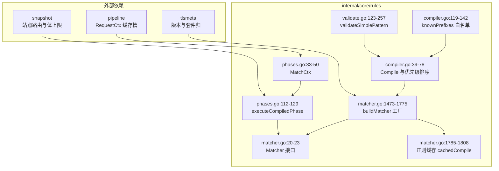
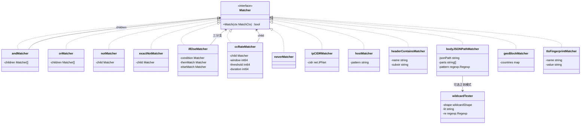
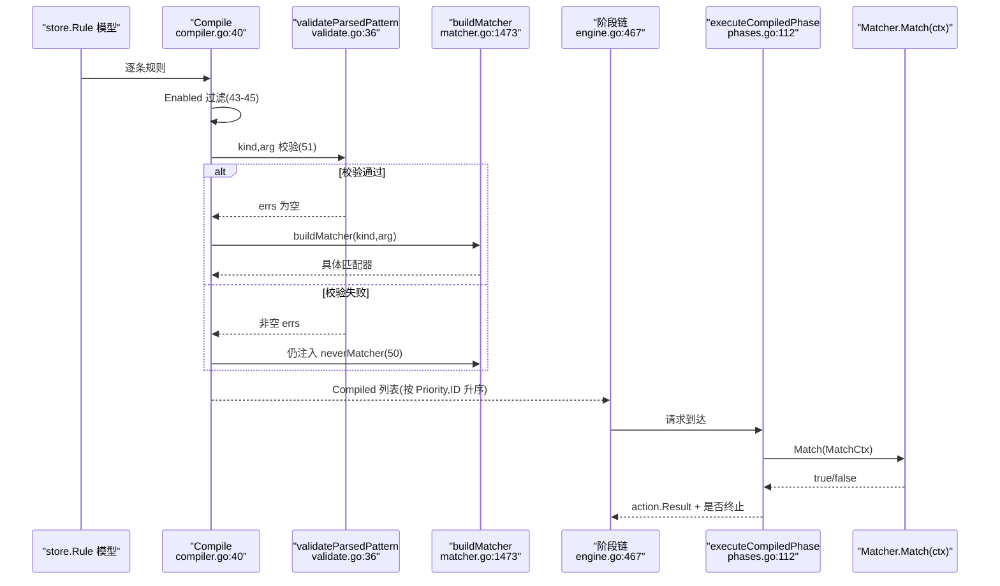
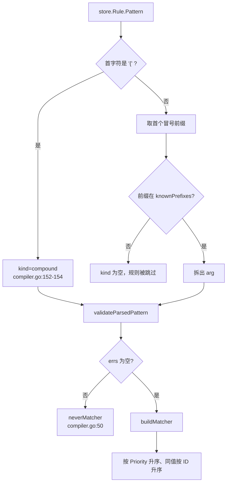
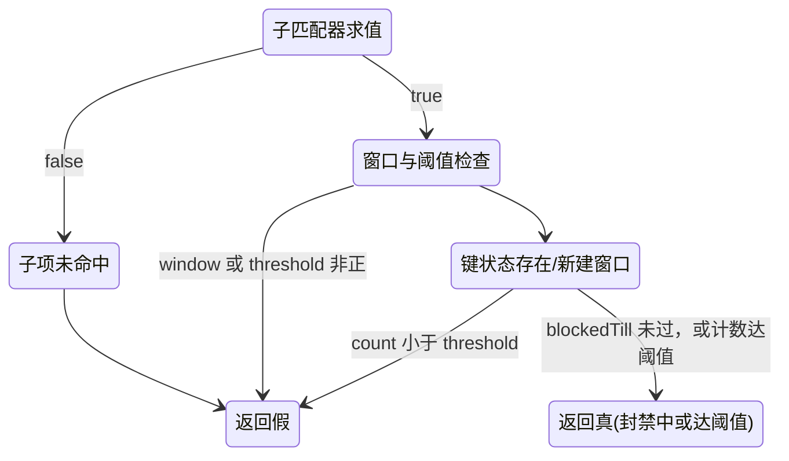
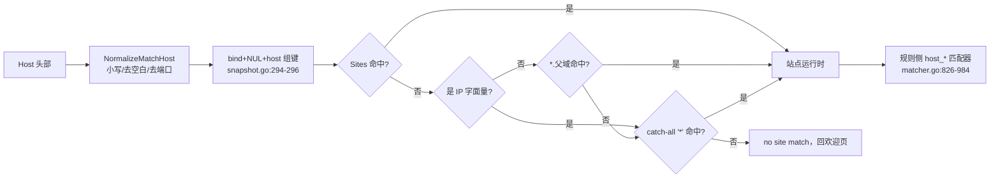
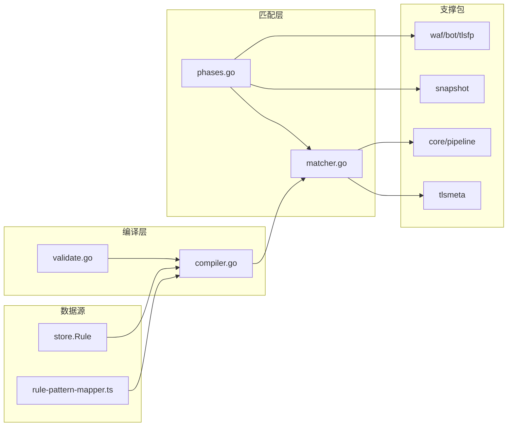
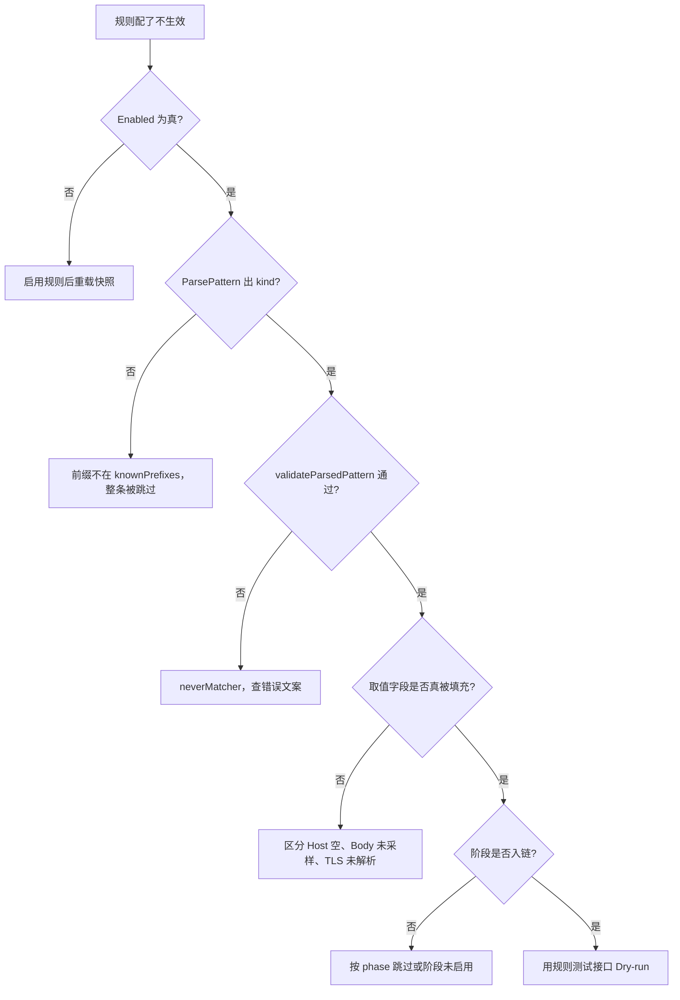

# 内置匹配器

> [返回 WAF 引擎系统](../WAF %E5%BC%95%E6%93%8E%E7%B3%BB%E7%BB%9F.md)

<cite>
**本文档引用的文件**
- [matcher.go](file://internal/core/rules/matcher.go)
- [compiler.go](file://internal/core/rules/compiler.go)
- [validate.go](file://internal/core/rules/validate.go)
- [phases.go](file://internal/core/rules/phases.go)
- [tls_cipher_suites.go](file://internal/core/rules/tls_cipher_suites.go)
- [pipeline.go](file://internal/core/pipeline/pipeline.go)
- [engine.go](file://internal/core/engine/engine.go)
- [snapshot.go](file://internal/snapshot/snapshot.go)
- [rule-pattern-mapper.ts](file://frontend/app/(dashboard)/rules/components/rule-pattern-mapper.ts)
- [rule-form-dialog.tsx](file://frontend/app/(dashboard)/rules/components/rule-form-dialog.tsx)
</cite>

## 目录

1. [简介](#简介)
2. [项目结构](#项目结构)
3. [核心组件](#核心组件)
4. [架构总览](#架构总览)
5. [详细组件分析](#详细组件分析)
6. [依赖关系分析](#依赖关系分析)
7. [性能考虑](#性能考虑)
8. [故障排查指南](#故障排查指南)
9. [结论](#结论)
10. [附录](#附录)

## 简介

本篇是「内置匹配器」目录的总览，回答三个问题：规则引擎到底内置了多少种匹配器、每一种从请求的哪个字段取值、以及它们如何被注册、校验、编译并执行。

全部内置匹配器都实现同一个接口，定义在 `internal/core/rules/matcher.go:20-23`：

```go
// Matcher 对请求字段检验单个条件。
type Matcher interface {
	Match(ctx MatchCtx) bool
}
```

签名只有一个入参 `MatchCtx`，没有历史文档里写的「5 参数（ip、method、path、query、headers）」形式。上下文按值传递，未导出的 `reqCtx` 字段（`phases.go:51`）仅用于把请求体 JSON、查询串解析结果挂到共享 `RequestCtx` 上做每请求一次的一元计算缓存。

按 DSL 口径统计，内置匹配器共 **57 个 kind**（`compiler.go:120-136` 的 `knownPrefixes` 白名单）加 1 个由 JSON 复合条件合成的 `compound` kind，合计 58 种可写表达式；`buildMatcher`（`matcher.go:1473-1775`）用 54 个 `case` 分支覆盖这些 kind（部分分支合并多个同义 kind），落到 **49 个具体匹配器结构体**上。

**重要订正**：全库不存在任何前缀树/字典树（Trie）实现，规则侧的 Host、路径匹配全部是线性字符串比较或 RE2 正则；站点解析走哈希表加至多三级查表（见「站点解析与规则匹配的分工」一节）。旧文档引用的数据平面主机索引文件已随该文件删除而失效，不得再作为链接目标。

## 项目结构

匹配器族集中在 `internal/core/rules` 包内，与快照层、流水线层、引擎层协作：

```text
internal/core/rules/
├── matcher.go              Matcher 接口 + 49 个匹配器 + buildMatcher 工厂 + 正则缓存
├── compiler.go             Compiled 模型、Compile 编译与优先级排序、knownPrefixes、ParsePattern
├── validate.go             ValidatePattern 保存期校验、复合条件递归校验
├── phases.go               MatchCtx、各阶段执行器、请求体目标抽取
└── tls_cipher_suites.go    密码套件令牌归一与头部名常量

internal/core/engine/
└── engine.go               阶段链装配、规则缓存、按站点/策略分桶
internal/core/pipeline/
└── pipeline.go             共享 RequestCtx 与每请求一元计算缓存槽
internal/snapshot/
└── snapshot.go             站点路由键、MatchSite 三级查找、体扫描上限常量
```

### 模块清单表

| 模块 | 路径 | 职责 | 核心接口/符号 | 依赖模块 | 被依赖 | 规模(行) | 测试 |
|------|------|------|---------------|----------|--------|:--------:|:----:|
| 匹配器 | `internal/core/rules/matcher.go` | 单条件判定与 `kind:arg` 工厂 | `Matcher`、`buildMatcher`、`cachedCompile` | `internal/tlsmeta`、`net`、`regexp` | compiler、phases | 1928 | 有 |
| 编译器 | `internal/core/rules/compiler.go` | 规则模型转 `Compiled`、优先级排序、前缀白名单 | `Compile`、`ParsePattern`、`knownPrefixes` | action、store | engine | 170 | 有 |
| 校验器 | `internal/core/rules/validate.go` | 保存期语法与语义校验，编译期复用 | `ValidatePattern`、`validateSimplePattern` | tlsmeta | admin/rule、compiler | 257 | 有 |
| 阶段执行 | `internal/core/rules/phases.go` | 按阶段遍历规则、构造 `MatchCtx`、请求体抽取 | `MatchCtx`、`executeCompiledPhase`、`extractBodyTargets` | snapshot、waf 各子包 | engine | 1391 | 有 |
| 流水线上下文 | `internal/core/pipeline/pipeline.go` | 共享请求态与懒解析缓存槽 | `RequestCtx`、`CachedJSONBodyObject` | - | rules、dataplane | 678 | 部分 |
| 引擎装配 | `internal/core/engine/engine.go` | 阶段链构建与规则/阶段双缓存 | `Engine.Process`、`SetGeoResolver` | rules、snapshot | app | 646 | 有 |
| 站点路由 | `internal/snapshot/snapshot.go` | 「监听 + Host」站点解析（哈希键，无前缀树） | `SiteMapKey`、`MatchSite`、`WAFBodyScanLimit` | - | engine、rules | 3071 | 有 |

**章节来源**
- [matcher.go:1-1928](file://internal/core/rules/matcher.go#L1-L1928)
- [compiler.go:1-170](file://internal/core/rules/compiler.go#L1-L170)
- [validate.go:1-257](file://internal/core/rules/validate.go#L1-L257)
- [phases.go:30-50](file://internal/core/rules/phases.go#L30-L50)
- [pipeline.go:144-165](file://internal/core/pipeline/pipeline.go#L144-L165)
- [engine.go:455-548](file://internal/core/engine/engine.go#L455-L548)
- [snapshot.go:289-296](file://internal/snapshot/snapshot.go#L289-L296)

### 实现载体

匹配算法只有四种载体：`net.IPNet` 包含判断（CIDR）、`strings`/`bytes` 的线性比较（前缀、后缀、子串、全等）、`regexp` RE2（全部 `*_regex` 与通配符回落路径）、`encoding/json`（JSON 路径与复合条件）。大小写不敏感统一走自研 ASCII 折叠（`matcher.go:216-279`），不使用 `strings.EqualFold` 之外的第三套折叠语义。全库没有前缀树、Aho-Corasick 或任何索引结构参与规则匹配——Aho-Corasick 仅用于 OWASP 指示器门，与匹配器无关。



**图表来源**
- [matcher.go:20-23](file://internal/core/rules/matcher.go#L20-L23)
- [matcher.go:1473-1775](file://internal/core/rules/matcher.go#L1473-L1775)
- [matcher.go:1785-1808](file://internal/core/rules/matcher.go#L1785-L1808)
- [compiler.go:39-78](file://internal/core/rules/compiler.go#L39-L78)
- [compiler.go:119-142](file://internal/core/rules/compiler.go#L119-L142)
- [validate.go:123-257](file://internal/core/rules/validate.go#L123-L257)
- [phases.go:33-50](file://internal/core/rules/phases.go#L33-L50)
- [phases.go:112-129](file://internal/core/rules/phases.go#L112-L129)

**章节来源**
- [matcher.go:216-279](file://internal/core/rules/matcher.go#L216-L279)
- [matcher.go:317-345](file://internal/core/rules/matcher.go#L317-L345)
- [matcher.go:529-566](file://internal/core/rules/matcher.go#L529-L566)
- [matcher.go:602-650](file://internal/core/rules/matcher.go#L602-L650)
- [matcher.go:1071-1077](file://internal/core/rules/matcher.go#L1071-L1077)

## 核心组件

| 组件 | 位置 | 职责 | 上游调用者 | 下游依赖 |
|------|------|------|------------|----------|
| `Matcher` 接口 | `matcher.go:20-23` | 单条件判定契约 | `Compiled.Match`（`compiler.go:31-37`） | 49 个实现 |
| `buildMatcher` | `matcher.go:1473-1775` | 由 `kind:arg` 构造匹配器 | `Compile`（`compiler.go:52`）、`buildCompound`（`matcher.go:1922`） | `cachedCompile`、`compileWildcard`、`splitHeaderArg` |
| `cachedCompile` | `matcher.go:1791-1808` | 正则编译缓存 | 全部 `*_regex` 分支、通配器、校验器 | `regexp.Compile` |
| `Compile` | `compiler.go:40-78` | 过滤停用、校验、注入匹配器、排序 | `engine.go` 规则缓存路径 | `validateParsedPattern`、`buildMatcher` |
| `hit` | `phases.go:1312-1338` | 命中后构造 `action.Result` | ACL/签名/自定义阶段 | `runtimeAction`、`ruleIDStr` |

**章节来源**
- [matcher.go:20-23](file://internal/core/rules/matcher.go#L20-L23)
- [matcher.go:1473-1775](file://internal/core/rules/matcher.go#L1473-L1775)
- [matcher.go:1791-1808](file://internal/core/rules/matcher.go#L1791-L1808)
- [compiler.go:40-78](file://internal/core/rules/compiler.go#L40-L78)
- [compiler.go:146-170](file://internal/core/rules/compiler.go#L146-L170)
- [phases.go:1312-1338](file://internal/core/rules/phases.go#L1312-L1338)

### 匹配器族类关系



上图为代表性的 13 个实现，实际共 49 个结构体实现该接口（完整清单见附录「matcher 类型对照表」）。`exactNotMatcher` 与 `notMatcher` 实现体相同但语义分工不同：前者专门服务 UI 的 `ne`，避免「不等于」被降级成「不包含」（注释见 `matcher.go:309-311`）；`andMatcher` 在 `children` 为空时判**假**（`matcher.go:289`）。

**图表来源**
- [matcher.go:20-23](file://internal/core/rules/matcher.go#L20-L23)
- [matcher.go:25-43](file://internal/core/rules/matcher.go#L25-L43)
- [matcher.go:281-315](file://internal/core/rules/matcher.go#L281-L315)
- [matcher.go:317-345](file://internal/core/rules/matcher.go#L317-L345)
- [matcher.go:347-371](file://internal/core/rules/matcher.go#L347-L371)
- [matcher.go:381-388](file://internal/core/rules/matcher.go#L381-L388)
- [matcher.go:488-527](file://internal/core/rules/matcher.go#L488-L527)
- [matcher.go:652-653](file://internal/core/rules/matcher.go#L652-L653)
- [matcher.go:816-817](file://internal/core/rules/matcher.go#L816-L817)
- [matcher.go:1321-1327](file://internal/core/rules/matcher.go#L1321-L1327)

**章节来源**
- [matcher.go:20-43](file://internal/core/rules/matcher.go#L20-L43)
- [matcher.go:281-446](file://internal/core/rules/matcher.go#L281-L446)
- [matcher.go:469-668](file://internal/core/rules/matcher.go#L469-L668)
- [matcher.go:1321-1327](file://internal/core/rules/matcher.go#L1321-L1327)

## 架构总览

匹配器处在「快照 → 编译 → 阶段 → 动作」链路的末端。阶段链实测 **11 阶段**，容量按 11 预分配（`engine.go:467`），顺序为 `ip_reputation`(480) → `anti_replay`(483) → `acl`(487) → `lua_pre`(493) → `owasp_default`(497) → `cve`(500) → `bot_detection`(509) → `browser_sign`(514) → `rate_limit`(519) → `signature`(525) → `custom`(528)。其中只有 `acl`、`signature`、`custom` 三阶段直接遍历 `Compiled` 并调用 `Matcher.Match`；其余阶段各有专属判定入口。逐阶段语义见 [WAF 引擎系统](../WAF %E5%BC%95%E6%93%8E%E7%B3%BB%E7%BB%9F.md) 的处理阶段详解篇，此处只给出匹配器的接入位置。



**图表来源**
- [compiler.go:40-78](file://internal/core/rules/compiler.go#L40-L78)
- [validate.go:36-44](file://internal/core/rules/validate.go#L36-L44)
- [matcher.go:1473-1775](file://internal/core/rules/matcher.go#L1473-L1775)
- [engine.go:467-528](file://internal/core/engine/engine.go#L467-L528)
- [phases.go:112-129](file://internal/core/rules/phases.go#L112-L129)

**章节来源**
- [engine.go:467-528](file://internal/core/engine/engine.go#L467-L528)
- [compiler.go:40-78](file://internal/core/rules/compiler.go#L40-L78)
- [phases.go:112-129](file://internal/core/rules/phases.go#L112-L129)

## 详细组件分析

### 全部内置匹配器一览

下表按族穷举 58 种可写 kind。「注册位置」给 `buildMatcher` 的 `case` 行号与匹配器结构体的实现行号；「取值」给实际读取的 `MatchCtx` 字段或头部名。

#### 网络族

| 名称(kind) | 注册位置:行 | 匹配对象 | 取值 | 依赖包 |
|------|------|------|------|------|
| `allow_ip` | matcher.go:1475 → 317 | `ctx.ClientIP` | CIDR 或单 IP（自动补 /32、/128） | `net` |
| `block_ip` | matcher.go:1475 → 317 | `ctx.ClientIP` | 同上 | `net` |
| `geo_block` | matcher.go:1577 → 655 | `x-geo-country`、`cf-ipcountry` | 逗号分隔 ISO 3166-1 alpha-2 | `strings` |

#### 路径与 URL 族

| 名称(kind) | 注册位置:行 | 匹配对象 | 取值 | 依赖包 |
|------|------|------|------|------|
| `block_path` | matcher.go:1493 → 325 | `ctx.Path` | 路径前缀 | `strings` |
| `block_path_exact` | matcher.go:1537 → 459 | `ctx.Path` | 全等路径 | - |
| `path_not_exact` | matcher.go:1540 → 313 | `ctx.Path` | 全等取反 | - |
| `block_path_regex` | matcher.go:1496 → 331 | `ctx.Path` | 正则 | `regexp` |
| `path_contains` | matcher.go:1651 → 809 | `ctx.Path` | 子串 | `strings` |
| `path_not_contains` | matcher.go:1654 → 813 | `ctx.Path` | 子串取反 | `strings` |
| `path_wildcard` | matcher.go:1657 → 1424 | `ctx.Path` | 通配符（大小写敏感） | `regexp` |
| `full_url_contains` | matcher.go:1701 → 998 | `ctx.Path+"?"+ctx.Query` | 小写子串（`splitHeaderArg` 在 1702 已折叠 arg） | `strings` |
| `full_url_regex` | matcher.go:1704 → 1005 | 同上 | 正则 | `regexp` |
| `full_url_wildcard` | matcher.go:1664 → 1432 | 同上 | 通配符（大小写不敏感） | `regexp` |
| `full_url_not_exact` | matcher.go:1543 → 465 | 同上 | 全等取反 | - |

#### 主机族

| 名称(kind) | 注册位置:行 | 匹配对象 | 取值 | 依赖包 |
|------|------|------|------|------|
| `host` | matcher.go:1711 → 826 | `hostValue(ctx)` 去端口 | 精确或 `*.` 后缀 | `net` |
| `host_not_exact` | matcher.go:1546 → 826 | 同上 | 精确取反 | `net` |
| `host_full` | matcher.go:1698 → 917 | 主机名 + 显式端口 | 端口参与匹配 | `net` |
| `host_regex` | matcher.go:1714 → 955 | 去端口主机名 | 正则 | `regexp` |
| `host_contains` | matcher.go:1721 → 966 | 去端口主机名 | 子串 | `strings` |
| `host_not_contains` | matcher.go:1724 → 977 | 去端口主机名 | 子串取反（空 Host 判真） | `strings` |
| `host_wildcard` | matcher.go:1671 → 1444 | 去端口主机名 | 通配符（模式与值均小写） | `regexp` |

#### 头部族

| 名称(kind) | 注册位置:行 | 匹配对象 | 取值 | 依赖包 |
|------|------|------|------|------|
| `block_header` | matcher.go:1525 → 363 | 指定头部值 | `name:substr` 包含 | `strings` |
| `block_header_exact` | matcher.go:1513 → 351 | 指定头部值 | `name:value` 全等 | - |
| `block_header_not_exact` | matcher.go:1517 → 313 | 指定头部值 | 全等取反 | - |
| `block_header_prefix` | matcher.go:1521 → 358 | 指定头部值 | `name:prefix` | `strings` |
| `block_header_regex` | matcher.go:1529 → 452 | 指定头部值 | `name:pattern` | `regexp` |
| `header_regex` | matcher.go:1611 → 452 | 指定头部值 | 与上同实现，UI 双写法 | `regexp` |
| `header_wildcard` | matcher.go:1687 → 1467 | 指定头部值 | `name:glob` | `regexp` |
| `block_user_agent` | matcher.go:1555 → 363 | `user-agent` 头 | 子串（不折叠大小写） | `strings` |
| `block_user_agent_regex` | matcher.go:1558 → 452 | `user-agent` 头 | 正则 | `regexp` |
| `block_content_type` | matcher.go:1552 → 483 | `content-type` 头 | ASCII 折叠包含 | `strings` |
| `cookie_contains` | matcher.go:1727 → 1011 | `cookie` 头 | 子串（整串扫描） | `strings` |
| `referer_contains` | matcher.go:1730 → 1019 | `referer` 头 | 子串 | `strings` |
| `header_order_contains` | matcher.go:1601 → 375 | `ctx.HeaderOrder` | 子串 | `strings` |
| `header_order_regex` | matcher.go:1604 → 448 | `ctx.HeaderOrder` | 正则 | `regexp` |

#### 查询参数族

| 名称(kind) | 注册位置:行 | 匹配对象 | 取值 | 依赖包 |
|------|------|------|------|------|
| `block_query_contains` | matcher.go:1503 → 337 | `ctx.Query` | 原始查询串子串 | `strings` |
| `block_query_regex` | matcher.go:1506 → 343 | `ctx.Query` | 原始查询串正则 | `regexp` |
| `query_param` | matcher.go:1632 → 718 | `url.Values` 解析结果 | `param:value`，值空只判存在 | `net/url` |
| `query_param_not_exact` | matcher.go:1636 → 741 | 同上 | 值全等取反 | `net/url` |
| `query_param_regex` | matcher.go:1640 → 761 | 同上 | `param:regex`（`strings.Cut`） | `net/url`、`regexp` |

#### 内容与方法族

| 名称(kind) | 注册位置:行 | 匹配对象 | 取值 | 依赖包 |
|------|------|------|------|------|
| `block_method` | matcher.go:1549 → 477 | `ctx.Method` | `EqualFold` 全等 | `strings` |
| `body_contains`、`block_body_contains` | matcher.go:1619 → 512 | `ctx.Body` | 字节子串 | `bytes` |
| `body_regex`、`block_body_regex` | matcher.go:1625 → 519 | `ctx.Body` | 字节正则 | `regexp` |
| `body_wildcard` | matcher.go:1680 → 1456 | `ctx.Body` | 通配符（字节快路径） | `regexp`、`bytes` |
| `body_not_exact` | matcher.go:1622 → 471 | `ctx.Body` | 整字节全等取反 | `bytes` |
| `block_body_json_path` | matcher.go:1733 → 529 | `ctx.Body` 的 JSON | `$.a.b` 或 `$.a.b:regex` | `encoding/json` |
| `block_multipart` | matcher.go:1746 → 602 | multipart 各 part 的 `filename` | 文件名正则，空 arg 用内置扩展名表 | `strings`、`regexp` |

#### TLS 指纹族

| 名称(kind) | 注册位置:行 | 匹配对象 | 取值 | 依赖包 |
|------|------|------|------|------|
| `tls_ja3` | matcher.go:1565 → 390 | `ctx.TLS.JA3` | 逗号分词等值 | `internal/waf/bot/tlsfp` |
| `tls_ja3_hash` | matcher.go:1568 → 390 | `ctx.TLS.JA3Hash` | 缺失时现算 MD5 | `crypto/md5` |
| `tls_ja4` | matcher.go:1571 → 390 | `ctx.TLS.JA4` | 逗号分词等值 | `internal/waf/bot/tlsfp` |
| `tls_version` | matcher.go:1574 → 390 | `ctx.TLS.TLSVersion` | 先经归一化令牌 | `internal/tlsmeta` |
| `tls_sni` | matcher.go:1581 → 390 | `ctx.TLS.SNI` | 逗号分词等值 | `internal/waf/bot/tlsfp` |
| `tls_alpn` | matcher.go:1584 → 390 | `ctx.TLSALPN` | 逗号分词等值 | `internal/core/pipeline` |
| `tls_cipher_suite`、`tls_cipher_suites` | matcher.go:1587 → 418 | `ctx.TLSCipherSuites` | 套件令牌集合命中 | `internal/core/rules/tls_cipher_suites.go:8-18` |

#### 结构与复合族

| 名称(kind) | 注册位置:行 | 匹配对象 | 取值 | 依赖包 |
|------|------|------|------|------|
| `compound` | matcher.go:1769 → 1825 | 整个 `MatchCtx` | JSON 条件树 | `encoding/json` |
| `op:"and"` | matcher.go:1889 → 281 | 子匹配器列表 | 全真才真，空 children 判假 | - |
| `op:"or"` | matcher.go:1892 → 294 | 子匹配器列表 | 有真即真 | - |
| `op:"not"` | matcher.go:1897 → 303 | 唯一子匹配器 | 取反，子项数必须为 1 | - |
| `op:"if"`/`"if_else"`/`"ifelse"` | matcher.go:1898 → 494 | 三分支 | 条件成立走 then，否则 else | - |
| `op:"cc_rate"` | matcher.go:1907 → 47 | 子匹配器 + 计数键 | 窗口内命中数达阈值 | `sync` |
| 兜底 | matcher.go:1772 → 506 | 无 | 未知 kind 与非法正则一律 `neverMatcher` | - |

**章节来源**
- [matcher.go:20-700](file://internal/core/rules/matcher.go#L20-L700)
- [matcher.go:700-1471](file://internal/core/rules/matcher.go#L700-L1471)
- [matcher.go:1473-1928](file://internal/core/rules/matcher.go#L1473-L1928)
- [tls_cipher_suites.go:1-18](file://internal/core/rules/tls_cipher_suites.go#L1-L18)

### kind 注册、校验与编译链路

| 步 | 动作 | 执行位置 | 输入 | 输出 | 失败分支 | 可观测点 |
|:--:|------|----------|------|------|----------|----------|
| 1 | 前缀白名单查表 | `compiler.go:161-168` | `pattern` 串首段 | `kind` | 不在 `knownPrefixes` 则返回空 kind | 规则保存报错文案 |
| 2 | 参数切分 | `compiler.go:157-167` | 首个冒号 | `arg` | `idx<=0` 直接判非法 | `Compiled.Kind/Arg` |
| 3 | 通配形态保留空白 | `compiler.go:164-166` | `*_wildcard` kind | 原样 `arg` | 非通配 kind 走 `TrimSpace` | 规则回放一致性 |
| 4 | 保存期校验 | `validate.go:36-44` | `kind,arg` | `errs` | 非空 `errs` 时注入 `neverMatcher` | `Compile` 第 51 行 |
| 5 | 正则预编译 | `validate.go:147-253` | 正则/通配 arg | 编译产物 | 语法非法即拒 | 429 前置错误提示 |
| 6 | 构造匹配器 | `matcher.go:1473-1775` | `kind,arg` | `Matcher` | 运行期编译失败回落 `neverMatcher` | 规则不生效排查 |
| 7 | 优先级排序 | `compiler.go:71-76` | `Compiled` 列表 | 升序列表 | 无 | 阶段遍历顺序 |
| 8 | 阶段遍历 | `phases.go:112-129` | `MatchCtx` | `action.Result` | 未命中继续下一条 | 安全事件 `Category` |



**图表来源**
- [compiler.go:50-76](file://internal/core/rules/compiler.go#L50-L76)
- [compiler.go:119-170](file://internal/core/rules/compiler.go#L119-L170)
- [validate.go:36-44](file://internal/core/rules/validate.go#L36-L44)
- [matcher.go:1473-1775](file://internal/core/rules/matcher.go#L1473-L1775)

**章节来源**
- [compiler.go:119-170](file://internal/core/rules/compiler.go#L119-L170)
- [validate.go:26-257](file://internal/core/rules/validate.go#L26-L257)
- [matcher.go:1473-1775](file://internal/core/rules/matcher.go#L1473-L1775)

### 匹配上下文取值来源与短路行为

| 匹配字段 | 取值来源:行 | 操作符集合 | 短路行为 | 典型用例 |
|------|------|------|------|------|
| `ctx.ClientIP` | 结构体 `phases.go:34`，填充 `phases.go:74` | `in_cidr`、`not_in_cidr`（后者由 `op:"not"` 包） | IP 为 nil 直接判假 | 放行运维网段 |
| `ctx.Path` | `phases.go:36`，填充 `phases.go:76` | `prefix`、`eq`、`contains`、`regex`、`wildcard`、`ne` | 无短路，纯字符串 | 封 `/admin` 目录 |
| `ctx.Query` | `phases.go:37`，取自 `RawQuery`（`phases.go:77`） | `contains`、`regex`、`param` 三类 | `query_param*` 先做原始串名探测再解析 | 拦 `?debug=1` |
| `ctx.Headers` | `phases.go:38`，填充 `phases.go:78` | 精确、前缀、包含、正则、通配 | 头缺失即 `ok=false`，直接判假 | UA 扫描器拦截 |
| `ctx.Host` | `phases.go:40`，取值回落 `host` 头（`matcher.go:819-824`） | 精确、全等含端口、正则、包含、通配 | 空 Host 多数族判假 | 虚拟主机校验 |
| `ctx.Body` | `phases.go:47`，填充 `phases.go:84` | 包含、正则、通配、JSON 路径、整段不等 | 体为空一律判假 | 请求体特征拦截 |
| `ctx.TLS` | `phases.go:46`（`*tlsfp.TLSClientFingerprint`） | JA3/JA3Hash/JA4/版本/SNI/套件 | 为 nil 时回落同名请求头 | 指纹拦工具 |
| `ctx.HeaderOrder` | `phases.go:43`，回落逻辑 `matcher.go:148-153` | 包含、正则 | 空值回落 `x-owaf-header-order` 头 | 头序异常检测 |
| `ctx.Bind`、`ctx.SiteID` | `phases.go:42`、`phases.go:41` | 仅 `cc_rate` 计数键使用 | 无 | 频次限制分桶 |
| `ctx.reqCtx`（未导出） | `phases.go:51` | 仅 JSON 路径与 `query_param` 族使用 | 为 nil 时不缓存，每次现解析 | 多条同类规则共享一元解析 |

**章节来源**
- [phases.go:33-104](file://internal/core/rules/phases.go#L33-L104)
- [matcher.go:111-153](file://internal/core/rules/matcher.go#L111-L153)
- [matcher.go:819-824](file://internal/core/rules/matcher.go#L819-L824)

### 组合匹配器与频次匹配器

组合语义集中在 `matcher.go:281-315` 与 `1878-1928`。`cc_rate` 是唯一带状态的匹配器：计数键由 `ccRateKey`（`matcher.go:107-109`）复用限流键 `RateLimitKey`（`phases.go:63-70`），因此同一 `bind` 下的 `*` 兜底站点与显式 host 站点不会互相挤占配额；状态表按复合条件指纹（`ccRateStateKey`，`matcher.go:1858-1876`）经 `sync.Map` 全局共享（`matcher.go:45`），每 60 秒清理一次过期项（`matcher.go:67-74`）。



**图表来源**
- [matcher.go:47-91](file://internal/core/rules/matcher.go#L47-L91)
- [matcher.go:281-315](file://internal/core/rules/matcher.go#L281-L315)
- [matcher.go:107-109](file://internal/core/rules/matcher.go#L107-L109)

**章节来源**
- [matcher.go:25-109](file://internal/core/rules/matcher.go#L25-L109)
- [matcher.go:281-315](file://internal/core/rules/matcher.go#L281-L315)
- [matcher.go:1858-1928](file://internal/core/rules/matcher.go#L1858-L1928)

### 通配符匹配器族与形态退化

五个 `*_wildcard` kind 共用 `wildcardTester`（`matcher.go:1321-1327`）。`compileWildcard`（`matcher.go:1341-1377`）在编译期判定形态，只有纯字面量的四类前后缀形态退化为 `strings`/`bytes` 比较，其余才进 RE2：

| 形态 | 常量:行 | 模式样例 | 命中实现 | 大小写 |
|------|------|------|------|------|
| `wcAny` | `matcher.go:1306` | `*` | 恒真 | — |
| `wcExact` | `matcher.go:1307` | `abc` | `==` | 仅大小写敏感时启用 |
| `wcContains` | `matcher.go:1308` | `*abc*` | `strings.Contains` 或折叠版 | 两者皆可 |
| `wcPrefix` | `matcher.go:1309` | `abc*` | `HasPrefix` | 大小写敏感 |
| `wcSuffix` | `matcher.go:1310` | `*abc` | `HasSuffix` | 大小写敏感 |
| `wcRegex` | `matcher.go:1305` | `a?c[0-9]*` | RE2 | 由 `(?i)` 表达 |

关键取舍：`*` 有意匹配 `/` 与换行（注释见 `matcher.go:1054-1070`），与 `path.Match` 的段边界语义不同；未转义星号上限 8 个（`matcher.go:1027`），空模式在保存期即被拒（`validate.go:212-223`）。

**章节来源**
- [matcher.go:1024-1112](file://internal/core/rules/matcher.go#L1024-L1112)
- [matcher.go:1120-1185](file://internal/core/rules/matcher.go#L1120-L1185)
- [matcher.go:1301-1419](file://internal/core/rules/matcher.go#L1301-L1419)
- [validate.go:212-238](file://internal/core/rules/validate.go#L212-L238)

### 站点解析与规则匹配的分工

需要明确区分两套「Host 匹配」，它们不在同一层，且都不使用任何树形索引：

| 维度 | 站点解析 | 规则侧 Host 匹配 |
|------|----------|------------------|
| 目的 | 决定请求属于哪个站点 | 决定规则条件是否成立 |
| 实现 | 哈希键 + 至多三级查表 | 字符串比较 / RE2 |
| 键构造 | `SiteMapKey`（`snapshot.go:289-291`）与 `siteMapKeyNorm`（`snapshot.go:294-296`）为 `bind + "\x00" + host` | 无键，逐条求值 |
| 查找层级 | 精确 → `*.` 单级父域 → catch-all `*`（`snapshot.go:337-362`） | `*.` 由 `hostMatcher` 后缀比较（`matcher.go:832-835`） |
| IP 字面量 | 跳过通配分支（`snapshot.go:347-351`） | `splitHostPortHeader` 保裸 IPv6 末段（`matcher.go:851-853`） |
| 拷贝语义 | `MatchSite` 拷贝、`MatchSitePtr` 零拷贝 | 值传递 `MatchCtx` |

站点路由冲突也不是「先到先得」：`registerSiteKeys` 对不同站点争用同一键直接返回 `duplicate site route`，同站点重复登记才幂等跳过。



**图表来源**
- [snapshot.go:289-296](file://internal/snapshot/snapshot.go#L289-L296)
- [snapshot.go:337-362](file://internal/snapshot/snapshot.go#L337-L362)
- [matcher.go:826-984](file://internal/core/rules/matcher.go#L826-L984)

**章节来源**
- [snapshot.go:289-296](file://internal/snapshot/snapshot.go#L289-L296)
- [snapshot.go:337-362](file://internal/snapshot/snapshot.go#L337-L362)
- [matcher.go:826-984](file://internal/core/rules/matcher.go#L826-L984)

### 失败方向与 neverMatcher 兜底

所有「配置了但无法执行」的情况统一回落到恒假匹配器（`matcher.go:504-508`），方向是**该规则不生效**，而不是拦下全部流量。触发点分两类：

- 编译前拒绝：`Compile` 先建 `neverMatcher`，只有 `validateParsedPattern` 返回空 `errs` 才替换（`compiler.go:50-53`）；复合 JSON 解析失败或递归校验非空同样兜底（`matcher.go:1827-1833`）。
- 构造期回落：`buildMatcher` 内共 12 处显式返回 `neverMatcher`，覆盖 IP/CIDR 解析失败（`matcher.go:1479-1490`）、正则编译失败（如 `matcher.go:1498-1500`）、通配模式非法（`matcher.go:1659-1661`，错误源 `errBadWildcard`，`matcher.go:1025`）、TLS 版本令牌无法归一（`matcher.go:1576-1578`）、密码套件集合为空（`matcher.go:1596-1598`）、`query_param_regex` 缺冒号（`matcher.go:1641-1643`）、以及未注册 kind 的 `default` 分支（`matcher.go:1772-1773`）。

注意没有恒真匹配器：需要「恒不命中」时只能靠 `neverMatcher` 兜底表达，而「恒命中」在内置族里没有对应实现，只能用 `path_wildcard:*` 这类形态退化出 `wcAny`（`matcher.go:1356-1357`）。

**章节来源**
- [matcher.go:504-508](file://internal/core/rules/matcher.go#L504-L508)
- [matcher.go:1025-1025](file://internal/core/rules/matcher.go#L1025-L1025)
- [matcher.go:1356-1357](file://internal/core/rules/matcher.go#L1356-L1357)
- [matcher.go:1473-1835](file://internal/core/rules/matcher.go#L1473-L1835)
- [compiler.go:50-53](file://internal/core/rules/compiler.go#L50-L53)

## 依赖关系分析



**图表来源**
- [compiler.go:1-17](file://internal/core/rules/compiler.go#L1-L17)
- [validate.go:1-9](file://internal/core/rules/validate.go#L1-L9)
- [matcher.go:1-18](file://internal/core/rules/matcher.go#L1-L18)
- [phases.go:1-29](file://internal/core/rules/phases.go#L1-L29)

**章节来源**
- [matcher.go:1-18](file://internal/core/rules/matcher.go#L1-L18)
- [compiler.go:1-17](file://internal/core/rules/compiler.go#L1-L17)
- [phases.go:1-29](file://internal/core/rules/phases.go#L1-L29)

### 依赖方向

包内依赖是单向的：`compiler.go`、`validate.go`、`phases.go` 都依赖 `matcher.go`，而 `matcher.go` 只依赖标准库与 `internal/tlsmeta`、`internal/core/pipeline`（`matcher.go:17`、`matcher.go:574-586`、`matcher.go:790-806`），不反向引用编译层或阶段层，因此匹配器可脱离引擎独立单测。`validate.go` 复用 `cachedCompile` 与 `splitHeaderArg`（`validate.go:151-253`、`matcher.go:1777-1783`），`phases.go` 复用 `matcher.go` 的头部查找函数（`matcher.go:131-146`），`engine.go` 复用 `MatchCtx` 构造（`phases.go:72-104`），均属包内直调而非跨层依赖；包外仅 `internal/core/engine` 与 `internal/admin/rule` 消费本包导出符号。

**章节来源**
- [matcher.go:574-586](file://internal/core/rules/matcher.go#L574-L586)
- [matcher.go:790-806](file://internal/core/rules/matcher.go#L790-L806)
- [matcher.go:1777-1783](file://internal/core/rules/matcher.go#L1777-L1783)
- [validate.go:147-257](file://internal/core/rules/validate.go#L147-L257)
- [phases.go:72-104](file://internal/core/rules/phases.go#L72-L104)

## 性能考虑

| 关注点 | 现状 | 依据 | 处置建议 |
|--------|------|------|----------|
| 正则重复编译 | 进程级 `map` 缓存，读写锁保护 | `matcher.go:1785-1808` | 无容量上限与淘汰；模式数量持续增长需关注常驻内存 |
| 通配匹配 | 四种纯字面量形态退化为字符串比较 | `matcher.go:1341-1377` | 优先写 `*foo*` 而非 `.*foo.*` 正则 |
| 头部查找 | `HeadersLowercase` 为真时 O(1) 表查 | `matcher.go:116-129` | 反之为 `EqualFold` 线性扫描（`matcher.go:140-144`） |
| 查询串解析 | 每请求一次，结果挂共享上下文 | `matcher.go:790-806`、`pipeline.go:156-165` | 多条 `query_param` 规则不重复解析 |
| JSON 体解析 | 每请求至多反序列化一次 | `matcher.go:574-586`、`pipeline.go:144-152` | 解析失败也会被缓存，不再重试 |
| 规则遍历 | 阶段内命中即返回 | `phases.go:119-128` | 高频规则给更小 `Priority` |

**章节来源**
- [matcher.go:116-129](file://internal/core/rules/matcher.go#L116-L129)
- [matcher.go:574-586](file://internal/core/rules/matcher.go#L574-L586)
- [matcher.go:790-806](file://internal/core/rules/matcher.go#L790-L806)
- [matcher.go:1341-1377](file://internal/core/rules/matcher.go#L1341-L1377)
- [matcher.go:1785-1808](file://internal/core/rules/matcher.go#L1785-L1808)
- [phases.go:236-246](file://internal/core/rules/phases.go#L236-L246)
- [pipeline.go:144-165](file://internal/core/pipeline/pipeline.go#L144-L165)
- [snapshot.go:493](file://internal/snapshot/snapshot.go#L493)

## 故障排查指南



**图表来源**
- [compiler.go:43-53](file://internal/core/rules/compiler.go#L43-L53)
- [compiler.go:146-170](file://internal/core/rules/compiler.go#L146-L170)
- [validate.go:36-44](file://internal/core/rules/validate.go#L36-L44)
- [phases.go:236-246](file://internal/core/rules/phases.go#L236-L246)

**章节来源**
- [compiler.go:43-53](file://internal/core/rules/compiler.go#L43-L53)
- [validate.go:36-44](file://internal/core/rules/validate.go#L36-L44)

### 常见问题与定位

| 症状 | 原因 | 排查 | 方案 |
|------|------|------|------|
| 保存时报「必须以合法的匹配器前缀开头」 | `ParsePattern` 未命中白名单 | 核对 `compiler.go:120-136` 清单 | 换用已注册 kind |
| 保存通过但零命中 | 非法正则回落 `neverMatcher` | 查 `validate.go` 对应分支错误文案 | 简化模式或用 `*_wildcard` |
| `query_param` 不命中 | 参数名含冒号被 `splitHeaderArg` 截断 | 看 `matcher.go:1777-1783` | 更换参数名或走 `query_param_regex` |
| 带 `/` 的通配不命中 | 误按 `path.Match` 段边界预期 | 读 `matcher.go:1054-1070` 注释 | 当前实现 `*` 跨 `/`，无需改写 |
| `header_order_*` 恒不命中 | 未派生头序 | 确认规则确实入链并触发 `needsDerivedHeaders` | 与指纹族同规则桶 |
| `block_multipart` 放过异常体 | 原始字节扫描不依赖 `mime` | 看 `matcher.go:626-648` | 叠加 OWASP 上传检测兜底 |

**章节来源**
- [validate.go:123-257](file://internal/core/rules/validate.go#L123-L257)
- [matcher.go:626-648](file://internal/core/rules/matcher.go#L626-L648)
- [matcher.go:1054-1070](file://internal/core/rules/matcher.go#L1054-L1070)
- [matcher.go:1777-1783](file://internal/core/rules/matcher.go#L1777-L1783)

## 结论

内置匹配器的设计核心是「一个接口、一张白名单、一个工厂」：`Matcher` 接口只有一元方法（`matcher.go:20-23`），`knownPrefixes`（`compiler.go:119-142`）是唯一 kind 合法性来源，`buildMatcher`（`matcher.go:1473-1775`）是唯一构造入口。三者对齐让「前端能写的、后端能存的、运行时能跑的」保持同一份口径，任何新增 kind 必须三处同改，否则会被白名单直接拒绝。

失败方向统一为「规则不生效」而非「误拦全量」，这是 `neverMatcher` 存在的理由，也让校验期与运行期对「什么算不可用模式」的判断保持一致。优势在于取值路径集中、正则全局复用、通配器有快路径退化、复合条件支持任意嵌套；局限是正则缓存无淘汰、除 `RequestCtx` 一元缓存外没有跨请求结果复用、且不提供更高级索引结构。

**章节来源**
- [matcher.go:20-23](file://internal/core/rules/matcher.go#L20-L23)
- [matcher.go:504-508](file://internal/core/rules/matcher.go#L504-L508)
- [matcher.go:1473-1775](file://internal/core/rules/matcher.go#L1473-L1775)
- [compiler.go:119-142](file://internal/core/rules/compiler.go#L119-L142)

## 附录

### matcher 类型对照表

| 族 | 结构体数 | 代表类型:行 | 备注 |
|----|:--------:|-------------|------|
| 网络 | 1 | `ipCIDRMatcher`:317、`geoBlockMatcher`:652 | 地理另属独立篇 |
| 路径 | 5 | `pathPrefixMatcher`:323、`pathRegexMatcher`:329、`exactPathMatcher`:457、`pathContainsMatcher`:685、`pathNotContainsMatcher`:687 | 无前缀树 |
| URL | 4 | `fullURLExactMatcher`:463、`fullURLContainsMatcher`:994、`fullURLRegexMatcher`:1001、`fullURLWildcardMatcher`:1428 | 拼接 `Path`+`Query` |
| 主机 | 6 | `hostMatcher`:816、`hostFullMatcher`:914、`hostRegexMatcher`:953、`hostContainsMatcher`:964、`hostNotContainsMatcher`:975、`hostWildcardMatcher`:1440 | 共享 `splitHostPortHeader` |
| 头部 | 6 | `headerExactMatcher`:349、`headerPrefixMatcher`:356、`headerContainsMatcher`:347、`headerRegexMatcher`:368、`headerWildcardMatcher`:1462、`cookieContainsMatcher`:1008 | `referer` 同型 |
| 头序 | 2 | `headerOrderContainsMatcher`:373、`headerOrderRegexMatcher`:379 | 依赖派生头部 |
| 查询 | 5 | `queryContainsMatcher`:335、`queryRegexMatcher`:341、`queryParamMatcher`:670、`queryParamExactMatcher`:675、`queryParamRegexMatcher`:680 | 后三者共享 `cachedQueryValues` |
| 主体 | 6 | `bodyExactMatcher`:469、`bodyContainsMatcher`:510、`bodyRegexMatcher`:516、`bodyJSONPathMatcher`:523、`multipartMatcher`:600、`bodyWildcardMatcher`:1454 | 均为 `[]byte` |
| 协议 | 2 | `methodMatcher`:475、`contentTypeMatcher`:481 | — |
| TLS | 2 | `tlsFingerprintMatcher`:381、`tlsCipherSuitesMatcher`:386 | 由 `tlsfp` 提供指纹 |
| 结构 | 6 | `andMatcher`:281、`orMatcher`:292、`notMatcher`:303、`exactNotMatcher`:311、`ifElseMatcher`:488、`ccRateMatcher`:25 | `ccRateMatcher` 带共享状态 |
| 兜底 | 1 | `neverMatcher`:504 | 无恒真匹配器 |

合计 49 个结构体，与 `rg -c '^type \w+Matcher struct'` 实测一致。

**章节来源**
- [matcher.go:25-1471](file://internal/core/rules/matcher.go#L25-L1471)

### 前端操作符与后端 kind 对照

| UI target | UI method | 后端 kind | 依据 |
|-----------|-----------|-----------|------|
| `src_ip` | `eq`、`in_cidr` | `block_ip`（勾选放行时为 `allow_ip`） | `rule-pattern-mapper.ts:148-156` |
| `src_ip` | `not_in_cidr`、`not_in_geo` | 正向 kind + `op:"not"` 包装 | `rule-pattern-mapper.ts:165-190` |
| `url` | `eq` | `full_url_regex`，值经转义后加 `^...$` 锚 | `rule-pattern-mapper.ts:205-213` |
| `url_path` | `prefix` / `eq` / `regex` | `block_path` / `block_path_exact` / `block_path_regex` | `rule-pattern-mapper.ts:237-253` |
| `req_body` | `eq` | `body_contains`，不是整段全等 | `rule-pattern-mapper.ts:396` |
| `ja4` | `eq`、`contains` | `tls_ja4`（`regex` 被显式拒绝） | `rule-pattern-mapper.ts:441-452` |

UI 提供 14 个 target（`rule-form-dialog.tsx:55-71`）与 12 个 method（`rule-form-dialog.tsx:73-86`），后端只有 57 个 kind，因此多组 target/method 会退化为同一 kind（上表 `req_body` 的 `eq` 即为一例）；`post_param`、`resp_body`、`http_req`、`http_resp` 四个 target 无后端实现，映射器直接返回 `ok:false`（`rule-pattern-mapper.ts:103-124`）。

**章节来源**
- [rule-pattern-mapper.ts:55-460](file://frontend/app/(dashboard)/rules/components/rule-pattern-mapper.ts#L55-L460)
- [rule-form-dialog.tsx:55-86](file://frontend/app/(dashboard)/rules/components/rule-form-dialog.tsx#L55-L86)

### 延伸阅读

分族实现细节见本目录下 [主机和URL匹配器](主机和URL匹配器.md)、[路径匹配器](路径匹配器.md)、[网络匹配器](网络匹配器.md)、[头部和查询参数匹配器](头部和查询参数匹配器.md)、[内容和主体匹配器](内容和主体匹配器.md)、[地理位置阻断匹配器](地理位置阻断匹配器.md)；组合语义与 JSON 结构见 [复合匹配器](../%E8%A7%84%E5%88%99%E5%8C%B9%E9%85%8D%E5%99%A8/%E5%A4%8D%E5%90%88%E5%8C%B9%E9%85%8D%E5%99%A8.md)；阶段层上下文见 [WAF 引擎系统](../WAF %E5%BC%95%E6%93%8E%E7%B3%BB%E7%BB%9F.md)。

[本节为索引性内容，无需特定文件来源]
