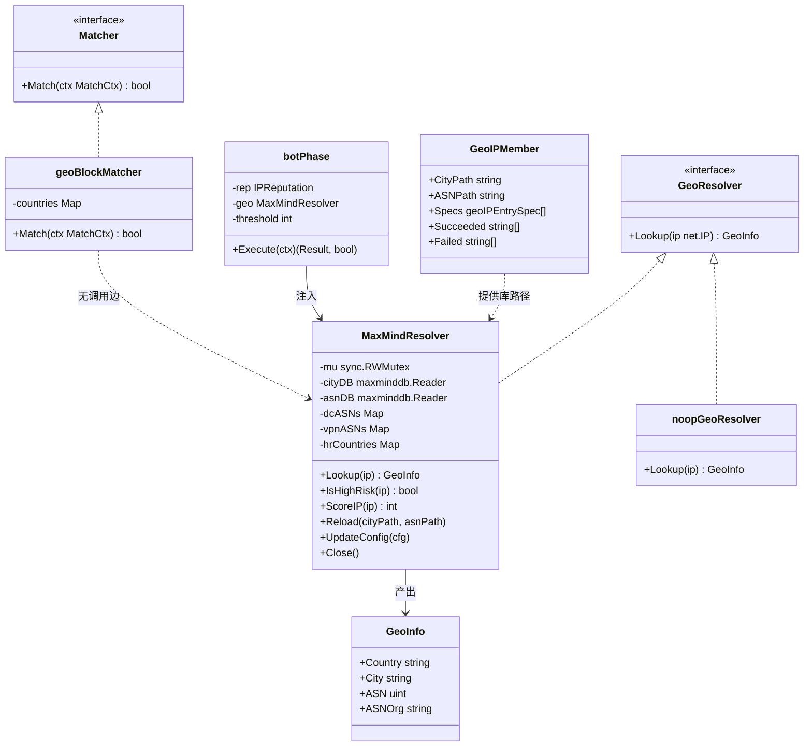
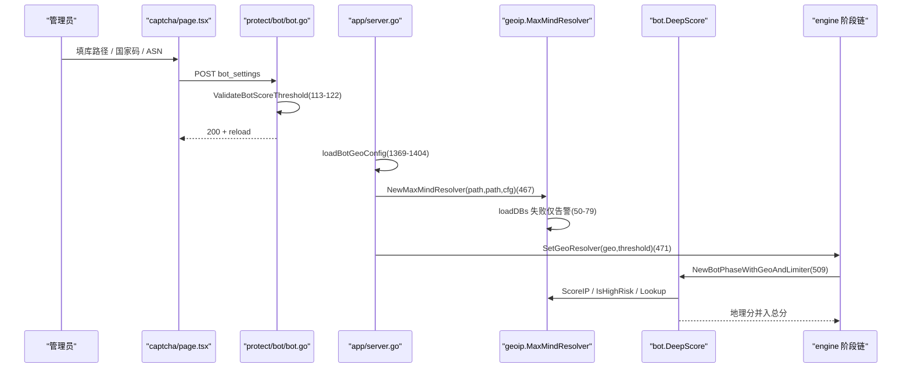
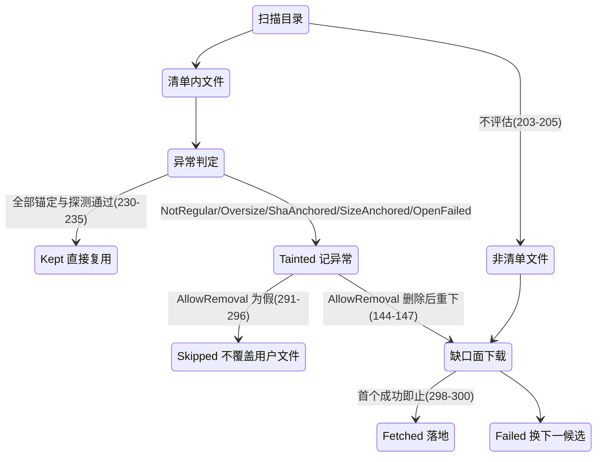
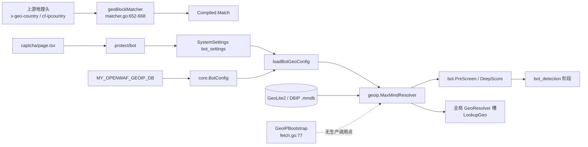
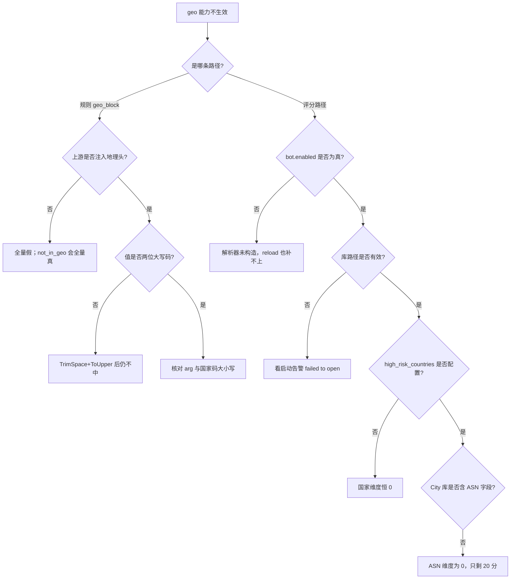

# 地理位置阻断匹配器

> [返回 WAF 引擎系统](../WAF %E5%BC%95%E6%93%8E%E7%B3%BB%E7%BB%9F.md)

<cite>
**本文档引用的文件**
- [matcher.go](file://internal/core/rules/matcher.go)
- [compiler.go](file://internal/core/rules/compiler.go)
- [validate.go](file://internal/core/rules/validate.go)
- [phases.go](file://internal/core/rules/phases.go)
- [geoip.go](file://internal/waf/bot/geoip/geoip.go)
- [fetch.go](file://internal/waf/bot/geoip/fetch.go)
- [bot.go](file://internal/waf/bot/bot.go)
- [config.go](file://internal/core/config.go)
- [registry.go](file://internal/core/configoverride/registry.go)
- [engine.go](file://internal/core/engine/engine.go)
- [server.go](file://internal/app/server.go)
- [bot.go](file://internal/admin/protect/bot/bot.go)
- [helpers.go](file://internal/admin/shared/helpers.go)
- [page.tsx](file://frontend/app/(dashboard)/captcha/page.tsx)
- [types.ts](file://frontend/lib/types.ts)
- [rule-pattern-mapper.ts](file://frontend/app/(dashboard)/rules/components/rule-pattern-mapper.ts)
</cite>

## 目录

1. [简介](#简介)
2. [项目结构](#项目结构)
3. [核心组件](#核心组件)
4. [架构总览](#架构总览)
5. [详细组件分析](#详细组件分析)
6. [依赖关系分析](#依赖关系分析)
7. [性能考虑](#性能考虑)
8. [故障排查指南](#故障排查指南)
9. [结论](#结论)
10. [附录](#附录)

## 简介

本篇讲 `geo_block` 这一个 kind，以及它与 MaxMind 地理能力的**真实关系**：`geo_block` 匹配器**不查询任何地理库**，只读两个由上游注入的请求头；地理库查询属于 `internal/waf/bot/geoip/` 子包，服务对象是 `bot_detection` 阶段的评分，与规则匹配器没有任何调用关系。

这是本篇最重要的一条订正。旧版本篇把两者画在同一张依赖图上（`matcher.go → geoip.go`），暗示「geo_block 命中前先查库」，代码里不存在这条边：`geoBlockMatcher.Match`（`matcher.go:655-668`）只调用 `lookupHeaderValueInCtx`，全库没有任何位置把 `LookupGeo` 的结果写成 `x-geo-country` 头（检索 `x-geo-country` 只得到匹配器与其单测，无生产点）。

三条次要订正：

1. 旧版本篇引用了 `frontend/app/(dashboard)/bot-protection/page.tsx`。该目录已被重命名拆分，Bot 与 GeoIP 配置现在位于 `frontend/app/(dashboard)/captcha/page.tsx`（GeoIP 区在 1590-1755 行附近），指纹页为 `tls-fingerprints`。
2. `MaxMindResolver` 的构造函数在启动时被以**同一份路径调用两次**（city 与 asn 同库，`server.go:467`），不是「两个独立库文件」。
3. 自动下载入口 `GeoIPBootstrap`（`fetch.go:77-88`）目前在生产启动链路上**没有任何调用点**，仅存在于子包与其单测中；实际生效的路径只有「显式路径 + 手工放置文件」。

## 项目结构

地理能力自 `internal/waf/bot` 切分为独立子包（提交 `160abcb`「refactor(waf/bot): 按前缀切分为 geoip/tlsfp 子包，删除两个空文件」），当前布局如下：

```text
internal/core/rules/matcher.go        geoBlockMatcher 652-668，工厂 1757-1767
internal/waf/bot/geoip/
├── geoip.go   211 行：GeoInfo 14-19、MaxMindResolver 21-28、Lookup 101-122、
│              IsHighRisk 123-152、ScoreIP 153-180、全局槽 182-197
└── fetch.go   396 行：候选清单 28-57、GeoIPBootstrap 77-88、分诊 186-238、
               下载 319-382、探测 389-396
internal/waf/bot/tlsfp/               同批切分的 TLS 指纹子包（1199 行，另篇）
internal/waf/bot/bot.go               地理维度进入评分：PreScreen 359-378、DeepScore 723-731、802
internal/core/engine/engine.go        SetGeoResolver 161-167、阶段装配 509
internal/app/server.go                构造 462-473、热重载 665-672、配置合并 1369-1404
```

### 模块清单表

| 模块 | 路径 | 职责 | 核心接口/符号 | 依赖模块 | 被依赖 | 规模(行) | 测试 |
|------|------|------|---------------|----------|--------|:--------:|:----:|
| 地理阻断匹配器 | `internal/core/rules/matcher.go` | 读地理头比对国家码集合 | `geoBlockMatcher` | `strings` | `buildMatcher` | 1928 | 有 |
| GeoIP 解析器 | `internal/waf/bot/geoip/geoip.go` | MaxMind 查询、高危判定、评分 | `MaxMindResolver`、`GeoInfo`、`GeoResolver` | maxminddb、`internal/core` | bot 阶段、引擎 | 211 | 有 |
| GeoIP 资产自举 | `internal/waf/bot/geoip/fetch.go` | 候选清单、分诊、下载与校验 | `GeoIPBootstrap`、`ensureGeoIPAssets` | `net/http`、`crypto/sha256` | （当前无生产调用点） | 396 | 有 |
| bot 评分集成 | `internal/waf/bot/bot.go` | 把地理分并入总分与高危位 | `PreScreen`、`DeepScore` | geoip、iprep | rules 阶段 | 1511 | 有 |
| 阶段接线 | `internal/core/rules/phases.go` | 持有解析器并传入评分 | `botPhase`、`NewBotPhaseWithGeoAndLimiter` | geoip、bot | engine | 1391 | 有 |
| 配置定义 | `internal/core/config.go` | `BotConfig` 六字段与默认名单 | `BotConfig`、`DefaultBotConfig` | - | app、admin | - | 有 |
| 环境变量登记 | `internal/core/configoverride/registry.go` | `geoip_db_path` 键与重启要求 | 条目 371-375 | - | 前端契约脚本 | - | 有 |
| 控制面读写 | `internal/admin/protect/bot/bot.go` | `bot_settings` 存取与校验 | `GetBotSettings`、`UpdateBotSettings` | repository、shared | 前端 | - | 有 |
| 前端配置区 | `frontend/app/(dashboard)/captcha/page.tsx` | 库路径模式、国家码与 ASN 输入 | `GeoIPMode`、表单区 | `lib/types.ts` | - | 1916 | 无 |

**章节来源**
- [matcher.go:652-668](file://internal/core/rules/matcher.go#L652-L668)
- [geoip.go:14-28](file://internal/waf/bot/geoip/geoip.go#L14-L28)
- [fetch.go:28-88](file://internal/waf/bot/geoip/fetch.go#L28-L88)
- [bot.go:359-378](file://internal/waf/bot/bot.go#L359-L378)
- [phases.go:435-478](file://internal/core/rules/phases.go#L435-L478)
- [config.go:13-53](file://internal/core/config.go#L13-L53)
- [registry.go:371-375](file://internal/core/configoverride/registry.go#L371-L375)
- [bot.go:76-130](file://internal/admin/protect/bot/bot.go#L76-L130)
- [page.tsx:1590-1755](file://frontend/app/(dashboard)/captcha/page.tsx#L1590-L1755)

## 核心组件

### 代码上下文表

| 符号 | 位置 | 职责 | 上游调用者 | 下游依赖 | 副作用 | 影响面 |
|------|------|------|------------|----------|--------|--------|
| `geoBlockMatcher.Match` | `matcher.go:655-668` | 两级头部查找 + 集合判定 | `Compiled.Match`（`compiler.go:32`） | `lookupHeaderValueInCtx`（`matcher.go:116-129`） | 无 | 中：只影响 geo 规则 |
| `buildMatcher` geo 分支 | `matcher.go:1757-1767` | CSV 国家码编译为集合 | `Compile`（`compiler.go:52`） | `strings.Split`、`ToUpper` | 无 | 中 |
| `MaxMindResolver.Lookup` | `geoip.go:101-122` | 返回国家/城市/ASN/组织 | `DeepScore` 详情写入（`bot.go:726`）、`LookupGeo` | `maxminddb.Reader.Lookup` | 无 | 高：bot 详情可见性 |
| `MaxMindResolver.IsHighRisk` | `geoip.go:123-152` | ASN 或高危国家任一命中 | `bot.PreScreen`（`bot.go:371`） | `dcASNs`、`vpnASNs`、`hrCountries` | 无 | 高：预筛直接进深度评分 |
| `MaxMindResolver.ScoreIP` | `geoip.go:153-180` | 地理维度原始分（上限 60） | `bot.DeepScore`（`bot.go:724`） | 同上 | 无 | 高：影响总分与高危位 |
| `GeoIPBootstrap` | `fetch.go:77-88` | 显式库缺失时的自举入口 | 无生产调用点 | `ensureGeoIPAssets` | 建目录、写文件 | 潜在：当前不生效 |
| `loadBotGeoConfig` | `server.go:1369-1404` | 把 UI 保存值并入 `BotConfig` | reload 链（`server.go:665`附近） | `SystemSettingsRepo` | 无 | 高：修复「UI 存了但评分用默认值」 |

**章节来源**
- [matcher.go:116-129](file://internal/core/rules/matcher.go#L116-L129)
- [matcher.go:655-668](file://internal/core/rules/matcher.go#L655-L668)
- [matcher.go:1757-1767](file://internal/core/rules/matcher.go#L1757-L1767)
- [geoip.go:101-180](file://internal/waf/bot/geoip/geoip.go#L101-L180)
- [bot.go:359-378](file://internal/waf/bot/bot.go#L359-L378)
- [fetch.go:77-88](file://internal/waf/bot/geoip/fetch.go#L77-L88)
- [server.go:1369-1404](file://internal/app/server.go#L1369-L1404)

### 类型体系



`countries` 实际类型是 `map[string]bool`（`matcher.go:653`），解析器的三个集合实际是 `map[uint]struct{}` 与 `map[string]struct{}`，类图记号已按渲染兼容规则简化。`geoBlockMatcher` 与 `MaxMindResolver` 之间的虚线是刻意的：**没有**调用边。全局 `GeoResolver` 槽默认装的是 `noopGeoResolver`（`geoip.go:183-189`），只有 `bot.enabled` 为真时 `server.go:473` 才把真实解析器换上去；`MaxMindResolver` 的方法名与旧版类图一致，但字段类型是 `map[uint]struct{}` 与 `map[string]struct{}` 而非 `map~uint~`，且 `Reload`/`UpdateConfig` 都要求调用方自行判断是否已有实例。

**图表来源**
- [geoip.go:14-28](file://internal/waf/bot/geoip/geoip.go#L14-L28)
- [geoip.go:81-100](file://internal/waf/bot/geoip/geoip.go#L81-L100)
- [geoip.go:101-182](file://internal/waf/bot/geoip/geoip.go#L101-L182)
- [geoip.go:183-197](file://internal/waf/bot/geoip/geoip.go#L183-L197)
- [fetch.go:61-67](file://internal/waf/bot/geoip/fetch.go#L61-L67)
- [matcher.go:20-23](file://internal/core/rules/matcher.go#L20-L23)
- [matcher.go:652-653](file://internal/core/rules/matcher.go#L652-L653)
- [phases.go:435-441](file://internal/core/rules/phases.go#L435-L441)
- [server.go:466-473](file://internal/app/server.go#L466-L473)

**章节来源**
- [fetch.go:61-67](file://internal/waf/bot/geoip/fetch.go#L61-L67)
- [geoip.go:14-28](file://internal/waf/bot/geoip/geoip.go#L14-L28)
- [geoip.go:101-197](file://internal/waf/bot/geoip/geoip.go#L101-L197)
- [matcher.go:652-653](file://internal/core/rules/matcher.go#L652-L653)
- [phases.go:435-441](file://internal/core/rules/phases.go#L435-L441)
- [server.go:466-473](file://internal/app/server.go#L466-L473)

## 架构总览

两条彼此独立的数据路径共同构成「地理位置」能力：

| 路径 | 触发者 | 判定输入 | 处置出口 | 位置 |
|------|--------|----------|----------|------|
| 规则路径 | `acl`/`signature`/`custom` 阶段遍历 | `x-geo-country`、`cf-ipcountry` 头 | 规则配置的 `action` | `phases.go:148-192` |
| 评分路径 | `bot_detection` 阶段 | `net.IP` → MaxMind → ASN/国家 | bot 总分与阈值 | `phases.go:509`、`bot.go:723-731` |



**图表来源**
- [bot.go:113-130](file://internal/admin/protect/bot/bot.go#L113-L130)
- [server.go:462-473](file://internal/app/server.go#L462-L473)
- [server.go:1369-1404](file://internal/app/server.go#L1369-L1404)
- [geoip.go:44-79](file://internal/waf/bot/geoip/geoip.go#L44-L79)
- [engine.go:161-167](file://internal/core/engine/engine.go#L161-L167)
- [engine.go:509](file://internal/core/engine/engine.go#L509)
- [bot.go:723-731](file://internal/waf/bot/bot.go#L723-L731)

**章节来源**
- [engine.go:509](file://internal/core/engine/engine.go#L509)
- [phases.go:148-192](file://internal/core/rules/phases.go#L148-L192)
- [phases.go:509](file://internal/core/rules/phases.go#L509)
- [server.go:462-473](file://internal/app/server.go#L462-L473)

## 详细组件分析

### 匹配字段与操作符总览

| 匹配字段 | 取值来源:行 | 操作符集合 | 短路行为 | 典型用例 |
|------|------|------|------|------|
| `x-geo-country` 头 | `matcher.go:656-661` | `in_geo`、`not_in_geo`（后者 `wrapNot`） | 命中该头即定胜负：在集合内返回真，不在则**立即返回假**，不再看第二个头 | 上游 CDN 已注入国家码 |
| `cf-ipcountry` 头 | `matcher.go:662-667` | 同上 | 仅在 `x-geo-country` **不存在**时被读 | Cloudflare 前置 |
| `arg` 国家码集合 | 编译 `matcher.go:1758-1766` | CSV，去空白转大写 | 集合为空时永不命中（无 `neverMatcher`，只是查不到） | `geo_block:CN,RU,KP` |

两级查找的语义要精确表述：`x-geo-country` 存在时，其值决定结果；不存在时才回落到 `cf-ipcountry`（`matcher.go:656-667`）。这与单测断言一致：`x-geo-country:JP` 且 `cf-ipcountry:US` 判假，`x-geo-country:JP` 且 `cf-ipcountry:CN` 也判假——第一个头一旦存在就形成终局（`matcher_uncovered_test.go:353-358` 的两个用例）。

**章节来源**
- [matcher.go:655-668](file://internal/core/rules/matcher.go#L655-L668)
- [matcher.go:1757-1767](file://internal/core/rules/matcher.go#L1757-L1767)
- [rule-pattern-mapper.ts:174-190](file://frontend/app/(dashboard)/rules/components/rule-pattern-mapper.ts#L174-L190)

### 国家码归一与集合构造

编译期（`matcher.go:1757-1766`）：`strings.Split(arg, ",")` → 逐项 `TrimSpace` + `ToUpper` → 跳过空串 → 建 `map[string]bool`。运行期（`matcher.go:657`、`666`）对头值同样 `TrimSpace` + `ToUpper` 后查表。因此：

| 输入形态 | 结果 | 依据 |
|----------|------|------|
| `geo_block:cn, ru ,KP` | 集合含 `CN/RU/KP` | `matcher.go:1761-1765` |
| `geo_block:CN,,RU` | 空段被跳过，集合含 `CN/RU` | `matcher.go:1763` |
| `geo_block:`（空 arg） | 集合为空，恒不命中 | `validate.go:136-139` 已在保存期拒绝 |
| 头值 `" cn "` | 命中 `CN` | `matcher.go:657`、`666` |
| 头值 `TW` 之类非两位码 | 按字面查表，通常不命中 | 无格式校验（见下） |

保存期只要求 `geo_block` 的 arg 非空（`validate.go:133-139` 的共用分支），**不校验 ISO 3166-1 alpha-2 格式**。格式约束只存在于前端：`isValidGeoToken` 要求单 token 恰为两个字母（`rule-pattern-mapper.ts:478-481`），且 `in_geo`/`not_in_geo` 会先做这层校验再产出 kind（`rule-pattern-mapper.ts:174-190`）。绕过 UI 直写数据库时，`geo_block:china` 会被接受并永不命中——这是一处真实的口径缺口。

**章节来源**
- [matcher.go:655-668](file://internal/core/rules/matcher.go#L655-L668)
- [matcher.go:1757-1767](file://internal/core/rules/matcher.go#L1757-L1767)
- [validate.go:133-139](file://internal/core/rules/validate.go#L133-L139)
- [rule-pattern-mapper.ts:174-190](file://frontend/app/(dashboard)/rules/components/rule-pattern-mapper.ts#L174-L190)
- [rule-pattern-mapper.ts:478-481](file://frontend/app/(dashboard)/rules/components/rule-pattern-mapper.ts#L478-L481)

### 与其他匹配器的组合方式

`geo_block` 常与三类条件组合，组合都走 `compound` JSON 而非新 kind：

| 组合意图 | 复合结构 | 依据 |
|----------|----------|------|
| 某国家访问特定目录 | `{"op":"and","children":[{"kind":"geo_block","arg":"RU"},{"kind":"block_path","arg":"/admin"}]}` | `matcher.go:1878-1892` |
| 「不是这些国家」才拦 | `{"op":"not","children":[{"kind":"geo_block","arg":"CN,US"}]}` | `matcher.go:1893-1897`；前端 `wrapNot` `rule-pattern-mapper.ts:186-189` |
| 国家 + 指纹 | `geo_block` 与 `tls_ja4` 同 and 子树 | `matcher.go:1565-1572` |
| 国家 + 频次限制 | `{"op":"cc_rate",...,"children":[{"op":"and","children":[…]}]}` | `matcher.go:1907-1919` |

`not` 包装对 `geo_block` 有一个隐含风险：当两个地理头都不存在时 `Match` 返回假，取反后变成真——即「无地理信息」会被判为「不在该国家集合内」而命中。用 `not_in_geo` 表达黑名单语义时，务必再加一条 `header` 存在性条件或用 `block_header_not_exact` 兜住缺头场景，否则上游一旦不回源注入国家码，规则就会全量命中。

**章节来源**
- [matcher.go:1565-1572](file://internal/core/rules/matcher.go#L1565-L1572)
- [matcher.go:1878-1919](file://internal/core/rules/matcher.go#L1878-L1919)
- [rule-pattern-mapper.ts:186-189](file://frontend/app/(dashboard)/rules/components/rule-pattern-mapper.ts#L186-L189)

### ASN 匹配与地理评分构成

评分侧的地理维度完全不看请求头，直接用 `ctx.ClientIP` 查库，权重固定（`geoip.go:153-180`）：

| 命中项 | 加分 | 集合来源 | 位置 |
|--------|:----:|----------|------|
| 数据中心 ASN | 25 | `BotConfig.DataCenterASNs` | `geoip.go:163-165` |
| VPN/代理 ASN | 15 | `BotConfig.VPNProxyASNs` | `geoip.go:166-168` |
| 高风险国家 | 20 | `BotConfig.HighRiskCountries` | `geoip.go:171-177` |
| 三者合计上限 | 60 | 同一 ASN 可同时命中机房与 VPN | `geoip.go:163-169` |

高危判定 `IsHighRisk`（`geoip.go:123-152`）与评分共享集合但逻辑更严：ASN 命中机房或 VPN 任一即为真，国家码命中高危列表也为真；两库皆未加载时直接返回假（`geoip.go:129-131`）。`PreScreen` 把 `IsHighRisk` 作为进入深度评分的三道门之一（`bot.go:369-373`），因此高危国家会**跳过轻量预筛**直接承担完整评分成本。

高危位另有独立触发：`bs.IsHighRisk = bs.Total >= 80 || raw.GeoIP >= 40 || raw.IPRep >= 25`（`bot.go:802`），即地理分单独达到 40（机房 ASN + 高风险国家 = 45，或机房 + VPN = 40）即可在总分不足 80 时仍标记高危。默认名单里 AWS/GCP/Azure/DigitalOcean/Vultr/Linode/OVH/Hetzner 等 14 个 ASN 与 8 个 VPN ASN 就来自这里（`config.go:31-53`）。

**章节来源**
- [config.go:23-53](file://internal/core/config.go#L23-L53)
- [geoip.go:123-180](file://internal/waf/bot/geoip/geoip.go#L123-L180)
- [bot.go:369-373](file://internal/waf/bot/bot.go#L369-L373)
- [bot.go:723-731](file://internal/waf/bot/bot.go#L723-L731)
- [bot.go:802](file://internal/waf/bot/bot.go#L802)

### GeoIP 库来源与自举清单

`fetch.go` 内置四条候选（`fetch.go:28-57`），按「城市面」与「ASN 面」两个功能槽挑用：

| 文件名 | 面 | 校验锚定 | 尺寸锚定 | 挑槽规则 |
|--------|----|----------|:--------:|----------|
| `GeoLite2-City.mmdb` | city | 无（`Sha256:""`、`Size:-1`） | 无 | 城市面首个可用 |
| `GeoLite2-Country.mmdb` | country | sha256 锚定 | 8 514 483 | 城市面（country 也算城市面） |
| `dbip-asn-lite.mmdb` | asn | sha256 锚定 | 6 772 963 | ASN 面 |
| `dbip-country-lite.mmdb` | country | sha256 锚定 | 3 563 355 | 城市面备选 |

`chooseKeptGeoIPAssets`（`fetch.go:256-277`）按清单顺序填槽：`Kind` 为 `city` 或 `country` 都归入城市面，`asn` 归入 ASN 面，任一面可用即返回对应路径。下载路径 `tryFetchGeoIP`（`fetch.go:319-382`）是严格的先校验后落地：临时文件 `.名称.tmp` → 20 秒超时 → `LimitReader(MaxBytes+1)` → 尺寸锚定 → sha256 逐字节比对 → `maxminddb.Open` 探测 → `os.Rename` 原子改名。单文件上限 16 MiB（`fetch.go:98`），超过即判源异常。

**章节来源**
- [fetch.go:28-57](file://internal/waf/bot/geoip/fetch.go#L28-L57)
- [fetch.go:90-98](file://internal/waf/bot/geoip/fetch.go#L90-L98)
- [fetch.go:256-277](file://internal/waf/bot/geoip/fetch.go#L256-L277)
- [fetch.go:319-382](file://internal/waf/bot/geoip/fetch.go#L319-L382)

### 分诊与处置状态

`triageExistingGeoIPAssets`（`fetch.go:186-238`）只处理**清单内**的文件名，目录里用户手工放置的其它 `.mmdb` 一律「不评估不替换」（`fetch.go:203-205`）。五档处置状态记录在 `geoIPEntrySpec`（`fetch.go:100-107`）：



**图表来源**
- [fetch.go:100-107](file://internal/waf/bot/geoip/fetch.go#L100-L107)
- [fetch.go:126-170](file://internal/waf/bot/geoip/fetch.go#L126-L170)
- [fetch.go:186-238](file://internal/waf/bot/geoip/fetch.go#L186-L238)
- [fetch.go:283-308](file://internal/waf/bot/geoip/fetch.go#L283-L308)

分诊的四个异常原因分别为：非普通文件（`NotRegular`）、超过 16 MiB（`Oversize`）、带锚定但 sha256 不符（`ShaAnchored`）、sha 相符但尺寸不符（`SizeAnchored`），以及 `maxminddb.Open` 打不开（`OpenFailed`）（`fetch.go:208-234`）。`AllowRemoval` 默认关闭（`fetch.go:144-147`），因此带异常标记的候选会被记 `Skipped` 且**不会覆盖**用户可见文件（`fetch.go:281-282` 的注释即为此意）。

**章节来源**
- [fetch.go:126-170](file://internal/waf/bot/geoip/fetch.go#L126-L170)
- [fetch.go:186-238](file://internal/waf/bot/geoip/fetch.go#L186-L238)
- [fetch.go:281-308](file://internal/waf/bot/geoip/fetch.go#L281-L308)

### 配置项

| 配置项 | 类型 | 默认 | 环境变量 | 生效方式 | 位置 |
|--------|------|:----:|----------|----------|------|
| `bot.enabled` | bool | 真 | — | 决定是否构造解析器 | `config.go:14`、`25`；`server.go:466` |
| `geoip_db_path` | string | 空 | `MY_OPENWAF_GEOIP_DB` | **需重启**（解析器在启动期创建） | `config.go:15`、`26`；`registry.go:371-375`；`config.go:387` |
| `high_risk_countries` | string 数组 | nil（不生效） | — | reload 合并 | `config.go:16`、`29`；`server.go:1391-1393` |
| `datacenter_asns` | uint32 数组 | 14 项内置 | — | reload 合并 | `config.go:17`、`31-43`；`server.go:1394-1396` |
| `vpn_proxy_asns` | uint32 数组 | 8 项内置 | — | reload 合并 | `config.go:18`、`45-53`；`server.go:1397-1399` |
| `bot_threshold` | int 1-100 | 80 | `MY_OPENWAF_BOT_THRESHOLD` | reload 取 `drop_policy` 行 | `config.go:19`、`27`；`registry.go:377-382` |

控制面与启动配置的字段名不同源：管理端结构体用 `DatacenterASNs`（小写 c，`bot.go:22`、`helpers.go:573`），内核用 `DataCenterASNs`（`config.go:17`），二者靠 json tag `datacenter_asns` 对齐而非字段名——这段历史差异在 `server.go:1378-1386` 的注释里被显式记录。前端类型定义同步在 `types.ts:1328-1340`，GeoIP 区表单在 `page.tsx:1590-1755`，其中库路径为「沿用环境变量」与「自定义路径」两态（`page.tsx:160`、`766`）。

**章节来源**
- [bot.go:17-24](file://internal/admin/protect/bot/bot.go#L17-L24)
- [config.go:13-53](file://internal/core/config.go#L13-L53)
- [helpers.go:568-575](file://internal/admin/shared/helpers.go#L568-L575)
- [page.tsx:1590-1755](file://frontend/app/(dashboard)/captcha/page.tsx#L1590-L1755)
- [registry.go:371-382](file://internal/core/configoverride/registry.go#L371-L382)
- [server.go:1378-1399](file://internal/app/server.go#L1378-L1399)
- [types.ts:1328-1340](file://frontend/lib/types.ts#L1328-L1340)

### 失效与降级路径（穷举）

| 情形 | 实际行为 | 位置 |
|------|----------|------|
| 上游未注入地理头 | `geo_block` 恒假；`not_in_geo` 恒真（取反后） | `matcher.go:655-668` |
| 上游注入但值非两位大写码 | 查表不中，恒假 | `matcher.go:657`、`666` |
| `MY_OPENWAF_GEOIP_DB` 未设且未手工放置 | `loadDBs` 两库皆 nil，`ScoreIP` 返 0、`IsHighRisk` 返假 | `geoip.go:50-79`、`129-131`、`153-180` |
| 库文件损坏或不可读 | 仅 `slog.Warn` 后继续运行（优雅降级），不阻塞启动 | `geoip.go:54`、`68` |
| `bot.enabled` 为假 | 根本不构造解析器，reload 时也不会补建 | `server.go:466-473`、`665-672` |
| `geoResolver` 为 nil 时换库 | 热重载分支整体跳过，改路径无效 | `server.go:665-672` |
| 自举下载逻辑 | 无生产调用点，`ensureGeoIPAssets` 只在单测可达 | `fetch.go:77-88` |
| 城市面与 ASN 面同库 | 同一路径开两次，ASN 字段缺失则 `ASN==0` 不计分 | `server.go:467`；`geoip.go:134`、`162` |
| `HighRiskCountries` 保持默认 nil | 国家维度评分恒 0，即使库已加载 | `geoip.go:171`（`len>0` 门） |

最后两行是真实可复现的降级组合：MaxMind City 库不含 `autonomous_system_number`，因此把 City 库同时当 ASN 库用时（`server.go:467` 的传参方式），ASN 维度必然为 0，地理分只剩「高风险国家」的 20 分；而该维度又要求管理员显式填写国家列表才生效。

**章节来源**
- [fetch.go:77-88](file://internal/waf/bot/geoip/fetch.go#L77-L88)
- [geoip.go:50-79](file://internal/waf/bot/geoip/geoip.go#L50-L79)
- [geoip.go:129-131](file://internal/waf/bot/geoip/geoip.go#L129-L131)
- [geoip.go:134-177](file://internal/waf/bot/geoip/geoip.go#L134-L177)
- [matcher.go:655-668](file://internal/core/rules/matcher.go#L655-L668)
- [server.go:466-473](file://internal/app/server.go#L466-L473)
- [server.go:665-672](file://internal/app/server.go#L665-L672)

### 流程步骤表

| 步 | 动作 | 执行位置 | 输入 | 输出 | 失败分支 | 可观测点 |
|:--:|------|----------|------|------|----------|----------|
| 1 | 读地理头 | `matcher.go:656` | `ctx.Headers` | `value, ok` | 无头则回落第二个头 | 规则不命中 |
| 2 | 归一并查集合 | `matcher.go:657-660` | 头值 | 布尔 | 不在集合则假 | 事件 `Category=geo_block` |
| 3 | 启动读环境变量 | `config.go:387` | `MY_OPENWAF_GEOIP_DB` | `BotConfig.GeoIPDBPath` | 空则不加载 | 启动日志 |
| 4 | 合并 UI 保存值 | `server.go:1369-1404` | `bot_settings` | 覆盖后配置 | 解析失败回落 fallback | reload 日志 |
| 5 | 构造并打开库 | `server.go:467`；`geoip.go:50-79` | 路径 ×2 | 解析器 | 打开失败仅告警 | `geoip: failed to open …` |
| 6 | 挂到引擎与全局槽 | `server.go:471-473` | 解析器 | 阶段依赖 | bot 关闭时整体缺失 | `engine.go:161-167` |
| 7 | 预筛 | `bot.go:369-373` | IP | 是否深度评分 | 无库则假 | bot 详情 |
| 8 | 评分并入总分 | `bot.go:723-731`、`802` | IP | 0-60 分 | 维度为 0 | `geoip_asn` 等 detail 键 |
| 9 | 换库热重载 | `server.go:665-672` | 新路径 | `Reload` + `UpdateConfig` | `geoResolver` 为 nil 时跳过 | reload 日志 |

**章节来源**
- [bot.go:369-373](file://internal/waf/bot/bot.go#L369-L373)
- [bot.go:723-731](file://internal/waf/bot/bot.go#L723-L731)
- [bot.go:802](file://internal/waf/bot/bot.go#L802)
- [config.go:387](file://internal/core/config.go#L387)
- [engine.go:161-167](file://internal/core/engine/engine.go#L161-L167)
- [geoip.go:50-79](file://internal/waf/bot/geoip/geoip.go#L50-L79)
- [matcher.go:656-660](file://internal/core/rules/matcher.go#L656-L660)
- [server.go:467-473](file://internal/app/server.go#L467-L473)
- [server.go:665-672](file://internal/app/server.go#L665-L672)
- [server.go:1369-1404](file://internal/app/server.go#L1369-L1404)

## 依赖关系分析



**图表来源**
- [fetch.go:77-88](file://internal/waf/bot/geoip/fetch.go#L77-L88)
- [geoip.go:182-197](file://internal/waf/bot/geoip/geoip.go#L182-L197)
- [bot.go:359-378](file://internal/waf/bot/bot.go#L359-L378)
- [matcher.go:652-668](file://internal/core/rules/matcher.go#L652-L668)
- [server.go:1369-1404](file://internal/app/server.go#L1369-L1404)

虚线是本篇的关键结论：`geoBlockMatcher` 与 `MaxMindResolver` 之间**没有**依赖边，自举函数到解析器之间也没有实线调用点。`internal/waf/bot/tlsfp/`（1199 行，与 geoip 同批切分）只被指纹族匹配器与 bot 指纹模块使用，不参与地理判定，此处不作展开。

**章节来源**
- [fetch.go:77-88](file://internal/waf/bot/geoip/fetch.go#L77-L88)
- [geoip.go:182-197](file://internal/waf/bot/geoip/geoip.go#L182-L197)
- [matcher.go:652-668](file://internal/core/rules/matcher.go#L652-L668)

## 性能考虑

| 关注点 | 现状 | 依据 | 建议 |
|--------|------|------|------|
| 规则侧判定 | map 查表 O(1)，两头部顺序查找 | `matcher.go:655-668` | 集合项数不影响单次成本 |
| 头部查找 | 受 `HeadersLowercase` 影响 | `matcher.go:116-129` | 与头部族同规则桶时注意慢路径 |
| 库查询锁 | `RWMutex` 读锁，写仅在 reload | `geoip.go:22`、`103-104` | 读路径无竞争 |
| 双库两次查 | `ScoreIP` 同时查 ASN 与 City | `geoip.go:160-178` | 只用一维时可接受单库配置 |
| 高危国家集合为空 | `len>0` 短路省一次查表 | `geoip.go:171` | 默认 nil 即默认零开销 |
| `LookupGeo` 全局槽 | `atomic.Pointer` 无锁读 | `geoip.go:187-197` | 任意位置可调用，成本等同一次间接 |
| 预筛放大 | 高危判定为真即进深度评分 | `bot.go:369-373` | 高危国家列表要克制配置 |

**章节来源**
- [bot.go:369-373](file://internal/waf/bot/bot.go#L369-L373)
- [geoip.go:22](file://internal/waf/bot/geoip/geoip.go#L22)
- [geoip.go:103-104](file://internal/waf/bot/geoip/geoip.go#L103-L104)
- [geoip.go:116-197](file://internal/waf/bot/geoip/geoip.go#L116-L197)
- [matcher.go:116-129](file://internal/core/rules/matcher.go#L116-L129)
- [matcher.go:655-668](file://internal/core/rules/matcher.go#L655-L668)

## 故障排查指南



**图表来源**
- [geoip.go:54](file://internal/waf/bot/geoip/geoip.go#L54)
- [geoip.go:171-177](file://internal/waf/bot/geoip/geoip.go#L171-L177)
- [matcher.go:655-668](file://internal/core/rules/matcher.go#L655-L668)
- [server.go:466-473](file://internal/app/server.go#L466-L473)

**章节来源**
- [geoip.go:50-79](file://internal/waf/bot/geoip/geoip.go#L50-L79)
- [matcher.go:655-668](file://internal/core/rules/matcher.go#L655-L668)
- [server.go:466-473](file://internal/app/server.go#L466-L473)

### 常见问题与定位

| 症状 | 原因 | 排查 | 方案 |
|------|------|------|------|
| `geo_block` 全量放过 | 无地理头，WAF 自身不查库 | `matcher.go:655-668`，全库无写头点 | 由前置 CDN 注入，或改用 IP 段规则 |
| 加了 `not_in_geo` 后大面积拦 | 缺头取反成真 | `matcher.go:656-667` | 叠加头部存在性条件 |
| bot 日志里 geo 分始终 0 | 未加载库或未配国家列表 | `geoip.go:129-131`、`171` | 设 `MY_OPENWAF_GEOIP_DB` 并填列表后重启 |
| 改了库路径没换库 | `geoResolver` 为 nil 时重载被跳过 | `server.go:665-672` | 先启用 bot 再改路径，或重启 |
| UI 存了国家码但评分没变 | 历史上两条链路未交汇，已由 `loadBotGeoConfig` 修复 | `server.go:1354-1368` 注释 | 确认走 reload 而非仅保存 |
| ASN 维度全 0 | City 库不含 ASN 字段 | `geoip.go:134-141` | 备一份 DBIP ASN 库 |
| 期望自动下载库 | `GeoIPBootstrap` 无调用点 | `fetch.go:77-88` | 手工放置或接线自举 |
| 手工放的库被覆盖担忧 | 分诊只处理清单内文件名 | `fetch.go:203-205` | 放心放置自定义文件名 |

**章节来源**
- [fetch.go:77-88](file://internal/waf/bot/geoip/fetch.go#L77-L88)
- [fetch.go:203-205](file://internal/waf/bot/geoip/fetch.go#L203-L205)
- [geoip.go:129-141](file://internal/waf/bot/geoip/geoip.go#L129-L141)
- [geoip.go:171](file://internal/waf/bot/geoip/geoip.go#L171)
- [matcher.go:655-667](file://internal/core/rules/matcher.go#L655-L667)
- [server.go:665-672](file://internal/app/server.go#L665-L672)
- [server.go:1354-1368](file://internal/app/server.go#L1354-L1368)

## 结论

`geo_block` 是内置匹配器里最「薄」的一个：9 行判定代码、零外部依赖、零状态。它的威力完全取决于部署形态——只有在具备地理头注入能力的前置（Cloudflare 之类）之后，才谈得上按国家阻断；在纯自建 WAF 拓扑里它近似空转。本篇已删除旧版「matcher 依赖 geoip 查询」的依赖边与指向已不存在的 `bot-protection` 页面的引用。

地理库能力的真实归属是 `internal/waf/bot/geoip/` 子包（607 行，与 `internal/waf/bot/tlsfp/` 1199 行同批由 `internal/waf/bot` 切分，提交 `160abcb`），服务于 `bot_detection` 的 ASN/国家维度评分（机房 25、VPN 15、高危国家 20，合计上限 60）。两条链路唯一可组合的场合是复合条件：用 `op:"and"` 把 `geo_block` 与 IP、路径、指纹条件拼在一起。

三项可改进且成本明确：把 `GeoIPBootstrap` 接入启动链路以兑现自动下载；给 `validate.go` 的 `geo_block` 分支补 ISO alpha-2 格式校验，与前端 `isValidGeoToken` 对齐；让 city/asn 两路可分别配置路径，避免单库时 ASN 维度静默为 0。

**章节来源**
- [bot.go:723-731](file://internal/waf/bot/bot.go#L723-L731)
- [fetch.go:77-88](file://internal/waf/bot/geoip/fetch.go#L77-L88)
- [geoip.go:153-180](file://internal/waf/bot/geoip/geoip.go#L153-L180)
- [matcher.go:652-668](file://internal/core/rules/matcher.go#L652-L668)
- [validate.go:133-139](file://internal/core/rules/validate.go#L133-L139)

## 附录

### DSL 示例

```text
geo_block:CN
geo_block:CN,RU,KP
geo_block:CU,IR,SY,PR,KP
{"op":"not","children":[{"kind":"geo_block","arg":"CN,US"}]}
{"op":"and","children":[{"kind":"geo_block","arg":"RU"},{"kind":"block_path","arg":"/admin"}]}
{"op":"and","children":[{"kind":"geo_block","arg":"RU"},{"kind":"tls_ja4","arg":"t13d1516h2_8daaf6152771_938d435b183e"}]}
```

**章节来源**
- [matcher.go:1565-1572](file://internal/core/rules/matcher.go#L1565-L1572)
- [matcher.go:1757-1767](file://internal/core/rules/matcher.go#L1757-L1767)
- [matcher.go:1878-1897](file://internal/core/rules/matcher.go#L1878-L1897)

### 外部服务依赖表

| 外部依赖 | 用途 | 引入位置 | 失败口径 |
|----------|------|----------|----------|
| `github.com/oschwald/maxminddb-golang` | 打开与查询 mmdb | `geoip.go:11`、`fetch.go:17` | 打开失败告警并降级 |
| GeoLite2 City / Country | 国家与城市面 | `fetch.go:31-41` | 候选失败记 Failed 换下一项 |
| DBIP ASN / Country lite | ASN 面与城市面备选 | `fetch.go:43-55` | 同上 |
| 上游 CDN 地理头注入 | `geo_block` 唯一输入 | `matcher.go:656-667` | 无头即恒不命中 |
| `bot_settings` 设置行 | 国家码与 ASN 名单 | `bot.go:76-130` | 解析失败回落默认值 |

**章节来源**
- [bot.go:76-130](file://internal/admin/protect/bot/bot.go#L76-L130)
- [fetch.go:31-55](file://internal/waf/bot/geoip/fetch.go#L31-L55)
- [geoip.go:11](file://internal/waf/bot/geoip/geoip.go#L11)
- [matcher.go:656-667](file://internal/core/rules/matcher.go#L656-L667)

### 术语口径

| 术语 | 含义 | 出处 |
|------|------|------|
| 城市面 | `Kind` 为 city 或 country 的库，供国家/城市查询 | `fetch.go:61-67`、`310-315` |
| ASN 面 | `Kind` 为 asn 的库，供自治系统号查询 | `fetch.go:43-48`、`310-315` |
| 地理原始分 | `ScoreIP` 返回的 0-60 未加权分 | `geoip.go:153-180` |
| 地理加权分 | 原始分乘模块权重后的 `GeoIPScore` | `bot.go:799` |
| 高危位 | 总分或单维分越界后的高风险标记 | `bot.go:802` |

**章节来源**
- [bot.go:799-802](file://internal/waf/bot/bot.go#L799-L802)
- [fetch.go:61-67](file://internal/waf/bot/geoip/fetch.go#L61-L67)
- [fetch.go:310-315](file://internal/waf/bot/geoip/fetch.go#L310-L315)
- [geoip.go:153-180](file://internal/waf/bot/geoip/geoip.go#L153-L180)

### 延伸阅读

功能视角的阻断配置与事件展示见 [地理位置阻断](../../%E5%AE%89%E5%85%A8%E9%98%B2%E6%8A%A4%E5%8A%9F%E8%83%BD/%E5%9C%B0%E7%90%86%E4%BD%8D%E7%BD%AE%E9%98%BB%E6%96%AD.md)；IP 维度阻断见 [网络匹配器](网络匹配器.md)；复合结构见 [复合匹配器](../%E8%A7%84%E5%88%99%E5%8C%B9%E9%85%8D%E5%99%A8/%E5%A4%8D%E5%90%88%E5%8C%B9%E9%85%8D%E5%99%A8.md)。

[本节为索引性内容，无需特定文件来源]
