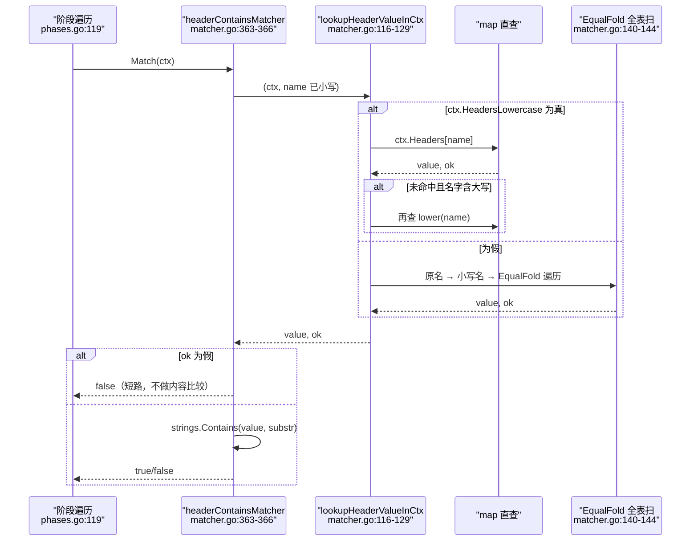
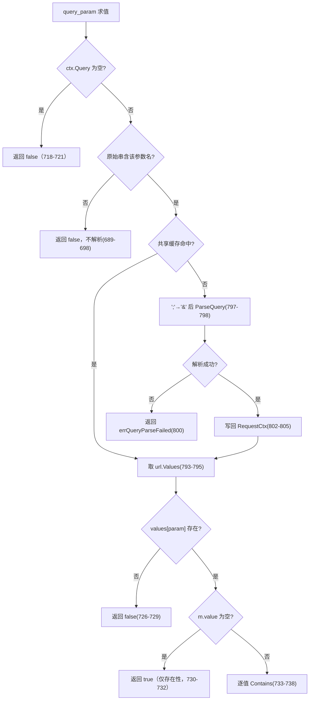
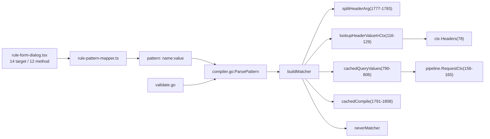
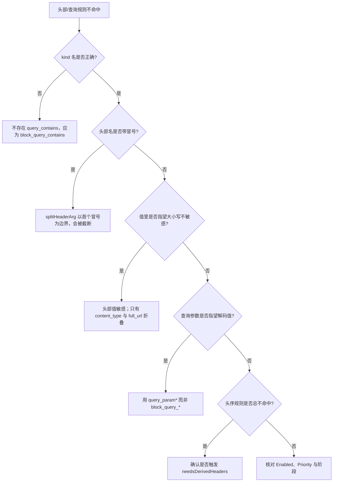

# 头部和查询参数匹配器

> [返回 WAF 引擎系统](../WAF %E5%BC%95%E6%93%8E%E7%B3%BB%E7%BB%9F.md)

<cite>
**本文档引用的文件**
- [matcher.go](file://internal/core/rules/matcher.go)
- [compiler.go](file://internal/core/rules/compiler.go)
- [validate.go](file://internal/core/rules/validate.go)
- [phases.go](file://internal/core/rules/phases.go)
- [pipeline.go](file://internal/core/pipeline/pipeline.go)
- [rule-pattern-mapper.ts](file://frontend/app/(dashboard)/rules/components/rule-pattern-mapper.ts)
- [rule-form-dialog.tsx](file://frontend/app/(dashboard)/rules/components/rule-form-dialog.tsx)
</cite>

## 目录

1. [简介](#简介)
2. [项目结构](#项目结构)
3. [核心组件](#核心组件)
4. [架构总览](#架构总览)
5. [详细组件分析](#详细组件分析)
6. [依赖关系分析](#依赖关系分析)
7. [性能考虑](#性能考虑)
8. [故障排查指南](#故障排查指南)
9. [结论](#结论)
10. [附录](#附录)

## 简介

本篇覆盖**头部族**（14 个 kind）与**查询参数族**（5 个 kind），它们共同构成「按名取值再判定」这一类匹配器：头部族读 `ctx.Headers`，查询族读 `ctx.Query` 或其解析结果。

| 族 | kind 数 | 结构体数 | 工厂位置 |
|----|:------:|:--------:|----------|
| 通用头部 | 7 | 4（`headerExactMatcher`、`headerPrefixMatcher`、`headerContainsMatcher`、`headerRegexMatcher`）+ `exactNotMatcher` + `headerWildcardMatcher` | `matcher.go:1513-1535`、`1611-1617`、`1687-1696` |
| 具名头部 | 5 | 复用 `headerContainsMatcher`、`headerRegexMatcher`、`contentTypeMatcher`、`cookieContainsMatcher`、`refererContainsMatcher` | `matcher.go:1552-1563`、`1727-1731` |
| 头部顺序 | 2 | `headerOrderContainsMatcher`、`headerOrderRegexMatcher` | `matcher.go:1601-1609` |
| 查询串 | 2 | `queryContainsMatcher`、`queryRegexMatcher` | `matcher.go:1503-1511` |
| 查询参数 | 3 | `queryParamMatcher`、`queryParamExactMatcher`、`queryParamRegexMatcher` | `matcher.go:1632-1649` |

四条必须订正的历史错误（旧版本篇均存在）：

1. **不存在 `query_contains` / `query_regex` 这两个 kind**。实际是 `block_query_contains`、`block_query_regex`（`compiler.go:123`、`matcher.go:1503-1511`）。写成前者会被 `knownPrefixes` 拒绝，整条规则被跳过。
2. **不存在 `allow_user_agent`、`allow_referer_contains`、`block_referer_contains`、`block_cookie_contains`、`block_query_param`**。放行由规则动作表达，不是 kind；Referer/Cookie 只有 `referer_contains`、`cookie_contains`。
3. **头部名大小写不敏感 ≠ 头部值大小写不敏感**。名在工厂构造期被 `strings.ToLower` 归一（如 `matcher.go:1527`），值一律按原样比较；只有 `block_content_type` 与 `full_url_contains` 这类走 ASCII 折叠包含（`matcher.go:483-486`）。`block_user_agent:SQLMAP` 是大小写敏感的子串判定。
4. **`Match` 签名是 `Match(MatchCtx)`**（`matcher.go:20-23`），旧版类图里的 5 参数形式已作废。

## 项目结构

```text
internal/core/rules/matcher.go
├── 头部取值        111-153（headerValue / lookupHeaderValueInCtx / lookupHeaderValue / headerOrderValue）
├── 参数切分        1777-1783（splitHeaderArg）
├── 通用头部匹配器  347-371、452-455（exact / prefix / contains / regex）
├── 具名头部匹配器  481-486、1008-1022（content-type / cookie / referer）
├── 头序匹配器      373-379、448-450
├── 查询串匹配器    335-345
├── 查询参数匹配器  670-683、689-806（含原始串名探测与共享解析缓存）
└── 工厂分支        1503-1535、1552-1563、1601-1617、1632-1649、1687-1696、1701-1731
```

### 模块清单表

| 模块 | 路径 | 职责 | 核心接口/符号 | 依赖模块 | 被依赖 | 规模(行) | 测试 |
|------|------|------|---------------|----------|--------|:--------:|:----:|
| 头部查找 | `internal/core/rules/matcher.go:111-153` | 按名取值，兼容小写标记与原始大小写 | `lookupHeaderValueInCtx`、`lookupHeaderValue` | `strings` | 头部族全部 | 1928 | 有 |
| 通用头部匹配器 | `internal/core/rules/matcher.go:347-371` | 精确/前缀/包含/正则 | `headerExactMatcher` 等 | `strings`、`regexp` | `buildMatcher` | 1928 | 有 |
| 具名头部匹配器 | `internal/core/rules/matcher.go:481-486`、`1008-1022` | Content-Type/Cookie/Referer | `contentTypeMatcher`、`cookieContainsMatcher`、`refererContainsMatcher` | `strings` | `buildMatcher` | 1928 | 有 |
| 头序匹配器 | `internal/core/rules/matcher.go:373-379`、`448-450` | 头部出现顺序 | `headerOrderContainsMatcher`、`headerOrderRegexMatcher` | `strings`、`regexp` | `buildMatcher` | 1928 | 有 |
| 查询串匹配器 | `internal/core/rules/matcher.go:335-345` | 原始查询串包含/正则 | `queryContainsMatcher`、`queryRegexMatcher` | `strings`、`regexp` | `buildMatcher` | 1928 | 有 |
| 查询参数匹配器 | `internal/core/rules/matcher.go:670-806` | 按参数名解析后判定 | `queryParamMatcher` 等、`cachedQueryValues`、`rawQueryMayContainParam` | `net/url`、`pipeline` | `buildMatcher` | 1928 | 有 |
| 编译与校验 | `internal/core/rules/compiler.go`、`validate.go` | kind 白名单、`name:value` 格式校验 | `ParsePattern`、`validateSimplePattern` | - | admin | 170 / 257 | 有 |
| 前端映射 | `frontend/app/(dashboard)/rules/components/rule-pattern-mapper.ts` | `req_header` / `get_param` 翻译 | `translateHeader`、`translateQueryParam` | - | 规则表单 | 994 | 有 |

**章节来源**
- [matcher.go:111-153](file://internal/core/rules/matcher.go#L111-L153)
- [matcher.go:335-379](file://internal/core/rules/matcher.go#L335-L379)
- [matcher.go:448-486](file://internal/core/rules/matcher.go#L448-L486)
- [matcher.go:670-806](file://internal/core/rules/matcher.go#L670-L806)
- [matcher.go:1008-1022](file://internal/core/rules/matcher.go#L1008-L1022)
- [compiler.go:119-170](file://internal/core/rules/compiler.go#L119-L170)
- [validate.go:154-184](file://internal/core/rules/validate.go#L154-L184)
- [rule-pattern-mapper.ts:296-398](file://frontend/app/(dashboard)/rules/components/rule-pattern-mapper.ts#L296-L398)

## 核心组件

### 代码上下文表

| 符号 | 位置 | 职责 | 上游调用者 | 下游依赖 | 副作用 | 影响面 |
|------|------|------|------------|----------|--------|--------|
| `lookupHeaderValueInCtx` | `matcher.go:116-129` | 按 `HeadersLowercase` 选查找策略 | 全部头部族匹配器、`geoBlockMatcher`、`multipartMatcher` | `lookupHeaderValue`、`lowerASCIIIfNeeded` | 无 | 高：取值即判定前提 |
| `lookupHeaderValue` | `matcher.go:131-146` | 三级回落：原名、小写名、`EqualFold` 全表扫 | 同上 | `strings.EqualFold` | 无 | 高 |
| `splitHeaderArg` | `matcher.go:1777-1783` | 首个冒号拆 `name:value` | 头部族工厂、`query_param`、`block_body_json_path` | `strings.Index` | 无 | 高：冒号即边界 |
| `rawQueryMayContainParam` | `matcher.go:689-698` | 解析前的参数名探测门 | 三个 `query_param*` | `rawQueryContainsParamName`、`url.QueryEscape` | 无 | 中：决定要不要解析 |
| `cachedQueryValues` | `matcher.go:790-806` | 每请求一次查询解析 | 同上 | `url.ParseQuery`、`pipeline.RequestCtx` | 写共享缓存 | 高 |
| `headerOrderValue` | `matcher.go:148-153` | 头序取值，回落伪头 | 头序族 | `headerValue` | 无 | 中 |
| `cachedCompile` | `matcher.go:1791-1808` | 正则复用 | 全部 `*_regex` kind | `regexp.Compile` | 写缓存 | 高 |

**章节来源**
- [matcher.go:116-153](file://internal/core/rules/matcher.go#L116-L153)
- [matcher.go:689-698](file://internal/core/rules/matcher.go#L689-L698)
- [matcher.go:790-806](file://internal/core/rules/matcher.go#L790-L806)
- [matcher.go:1777-1808](file://internal/core/rules/matcher.go#L1777-L1808)

### 类型体系

```mermaid
classDiagram
class Matcher {
<<interface>>
+Match(ctx MatchCtx) bool
}
class headerExactMatcher {
-name string
-value string
}
class headerPrefixMatcher {
-name string
-prefix string
}
class headerContainsMatcher {
-name string
-substr string
}
class headerRegexMatcher {
-name string
-re regexp.Regexp
}
class headerWildcardMatcher {
-name string
-w wildcardTester
}
class exactNotMatcher {
-child Matcher
}
class contentTypeMatcher {
-ctype string
}
class cookieContainsMatcher {
-substr string
}
class refererContainsMatcher {
-substr string
}
class headerOrderContainsMatcher {
-substr string
}
class headerOrderRegexMatcher {
-re regexp.Regexp
}
class queryContainsMatcher {
-substr string
}
class queryRegexMatcher {
-re regexp.Regexp
}
class queryParamMatcher {
-param string
-value string
}
class queryParamExactMatcher {
-param string
-value string
}
class queryParamRegexMatcher {
-param string
-re regexp.Regexp
}
Matcher <|.. headerExactMatcher
Matcher <|.. headerPrefixMatcher
Matcher <|.. headerContainsMatcher
Matcher <|.. headerRegexMatcher
Matcher <|.. headerWildcardMatcher
Matcher <|.. exactNotMatcher
Matcher <|.. contentTypeMatcher
Matcher <|.. cookieContainsMatcher
Matcher <|.. refererContainsMatcher
Matcher <|.. headerOrderContainsMatcher
Matcher <|.. headerOrderRegexMatcher
Matcher <|.. queryContainsMatcher
Matcher <|.. queryRegexMatcher
Matcher <|.. queryParamMatcher
Matcher <|.. queryParamExactMatcher
Matcher <|.. queryParamRegexMatcher
exactNotMatcher --> headerExactMatcher : 包装
exactNotMatcher --> queryParamExactMatcher : 包装
headerWildcardMatcher --> wildcardTester : 持有
queryParamMatcher --> url_Values : 依赖解析结果
class url_Values {
<<map>>
}
```



19 个 kind 复用 16 个结构体（类图省略了指针与切片记号，真值见上表行号）：`block_user_agent` 与 `block_header` 共用 `headerContainsMatcher`，`block_user_agent_regex`、`header_regex` 与 `block_header_regex` 共用 `headerRegexMatcher`，三个 `not` 类 kind 都经 `exactNotMatcher` 包装。

**图表来源**
- [matcher.go:20-23](file://internal/core/rules/matcher.go#L20-L23)
- [matcher.go:311-315](file://internal/core/rules/matcher.go#L311-L315)
- [matcher.go:335-345](file://internal/core/rules/matcher.go#L335-L345)
- [matcher.go:347-379](file://internal/core/rules/matcher.go#L347-L379)
- [matcher.go:481-486](file://internal/core/rules/matcher.go#L481-L486)
- [matcher.go:670-683](file://internal/core/rules/matcher.go#L670-L683)
- [matcher.go:1008-1017](file://internal/core/rules/matcher.go#L1008-L1017)
- [matcher.go:1462-1465](file://internal/core/rules/matcher.go#L1462-L1465)

**章节来源**
- [matcher.go:311-379](file://internal/core/rules/matcher.go#L311-L379)
- [matcher.go:481-486](file://internal/core/rules/matcher.go#L481-L486)
- [matcher.go:670-683](file://internal/core/rules/matcher.go#L670-L683)
- [matcher.go:1008-1017](file://internal/core/rules/matcher.go#L1008-L1017)
- [matcher.go:1462-1465](file://internal/core/rules/matcher.go#L1462-L1465)

### 取值与判定流程



**图表来源**
- [matcher.go:116-146](file://internal/core/rules/matcher.go#L116-L146)
- [matcher.go:363-366](file://internal/core/rules/matcher.go#L363-L366)
- [phases.go:119](file://internal/core/rules/phases.go#L119)

**章节来源**
- [matcher.go:116-146](file://internal/core/rules/matcher.go#L116-L146)
- [matcher.go:363-366](file://internal/core/rules/matcher.go#L363-L366)
- [phases.go:78-79](file://internal/core/rules/phases.go#L78-L79)

## 架构总览

| 层 | 输入形态 | 归一化 | 判定 | 位置 |
|----|----------|--------|------|------|
| 头部名 | `arg` 的冒号前段 | 工厂期 `strings.ToLower` | map 键或 `EqualFold` | `matcher.go:1513-1535`、`1611-1617` |
| 头部值 | `ctx.Headers[name]` | 无 | `==`、`HasPrefix`、`Contains`、RE2、glob | `matcher.go:351-366`、`452-455`、`1467-1470` |
| 伪头 | `x-owaf-header-order`、`x-owaf-tls-*` | 由数据平面派生后写入 | 同上 | `matcher.go:148-153`、`155-197` |
| 原始查询串 | `ctx.Query`（`RawQuery`） | 无 | `Contains`、RE2 | `matcher.go:335-345`、`phases.go:77` |
| 解析后参数 | `url.Values` | `;`→`&`（`matcher.go:797`） | 存在性、包含、全等、RE2 | `matcher.go:718-779` |

**章节来源**
- [matcher.go:148-197](file://internal/core/rules/matcher.go#L148-L197)
- [matcher.go:335-366](file://internal/core/rules/matcher.go#L335-L366)
- [matcher.go:718-797](file://internal/core/rules/matcher.go#L718-L797)
- [phases.go:77](file://internal/core/rules/phases.go#L77)

## 详细组件分析

### 匹配字段与操作符总览

| 匹配字段 | 取值来源:行 | 操作符集合 | 短路行为 | 典型用例 |
|------|------|------|------|------|
| `ctx.Headers` 任一头 | `phases.go:38`、取值 `matcher.go:116-146` | `eq`、`ne`、`prefix`、`contains`、`regex`、`wildcard` | 头缺失即 `ok=false`，直接返回假 | `block_header:Referer:evil.example` |
| `user-agent` | 同上，名在工厂固定（`matcher.go:1556`、`1563`） | `contains`、`regex` | 同上 | `block_user_agent_regex:(?i)(sqlmap\|nikto)` |
| `content-type` | `matcher.go:484` | `contains`（折叠） | 头缺失判假 | `block_content_type:multipart/form-data` |
| `cookie` | `matcher.go:1012` | `contains`（整串） | 头缺失判假 | `cookie_contains:admin=` |
| `referer` | `matcher.go:1020` | `contains` | 头缺失判假 | `referer_contains:attacker` |
| `ctx.HeaderOrder` | `phases.go:43`，回落 `matcher.go:148-153` | `contains`、`regex` | 空值再回落伪头 | `header_order_contains:accept-encoding,user-agent` |
| `ctx.Query` | `phases.go:37`（`RawQuery`） | `contains`、`regex` | `Query` 为空时 `Contains` 仍会执行 | `block_query_contains:union%20select` |
| `url.Values[params]` | 解析 `matcher.go:790-806` | `contains`（`query_param`）、`eq`+取反（`query_param_not_exact`）、`regex` | 名探测失败即返回假，不解析 | `query_param:id:1 OR 1=1` |

**章节来源**
- [matcher.go:148-197](file://internal/core/rules/matcher.go#L148-L197)
- [matcher.go:335-366](file://internal/core/rules/matcher.go#L335-L366)
- [matcher.go:452-486](file://internal/core/rules/matcher.go#L452-L486)
- [matcher.go:718-806](file://internal/core/rules/matcher.go#L718-L806)
- [matcher.go:1008-1022](file://internal/core/rules/matcher.go#L1008-L1022)
- [phases.go:37-43](file://internal/core/rules/phases.go#L37-L43)

### 头部族类型对照

| kind | 工厂位置 | 结构体:行 | 值判定 | 值的折叠 |
|------|----------|-----------|--------|----------|
| `block_header_exact` | `matcher.go:1513-1515` | `headerExactMatcher`:349 | `value == m.value`（`matcher.go:353`） | 无 |
| `block_header_not_exact` | `matcher.go:1517-1519` | `exactNotMatcher`:311 | 取反上者 | 无 |
| `block_header_prefix` | `matcher.go:1521-1523` | `headerPrefixMatcher`:356 | `HasPrefix`（`matcher.go:360`） | 无 |
| `block_header` | `matcher.go:1525-1527` | `headerContainsMatcher`:347 | `Contains`（`matcher.go:365`） | 无 |
| `block_header_regex` | `matcher.go:1529-1535` | `headerRegexMatcher`:368 | `re.MatchString(value)`（`matcher.go:454`） | 由模式 `(?i)` |
| `header_regex` | `matcher.go:1611-1617` | `headerRegexMatcher`:368 | 与上同实现 | 由模式 `(?i)` |
| `header_wildcard` | `matcher.go:1687-1696` | `headerWildcardMatcher`:1462 | `wildcardTester.matchString`（`matcher.go:1380-1398`） | 敏感（`compileWildcard(pattern, false)`） |
| `block_user_agent` | `matcher.go:1555-1556` | `headerContainsMatcher`:347 | `Contains` | 无 |
| `block_user_agent_regex` | `matcher.go:1558-1563` | `headerRegexMatcher`:368 | `MatchString` | 由模式 |
| `block_content_type` | `matcher.go:1552-1553` | `contentTypeMatcher`:481 | `containsFoldASCII`（`matcher.go:485`） | **ASCII 折叠** |
| `cookie_contains` | `matcher.go:1727-1728` | `cookieContainsMatcher`:1008 | `Contains` 整串 | 无 |
| `referer_contains` | `matcher.go:1730-1731` | `refererContainsMatcher`:1016 | `Contains` | 无 |

`block_header_regex` 与 `header_regex` 是同一实现的两个 kind（`matcher.go:1529-1535` 与 `1611-1617` 分别构造 `headerRegexMatcher`），差别只在历史命名；两者 arg 都必须是 `name:pattern`，且 pattern 里的第一个冒号会被 `splitHeaderArg` 当作名值边界（`matcher.go:1777-1783`），所以**含冒号的正则必须整体改用 `op:"not"` 复合结构或换分隔思路**，`(?i)a:b` 这类模式会被截断。

**章节来源**
- [matcher.go:347-371](file://internal/core/rules/matcher.go#L347-L371)
- [matcher.go:452-486](file://internal/core/rules/matcher.go#L452-L486)
- [matcher.go:1008-1022](file://internal/core/rules/matcher.go#L1008-L1022)
- [matcher.go:1380-1398](file://internal/core/rules/matcher.go#L1380-L1398)
- [matcher.go:1462-1470](file://internal/core/rules/matcher.go#L1462-L1470)
- [matcher.go:1513-1563](file://internal/core/rules/matcher.go#L1513-L1563)
- [matcher.go:1611-1617](file://internal/core/rules/matcher.go#L1611-L1617)
- [matcher.go:1687-1731](file://internal/core/rules/matcher.go#L1687-L1731)
- [matcher.go:1777-1783](file://internal/core/rules/matcher.go#L1777-L1783)

### 查询串族：原始字节 vs 解析结果

| kind | 目标 | 是否解码 | 典型命中形态 |
|------|------|:--------:|--------------|
| `block_query_contains` | `ctx.Query` 原文（`matcher.go:337-339`） | 否 | 必须写 `union%20select` 这类原始形态 |
| `block_query_regex` | 同上（`matcher.go:343-345`） | 否 | 同上 |
| `query_param` | 解析后单个值（`matcher.go:718-739`） | **是**（`url.ParseQuery`） | 写 `union select`（含空格） |
| `query_param_not_exact` | 同上（`matcher.go:741-759`） | 是 | 值不等 |
| `query_param_regex` | 同上（`matcher.go:761-779`） | 是 | 正则作用于解码后的值 |

同一条载荷在 `block_query_*` 与 `query_param` 上的可命中写法不同，这是这两类 kind 最容易混用的地方。解析前还有一道「原始串名探测」：`rawQueryMayContainParam`（`matcher.go:689-698`）先用 `rawQueryContainsParamName`（`matcher.go:700-716`）在原文里定位 `&name=` / `name=` 边界，探测失败直接返回假，不做任何解析——参数名本身也会被 URL 转义后再探测一次（`matcher.go:696-697`）。



**图表来源**
- [matcher.go:689-739](file://internal/core/rules/matcher.go#L689-L739)
- [matcher.go:790-806](file://internal/core/rules/matcher.go#L790-L806)
- [pipeline.go:156-165](file://internal/core/pipeline/pipeline.go#L156-L165)

注意 `matcher.go:730-732` 允许「值空只判存在」，但保存期 `validate.go:172-176` 要求 `query_param` 的 `param` 与 `value` 都非空。也就是说存在性语义在运行期可达、在控制面不可达：想表达「只要带 `token` 参数就拦」，当前只能改写成 `block_query_contains:token=`。这一处是代码与校验口径的真实不一致，值得在规则设计上注意。

**章节来源**
- [matcher.go:689-739](file://internal/core/rules/matcher.go#L689-L739)
- [matcher.go:741-779](file://internal/core/rules/matcher.go#L741-L779)
- [matcher.go:790-806](file://internal/core/rules/matcher.go#L790-L806)
- [validate.go:172-184](file://internal/core/rules/validate.go#L172-L184)
- [pipeline.go:156-165](file://internal/core/pipeline/pipeline.go#L156-L165)

### 每请求一元解析缓存

`cachedQueryValues`（`matcher.go:790-806`）与 `cachedJSONBodyObject`（`matcher.go:574-579`）走同一模式：先看 `ctx.reqCtx` 是否非空，非空则读 `RequestCtx` 上的缓存槽，命中即返回；否则现算并写回。

| 缓存项 | 存取方法 | 槽位定义 | 未命中行为 |
|--------|----------|----------|------------|
| 匹配器查询值 | `CachedMatcherQueryValues` / `StoreMatcherQueryValues` | `pipeline.go:156-165` | `url.ParseQuery` 一次并写回 |
| JSON 体对象 | `CachedJSONBodyObject` / `StoreJSONBodyObject` | `pipeline.go:144-152` | 解析成功与**失败**都写回，失败不再重试 |

`ctx.reqCtx` 为 nil（单测里直接构造 `MatchCtx`）时两者都退化为「每次现算、不缓存」，行为与原实现一致（注释见 `phases.go:48-50`）。这使得 100 条 `query_param` 规则在同一请求上最多只解析一次查询串（基准见 `matcher_cache_bench_test.go`）。

**章节来源**
- [matcher.go:574-586](file://internal/core/rules/matcher.go#L574-L586)
- [matcher.go:790-806](file://internal/core/rules/matcher.go#L790-L806)
- [pipeline.go:144-165](file://internal/core/pipeline/pipeline.go#L144-L165)
- [phases.go:48-50](file://internal/core/rules/phases.go#L48-L50)

### 头序匹配器与派生计算

`header_order_contains`、`header_order_regex` 的目标不是某个头部的值，而是头部**出现顺序**串（`matcher.go:148-153`）：优先 `ctx.HeaderOrder`，为空则回落到读取 `x-owaf-header-order` 头。前者由数据平面在 `needsDerivedHeaders` 为真时用 `DerivedHeaderOrder` 惰性算出（`phases.go:98-102`，槽位在 `pipeline.go:242`），后者是给「WAF 前置代理已注入头序」的部署形态留的通道。

是否需要派生由 kind 静态决定：`ruleNeedsDerivedHeaders` 只对 `tls_alpn`、`tls_cipher_suite`、`tls_cipher_suites`、`header_order_contains`、`header_order_regex` 五个 kind 返回真，`compound` 则递归探测子树（`phases.go:251-282`）。因此一条头序规则混进一个大规则桶时，会让整桶都承担一次头序拼接的代价。

**章节来源**
- [matcher.go:148-153](file://internal/core/rules/matcher.go#L148-L153)
- [phases.go:98-102](file://internal/core/rules/phases.go#L98-L102)
- [phases.go:236-275](file://internal/core/rules/phases.go#L236-L275)
- [pipeline.go:242](file://internal/core/pipeline/pipeline.go#L242)

### 前端映射与不可用组合

| UI target | method | 后端 kind | 备注 |
|-----------|--------|-----------|------|
| `req_header` | `eq` / `ne` | `block_header_exact` / `block_header_not_exact` | `rule-pattern-mapper.ts:353-362`、`382-386` |
| `req_header` | `contains` | `block_header` | `rule-pattern-mapper.ts:363-368` |
| `req_header` | `regex` | `header_regex`（不是 `block_header_regex`） | `rule-pattern-mapper.ts:369-374` |
| `req_header` | `prefix` / `wildcard` | `block_header_prefix` / `header_wildcard` | `rule-pattern-mapper.ts:375-381` |
| `get_param` | `eq` / `contains` | 都是 `query_param` | `rule-pattern-mapper.ts:310-321`，两方法退化同 kind |
| `get_param` | `regex` / `ne` | `query_param_regex` / `query_param_not_exact` | `rule-pattern-mapper.ts:322-332` |
| `post_param` | 任意 | 无 | `rule-pattern-mapper.ts:103-108` 显式拒绝 |

`headerName` 与 `paramName` 都禁止包含冒号（`rule-pattern-mapper.ts:303-308`、`350-355`），原因即 `splitHeaderArg` 以首个冒号为边界。`get_param` 的 `eq` 与 `contains` 映射为同一 kind，是前端语义与后端实现的已知落差：保存后重新打开时 `eq` 会显示成 `contains`，实际判定一直是子串包含。

**章节来源**
- [rule-pattern-mapper.ts:100-124](file://frontend/app/(dashboard)/rules/components/rule-pattern-mapper.ts#L100-L124)
- [rule-pattern-mapper.ts:296-398](file://frontend/app/(dashboard)/rules/components/rule-pattern-mapper.ts#L296-L398)
- [matcher.go:1777-1783](file://internal/core/rules/matcher.go#L1777-L1783)

### 保存期校验与流程步骤

| 步 | 动作 | 执行位置 | 输入 | 输出 | 失败分支 | 可观测点 |
|:--:|------|----------|------|------|----------|----------|
| 1 | 取 kind | `compiler.go:157-168` | pattern | `kind` | 前缀不在白名单则整条跳过 | 规则不生效 |
| 2 | 名格式校验 | `validate.go:154-158` | `block_header` 等 | `name`、`value` 均非空 | 「需要 name:value 格式」 | 422 文案 |
| 3 | 正则名值校验 | `validate.go:164-171` | `block_header_regex`、`header_regex` | pattern 非空 | 「需要 name:pattern 格式」 | 同上 |
| 4 | 正则预编译 | `validate.go:169-170`、`182-184` | pattern | `*regexp.Regexp` | 「非法的正则表达式」 | 同上 |
| 5 | 参数格式校验 | `validate.go:172-181` | `query_param`、`query_param_regex` | 名与值非空 | 相应错误文案 | 同上 |
| 6 | 名小写化构造 | `matcher.go:1513-1535` | `kind,arg` | 匹配器 | 回落 `neverMatcher` | 命中日志缺失 |
| 7 | 阶段遍历 | `phases.go:119-128` | `MatchCtx` | 动作 | 假则继续 | 事件 `Category` |

**章节来源**
- [compiler.go:157-168](file://internal/core/rules/compiler.go#L157-L168)
- [validate.go:154-184](file://internal/core/rules/validate.go#L154-L184)
- [matcher.go:1513-1535](file://internal/core/rules/matcher.go#L1513-L1535)
- [phases.go:119-128](file://internal/core/rules/phases.go#L119-L128)

## 依赖关系分析



**图表来源**
- [compiler.go:146-170](file://internal/core/rules/compiler.go#L146-L170)
- [matcher.go:116-129](file://internal/core/rules/matcher.go#L116-L129)
- [matcher.go:790-806](file://internal/core/rules/matcher.go#L790-L806)
- [phases.go:78](file://internal/core/rules/phases.go#L78)
- [pipeline.go:156-165](file://internal/core/pipeline/pipeline.go#L156-L165)

**章节来源**
- [compiler.go:146-170](file://internal/core/rules/compiler.go#L146-L170)
- [matcher.go:116-180](file://internal/core/rules/matcher.go#L116-L180)
- [phases.go:78](file://internal/core/rules/phases.go#L78)

## 性能考虑

| 关注点 | 现状 | 依据 | 建议 |
|--------|------|------|------|
| 头部查找（快路径） | `HeadersLowercase` 为真时 map 直查 O(1) | `matcher.go:117-126` | 保证上下文带小写标记 |
| 头部查找（慢路径） | 原名、小写名、`EqualFold` 全表扫 | `matcher.go:140-144` | 规则多时避免让上游产出混合大小写头名 |
| 解析惰性 | 名探测失败即跳过 `ParseQuery` | `matcher.go:689-698` | 参数类规则宜显式写参数名 |
| 解析复用 | 每请求一次，结果共享 | `matcher.go:790-806` | 同类规则合并到同阶段桶 |
| 正则复用 | 全局 map，无淘汰 | `matcher.go:1785-1808` | 控制模式总量，避免常驻增长 |
| 体/头序派生 | 只有 5 个 kind 触发 | `phases.go:236-246` | 头序规则单独分策略，别混大桶 |
| 折叠比较 | 无分配 ASCII 折叠 | `matcher.go:223-249` | Content-Type 类判定优先用它 |

**章节来源**
- [matcher.go:117-144](file://internal/core/rules/matcher.go#L117-L144)
- [matcher.go:223-249](file://internal/core/rules/matcher.go#L223-L249)
- [matcher.go:689-698](file://internal/core/rules/matcher.go#L689-L698)
- [matcher.go:790-806](file://internal/core/rules/matcher.go#L790-L806)
- [matcher.go:1785-1808](file://internal/core/rules/matcher.go#L1785-L1808)
- [phases.go:236-246](file://internal/core/rules/phases.go#L236-L246)

## 故障排查指南



**图表来源**
- [compiler.go:120-136](file://internal/core/rules/compiler.go#L120-L136)
- [matcher.go:483-486](file://internal/core/rules/matcher.go#L483-L486)
- [matcher.go:1777-1783](file://internal/core/rules/matcher.go#L1777-L1783)
- [phases.go:236-246](file://internal/core/rules/phases.go#L236-L246)

**章节来源**
- [matcher.go:483-486](file://internal/core/rules/matcher.go#L483-L486)
- [matcher.go:1777-1783](file://internal/core/rules/matcher.go#L1777-L1783)

### 常见问题与定位

| 症状 | 原因 | 排查 | 方案 |
|------|------|------|------|
| 写成 `query_contains:x` 无反应 | kind 未注册 | `compiler.go:120-136` | 改 `block_query_contains:x` |
| `query_param:token` 保存失败 | 校验要求值非空 | `validate.go:172-176` | 改 `block_query_contains:token=` |
| `block_user_agent:SQLMAP` 不命中 | 值大小写敏感 | `matcher.go:365` | 改 `block_user_agent_regex:(?i)sqlmap` |
| 正则被截断 | `splitHeaderArg` 取首个冒号 | `matcher.go:1777-1783` | 避免模式含冒号，或改前缀/包含 |
| `cookie_contains` 误命中 | 整串扫描，不拆 cookie 对 | `matcher.go:1011-1014` | 收窄子串，配合路径或头部条件 |
| Referer 缺失时「不为空才放行」无效 | 无 `referer_not_empty` kind | `matcher.go:1016-1022` | 用 `block_header_not_exact` 或复合 `not` |
| 头序规则偶发不命中 | 上游未注入伪头且未派生 | `matcher.go:148-153` | 确认规则桶触发派生计算 |
| 大量参数规则后 CPU 上升 | 慢路径头扫与重复解析 | `matcher.go:140-144` | 检查 `HeadersLowercase` 与参数名探测命中 |

**章节来源**
- [compiler.go:120-136](file://internal/core/rules/compiler.go#L120-L136)
- [matcher.go:140-153](file://internal/core/rules/matcher.go#L140-L153)
- [matcher.go:363-366](file://internal/core/rules/matcher.go#L363-L366)
- [matcher.go:1011-1022](file://internal/core/rules/matcher.go#L1011-L1022)
- [matcher.go:1777-1783](file://internal/core/rules/matcher.go#L1777-L1783)
- [validate.go:172-176](file://internal/core/rules/validate.go#L172-L176)

## 结论

头部与查询两族共 19 个 kind、13 个结构体，设计上一致性很强：名在构造期归一为小写、值一律原样比较、头缺失即短路返回假、正则统一走全局缓存。真正的复杂度集中在两处——`HeadersLowercase` 决定 map 直查还是全表扫（`matcher.go:116-146`），以及「原始查询串」与「解析后参数值」两种目标形态（`matcher.go:335-345` 与 `718-779`）。

本篇原有 `query_contains`、`query_regex`、`allow_user_agent`、`block_cookie_contains`、`block_referer_contains`、`block_query_param` 等 kind 名与「User-Agent 大小写不敏感」的说法均已按代码事实订正；`Match` 接口签名统一为 `Match(MatchCtx)`。

改进空间明确且有限：一是让 `validate.go` 放开 `query_param` 的空值以支持存在性判定，与 `matcher.go:730-732` 对齐；二是前端 `get_param` 的 `eq` 应映射到 `query_param_not_exact` 的取反或直接提供全等 kind，避免语义静默降级。两者都不需要新增匹配器。

**章节来源**
- [matcher.go:116-146](file://internal/core/rules/matcher.go#L116-L146)
- [matcher.go:335-345](file://internal/core/rules/matcher.go#L335-L345)
- [matcher.go:718-779](file://internal/core/rules/matcher.go#L718-L779)
- [validate.go:172-176](file://internal/core/rules/validate.go#L172-L176)

## 附录

### DSL 示例

```text
block_header:User-Agent:sqlmap
block_header_exact:X-Debug:1
block_header_not_exact:X-Client:mobile
block_header_prefix:Authorization:Bearer
block_header_regex:Referer:(?i)malicious\.example\.com
header_regex:X-Token:^[a-f0-9]{32}$
header_wildcard:X-Client:*beta*
block_user_agent:curl
block_user_agent_regex:(?i)(sqlmap|nikto|nmap|masscan|zgrab|nuclei)
block_content_type:multipart/form-data
cookie_contains:admin=
referer_contains:attacker-domain.com
header_order_contains:accept-encoding,user-agent
header_order_regex:^host,user-agent,accept
block_query_contains:union%20select
block_query_regex:(?i)union\s\+select
query_param:id:1 OR 1=1
query_param_not_exact:role:admin
query_param_regex:next:/page[0-9]+
```

`block_query_regex` 示例里的 `\s\+select` 中，反斜杠转义加号是**原文匹配**写法：目标串未经解码，`+` 就是字面加号。若载荷以 `%20` 形式出现，需分别书写，或改用 `query_param_regex`（目标是解码后的值）。

还有一条会影响取值正确性的规则：`ParsePattern` 对**非** `*_wildcard` 的 kind 会把 arg 做 `TrimSpace`，只有后缀为 `_wildcard` 的 kind 原样保留（`compiler.go:163-167`）。因此想表达「前缀是 `Bearer ` 带尾随空格」这类语义，写成 `block_header_prefix:Authorization:Bearer ` 会在解析时被裁掉空格，只能改用复合 JSON 形态 `{"kind":"block_header_prefix","arg":"Authorization:Bearer "}`——该路径整体 `TrimSpace` 只作用于外层字符串（`compiler.go:153`），叶子 `arg` 由 `buildCompound` 原样传入 `buildMatcher`（`matcher.go:1922`）。

**章节来源**
- [compiler.go:146-170](file://internal/core/rules/compiler.go#L146-L170)
- [matcher.go:1920-1924](file://internal/core/rules/matcher.go#L1920-L1924)

**章节来源**
- [matcher.go:1503-1731](file://internal/core/rules/matcher.go#L1503-L1731)
- [validate.go:147-184](file://internal/core/rules/validate.go#L147-L184)

### 校验要求对照

| kind | 格式要求 | 模式校验 | 位置 |
|------|----------|----------|------|
| `block_header`、`block_header_exact`、`block_header_not_exact` | `name:value` 两段均非空 | 无 | `validate.go:154-158` |
| `block_header_prefix` | `name:prefix` 两段均非空 | 无 | `validate.go:159-163` |
| `block_header_regex`、`header_regex` | `name:pattern` 两段均非空 | `cachedCompile` 成功 | `validate.go:164-171` |
| `query_param`、`query_param_not_exact` | `param:value` 两段均非空 | 无 | `validate.go:172-176` |
| `query_param_regex` | `param:regex`，冒号必须存在 | `cachedCompile` 成功 | `validate.go:177-184` |
| `header_wildcard` | `name:pattern`，pattern 非空 | `globToRegexSource` + `cachedCompile` | `validate.go:224-238` |
| `header_order_contains`、`cookie_contains`、`referer_contains`、`block_user_agent` | arg 非空 | 无 | `validate.go:133-139` |
| `header_order_regex`、`block_user_agent_regex`、`block_query_regex` | arg 非空 | `cachedCompile` 成功 | `validate.go:147-153` |
| `block_content_type`、`block_query_contains` | arg 非空 | 无 | `validate.go:133-139` |

`query_param_regex` 用 `strings.Cut` 而不是 `splitHeaderArg`（`matcher.go:1641` 对 `matcher.go:1778`），差别在于前者要求冒号存在否则整条回落 `neverMatcher`，后者允许冒号缺失时把全串当名字。这是两个相近 kind 的真实实现分歧，写文档或排障时不要合并叙述。

**章节来源**
- [validate.go:133-184](file://internal/core/rules/validate.go#L133-L184)
- [validate.go:224-238](file://internal/core/rules/validate.go#L224-L238)
- [matcher.go:1640-1649](file://internal/core/rules/matcher.go#L1640-L1649)
- [matcher.go:1777-1783](file://internal/core/rules/matcher.go#L1777-L1783)

### 术语口径

| 术语 | 含义 | 出处 |
|------|------|------|
| `HeadersLowercase` | 标记头图键是否已全小写，决定查找策略 | `phases.go:39`、`matcher.go:117` |
| 伪头 | 非客户端提交、由 WAF 派生的 `x-owaf-*` 头 | `matcher.go:148-197`、`tls_cipher_suites.go:7-10` |
| 原始查询串 | `RawQuery`，未解码 | `phases.go:77` |
| 名探测 | 解析前在原文上定位参数名边界 | `matcher.go:700-716` |
| 语义降级 | 前端两种 method 映射为同一 kind | `rule-pattern-mapper.ts:310-321` |

**章节来源**
- [matcher.go:117-153](file://internal/core/rules/matcher.go#L117-L153)
- [matcher.go:689-716](file://internal/core/rules/matcher.go#L689-L716)
- [matcher.go:1777-1783](file://internal/core/rules/matcher.go#L1777-L1783)
- [phases.go:39-77](file://internal/core/rules/phases.go#L39-L77)
- [rule-pattern-mapper.ts:310-321](file://frontend/app/(dashboard)/rules/components/rule-pattern-mapper.ts#L310-L321)
