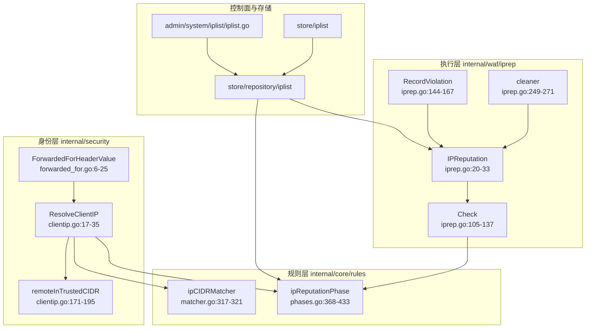
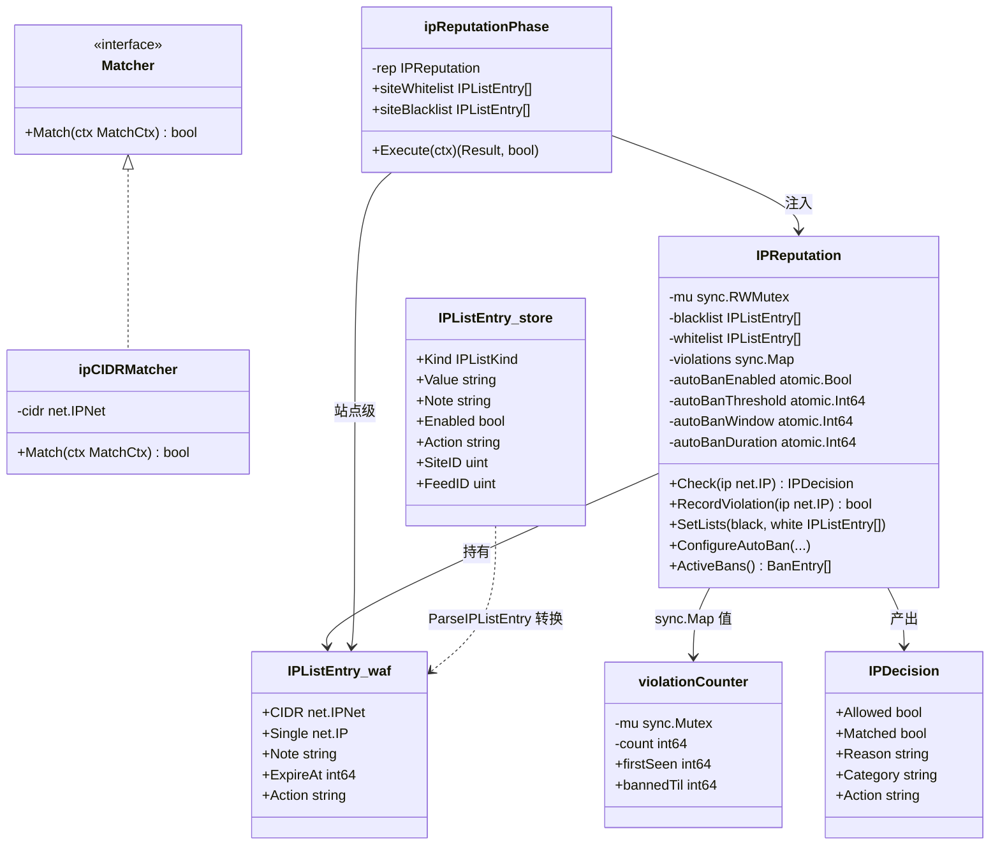
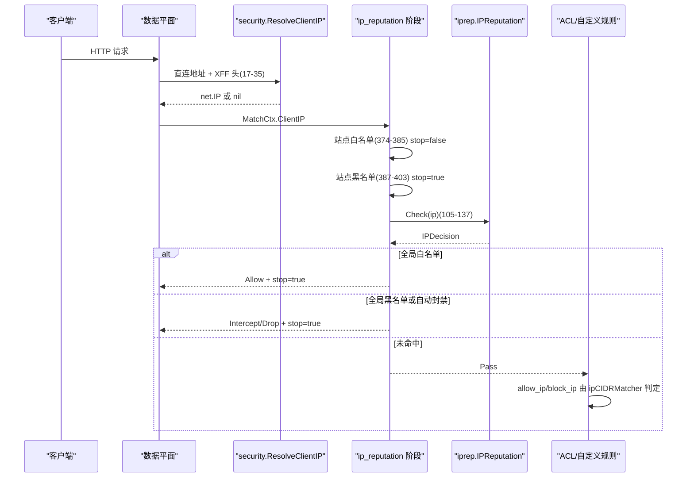
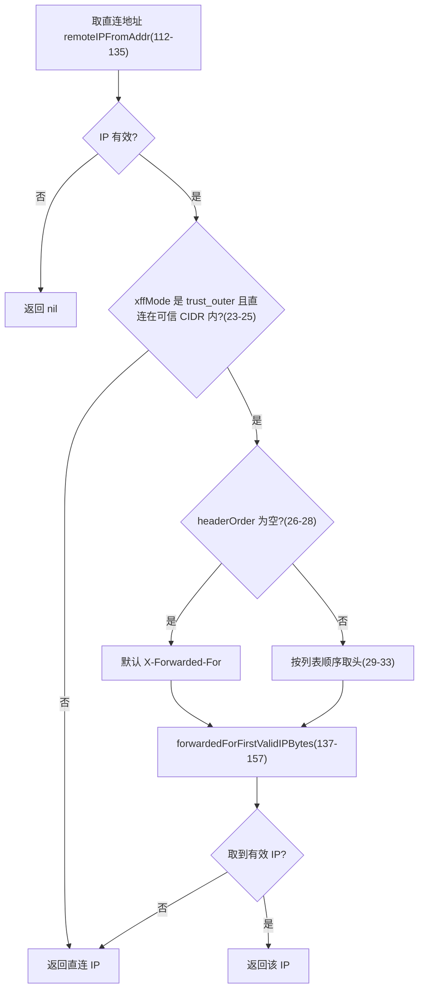
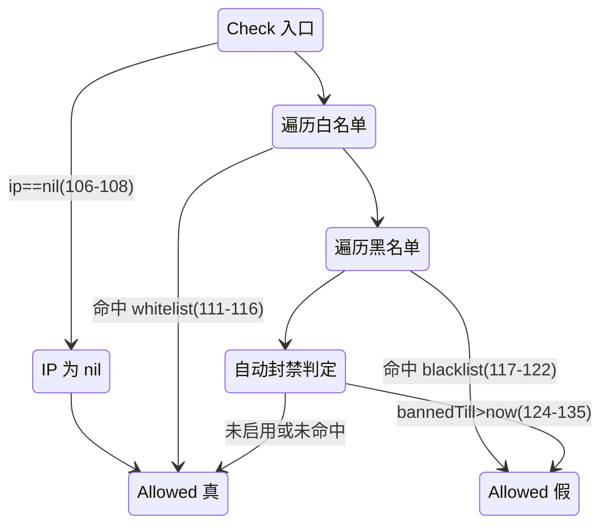
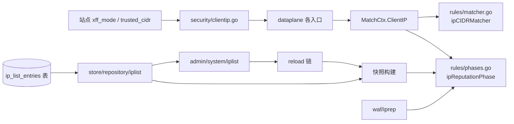
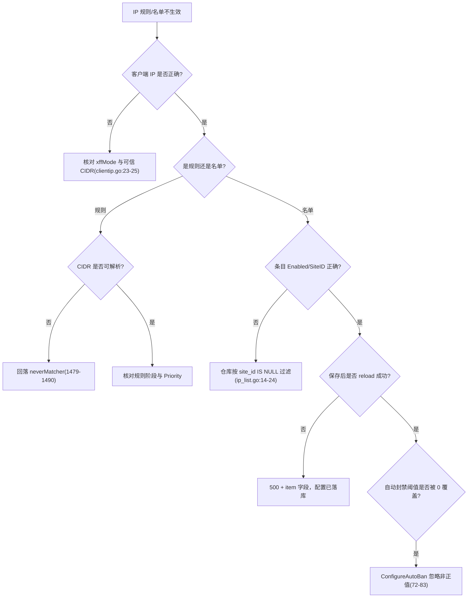

# 网络匹配器

> [返回 WAF 引擎系统](../WAF %E5%BC%95%E6%93%8E%E7%B3%BB%E7%BB%9F.md)

<cite>
**本文档引用的文件**
- [matcher.go](file://internal/core/rules/matcher.go)
- [compiler.go](file://internal/core/rules/compiler.go)
- [validate.go](file://internal/core/rules/validate.go)
- [phases.go](file://internal/core/rules/phases.go)
- [clientip.go](file://internal/security/clientip.go)
- [forwarded_for.go](file://internal/security/forwarded_for.go)
- [iprep.go](file://internal/waf/iprep/iprep.go)
- [ip_list.go](file://internal/store/iplist/ip_list.go)
- [ip_list.go](file://internal/store/repository/iplist/ip_list.go)
- [iplist.go](file://internal/admin/system/iplist/iplist.go)
- [page.tsx](file://frontend/app/(dashboard)/ip-lists/page.tsx)
- [rule-pattern-mapper.ts](file://frontend/app/(dashboard)/rules/components/rule-pattern-mapper.ts)
- [engine.go](file://internal/core/engine/engine.go)
</cite>

## 目录

1. [简介](#简介)
2. [项目结构](#项目结构)
3. [核心组件](#核心组件)
4. [架构总览](#架构总览)
5. [详细组件分析](#详细组件分析)
6. [依赖关系分析](#依赖关系分析)
7. [性能考虑](#性能考虑)
8. [故障排查指南](#故障排查指南)
9. [结论](#结论)
10. [附录](#附录)

## 简介

本篇覆盖「网络匹配器」的两个层次：**规则层的 `allow_ip` / `block_ip`**（唯一的 CIDR 匹配器 `ipCIDRMatcher`，`matcher.go:317-321`），以及**名单层的 IP 黑白名单与自动封禁**（执行侧 `internal/waf/iprep/`，持久化侧 `internal/store/iplist/` 与 `internal/store/repository/iplist/`，控制面 `internal/admin/system/iplist/`）。两者都基于 `net.IPNet`，但走完全不同的代码路径，混用是排障时最常见的误区。

三条重要订正：

1. 历史版本本篇把 IP 名单写成 `internal/admin/system/iplist.go`。该扁平文件早已不存在，实际控制面在 `internal/admin/system/iplist/iplist.go`（212 行），存储模型在 `internal/store/iplist/ip_list.go`（30 行），仓库在 `internal/store/repository/iplist/ip_list.go`（62 行）。
2. `ip_reputation` 阶段的短路语义**不是「白名单一律短路」**：站点级白名单命中返回 `stop=false`，不短路；全局白名单与站点黑名单、全局黑名单、自动封禁命中返回 `stop=true`（`phases.go:368-433`）。
3. 「用前缀树加速大规模名单」的历史建议不成立：全库没有任何前缀树实现，名单匹配是 `RWMutex` 保护下的线性遍历加 `net.IPNet.Contains`（`iprep.go:110-123`、`213-224`）。

## 项目结构

```text
internal/core/rules/matcher.go        ipCIDRMatcher 317-321，工厂 1475-1491
internal/core/rules/phases.go         ipReputationPhase 342-433，计数键 63-70
internal/waf/iprep/iprep.go           执行侧 281 行：Check 105-137，RecordViolation 144-167
internal/security/clientip.go         ResolveClientIP 17-35，ValidateTrustedCIDR 198-214
internal/security/forwarded_for.go    ForwardedForHeaderValue 6-25
internal/store/iplist/ip_list.go      模型 9-30（Kind/Value/Action/SiteID/FeedID）
internal/store/repository/iplist/     仓库 14-62（List/AllEnabledForSite/AllEnabledGlobal）
internal/admin/system/iplist/         控制面 20-212（Create/Update/Delete + reload）
frontend/app/(dashboard)/ip-lists/    名单页 723 行，作用域选择器 SCOPE_GLOBAL
```

### 模块清单表

| 模块 | 路径 | 职责 | 核心接口/符号 | 依赖模块 | 被依赖 | 规模(行) | 测试 |
|------|------|------|---------------|----------|--------|:--------:|:----:|
| CIDR 匹配器 | `internal/core/rules/matcher.go` | 规则层单条件 IP 判定 | `ipCIDRMatcher`、`buildMatcher` | `net` | ACL/签名/自定义阶段 | 1928 | 有 |
| IP 信誉执行 | `internal/waf/iprep/iprep.go` | 全局黑白名单与自动封禁 | `IPReputation`、`Check`、`RecordViolation` | `net`、`sync` | rules、bot 阶段 | 281 | 有 |
| 信誉阶段 | `internal/core/rules/phases.go` | 站点级名单 + 全局决策落动作 | `ipReputationPhase`、`siteIPEntryMatches` | iprep、pipeline | engine | 1391 | 有 |
| 客户端 IP 解析 | `internal/security/clientip.go` | XFF 语义与可信代理判定 | `ResolveClientIP`、`ValidateTrustedCIDR` | `net/netip`、store | dataplane | 273 | 有 |
| XFF 归一 | `internal/security/forwarded_for.go` | 重复头合成单条链 | `ForwardedForHeaderValue` | `strings` | 展示与审计 | 47 | 有 |
| 名单模型 | `internal/store/iplist/ip_list.go` | 持久化字段定义 | `IPListEntry`、`IPListKind` | gorm | repository、admin | 30 | 部分 |
| 名单仓库 | `internal/store/repository/iplist/ip_list.go` | 分页、按站点取用 | `IPListRepo` | gorm、store | admin、快照构建 | 62 | 有 |
| 名单控制面 | `internal/admin/system/iplist/iplist.go` | 增删改与重载触发 | `CreateIPEntry`、`NormalizeIPListAction` | repository、shared | 前端页面 | 212 | 有 |

**章节来源**
- [matcher.go:317-321](file://internal/core/rules/matcher.go#L317-L321)
- [phases.go:342-433](file://internal/core/rules/phases.go#L342-L433)
- [iprep.go:1-281](file://internal/waf/iprep/iprep.go#L1-L281)
- [clientip.go:17-35](file://internal/security/clientip.go#L17-L35)
- [forwarded_for.go:6-25](file://internal/security/forwarded_for.go#L6-L25)
- [rule-pattern-mapper.ts:133-190](file://frontend/app/(dashboard)/rules/components/rule-pattern-mapper.ts#L133-L190)
- [ip_list.go:9-30](file://internal/store/iplist/ip_list.go#L9-L30)
- [ip_list.go:14-62](file://internal/store/repository/iplist/ip_list.go#L14-L62)
- [iplist.go:20-212](file://internal/admin/system/iplist/iplist.go#L20-L212)
- [rule-pattern-mapper.ts:141-190](file://frontend/app/(dashboard)/rules/components/rule-pattern-mapper.ts#L141-L190)



**图表来源**
- [clientip.go:17-35](file://internal/security/clientip.go#L17-L35)
- [clientip.go:171-195](file://internal/security/clientip.go#L171-L195)
- [matcher.go:317-321](file://internal/core/rules/matcher.go#L317-L321)
- [phases.go:368-433](file://internal/core/rules/phases.go#L368-L433)
- [iprep.go:105-167](file://internal/waf/iprep/iprep.go#L105-L167)
- [iplist.go:20-212](file://internal/admin/system/iplist/iplist.go#L20-L212)

## 核心组件

### 代码上下文表

| 符号 | 位置 | 职责 | 上游调用者 | 下游依赖 | 副作用 | 影响面 |
|------|------|------|------------|----------|--------|--------|
| `buildMatcher`（IP 分支） | `matcher.go:1475-1491` | 解析 CIDR 或单 IP 并构造匹配器 | `Compile`（`compiler.go:52`） | `net.ParseCIDR`、`net.ParseIP` | 无 | 高：解析失败即整条规则失效 |
| `ipCIDRMatcher.Match` | `matcher.go:319-321` | `Contains` 判定 | `Compiled.Match` | `net.IPNet` | 无 | 高 |
| `ResolveClientIP` | `clientip.go:17-35` | 按 XFF 模式定客户端 IP | 数据平面各入口 | `remoteIPFromAddr`、`remoteInTrustedCIDR` | 无 | 高：决定所有 IP 类判定输入 |
| `IPReputation.Check` | `iprep.go:105-137` | 全局白/黑/自动封禁决策 | `ipReputationPhase`（`phases.go:408`）、`bot.PreScreen` | `entryMatchesAt`、`violations` | 只读 | 高 |
| `IPReputation.RecordViolation` | `iprep.go:144-167` | 违规计数与封禁落锤 | bot、限流等处置路径 | `IsWhitelisted` | 改 `sync.Map` 状态 | 高 |
| `CreateIPEntry` | `iplist.go:60-97` | 校验落库并触发 reload | 路由注册 | `validIPListValue`、`repo.Create` | 写库 + 重载快照 | 中 |
| `siteIPEntryMatches` | `phases.go:358-366` | 站点级条目过期与包含判定 | `ipReputationPhase.Execute` | `net.IPNet`、`net.IP.Equal` | 无 | 中 |

**章节来源**
- [matcher.go:317-321](file://internal/core/rules/matcher.go#L317-L321)
- [matcher.go:1475-1491](file://internal/core/rules/matcher.go#L1475-L1491)
- [clientip.go:17-35](file://internal/security/clientip.go#L17-L35)
- [iprep.go:105-167](file://internal/waf/iprep/iprep.go#L105-L167)
- [iplist.go:60-97](file://internal/admin/system/iplist/iplist.go#L60-L97)
- [phases.go:358-408](file://internal/core/rules/phases.go#L358-L408)
- [compiler.go:52](file://internal/core/rules/compiler.go#L52)

### 类型体系



类图中的 `*T`、`T[]`、`map` 记号已按渲染兼容规则简化——`CIDR` 实际是 `*net.IPNet`、名单字段实际是切片、三个 ASN/国家集合实际是 map，真值以 `iprep.go:11-33` 与 `ip_list.go:17-30` 为准。两层 `IPListEntry` 是**不同类型**：`internal/waf/iprep` 版本持有已解析的 `net.IPNet`/`net.IP`（`iprep.go:11-17`），`internal/store/iplist` 版本持有字符串 `Value` 与站点归属（`ip_list.go:17-30`），转换点在 `ParseIPListEntry`（`iprep.go:226-247`），由快照构建阶段批量完成。

**图表来源**
- [iprep.go:11-40](file://internal/waf/iprep/iprep.go#L11-L40)
- [iprep.go:97-103](file://internal/waf/iprep/iprep.go#L97-L103)
- [iprep.go:226-247](file://internal/waf/iprep/iprep.go#L226-L247)
- [matcher.go:317-321](file://internal/core/rules/matcher.go#L317-L321)
- [phases.go:342-347](file://internal/core/rules/phases.go#L342-L347)
- [ip_list.go:17-30](file://internal/store/iplist/ip_list.go#L17-L30)

**章节来源**
- [iprep.go:11-40](file://internal/waf/iprep/iprep.go#L11-L40)
- [iprep.go:97-103](file://internal/waf/iprep/iprep.go#L97-L103)
- [iprep.go:226-247](file://internal/waf/iprep/iprep.go#L226-L247)
- [ip_list.go:17-30](file://internal/store/iplist/ip_list.go#L17-L30)
- [phases.go:342-347](file://internal/core/rules/phases.go#L342-L347)

## 架构总览

| 层 | 输入 | 判定载体 | 状态 | 位置 |
|----|------|----------|------|------|
| 身份解析 | 直连地址 + XFF/`X-Real-IP`/`Forwarded` | 可信 CIDR 匹配 + 最左有效 IP | 无 | `clientip.go:17-35`、`137-169` |
| 规则层 `allow_ip`/`block_ip` | `ctx.ClientIP` | `net.IPNet.Contains` | 无 | `matcher.go:317-321` |
| 名单层（站点级） | `ctx.ClientIP` + 条目 | `Contains` 或 `Equal`，含 `ExpireAt` | 只读快照 | `phases.go:358-403` |
| 名单层（全局） | 同上 | 白/黑/自动封禁三段 | `RWMutex` + `sync.Map` | `iprep.go:105-137` |
| 控制面 | JSON 载荷 | `validIPListValue` + 动作归一 | 写库 + reload | `iplist.go:60-193` |



**图表来源**
- [clientip.go:17-35](file://internal/security/clientip.go#L17-L35)
- [phases.go:374-403](file://internal/core/rules/phases.go#L374-L403)
- [phases.go:405-433](file://internal/core/rules/phases.go#L405-L433)
- [iprep.go:105-137](file://internal/waf/iprep/iprep.go#L105-L137)
- [matcher.go:1475-1491](file://internal/core/rules/matcher.go#L1475-L1491)

**章节来源**
- [clientip.go:17-35](file://internal/security/clientip.go#L17-L35)
- [phases.go:368-433](file://internal/core/rules/phases.go#L368-L433)
- [iprep.go:105-137](file://internal/waf/iprep/iprep.go#L105-L137)

## 详细组件分析

### 匹配字段与操作符总览

| 匹配字段 | 取值来源:行 | 操作符集合 | 短路行为 | 典型用例 |
|------|------|------|------|------|
| `ctx.ClientIP` | `phases.go:34`（声明）、`phases.go:74`（填充）；源自 `clientip.go:17-35` | `in_cidr`、`not_in_cidr`（后者由 `op:"not"` 包装）、`in_geo`（属地理篇） | 规则层无短路；名单层按分支返回 stop | 放行运维网段、封已知恶意 IP |
| 名单条目 `Value` | `ip_list.go:24`，转 `IPListEntry` 在 `iprep.go:226-247` | 单 IP、IPv4 CIDR、IPv6 CIDR | 命中即产动作 | 全局黑名单 |
| 可信代理 `trustedCIDR` | `clientip.go:23`、`171-195` | 逗号/分号/换行/空白分隔的多 token | 非可信直连则忽略 XFF | 多层代理取真实来源 |

前端只提供 `eq`/`in_cidr`/`not_in_cidr` 三种可用 method（`rule-pattern-mapper.ts:141-190`），`contains`、`in_ip_group`、`not_in_ip_group` 对 `src_ip` 一律返回 `ok:false`，因为后端没有 IP 分组匹配器。

**章节来源**
- [phases.go:34](file://internal/core/rules/phases.go#L34)
- [phases.go:74](file://internal/core/rules/phases.go#L74)
- [clientip.go:17-35](file://internal/security/clientip.go#L17-L35)
- [clientip.go:171-195](file://internal/security/clientip.go#L171-L195)
- [iprep.go:226-247](file://internal/waf/iprep/iprep.go#L226-L247)
- [ip_list.go:24](file://internal/store/iplist/ip_list.go#L24)
- [rule-pattern-mapper.ts:133-190](file://frontend/app/(dashboard)/rules/components/rule-pattern-mapper.ts#L133-L190)

### ipCIDRMatcher 与两种地址写法

`buildMatcher` 的 IP 分支（`matcher.go:1475-1491`）先试 `net.ParseCIDR`，失败再试 `net.ParseIP`，成功则按 `To4()` 结果补 `/32` 或 `/128`；两者都失败返回 `neverMatcher`。

| 输入 | 解析路径 | 结果 | 位置 |
|------|----------|------|------|
| `10.0.0.0/8` | `ParseCIDR` | `ipCIDRMatcher` | `matcher.go:1476` |
| `203.0.113.7` | `ParseIP` → `To4()` 非空 | `/32` 网段 | `matcher.go:1482-1484` |
| `2001:db8::1` | `ParseIP` → `To4()` 为空 | `/128` 网段 | `matcher.go:1485` |
| `203.0.113.7/33` | `ParseCIDR` 失败且 `ParseIP` 失败 | `neverMatcher` | `matcher.go:1479-1481` |
| ` 203.0.113.7 ` | 单 IP 分支已 `TrimSpace` | `/32` 网段 | `matcher.go:1478` |
| 空串 | 两者皆失败 | `neverMatcher` | `matcher.go:1479-1490` |

`ctx.ClientIP` 为 nil 时判定直接为假（`matcher.go:320`），因此「拿不到客户端 IP」等价于「IP 规则全部不命中」，而不是「全部命中」。保存期还有独立校验：`validate.go:140-146` 要求 `ParseCIDR` 或 `ParseIP` 至少一个成功。

**章节来源**
- [matcher.go:317-321](file://internal/core/rules/matcher.go#L317-L321)
- [matcher.go:1475-1491](file://internal/core/rules/matcher.go#L1475-L1491)
- [matcher.go:1772-1773](file://internal/core/rules/matcher.go#L1772-L1773)
- [validate.go:140-146](file://internal/core/rules/validate.go#L140-L146)

### 客户端 IP 解析与可信代理链

`ResolveClientIP`（`clientip.go:17-35`）的逻辑只有四步，但顺序是安全语义的关键：



**图表来源**
- [clientip.go:17-35](file://internal/security/clientip.go#L17-L35)
- [clientip.go:112-135](file://internal/security/clientip.go#L112-L135)
- [clientip.go:137-157](file://internal/security/clientip.go#L137-L157)

三个易被误读的点：

| 现象 | 事实 | 位置 |
|------|------|------|
| 以为可信 CIDR 决定「从哪个 IP 开始信任」 | 只判断**直连地址**是否在可信段内，不看 XFF 链中各跳 | `clientip.go:23`、`171-195` |
| 以为支持 `rightmost`/`first_non_private` | 只实现「取最左有效 IP」，无私有网跳过 | `clientip.go:137-157` |
| 以为重复 XFF 头会被拼接 | 解析用 `PeekAll` 逐值扫描；拼接成单链只用于展示/审计 | `clientip.go:40`、`forwarded_for.go:6-25` |

`remoteInTrustedCIDR` 用 `netip` 而非 `net`，先 `Unmap()` 再比较，单 IP token 走相等比较（`clientip.go:188`）；分隔符集合为逗号、换行、分号与 ASCII 空白（`clientip.go:267-273`）。保存期校验 `ValidateTrustedCIDR`（`clientip.go:198-214`）与运行时解析共用同一 token 判定函数 `validTrustedCIDRToken`（`clientip.go:216-222`），不会出现「存进去读不出来」。

**章节来源**
- [clientip.go:17-35](file://internal/security/clientip.go#L17-L35)
- [clientip.go:40](file://internal/security/clientip.go#L40)
- [clientip.go:112-135](file://internal/security/clientip.go#L112-L135)
- [clientip.go:137-195](file://internal/security/clientip.go#L137-L195)
- [clientip.go:198-222](file://internal/security/clientip.go#L198-L222)
- [clientip.go:267-273](file://internal/security/clientip.go#L267-L273)
- [validate.go:140-146](file://internal/core/rules/validate.go#L140-L146)
- [forwarded_for.go:6-25](file://internal/security/forwarded_for.go#L6-L25)

### 名单层：站点级与全局的短路差异

`ipReputationPhase.Execute`（`phases.go:368-433`）按四段求值，返回值第二项是 stop 标志：

| 段 | 命中条件 | 动作 | stop | 位置 |
|----|----------|------|:----:|------|
| 站点白名单 | `siteIPEntryMatches` | `Allow` | **否** | `phases.go:374-385` |
| 站点黑名单 | 同上，`Action` 为 `drop`/`block` 时降为 Drop | `Intercept`/`Drop` | 是 | `phases.go:387-403` |
| 全局白名单 | `rep.Check` 且 `Allowed` | `Allow` | 是 | `phases.go:412-418` |
| 全局黑名单 / 自动封禁 | `rep.Check` 且非 Allowed | `Intercept`/`Drop` | 是 | `phases.go:419-431` |

站点白名单不短路是刻意的：它只表达「这个 IP 在本站点被放行」，后续 OWASP、CVE、bot 等阶段仍需执行；而全局白名单表达「整体可信」，因此短路。`ctx.ClientIP` 为 nil 时整阶段直接 Pass（`phases.go:369-371`）。

**章节来源**
- [phases.go:368-433](file://internal/core/rules/phases.go#L368-L433)
- [phases.go:358-366](file://internal/core/rules/phases.go#L358-L366)

### IPReputation：默认值、状态与清理

`NewIPReputation`（`iprep.go:42-51`）在建实例时即写入四个原子默认值，并启动清理协程：

| 配置 | 默认值 | 载体 | 位置 |
|------|:------:|------|------|
| `autoBanThreshold` | 10 | `atomic.Int64` | `iprep.go:44` |
| `autoBanWindow` | 60 秒 | `atomic.Int64` | `iprep.go:45` |
| `autoBanDuration` | 3600 秒 | `atomic.Int64` | `iprep.go:46` |
| `autoBanAction` | `intercept` | `atomic.Value` | `iprep.go:47` |
| `autoBanEnabled` | 假（零值） | `atomic.Bool` | `iprep.go:25` |
| 清理周期 | 5 分钟 | `time.Ticker` | `iprep.go:251` |
| 过期回收条件 | 封禁到期且 `firstSeen` 超 3600 秒 | 遍历删除 | `iprep.go:262-266` |

`ConfigureAutoBan`（`iprep.go:72-83`）对 `<=0` 的入参**不覆盖**旧值，因此「传 0 想关掉窗口」是无效操作；关闭自动封禁只能靠 `enabled=false`。`ConfigureAutoBanAction`（`iprep.go:85-95`）把无法识别的持久化动作统一回落 `intercept`，避免脏数据沿用旧动作。



**图表来源**
- [iprep.go:105-137](file://internal/waf/iprep/iprep.go#L105-L137)
- [iprep.go:20-33](file://internal/waf/iprep/iprep.go#L20-L33)

条目匹配由 `entryMatchesAt`（`iprep.go:213-224`）完成：先判 `ExpireAt`（`>0` 且已过则不匹配），再 `CIDR.Contains`，最后 `Single.Equal`。`IPListEntry` 同时持有 `CIDR` 与 `Single` 两个字段，由 `ParseIPListEntry`（`iprep.go:226-247`）二选一填充——单 IP 存成 `Single` 而不是 `/32`，这与规则层的实现选择相反。

**章节来源**
- [iprep.go:20-33](file://internal/waf/iprep/iprep.go#L20-L33)
- [iprep.go:42-51](file://internal/waf/iprep/iprep.go#L42-L51)
- [iprep.go:72-95](file://internal/waf/iprep/iprep.go#L72-L95)
- [iprep.go:105-137](file://internal/waf/iprep/iprep.go#L105-L137)
- [iprep.go:213-247](file://internal/waf/iprep/iprep.go#L213-L247)
- [iprep.go:249-271](file://internal/waf/iprep/iprep.go#L249-L271)

### 持久化字段与控制面约束

| 字段 | 类型 | 默认 | 约束 | 位置 |
|------|------|------|------|------|
| `Kind` | `IPListKind` | 无 | 只接受 `blacklist`/`whitelist` | `ip_list.go:9-14`、`23`；校验 `iplist.go:70-73` |
| `Value` | string(64) | 无 | `net.ParseIP` 或 `net.ParseCIDR` 任一成功 | `ip_list.go:24`；`iplist.go:183-193` |
| `Note` | string(255) | 空 | 作为决策 `Reason` 透传 | `ip_list.go:25`；`iprep.go:114` |
| `Enabled` | bool | true | gorm 默认值，创建走 `CreateWithZeroDefaults` | `ip_list.go:26`；`ip_list.go:58` |
| `Action` | string | `intercept` | 归一：`block`→`drop`，白名单强制 `intercept` | `ip_list.go:27`；`iplist.go:78-86`、`172-181` |
| `SiteID` | `*uint` | nil | nil 表全局；仓库按 `site_id IS NULL` 过滤 | `ip_list.go:28`；`ip_list.go:14-24`、`41-50` |
| `FeedID` | `*uint` | nil | nil 表手工添加，有值表订阅源导入 | `ip_list.go:29` |

控制面每个写操作成功后都调用 `reload()`（`iplist.go:91-94`、`164-167`、`206-209`）；重载失败时返回 500 但**配置已落库**，响应体额外带 `item` 字段以便前端回放——这是「保存成功但未生效」这类现象的根因位置。白名单的 `Action` 被强制成 `intercept`（`iplist.go:84-86`、`151-153`），实际不影响放行结果，仅为数据一致性。前端用 `SCOPE_GLOBAL` 哨兵值区分全局与站点作用域（`page.tsx:47-57`）。

**章节来源**
- [ip_list.go:9-30](file://internal/store/iplist/ip_list.go#L9-L30)
- [ip_list.go:14-24](file://internal/store/repository/iplist/ip_list.go#L14-L24)
- [ip_list.go:41-62](file://internal/store/repository/iplist/ip_list.go#L41-L62)
- [iplist.go:60-97](file://internal/admin/system/iplist/iplist.go#L60-L97)
- [iplist.go:99-193](file://internal/admin/system/iplist/iplist.go#L99-L193)
- [iplist.go:195-212](file://internal/admin/system/iplist/iplist.go#L195-L212)
- [page.tsx:47-57](file://frontend/app/(dashboard)/ip-lists/page.tsx#L47-L57)

## 依赖关系分析



**图表来源**
- [clientip.go:17-35](file://internal/security/clientip.go#L17-L35)
- [matcher.go:317-321](file://internal/core/rules/matcher.go#L317-L321)
- [phases.go:342-348](file://internal/core/rules/phases.go#L342-L348)
- [ip_list.go:14-50](file://internal/store/repository/iplist/ip_list.go#L14-L50)
- [iplist.go:60-97](file://internal/admin/system/iplist/iplist.go#L60-L97)

规则层不依赖名单层，名单层不依赖规则层：`ipReputationPhase` 通过构造函数注入 `*iprep.IPReputation` 与两份站点级条目切片（`phases.go:348-354`），由引擎在阶段链装配时传入（`engine.go:480`）。因此删掉任一实现不会影响另一条路径，这也是 `allow_ip` 规则与全局白名单可以独立排障的原因。

**章节来源**
- [phases.go:342-354](file://internal/core/rules/phases.go#L342-L354)
- [iprep.go:105-137](file://internal/waf/iprep/iprep.go#L105-L137)

## 性能考虑

| 关注点 | 现状 | 依据 | 建议 |
|--------|------|------|------|
| 规则层 CIDR | 单条 O(1)，无分配 | `matcher.go:319-321` | 大量固定 IP 用规则而非名单亦可 |
| 全局名单 | 白名单线性 → 黑名单线性 | `iprep.go:110-123` | 名单规模增长优先精简条目 |
| 名单锁 | `RWMutex` 读多写少 | `iprep.go:21`、`66-69` | `SetLists` 为整体替换，避免高频改写 |
| 违规计数 | `sync.Map` + 每 IP 互斥锁 | `iprep.go:24`、`35-40`、`153-166` | 高并发下计数是串行的，单 IP 吞吐有限 |
| 过期回收 | 5 分钟全表 `Range` | `iprep.go:249-271` | 封禁表极大会引入周期性抖动 |
| XFF 解析 | 字节级扫描，零拷贝 `netip` | `clientip.go:137-169` | 无长度上限，异常长头依赖上游限制 |
| 派生计算 | IP 类 kind 不触发派生头部 | `phases.go:236-246` | 与指纹族混桶会拖慢整桶 |

**章节来源**
- [iprep.go:21-40](file://internal/waf/iprep/iprep.go#L21-L40)
- [iprep.go:105-166](file://internal/waf/iprep/iprep.go#L105-L166)
- [iprep.go:249-271](file://internal/waf/iprep/iprep.go#L249-L271)
- [matcher.go:319-321](file://internal/core/rules/matcher.go#L319-L321)
- [clientip.go:137-169](file://internal/security/clientip.go#L137-L169)
- [phases.go:236-246](file://internal/core/rules/phases.go#L236-L246)

## 故障排查指南



**图表来源**
- [clientip.go:23-25](file://internal/security/clientip.go#L23-L25)
- [matcher.go:1475-1491](file://internal/core/rules/matcher.go#L1475-L1491)
- [ip_list.go:14-24](file://internal/store/repository/iplist/ip_list.go#L14-L24)
- [iplist.go:91-94](file://internal/admin/system/iplist/iplist.go#L91-L94)
- [iprep.go:72-83](file://internal/waf/iprep/iprep.go#L72-L83)

**章节来源**
- [iplist.go:91-94](file://internal/admin/system/iplist/iplist.go#L91-L94)
- [iprep.go:72-83](file://internal/waf/iprep/iprep.go#L72-L83)

### 常见问题与定位

| 症状 | 原因 | 排查 | 方案 |
|------|------|------|------|
| 白名单命中后 OWASP 仍拦截 | 站点级白名单 `stop=false`，本就不短路 | `phases.go:374-385` | 需要整体放行请配全局白名单 |
| IPv6 来源判不出 | 直连为 IPv4 映射地址，`Unmap` 后语义变化 | `clientip.go:176-181` | 可信段同时写 `::/0` 与 `0.0.0.0/0` |
| 单 IP 名单与规则行为不同 | 名单存 `Single`+`Equal`，规则补 `/32` | `iprep.go:220-223` 与 `matcher.go:1482-1486` | 需要网段就写 CIDR |
| 阈值/窗口设 0 没变化 | 非正值被忽略 | `iprep.go:74-82` | 用 `enabled=false` 关闭 |
| 封禁一直不解除 | 清理协程 5 分钟一轮，`Check` 实时比较时间 | `iprep.go:128-133`、`249-271` | 以 `ActiveBans` 输出为准 |
| 删除条目后仍命中 | reload 失败但库已改 | `iplist.go:206-209` | 看响应 `error` 与重载链日志 |
| `not_in_cidr` 规则不生效 | 需要 `op:"not"` 包装，写成裸 kind 无效 | `rule-pattern-mapper.ts:165-173` | 用前端条件组而非手写 DSL |

**章节来源**
- [clientip.go:176-181](file://internal/security/clientip.go#L176-L181)
- [iprep.go:72-83](file://internal/waf/iprep/iprep.go#L72-L83)
- [iprep.go:128-133](file://internal/waf/iprep/iprep.go#L128-L133)
- [iprep.go:220-223](file://internal/waf/iprep/iprep.go#L220-L223)
- [iprep.go:249-271](file://internal/waf/iprep/iprep.go#L249-L271)
- [matcher.go:1482-1486](file://internal/core/rules/matcher.go#L1482-L1486)
- [iplist.go:206-209](file://internal/admin/system/iplist/iplist.go#L206-L209)
- [phases.go:374-385](file://internal/core/rules/phases.go#L374-L385)
- [rule-pattern-mapper.ts:165-173](file://frontend/app/(dashboard)/rules/components/rule-pattern-mapper.ts#L165-L173)

## 结论

网络匹配器由两套彼此独立的实现组成：规则层的 `ipCIDRMatcher` 是纯无状态判定，把单 IP 归一成 `/32`、`/128` 后交给 `net.IPNet.Contains`；名单层的 `IPReputation` 是有状态服务，用原子量持有阈值、窗口与时长（默认 10/60/3600，`iprep.go:44-47`），并以 `sync.Map` 记录违规与封禁到期时间。两者的共同前提是先由 `ResolveClientIP` 得出可信的客户端地址——若直连不在可信 CIDR 内，任何 XFF 都会被忽略（`clientip.go:23-25`）。

本篇原有「IP 名单位于 `internal/admin/system/iplist.go`」的路径已订正为 `internal/admin/system/iplist/iplist.go`，「用前缀树加速名单」的建议已按代码事实删除：全库无前缀树，名单匹配就是线性遍历。

后续如需扩展名单规模，正确的演进方向是在快照层做分段预合并（把条目按掩码长度分桶），而不是引入树形结构，这样能保持 `SetLists` 的整体替换语义不变。

**章节来源**
- [clientip.go:23-25](file://internal/security/clientip.go#L23-L25)
- [iprep.go:44-47](file://internal/waf/iprep/iprep.go#L44-L47)
- [iprep.go:65-69](file://internal/waf/iprep/iprep.go#L65-L69)
- [matcher.go:317-321](file://internal/core/rules/matcher.go#L317-L321)
- [engine.go:480](file://internal/core/engine/engine.go#L480)

## 附录

### DSL 与配置示例

```text
allow_ip:192.0.2.0/24
block_ip:198.51.100.7
block_ip:2001:db8::/32
compound JSON：{"op":"not","children":[{"kind":"block_ip","arg":"192.0.2.10"}]}
```

前两条对应规则层的放行与封禁（动作由 `store.Rule.Action` 决定，kind 本身只表达「命中」）；第三条演示 IPv6 CIDR；第四条演示 `not_in_cidr` 的真实落库形态——后端没有独立的「不在网段内」kind，必须由复合条件的 `op:"not"` 包装。

**章节来源**
- [matcher.go:1475-1491](file://internal/core/rules/matcher.go#L1475-L1491)
- [matcher.go:1893-1897](file://internal/core/rules/matcher.go#L1893-L1897)
- [engine.go:480](file://internal/core/engine/engine.go#L480)
- [rule-pattern-mapper.ts:141-173](file://frontend/app/(dashboard)/rules/components/rule-pattern-mapper.ts#L141-L173)

### 外部依赖与取值口径

| 依赖 | 用途 | 位置 | 失败口径 |
|------|------|------|----------|
| `net.ParseCIDR` / `net.ParseIP` | 规则层地址解析 | `matcher.go:1476-1479` | 回落 `neverMatcher` |
| `netip.ParsePrefix` / `ParseAddr` | 可信代理校验 | `clientip.go:183-190`、`216-222` | 判定为不可信 |
| `github.com/oschwald/maxminddb-golang` | 地理维度（另篇） | `internal/waf/bot/geoip/` | 见地理篇 |
| gorm | 名单持久化 | `ip_list.go:58-62` | 500 且已落库 |
| Hertz `RequestContext` | 头与远端地址读取 | `clientip.go:17-48` | IP 为 nil |

`ip_reputation` 是阶段链的第一环（`engine.go:480`），因此名单命中会直接决定后续所有阶段是否执行；而 `allow_ip` / `block_ip` 规则只在 ACL、signature、custom 三个阶段被遍历，两者的位置差异会直接体现为「同一条记录为何有时放行有时仍检测」。

**章节来源**
- [clientip.go:17-48](file://internal/security/clientip.go#L17-L48)
- [clientip.go:183-222](file://internal/security/clientip.go#L183-L222)
- [ip_list.go:58-62](file://internal/store/repository/iplist/ip_list.go#L58-L62)
- [matcher.go:1476-1479](file://internal/core/rules/matcher.go#L1476-L1479)

### 术语速查

| 术语 | 含义 | 出处 |
|------|------|------|
| stop | 阶段返回的「是否终止后续阶段」布尔位 | `phases.go:112`、`374-431` |
| 全局条目 | `site_id IS NULL` 的名单记录 | `ip_list.go:28`、`47-50` |
| 站点条目 | `site_id = ?` 的名单记录 | `ip_list.go:41-45` |
| 自动封禁 | 违规计数达阈值后的临时拒绝 | `iprep.go:144-167` |
| 可信代理 | 允许从其 XFF 取客户端 IP 的直连地址段 | `clientip.go:23`、`171-195` |

**章节来源**
- [clientip.go:23-35](file://internal/security/clientip.go#L23-L35)
- [clientip.go:171-195](file://internal/security/clientip.go#L171-L195)
- [ip_list.go:28-50](file://internal/store/repository/iplist/ip_list.go#L28-L50)
- [iprep.go:144-167](file://internal/waf/iprep/iprep.go#L144-L167)
- [phases.go:112](file://internal/core/rules/phases.go#L112)
- [phases.go:374-431](file://internal/core/rules/phases.go#L374-L431)
