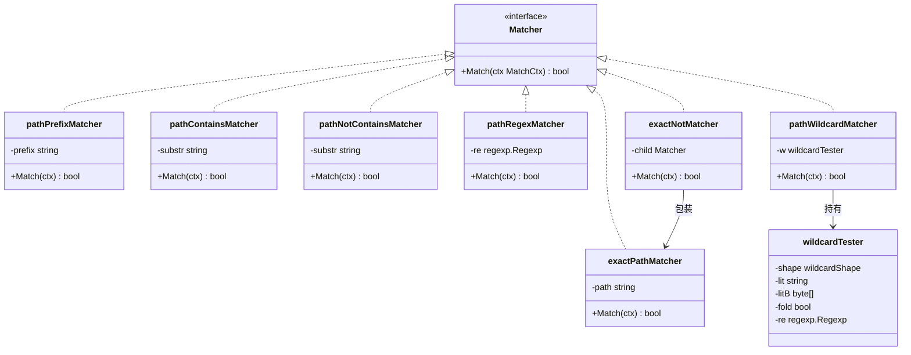
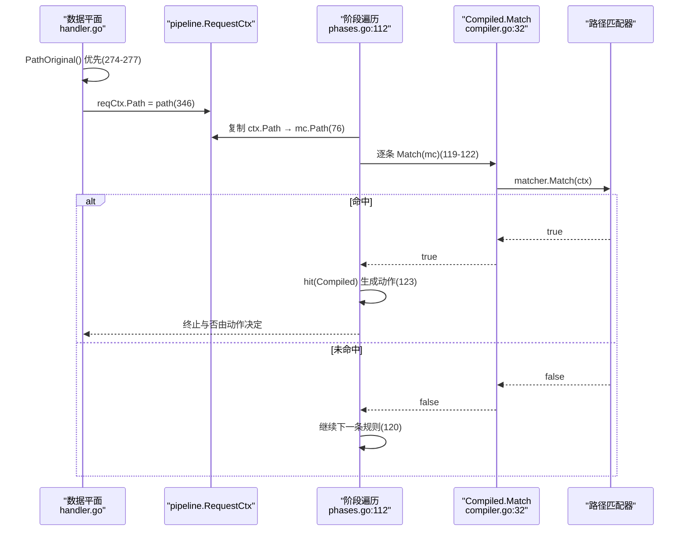
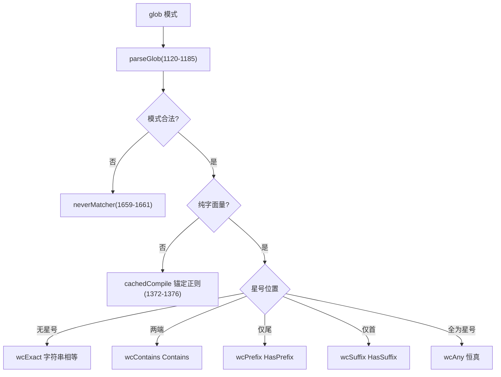
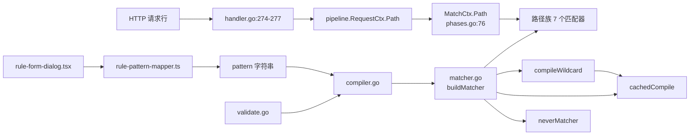
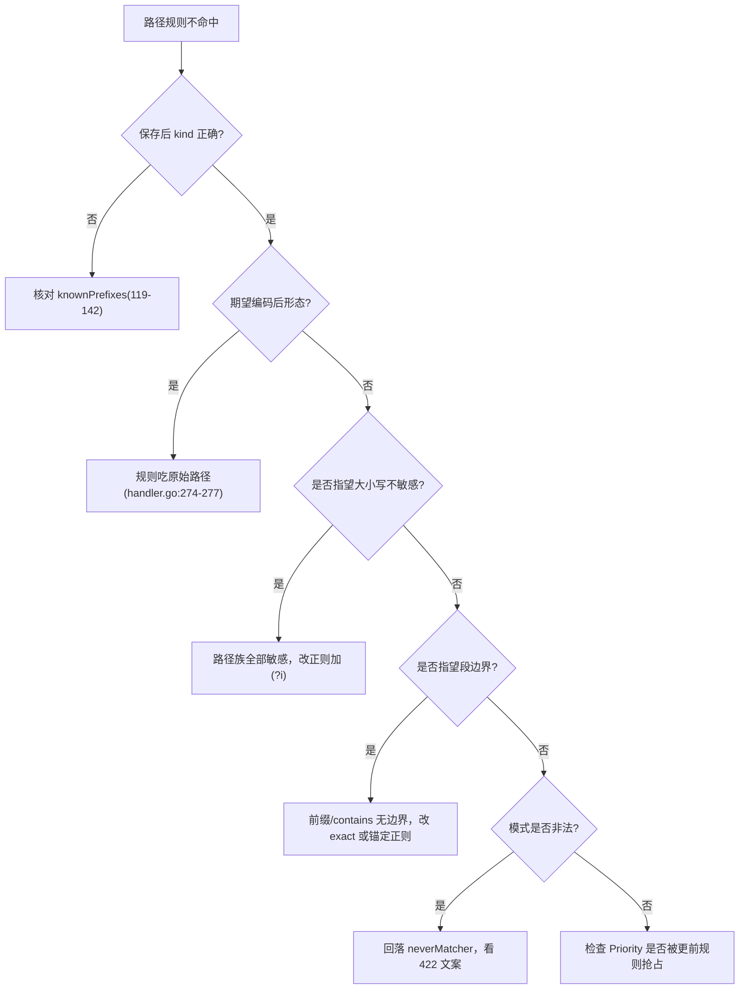

# 路径匹配器

> [返回 WAF 引擎系统](../WAF %E5%BC%95%E6%93%8E%E7%B3%BB%E7%BB%9F.md)

<cite>
**本文档引用的文件**
- [matcher.go](file://internal/core/rules/matcher.go)
- [compiler.go](file://internal/core/rules/compiler.go)
- [validate.go](file://internal/core/rules/validate.go)
- [phases.go](file://internal/core/rules/phases.go)
- [handler.go](file://internal/dataplane/handler.go)
- [snapshot.go](file://internal/snapshot/snapshot.go)
- [match.go](file://internal/appresource/match.go)
- [normalize.go](file://internal/waf/owasp/normalize.go)
- [rule-pattern-mapper.ts](file://frontend/app/(dashboard)/rules/components/rule-pattern-mapper.ts)
- [rule-form-dialog.tsx](file://frontend/app/(dashboard)/rules/components/rule-form-dialog.tsx)
</cite>

## 目录

1. [简介](#简介)
2. [项目结构](#项目结构)
3. [核心组件](#核心组件)
4. [架构总览](#架构总览)
5. [详细组件分析](#详细组件分析)
6. [依赖关系分析](#依赖关系分析)
7. [性能考虑](#性能考虑)
8. [故障排查指南](#故障排查指南)
9. [结论](#结论)
10. [附录](#附录)

## 简介

本篇只讲**规则路径匹配**，即对 `MatchCtx.Path` 求值的七个 kind：`block_path`、`block_path_exact`、`path_not_exact`、`block_path_regex`、`path_contains`、`path_not_contains`、`path_wildcard`。带查询串的完整 URL 匹配（`full_url_*`）属于「主机和URL匹配器」篇，两者实现不同、取值也不同，不可混用。

三条必须先纠正的认知：

1. **没有树形索引**。历史版本本篇把 `internal/dataplane` 下的一个域名索引文件描述成「域名 Trie，用于站点解析与主机匹配」。该文件已删除，全库没有任何前缀树/字典树；路径匹配就是 `strings.HasPrefix`、`==`、`strings.Contains` 与 RE2 四件事（`matcher.go:323-333`、`457-461`、`808-814`）。
2. **规则匹配的是原始路径，不是解码后的路径**。数据平面优先取 `PathOriginal()`，只有它为空时才回落到 Hertz 归一化后的 `c.Path()`（`handler.go:274-277`），随后原样写入 `reqCtx.Path`（`handler.go:346`）并复制到 `MatchCtx.Path`（`phases.go:76`）。URL 解码、UTF-7、HTML 实体等归一化只发生在 OWASP 检测层（`internal/waf/owasp/normalize.go:14-70`），规则层不做。
3. **「放行路径」不是一种匹配器**。前端列表里的「放行路径 / 放行路径正则」是同一批路径 kind 配上 `allow` 动作（`action.Allow`，见 `phases.go:377` 的白名单结果构造），差别在动作与所在阶段，不在匹配器。

## 项目结构

```text
internal/core/rules/
├── matcher.go       路径族实现 323-333 / 457-461 / 685-687 / 808-814 / 1421-1426
│                    工厂分支 1493-1501 / 1537-1541 / 1651-1662
│                    glob 编译 1071-1419，正则缓存 1785-1808
├── compiler.go      knownPrefixes 119-142，ParsePattern 146-170，Compile 40-78
├── validate.go      保存期校验 129-131 / 133-139 / 147-153 / 212-223
└── phases.go        MatchCtx 33-52，填充 72-104，阶段遍历 112-129
internal/dataplane/handler.go   原始路径选取 274-277，上下文写入 346
internal/appresource/match.go   另一套路径操作符（资源记录，不参与拦截）
```

### 模块清单表

| 模块 | 路径 | 职责 | 核心接口/符号 | 依赖模块 | 被依赖 | 规模(行) | 测试 |
|------|------|------|---------------|----------|--------|:--------:|:----:|
| 路径前缀 | `internal/core/rules/matcher.go:323-327` | `HasPrefix` 判定 | `pathPrefixMatcher` | `strings` | `buildMatcher` | 1928 | 有 |
| 路径精确 | `internal/core/rules/matcher.go:457-461` | `==` 判定 | `exactPathMatcher` | - | `buildMatcher` | 1928 | 有 |
| 路径包含 | `internal/core/rules/matcher.go:685-687` | `Contains` 与取反 | `pathContainsMatcher`、`pathNotContainsMatcher` | `strings` | `buildMatcher` | 1928 | 有 |
| 路径正则 | `internal/core/rules/matcher.go:329-333` | RE2 判定 | `pathRegexMatcher` | `regexp` | `buildMatcher` | 1928 | 有 |
| 路径通配 | `internal/core/rules/matcher.go:1421-1426` | glob 判定，形态退化 | `pathWildcardMatcher`、`wildcardTester` | `regexp`、`strings`、`bytes` | `buildMatcher` | 1928 | 有 |
| 取反包装 | `internal/core/rules/matcher.go:309-315` | 保持精确语义的 `ne` | `exactNotMatcher` | - | `buildMatcher` | 1928 | 有 |
| 资源路由匹配 | `internal/appresource/match.go` | 记录用途的独立操作符集 | `Match`、`applyOp` | `store/approute` | 资源记录 | 109 | 部分 |

**章节来源**
- [matcher.go:309-333](file://internal/core/rules/matcher.go#L309-L333)
- [matcher.go:457-461](file://internal/core/rules/matcher.go#L457-L461)
- [matcher.go:685-687](file://internal/core/rules/matcher.go#L685-L687)
- [matcher.go:808-814](file://internal/core/rules/matcher.go#L808-L814)
- [matcher.go:1421-1426](file://internal/core/rules/matcher.go#L1421-L1426)
- [match.go:11-40](file://internal/appresource/match.go#L11-L40)

### 类型关系

七个 kind 落到 6 个结构体加 1 个取反包装。类图为兼容渲染器省略了 Go 的指针与切片记号（`*regexp.Regexp`、`[]byte`），真值以 `matcher.go:329-333` 与 `matcher.go:1321-1327` 为准。



**图表来源**
- [matcher.go:20-23](file://internal/core/rules/matcher.go#L20-L23)
- [matcher.go:309-333](file://internal/core/rules/matcher.go#L309-L333)
- [matcher.go:457-461](file://internal/core/rules/matcher.go#L457-L461)
- [matcher.go:685-687](file://internal/core/rules/matcher.go#L685-L687)
- [matcher.go:1321-1327](file://internal/core/rules/matcher.go#L1321-L1327)
- [matcher.go:1421-1426](file://internal/core/rules/matcher.go#L1421-L1426)

**章节来源**
- [matcher.go:309-333](file://internal/core/rules/matcher.go#L309-L333)
- [matcher.go:457-461](file://internal/core/rules/matcher.go#L457-L461)
- [matcher.go:685-687](file://internal/core/rules/matcher.go#L685-L687)
- [matcher.go:1321-1327](file://internal/core/rules/matcher.go#L1321-L1327)
- [matcher.go:1421-1426](file://internal/core/rules/matcher.go#L1421-L1426)

## 核心组件

七个 kind 由 `buildMatcher` 的六个分支构造（`matcher.go:1493-1501`、`1537-1541`、`1651-1662`），全部只读 `ctx.Path` 一个字段，不触碰头部、体或 TLS，因此 `needsDerivedHeaders` 对它们恒为假（`phases.go:236-246`），热路径上不会触发头序/ALPN/套件派生。

### 代码上下文表

| 符号 | 位置 | 职责 | 上游调用者 | 下游依赖 | 副作用 | 影响面 |
|------|------|------|------------|----------|--------|--------|
| `pathPrefixMatcher.Match` | `matcher.go:325-327` | 前缀判定 | `Compiled.Match`（`compiler.go:32-37`） | `strings.HasPrefix` | 无 | 高：目录级封禁的成败 |
| `exactPathMatcher.Match` | `matcher.go:459-461` | 全等判定 | 同上、`exactNotMatcher` | 无 | 无 | 高：敏感文件拦截 |
| `pathRegexMatcher.Match` | `matcher.go:331-333` | RE2 判定 | 同上 | `regexp.MatchString` | 无 | 中 |
| `pathContainsMatcher.Match` | `matcher.go:808-810` | 子串判定 | 同上 | `strings.Contains` | 无 | 中 |
| `pathNotContainsMatcher.Match` | `matcher.go:812-814` | 子串取反 | 同上 | `strings.Contains` | 无 | 中 |
| `pathWildcardMatcher.Match` | `matcher.go:1424-1426` | glob 判定 | 同上 | `wildcardTester.matchString` | 无 | 中 |
| `compileWildcard` | `matcher.go:1341-1377` | 模式编译与形态选择 | `buildMatcher`（`matcher.go:1658`） | `parseGlob`、`cachedCompile` | 写正则缓存 | 中 |
| `cachedCompile` | `matcher.go:1791-1808` | 正则实例复用 | 全部 `*_regex` 与通配回落 | `regexp.Compile` | 写全局 map | 高 |

**章节来源**
- [matcher.go:325-333](file://internal/core/rules/matcher.go#L325-L333)
- [matcher.go:459-461](file://internal/core/rules/matcher.go#L459-L461)
- [matcher.go:808-814](file://internal/core/rules/matcher.go#L808-L814)
- [matcher.go:1341-1377](file://internal/core/rules/matcher.go#L1341-L1377)
- [matcher.go:1424-1426](file://internal/core/rules/matcher.go#L1424-L1426)
- [matcher.go:1791-1808](file://internal/core/rules/matcher.go#L1791-L1808)
- [compiler.go:31-37](file://internal/core/rules/compiler.go#L31-L37)
- [phases.go:236-246](file://internal/core/rules/phases.go#L236-L246)

## 架构总览



**图表来源**
- [handler.go:274-277](file://internal/dataplane/handler.go#L274-L277)
- [handler.go:346](file://internal/dataplane/handler.go#L346)
- [phases.go:76](file://internal/core/rules/phases.go#L76)
- [phases.go:112-129](file://internal/core/rules/phases.go#L112-L129)
- [compiler.go:31-37](file://internal/core/rules/compiler.go#L31-L37)

**章节来源**
- [handler.go:274-277](file://internal/dataplane/handler.go#L274-L277)
- [handler.go:346](file://internal/dataplane/handler.go#L346)
- [phases.go:76-129](file://internal/core/rules/phases.go#L76-L129)

### 匹配字段与操作符总览

| 匹配字段 | 取值来源:行 | 操作符集合 | 短路行为 | 典型用例 |
|------|------|------|------|------|
| `ctx.Path` | `phases.go:36`（声明）、`phases.go:76`（填充），源自 `handler.go:274-277` | `prefix`(`block_path`)、`eq`(`block_path_exact`)、`ne`(`path_not_exact`)、`contains`(`path_contains`)、`not_contains`、`regex`(`block_path_regex`)、`wildcard`(`path_wildcard`) | 匹配器内部无短路；阶段层命中即返回 | 封 `/admin`、放行 `/health` |

阶段级短路只有一处：ACL 阶段以 `allowShortCircuit=true` 调用（`phases.go:148-149`），签名与自定义阶段为假（`phases.go:169-170`、`phases.go:190-194`）。也就是说「命中 Allow 就跳出后续阶段」是 ACL 的属性，不是路径匹配器的属性。

**章节来源**
- [phases.go:36](file://internal/core/rules/phases.go#L36)
- [phases.go:76](file://internal/core/rules/phases.go#L76)
- [phases.go:148-149](file://internal/core/rules/phases.go#L148-L150)
- [phases.go:169-170](file://internal/core/rules/phases.go#L169-L170)
- [phases.go:190-194](file://internal/core/rules/phases.go#L190-L194)
- [handler.go:274-277](file://internal/dataplane/handler.go#L274-L277)

## 详细组件分析

### 路径族类型与判定对照

| kind | 工厂位置 | 结构体:行 | 判定表达式 | 段边界 | 大小写 |
|------|----------|-----------|------------|--------|--------|
| `block_path` | `matcher.go:1493-1494` | `pathPrefixMatcher`:323 | `strings.HasPrefix(ctx.Path, prefix)` | 无保护 | 敏感 |
| `block_path_exact` | `matcher.go:1537-1538` | `exactPathMatcher`:457 | `ctx.Path == path` | 需全等 | 敏感 |
| `path_not_exact` | `matcher.go:1540-1541` | `exactNotMatcher`:311 | `!(ctx.Path == path)` | 需全等 | 敏感 |
| `block_path_regex` | `matcher.go:1496-1501` | `pathRegexMatcher`:329 | `re.MatchString(ctx.Path)` | 由模式决定 | 由模式决定 |
| `path_contains` | `matcher.go:1651-1652` | `pathContainsMatcher`:685 | `strings.Contains(ctx.Path, substr)` | 无 | 敏感 |
| `path_not_contains` | `matcher.go:1654-1655` | `pathNotContainsMatcher`:687 | `!Contains(ctx.Path, substr)` | 无 | 敏感 |
| `path_wildcard` | `matcher.go:1657-1662` | `pathWildcardMatcher`:1421 | `wildcardTester.matchString(ctx.Path)` | `*` 跨 `/` | 敏感 |

`block_path:/admin` 会同时命中 `/admin`、`/admin/`、`/administrator`，因为前缀比较不看段边界（`matcher.go:325-327`）。要精确到目录，写 `block_path:/admin/` 或用 `block_path_regex` 自行锚定。

**章节来源**
- [matcher.go:323-333](file://internal/core/rules/matcher.go#L323-L333)
- [matcher.go:457-461](file://internal/core/rules/matcher.go#L457-L461)
- [matcher.go:685-687](file://internal/core/rules/matcher.go#L685-L687)
- [matcher.go:808-814](file://internal/core/rules/matcher.go#L808-L814)
- [matcher.go:1421-1426](file://internal/core/rules/matcher.go#L1421-L1426)
- [matcher.go:1493-1662](file://internal/core/rules/matcher.go#L1493-L1662)

### 取值语义：原始路径优先

`handler.go:268-278` 决定规则看到什么：

```text
pathCached := string(c.Path())              // handler.go:198，Hertz 归一化形态
path := pathCached                          // handler.go:274
if rawPath := c.Request.URI().PathOriginal(); len(rawPath) > 0 {
    path = string(rawPath)                  // handler.go:275-277，优先原始字节
}
rawQ := string(c.URI().QueryString())       // handler.go:278
```

由此推出三条实践结论：

| 场景 | 规则看到的形态 | 影响 |
|------|----------------|------|
| 请求行含 `%2e%2e/` | 原样 `%2e%2e/` | `path_contains:../` 不命中，需另写 `%2e%2e` 或交给 OWASP |
| 请求行为 `//a//b` | 原样双斜杠 | `block_path:/a/` 不命中 |
| `PathOriginal()` 为空（异常构造） | 回落 `c.Path()` 归一形态 | 同一条规则可能有两种命中口径 |

OWASP 层另有独立的解码链（URL 解码、`%u`、UTF-7 预解码、HTML 实体），入口在 `normalize`/`normalizeTarget`（`normalize.go:55-70`），与规则路径匹配互不相干——这也是「同一攻击串规则不命中但 OWASP 命中」的根本原因。

**章节来源**
- [handler.go:198](file://internal/dataplane/handler.go#L198)
- [handler.go:274-278](file://internal/dataplane/handler.go#L274-L278)
- [normalize.go:14-70](file://internal/waf/owasp/normalize.go#L14-L70)

### 通配符在路径上的形态退化

`path_wildcard` 与其余四族共享 `compileWildcard`（`matcher.go:1341-1377`），大小写敏感（工厂传 `false`，`matcher.go:1658`），因此五种快形态全部可用：



**图表来源**
- [matcher.go:1120-1185](file://internal/core/rules/matcher.go#L1120-L1185)
- [matcher.go:1341-1377](file://internal/core/rules/matcher.go#L1341-L1377)
- [matcher.go:1379-1398](file://internal/core/rules/matcher.go#L1379-L1398)
- [matcher.go:1657-1662](file://internal/core/rules/matcher.go#L1657-L1662)

关键差异在于 `*` 的语义：本实现中 `*` 匹配任意字符序列，**包含 `/`** 与换行，这是有意偏离 `path.Match` 段边界语义的设计（决策记录在 `matcher.go:1054-1070`），代价是 `block_path_wildcard:/admin*` 会一路吞掉后续所有段。此外首尾星号不再翻译成 `\A.*` / `.*\z`，而是省掉锚点（`parsedGlob.regexSource`，`matcher.go:1096-1112`），让 RE2 能用字面量预扫描；`(?s)` 始终前置，防止换行绕过 `.`。

**章节来源**
- [matcher.go:1054-1112](file://internal/core/rules/matcher.go#L1054-L1112)
- [matcher.go:1120-1185](file://internal/core/rules/matcher.go#L1120-L1185)
- [matcher.go:1301-1327](file://internal/core/rules/matcher.go#L1301-L1327)
- [matcher.go:1341-1398](file://internal/core/rules/matcher.go#L1341-L1398)
- [matcher.go:1657-1662](file://internal/core/rules/matcher.go#L1657-L1662)

### 正则族与缓存复用

`block_path_regex` 与 `block_user_agent_regex`、`host_regex` 等共用同一个 `cachedCompile`（`matcher.go:1791-1808`）：读时先取读锁查表，未命中才编译并加写锁回填。缓存以模式原文为键、进程级常驻，没有容量上限也没有淘汰接口——快照重载只重建 `Compiled` 列表，不清空该缓存。

| 特性 | 实测行为 | 位置 |
|------|----------|------|
| 引擎 | Go `regexp`（RE2，线性时间） | `matcher.go:1799` |
| 编译失败 | 返回 err，工厂回落 `neverMatcher` | `matcher.go:1497-1500` |
| 跨站点复用 | 同模式字符串共享一个实例 | `matcher.go:1792-1796` |
| 校验期复用 | `validate.go` 也调 `cachedCompile`，故保存即预热 | `validate.go:147-153` |
| 匹配目标 | `ctx.Path` 原始串，非锚定 | `matcher.go:331-333` |

最后一行意味着 `block_path_regex:/admin` 会命中任何含 `/admin` 的路径，而不是以它开头。写正则时必须自行加 `^`，且由于目标不锚定、`.` 默认不跨换行，若依赖多行语义需显式 `(?s)`。

**章节来源**
- [matcher.go:329-333](file://internal/core/rules/matcher.go#L329-L333)
- [matcher.go:1496-1501](file://internal/core/rules/matcher.go#L1496-L1501)
- [matcher.go:1785-1808](file://internal/core/rules/matcher.go#L1785-L1808)
- [validate.go:147-153](file://internal/core/rules/validate.go#L147-L153)

### 与站点路由查找的边界

站点解析同样吃 Host 与路径无关的键，但它常被误当作「路径 Trie」。真实实现是哈希键加至多三级查表，且只作用于 Host：

| 维度 | 站点路由 | 规则路径匹配 |
|------|----------|--------------|
| 键/目标 | `bind + "\x00" + host`（`snapshot.go:289-296`） | `ctx.Path`（`phases.go:76`） |
| 查找方式 | 精确 → `*.` 单级父域 → catch-all `*`（`snapshot.go:337-362`） | 逐条求值，无索引 |
| 复杂度 | 至多三次 map 命中，O(1) | O(规则数 × 串长) |
| 通配 | 只剥最左一级标签（`strings.Index` 取第一个点，`snapshot.go:349`） | `*` 跨段（`matcher.go:1054-1070`） |

结论：站点解析与路径匹配没有共享任何数据结构，「站点解析器含前缀树加速」的说法在代码里找不到对应实现。

**章节来源**
- [snapshot.go:289-296](file://internal/snapshot/snapshot.go#L289-L296)
- [snapshot.go:337-362](file://internal/snapshot/snapshot.go#L337-L362)
- [matcher.go:1054-1070](file://internal/core/rules/matcher.go#L1054-L1070)
- [phases.go:76](file://internal/core/rules/phases.go#L76)

### 从前端到运行时的落库链路

| 步 | 动作 | 执行位置 | 输入 | 输出 | 失败分支 | 可观测点 |
|:--:|------|----------|------|------|----------|----------|
| 1 | UI 选 `url_path` + method | `rule-form-dialog.tsx:60`、`73-86` | 表单输入 | `ConditionRow` | 空 content 即拒 | 表单提示 |
| 2 | 翻译 kind | `rule-pattern-mapper.ts:235-255` | `(url_path, prefix)` | `block_path:…` | `ok:false` | 保存前报错 |
| 3 | 保留原始空白 | `compiler.go:164-166` | `*_wildcard` 模式 | 未 `TrimSpace` 的 arg | 非通配族会被裁边 | 模式与预期不符 |
| 4 | 白名单核对 | `compiler.go:161-163` | kind 前缀 | 命中 `knownPrefixes` | 整条规则跳过 | 规则永不生效 |
| 5 | 保存期校验 | `validate.go:129-131`、`133-139`、`147-153`、`212-223` | `kind,arg` | `errs` | 注入 `neverMatcher`（`compiler.go:50-53`） | 422 文案 |
| 6 | 编译并排序 | `compiler.go:40-78` | 站点规则集合 | 升序 `Compiled` | 停用规则直接跳过（`compiler.go:43-45`） | 命中顺序 |
| 7 | 运行期求值 | `phases.go:119-128` | `MatchCtx` | 布尔→动作 | 假则继续 | 安全事件 `Category` 即 kind |

**章节来源**
- [compiler.go:40-78](file://internal/core/rules/compiler.go#L40-L78)
- [compiler.go:161-166](file://internal/core/rules/compiler.go#L161-L166)
- [validate.go:129-153](file://internal/core/rules/validate.go#L129-L153)
- [validate.go:212-223](file://internal/core/rules/validate.go#L212-L223)
- [phases.go:112-129](file://internal/core/rules/phases.go#L112-L129)
- [rule-pattern-mapper.ts:235-255](file://frontend/app/(dashboard)/rules/components/rule-pattern-mapper.ts#L235-L255)
- [rule-form-dialog.tsx:55-86](file://frontend/app/(dashboard)/rules/components/rule-form-dialog.tsx#L55-L86)

### 另一套路径操作符：应用资源记录

`internal/appresource/match.go` 与规则引擎完全无关，它服务资源记录与转储，操作符更丰富但语义更松：

| 操作符 | 判定 | 位置 | 规则引擎是否有对应 |
|--------|------|------|--------------------|
| `eq` | `value == pattern` | `match.go:19` | 有（`block_path_exact`） |
| `ne` | `value != pattern` | `match.go:21` | 有（`path_not_exact`） |
| `contains` | `strings.Contains` | `match.go:23` | 有（`path_contains`） |
| `not_contains` | `!Contains` | `match.go:25` | 有（`path_not_contains`） |
| `prefix` | `HasPrefix` | `match.go:27` | 有（`block_path`） |
| `suffix` | `HasSuffix` | `match.go:29` | **无**，规则侧需用通配或正则 |
| `fuzzy` | 双侧 `ToLower` 后 `Contains` | `match.go:31` | **无**，规则侧大小写敏感 |
| `regex` | `re.MatchString`，`re==nil` 判假 | `match.go:32-36` | 有（`block_path_regex`） |
| 默认 | 恒假 | `match.go:37-38` | 对应 `neverMatcher` |

两套实现在「目标串」上也不同：资源匹配拿 `Material.Path` 拼进 `FullHTTPRequest`（`match.go:64-68`），而规则匹配只拿 `ctx.Path`。写文档或排障时不要把 `suffix`、`fuzzy` 当成规则可用操作符。

**章节来源**
- [match.go:11-40](file://internal/appresource/match.go#L11-L40)
- [match.go:64-68](file://internal/appresource/match.go#L64-L69)
- [matcher.go:457-461](file://internal/core/rules/matcher.go#L457-L461)
- [matcher.go:504-508](file://internal/core/rules/matcher.go#L504-L508)

## 依赖关系分析



**图表来源**
- [matcher.go:1493-1662](file://internal/core/rules/matcher.go#L1493-L1662)
- [matcher.go:1341-1377](file://internal/core/rules/matcher.go#L1341-L1377)
- [compiler.go:40-78](file://internal/core/rules/compiler.go#L40-L78)
- [handler.go:274-277](file://internal/dataplane/handler.go#L274-L277)
- [phases.go:76](file://internal/core/rules/phases.go#L76)

**章节来源**
- [matcher.go:1341-1662](file://internal/core/rules/matcher.go#L1341-L1662)
- [compiler.go:40-78](file://internal/core/rules/compiler.go#L40-L78)
- [handler.go:274-277](file://internal/dataplane/handler.go#L274-L277)
- [phases.go:76](file://internal/core/rules/phases.go#L76)

路径族对包外的唯一依赖是 `ctx.Path` 的填充质量；正则与通配编译全部收敛到 `cachedCompile` 与 `parseGlob` 两个函数，没有第三方模式库，也不读取快照或存储层。

**章节来源**
- [matcher.go:1120-1185](file://internal/core/rules/matcher.go#L1120-L1185)
- [matcher.go:1785-1808](file://internal/core/rules/matcher.go#L1785-L1808)

## 性能考虑

| 关注点 | 现状 | 依据 | 建议 |
|--------|------|------|------|
| 前缀/子串 | 无内存分配，长度线性 | `matcher.go:325-327`、`808-814` | 优先这类 kind |
| 全等 | 直接 `==`，最快 | `matcher.go:459-461` | 敏感文件用 `block_path_exact` |
| 通配快路径 | 纯字面量退化为字符串操作 | `matcher.go:1347-1370` | 写 `*evil*` 而非等价正则 |
| 正则复用 | 全局缓存共享实例 | `matcher.go:1791-1808` | 跨站点复用同一模式串以命中缓存 |
| 正则风险 | RE2 线性时间，无回溯爆炸 | `matcher.go:1799` | 仍需避免过度宽泛的非锚定搜索 |
| 遍历成本 | 阶段内逐条，命中即停 | `phases.go:119-128` | 精确规则给更小 `Priority`（`compiler.go:71-76`） |
| 星号预算 | 类外未转义星号上限 8 | `matcher.go:1027`、`1121` | 复杂 glob 拆成多条规则 |
| 派生头部 | 路径族不触发 | `phases.go:236-246` | 与指纹族分桶会拖慢整桶 |

**章节来源**
- [matcher.go:325-327](file://internal/core/rules/matcher.go#L325-L327)
- [matcher.go:459-461](file://internal/core/rules/matcher.go#L459-L461)
- [matcher.go:808-814](file://internal/core/rules/matcher.go#L808-L814)
- [matcher.go:1027](file://internal/core/rules/matcher.go#L1027)
- [matcher.go:1121](file://internal/core/rules/matcher.go#L1121)
- [matcher.go:1347-1370](file://internal/core/rules/matcher.go#L1347-L1370)
- [matcher.go:1791-1808](file://internal/core/rules/matcher.go#L1791-L1808)
- [compiler.go:71-76](file://internal/core/rules/compiler.go#L71-L76)
- [phases.go:119-128](file://internal/core/rules/phases.go#L119-L128)
- [phases.go:236-246](file://internal/core/rules/phases.go#L236-L246)

## 故障排查指南



**图表来源**
- [compiler.go:119-142](file://internal/core/rules/compiler.go#L119-L142)
- [handler.go:274-277](file://internal/dataplane/handler.go#L274-L277)
- [matcher.go:325-327](file://internal/core/rules/matcher.go#L325-L327)
- [compiler.go:50-53](file://internal/core/rules/compiler.go#L50-L53)

**章节来源**
- [compiler.go:50-53](file://internal/core/rules/compiler.go#L50-L53)
- [compiler.go:119-142](file://internal/core/rules/compiler.go#L119-L142)
- [handler.go:274-277](file://internal/dataplane/handler.go#L274-L277)

### 常见问题与定位

| 症状 | 原因 | 排查 | 方案 |
|------|------|------|------|
| `path_contains:../` 放过 `%2e%2e/` | 目标是原始路径 | `handler.go:274-277` | 补 `%2e` 条件，或依赖 OWASP 解码链 |
| `block_path:/admin` 误拦 `/administrator` | 前缀无段边界 | `matcher.go:325-327` | 写 `/admin/` 或用锚定正则 |
| `block_path_regex:/api` 命中意外路径 | `MatchString` 非锚定 | `matcher.go:331-333` | 加 `^/api/` |
| `path_wildcard:/a*` 吞掉多级路径 | `*` 有意跨 `/` | `matcher.go:1054-1070` | 收窄为 `/a/b*` 或改正则 |
| 带空格的 glob 意外生效 | 通配族 arg 不被裁剪 | `compiler.go:164-166` | 显式处理首尾空白 |
| 规则保存成功但零命中 | 校验失败回落恒假 | `compiler.go:50-53` | 用规则测试接口 Dry-run |
| 放行规则没跳过后续阶段 | 不在 ACL 阶段 | `phases.go:148-149` | 把 Allow 规则放到 `acl` |

**章节来源**
- [compiler.go:50-53](file://internal/core/rules/compiler.go#L50-L53)
- [compiler.go:164-166](file://internal/core/rules/compiler.go#L164-L166)
- [handler.go:274-277](file://internal/dataplane/handler.go#L274-L277)
- [matcher.go:325-333](file://internal/core/rules/matcher.go#L325-L333)
- [matcher.go:1054-1070](file://internal/core/rules/matcher.go#L1054-L1070)
- [phases.go:148-149](file://internal/core/rules/phases.go#L148-L150)

## 结论

路径族七个 kind 是整套内置匹配器里最简单的一族：单字段输入、无状态、无派生计算，实现全部落在 `matcher.go` 的 30 行以内。它的复杂度不在算法，而在**取值口径**——规则看到的是原始未解码路径（`handler.go:274-277`），而攻击者提交的形态、Hertz 归一后的形态、OWASP 解码后的形态三者互不相同，绝大多数「规则没拦住」的归因都在这里。

本篇原有「站点解析与主机匹配互补的前缀树」描述已按代码事实删除：全库无前缀树实现，站点解析是 `bind+NUL+host` 哈希键与至多三级查表（`snapshot.go:289-296`、`337-362`），与路径匹配没有任何共享结构。

建议把路径规则当成「字节层断言」来写：需要解码语义就交给 OWASP，需要边界就显式加 `/` 或锚点，需要大小写不敏感就显式写 `(?i)`。

**章节来源**
- [handler.go:274-277](file://internal/dataplane/handler.go#L274-L277)
- [matcher.go:323-333](file://internal/core/rules/matcher.go#L323-L333)
- [snapshot.go:289-296](file://internal/snapshot/snapshot.go#L289-L296)
- [snapshot.go:337-362](file://internal/snapshot/snapshot.go#L337-L362)

## 附录

### DSL 示例

```text
block_path:/admin
block_path:/admin/
block_path_exact:/.env
path_not_exact:/health
block_path_regex:^/api/v[0-9]+/(admin|debug)
block_path_regex:(?i)^/upload/.*\.php$
path_contains:.php
path_not_contains:/static/
path_wildcard:/export?*format=csv
path_wildcard:*..*
```

前两条演示段边界差异：`/admin` 命中 `/administrator`，`/admin/` 不会。最后一条 `*..*` 只在原始路径含字面 `..` 时命中，编码形态需另写规则。

**章节来源**
- [matcher.go:1493-1662](file://internal/core/rules/matcher.go#L1493-L1662)

### 保存期校验要求

| kind | 必填校验 | 模式校验 | 位置 |
|------|----------|----------|------|
| `block_path` | 去空白后非空 | 无 | `validate.go:129-131` |
| `block_path_exact`、`path_contains`、`path_not_contains` | 非空 | 无 | `validate.go:133-139` |
| `path_not_exact` | 非空 | 无 | `validate.go:135`（同一分支列表） |
| `block_path_regex` | 非空 | `cachedCompile` 成功 | `validate.go:147-153` |
| `path_wildcard` | 非空 | `globToRegexSource` + `cachedCompile` 成功 | `validate.go:212-223` |

`validate.go` 与 `buildMatcher` 共用 `cachedCompile`，因此保存成功会顺带预热正则缓存；反之保存期被拒的模式在运行期也一定编译不出来，两侧口径一致，不会出现「一边放行一边拒绝」。

**章节来源**
- [validate.go:129-153](file://internal/core/rules/validate.go#L129-L153)
- [validate.go:212-223](file://internal/core/rules/validate.go#L212-L223)
- [matcher.go:1071-1077](file://internal/core/rules/matcher.go#L1071-L1077)
- [matcher.go:1785-1808](file://internal/core/rules/matcher.go#L1785-L1808)

### 术语口径

| 术语 | 含义 | 出处 |
|------|------|------|
| 原始路径 | `URI().PathOriginal()`，未解码、未归一 | `handler.go:275` |
| 归一化路径 | Hertz `c.Path()`，仅在原始路径为空时回落 | `handler.go:198`、`274` |
| 段边界 | 路径分隔符 `/` 构成的边界，前缀匹配不检查 | `matcher.go:325-327` |
| 形态退化 | glob 编译成字符串快路径 | `matcher.go:1301-1327` |
| 恒假兜底 | 模式不可用时该规则不生效 | `matcher.go:504-508` |

**章节来源**
- [handler.go:198-277](file://internal/dataplane/handler.go#L198-L277)
- [matcher.go:325-327](file://internal/core/rules/matcher.go#L325-L327)
- [matcher.go:504-508](file://internal/core/rules/matcher.go#L504-L508)
- [matcher.go:1054-1070](file://internal/core/rules/matcher.go#L1054-L1070)
- [matcher.go:1301-1327](file://internal/core/rules/matcher.go#L1301-L1327)

### 延伸阅读

同族相关篇：[主机和URL匹配器](主机和URL匹配器.md)（`full_url_*` 与 Host 族）、[头部和查询参数匹配器](头部和查询参数匹配器.md)（`block_query_*` 同样吃原始串）、[内置匹配器](内置匹配器.md)（全量清单与注册链路）。

[本节为索引性内容，无需特定文件来源]
