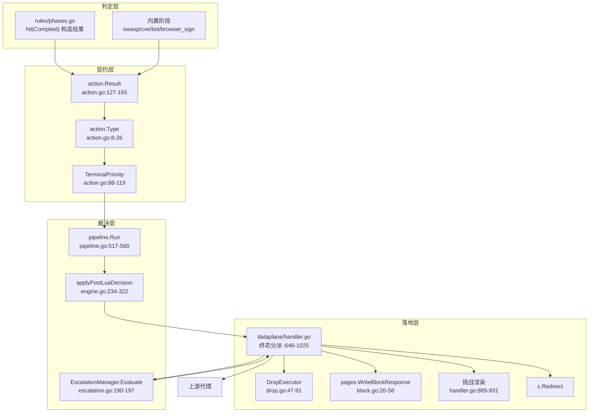
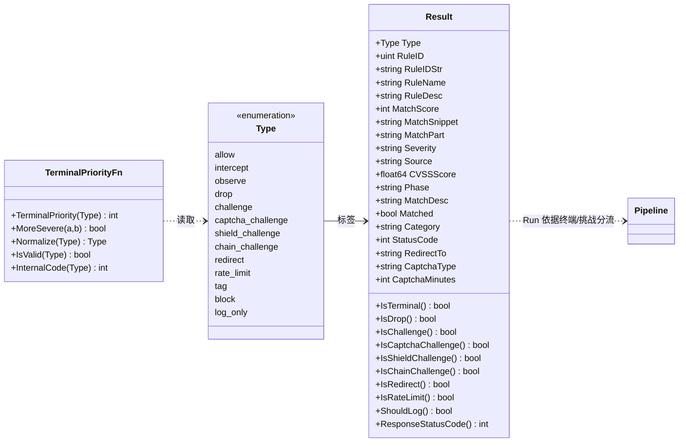
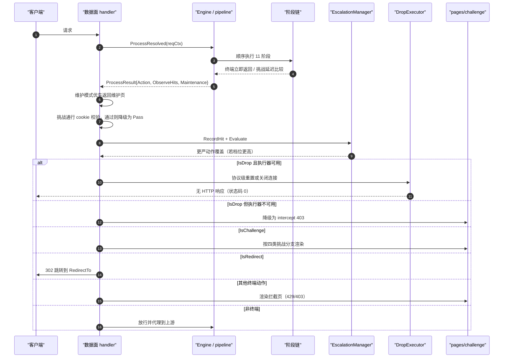
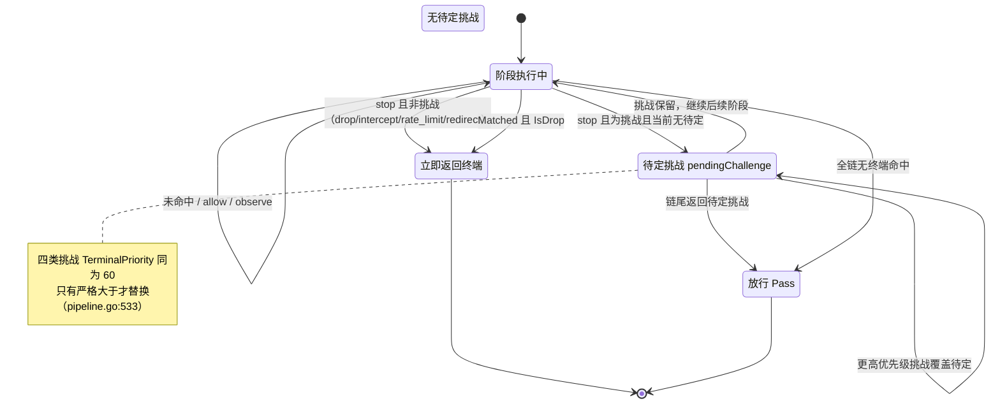
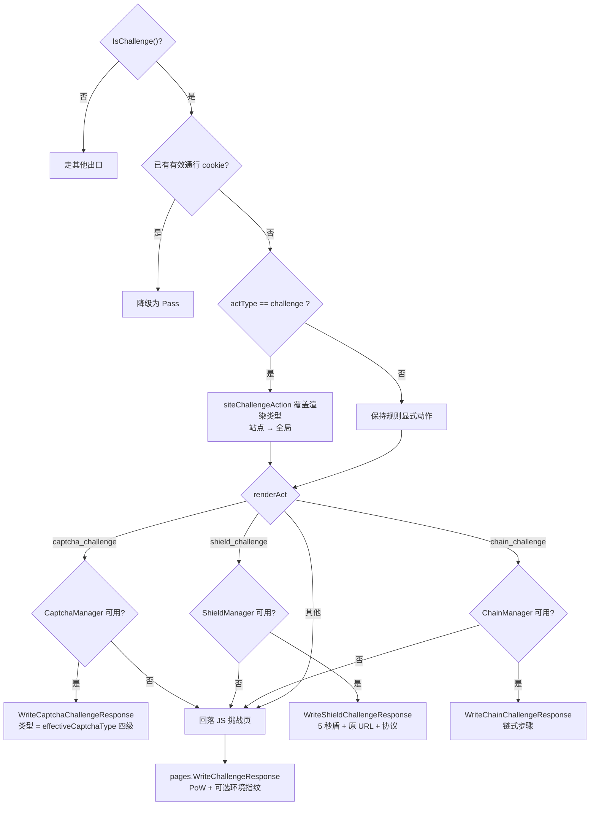
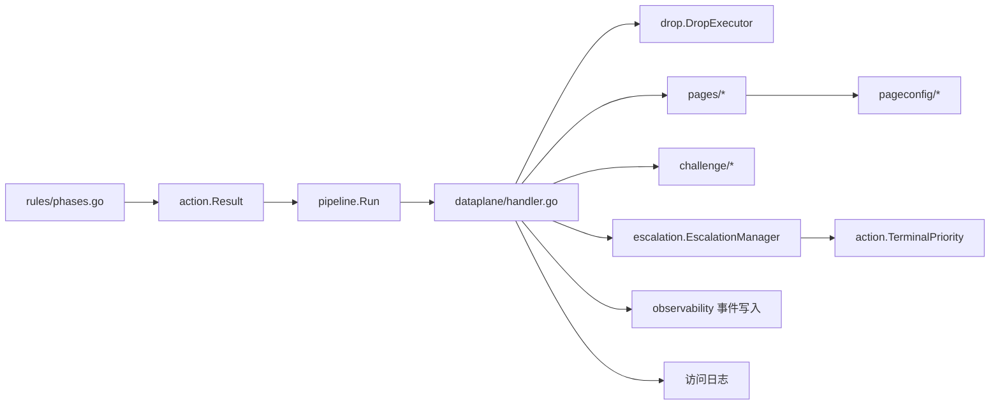

# 动作与结果系统

> [返回 WAF 引擎系统](WAF 引擎系统.md)

<cite>
**本文档引用的文件**
- [action.go](file://internal/core/action/action.go)
- [pipeline.go](file://internal/core/pipeline/pipeline.go)
- [engine.go](file://internal/core/engine/engine.go)
- [phases.go](file://internal/core/rules/phases.go)
- [handler.go](file://internal/dataplane/handler.go)
- [handler_support.go](file://internal/dataplane/handler_support.go)
- [challenge.go](file://internal/dataplane/challenge.go)
- [drop.go](file://internal/waf/drop/drop.go)
- [block.go](file://internal/waf/pages/block.go)
- [config.go](file://internal/waf/pageconfig/config.go)
- [escalation.go](file://internal/waf/escalation/escalation.go)
- [captcha.go](file://internal/waf/challenge/captcha.go)
- [protection.go](file://internal/store/protection.go)
- [policy.go](file://internal/store/policy.go)
- [compiler.go](file://internal/core/rules/compiler.go)
</cite>

## 目录

1. [简介](#简介)
2. [项目结构](#项目结构)
3. [核心组件](#核心组件)
4. [架构总览](#架构总览)
5. [详细组件分析](#详细组件分析)
6. [依赖关系分析](#依赖关系分析)
7. [性能考虑](#性能考虑)
8. [故障排查指南](#故障排查指南)
9. [结论](#结论)
10. [附录](#附录)

## 简介
动作与结果系统是规则判定与客户端响应之间的唯一契约层，承载三件事：

- **动作建模**：`action.Type` 定义 12 个可用动作加 2 个历史别名，`action.Result` 打包一次判定的全部归因信息
- **终态裁决**：`TerminalPriority` 决定多阶段并发命中时谁胜出，`pipeline.Run` 据此实现"终端立即返回、挑战延迟保留"
- **动作落地**：数据面把最终判定路由到五类出口——TCP 丢弃、拦截页、挑战页、重定向、放行上游

本篇必须强调的项目约定：**挑战类动作是 WAF action，不是状态码页面**。`captcha_challenge` 展示站点/全局配置的验证码类型，`shield_challenge` 走 5 秒盾（PoW + 环境指纹）流程，`chain_challenge` 展示链式步骤，`challenge` 才是不指定形态的 JS 挑战。四者都不得用通用 403 页面代替。

两条常被写错的事实：

- `allow` 与 `observe` **都不是终端动作**，不会短路后续阶段（action.go:168-179）
- 四类挑战动作的优先级**同为 60**，同档取链上先出现者，不存在"验证码比 5 秒盾高"之类的排序（action.go:96-97、pipeline.go:533）

阶段全序见 [处理阶段详解](处理阶段详解/处理阶段详解.md)，匹配器如何产出结果见 [规则匹配器](规则匹配器/规则匹配器.md)。

## 项目结构
动作系统横跨"判定层、裁决层、落地层、配置层"四层，落地层全部在数据面。

**图表来源**
- [action.go:8-165](file://internal/core/action/action.go#L8-L165)
- [pipeline.go:517-560](file://internal/core/pipeline/pipeline.go#L517-L560)
- [engine.go:234-322](file://internal/core/engine/engine.go#L234-L322)
- [handler.go:646-1025](file://internal/dataplane/handler.go#L646-L1025)
- [drop.go:47-91](file://internal/waf/drop/drop.go#L47-L91)
- [block.go:20-58](file://internal/waf/pages/block.go#L20-L58)
- [escalation.go:190-197](file://internal/waf/escalation/escalation.go#L190-L197)

| 模块 | 路径 | 职责 | 核心接口/符号 | 依赖模块 | 被依赖 | 规模(行) | 测试 |
|---|---|---|---|---|---|---:|:--:|
| 动作契约 | `internal/core/action/action.go` | 类型、结果、优先级、内部码 | `Type`、`Result`、`TerminalPriority` | 无 | 全链路 | 393 | 有 |
| 管道裁决 | `internal/core/pipeline/pipeline.go` | 终端/挑战延迟与观察收集 | `Run`、`RunResult` | `action`、`tlsfp` | `engine`、`rules` | 565 | 有 |
| 后置覆盖 | `internal/core/engine/engine.go` | Lua post 对内置判定的覆盖 | `applyPostLuaDecision` | `action`、`luaplugin` | `dataplane` | 646 | 有 |
| 终态分派 | `internal/dataplane/handler.go` | 六类出口的响应写入 | 终态分支、挑战路由 | `action`、`pages`、`challenge` | Hertz | 1280 | 有 |
| 丢弃执行 | `internal/waf/drop/drop.go` | SetLinger(0) + Close，统计与限频日志 | `DropExecutor` | `net`、`slog` | `dataplane` | 113 | 有 |
| 页面渲染 | `internal/waf/pages/block.go` | 拦截页/维护页/挑战页/错误页 | `WriteBlockResponse` 等 | `pageconfig`、`adminweb` | `dataplane` | 307 | 有 |
| 页面配置 | `internal/waf/pageconfig/config.go` | 品牌文案与 CSS/URL 净化 | `PageConfig` 族、`Safe*` | `html/template` | `pages`、`snapshot` | 274 | 有 |
| 分级升级 | `internal/waf/escalation/escalation.go` | 命中次数驱动的档位提升 | `EscalationManager`、`ActionSeverity` | `action`、`rueidis` | `dataplane` | 268 | 有 |

**章节来源**
- [action.go:1-393](file://internal/core/action/action.go#L1-L393)
- [pipeline.go:493-565](file://internal/core/pipeline/pipeline.go#L493-L565)
- [engine.go:217-378](file://internal/core/engine/engine.go#L217-L378)
- [handler.go:632-1038](file://internal/dataplane/handler.go#L632-L1038)
- [drop.go:10-113](file://internal/waf/drop/drop.go#L10-L113)
- [block.go:19-188](file://internal/waf/pages/block.go#L19-L188)
- [config.go:11-122](file://internal/waf/pageconfig/config.go#L11-L122)
- [escalation.go:15-249](file://internal/waf/escalation/escalation.go#L15-L249)

## 核心组件
`Result` 是唯一的判定载体，`Type` 是它的语义标签。

**图表来源**
- [action.go:8-26](file://internal/core/action/action.go#L8-L26)
- [action.go:28-124](file://internal/core/action/action.go#L28-L124)
- [action.go:127-312](file://internal/core/action/action.go#L127-L312)
- [action.go:344-393](file://internal/core/action/action.go#L344-L393)
- [pipeline.go:517-560](file://internal/core/pipeline/pipeline.go#L517-L560)

**章节来源**
- [action.go:8-312](file://internal/core/action/action.go#L8-L312)
- [pipeline.go:493-560](file://internal/core/pipeline/pipeline.go#L493-L560)

## 架构总览
一个请求从判定到响应写入的完整时序，其中挑战类动作的"延迟保留"是唯一的非线性环节。

**图表来源**
- [handler.go:632-1038](file://internal/dataplane/handler.go#L632-L1038)
- [pipeline.go:517-560](file://internal/core/pipeline/pipeline.go#L517-L560)
- [engine.go:331-378](file://internal/core/engine/engine.go#L331-L378)
- [drop.go:47-91](file://internal/waf/drop/drop.go#L47-L91)
- [block.go:20-58](file://internal/waf/pages/block.go#L20-L58)

| 出口 | 触发条件 | HTTP 状态 | 是否发响应 | 事件记录 | 位置 |
|---|---|:--:|:--:|:--:|---|
| 维护页 | `ProcessResult.Maintenance` | 503（可配） | 是 | 访问日志 `maintenance` | handler.go:632-644 |
| TCP 丢弃 | `IsDrop()` 且协议级可用 | 无 | **否** | 事件 `StatusCode:0` + drop 事件 | handler.go:713-795 |
| 丢弃降级 | `IsDrop()` 但无可用连接 | 403 | 是 | 事件动作改写为 `intercept` | handler.go:796-849 |
| 挑战页 | `IsChallenge()` | 403（可配） | 是 | 事件动作为具体挑战类型 | handler.go:852-931 |
| 重定向 | `IsRedirect()` | 302（可配） | 是 | `Upstream` 字段记跳转目标 | handler.go:934-974 |
| 拦截页 | 其余终端动作 | 403/429（可配） | 是 | 事件动作为 `actStr` | handler.go:976-1024 |
| 放行 | 非终端 | 上游决定 | 是 | 访问日志正常记录 | handler.go:1040+ |

**章节来源**
- [handler.go:632-1040](file://internal/dataplane/handler.go#L632-L1040)

## 详细组件分析

### 动作取值与规范语义
| 动作 | 终端 | 挑战 | 记日志 | `DefaultStatusCode` | 内部码 | 落地出口 |
|---|:--:|:--:|:--:|:--:|:--:|---|
| `allow` | 否 | 否 | 否 | 0 | 0 | 判定放行，阶段不短路 |
| `observe` | 否 | 否 | 是 | 0 | 1008 | 收集进 `ObserveHits`，请求继续 |
| `tag` | 否 | 否 | 否 | 0 | 0 | 仅打标，供下游脚本/日志消费 |
| `redirect` | 是 | 否 | 是 | 302 | 1007 | `c.Redirect(statusCode, RedirectTo)` |
| `challenge` | 是 | 是 | 是 | 403 | 1003 | JS 挑战页（PoW + 可选环境指纹） |
| `captcha_challenge` | 是 | 是 | 是 | 403 | 1004 | 渲染配置的验证码类型 |
| `shield_challenge` | 是 | 是 | 是 | 403 | 1005 | 5 秒盾：PoW + 环境指纹 + 协议约束 |
| `chain_challenge` | 是 | 是 | 是 | 403 | 1006 | 链式多步挑战 |
| `rate_limit` | 是 | 否 | 是 | 429 | 1002 | 拦截页限流文案分支 |
| `intercept` | 是 | 否 | 是 | 403 | 1001 | 拦截页 |
| `drop` | 是 | 否 | 是 | 0 | 1000 | 协议级关闭，不发响应 |
| `block`（legacy） | 经归一为 `intercept` | 否 | 是 | 403 | 1001 | 同 `intercept` |
| `log_only`（legacy） | 经归一为 `observe` | 否 | 是 | 0 | 1008 | 同 `observe` |

归一化链条：`Normalize` 先做 ASCII 小写化（`normalizeActionToken`，action.go:47-70），再把 `block`→`intercept`、`log_only`→`observe`；规则配置侧另有一层 `normalizeConfiguredAction`，把 `log` 归一为 `observe`，并把**任何非法动作回落为 `intercept`**（phases.go:1301-1310）。

`tag` 虽然出现在动作常量表里，但它既非终端也非 `ShouldLog`，实际语义只由 Lua/内置阶段的 `Tags` 字段承载。

**章节来源**
- [action.go:8-26](file://internal/core/action/action.go#L8-L26)
- [action.go:28-124](file://internal/core/action/action.go#L28-L124)
- [action.go:168-312](file://internal/core/action/action.go#L168-L312)
- [action.go:323-393](file://internal/core/action/action.go#L323-L393)
- [phases.go:1301-1310](file://internal/core/rules/phases.go#L1301-L1310)

### 终止优先级与终态判定
优先级数值只有一处定义，且**同档不比较、保留先出现者**（action.go:88-119、pipeline.go:533-536）。

**图表来源**
- [pipeline.go:517-560](file://internal/core/pipeline/pipeline.go#L517-L560)
- [action.go:88-124](file://internal/core/action/action.go#L88-L124)

| 动作 | `TerminalPriority` | 相对关系 |
|---|:--:|---|
| `drop` | 90 | 最高，链路立即返回 |
| `intercept` | 80 | 高于限流与挑战 |
| `rate_limit` | 70 | 高于挑战 |
| `challenge`、`captcha_challenge`、`shield_challenge`、`chain_challenge` | 60 | **四者同档** |
| `redirect` | 50 | 最低终端 |
| `observe` | 10 | 非终端，仅记日志 |
| `allow`、`tag`、未知 | 0 | 非终端 |

三个判定函数的边界值得单独记住：`IsTerminal()` 要求 `Matched` 为真（action.go:168-171），`IsChallenge()` 同样要求 `Matched`；而 `ShouldLog()` 对 `observe` 也返回真，因此"仅观察"的命中会进入 `RunResult.ObserveHits` 而不改变放行结果。

**章节来源**
- [action.go:88-124](file://internal/core/action/action.go#L88-L124)
- [action.go:168-272](file://internal/core/action/action.go#L168-L272)
- [pipeline.go:517-560](file://internal/core/pipeline/pipeline.go#L517-L560)

### 结果字段与归因
| 字段 | 来源 | 记录条件 | 说明 |
|---|---|---|---|
| `Type` | 规则动作 / 阶段配置 | 恒有 | 经归一化后的动作 |
| `RuleID`、`RuleIDStr` | `Compiled.ID`、`rule:<phase>:<kind>`；内置为 `owasp:` 等前缀 | 命中 | 检索主键 |
| `RuleName`、`RuleDesc` | 内置注册表（OWASP/CVE） | 仅内置检测 | 自定义规则恒空 |
| `MatchScore` | OWASP 累计风险分 | OWASP 命中 | 0 表示不适用 |
| `MatchSnippet` | 触发片段 | 命中 | 已按 `maxSnippetLen` 截断并脱敏 |
| `MatchPart`、`Severity`、`Source`、`CVSSScore`、`CWEType`、`References` | CVE 命中明细 | CVE 命中 | 来自规则目录与 NVD/GitHub 采集 |
| `Phase`、`Category`、`MatchDesc` | 阶段名、kind 或模块分类、模式描述 | 命中 | `compound` 长串被折叠 |
| `StatusCode` | 规则级自定义码 | 可选 | `0` 表示用默认码 |
| `RedirectTo` | 规则 `redirect_to` | `redirect` | 数据面直接跳转 |
| `CaptchaType`、`CaptchaMinutes` | 规则级覆盖 | `captcha_challenge` | 空/0 继承站点与全局 |
| `SetHeaders`、`ResponseBody`、`Tags` | Lua 后置产出 | 脚本指定 | 指针区分"不改"与"显式置空" |

**章节来源**
- [action.go:127-165](file://internal/core/action/action.go#L127-L165)
- [phases.go:1312-1339](file://internal/core/rules/phases.go#L1312-L1339)
- [compiler.go:80-85](file://internal/core/rules/compiler.go#L80-L85)

### 挑战类动作的渲染分支
挑战路由发生在数据面，核心是"规则显式选择的挑战形态不被站点/全局默认值顶替"。

**图表来源**
- [handler.go:852-931](file://internal/dataplane/handler.go#L852-L931)
- [challenge.go:493-532](file://internal/dataplane/challenge.go#L493-L532)
- [block.go:97-137](file://internal/waf/pages/block.go#L97-L137)

| 动作 | 渲染器 | 形态来源 | 参数继承链 | 管理器缺失时 |
|---|---|---|---|---|
| `challenge` | 由 `siteChallengeAction` 决定四选一 | 站点 `challenge_action` → 全局 `challenge_action` | 空值视为默认 `challenge` | 回落 JS 挑战页 |
| `captcha_challenge` | `WriteCaptchaChallengeResponse` | **配置的验证码类型**：`math`/`click`/`slide`/`rotate` | 规则级 → 站点级 → 全局 → `math` | 回落 JS 挑战页 |
| `shield_challenge` | `WriteShieldChallengeResponse` | 5 秒盾流程（PoW + 环境指纹 + 协议约束） | 原始请求 URL 与协议 | 回落 JS 挑战页 |
| `chain_challenge` | `WriteChainChallengeResponse` | 链式多步流程 | `ChainSteps` 配置 | 回落 JS 挑战页 |
| JS 挑战（兜底） | `pages.WriteChallengeResponse` | 挑战 token + PoW 分片脚本 + 可选 `__waf_env_fp` | `ChallengePage` 品牌配置 | 模板失败返回极简安全页 |

验证码类型集合只有四种且校验严格（captcha.go:30-45），全局默认 `math`、`captcha_pass_ttl` 默认 120 秒（protection.go:182-184）。挑战 token 与通行 cookie 都绑定 `ClientIP`/`UA`/`Host`/`SiteID`/`Bind`，因此页面里的三元组无法被其他客户端复用（block.go:88-137、handler.go:650-656）。

**章节来源**
- [handler.go:646-931](file://internal/dataplane/handler.go#L646-L931)
- [challenge.go:493-532](file://internal/dataplane/challenge.go#L493-L532)
- [captcha.go:27-53](file://internal/waf/challenge/captcha.go#L27-L53)
- [protection.go:72-117](file://internal/store/protection.go#L72-L117)
- [protection.go:145-157](file://internal/store/protection.go#L145-L157)
- [block.go:88-171](file://internal/waf/pages/block.go#L88-L171)

### Drop 执行与协议级降级
`drop` 的语义是"立即断开 TCP 且不发送任何 HTTP 响应"，但落地路径有四种，且**必须失败可见**：

| 步 | 动作 | 执行位置 | 输入 | 输出 | 失败分支 | 可观测点 |
|:--:|---|---|---|---|---|---|
| 1 | 执行器缺失检查 | [handler.go:664-668](file://internal/dataplane/handler.go#L664-L668) | `dropEnabled(eng)` | 否 → 动作改写为 `intercept` | 403 拦截页 | 事件 `action=intercept` |
| 2 | h2 流重置 | [handler.go:743-745](file://internal/dataplane/handler.go#L743-L745) | `InboundProtocolGuard` | `RST_STREAM(CANCEL)` | 落到下一级 | 响应头无 `X-OWAF-Drop-Degraded` |
| 3 | h3 流重置 | [handler.go:746-748](file://internal/dataplane/handler.go#L746-L748) | 请求上下文 | 流重置 | 落到下一级 | 同上 |
| 4 | 连接关闭 | [handler.go:749-753](file://internal/dataplane/handler.go#L749-L753) | `DropExecutor` 或 `CloseForDrop` | `SetLinger(0)` + `Close` | `dropApplied=false` | 降级分支 |
| 5 | 成功记账 | [handler.go:755-795](file://internal/dataplane/handler.go#L755-L795) | 判定结果 | 事件 `StatusCode:0`、访问日志 `drop`、drop 事件 | 无 | `drop-events` 页面 |
| 6 | 失败降级 | [handler.go:796-849](file://internal/dataplane/handler.go#L796-L849) | 无可关闭连接 | 403 拦截页 + `X-OWAF-Drop-Degraded` | 事件 `MatchDesc` 追加降级原因 | 响应头与事件字段 |

降级原因写在注释里并被固化为响应头：历史行为此处写 502，会让客户端误判为上游故障；当前 fork 未提供 h2 流级重置方法，因此 h2 请求实际恒走降级分支。

`DropExecutor` 侧的三项实现细节：

- 统计按 `DropReason.Source` 分桶，日志限频为"前 16 条 + 每 1024 条一次"（drop.go:61-76）
- `GetStats()` 返回**深拷贝**，`ResetStats()` 清零全部计数与最后时间（drop.go:93-113）
- 分桶 case 是 `"bot"`/`"cve"`/`"rule"`/`"ip_reputation"`，而数据面传入的 `Source` 是**阶段名**（`bot_detection`/`cve_detection`/`acl`/`custom`），因此 `DroppedByBot`、`DroppedByCVE`、`DroppedByRule` 在当前主路径下不会被累加，实际都落进 `DroppedOther`——只有 `ip_reputation` 阶段能对上桶名（drop.go:78-91、handler.go:733-741）

**章节来源**
- [handler.go:664-849](file://internal/dataplane/handler.go#L664-L849)
- [drop.go:10-113](file://internal/waf/drop/drop.go#L10-L113)
- [handler_support.go:350-353](file://internal/dataplane/handler_support.go#L350-L353)

### 拦截页、维护页与页面配置
渲染优先级统一为"站点自定义 → 全局默认 → 内嵌资源"三级。

| 页面 | 一级来源 | 二级来源 | 三级兜底 | 状态码可配 |
|---|---|---|---|---|
| 拦截页 | `rt.BlockHTML` | `sn.DefaultBlockHTML` + `sn.BlockPage` 配置 | 内嵌 `block/index.html` | `rt.BlockStatus`（仅当算出 403 时生效） |
| 限流页 | 同上，文案走 `RateLimitTitle`/`RateLimitMsg` | 同 | 同 | `rate_limit` 默认 429 |
| 维护页 | `rt.MaintenanceHTML` + `rt.MaintenanceStatus` | `Protection.MaintenanceGlobalHTML` + `MaintenanceGlobalStatus` | 内嵌 `maintenance/index.html` | 默认 503 |
| 上游错误页 | 内嵌 `error/index.html` | `buildErrorFallbackHTML` 按 502/503/504 定制 | 同 | 上游决定 |

品牌与主题字段是三类页面共用的 `PageConfig`，全部经净化后才进模板：

| 配置项 | 类型 | 默认值 | 净化方式 | 安全等级 |
|---|---|---|---|---|
| `brand_name` | string | `My-OpenWAF` | `SafeHTMLAttr` 转义 | 普通 |
| `primary_color` | string | `#14b8a6` | `SafePrimaryColor`：白名单字符 + `#hex`/`rgb()`/`rgba()`/`hsl()`/`hsla()` | 普通 |
| `bg_gradient` | string | `linear-gradient(160deg,...)` | `SafeBackground`：仅允许 `linear-gradient(`/`radial-gradient(` 且以 `)` 结尾 | 普通 |
| `logo_url` | string | 无 | `SafeLogoURL`：同源路径或显式 `http(s)`；拒绝协议相对地址 | 敏感（注入面） |
| `custom_css` | string | 无 | `SanitizeCSS`：命中 `url(`/`expression(`/`javascript:`/`@import`/`<`/`>` 等任一标记即整体置空 | 敏感（注入面） |
| `title` / `footer_text` | string | `Security Verification` / `Protected by My-OpenWAF` | 模板转义 | 普通 |

模板变量注入受严格限制：`renderTemplatePage` 只向自定义模板暴露 `RequestID` 与 `StatusCode`，其余字段一律留空，防止站点自定义页面把 WAF 内部信息（规则 ID、阶段、匹配描述）透出给客户端（block.go:190-219）。页面设置键为 `page_template_captcha` / `page_template_challenge` / `page_template_block`（config.go:11-15）。

**章节来源**
- [block.go:19-58](file://internal/waf/pages/block.go#L19-L58)
- [block.go:60-86](file://internal/waf/pages/block.go#L60-L86)
- [block.go:173-237](file://internal/waf/pages/block.go#L173-L237)
- [config.go:11-122](file://internal/waf/pageconfig/config.go#L11-L122)
- [config.go:148-264](file://internal/waf/pageconfig/config.go#L148-L264)
- [protection.go:31-33](file://internal/store/protection.go#L31-L33)

### 分级响应升级与 Lua 后置覆盖
两个"在管道之外修改动作"的机制，都必须防止把判定改松。

| 机制 | 位置 | 触发 | 允许的动作变化 | 禁止的动作变化 |
|---|---|---|---|---|
| 分级升级 | [handler.go:679-702](file://internal/dataplane/handler.go#L679-L702) | 同 IP 同站点窗口内命中次数达阈值 | 只能变**更严**：`ActionSeverity(升级动作) > ActionSeverity(当前)` | 等档或更松都不生效 |
| Lua post | [engine.go:234-322](file://internal/core/engine/engine.go#L234-L322) | 存在 `StagePost` 脚本 | 只有 `allow` 能推翻内置终端判定 | 内置已终端且脚本非 `allow` 时保留内置判定；未知动作忽略 |

分级升级默认配置（escalation.go:26-28）：`enabled:false`、`window_secs:60`、三档 `3→challenge`、`5→intercept`、`10→block`，其中 `block` 被 `ActionSeverity` 显式映射为 `drop` 的 90（escalation.go:244-249）。命中计数优先走 Redis（50ms 超时），失败回落实数 `sync.Map`，并由 30 秒周期的清理协程回收过期条目（escalation.go:119-154、250-268）。升级生效时 `MatchDesc` 追加 ` [escalated→<动作>]`，是事件里唯一的直接证据。

**章节来源**
- [escalation.go:15-268](file://internal/waf/escalation/escalation.go#L15-L268)
- [engine.go:217-322](file://internal/core/engine/engine.go#L217-L322)
- [action.go:88-124](file://internal/core/action/action.go#L88-L124)

## 依赖关系分析

**图表来源**
- [handler.go:646-1038](file://internal/dataplane/handler.go#L646-L1038)
- [pipeline.go:517-560](file://internal/core/pipeline/pipeline.go#L517-L560)
- [escalation.go:244-249](file://internal/waf/escalation/escalation.go#L244-L249)
- [block.go:11-17](file://internal/waf/pages/block.go#L11-L17)

| 外部实体 | 类型 | 交互方向 | 协议/方式 | 触发时机 | 数据内容 | 失败影响 | 容错处理 |
|---|---|:--:|---|---|---|---|---|
| 客户端浏览器 | 角色 | 入向 | HTTP/1.1、h2、h3 | 每次请求 | 请求与响应 | 功能不可用 | 无（风险） |
| 上游服务 | 后端 | 出向 | HTTP 代理 | 判定放行后 | 请求转发与响应 | 502/503/504 错误页 | 探活与延迟择优 |
| Redis | 存储 | 出向 | `rueidis` | 分级升级计数 | `owaf:escalation:<ip>:<siteID>` | 计数降级为本机 | 回退 `sync.Map` |
| 嵌入前端资源 | 存储 | 入向 | `adminweb.SubFS` | 页面兜底渲染 | `block/index.html` 等 | 走极简回退页 | 双级兜底 |
| 事件写入器 | 消息通道 | 出向 | 异步批量 | 终端命中 | `SecurityEvent` | 事件缺失 | 无（风险） |

**章节来源**
- [escalation.go:119-154](file://internal/waf/escalation/escalation.go#L119-L154)
- [block.go:239-245](file://internal/waf/pages/block.go#L239-L245)
- [handler.go:988-1016](file://internal/dataplane/handler.go#L988-L1016)

## 性能考虑
- 优先级比较是整数比较，`TerminalPriority` 两次 `switch`（含归一后重算）不构成热点（action.go:88-119）
- 挑战延迟保留让后续更严动作有机会覆盖，代价是该请求多跑若干阶段——这是正确性优先于单次延迟的取舍
- `Result` 的可选输出（`SetHeaders`/`ResponseBody`/`Tags`）用指针表达，避免未启用时的分配
- Drop 日志限频（前 16 条 + 每 1024 条）避免高频丢弃把日志变成瓶颈（drop.go:61-76）
- 分级升级的 Redis 调用带 50ms 超时，失败即回落实数，不会拖慢判定路径（escalation.go:120、164）
- 页面渲染的模板解析在请求期发生（`renderTemplatePage` 对站点自定义 HTML 每次 `template.Parse`），是自定义页面场景下已知的固定成本

**章节来源**
- [action.go:88-124](file://internal/core/action/action.go#L88-L124)
- [drop.go:61-76](file://internal/waf/drop/drop.go#L61-L76)
- [escalation.go:119-154](file://internal/waf/escalation/escalation.go#L119-L154)
- [block.go:190-219](file://internal/waf/pages/block.go#L190-L219)

## 故障排查指南
- "配置了验证码，出来的却是 403 页"
  - 检查动作是否写成 `intercept` 而非 `captcha_challenge`；`CaptchaManager` 未挂载时会回落 JS 挑战页
  - 检查规则是否显式选了 `captcha_challenge`：泛化 `challenge` 才会被站点/全局 `challenge_action` 覆盖，显式类型不会被顶替（handler.go:889-898）
- "5 秒盾没出现，出现的是普通挑战"
  - `ShieldManager` 未启用时回落 JS 挑战页；确认站点级 `shield_enabled` 与挑战参数已配置
- "drop 之后客户端收到 403"
  - 说明进入了协议级降级分支（h2 无流重置方法或多路复用场景）；看响应头 `X-OWAF-Drop-Degraded` 与事件 `match_desc` 中的 `drop degraded to 403`
  - 若动作直接被改成 `intercept` 且无降级头，则是执行器未启用（`dropEnabled` 为假）
- "drop 统计里 ByBot/ByCVE 一直是 0"
  - 成因是桶名与阶段名不一致：`recordStats` 按 `"bot"`/`"cve"`/`"rule"` 匹配，而传入的是 `bot_detection`/`cve_detection`/`acl`，全部落进 `DroppedOther`（drop.go:78-91、handler.go:734）
  - 需要按来源统计时，应查安全事件的 `phase` 字段而非 `DropStats`
- "ACL 放行没生效"
  - `allow` 不短路是设计行为：ACL 放行只表示该阶段不拦，OWASP/CVE/Bot 仍会判定；要真正终止请求需 `observe` 之外的放行语义请配合阶段跳过配置
- "挑战通过后又弹挑战"
  - 通行 cookie 绑定 IP/UA/Host/SiteID/Bind 五元组，任一项变化（如经不同 CDN 出口）即失效
- "拦截页显示成英文默认页"
  - 站点与全局 HTML 均为空时走 `sn.BlockPage` 配置渲染，配置解析失败会回落 `DefaultBlockPageConfig`
- 验证命令
  - `go test ./internal/core/action/...`：优先级与判定谓词
  - `go test ./internal/core/pipeline/...`：终端/挑战延迟与观察收集
  - `go test ./internal/waf/escalation/...`：档位比较与计数降级

**章节来源**
- [handler.go:664-931](file://internal/dataplane/handler.go#L664-L931)
- [drop.go:78-91](file://internal/waf/drop/drop.go#L78-L91)
- [block.go:39-58](file://internal/waf/pages/block.go#L39-L58)
- [action.go:168-179](file://internal/core/action/action.go#L168-L179)

## 结论
动作系统用一套 `Result` 与一组整数优先级，把"多阶段并发命中"这件本质上含糊的事变成了可判定的规则：终端立即返回、挑战延迟比较、同档保留先者、`allow`/`observe` 永不短路。落地层按出口分派并保持三级兜底（自定义 → 全局 → 内嵌），且对页面注入面做了显式净化。两个管道外的修改机制（分级升级、Lua post）都被约束为"只能变严或只能放行误报"，避免了绕过优先级的第二条判定通道。已知需要读者警惕的是三点：挑战类动作必须按具体形态而非通用状态码呈现；`DropStats` 的来源桶名与阶段名不一致导致按来源统计不可用；站点自定义 HTML 每次请求重新解析模板。

## 附录

### 内部状态码速查
内部码仅用于日志与指标，**不会**作为 HTTP 响应发给客户端。

| 内部码 | 常量 | 含义 |
|:--:|---|---|
| 1000 | `InternalCodeDrop` | TCP 立即断开，不发送 HTTP 响应 |
| 1001 | `InternalCodeIntercept` | WAF 拦截 |
| 1002 | `InternalCodeRateLimit` | 速率限制 |
| 1003 | `InternalCodeChallenge` | JS 验证挑战 |
| 1004 | `InternalCodeCaptchaChallenge` | 图形验证码挑战 |
| 1005 | `InternalCodeShieldChallenge` | 5 秒盾（验证码 + PoW + 环境指纹） |
| 1006 | `InternalCodeChainChallenge` | 多步链式挑战 |
| 1007 | `InternalCodeRedirect` | 安全重定向 |
| 1008 | `InternalCodeObserve` | 仅观察，请求放行 |
| 1009-1015 | IP 信誉 / 防重放 / 机器人 / 维护 / 响应升级 / 上传拦截 / 语义检测 | 非动作派生，由具体模块写入 |

**章节来源**
- [action.go:317-393](file://internal/core/action/action.go#L317-L393)

### 动作相关配置项
| 配置项 | 类型 | 默认值 | 作用域 | 生效方式 | 说明 |
|---|---|---|---|---|---|
| `challenge_action` | string | `challenge` | 全局 + 站点覆盖 | 即时 | 只影响泛化 `challenge` 的渲染形态 |
| `captcha_type` | string | `math` | 全局 + 站点覆盖 + 规则级 | 即时 | 四值白名单校验 |
| `captcha_pass_ttl` | int 秒 | `120` | 全局；规则级 `captcha_minutes` | 即时 | `0` 表示继承 |
| `shield_enable_env_check` | bool | `true` | 全局 | 即时 | 控制挑战页是否注入环境采集 |
| `escalation_enabled` | bool | `false` | 全局 + 站点 | 即时 | 分级升级总开关 |
| `escalation_window_secs` | int | `60` | 全局 | 即时 | 命中计数窗口 |
| `maintenance_global_status` | int | `503` | 全局 | 即时 | 维护页状态码 |
| `request_ratelimit_action` | string | `rate_limit` | 全局 + 站点 | 即时 | 超限动作 |
| `browser_sign_action` | string | `challenge` | 全局 + 站点 | 即时 | 非法值回落 `challenge` |
| 规则级 `status_code` | int | `0` | 单条规则 | 重载后 | `0` 使用动作默认码 |

**章节来源**
- [protection.go:17-117](file://internal/store/protection.go#L17-L117)
- [protection.go:145-199](file://internal/store/protection.go#L145-L199)
- [policy.go:69-97](file://internal/store/policy.go#L69-L97)
- [phases.go:1373-1391](file://internal/core/rules/phases.go#L1373-L1391)
