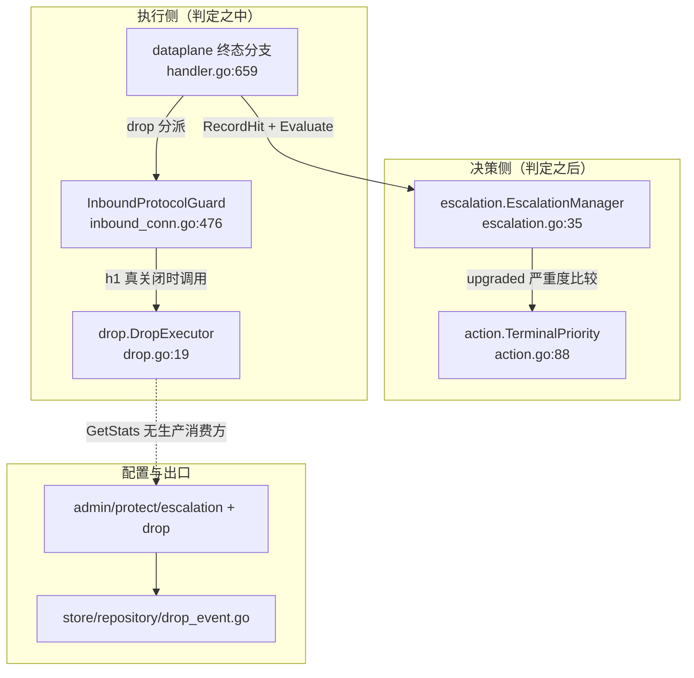
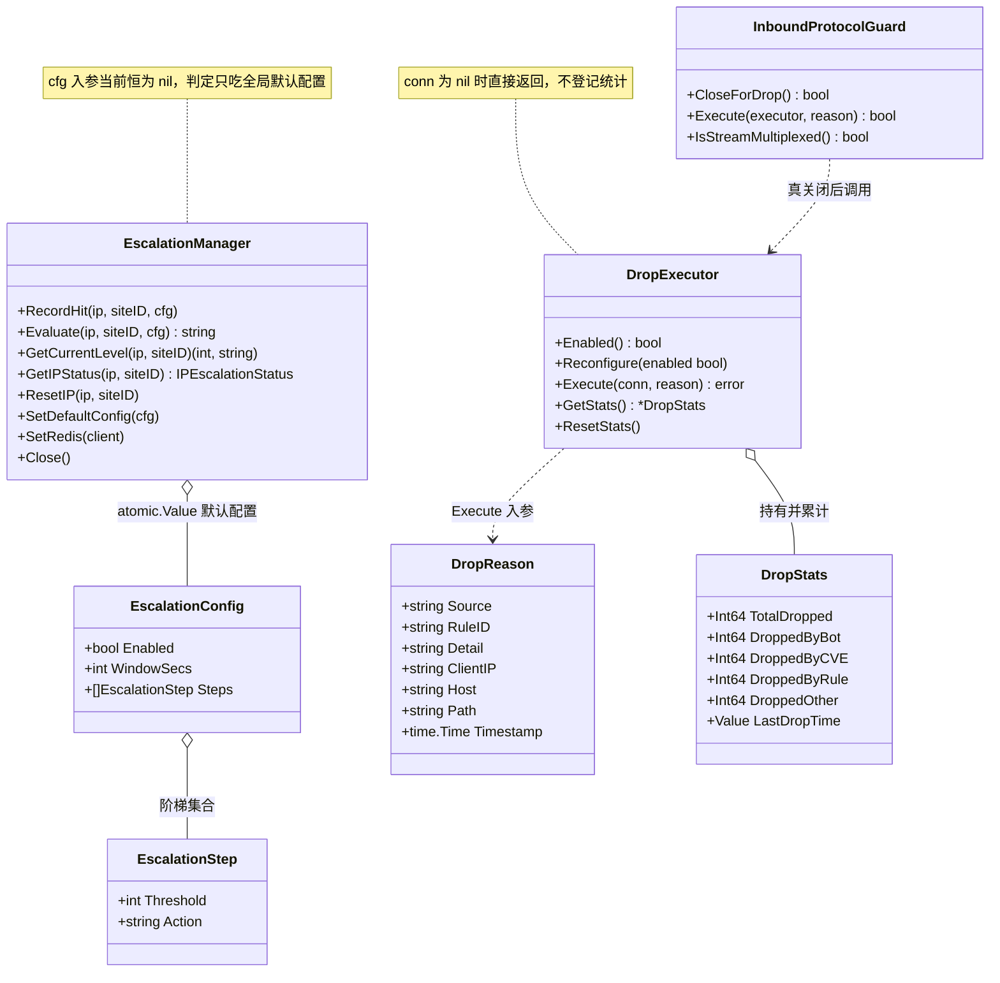
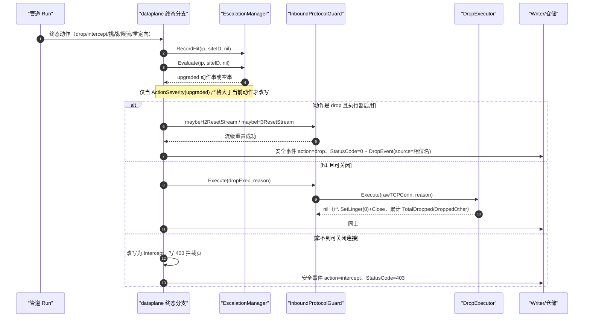
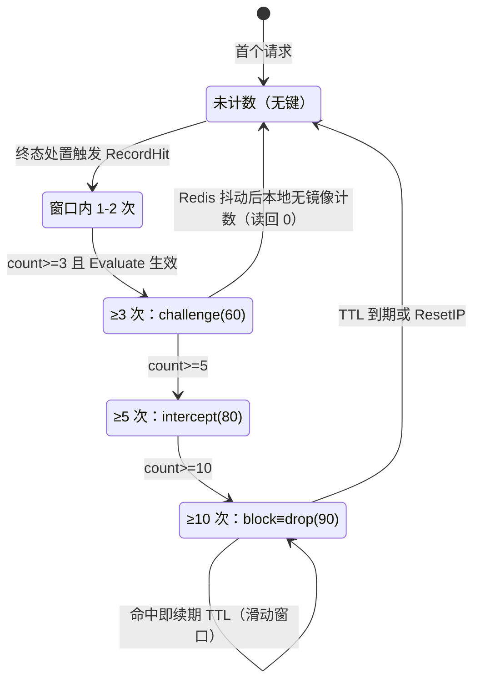
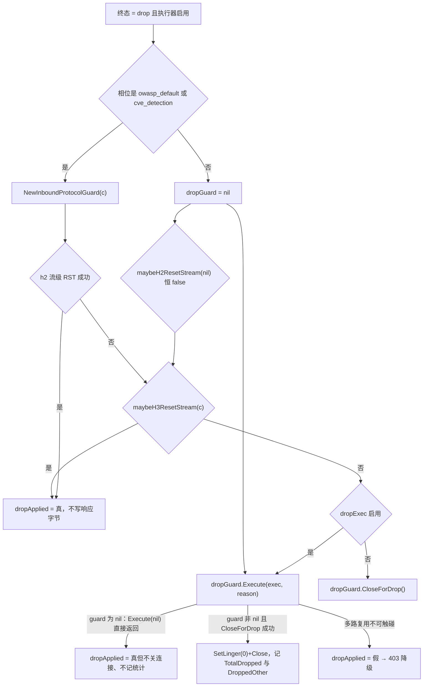
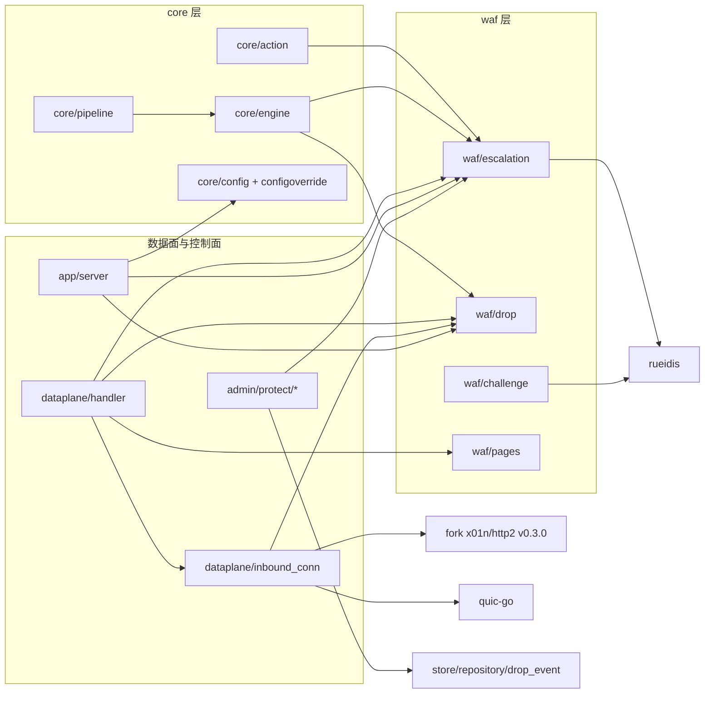
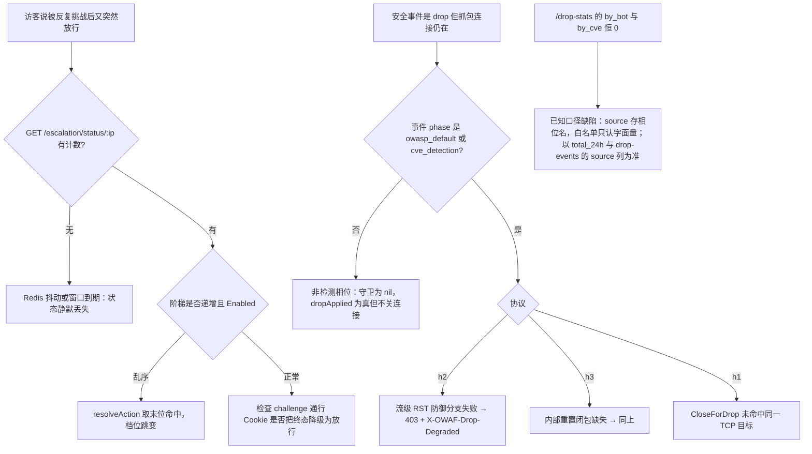

# 分级升级与丢弃执行

<cite>
**本文档引用的文件**
- [escalation.go](file://internal/waf/escalation/escalation.go)
- [drop.go](file://internal/waf/drop/drop.go)
- [drop_test.go](file://internal/waf/drop/drop_test.go)
- [handler.go](file://internal/dataplane/handler.go)
- [handler_support.go](file://internal/dataplane/handler_support.go)
- [inbound_conn.go](file://internal/dataplane/inbound_conn.go)
- [access_log.go](file://internal/dataplane/access_log.go)
- [pipeline.go](file://internal/core/pipeline/pipeline.go)
- [action.go](file://internal/core/action/action.go)
- [phases.go](file://internal/core/rules/phases.go)
- [engine.go](file://internal/core/engine/engine.go)
- [server.go](file://internal/app/server.go)
- [escalation.go](file://internal/admin/protect/escalation/escalation.go)
- [drop.go](file://internal/admin/protect/drop/drop.go)
- [helpers.go](file://internal/admin/shared/helpers.go)
- [router.go](file://internal/admin/router.go)
- [drop_event.go](file://internal/store/repository/drop_event.go)
- [protection.go](file://internal/store/protection.go)
- [config.go](file://internal/core/config.go)
- [registry.go](file://internal/core/configoverride/registry.go)
- [block.go](file://internal/waf/pages/block.go)
- [chain.go](file://internal/waf/challenge/chain.go)
- [page.tsx](file://frontend/app/(dashboard)/attacks/page.tsx)
- [page.tsx](file://frontend/app/(dashboard)/captcha/page.tsx)
- [page.tsx](file://frontend/app/(dashboard)/drop-events/page.tsx)
- [use-api.ts](file://frontend/hooks/use-api.ts)
- [bot-observation-card.tsx](file://frontend/app/(dashboard)/captcha/components/bot-observation-card.tsx)
- [go.mod](file://go.mod)
</cite>

## 目录
1. [简介](#简介)
2. [项目结构](#项目结构)
3. [核心组件](#核心组件)
4. [架构总览](#架构总览)
5. [详细组件分析](#详细组件分析)
6. [依赖关系分析](#依赖关系分析)
7. [性能考虑](#性能考虑)
8. [故障排查指南](#故障排查指南)
9. [结论](#结论)
10. [附录](#附录)

## 简介

本篇是「动态处置」子域的**三级实现文档（形态 C）**，覆盖两个具体实现：`internal/waf/escalation`（按 IP×站点命中计数的 step-up 动作升级）与 `internal/waf/drop`（连接级丢弃执行器与统计）。二者共同回答一个问题：**动作裁决已经选定终态之后，处置如何被改写、如何被真正执行、执行结果如何被记账**。

| 项 | 内容 |
|----|------|
| 所属业务域 | WAF 引擎系统 / 动态处置 |
| 本篇形态 | C 三级实现文档（escalation、drop 各一节） |
| 覆盖范围 | 阶梯语义、状态存储与回退、动作严重度映射；TCP RST 式关闭、协议级重置分支、统计口径与对外消费方 |
| 不覆盖 | 阶段链如何产出动作（见处理阶段详解域）、挑战算法与链式会话内部（见挑战与验证域）、OAuth 与 nonce（见同子域实现篇） |
| 同族其他实现 | [动态处置](./动态处置.md)（子域总览，11 阶段与处置能力全景）、[访问控制网关与重放防护](./访问控制网关与重放防护.md)（accessgate + antireplay 实现细节） |

两个实现的关键差异必须点明：**escalation 是「判定后的改写器」，只产出更重的动作字符串，不接触连接；drop 是「执行体」，只负责让连接消失并记账，不做任何决策**。二者的唯一交点是 `internal/dataplane/handler.go` 的终态分支——先升级、再执行、最后记账。

**章节来源**
- [escalation.go:15-28](file://internal/waf/escalation/escalation.go#L15-L28)
- [drop.go:19-45](file://internal/waf/drop/drop.go#L19-L45)
- [handler.go:659-713](file://internal/dataplane/handler.go#L659-L713)

## 项目结构

两个实现各自占据一个极小目录：escalation 单文件、drop 单文件；它们的接线与消费方全在 `dataplane`、`app`、`admin/protect` 三处。

```text
internal/waf/
├── escalation/
│   ├── escalation.go            # 268 行：EscalationStep/EscalationConfig/EscalationManager
│   └── escalation_logic_test.go # 阶梯解析、键格式、窗口过期、nil 接收者
└── drop/
    ├── drop.go                  # 113 行：DropStats/DropExecutor/DropReason
    ├── drop_test.go             # 分桶计数、ResetStats、未知 source 归 other
    └── execute_error_test.go    # Close 失败不登记统计

internal/dataplane/              # 唯一执行接线方（终态分支、协议守卫）
internal/admin/protect/          # 唯一配置与统计出口（escalation、drop 两个子包）
```

| 路径 | 职责 | 主要语言 | 文件数 | 代表文件 | 对外暴露 |
|------|------|----------|:------:|----------|:--------:|
| `internal/waf/escalation/` | 命中计数与阶梯动作解析 | Go | 1 | `escalation.go`（268 行） | 是（engine、dataplane、admin） |
| `internal/waf/drop/` | 连接关闭执行与进程内统计 | Go | 1 | `drop.go`（113 行） | 是（engine、dataplane） |
| `internal/dataplane/` | 终态分支、协议守卫、降级与记账 | Go | 3 | `handler.go`（1280 行）、`inbound_conn.go`（651 行）、`handler_support.go` | 是（由 `app` 装配） |
| `internal/admin/protect/{escalation,drop}/` | 配置读写与统计端点 | Go | 2 | `escalation.go`（168 行）、`drop.go`（176 行） | 是（REST） |
| `internal/store/repository/drop_event.go` | DropEvent 落库与 24 小时聚合 | Go | 1 | `drop_event.go`（208 行） | 是 |



**图表来源**
- [escalation.go:35-49](file://internal/waf/escalation/escalation.go#L35-L49)
- [drop.go:19-45](file://internal/waf/drop/drop.go#L19-L45)
- [handler.go:659-760](file://internal/dataplane/handler.go#L659-L760)
- [inbound_conn.go:476-564](file://internal/dataplane/inbound_conn.go#L476-L564)

**章节来源**
- [escalation.go:1-268](file://internal/waf/escalation/escalation.go#L1-L268)
- [drop.go:1-113](file://internal/waf/drop/drop.go#L1-L113)

## 核心组件

| 模块 | 路径 | 职责 | 核心接口/符号 | 依赖模块 | 被依赖 | 规模(行) | 测试 |
|------|------|------|---------------|----------|--------|:--------:|:----:|
| 分级升级 | `internal/waf/escalation` | 按 `ip×siteID` 计数，解析出应升级到的动作 | `EscalationManager`、`Evaluate`、`ActionSeverity` | `core/action`、rueidis | `core/engine`、`dataplane`、`admin/protect/escalation` | 268 | 有 |
| 丢弃执行 | `internal/waf/drop` | 对可关闭的 TCP 连接做 `SetLinger(0)`+Close 并累计计数 | `DropExecutor`、`DropStats`、`DropReason` | 标准库 `net`、`log/slog` | `core/engine`、`dataplane` | 113 | 有 |
| 协议守卫 | `internal/dataplane` | 判定协议、选择流级重置或整连关闭、给出降级 | `InboundProtocolGuard`、`maybeH2ResetStream`、`maybeH3ResetStream` | hertz、fork `x01n/http2`、quic-go | `handler` | 651 | 有 |
| 配置出口 | `internal/admin/protect/escalation` | 阶梯读写与 IP 状态查询/重置 | `UpdateEscalationConfig`、`GetEscalationIPStatus` | `admin/shared`、`store`、`waf/escalation` | `admin/router` | 169 | 有 |
| 统计出口 | `internal/admin/protect/drop` | drop 策略读写与 24 小时聚合查询 | `GetDropPolicy`、`UpdateDropPolicy`、`GetDropStats` | `admin/shared`、`repository` | `admin/router` | 177 | 有 |

`escalation` 与 `drop` 都没有注册中心、没有接口抽象：前者以具体类型 `*escalation.EscalationManager` 被 `Engine` 持有（[engine.go:94、601、619](file://internal/core/engine/engine.go#L94-L94)），后者以 `*drop.DropExecutor` 持有（[engine.go:93、593、604](file://internal/core/engine/engine.go#L93-L93)）。这符合它们的定位——单实现、无变体，强行抽接口只会制造第二配置源。



**图表来源**
- [escalation.go:15-49](file://internal/waf/escalation/escalation.go#L15-L49)
- [escalation.go:190-234](file://internal/waf/escalation/escalation.go#L190-L234)
- [drop.go:10-45](file://internal/waf/drop/drop.go#L10-L45)
- [inbound_conn.go:529-564](file://internal/dataplane/inbound_conn.go#L529-L564)

### 重点组件展开

**职责**：`EscalationManager` 把「同一个 IP 在这个站点上被处置过多少次」变成一个可解析的动作字符串；`DropExecutor` 把一个 `action.Drop` 判定变成一次真实的连接消失。**关键文件**：`internal/waf/escalation/escalation.go`、`internal/waf/drop/drop.go`。**核心接口**：

```go
// internal/waf/escalation/escalation.go:107-118、190-197
func (m *EscalationManager) RecordHit(ip string, siteID uint, cfg *EscalationConfig)
func (m *EscalationManager) Evaluate(ip string, siteID uint, cfg *EscalationConfig) string

// internal/waf/drop/drop.go:47-72
func (d *DropExecutor) Execute(conn net.Conn, reason DropReason) error
```

`RecordHit` 无返回值、`Evaluate` 返回空串表示「不升级」——两者都不产出错误：Redis 失败在实现内部被吞掉并回落本地存储（[escalation.go:112-117](file://internal/waf/escalation/escalation.go#L112-L117)）。`DropExecutor.Execute` 返回错误只在 `Close` 失败时出现，且调用方（守卫）忽略该返回值（[inbound_conn.go:556-559](file://internal/dataplane/inbound_conn.go#L556-L559)）。

**章节来源**
- [escalation.go:107-197](file://internal/waf/escalation/escalation.go#L107-L197)
- [drop.go:47-91](file://internal/waf/drop/drop.go#L47-L91)
- [inbound_conn.go:549-564](file://internal/dataplane/inbound_conn.go#L549-L564)

## 架构总览

一次「命中并被升级后真丢弃」的请求，端到端如下。图中 `alt` 分支对应三条真实出口：协议级 drop、h1 整连关闭、降级 403。



**图表来源**
- [handler.go:659-849](file://internal/dataplane/handler.go#L659-L849)
- [inbound_conn.go:440-474](file://internal/dataplane/inbound_conn.go#L440-L474)
- [drop.go:47-91](file://internal/waf/drop/drop.go#L47-L91)

### 动作优先级与升级映射

升级只比较严重度，不比较动作名。下表是本子域涉及的全部终态优先级与「升级可达性」，数值唯一来源是 `action.TerminalPriority`（[action.go:88-118](file://internal/core/action/action.go#L88-L118)）；escalation 侧对别名 `block` 做了特判映射到 `drop`（[escalation.go:244-249](file://internal/waf/escalation/escalation.go#L244-L249)）。

| 动作 | 优先级 | 管道行为 | 可被升级到 | 升级后渲染形态 | 证据 |
|------|:------:|----------|:----------:|----------------|------|
| `drop` | 90 | 命中即短路返回 | 无（已最高） | h2 发 `RST_STREAM(CANCEL)`、h3 取消流、h1 整连 RST 式关闭 | [pipeline.go:540-541](file://internal/core/pipeline/pipeline.go#L540-L541)、[handler.go:743-754](file://internal/dataplane/handler.go#L743-L754) |
| `intercept` | 80 | 短路返回 | `drop`/`block` | 拦截页（站点/全局模板，仅注入 RequestID 与状态码） | [handler.go:1000-1020](file://internal/dataplane/handler.go#L1000-L1020)、[block.go:17-58](file://internal/waf/pages/block.go#L17-L58) |
| `rate_limit` | 70 | 短路返回 | `intercept`、`drop`、各类挑战 | 429 限流页 | [action.go:94-95](file://internal/core/action/action.go#L94-L95) |
| `captcha_challenge` | 60 | 延迟裁决，同档取先出现者 | `intercept`、`drop` | 按站点/全局配置的验证码类型渲染（math/click/slide/rotate） | [handler.go:904-911](file://internal/dataplane/handler.go#L904-L911)、[pipeline.go:533](file://internal/core/pipeline/pipeline.go#L533) |
| `shield_challenge` | 60 | 同上 | 同上 | 5 秒盾流程页（难度与环境检测按配置） | [handler.go:912-918](file://internal/dataplane/handler.go#L912-L918) |
| `chain_challenge` | 60 | 同上 | 同上 | 链式多步挑战（env/pow/captcha 步骤序列） | [handler.go:919-925](file://internal/dataplane/handler.go#L919-L925)、[chain.go:205-243](file://internal/waf/challenge/chain.go#L205-L243) |
| `challenge` | 60 | 同上 | 同上 | 泛化挑战，先被站点/全局 `challenge_action` 覆盖再渲染 | [handler.go:893-898](file://internal/dataplane/handler.go#L893-L898) |
| `redirect` | 50 | 短路返回 | 全部更高档 | 3xx 跳转到 `RedirectTo` | [handler.go:934-969](file://internal/dataplane/handler.go#L934-L969) |
| `block`（阶梯别名） | 90 | — | — | 经 `ActionSeverity` 特判等价 `drop`，改写时落 `action.Drop` | [escalation.go:244-248](file://internal/waf/escalation/escalation.go#L244-L248)、[handler.go:684-686](file://internal/dataplane/handler.go#L684-L686) |

**章节来源**
- [action.go:86-124](file://internal/core/action/action.go#L86-L124)
- [pipeline.go:517-558](file://internal/core/pipeline/pipeline.go#L517-L558)
- [handler.go:679-702](file://internal/dataplane/handler.go#L679-L702)
- [escalation.go:235-249](file://internal/waf/escalation/escalation.go#L235-L249)

## 详细组件分析

本节按形态 C「一实现一节」展开，两节各含接口与注册、配置与语义、调用与差异、限制与回退四段。

### 分级升级（escalation）

#### 接口与注册

三个数据结构构成全部对外契约：`EscalationStep{Threshold,Action}`（[escalation.go:15-18](file://internal/waf/escalation/escalation.go#L15-L18)）、`EscalationConfig{Enabled,WindowSecs,Steps}`（20-24）、`IPEscalationStatus{IP,HitCount,Level,Action}`，其 JSON 键为 `ip`/`hit_count`/`current_step`/`action`（[escalation.go:215-220](file://internal/waf/escalation/escalation.go#L215-L220)）。

`EscalationManager` 的内部状态是四件：`redisMu sync.RWMutex` + `rueidis.Client`、`localCache sync.Map`、`defaultCfg atomic.Value`、`cleanupDone chan struct{}`（[escalation.go:35-42](file://internal/waf/escalation/escalation.go#L35-L42)）。构造即拉起清理协程（44-49），`Close` 用 `sync.Once` 保证幂等（63-72）。

注册链路只有一条：`app.Run` 创建管理器并挂到引擎——`escalation.NewEscalationManager(rt.Redis)`（[server.go:636](file://internal/app/server.go#L636)）→ `eng.SetEscalationManager(escalationMgr)`（690）→ `defer escalationMgr.Close()`（691）；同一实例再作为 `admin.Dependencies.EscalationMgr` 交给控制面（[server.go:1082](file://internal/app/server.go#L1082)、[router.go:75](file://internal/admin/router.go#L75)）。Redis 热切换时通过 `SetRedis` 换后端并同步给管理器（[server.go:1228-1229](file://internal/app/server.go#L1228-L1229)、[escalation.go:52-59](file://internal/waf/escalation/escalation.go#L52-L59)）。

#### 配置与语义

默认配置**默认停用**：`Enabled:false`、`WindowSecs:60`、阶梯 `3→challenge`、`5→intercept`、`10→block`（[escalation.go:26-28](file://internal/waf/escalation/escalation.go#L26-L28)）。持久化字段是全局 `protection` 设置行的三个键 `escalation_enabled`/`escalation_window_secs`/`escalation_steps`（[protection.go:103-104、412-435](file://internal/store/protection.go#L103-L104)），默认窗口同样取 60（[protection.go:194](file://internal/store/protection.go#L194)）。

| 档 | 阈值（默认） | 配置动作 | 映射到的动作类型 | 严重度 | 数据面渲染 |
|:--:|:------:|----------|------------------|:------:|------------|
| 0 | 1-2 | — | 不升级（`Evaluate` 返空串） | — | 保持原判定 |
| 1 | 3 | `challenge` | `action.Challenge` | 60 | 泛化挑战；站点/全局 `challenge_action` 决定实际渲染哪类挑战 |
| 2 | 5 | `intercept` | `action.Intercept` | 80 | 拦截页，状态码走 `ResponseStatusCode()` |
| 3 | 10 | `block` | `action.Drop` | 90 | 协议级丢弃（见下一节执行链） |
| 可选 | 自定义 | `captcha_challenge` | `action.CaptchaChallenge` | 60 | 显示配置的验证码类型（math/click/slide/rotate） |
| 可选 | 自定义 | `shield_challenge` | `action.ShieldChallenge` | 60 | 5 秒盾流程页 |
| 可选 | 自定义 | `chain_challenge` | `action.ChainChallenge` | 60 | 链式步骤序列（env/pow/captcha） |

步进条件的解析规则只有一句：**按切片顺序遍历，取最后一个满足 `count >= threshold` 的步骤动作**（`resolveAction`，[escalation.go:235-243](file://internal/waf/escalation/escalation.go#L235-L243)）。它依赖「阈值递增」这一外部约束——控制面在保存时强制校验 `steps must have increasing thresholds`（[admin/protect/escalation/escalation.go:74-77](file://internal/admin/protect/escalation/escalation.go#L74-L77)），前端也做同口径校验（[attacks/page.tsx:715-725](file://frontend/app/(dashboard)/attacks/page.tsx#L715-L725)）。绕过控制面直接改数据库写入乱序阶梯，`resolveAction` 会给出非单调结果，这是实现事实而非缺陷兜底。

计数窗口是**滑动窗口**：每次命中都重设 TTL（`INCR` + `EXPIRE` 同一批，[escalation.go:119-139](file://internal/waf/escalation/escalation.go#L119-L139)），持续低速攻击者的计数永不过期；本地路径同理以 `expires = now + windowSecs` 覆盖（140-154）。

#### 调用与差异

计数只发生在**终态分支内部**（[handler.go:679-682](file://internal/dataplane/handler.go#L679-L682)），因此「命中次数」的真实语义是**被处置次数**，不是可疑请求数：`observe` 不计数，持有效质询通行 Cookie 被降级为放行的请求也不计数（降级发生在终态判定之前，[handler.go:646-657](file://internal/dataplane/handler.go#L646-L657)）。改写只在严重度**严格大于**当前动作时发生（683-700），且只在 `MatchDesc` 追加 `[escalated→X]` 标记，原始规则 ID 与相位保持不变。

| 符号 | 位置 | 签名 | 上游调用者 | 契约与副作用 |
|------|------|------|------------|--------------|
| `RecordHit` | [escalation.go:107-118](file://internal/waf/escalation/escalation.go#L107-L118) | `(ip, siteID, cfg)` 无返回 | `dataplane` 终态分支 | 停用或 `WindowSecs<=0` 时直接返回；Redis 可用且批成功则**只写 Redis** |
| `recordHitRedis` | [escalation.go:119-139](file://internal/waf/escalation/escalation.go#L119-L139) | `(ip, siteID, windowSecs) bool` | `RecordHit` | 50ms 超时；`DoMulti(INCR, EXPIRE)`；任一失败即整批判失败并返回 false |
| `recordHitLocal` | [escalation.go:140-154](file://internal/waf/escalation/escalation.go#L140-L154) | `(ip, siteID, windowSecs)` | `RecordHit` | `sync.Map` 内原子自增，过期则整条替换为 1 |
| `Evaluate` | [escalation.go:190-197](file://internal/waf/escalation/escalation.go#L190-L197) | `→ string` | `dataplane` 终态分支 | `Enabled` 假或阶梯空 → 空串；否则 `resolveAction(count, steps)` |
| `GetCount`（私有） | [escalation.go:155-176](file://internal/waf/escalation/escalation.go#L155-L176) | `→ int` | `Evaluate`、`GetCurrentLevel` | Redis 优先，失败读本地；本地过期即删并返 0 |
| `GetCurrentLevel` | [escalation.go:198-213](file://internal/waf/escalation/escalation.go#L198-L213) | `→ (int, string)` | `GetIPStatus` | **只读全局默认配置**，停用返回 `-1` |
| `GetIPStatus` | [escalation.go:222-226](file://internal/waf/escalation/escalation.go#L222-L226) | `→ IPEscalationStatus` | `GET /escalation/status/:ip` | 内部两次取计数（各发一次 Redis GET） |
| `ResetIP` | [escalation.go:227-234](file://internal/waf/escalation/escalation.go#L227-L234) | `(ip, siteID)` | `POST /escalation/status/:ip/reset` | 删本地 + 删 Redis，DEL 结果被丢弃 |
| `ActionSeverity` | [escalation.go:244-249](file://internal/waf/escalation/escalation.go#L244-L249) | `(string) int` | `dataplane` 比较档 | `block`→90，其余复用 `TerminalPriority` |



**图表来源**
- [escalation.go:107-154](file://internal/waf/escalation/escalation.go#L107-L154)
- [escalation.go:190-243](file://internal/waf/escalation/escalation.go#L190-L243)
- [handler.go:679-702](file://internal/dataplane/handler.go#L679-L702)

#### 限制与回退

1. **只有全局配置参与判定**：`Evaluate` 与 `GetCurrentLevel` 分别经 `effectiveCfg(cfg)`（[escalation.go:101-106](file://internal/waf/escalation/escalation.go#L101-L106)）与 `DefaultConfig()`（198-202）取配置，而数据面调用处**恒传 `nil`**（[handler.go:680-681](file://internal/dataplane/handler.go#L680-L681)），因此站点级阶梯根本不存在。控制面路由写作 `:id` 也只是参数校验，读写仍落在同一行全局 `protection`（[admin/protect/escalation/escalation.go:17-37](file://internal/admin/protect/escalation/escalation.go#L17-L37)、[shared/helpers.go:33-45](file://internal/admin/shared/helpers.go#L33-L45)）。
2. **停用即清空参数**：reload 走 else 分支时只塞 `EscalationConfig{Enabled:false}`，`WindowSecs` 与 `Steps` 被写成零值（[server.go:685-686](file://internal/app/server.go#L685-L686)），此时 `GetCurrentLevel` 返回 `-1`、`GetIPStatus` 的 `current_step` 即为 `-1`。
3. **双后端不双写导致静默丢状态**：`RecordHit` 在 Redis 批成功时直接 return，本地镜像永远不建（[escalation.go:112-117](file://internal/waf/escalation/escalation.go#L112-L117)）；随后任何一次 Redis 失败都会让 `getCount` 落到无数据的本地表读回 0（155-189），升级当场失效，且不会有任何错误上报。反向的 Redis 切换（`ReloadRedis` → `SetRedis`）同样不迁移 `localCache`（[server.go:1228-1229](file://internal/app/server.go#L1228-L1229)），断连期间积累的本地计数对新后端不可见。
4. **批失败可能双计**：`DoMulti(INCR, EXPIRE)` 只要任一命令出错就整批判失败并转本地再自增一次（[escalation.go:127-138](file://internal/waf/escalation/escalation.go#L127-L138)）。若 `INCR` 已在服务端生效而 `EXPIRE` 未落，Redis 侧计数已加、本地又加一遍，且该键可能长期无 TTL——源码注释「计数只作栅栏用途，失败时不回退」正是这一取舍。
5. **`ResetIP` 吞掉删除结果**：本地删除无条件执行，Redis `DEL` 的返回被丢弃（[escalation.go:227-234](file://internal/waf/escalation/escalation.go#L227-L234)），管理端仍回 200 成功（[admin/protect/escalation/escalation.go:139-155](file://internal/admin/protect/escalation/escalation.go#L139-L155)）。
6. **只升不降**：改写条件是比较严重度后替换动作类型（[handler.go:682-699](file://internal/dataplane/handler.go#L682-L699)），规则级的 `StatusCode`、`RedirectTo`、`CaptchaType` 不会被重置，因此升级到的新动作若与原动作的状态码字段冲突，最终状态码仍由 `ResponseStatusCode()` 按原字段推导。
7. **清理只覆盖本地**：`cleanupLoop` 每 30 秒只扫 `localCache`（[escalation.go:250-268](file://internal/waf/escalation/escalation.go#L250-L268)），Redis 侧完全依赖 TTL；无 TTL 的键不会被任何后台循环回收，只能靠 `ResetIP` 或 Redis 淘汰策略。

**章节来源**
- [escalation.go:15-234](file://internal/waf/escalation/escalation.go#L15-L234)
- [escalation.go:250-268](file://internal/waf/escalation/escalation.go#L250-L268)
- [handler.go:679-702](file://internal/dataplane/handler.go#L679-L702)
- [server.go:674-691](file://internal/app/server.go#L674-L691)
- [admin/protect/escalation/escalation.go:17-155](file://internal/admin/protect/escalation/escalation.go#L17-L155)

### 丢弃执行（drop）

#### 接口与注册

`DropStats` 是六个原子字段的集合：`TotalDropped`、`DroppedByBot`、`DroppedByCVE`、`DroppedByRule`、`DroppedOther`、`LastDropTime`（`atomic.Value`）（[drop.go:10-17](file://internal/waf/drop/drop.go#L10-L17)）。`DropExecutor` 持 `stats`、`enabled`、`log`、`logCounter`（19-24），`DropReason` 是七字段的原因快照（26-34）。

关闭动作本体只有三行有效逻辑：若连接可断言为 `*net.TCPConn` 则 `SetLinger(0)`，随后 `Close()`（[drop.go:51-56](file://internal/waf/drop/drop.go#L51-L56)）。`SetLinger(0)` 使关闭发送 RST 而非正常四次挥手，客户端立即感知连接死亡。`conn == nil` 时在统计之前直接返回（47-50）；`Close` 返回错误时同样**跳过统计与日志**（57-59），这一路径由测试锁定（[drop_test.go](file://internal/waf/drop/drop_test.go)、[execute_error_test.go:30-42](file://internal/waf/drop/execute_error_test.go#L30-L42)）。

注册同样是单点：`drop.NewDropExecutor(dropCfg.Enabled, logger.New("drop"))` → `eng.SetDropExecutor`（[server.go:457-459](file://internal/app/server.go#L457-L459)），reload 时以 `dropExec.Reconfigure(dropPolicy.Enabled)` 改开关（[server.go:659-660](file://internal/app/server.go#L659-L660)）。注意 `enabled` 是**裸 bool 字段**，写入发生在 reload 协程、读取发生在每个请求（[drop.go:21、43-45](file://internal/waf/drop/drop.go#L21-L45)），无原子保护，这是实现层面的既存事实。

#### 配置与语义

策略真值有三个来源，优先级从高到低：`drop_policy` 设置行 → 启动期固化的 `core.DropConfig` → 默认值。默认 `Enabled:true`、`BotScoreThreshold:80`、`CVEAutoDropCritical:true`、`CVEAutoDropHigh:true`（[config.go:58-73](file://internal/core/config.go#L58-L73)），读取与合并见 `loadDropPolicy`（[server.go:1416-1441](file://internal/app/server.go#L1416-L1441)）。

| 键 | 环境变量 | 默认 | 取值域 | 生效方式 | 证据 |
|----|----------|:----:|--------|----------|------|
| `drop_enabled` | `MY_OPENWAF_DROP_ENABLED` | true | 仅字面 `false` 关闭 | reload 后 `Reconfigure`，标记 `RestartRequired:true` | [registry.go:384-387](file://internal/core/configoverride/registry.go#L384-L387) |
| `drop_bot_threshold` | `MY_OPENWAF_DROP_BOT_THRESHOLD` | 80 | 1-100 | 同步给 `eng.SetBotThreshold` | [registry.go:390-393](file://internal/core/configoverride/registry.go#L390-L393)、[server.go:661](file://internal/app/server.go#L661) |
| `cve_auto_drop_critical` | 同名键 | true | 布尔 | CVE 相位规则未指定动作时升 Drop | [registry.go:396-398](file://internal/core/configoverride/registry.go#L396-L398)、[phases.go:863-875](file://internal/core/rules/phases.go#L863-L875) |
| `cve_auto_drop_high` | 同名键 | true | 布尔 | 同上 | 同上 |

动作语义上，`drop` 不是一个可被规则随意选择的标签：IP 声誉黑名单里 `drop` 与旧值 `block` 都映射到 `action.Drop`（[phases.go:429-430](file://internal/core/rules/phases.go#L429-L430)），bot 高档位同样（460-461），OWASP 累计分达到阈值时升 Drop（611），CVE 严重/高危在未显式指定动作时自动升 Drop（863-875）。

#### 调用与差异

执行链有七个决策点。关键在于**协议守卫只在两个检测相位被构建**：`result.Action.Phase == "cve_detection" || == "owasp_default"`（[handler.go:728-731](file://internal/dataplane/handler.go#L728-L731)），其余相位的 drop 拿到的是 `nil` 守卫。

| 步 | 动作 | 执行位置 | 输入 | 输出 | 失败分支 | 可观测点 |
|:--:|------|----------|------|------|----------|----------|
| 1 | 终态选定 | [pipeline.go:517-558](file://internal/core/pipeline/pipeline.go#L517-L558) | 各相位结果 | 单一终态 | 无终态则放行 | 访问日志 `waf_action` |
| 2 | 执行器停用兜底 | [handler.go:664-668](file://internal/dataplane/handler.go#L664-L668) | `!dropEnabled` | 改写为 `intercept` | — | 日志 `action=intercept` |
| 3 | 升级改写 | [handler.go:679-702](file://internal/dataplane/handler.go#L679-L702) | 计数与阶梯 | 可能升为 drop | 严重度不增则不变 | `MatchDesc` 含 `[escalated→drop]` |
| 4 | 控制台采样 | [handler.go:713-724](file://internal/dataplane/handler.go#L713-L724) | 全局计数器 | 打或不打 | 静默丢弃不打日志 | `section=security` 的 `drop` 行 |
| 5 | 分支裁决 | [handler.go:743-754](file://internal/dataplane/handler.go#L743-L754) | 守卫、协议 | `dropApplied` | 依次尝试 h2 重置→h3 取消→守卫执行 | 响应头 `X-OWAF-Drop-Degraded` |
| 6 | 成功记账 | [handler.go:755-795](file://internal/dataplane/handler.go#L755-L795) | drop 已生效 | 事件与访问日志 `StatusCode=0` + DropEvent | 写器为 nil 时静默 | 安全事件表、`drop_events` 表 |
| 7 | 失败降级 | [handler.go:796-849](file://internal/dataplane/handler.go#L796-L849) | 无可关闭连接 | 403 拦截页 + 事件 `intercept` | — | `X-OWAF-Drop-Degraded: h2-h3-no-stream-reset` |



**图表来源**
- [handler.go:713-849](file://internal/dataplane/handler.go#L713-L849)
- [inbound_conn.go:440-474](file://internal/dataplane/inbound_conn.go#L440-L474)
- [inbound_conn.go:512-564](file://internal/dataplane/inbound_conn.go#L512-L564)
- [drop.go:47-91](file://internal/waf/drop/drop.go#L47-L91)

分桶口径必须逐条核对，因为**内存计数与数据库聚合是两套互不相干的体系**：

| 消费方 | 桶/列 | 期望的 source | 实传 source（相位名） | 实测结论 |
|--------|-------|---------------|------------------------|----------|
| `DropStats.DroppedByBot` | `bot` | `bot` | `bot_detection` | 恒 0 |
| `DropStats.DroppedByCVE` | `cve` | `cve` | `cve_detection` | 恒 0 |
| `DropStats.DroppedByRule` | `rule`/`ip_reputation` | `rule` 或 `ip_reputation` | 规则类相位是 `acl`/`signature`/`custom`；`ip_reputation` 匹配但走 nil 守卫不登记 | 恒 0 |
| `DropStats.DroppedOther` | default | 任意 | `owasp_default`、`cve_detection`（仅 h1 真关闭） | 多数落此桶 |
| `DropExecutor.GetStats` | 全部 | — | — | 生产无调用方，四桶对外不可见 |
| `GET /drop-stats` | `by_bot`/`by_cve`/`by_rule`/`by_ip_reputation` | 同左 | `drop_events.source` 存相位名 | 前三列恒 0，`by_ip_reputation` 正常 |
| `GET /drop-stats` | `total_24h` | — | — | 正常（`COUNT(*)`），窗口硬编码 24 小时 |

证据链：`DropReason.Source` 被无条件赋成 `result.Action.Phase`（[handler.go:733-741](file://internal/dataplane/handler.go#L733-L741)、[handler_support.go:334-348](file://internal/dataplane/handler_support.go#L334-L348)），而 `recordStats` 的白名单是四个字面量（[drop.go:78-91](file://internal/waf/drop/drop.go#L78-L91)）；相位实名表见 [phases.go:146、167、188、339、394、526、654、780、1289、1389](file://internal/core/rules/phases.go#L146-L146)。数据库侧同款白名单在 [drop_event.go:190-208](file://internal/store/repository/drop_event.go#L190-L208)。单测之所以全绿，是因为测试直接注入字面量 `"bot"`/`"cve"`/`"rule"`（[drop_test.go:43-64](file://internal/waf/drop/drop_test.go#L43-L64)），不经过相位名这一层。

#### 限制与回退

1. **h2 不再恒降级 403**。代码注释仍写着 fork `x01n/http2 v0.2.0` 未提供流级重置（[handler.go:802-804](file://internal/dataplane/handler.go#L802-L804)），但 `go.mod` 实际要求 `github.com/x01n/http2 v0.3.0`，该版本已实现 `(*h2ServerConn).ResetStreamHandler`，并在服务循环里用 `st.reqCtx.SetConn(&h2ServerConn{...})` 把包装连接塞进请求上下文；本仓库又在 [server.go:1618](file://internal/app/server.go#L1618) 用 fork 的工厂注册 `h2` 协议。因此检测相位的 h2 drop 走真流级 `RST_STREAM(CANCEL)`，403 降级退化为「重置失败的兜底」（连接已关、流已终结、handler 已结束、帧写出失败四种防御分支）。
2. **非检测相位的 drop 是「记账式空操作」**：守卫为 `nil` 时 `Execute` 走 nil 接收者分支，直接对 executor 传 `nil` 连接并返回 `true`（[inbound_conn.go:549-555](file://internal/dataplane/inbound_conn.go#L549-L555)），既不触碰连接也不登记统计，处理器随后不写任何响应即返回。这是「drop 判定成立但访客未被真正切断」的根因，与子域总览中「其余相位不拥有真关闭能力」的口径一致（见 [动态处置 · 术语](./动态处置.md)）。
3. **统计只在真关闭成功后累计**：`Close` 出错即返回错误并跳过 `recordStats`（[drop.go:57-60](file://internal/waf/drop/drop.go#L57-L60)），因此 `TotalDropped` 是「已成功切断的连接数」，与 `drop_events` 行数（判定数）不同源。
4. **日志采样**：前 16 条逐条、此后每 1024 条一条（[drop.go:61-76](file://internal/waf/drop/drop.go#L61-L76)），控制台侧另有同款采样计数器（[access_log.go:43-57](file://internal/dataplane/access_log.go#L43-L57)），两者独立累加。
5. **降级路径的信息面**：拦截页模板只注入 `RequestID` 与 `StatusCode`，`RuleID`/`Phase`/`MatchDesc` 一律留空（[block.go:190-219](file://internal/waf/pages/block.go#L190-L219)）；对外响应头只有 `X-Request-ID` 与降级标记 `X-OWAF-Drop-Degraded`，**不存在 `X-WAF-Action`**（[handler.go:835-840](file://internal/dataplane/handler.go#L835-L840)、[block.go:20-22](file://internal/waf/pages/block.go#L20-L22)）。
6. **配置入口没有独立页面**：不存在 `drop-policy` 前端目录，drop 开关与阈值在 `captcha/` 页的 detection 域覆盖卡里（`drop_enabled`、`drop_bot_threshold`、`cve_auto_drop_critical`、`cve_auto_drop_high`，[captcha/page.tsx:79-88](file://frontend/app/(dashboard)/captcha/page.tsx#L79-L88)），策略读写另有 REST：`GET /api/v1/drop-policy`、`POST /api/v1/drop-policy/update`（[router.go:242、408](file://internal/admin/router.go#L242-L242)）。`useDropPolicy`/`useDropPolicyUpdate` 两个 hook 定义了但无页面消费（[use-api.ts:596-598、1209-1214](file://frontend/hooks/use-api.ts#L596-L598)）；`drop-events` 页只消费事件列表（[drop-events/page.tsx:15-31](file://frontend/app/(dashboard)/drop-events/page.tsx#L15-L31)），24 小时统计卡片在 `captcha/` 的观察卡里（[bot-observation-card.tsx:111](file://frontend/app/(dashboard)/captcha/components/bot-observation-card.tsx#L111)）。
7. **升级继承链式挑战的既存风险**：阶梯可配 `chain_challenge`，改写后走 `WriteChainChallengeResponse`。而链式状态保存在 Redis 时**不回退内存**——`saveChainState` 在 `SET` 出错时直接 `return`，`loadChainState` 在任何 Redis 错误时返回 `nil`（[chain.go:677-710](file://internal/waf/challenge/chain.go#L677-L710)），访客的链路进度会静默归零并从头再来。escalation 自身同样存在「Redis 写成功则不写本地镜像」的静默丢状态：`RecordHit` 在 `recordHitRedis` 返回 true 时立即 return（[escalation.go:112-117](file://internal/waf/escalation/escalation.go#L112-L117)），此后 Redis 抖动使 `getCountRedis` 失败，`getCountLocal` 对同一键从无到有读到 0（177-189），升级判定当场失效；反向地，`ReloadRedis` 换后端时 `SetRedis` 只换客户端、不迁移 `localCache`（[server.go:1228-1229](file://internal/app/server.go#L1228-L1229)、[escalation.go:52-59](file://internal/waf/escalation/escalation.go#L52-L59)），断连期间积累的本地计数在新后端不可见。两处都不是「返回安全行为」而是「状态静默消失」，与防重放的 fail-closed、限流的 fail-open 都不同（对照 [访问控制网关与重放防护](./访问控制网关与重放防护.md) 的降级语义表）。

**章节来源**
- [drop.go:10-113](file://internal/waf/drop/drop.go#L10-L113)
- [handler.go:713-849](file://internal/dataplane/handler.go#L713-L849)
- [server.go:1612-1618](file://internal/app/server.go#L1612-L1618)
- [go.mod:29](file://go.mod#L29)
- [inbound_conn.go:428-564](file://internal/dataplane/inbound_conn.go#L428-L564)
- [drop_event.go:156-208](file://internal/store/repository/drop_event.go#L156-L208)
- [block.go:17-219](file://internal/waf/pages/block.go#L17-L219)
- [chain.go:677-710](file://internal/waf/challenge/chain.go#L677-L710)
- [admin/protect/drop/drop.go:16-176](file://internal/admin/protect/drop/drop.go#L16-L176)

## 依赖关系分析



**图表来源**
- [escalation.go:3-13](file://internal/waf/escalation/escalation.go#L3-L13)
- [drop.go:3-8](file://internal/waf/drop/drop.go#L3-L8)
- [inbound_conn.go:14-26](file://internal/dataplane/inbound_conn.go#L14-L26)
- [engine.go:93-94](file://internal/core/engine/engine.go#L93-L94)
- [server.go:457-459](file://internal/app/server.go#L457-L459)

| 调用方 ↓ / 被调方 → | action | escalation | drop | challenge | pages | rueidis | fork http2 |
|---------------------|:------:|:----------:|:----:|:---------:|:-----:|:-------:|:----------:|
| `core/engine` | ✓ | ✓ | ✓ | — | — | — | — |
| `dataplane/handler` | ✓ | ✓ | ✓ | ✓ | ✓ | — | — |
| `dataplane/inbound_conn` | — | — | ✓ | — | — | — | ✓ |
| `waf/escalation` | ✓ | — | — | — | — | ✓ | — |
| `waf/drop` | — | — | — | — | — | — | — |
| `admin/protect/escalation` | ✓ | ✓ | — | — | — | — | — |
| `admin/protect/drop` | — | — | — | — | — | — | — |

外部实体三处：`rueidis`（escalation 计数后端，`DoMulti` 聚合 INCR+EXPIRE）、fork `github.com/x01n/http2 v0.3.0`（`ResetStreamHandler` 提供 h2 流级 RST）、`quic-go`（h3 流取消闭包由 `internal/app` 注册）。`waf/drop` 只依赖标准库 `net` 与 `log/slog`，可独立替换；`waf/escalation` 对 `core/action` 的依赖仅用于严重度换算，不含动作构造，因此不存在「两处都能定义动作」的双配置源。

**章节来源**
- [escalation.go:1-13](file://internal/waf/escalation/escalation.go#L1-L13)
- [drop.go:1-8](file://internal/waf/drop/drop.go#L1-L8)
- [router.go:21-22、53、75](file://internal/admin/router.go#L21-L22)
- [handler_support.go:334-353](file://internal/dataplane/handler_support.go#L334-L353)

## 性能考虑

- **问题**：热路径上每个终态请求都要为升级判定付一次 Redis 往返。**优化**：`INCR` 与 `EXPIRE` 合并为 `DoMulti` 单批，且整批 50ms 超时（[escalation.go:119-139](file://internal/waf/escalation/escalation.go#L119-L139)），与限流后端同口径。**效果**：判定延迟有硬上界；代价是超时即视为失败并转本地，带来上文的状态分裂。
- **问题**：连接风暴下 drop 日志会淹没控制台。**优化**：executor 侧 `count <= 16 || count%1024 == 0`（[drop.go:61-76](file://internal/waf/drop/drop.go#L61-L76)），日志层另有独立同款采样计数器（[access_log.go:43-57](file://internal/dataplane/access_log.go#L43-L57)）。**效果**：日志量与事件量解耦，但两处采样不同步，条数不能互相校验。
- **问题**：`GetIPStatus` 会发两次 Redis GET（`getCount` 一次、`GetCurrentLevel` 内部再一次，[escalation.go:155-176、198-213、222-226](file://internal/waf/escalation/escalation.go#L155-L176)）。**优化方向**：同一计数值应在一次读取内复用。**效果**：管理端批量排查 IP 时延迟翻倍，非热路径，影响可控。
- **问题**：`sync.Map` 本地计数无容量上限。**优化**：30 秒周期的 `cleanupLoop` 清理过期项（[escalation.go:250-268](file://internal/waf/escalation/escalation.go#L250-L268)）。**效果**：Redis 不可用时仍能自愈，但攻击者可用大量随机 IP 抬高本地表规模。
- **问题**：协议守卫为反射解包付成本。**优化**：构造期零反射，`rawTCPConnForRST` 推迟到真正执行 RST 的那一刻（[inbound_conn.go:481-499](file://internal/dataplane/inbound_conn.go#L481-L499)）。**效果**：绝大多数请求不走 drop 分支，热路径不负担解包开销。

[本节为总结，无需特定文件来源]

## 故障排查指南



**图表来源**
- [escalation.go:155-213](file://internal/waf/escalation/escalation.go#L155-L213)
- [handler.go:713-849](file://internal/dataplane/handler.go#L713-L849)
- [drop_event.go:190-208](file://internal/store/repository/drop_event.go#L190-L208)

| 症状 | 原因 | 排查动作 | 方案 |
|------|------|----------|------|
| `DroppedByBot`/`DroppedByCVE`/`DroppedByRule` 恒 0，绝大多数落 `DroppedOther` | `DropReason.Source` 传相位名，`recordStats` 白名单是 `bot`/`cve`/`rule`/`ip_reputation`；且能登记统计的路径只有检测相位 + h1 真关闭 | 对照 [drop.go:78-91](file://internal/waf/drop/drop.go#L78-L91) 与 [phases.go:526、780](file://internal/core/rules/phases.go#L526-L526) | 以安全事件的 `phase` 字段统计；分桶修复登记问题清单 |
| `/drop-stats` 的 `by_rule` 恒 0 而 `by_ip_reputation` 有值 | SQL 聚合用同一套字面量白名单，`acl`/`custom`/`signature` 不在其中 | 对照 [drop_event.go:195-199](file://internal/store/repository/drop_event.go#L195-L199) | 按 `drop-events?source=acl` 等实相位取值 |
| 想读进程内 drop 计数却无处可取 | `GetStats` 无生产调用方，既不进指标也不进端点 | `grep -rn "GetStats()" internal/` 只见测试 | 需要时新增管理端点或指标桥接，勿复用四桶语义 |
| 统计窗口无法自定义 | `GetDropStats` 硬编码 `Stats24h()` | [admin/protect/drop/drop.go:137-146](file://internal/admin/protect/drop/drop.go#L137-L146)、[drop_event.go:190-195](file://internal/store/repository/drop_event.go#L190-L195) | 用 `drop-events` 的 `start_time`/`end_time` 自行筛选 |
| 升级后想确认阶梯实际生效 | 站点级阶梯不存在：`GetEscalationConfig` 无论 `:id` 是 global 还是数字，都只读全局 `protection` 行 | [admin/protect/escalation/escalation.go:17-37](file://internal/admin/protect/escalation/escalation.go#L17-L37)、[shared/helpers.go:23-45](file://internal/admin/shared/helpers.go#L23-L45) | 只在 `attacks` 页的全局升级卡配置，勿在站点页签找同名开关 |
| `reset` 返回成功但计数仍在 | `ResetIP` 丢弃 Redis `DEL` 的错误 | [escalation.go:227-234](file://internal/waf/escalation/escalation.go#L227-L234) | 手工 `redis-cli DEL owaf:escalation:{ip}:{siteID}` 复核 |

诊断命令（管理端口）：

```bash
# 阶梯当前值（:id 填 global）
curl -s "$ADMIN/api/v1/protection/global/escalation"

# 单 IP 当前命中档位（site_id 可选，缺省为 0）
curl -s "$ADMIN/api/v1/escalation/status/203.0.113.10?site_id=7"

# 24 小时丢弃聚合与按实相位筛选的事件
curl -s "$ADMIN/api/v1/drop-stats"
curl -s "$ADMIN/api/v1/drop-events?source=cve_detection&page=1&page_size=20"

# Redis 侧升级键与 TTL（键前缀为 owaf:，非 openwaf:）
redis-cli --scan --pattern 'owaf:escalation:*' | head
```

**章节来源**
- [drop.go:78-113](file://internal/waf/drop/drop.go#L78-L113)
- [drop_event.go:148-208](file://internal/store/repository/drop_event.go#L148-L208)
- [admin/protect/drop/drop.go:137-176](file://internal/admin/protect/drop/drop.go#L137-L176)
- [admin/protect/escalation/escalation.go:17-168](file://internal/admin/protect/escalation/escalation.go#L17-L168)
- [escalation.go:82-100](file://internal/waf/escalation/escalation.go#L82-L100)

## 结论

- **成果**：把两个 268/113 行的小包讲透到调用点级别——escalation 的阶梯解析规则（末位命中 + 递增校验依赖）、滑动窗口续期、只吃全局配置、被处置才计数；drop 的七步执行链、守卫仅覆盖两个检测相位、统计在 `Close` 成功后才累计、三套出口（协议级 drop / h1 关闭 / 403 降级）各有不同记账形态。
- **口径订正**：`h2 上 drop 恒降级 403` 的说法已过时——fork 升到 `x01n/http2 v0.3.0` 后具备 `ResetStreamHandler`，降级只剩兜底语义；`X-WAF-Action` 响应头不存在，对外只有 `X-Request-ID` 与 `X-OWAF-Drop-Degraded`。
- **登记的问题**：DropStats 四桶结构性恒 0、`GetStats` 无消费方、`SetEnabled`/`ResetStats` 无生产调用、`enabled` 裸 bool 跨协程读写、`ResetIP` 吞错、escalation 与 chain 的静默丢状态、`handler.go` 内 v0.2.0 注释与 `go.mod` 不一致。
- **原则回顾**：KISS 体现在两个包都刻意不做抽象与注册中心；DRY 的反面案例是字面量白名单在 `drop.go` 与 `drop_event.go` 各写一份且都漂移了；YAGNI 的反面案例是 `GetStats`/`ResetStats`/`SetEnabled` 三件无消费者的 API；SRP 保持良好——判定与执行分离，唯一交点在 handler。
- **下一步**：分桶与 `GetStats` 出口若修复，应一并补「相位名即 source」的契约测试；h2 兜底分支可考虑在 `drop_policy` 增加开关，让运维显式选择「降级 403」或「静默丢弃」。

[本节为总结，无需特定文件来源]

## 附录

### 配置参数速查

| 参数 | 载体 | 类型 | 默认 | 校验 | 生效路径 |
|------|------|:----:|:----:|------|----------|
| `escalation_enabled` | `protection` 设置行 | bool | false | 无 | reload → `SetDefaultConfig`（[server.go:674-686](file://internal/app/server.go#L674-L686)） |
| `escalation_window_secs` | 同上 | int | 60 | 必须 >0（[admin/protect/escalation/escalation.go:57-60](file://internal/admin/protect/escalation/escalation.go#L57-L60)） | 同上 |
| `escalation_steps` | 同上（JSON） | 数组 | 3/5/10 三档 | 阈值 >0、严格递增、动作在白名单内（61-78） | 同上 |
| `drop_policy.enabled` | `drop_policy` 设置行 | bool\* | true | 指针可空 | `loadDropPolicy` → `Reconfigure`（[server.go:659-660](file://internal/app/server.go#L659-L660)） |
| `drop_policy.bot_score_threshold` | 同上 | int\* | 80 | 1-100（[admin/protect/drop/drop.go:77-80](file://internal/admin/protect/drop/drop.go#L77-L80)） | `eng.SetBotThreshold` |
| `drop_policy.cve_auto_drop_{critical,high}` | 同上（并回写 `protection`） | bool\* | true | 无 | CVE 相位（[phases.go:863-875](file://internal/core/rules/phases.go#L863-L875)） |

**章节来源**
- [protection.go:103-104、194、412-435](file://internal/store/protection.go#L103-L104)
- [admin/protect/drop/drop.go:16-135](file://internal/admin/protect/drop/drop.go#L16-L135)
- [config.go:58-73](file://internal/core/config.go#L58-L73)

### 端点与调用示例

| 方法 | 路径 | 处理器 | 归属 | 证据 |
|------|------|--------|:----:|------|
| GET | `/api/v1/protection/:id/escalation` | `GetEscalationConfig` | readGroup | [router.go:236](file://internal/admin/router.go#L236) |
| POST | `/api/v1/protection/:id/escalation` | `UpdateEscalationConfig`（触发 reload） | opsGroup | [router.go:342](file://internal/admin/router.go#L342) |
| GET | `/api/v1/escalation/status/:ip` | `GetEscalationIPStatus` | readGroup | [router.go:237](file://internal/admin/router.go#L237) |
| POST | `/api/v1/escalation/status/:ip/reset` | `ResetEscalationIPStatus` | opsGroup | [router.go:343](file://internal/admin/router.go#L343) |
| GET | `/api/v1/drop-policy` | `GetDropPolicy` | readGroup | [router.go:242](file://internal/admin/router.go#L242) |
| POST | `/api/v1/drop-policy/update` | `UpdateDropPolicy`（事务 + reload） | adminGroup | [router.go:408](file://internal/admin/router.go#L408) |
| GET | `/api/v1/drop-stats` | `GetDropStats`（24 小时） | readGroup | [router.go:243](file://internal/admin/router.go#L243) |
| GET | `/api/v1/drop-events` | `GetDropEvents`（分页 + 筛选） | readGroup | [router.go:244](file://internal/admin/router.go#L244) |
| GET | `/api/v1/sites/:id/drop-stats` | `SiteDropStats`（按站点 24 小时） | readGroup | [router.go:192](file://internal/admin/router.go#L192) |

写请求体只出现 POST，字段一律 snake_case；升级配置示例：

```json
{
  "escalation_enabled": true,
  "escalation_window_secs": 120,
  "escalation_steps": [
    {"threshold": 3, "action": "captcha_challenge"},
    {"threshold": 6, "action": "shield_challenge"},
    {"threshold": 9, "action": "chain_challenge"},
    {"threshold": 15, "action": "block"}
  ]
}
```

**章节来源**
- [router.go:191-192、236-244、342-343、408](file://internal/admin/router.go#L191-L244)
- [admin/protect/escalation/escalation.go:39-155](file://internal/admin/protect/escalation/escalation.go#L39-L155)

### 两实现的触发口径对比

| 维度 | escalation | drop |
|------|------------|------|
| 输入 | `ip × siteID` 的被处置次数 | 一个已选定的 `action.Drop` 判定 |
| 输出 | 更重的动作字符串 | 连接消失 / 流取消 / 403 降级三选一 |
| 状态存储 | Redis `owaf:escalation:{ip}:{siteID}` + 本地 `sync.Map`（二选一，不双写） | 无状态，仅进程内原子计数 |
| 失败语义 | 静默丢状态后不升级（等效放行） | `Close` 失败则不记账；守卫不可用则降级 403 |
| 对外可见面 | `hit_count`/`current_step`（两个端点） | `drop_events` 表 + 24 小时聚合 |
| 与动作优先级的关系 | 只读 `TerminalPriority`，不改写优先级表 | 消费 `drop` 档，不参与裁决 |

**章节来源**
- [escalation.go:35-42、82-100、107-154、227-234](file://internal/waf/escalation/escalation.go#L35-L154)
- [drop.go:10-17、47-91](file://internal/waf/drop/drop.go#L47-L91)
- [handler_support.go:334-353](file://internal/dataplane/handler_support.go#L334-L353)

### 术语与约定

- **检测相位**：仅 `owasp_default` 与 `cve_detection`，只有它们会为 drop 构建协议守卫（[handler.go:728-731](file://internal/dataplane/handler.go#L728-L731)）。
- **流级重置**：h2 用 `RST_STREAM(CANCEL)`、h3 用一次性取消闭包，二者都不写响应字节（[inbound_conn.go:440-474](file://internal/dataplane/inbound_conn.go#L440-L474)）。
- **降级 403**：drop 判定成立但拿不到可关闭连接时改写为 `intercept` 并打 `X-OWAF-Drop-Degraded`，历史曾写 502，现已订正为语义正确的 403（[handler.go:796-840](file://internal/dataplane/handler.go#L796-L840)）。
- **`block`**：阶梯里的历史别名，严重度等价 `drop`，与拦截页动作 `intercept` 不同物（[escalation.go:244-248](file://internal/waf/escalation/escalation.go#L244-L248)）。

[本节为总结，无需特定文件来源]
