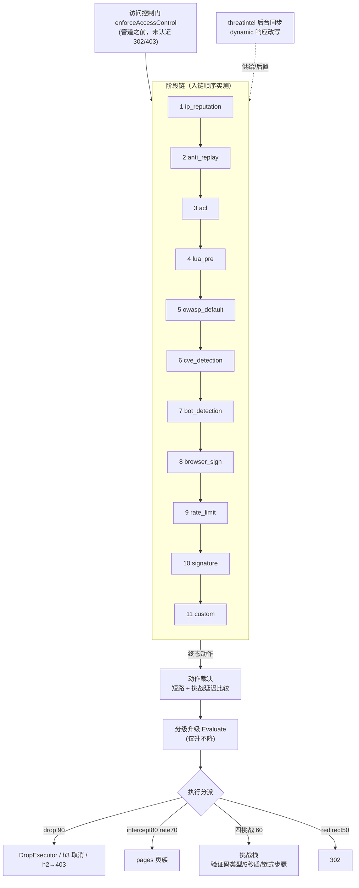
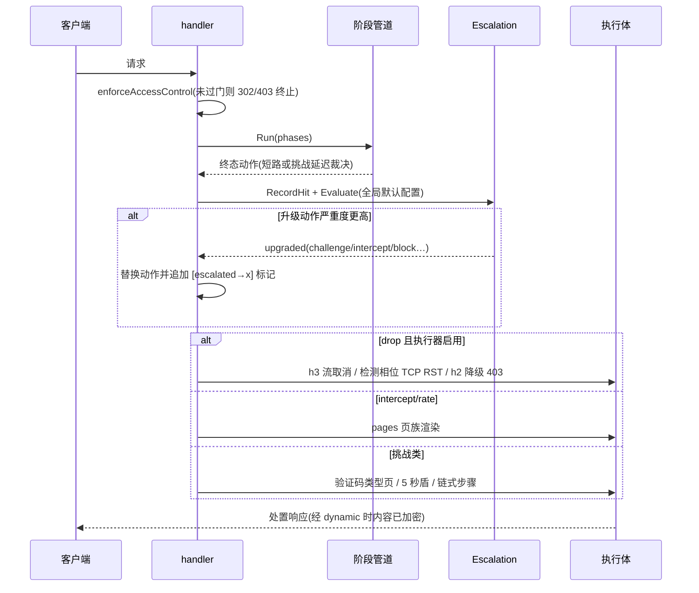
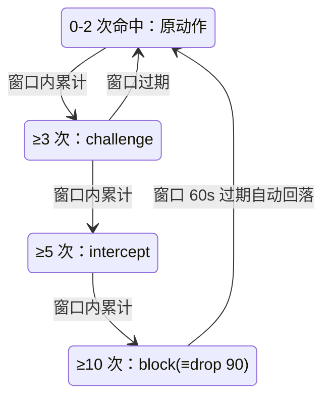
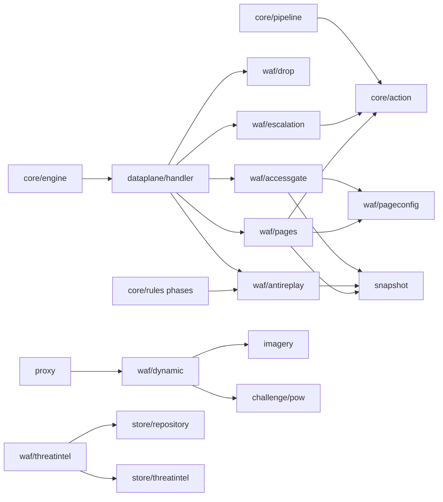

# 动态处置

<cite>
**本文档引用的文件**
- [engine.go](file://internal/core/engine/engine.go)
- [pipeline.go](file://internal/core/pipeline/pipeline.go)
- [action.go](file://internal/core/action/action.go)
- [phases.go](file://internal/core/rules/phases.go)
- [handler.go](file://internal/dataplane/handler.go)
- [handler_support.go](file://internal/dataplane/handler_support.go)
- [inbound_conn.go](file://internal/dataplane/inbound_conn.go)
- [access_control.go](file://internal/dataplane/access_control.go)
- [challenge.go](file://internal/dataplane/challenge.go)
- [sanitize.go](file://internal/dataplane/logredact/sanitize.go)
- [token.go](file://internal/waf/challenge/token.go)
- [drop.go](file://internal/waf/drop/drop.go)
- [escalation.go](file://internal/waf/escalation/escalation.go)
- [antireplay.go](file://internal/waf/antireplay/antireplay.go)
- [redis.go](file://internal/waf/ratelimit/redis.go)
- [gate.go](file://internal/waf/accessgate/gate.go)
- [oauth.go](file://internal/waf/accessgate/oauth.go)
- [server.go](file://internal/app/server.go)
- [manager.go](file://internal/waf/threatintel/manager.go)
- [threat_intel.go](file://internal/store/threatintel/threat_intel.go)
- [threat_intel.go](file://internal/admin/system/threatintel/threat_intel.go)
- [config.go](file://internal/waf/pageconfig/config.go)
- [block.go](file://internal/waf/pages/block.go)
- [cookie_renew.go](file://internal/waf/pages/cookie_renew.go)
- [error_pages.go](file://internal/waf/pages/error_pages.go)
- [processor.go](file://internal/waf/dynamic/processor.go)
- [bootstrap.go](file://internal/waf/dynamic/bootstrap.go)
- [templates.go](file://internal/waf/dynamic/templates.go)
- [shards.go](file://internal/waf/dynamic/shards.go)
- [proxy.go](file://internal/proxy/proxy.go)
</cite>

## 目录
1. [简介](#简介)
2. [项目结构](#项目结构)
3. [核心组件](#核心组件)
4. [架构总览](#架构总览)
5. [详细组件分析](#详细组件分析)
6. [依赖关系分析](#依赖关系分析)
7. [性能考虑](#性能考虑)
8. [故障排查指南](#故障排查指南)
9. [结论](#结论)
10. [附录](#附录)

## 简介

「动态处置」是 WAF 引擎系统中负责「判定之后怎么办」的子域：管道各阶段产出动作后，由本子域的组件把动作变成对访客的真实处置——终止连接、返回拦截页、下发挑战、跳登录认证、消耗一次性凭据、改写响应内容，以及支撑这些行为所需的订阅情报与页面配置。

本篇是子域**总览**（形态 A）：给出全景、处置能力清单与文档索引，不展开单实现细节。子域另有两篇实现文档：[访问控制网关与重放防护](./访问控制网关与重放防护.md)（accessgate + antireplay）与[分级升级与丢弃执行](./分级升级与丢弃执行.md)（escalation + drop 执行链），细节以彼篇为准，本篇只引用其结论口径。

| 项 | 内容 |
|----|------|
| 所属业务域 | WAF 引擎系统 / 动态处置 |
| 本篇形态 | A 总览（子域同名索引） |
| 覆盖范围 | `internal/waf/{accessgate,dynamic,escalation,drop,antireplay,threatintel,pageconfig,pages}` 八个包的全景、切面级结论与索引 |
| 不覆盖 | 各包接口与参数细节（见子文档）、挑战算法本体（见挑战域文档）、阶段匹配语义（见处理阶段详解域） |
| 上游 | [WAF 引擎系统](../WAF%20引擎系统.md)、[处理阶段详解](../处理阶段详解/处理阶段详解.md) |

**章节来源**
- [engine.go:465-548](file://internal/core/engine/engine.go#L465-L548)

## 项目结构

子域按「谁消费动作」而非「技术分层」组织：

```text
internal/waf/
├── accessgate/    # 站点访问控制网关：OAuth2/OIDC + 会话（1672 行，7 文件）
├── dynamic/       # 动态防护：HTML/JS 加密信封与图片水印转发（954 行）
├── escalation/    # 分级升级：命中计数 step-up 动作链（268 行）
├── drop/          # 丢弃执行：TCP 层 RST 式关闭与统计（113 行）
├── antireplay/    # 重放防护：HMAC nonce 签发/轮换/一次性消费（214 行）
├── threatintel/   # 威胁情报订阅：拉取-解析-全量替换 IP 列表（415 行）
├── pageconfig/    # 页面品牌配置与 CSS/URL 净化白名单（274 行）
└── pages/         # 处置响应页渲染：拦截/维护/续期/错误页（848 行）
```

| 模块 | 路径 | 职责 | 核心接口/符号 | 依赖模块 | 被依赖 | 规模(行) | 测试 |
|------|------|------|---------------|----------|--------|:--------:|:----:|
| accessgate | `internal/waf/accessgate` | 认证准入、OAuth 流程、会话/state 存储、密钥解密 | `Gate`、`OAuthFlow`、`SessionStore` | pageconfig、rueidis | dataplane | 1672 | 有 |
| dynamic | `internal/waf/dynamic` | 响应内容加密信封与水印转发 | `Processor`、`Process/ProcessHTML/ProcessJS` | imagery、challenge/pow | proxy | 954 | 有 |
| escalation | `internal/waf/escalation` | 按 IP×站点计数的动作升级 | `EscalationManager`、`Evaluate` | action、rueidis | engine、dataplane | 268 | 有 |
| drop | `internal/waf/drop` | 连接级丢弃执行与计数 | `DropExecutor`、`DropStats` | 标准库 net | engine、dataplane | 113 | 有 |
| antireplay | `internal/waf/antireplay` | nonce 签发/校验/轮换（fail-closed） | `AntiReplayManager`、`ValidateAndRotate` | snapshot、rueidis | engine、rules、dataplane | 214 | 有 |
| threatintel | `internal/waf/threatintel` | 订阅源后台同步进 IP 列表 | `Manager`、`SyncFeed` | repository、store/threatintel | app、admin | 415 | 有 |
| pageconfig | `internal/waf/pageconfig` | 三类处置页品牌配置与净化函数 | `PageConfig`、`Safe*`/`SanitizeCSS` | 标准库 | pages、accessgate、challenge | 274 | 有 |
| pages | `internal/waf/pages` | 拦截/维护/续期/错误页渲染 | `WriteBlockResponse`、`WriteMaintenanceResponse` | pageconfig、snapshot、adminweb | dataplane | 848 | 有 |

**章节来源**
- [gate.go:14-61](file://internal/waf/accessgate/gate.go#L14-L61)
- [processor.go:18-40](file://internal/waf/dynamic/processor.go#L18-L40)
- [escalation.go:15-49](file://internal/waf/escalation/escalation.go#L15-L49)
- [drop.go:10-45](file://internal/waf/drop/drop.go#L10-L45)
- [antireplay.go:18-60](file://internal/waf/antireplay/antireplay.go#L18-L60)
- [manager.go:40-73](file://internal/waf/threatintel/manager.go#L40-L73)
- [pageconfig.go:11-63](file://internal/waf/pageconfig/config.go#L11-L63)
- [block.go:17-58](file://internal/waf/pages/block.go#L17-L58)

## 核心组件

处置决策的权威次序由动作终态优先级决定。`TerminalPriority`（[action.go:88-102](file://internal/core/action/action.go#L88-L102)）实测如下，构成子域的**处置能力全景表**：

| 动作 | 终态优先级 | 页面/协议形态（按 WAF action 语义建模） | 执行组件 | 触发来源示例 |
|------|:----:|------------------------------------------|----------|--------------|
| `drop` | 90 | TCP 层关闭（`SetLinger(0)`+Close），h2 降级 403、h3 流取消 | `DropExecutor`（`drop.go:47-72`） | OWASP/CVE 高危、IP 信誉、订阅源 action=drop |
| `intercept` | 80 | 拦截页 403（可配状态码覆盖），携带 X-Request-ID | `pages.WriteBlockResponse`（`block.go:17-58`） | 规则命中、反重放 fail-closed |
| `rate_limit` | 70 | 限流页 429（复用 block 页族文案） | `pages.WriteBlockResponse` 429 分支 | 限流窗口超限 |
| `captcha_challenge` | 60 | **显示配置的验证码类型**的验证页，非通用状态码页 | 挑战栈（dataplane/challenge） | 站点配置、升级链 |
| `shield_challenge` | 60 | **5 秒盾等待流程**页 | 挑战栈 shield 管理器 | 站点配置、升级链 |
| `chain_challenge` | 60 | **链式验证步骤**页（按配置序列逐步展示） | 挑战栈 chain 管理器 | 站点配置、升级链 |
| `challenge` | 60 | JS 挑战页 | 挑战栈 | 默认挑战 |
| `redirect` | 50 | 302 跳转 | 规则动作 | 自定义规则 |

同一优先级档内**取先出现者**：管道对挑战类采用延迟处理，仅当后续挑战优先级**严格大于**已挂起者才替换（`pendingChallenge == nil || TerminalPriority(new) > TerminalPriority(pending)`，两处比较同在 [pipeline.go:533、545](file://internal/core/pipeline/pipeline.go#L533-L545)），相等不替换；drop/intercept/rate/redirect 属非挑战终态，命中即短路返回（[pipeline.go:529-549](file://internal/core/pipeline/pipeline.go#L529-L549)）。

**章节来源**
- [action.go:88-102](file://internal/core/action/action.go#L88-L102)
- [pipeline.go:511-558](file://internal/core/pipeline/pipeline.go#L511-L558)
- [drop.go:47-72](file://internal/waf/drop/drop.go#L47-L72)
- [block.go:17-58](file://internal/waf/pages/block.go#L17-L58)
- [challenge.go:400-410](file://internal/dataplane/challenge.go#L400-L410)

## 架构总览

11 阶段链（实测 [engine.go:465-548](file://internal/core/engine/engine.go#L465-L548)，容量预分配 11 于 467 行）与处置执行体的关系如下：



**图表来源**
- [engine.go:465-548](file://internal/core/engine/engine.go#L465-L548)
- [handler.go:310-315](file://internal/dataplane/handler.go#L310-L315)
- [pipeline.go:517-558](file://internal/core/pipeline/pipeline.go#L517-L558)
- [handler.go:679-700](file://internal/dataplane/handler.go#L679-L700)

阶段入链条件（缺条件即不入链，链为按需装配）：

| # | 阶段名 | 入链条件 | 装配位置 |
|:--:|--------|----------|----------|
| 1 | `ip_reputation` | `e.ipRep != nil` | [engine.go:479-481](file://internal/core/engine/engine.go#L479-L481) |
| 2 | `anti_replay` | 管理器非 nil 且 `rt.AntiReplayEnabled` | [engine.go:482-483](file://internal/core/engine/engine.go#L482-L483) |
| 3 | `acl` | 预编译 ACL 非空 | [engine.go:486-488](file://internal/core/engine/engine.go#L486-L488) |
| 4 | `lua_pre` | Lua 前置脚本存在 | [engine.go:491-494](file://internal/core/engine/engine.go#L491-L494) |
| 5 | `owasp_default` | `prot.OWASPEnabled` | [engine.go:496-498](file://internal/core/engine/engine.go#L496-L498) |
| 6 | `cve_detection` | `prot.CVEEnabled` 且检测器非 nil | [engine.go:499-501](file://internal/core/engine/engine.go#L499-L501) |
| 7 | `bot_detection` | `prot.BotDetectionEnabled` | [engine.go:503-510](file://internal/core/engine/engine.go#L503-L510) |
| 8 | `browser_sign` | `prot.BrowserSignEnabled` | [engine.go:512-515](file://internal/core/engine/engine.go#L512-L515) |
| 9 | `rate_limit` | 限流启用且后端非 nil | [engine.go:517-521](file://internal/core/engine/engine.go#L517-L521) |
| 10 | `signature` | 预编译签名规则非空（不过按路径跳过装饰器） | [engine.go:526-528](file://internal/core/engine/engine.go#L526-L528) |
| 11 | `custom` | 预编译自定义规则非空（同上） | [engine.go:529-531](file://internal/core/engine/engine.go#L529-L531) |

一次典型处置判定的行为视图：



**图表来源**
- [handler.go:310-315](file://internal/dataplane/handler.go#L310-L315)
- [pipeline.go:517-558](file://internal/core/pipeline/pipeline.go#L517-L558)
- [handler.go:660-700](file://internal/dataplane/handler.go#L660-L700)
- [handler.go:726-760](file://internal/dataplane/handler.go#L726-L760)

## 详细组件分析

### 动作裁决与升级（escalation）

升级链在动作裁决之后、执行之前插入（[handler.go:679-700](file://internal/dataplane/handler.go#L679-L700)）：先 `RecordHit` 再 `Evaluate`，仅当 `ActionSeverity(upgraded) > ActionSeverity(current)` 才替换动作；`block` 在严重度映射中等价 `drop`（90），其余直接复用 `TerminalPriority`（[escalation.go:244-249](file://internal/waf/escalation/escalation.go#L244-L249)）。默认配置为窗口 60 秒、阶梯 3→challenge、5→intercept、10→block（[escalation.go:26-28](file://internal/waf/escalation/escalation.go#L26-L28)），且**默认停用**（`Enabled:false`）。



**图表来源**
- [escalation.go:26-28](file://internal/waf/escalation/escalation.go#L26-L28)
- [escalation.go:235-249](file://internal/waf/escalation/escalation.go#L235-L249)
- [handler.go:679-700](file://internal/dataplane/handler.go#L679-L700)

**静默丢状态风险（实测登记）**：计数写入 `recordHitRedis` 用 DoMulti（INCR+EXPIRE，50ms 超时），任一命令失败即整批失败**且不回退补偿**，转而落本地 `sync.Map`（[escalation.go:107-154](file://internal/waf/escalation/escalation.go#L107-L154)）。后果链：Redis 抖动期各节点本地计数互相分裂 → 阈值可能永不达到 → 升级静默不生效，且无错误上抛、无专属指标可观测。另一处口径：数据面调用 `Evaluate(ip, siteID, nil)` 恒传 nil 配置（[handler.go:681](file://internal/dataplane/handler.go#L681)），站点级阶梯不会参与评估，生效的只有进程默认配置。`resolveAction` 取最后命中档（[escalation.go:235-243](file://internal/waf/escalation/escalation.go#L235-L243)），隐式要求 steps 按阈值升序配置。

**章节来源**
- [escalation.go:15-28](file://internal/waf/escalation/escalation.go#L15-L28)
- [escalation.go:107-154](file://internal/waf/escalation/escalation.go#L107-L154)
- [escalation.go:190-249](file://internal/waf/escalation/escalation.go#L190-L249)
- [handler.go:679-700](file://internal/dataplane/handler.go#L679-L700)

### 丢弃执行（drop）

`DropExecutor.Execute` 的关闭方式是对 `*net.TCPConn` 先 `SetLinger(0)` 再 `Close()`——等价发 RST 而非四次挥手，客户端立即感知连接死亡（[drop.go:47-72](file://internal/waf/drop/drop.go#L47-L72)）；日志限流为前 16 条逐条 + 之后每 1024 条一条（[drop.go:74-76](file://internal/waf/drop/drop.go#L74-L76)）。统计族 `DropStats` 用五个原子计数器按 `reason.Source` 分桶（bot/cve/rule+ip_reputation/other，[drop.go:78-91](file://internal/waf/drop/drop.go#L78-L91)）。

执行侧的真实路径比看起来窄（实测）：

| 步 | 动作 | 执行位置 | 输入 | 输出 | 失败分支 | 可观测点 |
|:--:|------|----------|------|------|----------|----------|
| 1 | drop 动作选定 | [pipeline.go:540-541](file://internal/core/pipeline/pipeline.go#L540-L541) | 阶段结果 | 短路返回 Drop | — | 安全事件 action=drop |
| 2 | 执行器停用兜底 | [handler.go:664-668](file://internal/dataplane/handler.go#L664-L668) | `!dropEnabled` | 降级为 Intercept | — | 访问日志 intercept |
| 3 | 协议守卫构建 | [handler.go:727-730](file://internal/dataplane/handler.go#L727-L730) | 相位 ∈ {cve_detection, owasp_default} | 非 nil guard，否则 nil | — | — |
| 4 | h3 流取消 | [inbound_conn.go:459-474](file://internal/dataplane/inbound_conn.go#L459-L474) | 一次性重置闭包 | 真 drop | 闭包缺失落下一步 | X-OWAF-Drop-Degraded 无 |
| 5 | h2 流重置尝试 | [inbound_conn.go:440-449](file://internal/dataplane/inbound_conn.go#L440-L449) | 当前 fork x01n/http2 v0.2.0 **无流级重置方法** | 恒 false | 落降级 | — |
| 6 | TCP RST 或空操作 | [inbound_conn.go:549-568](file://internal/dataplane/inbound_conn.go#L549-L568) | guard/executor | http/1.1 检测相位真关闭 | 见下方缺陷 | — |
| 7 | 降级 403 | [handler.go:796-840](file://internal/dataplane/handler.go#L796-L840) | 多路复用不可触碰 | 拦截页 + `X-OWAF-Drop-Degraded: h2-h3-no-stream-reset` | — | 响应头 |

两条实测缺陷（登记进问题检测报告口径）：其一，**分桶名与阶段名不匹配致 `DroppedByBot`/`DroppedByCVE`/`DroppedByRule` 恒 0**——`DropReason.Source` 被直接赋成阶段名（[handler.go:733-734](file://internal/dataplane/handler.go#L733-L734)），而分桶白名单是短名 `bot`/`cve`/`rule`（阶段实名 `bot_detection`/`cve_detection`，不存在名为 `rule` 的阶段）；且能进入统计的只有检测相位 guard 真关闭成功的案例（其 Source 恒为 `owasp_default`/`cve_detection`，全部落 `DroppedOther`），非检测相位 guard 为 nil 时 `Execute` 走 nil-conn 空操作、连 `recordStats` 都不触达（[drop.go:47-50](file://internal/waf/drop/drop.go#L47-L50)、[inbound_conn.go:550-554](file://internal/dataplane/inbound_conn.go#L550-L554)）。其二，**h2 上的 drop 恒降级 403**：fork 缺流级重置使 h2 请求在检测相位必走降级分支（[handler.go:800-810](file://internal/dataplane/handler.go#L800-L810) 注释明言），h3 反而有真取消路径。

**章节来源**
- [drop.go:10-113](file://internal/waf/drop/drop.go#L10-L113)
- [handler.go:660-845](file://internal/dataplane/handler.go#L660-L845)
- [inbound_conn.go:440-568](file://internal/dataplane/inbound_conn.go#L440-L568)
- [handler_support.go:334-348](file://internal/dataplane/handler_support.go#L334-L348)
- [pipeline.go:517-558](file://internal/core/pipeline/pipeline.go#L517-L558)

### 访问控制网关与重放防护（概览索引）

两者为「凭据生命周期」组合：accessgate 决定**谁能看到站点**（共享密码/本地用户/OAuth2/OIDC 三态认证 + 站点隔离会话），antireplay 决定**一枚凭据只能用一次**（HMAC nonce 绑定客户端 IP 与时间窗，Redis Lua 原子消费并轮换新值）。要点结论（细节见[访问控制网关与重放防护](./访问控制网关与重放防护.md)）：

- OAuth2/OIDC 是**真实完整实现**（授权码 + PKCE S256 + OIDC 发现，[oauth.go:136-336](file://internal/waf/accessgate/oauth.go#L136-L336)），此前「未发现实现」的文档结论有误；client_secret 以 JWT 主密钥经 HKDF 派生 AES-256-GCM 可逆加密存储，数据面用同一 info 常量解密（密钥链路细节见子文档）。
- 访问门在管道之前执行且互不越界：认证通过不豁免任何 WAF 检测（[access_control.go:346-352](file://internal/dataplane/access_control.go#L346-L352)）；两套 Cookie 体系完全分离（`__owaf_access_{siteID}` 对 `__waf_nonce`/`__waf_nonce2`/`__waf_passed`，[gate.go:163-165](file://internal/waf/accessgate/gate.go#L163-L165)、[token.go:22-26](file://internal/waf/challenge/token.go#L22-L26)）。
- 反重放 **fail-closed**：Redis 80ms 超时或任何异常一律按重放处理并产出 Intercept（[antireplay.go:140-146](file://internal/waf/antireplay/antireplay.go#L140-L146)、[phases.go:1313-1325](file://internal/core/rules/phases.go#L1313-L1325)），与限流 **fail-open**（50ms、出错放行，[redis.go:127-136](file://internal/waf/ratelimit/redis.go#L127-L136)）方向相反；nonce 管理器以进程随机密钥签发（[server.go:621](file://internal/app/server.go#L621) 传空 secret，[antireplay.go:50-59](file://internal/waf/antireplay/antireplay.go#L50-L59)），重启即令旧 nonce 全部失效。
- 管理面：`SaveAccessConfigReq`/`CreateProviderReq` 等请求体在 `internal/admin/access/`（1077 行），存储模型 `internal/store/access/` 94 行；前端入口是站点详情页的访问控制页签与三个对话框，**没有**独立顶层页面目录（旧目录 protection/drop-policy/bot-protection/fingerprints/forwarding-profiles 均不存在）。

**章节来源**
- [access_control.go:346-379](file://internal/dataplane/access_control.go#L346-L379)
- [gate.go:163-165](file://internal/waf/accessgate/gate.go#L163-L165)
- [oauth.go:136-336](file://internal/waf/accessgate/oauth.go#L136-L336)
- [antireplay.go:50-59](file://internal/waf/antireplay/antireplay.go#L50-L59)
- [antireplay.go:140-146](file://internal/waf/antireplay/antireplay.go#L140-L146)
- [phases.go:1313-1325](file://internal/core/rules/phases.go#L1313-L1325)
- [redis.go:127-136](file://internal/waf/ratelimit/redis.go#L127-L136)
- [token.go:22-26](file://internal/waf/challenge/token.go#L22-L26)

### 威胁情报订阅（threatintel）

`Manager` 每分钟轮询到期订阅源（`loopInterval=1min`，[manager.go:25-32、97-111](file://internal/waf/threatintel/manager.go#L97-L111)），单源同步默认间隔 3600 秒（`gorm:"default:3600"`，[threat_intel(store):27](file://internal/store/threatintel/threat_intel.go#L27)）；拉取带 30s 超时与 10MiB 响应体上限（[manager.go:26-29、229-258](file://internal/waf/threatintel/manager.go#L229-L258)），可选认证头仅在名称与值同时非空时附加。解压容错覆盖 gzip/含 zlib 头的伪 gzip/deflate/裸 deflate，未知编码原样透传（[manager.go:269-324](file://internal/waf/threatintel/manager.go#L269-L324)）。解析按行：跳空行与 `#` 注释、行内注释截断、空白切列取第一列、`net.ParseIP/ParseCIDR` 严格校验、正文内去重，条目继承 feed 的 Kind/Action/SiteID（[manager.go:346-390](file://internal/waf/threatintel/manager.go#L346-L390)）。成功后**全量替换**该 feed 的 IP 列表条目并触发 reload 重建快照（[manager.go:187-203](file://internal/waf/threatintel/manager.go#L187-L203)）；每次同步无论成败都写一条同步日志（[manager.go:206-226](file://internal/waf/threatintel/manager.go#L206-L226)）。

实测规模订正：管理端 `internal/admin/system/threatintel/threat_intel.go` 为 **273 行**（旧文档口径 314 有误），其对 operator/readonly 角色遮蔽认证头值、admin 回显明文（[threat_intel(admin):25-52](file://internal/admin/system/threatintel/threat_intel.go#L25-L52)）；白名单类订阅源的动作被强制归一为 `intercept`（[threat_intel(admin):66-79](file://internal/admin/system/threatintel/threat_intel.go#L66-L79)）。模型表在 `internal/store/threatintel/`（两文件合计 69 行），同步日志仓储真值为 `internal/store/repository/threat/threat_intel_sync_log.go`（71 行）。

**章节来源**
- [manager.go:25-32](file://internal/waf/threatintel/manager.go#L25-L32)
- [manager.go:97-145](file://internal/waf/threatintel/manager.go#L97-L145)
- [manager.go:158-258](file://internal/waf/threatintel/manager.go#L158-L258)
- [manager.go:269-390](file://internal/waf/threatintel/manager.go#L269-L390)
- [threat_intel.go(store):12-33](file://internal/store/threatintel/threat_intel.go#L12-L33)
- [threat_intel.go(admin):20-79](file://internal/admin/system/threatintel/threat_intel.go#L20-L79)

### 动态防护（dynamic）

动态防护在响应回写路径上把明文变成「只有真实浏览器环境解得开」的密文。`Processor` 按站点派生双密钥：HKDF 自 `EncryptionKeyBase` 出 CEK（AES-256-GCM 内容加密）与 KEK（AES-KW 包装 CEK），派生结果进程内缓存（上限 1024 条，超限整体清空，[processor.go:73-138](file://internal/waf/dynamic/processor.go#L73-L138)）。信封七元组 `data/iv/wrap/kek/ticket/key/ttl`；签发器存在时 KEK 不再内联下发，改由浏览器携票据到 `/__owaf/dynamic/key` 兑换（[processor.go:230-259](file://internal/waf/dynamic/processor.go#L230-L259)、[bootstrap.go:56](file://internal/waf/dynamic/bootstrap.go#L56)），该路径在日志侧被归入脱敏组（[sanitize.go:34](file://internal/dataplane/logredact/sanitize.go#L34)）。TTL 缺省 300 秒、上限 1800 秒（[processor.go:42-58](file://internal/waf/dynamic/processor.go#L42-L58)）。

注入浏览器的引导脚本先跑**环境检测**（webdriver/headless/自动化框架为硬阻断项，electron/devtools/debugger 为软计分项，累计软分 ≥100 阻断，[bootstrap.go:24-52](file://internal/waf/dynamic/bootstrap.go#L24-L52)），解包依赖 Rust WASM（AES-KW + GCM）而非 crypto.subtle；JS 资产走分片信封 + VM 汇编路径（`vm_assemble_shards`，FNV-1a 校验，[shards.go:31-60](file://internal/waf/dynamic/shards.go#L31-L60)）。接入点在代理响应转换处按 `ShouldProcessContentType` 分派 html/js/image，图像水印一行转发至 `internal/imagery`（[processor.go:194-227](file://internal/waf/dynamic/processor.go#L194-L227)、[proxy.go:184-227](file://internal/proxy/proxy.go#L184-L227)）。

**章节来源**
- [processor.go:14-58](file://internal/waf/dynamic/processor.go#L14-L58)
- [processor.go:73-149](file://internal/waf/dynamic/processor.go#L73-L149)
- [processor.go:194-259](file://internal/waf/dynamic/processor.go#L194-L259)
- [bootstrap.go:20-107](file://internal/waf/dynamic/bootstrap.go#L20-L107)
- [templates.go:7-45](file://internal/waf/dynamic/templates.go#L7-L45)
- [shards.go:31-60](file://internal/waf/dynamic/shards.go#L31-L60)
- [proxy.go:184-227](file://internal/proxy/proxy.go#L184-L227)
- [sanitize.go:34](file://internal/dataplane/logredact/sanitize.go#L34)

### 页面配置与模板注入面（pageconfig + pages）

pageconfig 是处置页族的唯一品牌配置源：三类页面键 `page_template_{captcha,challenge,block}` 各存一份 JSON（[pageconfig.go:10-15](file://internal/waf/pageconfig/config.go#L10-L15)），`PageConfig` 七字段（品牌名/主色/背景/Logo/标题/页脚/自定义 CSS）经白名单函数净化后才进模板：`SanitizeCSS` 命中任一危险标记即整体置空；`SafePrimaryColor` 先过滤再校验 `#hex|rgb()|rgba()|hsl()|hsla()` 且字符集白名单收紧到 CSS 安全字符；`SafeBackground` 仅放行 linear/radial 渐变前缀；`SafeLogoURL` 拒协议相对地址与非 http(s) 协议（[pageconfig.go:148-264](file://internal/waf/pageconfig/config.go#L148-L264)）。

pages 的模板注入面实测**只有 RequestID 与 StatusCode 两个动态变量**：拦截页渲染前显式注释「防止信息泄露：仅填充 RequestID 和 StatusCode」（[block.go:196-216](file://internal/waf/pages/block.go#L196-L216)），页脚规则 ID 单独走受限模板数据；维护页与错误页（内置 403/404/429/431/502/503/504 七档文案）同样只透出请求标识（[block.go:60-80](file://internal/waf/pages/block.go#L60-L80)、[error_pages.go:12-30](file://internal/waf/pages/error_pages.go#L12-L30)）。续期页（412，双模式 nonce 用）额外下发 C2 种子信封与密钥 hex，签发失败时回退重载路径（[cookie_renew.go:14-38](file://internal/waf/pages/cookie_renew.go#L14-L38)）。访问控制登录页与拦截页同源品牌：直接读 `sn.BlockPage.PageConfig`（[access_control.go:382-391](file://internal/dataplane/access_control.go#L382-L391)）。站点自定义 HTML 优先于品牌配置，`BlockStatus>0` 可覆盖 403 展示码（[block.go:24-41](file://internal/waf/pages/block.go#L24-L41)）。

**章节来源**
- [pageconfig.go:10-63](file://internal/waf/pageconfig/config.go#L10-L63)
- [pageconfig.go:148-264](file://internal/waf/pageconfig/config.go#L148-L264)
- [block.go:17-80](file://internal/waf/pages/block.go#L17-L80)
- [block.go:196-216](file://internal/waf/pages/block.go#L196-L216)
- [cookie_renew.go:14-38](file://internal/waf/pages/cookie_renew.go#L14-L38)
- [error_pages.go:12-30](file://internal/waf/pages/error_pages.go#L12-L30)
- [access_control.go:382-391](file://internal/dataplane/access_control.go#L382-L391)

## 依赖关系分析



**图表来源**
- [engine.go:465-548](file://internal/core/engine/engine.go#L465-L548)
- [handler.go:660-700](file://internal/dataplane/handler.go#L660-L700)
- [access_control.go:12-19](file://internal/dataplane/access_control.go#L12-L19)
- [manager.go:18-23](file://internal/waf/threatintel/manager.go#L18-L23)
- [processor.go:10-13](file://internal/waf/dynamic/processor.go#L10-L13)
- [proxy.go:28](file://internal/proxy/proxy.go#L28)

依赖矩阵（✓ 存在依赖，自身/无依赖为 `—`）：

| 调用方 ↓ / 被调方 → | action | snapshot | pageconfig | pages | drop | escalation | antireplay | accessgate |
|---------------------|:---:|:---:|:---:|:---:|:---:|:---:|:---:|:---:|
| dataplane | ✓ | ✓ | ✓ | ✓ | ✓ | ✓ | ✓ | ✓ |
| core/rules、core/engine | ✓ | ✓ | — | — | — | — | ✓ | — |
| waf/pages | ✓ | ✓ | ✓ | — | — | — | — | — |
| waf/accessgate | — | ✓ | ✓ | — | — | — | — | — |
| waf/antireplay | — | ✓ | — | — | — | — | — | — |
| waf/escalation | ✓ | — | — | — | — | — | — | — |
| waf/threatintel | — | — | — | — | — | — | — | — |
| waf/dynamic | — | — | — | — | — | — | — | — |

外部实体：rueidis（escalation/antireplay/accessgate 后端）、`golang.org/x/crypto/{bcrypt,hkdf}`（accessgate）、标准库 `compress/{gzip,zlib,flate}`（threatintel）、WASM 产物 `internal/waf/challenge/powdata`（dynamic 引导脚本复用 pow 资产通道）。观察：dynamic 与 threatintel 不依赖其他 WAF 包，可独立替换；action→执行体的强收敛在 dataplane 单点，符合单一职责。

**章节来源**
- [access_control.go:12-19](file://internal/dataplane/access_control.go#L12-L19)
- [phases.go:1281-1327](file://internal/core/rules/phases.go#L1281-L1327)
- [block.go:1-15](file://internal/waf/pages/block.go#L1-L15)
- [gate.go:4-12](file://internal/waf/accessgate/gate.go#L4-L12)
- [antireplay.go:3-16](file://internal/waf/antireplay/antireplay.go#L3-L16)
- [escalation.go:3-13](file://internal/waf/escalation/escalation.go#L3-L13)
- [manager.go:3-23](file://internal/waf/threatintel/manager.go#L3-L23)
- [processor.go:7-12](file://internal/waf/dynamic/processor.go#L7-L12)

## 性能考虑

- **问题**：连接池高吞吐下 drop 日志风暴。**优化**：`shouldLogConnectionDropCount` 前 16 条 + 每 1024 条采样（[drop.go:74-76](file://internal/waf/drop/drop.go#L74-L76)）。**效果**：日志量与事件量解耦。
- **问题**：升级计数在热路径上可能拖慢处置判定。**优化**：Redis 命令 50ms 超时 + DoMulti 合并（[escalation.go:119-139](file://internal/waf/escalation/escalation.go#L119-L139)），失败转本地 sync.Map。**效果**：判定延迟有硬上界（代价见静默丢状态风险）。
- **问题**：反重放每请求一次 Redis 往返。**优化**：单条 Lua 完成消费+轮换，80ms 超时（[antireplay.go:139-144](file://internal/waf/antireplay/antireplay.go#L139-L144)）。**效果**：往返次数为 1；与限流 50ms 相比更宽松，因其失败方向是 fail-closed。
- **问题**：动态防护每个响应重跑两次 HKDF 曾是最大单点分配。**优化**：站点密钥进程内缓存（[processor.go:104-138](file://internal/waf/dynamic/processor.go#L104-L138)）。**效果**：pprof 热点消除（注释自证）。
- **问题**：订阅源响应可能巨大。**优化**：10MiB LimitReader + 解压二次限流（[manager.go:250、277-283](file://internal/waf/threatintel/manager.go#L250)）。**效果**：内存占用有界。

**章节来源**
- [drop.go:74-76](file://internal/waf/drop/drop.go#L74-L76)
- [escalation.go:119-139](file://internal/waf/escalation/escalation.go#L119-L139)
- [antireplay.go:139-144](file://internal/waf/antireplay/antireplay.go#L139-L144)
- [redis.go:127-136](file://internal/waf/ratelimit/redis.go#L127-L136)
- [processor.go:104-138](file://internal/waf/dynamic/processor.go#L104-L138)
- [manager.go:245-283](file://internal/waf/threatintel/manager.go#L245-L283)

## 故障排查指南

| 症状 | 可能根因 | 排查路径 | 处置 |
|------|----------|----------|------|
| drop 事件在统计面板只涨 `DroppedOther`，按 bot/cve/rule 分桶恒 0 | 分桶白名单与阶段名不匹配（代码缺陷，非配置错） | 对照 [drop.go:78-91](file://internal/waf/drop/drop.go#L78-L91) 与阶段实名表 | 以安全事件 `phase` 字段为准统计；修复登记问题清单 |
| h2 上预期 drop 实收 403 页 | fork x01n/http2 v0.2.0 无流级重置，检测相位恒走降级 | 响应头 `X-OWAF-Drop-Degraded: h2-h3-no-stream-reset` | 升级 fork 或以 h3/h1 承接；接受降级语义 |
| 站点频繁被升级拦截忽又消失 | 60s 窗口过期回落 + Redis 抖动致本地计数分裂 | `owaf:escalation:{ip}:{siteID}` 键存在性 | 稳定 Redis；注意 `Evaluate` 只吃全局默认配置 |
| 反重放拦截率随 Redis 劣化陡增 | fail-closed 80ms 语义（预期行为，勿当误报） | 安全事件 `category=replay`、`antireplay:nonce` | 与限流 fail-open 区分定位；优先修 Redis |
| 重启后访客全部要求重新登录/重新验证 | 会话回落内存或 HMAC 密钥进程随机（预期安全方向） | 部署形态是否注入 Redis | 生产配置 Redis 后端 |
| 处置页品牌不生效或被整体置空 | CustomCSS 命中危险标记黑名单即空串 | 保存后看渲染结果与 [pageconfig.go:148-163](file://internal/waf/pageconfig/config.go#L148-L163) 黑名单 | 按白名单语法重写样式 |
| 订阅源同步了但 IP 没变化 | 解析全部行非法被跳过或状态非 200 | feed 的 `last_error`/`entry_count`、同步日志表 | 核对每行一个 IP/CIDR 格式（支持列取首格） |

诊断动作示例（管理端口与库检查）：

```bash
# 同步历史（SQLite 主库）
sqlite3 data/waf.db 'SELECT feed_id,success,entries_added,error FROM threat_intel_sync_logs ORDER BY id DESC LIMIT 5;'
# 反重放与升级键存活（Redis）
redis-cli --scan --pattern 'waf:nonce:*' | head
redis-cli --scan --pattern 'owaf:escalation:*' | head
```

**章节来源**
- [drop.go:78-91](file://internal/waf/drop/drop.go#L78-L91)
- [handler.go:796-840](file://internal/dataplane/handler.go#L796-L840)
- [escalation.go:26-28](file://internal/waf/escalation/escalation.go#L26-L28)
- [escalation.go:107-154](file://internal/waf/escalation/escalation.go#L107-L154)
- [antireplay.go:140-146](file://internal/waf/antireplay/antireplay.go#L140-L146)
- [pageconfig.go:148-163](file://internal/waf/pageconfig/config.go#L148-L163)
- [manager.go:180-226](file://internal/waf/threatintel/manager.go#L180-L226)
- [threat_intel.go(store):27-32](file://internal/store/threatintel/threat_intel.go#L27-L32)

## 结论

本篇完成「动态处置」子域的全景定标：

- **成果**：完成了 11 阶段链入链条件表、处置能力全景表（含四类挑战动作按 WAF action 语义的具体页面形态而非通用状态码页）、同档取先出现的裁决规则、drop 执行七步与两条实测缺陷（分桶恒 0、h2 恒降级）、escalation 静默丢状态风险、threatintel 行数以实测 273 订正旧口径 314、dynamic/pageconfig/pages 的注入面收口结论（模板动态变量仅 RequestID + StatusCode）。
- **原则应用**：全景表以动作单一维度穷举（KISS）；两篇子文档承担实现细节、本篇不复制其参数（DRY、单一职责）；依赖矩阵证明 dynamic/threatintel 可独立替换（OCP/LSP 友好）；「不覆盖」清单明确（YAGNI——总览不做实现级展开）。
- **遇到的问题与解决**：escalation 本地回退语义与注释「失败时不回退」表述存在理解歧义，最终以代码路径为准（Redis 批失败→转本地）；前端「访问控制页面」实测为站点详情内嵌页签而非独立目录，已按实测落笔。
- **下一步**：两篇子文档与本篇索引闭合；分桶不匹配与 h2 降级等待 fork 的演进可在问题检测报告中跟踪复验。

[本节为总结，无需特定文件来源]

## 附录

### 子域文档索引

| 文档 | 覆盖包 | 与本篇关系 |
|------|--------|------------|
| [动态处置](./动态处置.md) | 全部 8 包 | 本篇（子域同名总览） |
| [访问控制网关与重放防护](./访问控制网关与重放防护.md) | accessgate、antireplay | 实现细节：OAuth 全流程、双后端降级、fail-closed 对比表 |
| [分级升级与丢弃执行](./分级升级与丢弃执行.md) | escalation、drop（及执行接线） | 实现细节：step-up 链、RST 式关闭与执行体接线 |

[本节为总结，无需特定文件来源]

### 符号速查

| 符号 | 位置 | 一句话 |
|------|------|--------|
| `TerminalPriority` | [action.go:88-102](file://internal/core/action/action.go#L88-L102) | 动作终态优先级唯一来源 |
| `Run`（管道） | [pipeline.go:517-558](file://internal/core/pipeline/pipeline.go#L517-L558) | 短路 + 挑战延迟裁决 |
| `EscalationManager.Evaluate` | [escalation.go:190-197](file://internal/waf/escalation/escalation.go#L190-L197) | 命中计数→阶梯动作字符串 |
| `DropExecutor.Execute` | [drop.go:47-72](file://internal/waf/drop/drop.go#L47-L72) | `SetLinger(0)`+Close |
| `ValidateAndRotate` | [antireplay.go:101-180](file://internal/waf/antireplay/antireplay.go#L101-L180) | nonce 一次性消费与轮换 |
| `Manager.SyncFeed` | [manager.go:152-204](file://internal/waf/threatintel/manager.go#L152-L204) | 单源拉取-替换-reload |
| `SafePrimaryColor` | [pageconfig.go:175-181](file://internal/waf/pageconfig/config.go#L175-L181) | 颜色白名单入口 |
| `WriteBlockResponse` | [block.go:17-58](file://internal/waf/pages/block.go#L17-L58) | 拦截/限流页渲染分派 |
| `NewProcessor` | [processor.go:140-149](file://internal/waf/dynamic/processor.go#L140-L149) | 动态防护信封入口 |
| `CheckAccess` | [gate.go:85-115](file://internal/waf/accessgate/gate.go#L85-L115) | 访问门三态判定 |

**章节来源**
- [action.go:88-102](file://internal/core/action/action.go#L88-L102)
- [pipeline.go:517-558](file://internal/core/pipeline/pipeline.go#L517-L558)
- [escalation.go:190-197](file://internal/waf/escalation/escalation.go#L190-L197)
- [drop.go:47-72](file://internal/waf/drop/drop.go#L47-L72)
- [antireplay.go:101-180](file://internal/waf/antireplay/antireplay.go#L101-L180)
- [manager.go:152-204](file://internal/waf/threatintel/manager.go#L152-L204)
- [pageconfig.go:175-181](file://internal/waf/pageconfig/config.go#L175-L181)
- [block.go:17-58](file://internal/waf/pages/block.go#L17-L58)
- [processor.go:140-149](file://internal/waf/dynamic/processor.go#L140-L149)
- [gate.go:85-115](file://internal/waf/accessgate/gate.go#L85-L115)

### 术语与口径

- **检测相位**：仅指 `owasp_default` 与 `cve_detection` 两个会构建协议守卫的阶段（[handler.go:727-730](file://internal/dataplane/handler.go#L727-L730)），其余相位的 drop 不拥有真关闭能力。
- **block**：escalation 阶梯里的动作别名，严重度等价 `drop`（[escalation.go:244-248](file://internal/waf/escalation/escalation.go#L244-L248)），与拦截页动作 `intercept` 不同物。
- **fail-closed / fail-open**：后端故障时分别倒向「拦截」与「放行」；子域内反重放 fail-closed、限流 fail-open、escalation 与访问门存储故障时倒向保守面（重登/不升级但本地兜底）。

**章节来源**
- [handler.go:727-730](file://internal/dataplane/handler.go#L727-L730)
- [escalation.go:244-248](file://internal/waf/escalation/escalation.go#L244-L248)
- [antireplay.go:140-146](file://internal/waf/antireplay/antireplay.go#L140-L146)
- [redis.go:127-136](file://internal/waf/ratelimit/redis.go#L127-L136)
