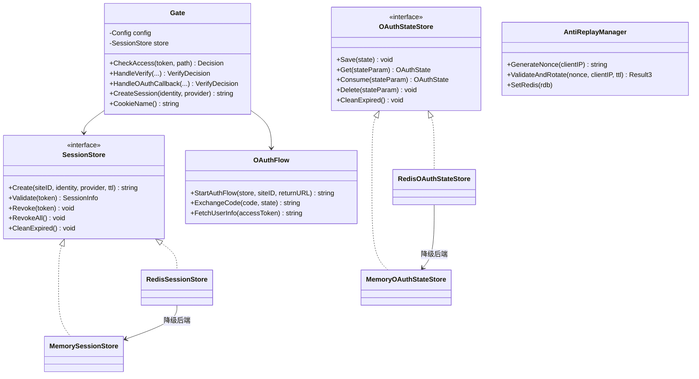
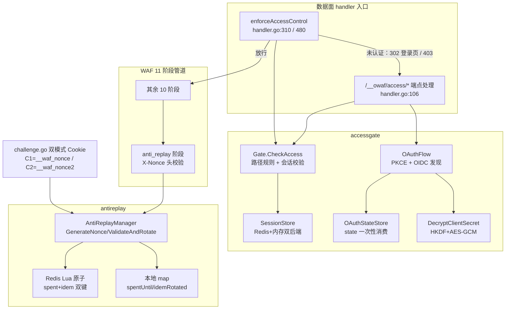
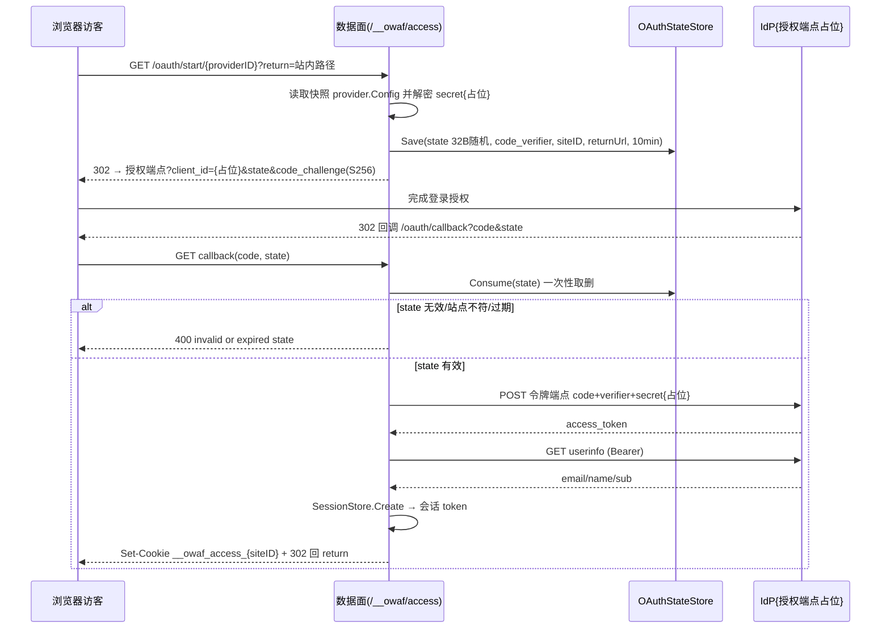
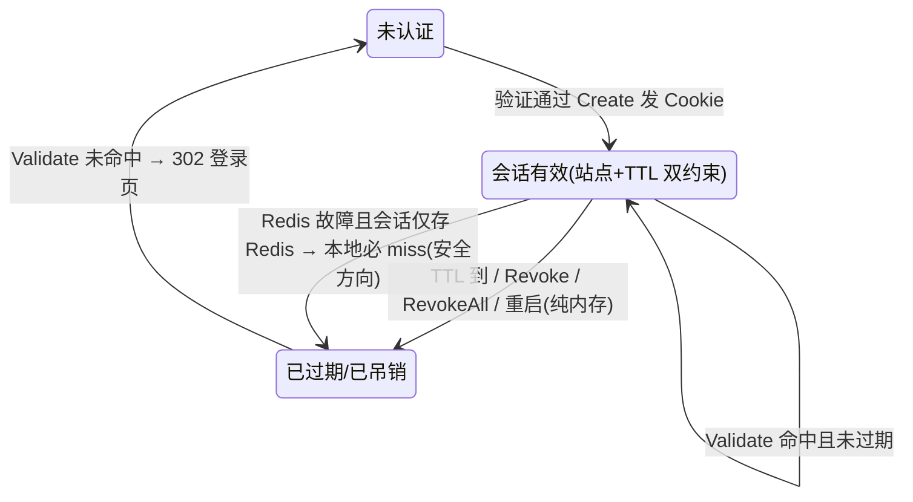
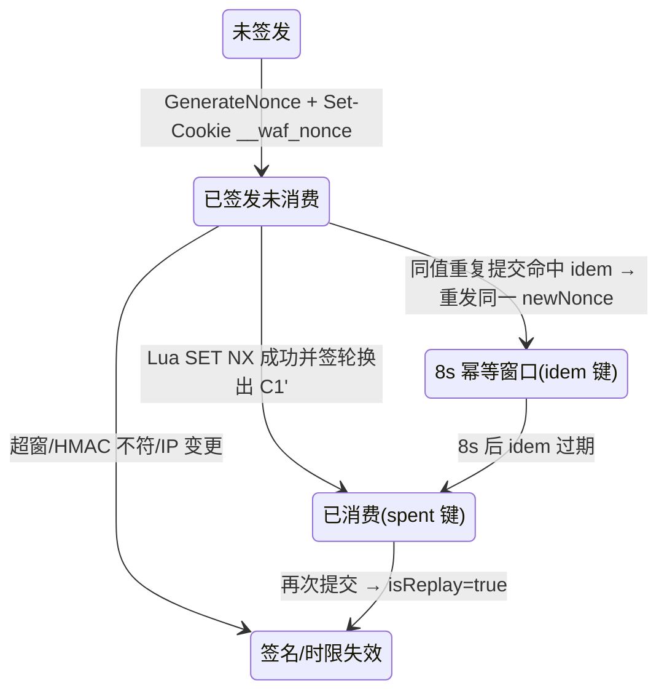
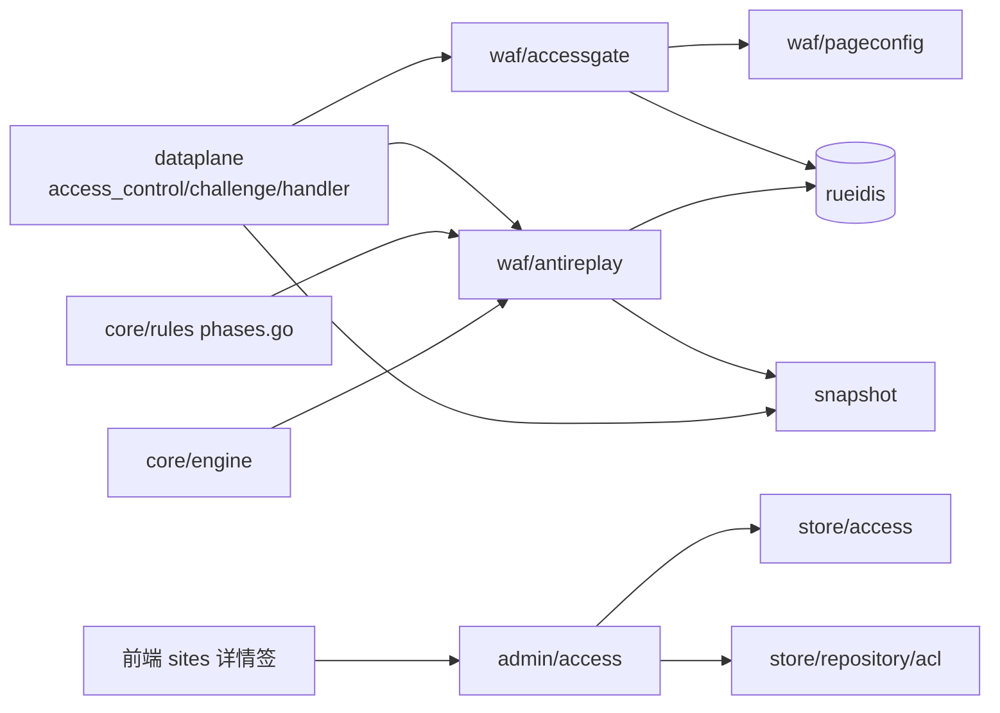

# 访问控制网关与重放防护

<cite>
**本文档引用的文件**
- [gate.go](file://internal/waf/accessgate/gate.go)
- [oauth.go](file://internal/waf/accessgate/oauth.go)
- [handlers.go](file://internal/waf/accessgate/handlers.go)
- [crypto.go](file://internal/waf/accessgate/crypto.go)
- [session.go](file://internal/waf/accessgate/session.go)
- [store_redis.go](file://internal/waf/accessgate/store_redis.go)
- [login_page.go](file://internal/waf/accessgate/login_page.go)
- [antireplay.go](file://internal/waf/antireplay/antireplay.go)
- [access_control.go](file://internal/dataplane/access_control.go)
- [challenge.go](file://internal/dataplane/challenge.go)
- [handler.go](file://internal/dataplane/handler.go)
- [phases.go](file://internal/core/rules/phases.go)
- [engine.go](file://internal/core/engine/engine.go)
- [pipeline.go](file://internal/core/pipeline/pipeline.go)
- [token.go](file://internal/waf/challenge/token.go)
- [redis.go](file://internal/waf/ratelimit/redis.go)
- [access.go](file://internal/admin/access/access.go)
- [providers.go](file://internal/admin/access/providers.go)
- [crypto.go](file://internal/admin/access/crypto.go)
- [users.go](file://internal/admin/access/users.go)
- [path_rules.go](file://internal/admin/access/path_rules.go)
- [access_control.go](file://internal/store/access/access_control.go)
- [access_control.go](file://internal/store/repository/acl/access_control.go)
- [snapshot.go](file://internal/snapshot/snapshot.go)
- [server.go](file://internal/app/server.go)
- [site.go](file://internal/store/site.go)
- [router.go](file://internal/admin/router.go)
- [access-control-tab.tsx](file://frontend/app/(dashboard)/sites/detail/components/access-control-tab.tsx)
- [access-provider-dialog.tsx](file://frontend/app/(dashboard)/sites/components/access-provider-dialog.tsx)
- [api.ts](file://frontend/lib/api.ts)
</cite>

## 目录
1. [简介](#简介)
2. [项目结构](#项目结构)
3. [核心组件](#核心组件)
4. [架构总览](#架构总览)
5. [详细组件分析](#详细组件分析)
6. [依赖关系分析](#依赖关系分析)
7. [性能考虑](#性能考虑)
8. [故障排查指南](#故障排查指南)
9. [结论](#结论)
10. [附录](#附录)

## 简介

本篇是「动态处置」子域的三级实现文档，覆盖两个实现：站点访问控制网关 `internal/waf/accessgate/`（7 文件 1672 行）与重放防护管理器 `internal/waf/antireplay/`（单文件 214 行）。两者分别解决「未认证访客根本不该看到站点内容」与「已签发的验证凭据不能被二次提交」两类问题。

本文档首先需要订正一个历史错误结论：早期文档曾称「仓库内未发现 OAuth2/OIDC 实现」。**该结论是错的**。`internal/waf/accessgate/oauth.go:136-336` 是一套真实、完整的授权码流程实现，覆盖 PKCE（S256）、OIDC 自动发现、state 一次性消费与令牌交换；`crypto.go:48-77` 提供配套的 `DecryptClientSecret`。本文按实测代码写清其真实能力面与边界，同时按要求不给出任何可直接用于绕站的完整操作路径。

| 项 | 内容 |
|----|------|
| 所属业务域 | WAF 引擎系统 / 动态处置 |
| 本篇形态 | C 三级实现文档 |
| 覆盖范围 | accessgate 网关（配置、会话、OAuth 流程、密钥解密、登录页）与 antireplay（nonce 生成、轮换、fail-closed 校验），及二者的管理 API 与前端配置入口 |
| 不覆盖 | 分级升级与丢弃执行细节（见同域文档），验证码/5 秒盾/链式挑战（见挑战域文档） |
| 上级与同级 | [动态处置](./动态处置.md)、[分级升级与丢弃执行](./分级升级与丢弃执行.md) |

**章节来源**
- [oauth.go:136-336](file://internal/waf/accessgate/oauth.go#L136-L336)
- [crypto.go:48-77](file://internal/waf/accessgate/crypto.go#L48-L77)

## 项目结构

两个实现分属数据面 WAF 包，接入点在 `internal/dataplane/`，管理链路在 `internal/admin/access/` 与 `internal/store/access/`，前端入口内嵌于站点详情页签（不存在独立的顶层「访问控制」页面目录，`protection`/`drop-policy`/`bot-protection`/`fingerprints`/`forwarding-profiles` 等旧目录名均已不存在）。

```text
internal/waf/accessgate/          # 访问控制网关（7 文件 1672 行，非测试）
├── gate.go        # Config/ProviderConfig/PathRule 模型 + Gate.CheckAccess + CookieName
├── oauth.go       # OAuthFlow/OAuthStateStore + PKCE + OIDC 发现
├── handlers.go    # 端点常量 + HandleVerify/HandleOAuthStart/HandleOAuthCallback 决策层
├── crypto.go      # HKDF 派生 + DecryptClientSecret（AES-256-GCM 解密）
├── session.go     # MemorySessionStore（会话内存后端）
├── store_redis.go # RedisSessionStore/RedisOAuthStateStore（双端降级后端）
└── login_page.go  # 登录页模板渲染（复用 pageconfig 品牌化）
internal/waf/antireplay/
└── antireplay.go  # AntiReplayManager：GenerateNonce / ValidateAndRotate
internal/dataplane/
├── access_control.go  # /__owaf/access/* 端点处理 + enforceAccessControl 前置执行
└── challenge.go       # 双模式 nonce Cookie（C1/C2）签发与续期页路径
```

| 模块 | 路径 | 职责 | 核心接口/符号 | 依赖模块 | 被依赖 | 规模(行) | 测试 |
|------|------|------|---------------|----------|--------|:--------:|:----:|
| 访问控制网关 | `internal/waf/accessgate` | 认证决策、OAuth/OIDC 流程、会话与 state 存储、client_secret 解密 | `Gate`、`SessionStore`、`OAuthFlow`、`OAuthStateStore`、`DecryptClientSecret` | pageconfig、rueidis、bcrypt、hkdf | dataplane | 1672 | 有 |
| 重放防护 | `internal/waf/antireplay` | HMAC nonce 生成/校验/轮换，Redis 原子消费 | `AntiReplayManager`、`ValidateAndRotate` | snapshot、rueidis | engine、rules、dataplane、app | 214 | 有 |
| 数据面接入 | `internal/dataplane/access_control.go` | 端点路由、Cookie 下发、前置强制 | `handleAccessControlEndpoints`、`enforceAccessControl` | accessgate、snapshot | handler | 546 | 有 |
| 管理 API | `internal/admin/access` | 配置/提供方/用户/路径规则 CRUD 与密钥加密 | `SaveAccessConfigReq`、`CreateProviderReq`、`encryptClientSecret` | store/access、repository | router | 1077 | 有 |
| 存储模型 | `internal/store/access` | 5 张表模型与 OAuth 配置结构 | `SiteAccessConfig`、`AccessProvider`、`OAuthProviderConfig` | gorm | admin、snapshot、backup | 94 | 有 |

**章节来源**
- [gate.go:14-61](file://internal/waf/accessgate/gate.go#L14-L61)
- [oauth.go:34-65](file://internal/waf/accessgate/oauth.go#L34-L65)
- [handlers.go:11-36](file://internal/waf/accessgate/handlers.go#L11-L36)
- [antireplay.go:18-60](file://internal/waf/antireplay/antireplay.go#L18-L60)
- [access_control.go:24-93](file://internal/dataplane/access_control.go#L24-L93)

## 核心组件

accessgate 对外暴露的类型关系如下：`Gate` 只依赖两个存储抽象（`SessionStore`、`OAuthStateStore`），各有内存与 Redis 双实现；Redis 实现内嵌内存实现作为降级后端。



**图表来源**
- [gate.go:63-81](file://internal/waf/accessgate/gate.go#L63-L81)
- [oauth.go:58-65](file://internal/waf/accessgate/oauth.go#L58-L65)
- [session.go:10-21](file://internal/waf/accessgate/session.go#L10-L21)
- [store_redis.go:58-70](file://internal/waf/accessgate/store_redis.go#L58-L70)
- [antireplay.go:18-33](file://internal/waf/antireplay/antireplay.go#L18-L33)

组件职责速查：

| 组件 | 位置 | 一句话职责 |
|------|------|------------|
| `Gate.CheckAccess` | [gate.go:85-115](file://internal/waf/accessgate/gate.go#L85-L115) | 路径规则匹配 + 会话有效性判定，返回放行/跳登录/拒绝三态 |
| `OAuthFlow` | [oauth.go:34-46](file://internal/waf/accessgate/oauth.go#L34-L46) | 授权码流程参数载体（端点、scope、PKCE 开关） |
| `DecryptClientSecret` | [crypto.go:48-77](file://internal/waf/accessgate/crypto.go#L48-L77) | 用 JWT 主密钥经 HKDF 派生 AES-256-GCM 密钥解密 client_secret 密文 |
| `AntiReplayManager.ValidateAndRotate` | [antireplay.go:101-180](file://internal/waf/antireplay/antireplay.go#L101-L180) | 校验一次性 nonce 并原子签轮换出 nonce，任何异常按重放处理 |
| `enforceAccessControl` | [access_control.go:353-379](file://internal/dataplane/access_control.go#L353-L379) | 在 WAF 管道之前执行访问门，未认证时 302 跳登录或 403 |

**章节来源**
- [gate.go:85-165](file://internal/waf/accessgate/gate.go#L85-L165)
- [oauth.go:34-46](file://internal/waf/accessgate/oauth.go#L34-L46)
- [crypto.go:48-77](file://internal/waf/accessgate/crypto.go#L48-L77)
- [antireplay.go:101-180](file://internal/waf/antireplay/antireplay.go#L101-L180)
- [access_control.go:353-379](file://internal/dataplane/access_control.go#L353-L379)

## 架构总览

两个实现落在请求处理链的不同位置：访问门是「管道前的身份门」，重放防护既是「管道内阶段」又是「挑战线的 Cookie 机制」。



**图表来源**
- [handler.go:106](file://internal/dataplane/handler.go#L106)
- [handler.go:310](file://internal/dataplane/handler.go#L310)
- [access_control.go:131-184](file://internal/dataplane/access_control.go#L131-L184)
- [gate.go:85-115](file://internal/waf/accessgate/gate.go#L85-L115)
- [phases.go:1289-1327](file://internal/core/rules/phases.go#L1289-L1327)
- [antireplay.go:101-214](file://internal/waf/antireplay/antireplay.go#L101-L214)
- [challenge.go:240-300](file://internal/dataplane/challenge.go#L240-L300)

关键边界结论（实测）：

- 访问控制**先于** WAF 管道执行，且「认证仅代表身份放行，不跳过后续 WAF 检测」（[access_control.go:346-352](file://internal/dataplane/access_control.go#L346-L352) 方法注释与 [handler.go:310](file://internal/dataplane/handler.go#L310)、[handler.go:480](file://internal/dataplane/handler.go#L480) 调用点）。`/__owaf/access/` 前缀路径自身豁免强制检查，避免登录死循环（[access_control.go:357-359](file://internal/dataplane/access_control.go#L357-L359)）。
- 会话边界清晰隔离：访问门 Cookie 为 `__owaf_access_{siteID}`（站点级隔离，[gate.go:163-165](file://internal/waf/accessgate/gate.go#L163-L165)），与挑战线 Cookie `__waf_nonce`/`__waf_nonce2`/`__waf_passed`（[token.go:22-26](file://internal/waf/challenge/token.go#L22-L26)）互不相通。通过访问门不产生挑战通过凭据，反之亦然。
- antireplay 有两条消费路径：管道内 `anti_replay` 阶段校验 `X-Nonce` 请求头（[phases.go:1295-1296](file://internal/core/rules/phases.go#L1295-L1296)）；数据面 Cookie 路径在 [challenge.go:240-300](file://internal/dataplane/challenge.go#L240-L300) 校验 `__waf_nonce` 并在成功后轮换成新值。管道对已被 Cookie 路径消费的同一枚 nonce 值免检（`AntiReplayConsumedNonce` 精确值比对，[phases.go:1301-1305](file://internal/core/rules/phases.go#L1301-L1305)，字段定义 [pipeline.go:44-48](file://internal/core/pipeline/pipeline.go#L44-L48)）。

**章节来源**
- [access_control.go:131-184](file://internal/dataplane/access_control.go#L131-L184)
- [access_control.go:346-379](file://internal/dataplane/access_control.go#L346-L379)
- [handler.go:106](file://internal/dataplane/handler.go#L106)
- [handler.go:310](file://internal/dataplane/handler.go#L310)
- [handler.go:480](file://internal/dataplane/handler.go#L480)
- [phases.go:1289-1327](file://internal/core/rules/phases.go#L1289-L1327)
- [pipeline.go:44-48](file://internal/core/pipeline/pipeline.go#L44-L48)
- [token.go:22-26](file://internal/waf/challenge/token.go#L22-L26)
- [challenge.go:240-300](file://internal/dataplane/challenge.go#L240-L300)

## 详细组件分析

### 访问控制网关（accessgate）

#### 配置模型与准入判定

网关运行时配置 `Config` 由快照构建：开关、站点 ID/Host、共享密码 bcrypt 哈希、会话 TTL、提供方列表与路径规则（[gate.go:15-52](file://internal/waf/accessgate/gate.go#L15-L52)）。提供方类型只有三种：`password`、`oauth2`、`oidc`（常量定义于 [access_control.go:5-11](file://internal/store/access/access_control.go#L5-L11)）——不存在按厂商写死的适配器清单，任何符合授权码模式的 IdP 均可接入。

`CheckAccess` 的决策顺序：未启用直接放行 → 路径规则按序首匹配（`allow`/`deny`/`require_auth`，无命中默认 `require_auth`，[gate.go:118-125](file://internal/waf/accessgate/gate.go#L118-L125)）→ 无会话 Cookie 则跳登录 → 会话校验三连查（存在性、站点一致性 `session.SiteID != g.config.SiteID`、过期时刻）。路径模式支持 `*`、`/*`、前缀 `xxx/*` 与结尾 `*` 通配（[gate.go:177-192](file://internal/waf/accessgate/gate.go#L177-L192)）。

| 步 | 动作 | 执行位置 | 输入 | 输出 | 失败分支 | 可观测点 |
|:--:|------|----------|------|------|----------|----------|
| 1 | 端点分发 | [access_control.go:131-184](file://internal/dataplane/access_control.go#L131-L184) | `/__owaf/access/*` 请求 | 站点网关实例+方法路由 | 站点未启用时 404 | 响应码 |
| 2 | 授权发起 | [oauth.go:136-191](file://internal/waf/accessgate/oauth.go#L136-L191) | provider ID | state 落库 + 302 到授权端点 | state 存储失败返 502 | 安全事件 |
| 3 | IdP 回调 | [access_control.go:256-297](file://internal/dataplane/access_control.go#L256-L297) | code + state | 一次性消费 state | state 无效/站点不符 400 | 访问日志 |
| 4 | 令牌交换 | [oauth.go:194-249](file://internal/waf/accessgate/oauth.go#L194-L249) | code、verifier、secret{占位} | access_token | 非 200/带 error 返 502 | 数据面日志 |
| 5 | 身份获取 | [oauth.go:252-304](file://internal/waf/accessgate/oauth.go#L252-L304) | Bearer access_token | email→name→sub→`unknown` 择一 | userinfo 非 200 返 502 | 数据面日志 |
| 6 | 建会话发 Cookie | [gate.go:143-145](file://internal/waf/accessgate/gate.go#L143-L145)、[access_control.go:478-487](file://internal/dataplane/access_control.go#L478-L487) | identity | `__owaf_access_{siteID}` HttpOnly/SameSite=Lax + 302 回跳 | 会话创建失败回登录页带错 | Set-Cookie |

**章节来源**
- [gate.go:15-52](file://internal/waf/accessgate/gate.go#L15-L52)
- [gate.go:85-125](file://internal/waf/accessgate/gate.go#L85-L125)
- [gate.go:177-192](file://internal/waf/accessgate/gate.go#L177-L192)
- [access_control.go:131-184](file://internal/dataplane/access_control.go#L131-L184)
- [access_control.go:256-297](file://internal/dataplane/access_control.go#L256-L297)
- [oauth.go:136-304](file://internal/waf/accessgate/oauth.go#L136-L304)
- [access_control.go:5-11](file://internal/store/access/access_control.go#L5-L11)

#### OAuth2/OIDC 真实能力面（订正：实现存在且完整可用）

实测 `oauth.go:136-336`，能力面如下，均可从代码逐行对应：

- **授权码模式全流程**：`StartAuthFlow` 生成 32 字节随机 state（base64url）、按配置拼授权 URL（缺省端点经 OIDC 发现补齐，[oauth.go:175-184](file://internal/waf/accessgate/oauth.go#L175-L184)）；`ExchangeCode` 以 `grant_type=authorization_code` 表单向令牌端点交换；`FetchUserInfo` 携 Bearer 令牌取身份。
- **PKCE**：`UsePKCE` 为真时生成 32 字节 `code_verifier` 并以其 SHA-256 的 base64url 作 `code_challenge_method=S256`（[oauth.go:163-169](file://internal/waf/accessgate/oauth.go#L163-L169)、[oauth.go:339-349](file://internal/waf/accessgate/oauth.go#L339-L349)）；verifier 随 state 存储、交换时回带。**OIDC 类型强制启用 PKCE**，除非配置显式关闭的判断在 `NewOAuthFlow`（[handlers.go:172-191](file://internal/waf/accessgate/handlers.go#L172-L191)），数据面构造点同样 `oc.UsePKCE || type==oidc`（[access_control.go:341](file://internal/dataplane/access_control.go#L341)）。
- **OIDC 自动发现**：`DiscoverEndpoints` 拉取 `{issuer}/.well-known/openid-configuration`，解析 authorization/token/userinfo 三端点，10s 超时、响应体上限 1MiB（[oauth.go:307-336](file://internal/waf/accessgate/oauth.go#L307-L336)）。
- **scope 缺省**：未配置时默认 `openid email profile`（[oauth.go:157-161](file://internal/waf/accessgate/oauth.go#L157-L161)）。
- **出站超时护栏**：token/userinfo 请求走专用 `oauthOutboundClient`，整体超时 10s，注释明确此设计是为消除数据面请求路径上 IdP 挂起占用工作协程的拒绝服务面（[oauth.go:17-32](file://internal/waf/accessgate/oauth.go#L17-L32)）。
- **能力边界（如实说明）**：实现**不发送 OIDC `nonce` 参数、不本地验签 `id_token`**——响应中的 `id_token` 字段被解析但从未使用（[oauth.go:234-238](file://internal/waf/accessgate/oauth.go#L234-L238)），身份断言完全来自 userinfo 端点的在线查询。接入方若只有 id_token 而无 userinfo 端点，则不适用本实现。



**图表来源**
- [oauth.go:136-249](file://internal/waf/accessgate/oauth.go#L136-L249)
- [access_control.go:233-297](file://internal/dataplane/access_control.go#L233-L297)
- [handlers.go:203-270](file://internal/waf/accessgate/handlers.go#L203-L270)

#### state 与回跳安全

`OAuthState` 携带 state、code_verifier、siteID、providerID、returnURL 与 `ExpiresAt = now+10min`（[oauth.go:142-148](file://internal/waf/accessgate/oauth.go#L142-L148)）。回调阶段用 `Consume` 而非 `Get`：内存实现删键取值为一次性语义（[oauth.go:103-114](file://internal/waf/accessgate/oauth.go#L103-L114)），Redis 实现用 Lua `GET+DEL` 原子完成（[store_redis.go:39-46](file://internal/waf/accessgate/store_redis.go#L39-L46)），站点不符即拒（[handlers.go:235-237](file://internal/waf/accessgate/handlers.go#L235-L237)、[access_control.go:264](file://internal/dataplane/access_control.go#L264)）。回跳地址统一经 `SanitizeReturnURL`：仅放行单 `/` 开头的站内路径，显式排除 `//host` 与 `/\host` 两种开放重定向形态（[handlers.go:71-80](file://internal/waf/accessgate/handlers.go#L71-L80)）；Referer 回跳须先通过同源比对 `sameSiteRefererPath`，跨站一律丢弃（[access_control.go:396-446](file://internal/dataplane/access_control.go#L396-L446)）。

**章节来源**
- [oauth.go:142-148](file://internal/waf/accessgate/oauth.go#L142-L148)
- [oauth.go:103-114](file://internal/waf/accessgate/oauth.go#L103-L114)
- [store_redis.go:39-46](file://internal/waf/accessgate/store_redis.go#L39-L46)
- [handlers.go:235-237](file://internal/waf/accessgate/handlers.go#L235-L237)
- [handlers.go:71-80](file://internal/waf/accessgate/handlers.go#L71-L80)
- [access_control.go:264](file://internal/dataplane/access_control.go#L264)
- [access_control.go:396-446](file://internal/dataplane/access_control.go#L396-L446)

#### DecryptClientSecret：密钥来源与解密路径

client_secret 的完整生命周期是「管理侧加密落库、数据面解密使用、两侧响应脱敏」：

- **密钥来源**：JWT 主密钥 `MY_OPENWAF_JWT_SECRET`（启动时 `resolveJWTSecret` 解析，数据面经 `opts.JWTSecret` 注入，[access_control.go:239](file://internal/dataplane/access_control.go#L239)、[access_control.go:305-344](file://internal/dataplane/access_control.go#L305-L344)）。
- **派生约定**：HKDF-SHA256，`secret=JWT 主密钥、salt=nil、info="access-oauth-client-secret"`，输出 32 字节 AES-256 密钥；管理侧 [crypto.go(admin/access):15-35](file://internal/admin/access/crypto.go#L15-L35) 与数据面 [crypto.go(accessgate):14-36](file://internal/waf/accessgate/crypto.go#L14-L36) 使用同一常量，两侧不一致即解密失败。
- **封装格式**：`base64.StdEncoding(nonce(12) ‖ ciphertext‖tag)`，AES-256-GCM（加密侧 [crypto.go(admin/access):46-64](file://internal/admin/access/crypto.go#L46-L64)，解密侧 [crypto.go(accessgate):48-77](file://internal/waf/accessgate/crypto.go#L48-L77)）。
- **更新语义**：管理侧 `encodeProviderConfig` 在提交明文为空时沿用旧密文，避免改其它字段误清密钥（[providers.go:119-144](file://internal/admin/access/providers.go#L119-L144)）；响应仅回显 `client_secret_set` 与前 4 位遮蔽 `maskClientSecret`（[crypto.go(admin/access):107-115](file://internal/admin/access/crypto.go#L107-L115)、[providers.go:56-108](file://internal/admin/access/providers.go#L56-L108)）。
- **失败行为**：数据面 `decryptOAuthSecret` 解密失败时原样返回密文串传给 IdP（[access_control.go:536-545](file://internal/dataplane/access_control.go#L536-L545)），后果是令牌交换必然失败并在回调阶段以 502 呈现，不会静默放行。

**章节来源**
- [crypto.go:14-36](file://internal/waf/accessgate/crypto.go#L14-L36)
- [crypto.go:48-77](file://internal/waf/accessgate/crypto.go#L48-L77)
- [crypto.go(admin/access):15-64](file://internal/admin/access/crypto.go#L15-L64)
- [crypto.go(admin/access):107-115](file://internal/admin/access/crypto.go#L107-L115)
- [providers.go:119-144](file://internal/admin/access/providers.go#L119-L144)
- [access_control.go:239](file://internal/dataplane/access_control.go#L239)
- [access_control.go:305-344](file://internal/dataplane/access_control.go#L305-L344)
- [access_control.go:536-545](file://internal/dataplane/access_control.go#L536-L545)

#### 会话与 OAuth state 存储：双后端降级语义

`RedisSessionStore`/`RedisOAuthStateStore` 结构相同：Redis 优先、内嵌内存后端兜底，单命令超时 100ms（[store_redis.go:20](file://internal/waf/accessgate/store_redis.go#L20)）。降级方向全部选择「宁可要求重新登录，绝不误放行」：`Create` 写 Redis 失败改用内存并**重新生成 token**（极端情况下 Redis 侧留下无人持有的孤儿键，随 TTL 过期，[store_redis.go:97-120](file://internal/waf/accessgate/store_redis.go#L97-L120)）；`Validate` 在 Redis 命令失败或未命中时二次查本地（降级期写入的会话只存在于本节点，[store_redis.go:142-160](file://internal/waf/accessgate/store_redis.go#L142-L160)）。`Revoke` 内存与 Redis 双端各删一次保幂等；`RevokeAll` 用 SCAN（Count 128、总超时 2s）分批删除而非 KEYS，注释明确为避免阻塞 Redis 主线程（[store_redis.go:220-264](file://internal/waf/accessgate/store_redis.go#L220-L264)），供备份恢复后的全量权限重置调用（[access_control.go:39-46](file://internal/dataplane/access_control.go#L39-L46)）。过期清理由数据面协程每 5 分钟驱动 `CleanExpired`（[access_control.go:48-55](file://internal/dataplane/access_control.go#L48-L55)）。

会话状态机（内存与 Redis 语义一致）：



**图表来源**
- [session.go:23-86](file://internal/waf/accessgate/session.go#L23-L86)
- [store_redis.go:97-160](file://internal/waf/accessgate/store_redis.go#L97-L160)
- [gate.go:103-114](file://internal/waf/accessgate/gate.go#L103-L114)

存储键与过期一览：

| 键前缀 | 载体 | TTL/过期 | 语义 | 位置 |
|--------|------|----------|------|------|
| `owaf:access:session:{token}` | 会话 JSON | 键 TTL=剩余有效期（Unix 毫秒判过期） | 访问门会话 | [store_redis.go:16、122-137](file://internal/waf/accessgate/store_redis.go#L16) |
| `owaf:access:oauth-state:{state}` | state JSON | `Px=10min` 内剩余 | OAuth 中间态，取删一次性 | [store_redis.go:17、386-401](file://internal/waf/accessgate/store_redis.go#L386-L401) |
| `waf:nonce:spent:{nonce}` | "1" | 会话剩余(下限 5s，上限 86400s) | nonce 已消费标记 | [antireplay.go:142-144](file://internal/waf/antireplay/antireplay.go#L142-L144) |
| `waf:nonce:idem:{nonce}` | 新 nonce | 8s（`antiReplayIdemSeconds`） | 同请求重试的幂等重放窗口 | [antireplay.go:33、143](file://internal/waf/antireplay/antireplay.go#L33) |

**章节来源**
- [store_redis.go:14-55](file://internal/waf/accessgate/store_redis.go#L14-L55)
- [store_redis.go:97-160](file://internal/waf/accessgate/store_redis.go#L97-L160)
- [store_redis.go:220-264](file://internal/waf/accessgate/store_redis.go#L220-L264)
- [store_redis.go:372-475](file://internal/waf/accessgate/store_redis.go#L372-L475)
- [access_control.go:39-55](file://internal/dataplane/access_control.go#L39-L55)
- [antireplay.go:33-48](file://internal/waf/antireplay/antireplay.go#L33-L48)

### 重放防护（antireplay）

#### Nonce 结构与安全参数

`GenerateNonce` 产出的 nonce 为 `base64url(时间戳8B ‖ 随机16B ‖ HMAC-SHA256签名32B)`，签名载荷绑定**客户端 IP 字符串**（[antireplay.go:81-99](file://internal/waf/antireplay/antireplay.go#L81-L99)）。校验侧要求解码后恰为 56 字节、HMAC 恒定时间比对（`hmac.Equal`，[antireplay.go:105-121](file://internal/waf/antireplay/antireplay.go#L105-L121)）、时间窗为 `age ≤ sessionTTL 且 age ≥ -30s`（容忍轻微时钟超前，[antireplay.go:122-126](file://internal/waf/antireplay/antireplay.go#L122-L126)）。

签名密钥来源需要注意：构造点传入空 secret，`NewAntiReplayManager` 随即生成**进程级随机密钥**（[antireplay.go:50-60](file://internal/waf/antireplay/antireplay.go#L50-L60)），实际调用为 [server.go:621](file://internal/app/server.go#L621) 的 `antireplay.NewAntiReplayManager("", rt.Redis, 5*time.Minute)`。推论：进程重启后旧 nonce 全部 HMAC 失效；多实例部署若无共享密钥，A 实例签发的 nonce 在 B 实例必校验失败。当前架构以 Redis 共享 spent/idem 键解决「已消费」判定的跨实例一致，但**签名验证仍是本实例密钥**，这是横向扩容时的既知约束。

#### ValidateAndRotate：轮换语义与 fail-closed

返回值三元组 `(valid, isReplay, newNonce)` 的完整语义：

1. 格式/签名/时间窗任一不过 → `(false, false, "")`：无效 nonce，非重放。
2. Redis 路径（客户端非 nil 时）执行一段 Lua：`SET spent NX EX` 成功则同时写入 idem 键（值为新 nonce，8s）并返回 `{1, 新nonce}`——即**校验与消费在同一条脚本内原子完成**；spent 已存在但 idem 命中返回 `{2, 原新nonce}`（幂等重取）；否则 `{0}` 判重放（[antireplay.go:35-48、139-177](file://internal/waf/antireplay/antireplay.go#L35-L48)）。
3. **任何 Redis 异常都收敛到 `(false, true, "")`**——超时（80ms，[antireplay.go:140](file://internal/waf/antireplay/antireplay.go#L140)）、命令错误、应答类型畸形（注释明确 bulk string "1" 视为畸形应答统一 fail-closed，[antireplay.go:161-166](file://internal/waf/antireplay/antireplay.go#L161-L166)）全部按「重放」处理。
4. Redis 客户端为 nil（未注入）时走 `validateAndRotateLocal`：进程内双 map（`spentUntil` 超 20000 条惰性清理、`idemRotated` 超 5000 条），同样实现一次性消费 + 8s 幂等窗口（[antireplay.go:182-214](file://internal/waf/antireplay/antireplay.go#L182-L214)）。
5. 消费成功时返回的 `newNonce` 由调用方立即下发（Cookie 轮换路径 [challenge.go:261、274-291](file://internal/dataplane/challenge.go#L261)，头路径签发在 [challenge.go:352](file://internal/dataplane/challenge.go#L352)），形成「一次请求一枚 nonce」的轮换链。

**Redis 不可用时的行为辨析**：「不可用」分两种——客户端对象为 nil（未配置/被清除）走本地内存路径，功能完整但不跨实例共享；客户端存在而 Redis 服务劣化，80ms 内无正常应答即 fail-closed，管道阶段据此返回 `Intercept`（[phases.go:1313-1325](file://internal/core/rules/phases.go#L1313-L1325)，`RuleIDStr: "antireplay:nonce"`、`Category: "replay"`），Cookie 路径则按站点配置的反重放动作处置（[challenge.go:352-365](file://internal/dataplane/challenge.go#L352-L365)）。

nonce 生命周期状态机（Cookie C1 视角）：



**图表来源**
- [antireplay.go:35-48](file://internal/waf/antireplay/antireplay.go#L35-L48)
- [antireplay.go:139-214](file://internal/waf/antireplay/antireplay.go#L139-L214)
- [challenge.go:240-300](file://internal/dataplane/challenge.go#L240-L300)

#### 与限流 fail-open 的方向对比（强制口径）

同为 Redis Lua + 短超时的设计，两者的失败方向**相反**，这是有意为之的风险定价差异：

| 维度 | 反重放 antireplay | 限流 ratelimit |
|------|-------------------|----------------|
| 单命令超时 | 80ms（[antireplay.go:140](file://internal/waf/antireplay/antireplay.go#L140)） | 50ms（[redis.go:127](file://internal/waf/ratelimit/redis.go#L127)） |
| Redis 出错时 | `return false, true, ""` 按重放处理（[antireplay.go:145-146](file://internal/waf/antireplay/antireplay.go#L145-L146)） | `return true` 直接放行（[redis.go:135-136](file://internal/waf/ratelimit/redis.go#L135-L136)） |
| 失败语义 | **fail-closed**：错误即 `Intercept` | **fail-open**：错误即视为未超限 |
| 定价逻辑 | 漏放重放的不可信请求伤害大于误拦 | 限流是配额设施，故障不应放大为拒绝服务 |
| Redis 未注入 | 本地双 map 降级 | 本地限流器独立实现 |

**章节来源**
- [antireplay.go:140-177](file://internal/waf/antireplay/antireplay.go#L140-L177)
- [redis.go:127-138](file://internal/waf/ratelimit/redis.go#L127-L138)
- [phases.go:1313-1325](file://internal/core/rules/phases.go#L1313-L1325)

#### 管道接入：anti_replay 阶段

阶段名 `anti_replay`，在 11 阶段链中位列第二（`ip_reputation` 之后，[engine.go:482-483](file://internal/core/engine/engine.go#L482-L483)），仅当 `deps.antiReplay != nil && rt.AntiReplayEnabled` 时入链。执行逻辑：无 `X-Nonce` 头直接跳过（Cookie 路径独立承担主校验）；`AntiReplayConsumedNonce` 与头值**完全相同**才免检——值不同的头仍照常校验，无法用「再塞一枚不同值」绕过（[phases.go:1295-1305](file://internal/core/rules/phases.go#L1295-L1305)）；`valid==false || isReplay==true` 即产出 Intercept 终止结果（[phases.go:1312-1325](file://internal/core/rules/phases.go#L1312-L1325)）。按站点窗口 `ctx.AntiReplayTTL` 来自 `rt.Site.AntiReplayTTL`（默认 300s，[site.go:65](file://internal/store/site.go#L65)、[handler.go:365](file://internal/dataplane/handler.go#L365)）。

**章节来源**
- [phases.go:1281-1327](file://internal/core/rules/phases.go#L1281-L1327)
- [engine.go:482-483](file://internal/core/engine/engine.go#L482-L483)
- [handler.go:365](file://internal/dataplane/handler.go#L365)
- [challenge.go:240-300](file://internal/dataplane/challenge.go#L240-L300)

### 管理 API 与配置链路

管理侧全部挂在站点作用域下，写操作仅有 POST（符合全库路由约定）：

| 方法 | 端点 | 处理器 | 请求体要点 |
|------|------|--------|------------|
| GET | `/sites/:id/access` | `GetAccessConfig` | 响应脱敏：只回 `shared_password_set` 布尔（[access.go:34-40](file://internal/admin/access/access.go#L34-L40)） |
| POST | `/sites/:id/access` | `SaveAccessConfig` | `SaveAccessConfigReq{enabled *bool, shared_password, clear_shared_password, session_ttl *int}`，空密码=保持，TTL≤0 回落 86400（[access.go:24-32、115-135](file://internal/admin/access/access.go#L24-L32)） |
| GET/POST | `/sites/:id/access/providers`、`/providers/:pid/update`、`/providers/:pid/delete` | `ListProviders`/`CreateProvider`/`UpdateProvider`/`DeleteProvider` | `CreateProviderReq{type,name,priority,enabled,config}`；type 白名单三值；oauth/oidc 必带 config（[providers.go:17-32、198-251](file://internal/admin/access/providers.go#L17-L32)） |
| GET/POST | `/sites/:id/access/users`（含 `/:uid/update`、`/:uid/delete`） | `ListUsers`/`CreateUser`/`UpdateUser`/`DeleteUser` | 密码 bcrypt cost 10；空密码保持原值（[users.go:20-60](file://internal/admin/access/users.go#L20-L60)） |
| GET/POST | `/sites/:id/access/rules`（含 `/:rid/update`、`/:rid/delete`） | `ListPathRules`/`CreatePathRule`/… | `CreatePathRuleReq{path,action,priority,enabled}`，action 白名单三值（[path_rules.go:15-45](file://internal/admin/access/path_rules.go#L15-L45)） |

所有写端点保存成功后调用 `reload()` 重建快照（[router.go:353-362](file://internal/admin/router.go#L353-L362)），使变更进入数据面 `SiteRuntime.AccessControl`（结构定义 [snapshot.go:136-158](file://internal/snapshot/snapshot.go#L136-L158)）；`CreateAccessProvider` 因 GORM 零值默认问题对显式禁用做插入后回写（[acl/access_control.go:37-52](file://internal/store/repository/acl/access_control.go#L37-L52)）。

前端实测落位：访问控制**没有独立的顶层页面目录**，配置 UI 是站点详情页的 `access-control-tab.tsx` 内联区（总开关、共享密码、TTL、三个列表），提供方/用户/路径规则各自是对话框组件 `sites/components/access-{provider,user,path-rule}-dialog.tsx`；数据钩子 `useAccessConfig/useAccessProviders/useAccessUsers/useAccessPathRules`，API 封装 `accessApi`（`frontend/lib/api.ts:1211-1264`）。权限门槛为 admin/operator 可管理（`access-control-tab.tsx` 中 `canManage`）。OAuth 表单字段与 `OAuthProviderConfig` 一一对应（client_id、client_secret、auth_url、token_url、userinfo_url、issuer、scopes、redirect_path、use_pkce，`access-provider-dialog.tsx`），编辑时 secret 留空即保持原密钥。

**章节来源**
- [access.go:24-147](file://internal/admin/access/access.go#L24-L147)
- [providers.go:17-251](file://internal/admin/access/providers.go#L17-L251)
- [users.go:20-60](file://internal/admin/access/users.go#L20-L60)
- [path_rules.go:15-45](file://internal/admin/access/path_rules.go#L15-L45)
- [acl/access_control.go:37-52](file://internal/store/repository/acl/access_control.go#L37-L52)
- [router.go:353-362](file://internal/admin/router.go#L353-L362)
- [snapshot.go:136-158](file://internal/snapshot/snapshot.go#L136-L158)
- [access-control-tab.tsx:1-120](file://frontend/app/(dashboard)/sites/detail/components/access-control-tab.tsx#L1-L120)
- [access-provider-dialog.tsx:1-60](file://frontend/app/(dashboard)/sites/components/access-provider-dialog.tsx#L1-L60)
- [api.ts:1211-1264](file://frontend/lib/api.ts#L1211-L1264)

## 依赖关系分析



**图表来源**
- [access_control.go:12-19](file://internal/dataplane/access_control.go#L12-L19)
- [antireplay.go:14-15](file://internal/waf/antireplay/antireplay.go#L14-L15)
- [phases.go:1285-1291](file://internal/core/rules/phases.go#L1285-L1291)
- [providers.go:11-15](file://internal/admin/access/providers.go#L11-L15)

依赖矩阵（✓ 存在依赖）：

| 调用方 ↓ / 被调方 → | accessgate | antireplay | store/access | snapshot | rueidis | pageconfig |
|---------------------|:---:|:---:|:---:|:---:|:---:|:---:|
| dataplane | ✓ | ✓ | ✓ | ✓ | ✓ | ✓ |
| core/rules、core/engine | — | ✓ | — | ✓ | — | — |
| admin/access | — | — | ✓ | — | — | — |
| waf/accessgate 自身 | — | — | — | — | ✓ | ✓ |
| waf/antireplay 自身 | — | — | — | ✓ | ✓ | — |

外部实体：`rueidis`（两套存储后端与 nonce Lua）、`golang.org/x/crypto/bcrypt`（共享密码与用户口令，cost 10）、`golang.org/x/crypto/hkdf` + 标准库 AES-GCM（client_secret 加解密）、`html/template` + `embed`（登录页模板 `templates/login.html`）。反向依赖检查：accessgate 不依赖 store 层——本地用户查询经 `UserLookupFunc` 由数据面注入（[handlers.go:41-43](file://internal/waf/accessgate/handlers.go#L41-L43)），符合依赖倒置。

**章节来源**
- [access_control.go:12-19](file://internal/dataplane/access_control.go#L12-L19)
- [handlers.go:41-43](file://internal/waf/accessgate/handlers.go#L41-L43)
- [antireplay.go:14-15](file://internal/waf/antireplay/antireplay.go#L14-L15)
- [gate.go:11-12](file://internal/waf/accessgate/gate.go#L11-L12)
- [login_page.go:6-10](file://internal/waf/accessgate/login_page.go#L6-L10)

## 性能考虑

- **问题**：IdP 端点挂起会占住数据面工作协程。**优化**：OAuth 出站统一 10s 超时专用客户端，且不复用 `http.DefaultClient` 以免全局 Timeout 波及他处（[oauth.go:17-32](file://internal/waf/accessgate/oauth.go#L17-L32)）。**效果**：单请求最坏占用时长可预期。
- **问题**：nonce 校验位于热路径，Redis 往返可能拖慢每个请求。**优化**：单命令 80ms 超时 + 一次 Lua 完成校验/消费/签发三事（[antireplay.go:139-144](file://internal/waf/antireplay/antireplay.go#L139-L144)）。**效果**：往返次数为 1，尾延迟有硬上界；代价是 fail-closed 下 Redis 劣化直接转化为拦截率上升。
- **问题**：SCAN 全量遍历会话键可能长时间占用连接。**优化**：Count 128 分批 + 2s 总超时，弃用 KEYS（[store_redis.go:236-264](file://internal/waf/accessgate/store_redis.go#L236-L264)）。**效果**：清理与全量吊销均为可中断的有界操作。
- **问题**：本地降级 map 无主动淘汰定时器。**优化**：超阈值惰性清理（20000/5000 条，[antireplay.go:187-200](file://internal/waf/antireplay/antireplay.go#L187-L200)）。**效果**：内存占用有软上限，但清理发生在写入路径，突发流量下单次延迟略增。

**章节来源**
- [oauth.go:17-32](file://internal/waf/accessgate/oauth.go#L17-L32)
- [antireplay.go:139-144](file://internal/waf/antireplay/antireplay.go#L139-L144)
- [antireplay.go:187-200](file://internal/waf/antireplay/antireplay.go#L187-L200)
- [store_redis.go:236-264](file://internal/waf/accessgate/store_redis.go#L236-L264)

## 故障排查指南

| 症状 | 根因 | 排查 | 处置 |
|------|------|------|------|
| 回调稳定 400「invalid or expired state」 | state 超 10 分钟、被消费过、或降级窗口 state 存于另一节点内存 | 核对回调耗时与多实例分布；查 `owaf:access:oauth-state:*` 是否存在 | 会话粘性部署或确保 Redis 已注入（`SetAccessStoreRedisClients`） |
| 令牌交换 502 | client_secret 密文与当前 JWT 主密钥不匹配（换密钥后未重存提供方）、或 IdP 端点不可达 | 数据面日志 `oauth token exchange failed`；确认 provider.Config 可被 `DecryptClientSecret` 还原 | 用当前 JWT 主密钥重新保存提供方 secret{占位}；检查出站网络 |
| 重启后大量请求被 `antireplay:nonce` Intercept | 随机 HMAC 密钥随进程重生，旧 nonce 全部失效，属预期安全行为 | 看 `Category: "replay"` 事件是否集中在重启时刻 | 等待客户端 Cookie 轮换自愈；避免流量高峰重启 |
| Redis 抖动期反重放拦截率飙升但限流无感 | fail-closed 80ms vs fail-open 50ms 的方向性差异（见对比表） | 比对 `waf:nonce:spent:*` 读写延迟与两条链错误日志 | 优先修 Redis；确需降级容忍时评估关闭站点 anti_replay 入链的代价 |
| 登录成功但业务路径仍 302 回登录页 | 会话 SiteID 与请求站点不符（Cookie 按站点隔离，跨站点复用无效） | 检查 `__owaf_access_{siteID}` 名称与请求 Host 命中的站点 | 属正确行为；核对多站点 Cookie 混淆场景 |
| 登录后跳到站外页面（历史缺陷） | 早期 `HasPrefix(v,"/")` 放行 `//evil.com` | 现实现已收口 `SanitizeReturnURL` + 同源 Referer | 若复现先确认未部署旧版本 |

**章节来源**
- [access_control.go:256-297](file://internal/dataplane/access_control.go#L256-L297)
- [handlers.go:225-270](file://internal/waf/accessgate/handlers.go#L225-L270)
- [antireplay.go:50-60](file://internal/waf/antireplay/antireplay.go#L50-L60)
- [antireplay.go:139-177](file://internal/waf/antireplay/antireplay.go#L139-L177)
- [redis.go:127-138](file://internal/waf/ratelimit/redis.go#L127-L138)
- [gate.go:107-109](file://internal/waf/accessgate/gate.go#L107-L109)
- [access_control.go:396-413](file://internal/dataplane/access_control.go#L396-L413)

## 结论

本次迭代为「动态处置」子域补上了两篇实现级文档中偏身份与凭据的一半。成果与结论：

- **订正重大误判**：OAuth2/OIDC 是真实完整实现——授权码 + PKCE(S256) + OIDC 发现 + state 一次性消费 + 10s 出站超时全部有码可查；同时如实记录边界（不做 id_token 验签、不传 OIDC nonce、签名密钥进程级随机）。
- **失败语义定型**：反重放 fail-closed（80ms、错误即 Intercept）与限流 fail-open（50ms、错误即放行）方向相反，已在对比表中固化为口径；访问门存储的降级方向统一为「宁可重登，不可误放」。
- **设计原则印证**：`SessionStore`/`OAuthStateStore` 接口隔离让内存/Redis 后端可替换（SOLID-I/D）；`UserLookupFunc` 注入避免网关包反向依赖存储层（DIP）；管理端点全部 POST 与 `readGroup/opsGroup` 划分延续全库约定（KISS）。
- **遇到的问题**：任务口径中「前端访问控制页面目录」实测不存在——真实形态是站点详情内嵌页签加三个对话框，已按实测落笔。
- **下一步**：同域《分级升级与丢弃执行》补齐 escalation/drop 细节；本篇登记的扩容约束（HMAC 密钥随机、跨实例 state）适合进入问题检测报告跟踪。

[本节为总结，无需特定文件来源]

## 附录

### 数据面端点速查

| 常量 | 路径 | 方法 | 定义 |
|------|------|:----:|------|
| `PathLogin` | `/__owaf/access/login` | GET | [handlers.go:13](file://internal/waf/accessgate/handlers.go#L13) |
| `PathVerify` | `/__owaf/access/verify` | POST | [handlers.go:15](file://internal/waf/accessgate/handlers.go#L15) |
| `PathOAuthStartPrefix` | `/__owaf/access/oauth/start/{providerID}` | GET | [handlers.go:17](file://internal/waf/accessgate/handlers.go#L17) |
| `PathOAuthCallback` | `/__owaf/access/oauth/callback` | GET | [handlers.go:19](file://internal/waf/accessgate/handlers.go#L19) |
| `PathLogout` | `/__owaf/access/logout` | POST | [handlers.go:21](file://internal/waf/accessgate/handlers.go#L21) |

**章节来源**
- [handlers.go:11-22](file://internal/waf/accessgate/handlers.go#L11-L22)

### Cookie 与参数速查

| 名称 | 归属 | 属性 | 位置 |
|------|------|------|------|
| `__owaf_access_{siteID}` | 访问门会话 | HttpOnly、SameSite=Lax、Max-Age=SessionTTL(缺省 86400)、TLS 站点加 Secure | [access_control.go:478-487](file://internal/dataplane/access_control.go#L478-L487) |
| `__waf_nonce`(C1)/`__waf_nonce2`(C2) | 重放防护双模式 | HttpOnly、SameSite=Strict、Max-Age=86400 | [challenge.go:131-137](file://internal/dataplane/challenge.go#L131-L137)、[token.go:22-24](file://internal/waf/challenge/token.go#L22-L24) |
| `X-Nonce` 请求头 | 重放防护管道路径 | 仅与已消费 Cookie 值完全相同才免检 | [phases.go:1295-1305](file://internal/core/rules/phases.go#L1295-L1305) |
| `auth_type` 表单 | 登录验证 | `shared_password` / `user_password` 二值 | [handlers.go:25-36](file://internal/waf/accessgate/handlers.go#L25-L36) |

### 术语与约定

- **共享密码**：全站一把 bcrypt(cost 10) 口令，身份记为 `shared`（[gate.go:128-134](file://internal/waf/accessgate/gate.go#L128-L134)、[access.go:20-22](file://internal/admin/access/access.go#L20-L22)）。
- **双模式（dual）**：nonce 续期页机制，仅对接受 text/html 且方法幂等的请求生效，避免 POST 循环 412（[challenge.go:245-262](file://internal/dataplane/challenge.go#L245-L262)）。
- **挑战动作语义**：`captcha_challenge` 展示配置的验证码类型、`shield_challenge` 走 5 秒盾流程、`chain_challenge` 展示链式步骤，均为具体 WAF action 页面而非通用状态码页；反重放无效 nonce 的处置经 `normalizeAntiReplayAction` 归入这套动作集（[challenge.go:400-410](file://internal/dataplane/challenge.go#L400-L410)）。

**章节来源**
- [access_control.go:131-137](file://internal/dataplane/access_control.go#L131-L137)
- [access_control.go:478-487](file://internal/dataplane/access_control.go#L478-L487)
- [token.go:22-26](file://internal/waf/challenge/token.go#L22-L26)
- [phases.go:1295-1305](file://internal/core/rules/phases.go#L1295-L1305)
- [handlers.go:25-36](file://internal/waf/accessgate/handlers.go#L25-L36)
- [gate.go:128-134](file://internal/waf/accessgate/gate.go#L128-L134)
- [access.go:20-22](file://internal/admin/access/access.go#L20-L22)
- [challenge.go:245-262](file://internal/dataplane/challenge.go#L245-L262)
- [challenge.go:400-410](file://internal/dataplane/challenge.go#L400-L410)
