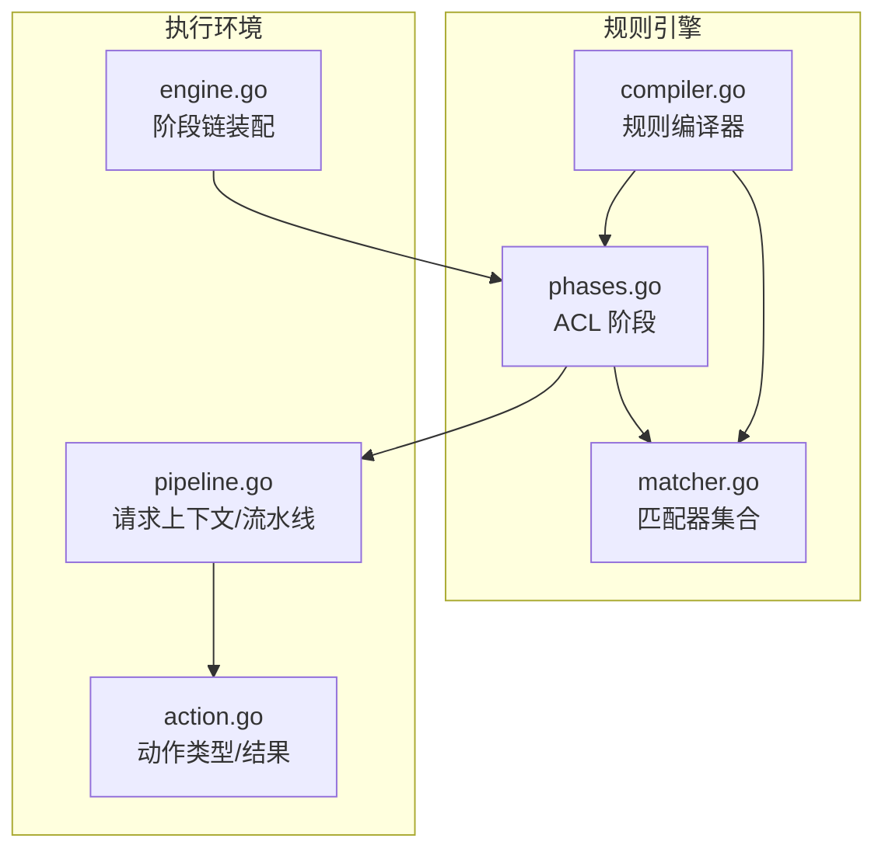
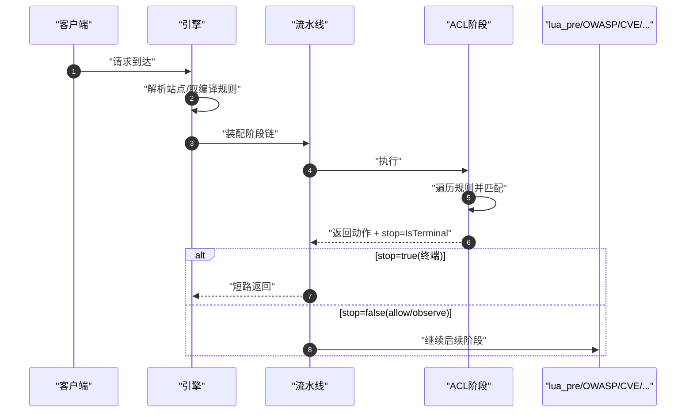
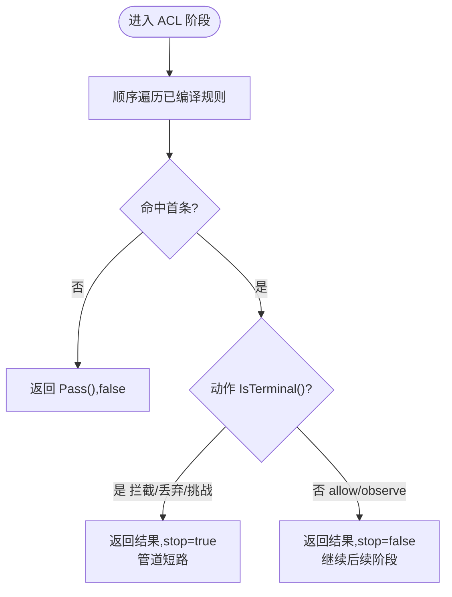
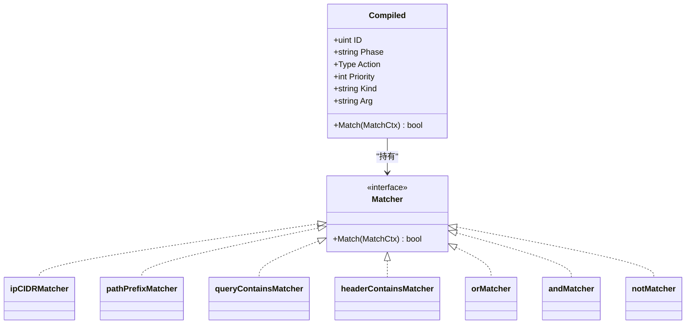
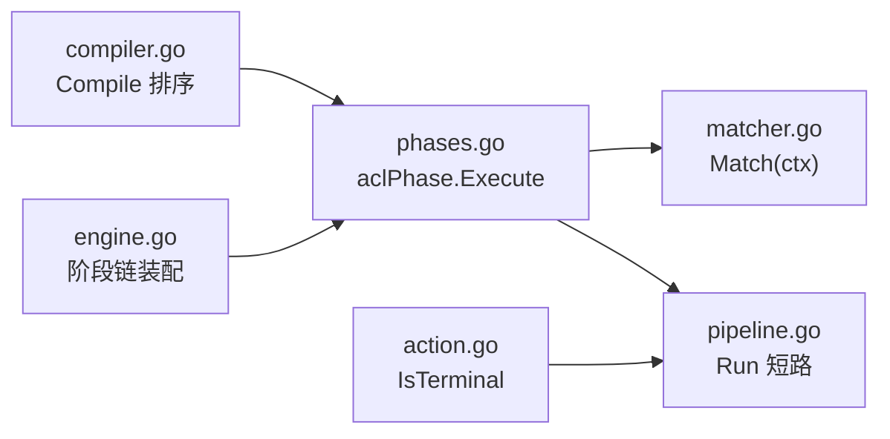

# ACL 访问控制阶段

> [返回 WAF 引擎系统](../WAF 引擎系统.md)

<cite>
**本文档引用的文件**
- [phases.go](file://internal/core/rules/phases.go)
- [compiler.go](file://internal/core/rules/compiler.go)
- [matcher.go](file://internal/core/rules/matcher.go)
- [action.go](file://internal/core/action/action.go)
- [pipeline.go](file://internal/core/pipeline/pipeline.go)
- [engine.go](file://internal/core/engine/engine.go)
</cite>

## 目录

1. [简介](#简介)
2. [项目结构](#项目结构)
3. [核心组件](#核心组件)
4. [架构总览](#架构总览)
5. [详细组件分析](#详细组件分析)
6. [依赖关系分析](#依赖关系分析)
7. [性能考虑](#性能考虑)
8. [故障排查指南](#故障排查指南)
9. [结论](#结论)
10. [附录](#附录)

## 简介
本文件系统性阐述 OpenWAF 中"ACL 访问控制"阶段的实现原理与运行机制，覆盖规则匹配、白名单与黑名单处理、短路与终端动作、在整体处理管线中的优先级与位置、配置示例与最佳实践，以及性能优化与常见错误排查方法。目标是帮助读者从代码到实践全面掌握 ACL 阶段的设计与运维要点。

## 项目结构
ACL 阶段位于规则引擎子系统中，作为请求处理流水线的一个阶段参与整体 WAF 执行。其核心文件分布如下：
- 规则编译与匹配：`internal/core/rules/compiler.go`、`internal/core/rules/matcher.go`
- ACL 阶段实现：`internal/core/rules/phases.go`
- 处理管线与短路策略：`internal/core/pipeline/pipeline.go`、`internal/core/action/action.go`
- 引擎装配与阶段顺序：`internal/core/engine/engine.go`

ACL 阶段在引擎中的相关符号如下表，行号均为实际读取值：

| 符号 | 文件:行 | 签名 | 职责 |
|---|---|---|---|
| `aclPhase` | phases.go:131-134 | `struct{ rules []Compiled; needsDerivedHeaders bool }` | ACL 阶段载体 |
| `NewACLPhasePrecompiled` | phases.go:142-144 | `(rules []Compiled) pipeline.Phase` | 由已分区规则构造阶段 |
| `aclPhase.Name` | phases.go:146 | `() string` | 返回 `"acl"` |
| `aclPhase.Execute` | phases.go:148-150 | `(ctx) (action.Result, bool)` | 委托 `executeCompiledPhase` |
| `executeCompiledPhase` | phases.go:112-129 | `(ctx, rules, allowShortCircuit, needsDerived)` | 顺序命中首条返回 |
| `Compiled.Match` | compiler.go:32-37 | `(ctx MatchCtx) bool` | 委托预构建匹配器 |

**图表来源**
- [phases.go:131-150](file://internal/core/rules/phases.go#L131-L150)
- [compiler.go:39-78](file://internal/core/rules/compiler.go#L39-L78)
- [engine.go:486-488](file://internal/core/engine/engine.go#L486-L488)

**章节来源**
- [phases.go:112-150](file://internal/core/rules/phases.go#L112-L150)
- [compiler.go:13-78](file://internal/core/rules/compiler.go#L13-L78)
- [engine.go:486-488](file://internal/core/engine/engine.go#L486-L488)

## 核心组件
- 规则编译器：`Compile` 将存储层规则转换为运行时 `Compiled`，按优先级升序、ID 升序排序，预构建匹配器（compiler.go:39-78）
- 匹配器：`Matcher.Match(ctx MatchCtx) bool` 针对具体字段进行匹配，支持正则缓存（matcher.go:21-23、1785-1808）
- 处理阶段：`aclPhase` 遍历已编译 ACL 规则，命中首条即返回 `(结果, IsTerminal)`（phases.go:112-150）
- 引擎：整合站点解析、规则编译、阶段装配与流水线执行（engine.go:441-548）

| 组件 | 位置 | 对外契约 | 说明 |
|---|---|---|---|
| ACL 阶段 | phases.go:146 | `Name()`="acl" | 链上第 3 位 |
| 结果动作 | action.go:9-26 | `allow/intercept/observe/drop/...` | 见动作取值表 |
| 终止判定 | action.go:168-179 | `IsTerminal()` | 仅终端动作短路 |

**章节来源**
- [compiler.go:39-78](file://internal/core/rules/compiler.go#L39-L78)
- [matcher.go:21-23](file://internal/core/rules/matcher.go#L21-L23)
- [phases.go:112-150](file://internal/core/rules/phases.go#L112-L150)
- [action.go:9-179](file://internal/core/action/action.go#L9-L179)

## 架构总览
ACL 位于全 11 阶段链的第 3 位（`ip_reputation → anti_replay → acl → lua_pre → ...`，engine.go:465-548），在站点黑名单之后、Lua 前置与 OWASP 昂贵检测之前。规则引擎遵循"编译期优化 + 运行期快速匹配"的设计：编译阶段解析 DSL 与复合 JSON、映射匹配器、缓存正则、按优先级与 ID 排序；运行阶段在流水线中按阶段顺序执行，命中首条即依据动作是否为终端动作决定短路或继续。

| 动作 | 是否终端 | ACL 命中后的短路行为 | 默认状态码 |
|---|:--:|---|:--:|
| `allow` | 否 | **不短路**，继续 OWASP/CVE 等后续阶段 | - |
| `observe` | 否 | 不短路，作为观察命中记录 | - |
| `intercept` | 是 | 短路，返回拦截 | 403 |
| `drop` | 是 | 立即短路并关闭 TCP，不发响应 | - |
| `redirect` | 是 | 短路，返回重定向 | 302 |
| `challenge` | 是 | 延迟保留，后续更高优先级动作可覆盖 | 403 |

**图表来源**
- [engine.go:465-548](file://internal/core/engine/engine.go#L465-L548)
- [phases.go:148-150](file://internal/core/rules/phases.go#L148-L150)
- [pipeline.go:517-560](file://internal/core/pipeline/pipeline.go#L517-L560)

**章节来源**
- [engine.go:465-548](file://internal/core/engine/engine.go#L465-L548)
- [pipeline.go:517-560](file://internal/core/pipeline/pipeline.go#L517-L560)

## 详细组件分析

### ACL 阶段执行流程与短路机制
- 规则筛选与排序：`Compile` 仅保留启用规则，按优先级升序、ID 升序排序（compiler.go:71-76）；引擎按 `Phase=="acl"` 预分区（engine.go:403-404）。
- 匹配与命中：`executeCompiledPhase` 顺序遍历，命中**首条**即返回 `(hit(rule), hit(rule).IsTerminal())`（phases.go:120-126）。
- **短路订正**：函数形参 `allowShortCircuit` 在函数体内从未被引用（phases.go:112-129）。因此 `allow` 命中返回 `stop=false`，**不短路**，请求继续进入 `lua_pre`、`owasp_default` 等后续阶段；只有终端动作（intercept/drop/challenge/redirect/rate_limit 等，action.go:168-179）才短路。
- 返回值：未命中返回 `Pass(), false`。

**图表来源**
- [phases.go:112-129](file://internal/core/rules/phases.go#L112-L129)
- [action.go:168-179](file://internal/core/action/action.go#L168-L179)

**章节来源**
- [phases.go:112-129](file://internal/core/rules/phases.go#L112-L129)
- [compiler.go:71-76](file://internal/core/rules/compiler.go#L71-L76)
- [action.go:168-179](file://internal/core/action/action.go#L168-L179)

### 规则匹配机制与白名单/黑名单处理
- 匹配器类型：`Matcher.Match(ctx MatchCtx) bool`（matcher.go:21-23），具体实现覆盖 IP/CIDR、路径前缀/精确/正则、查询包含/正则、头部包含/精确/正则、方法、内容类型、User-Agent、Body、TLS 指纹、复合 and/or/not 等。
- 白名单与黑名单：
  - `allow_ip` 命中返回 `allow` 动作，`IsTerminal()` 为假 → **不短路**，作为放行判定但请求仍继续后续检测。
  - `block_ip` 命中返回拦截/丢弃动作，终端动作 → 短路。
  - 非法 IP/CIDR 或非法正则编译失败时回落到 `neverMatcher`（fail-closed，永不匹配），避免误伤（matcher.go:504-508、1772-1773）。
- 匹配上下文：`fillMatchCtxFromPipeline` 从 `RequestCtx` 提取 ClientIP、Method、Path、RawQuery、Headers、Host、TLS、Body 等字段（phases.go:72-104）。

| kind | 匹配器 | 目标字段 | 非法输入回落 | 位置 |
|---|---|---|---|---|
| `allow_ip`/`block_ip` | `ipCIDRMatcher` | ClientIP | neverMatcher | [matcher.go:1475-1491](file://internal/core/rules/matcher.go#L1475-L1491) |
| `block_path` | `pathPrefixMatcher` | Path | - | [matcher.go:1493-1494](file://internal/core/rules/matcher.go#L1493-L1494) |
| `block_path_exact` | `exactPathMatcher` | Path | - | [matcher.go:1537-1538](file://internal/core/rules/matcher.go#L1537-L1538) |
| `block_path_regex` | `pathRegexMatcher` | Path | neverMatcher | [matcher.go:1496-1501](file://internal/core/rules/matcher.go#L1496-L1501) |
| `block_query_contains` | `queryContainsMatcher` | Query | - | [matcher.go:1503-1504](file://internal/core/rules/matcher.go#L1503-L1504) |
| `block_header` | `headerContainsMatcher` | Headers | - | [matcher.go:1525-1527](file://internal/core/rules/matcher.go#L1525-L1527) |
| `block_method` | `methodMatcher` | Method | - | [matcher.go:1549-1550](file://internal/core/rules/matcher.go#L1549-L1550) |
| `compound` | `parseCompoundJSON` | 组合 | neverMatcher | [matcher.go:1769-1770](file://internal/core/rules/matcher.go#L1769-L1770) |

**图表来源**
- [compiler.go:13-37](file://internal/core/rules/compiler.go#L13-L37)
- [matcher.go:21-23](file://internal/core/rules/matcher.go#L21-L23)
- [matcher.go:281-321](file://internal/core/rules/matcher.go#L281-L321)

**章节来源**
- [matcher.go:21-321](file://internal/core/rules/matcher.go#L21-L321)
- [phases.go:72-104](file://internal/core/rules/phases.go#L72-L104)
- [compiler.go:13-37](file://internal/core/rules/compiler.go#L13-L37)

### 规则语法与表达式支持
- 简单规则：`kind:arg`，`ParsePattern` 找到首个冒号并校验前缀是否属于 `knownPrefixes`（compiler.go:146-170、119-142）。
  - IP 类仅有 `allow_ip`、`block_ip`；路径类有 `block_path`、`block_path_exact`、`block_path_regex`、`path_contains`、`path_wildcard` 等；头部类有 `block_header`、`block_header_exact`、`block_header_regex`、`header_wildcard` 等。
- 复合规则：JSON 对象 `{"op":"and|or|not|if|cc_rate","children":[...]}`，`ParsePattern` 见到首个 `{` 直接判为 `compound`（compiler.go:152-153），`buildCompound` 递归构建匹配器树（matcher.go:1878-1928）。
- 变量与上下文：从 `MatchCtx` 提取 ClientIP、Method、Path、Query、Headers、Host、TLS、Body 参与匹配。

**章节来源**
- [compiler.go:119-170](file://internal/core/rules/compiler.go#L119-L170)
- [matcher.go:1878-1928](file://internal/core/rules/matcher.go#L1878-L1928)

### 规则执行顺序与优先级
- 编译时排序：优先级升序，优先级相同时按 ID 升序（compiler.go:71-76）。
- 运行时遍历：阶段内按编译顺序依次匹配，命中**首条**即返回该条结果（phases.go:120-126）。
- 动作影响：终端动作（Intercept/Drop/…）短路；Allow 与 Observe 不短路，Observe 作为观察命中继续收集。

**章节来源**
- [compiler.go:71-76](file://internal/core/rules/compiler.go#L71-L76)
- [phases.go:120-126](file://internal/core/rules/phases.go#L120-L126)

### 规则编写示例与调试方法
- 示例（DSL）：
  - 简单：`block_ip:192.168.1.0/24`、`block_path:/admin`、`block_method:DELETE`、`block_header_regex:User-Agent:(?i)scanner`。
  - 复合：`{"op":"and","children":[{"kind":"block_path","arg":"/admin"},{"kind":"block_method","arg":"POST"}]}`。
- 调试：`ParsePattern` 决定 kind/arg 解析（compiler.go:146-170），`buildMatcher` 依 kind 分派匹配器（matcher.go:1473-1775），任一非法模式统一回落 `neverMatcher`，因此"配了不生效"多因 kind 前缀不在 `knownPrefixes` 中。

**章节来源**
- [compiler.go:146-170](file://internal/core/rules/compiler.go#L146-L170)
- [matcher.go:1473-1775](file://internal/core/rules/matcher.go#L1473-L1775)

## 依赖关系分析
- 规则相位与动作：ACL 阶段名 `acl`（phases.go:146）；动作取值来自 `action.Type` 全集（action.go:9-26）。
- 规则编译：`Compile` 输出排序后的 `Compiled`，引擎按 `Phase` 预分区为 `cr.ACL`（engine.go:399-410）。
- 配置项：运行时依赖 `phaseRuntimeConfig` 只影响限流/GeoIP/AntiReplay，不改变 ACL 匹配逻辑（engine.go:73-80）。

| 依赖方向 | 依赖对象 | 证据 |
|---|---|---|
| engine → acl | `getOrBuildPhases` 条件入链 | [engine.go:486-488](file://internal/core/engine/engine.go#L486-L488) |
| acl → compiler | `Compiled.Match` | [compiler.go:32-37](file://internal/core/rules/compiler.go#L32-L37) |
| acl → action | `Result.IsTerminal` 决定 stop | [action.go:168-179](file://internal/core/action/action.go#L168-L179) |
| pipeline → acl | `Run` 顺序执行与短路 | [pipeline.go:517-560](file://internal/core/pipeline/pipeline.go#L517-L560) |

**图表来源**
- [phases.go:146-150](file://internal/core/rules/phases.go#L146-L150)
- [engine.go:399-488](file://internal/core/engine/engine.go#L399-L488)
- [pipeline.go:517-560](file://internal/core/pipeline/pipeline.go#L517-L560)

**章节来源**
- [engine.go:399-488](file://internal/core/engine/engine.go#L399-L488)
- [phases.go:146-150](file://internal/core/rules/phases.go#L146-L150)
- [pipeline.go:517-560](file://internal/core/pipeline/pipeline.go#L517-L560)

## 性能考虑
- 命中即返回：ACL 在首条命中后即退出本阶段遍历，建议将高命中率规则置于靠前优先级。
- 匹配器选择：前缀/包含匹配优于正则；正则经 `cachedCompile` 全局缓存（matcher.go:1785-1808），仍应避免复杂或回溯严重模式（RE2 保证线性时间）。
- CIDR 聚合：`allow_ip`/`block_ip` 用 CIDR 匹配，聚合常用网段可减少规则数量。
- 派生头部开销：仅当规则含 `tls_alpn`/`header_order_*` 等 kind 时才计算派生头部（phases.go:227-249），避免热路径无用分支。

## 故障排查指南
- 规则不生效：确认规则启用、`Phase` 正确、kind 前缀在 `knownPrefixes` 内。
- Allow 未"放行整条链"：这是预期行为——ACL allow 不短路，后续 OWASP/CVE 仍可拦截；如需绕过昂贵检测应使用 IP 信誉全局白名单。
- 正则匹配异常：非法正则回落 `neverMatcher`，检查语法（matcher.go:1791-1808）。
- 动作不符合预期：终端动作短路、Allow/Observe 不短路。

| 症状 | 原因 | 处置 |
|---|---|---|
| allow 规则命中但请求仍被拦截 | allow 不短路，后续阶段拦截 | 用全局白名单或调低后续阶段敏感度 |
| 规则完全不起作用 | kind 前缀未登记 / 已停用 | 核对 `knownPrefixes`、启用状态、优先级 |
| 正则命中不稳定 | 非法正则回落永不匹配 | 修正正则语法 |
| CIDR 未覆盖 | 单 IP 与网段形态混用 | 用 `/32` 或明确网段 |

**章节来源**
- [phases.go:112-129](file://internal/core/rules/phases.go#L112-L129)
- [matcher.go:1785-1808](file://internal/core/rules/matcher.go#L1785-L1808)
- [compiler.go:119-170](file://internal/core/rules/compiler.go#L119-L170)

## 结论
ACL 规则引擎通过"编译期排序 + 运行期顺序匹配"实现灵活高效的访问控制。`executeCompiledPhase` 命中首条即返回，`allowShortCircuit` 形参已废弃，Allow 与终端动作的短路语义由 `IsTerminal()` 统一决定。非法模式统一 fail-closed 到 `neverMatcher`，保证规则配置错误不会放大为误封。

## 附录
ACL 阶段的属性一览（与总览 11 阶段全序表一致）：

| 属性 | 取值 |
|---|---|
| 阶段名 | `acl` |
| 注册位置 | [engine.go:486-488](file://internal/core/engine/engine.go#L486-L488) |
| 入链前置 | `len(cr.ACL) > 0` |
| 链上位置 | 第 3 位（anti_replay 之后、lua_pre 之前） |
| 短路策略 | 仅终端动作短路；Allow 不短路 |

**章节来源**
- [engine.go:486-488](file://internal/core/engine/engine.go#L486-L488)
- [phases.go:131-150](file://internal/core/rules/phases.go#L131-L150)