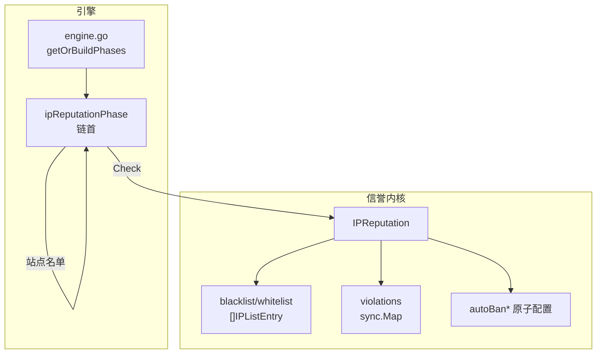
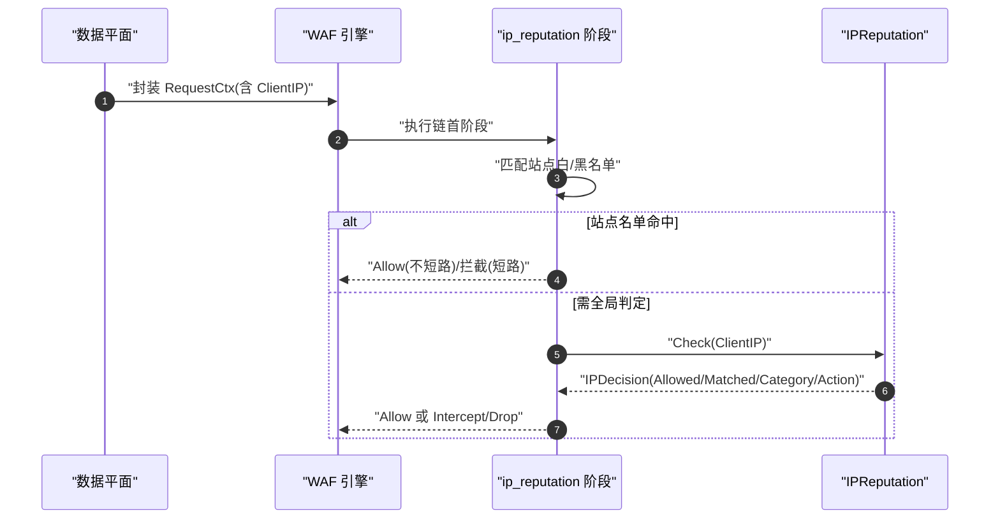
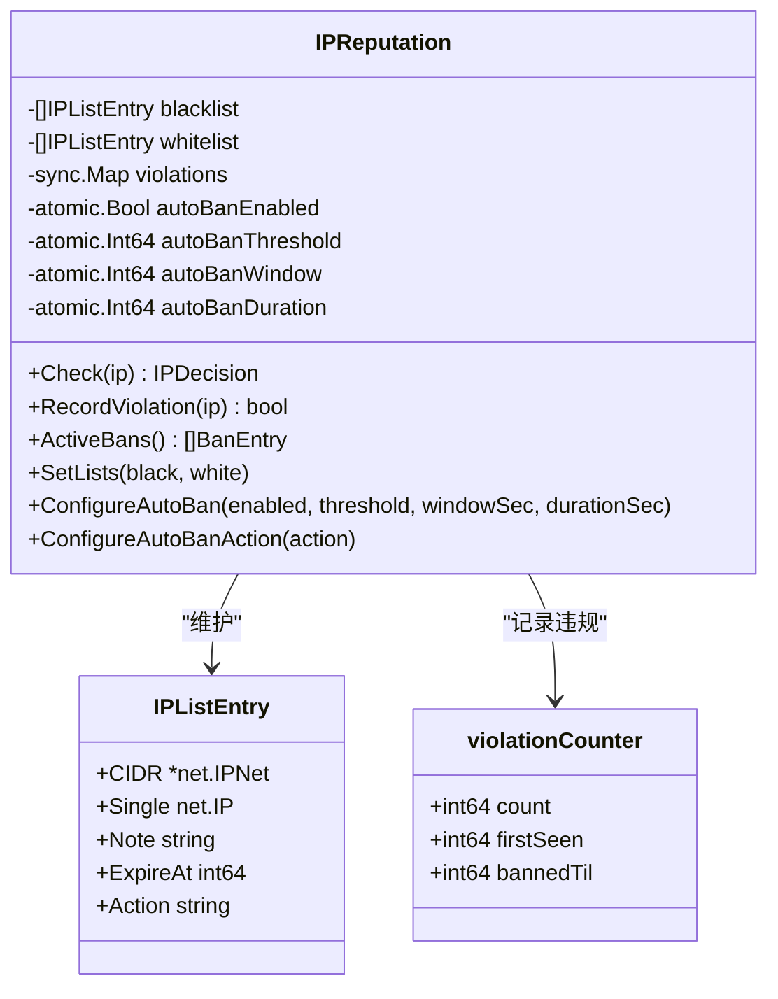
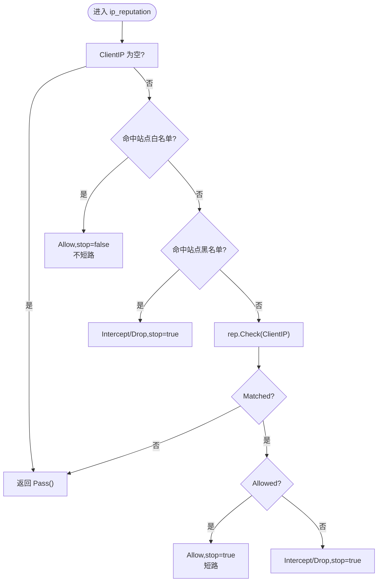
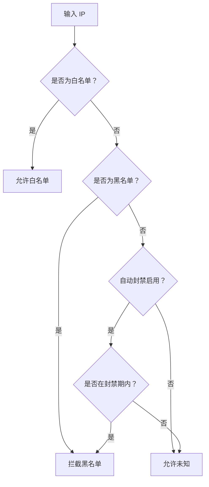
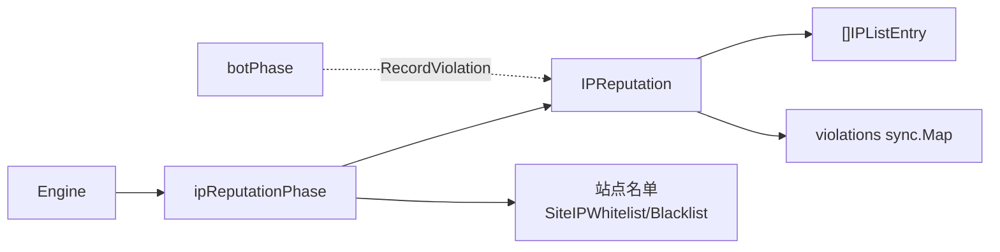

# IP 信誉检查阶段

> [返回 WAF 引擎系统](../WAF 引擎系统.md)

<cite>
**本文档引用的文件**
- [iprep.go](file://internal/waf/iprep/iprep.go)
- [phases.go](file://internal/core/rules/phases.go)
- [bot.go](file://internal/waf/bot/bot.go)
- [engine.go](file://internal/core/engine/engine.go)
- [action.go](file://internal/core/action/action.go)
- [pipeline.go](file://internal/core/pipeline/pipeline.go)
</cite>

## 目录

1. [简介](#简介)
2. [项目结构](#项目结构)
3. [核心组件](#核心组件)
4. [架构总览](#架构总览)
5. [详细组件分析](#详细组件分析)
6. [依赖关系分析](#依赖关系分析)
7. [性能考虑](#性能考虑)
8. [故障排查指南](#故障排查指南)
9. [结论](#结论)
10. [附录](#附录)

## 简介
本文件聚焦 My-OpenWaf 的 IP 信誉检查阶段（`ip_reputation`），它是全 11 阶段链的**第 1 位**（`ip_reputation → anti_replay → acl → lua_pre → owasp_default → cve_detection → bot_detection → browser_sign → rate_limit → signature → custom`，engine.go:465-548），基于预置黑白名单与动态违规计数做出允许或拦截判定。文档阐述其数据结构、判定逻辑、自动封禁机制、短路语义与并发清理。阶段实现分布在两处：内存信誉管理与自动封禁在 `internal/waf/iprep/iprep.go`，流水线阶段与站点级名单在 `internal/core/rules/phases.go`。

## 项目结构
IP 信誉检查涉及以下关键模块：
- 内核层：`IPReputation`（内存黑白名单 + 原子自动封禁配置）
- 规则层：`ipReputationPhase`（流水线中的独立阶段）
- 引擎层：`getOrBuildPhases` 在 `e.ipRep != nil` 时把该阶段置于链首（engine.go:479-481）
- 协同层：Bot 检测阶段复用同一 `IPReputation` 记录违规（phases.go:562-563）

| 符号 | 文件:行 | 签名 | 职责 |
|---|---|---|---|
| `IPReputation` | [iprep.go:20](file://internal/waf/iprep/iprep.go#L20) | struct | 内存信誉与自动封禁载体 |
| `IPListEntry` | [iprep.go:11](file://internal/waf/iprep/iprep.go#L11) | CIDR/Single/Note/ExpireAt/Action | 单条名单条目 |
| `Check` | [iprep.go:105](file://internal/waf/iprep/iprep.go#L105) | `(ip net.IP) IPDecision` | 白→黑→自动封禁判定 |
| `ipReputationPhase` | [phases.go:342](file://internal/core/rules/phases.go#L342) | struct | 阶段载体 |
| `ipReputationPhase.Execute` | [phases.go:368](file://internal/core/rules/phases.go#L368) | `(ctx) (action.Result,bool)` | 站点名单 + 全局信誉决策 |

**图表来源**
- [engine.go:479-481](file://internal/core/engine/engine.go#L479-L481)
- [phases.go:342-433](file://internal/core/rules/phases.go#L342-L433)
- [iprep.go:20-137](file://internal/waf/iprep/iprep.go#L20-L137)

**章节来源**
- [engine.go:479-481](file://internal/core/engine/engine.go#L479-L481)
- [phases.go:342-433](file://internal/core/rules/phases.go#L342-L433)
- [iprep.go:11-137](file://internal/waf/iprep/iprep.go#L11-L137)

## 核心组件
- `IPReputation`：内存中的信誉管理器，维护全局黑白名单与基于违规计数的自动封禁状态，支持并发读写与原子配置更新（iprep.go:20-137）。
- `ipReputationPhase`：流水线中的独立阶段，先匹配站点级名单，再调用 `IPReputation.Check` 生成动作结果（phases.go:342-433）。
- 引擎与短路：链首入链（engine.go:479-481）。**站点白名单命中返回 `Allow, stop=false`（不短路，继续后续阶段）**；站点黑名单命中返回拦截/丢弃且 `stop=true`；全局 `Check` 命中白名单返回 `Allow, stop=true`（短路），命中黑名单/自动封禁返回终端动作短路。

| 组件 | 位置 | 并发原语 | 说明 |
|---|---|---|---|
| `blacklist/whitelist` | [iprep.go:22-23](file://internal/waf/iprep/iprep.go#L22-L23) | `sync.RWMutex` | 名单读多写少 |
| `violations` | [iprep.go:24](file://internal/waf/iprep/iprep.go#L24) | `sync.Map` + 内部 Mutex | 违规计数 |
| `autoBan*` | [iprep.go:25-28](file://internal/waf/iprep/iprep.go#L25-L28) | `atomic.Bool/Int64` | 原子阈值/窗口/时长 |
| `cleaner` | [iprep.go:249](file://internal/waf/iprep/iprep.go#L249) | Ticker 5 分钟 | 过期封禁回收 |

**章节来源**
- [iprep.go:20-137](file://internal/waf/iprep/iprep.go#L20-L137)
- [phases.go:342-433](file://internal/core/rules/phases.go#L342-L433)
- [engine.go:479-481](file://internal/core/engine/engine.go#L479-L481)

## 架构总览
IP 信誉检查是全 11 阶段链的第 1 位，其后依次是 anti_replay、acl、lua_pre、owasp_default、cve_detection、bot_detection、browser_sign、rate_limit、signature、custom（engine.go:465-548）。请求处理时序如下：

**图表来源**
- [phases.go:368-433](file://internal/core/rules/phases.go#L368-L433)
- [iprep.go:105-137](file://internal/waf/iprep/iprep.go#L105-L137)

**章节来源**
- [phases.go:368-433](file://internal/core/rules/phases.go#L368-L433)
- [engine.go:465-548](file://internal/core/engine/engine.go#L465-L548)

## 详细组件分析

### IPReputation 组件
- 数据结构：
  - `IPListEntry`：支持单 IP（`Single`）与 CIDR（`CIDR`），带 `Note`、`ExpireAt` 与 `Action` 字段（iprep.go:11-17）。
  - `violationCounter`：按 IP 聚合，记录 `count`、`firstSeen`、`bannedTil`（iprep.go:35-40）。
  - 自动封禁参数：阈值、窗口秒数、封禁持续秒数均通过原子变量支持运行时调整（iprep.go:25-28）。
- 关键方法：
  - `Check`：nil IP→Allowed；白名单→黑名单→自动封禁顺序判定（iprep.go:105-137）。
  - `RecordViolation`：自动封禁开启时累计违规，超阈值且未封禁则设 `bannedTil`（iprep.go:144-167）。
  - `ActiveBans`/`SetLists`/`ConfigureAutoBan`/`ConfigureAutoBanAction`：并发安全地枚举与更新（iprep.go:65-95、194-207）。
- 自动封禁代码默认值：

| 参数 | 默认值 | 证据 |
|---|:--:|---|
| 阈值 threshold | 10 | [iprep.go:44](file://internal/waf/iprep/iprep.go#L44) |
| 窗口 window | 60 秒 | [iprep.go:45](file://internal/waf/iprep/iprep.go#L45) |
| 持续 duration | 3600 秒 | [iprep.go:46](file://internal/waf/iprep/iprep.go#L46) |
| 动作 action | intercept | [iprep.go:47](file://internal/waf/iprep/iprep.go#L47) |

- 并发与清理：名单读多写少用 `RWMutex`；违规计数器内部互斥锁；后台 `cleaner` 每 5 分钟清理"封禁已过期且距首次违规超 1 小时"的条目（iprep.go:249-271）。

**图表来源**
- [iprep.go:11-40](file://internal/waf/iprep/iprep.go#L11-L40)
- [iprep.go:105-207](file://internal/waf/iprep/iprep.go#L105-L207)

**章节来源**
- [iprep.go:11-40](file://internal/waf/iprep/iprep.go#L11-L40)
- [iprep.go:105-271](file://internal/waf/iprep/iprep.go#L105-L271)

### IP 信誉阶段（规则流水线）
- 执行逻辑（phases.go:368-433）：
  - ClientIP 为空直接 `Pass`。
  - 先遍历 `siteWhitelist`：命中返回 `Allow, stop=false`（不短路，继续后续阶段）。
  - 再遍历 `siteBlacklist`：命中返回 Intercept/Drop，`stop=true`（动作由条目 `Action` 决定，drop/block→Drop）。
  - 最后调用全局 `rep.Check`：`Allowed`→ `Allow, stop=true`；否则 Intercept/Drop，`stop=true`，`RuleIDStr="iprep:类别"`。
- 结果映射：Category 取 `whitelist`/`site_blacklist`/`blacklist`/`auto_ban`。

**图表来源**
- [phases.go:368-433](file://internal/core/rules/phases.go#L368-L433)

**章节来源**
- [phases.go:368-433](file://internal/core/rules/phases.go#L368-L433)

### 黑/白名单与自动封禁处理逻辑
`Check` 判定优先级与取值（iprep.go:105-137）：

| 判定顺序 | 命中条件 | Allowed | Matched | Category | Action |
|:--:|---|:--:|:--:|---|---|
| 1 白名单 | `entryMatchesAt` 为真 | true | true | `whitelist` | - |
| 2 黑名单 | `entryMatchesAt` 为真 | false | true | `blacklist` | 条目 Action |
| 3 自动封禁 | `bannedTil > now` 且启用 | false | true | `auto_ban` | 原子动作 |
| 未知 IP | 以上皆不命中 | true | false | - | - |

条目匹配 `entryMatchesAt`：`ExpireAt>0` 且已过期则不匹配；CIDR 覆盖或 Single 相等则命中（iprep.go:213-224）。

**图表来源**
- [iprep.go:105-224](file://internal/waf/iprep/iprep.go#L105-L224)

**章节来源**
- [iprep.go:105-224](file://internal/waf/iprep/iprep.go#L105-L224)

### 自动封禁算法与准确性保证
- 计数窗口：以 `firstSeen` 为基准，`now-firstSeen>window` 则重置计数与首见时间（iprep.go:157-160）。
- 触发条件：`count>=threshold` 且 `bannedTil<now` 时设 `bannedTil=now+duration`（iprep.go:162-164）。
- 白名单豁免：`RecordViolation` 对命中白名单的 IP 直接返回 false（iprep.go:145）。
- 动作归一化：`ConfigureAutoBanAction` 将 drop/block→drop，其余→intercept（iprep.go:85-95）。
- 与 Bot 检测联动：bot 终端判定调用 `RecordViolation`（phases.go:562-563）。

**章节来源**
- [iprep.go:85-167](file://internal/waf/iprep/iprep.go#L85-L167)
- [phases.go:562-563](file://internal/core/rules/phases.go#L562-L563)

### 与 Bot 检测的协同
- bot 阶段复用同一 `IPReputation`：`CheckBotTwoPhaseWithBehavior` 的 PreScreen 检查信誉（黑名单/自动封禁），命中进入深度评分（bot.go:922-926）。
- 深度评分将 IP 信誉纳入加权总分；信誉模块权重 15%（bot.go:85）。
- bot 终端判定回写违规：`verdictToResult` 在拦截档调用 `RecordViolation`（phases.go:562-563）。

**章节来源**
- [bot.go:85-942](file://internal/waf/bot/bot.go#L85-L942)
- [phases.go:562-563](file://internal/core/rules/phases.go#L562-L563)

## 依赖关系分析
- 引擎将 `ip_reputation` 阶段置于链首，先于 ACL 与所有检测阶段参与决策（engine.go:479-481）。
- `ipReputationPhase` 依赖 `IPReputation`（`rep` 字段）与站点级名单（`siteWhitelist/siteBlacklist`）（phases.go:342-354）。
- `IPReputation` 内部依赖 `IPListEntry` 名单数组、`sync.Map` 违规表与原子配置（iprep.go:20-33）。
- 结果动作依赖 `action.Type` 与 `IsTerminal` 判定（action.go:168-179）。

| 依赖方 | 被依赖对象 | 证据 |
|---|---|---|
| engine | `ipReputationPhase` | [engine.go:479-481](file://internal/core/engine/engine.go#L479-L481) |
| ipReputationPhase | `IPReputation.Check` | [phases.go:404-407](file://internal/core/rules/phases.go#L404-L407) |
| ipReputationPhase | 站点名单切片 | [phases.go:344-345](file://internal/core/rules/phases.go#L344-L345) |
| IPReputation | `IPListEntry`/`violationCounter` | [iprep.go:11-40](file://internal/waf/iprep/iprep.go#L11-L40) |
| bot 阶段 | 同一 `IPReputation` | [phases.go:562-563](file://internal/core/rules/phases.go#L562-L563) |

**图表来源**
- [phases.go:342-433](file://internal/core/rules/phases.go#L342-L433)
- [iprep.go:20-40](file://internal/waf/iprep/iprep.go#L20-L40)
- [engine.go:479-481](file://internal/core/engine/engine.go#L479-L481)

**章节来源**
- [phases.go:342-433](file://internal/core/rules/phases.go#L342-L433)
- [iprep.go:20-40](file://internal/waf/iprep/iprep.go#L20-L40)
- [engine.go:479-481](file://internal/core/engine/engine.go#L479-L481)

## 性能考虑
- 名单匹配 O(N)：黑白名单为切片线性遍历（iprep.go:110-122）；站点名单同样线性（phases.go:374-402）。建议控制条目数量、按 CIDR 分桶优化（建议项，非现实现）。
- 自动封禁 O(1)：`violations` 用 `sync.Map` 字符串键，平均常数级（iprep.go:125）。
- 并发控制：名单读多写少用 `RWMutex`；违规计数器内部加锁（iprep.go:21-33）。
- 内存回收：`cleaner` 每 5 分钟清理过期封禁，避免键空间膨胀（iprep.go:249-271）。

## 故障排查指南
- 封禁未解除/未触发：确认自动封禁开关、阈值、窗口、持续时间；检查条目 `ExpireAt` 是否过期（iprep.go:213-224）。
- 白名单"未放行整条链"：站点白名单 `stop=false` 不短路，后续阶段仍可拦截；如需绕过检测应使用全局白名单（`stop=true`）。
- 封禁堆积：确认 `cleaner` 运行、过期条件 `bannedTil<now 且 now-firstSeen>3600` 满足（iprep.go:262）。
- 观测：`ActiveBans` 枚举当前生效封禁（iprep.go:194-207）。

| 症状 | 可能原因 | 排查点 |
|---|---|---|
| 白名单命中仍被拦截 | 站点白名单不短路 | 改用全局白名单/降后续敏感度 |
| 黑名单不生效 | 条目已过期或解析失败 | `ExpireAt`、`ParseIPListEntry` |
| 自动封禁长期不解 | `bannedTil` 仍在窗口内 | `ActiveBans` 核对截止时间 |

**章节来源**
- [iprep.go:194-271](file://internal/waf/iprep/iprep.go#L194-L271)
- [phases.go:368-433](file://internal/core/rules/phases.go#L368-L433)

## 结论
IP 信誉检查阶段以内存名单与原子自动封禁实现统一准入。需特别注意短路语义差异：站点白名单不短路、全局白名单短路、黑名单与自动封禁均短路。结合后台清理与 Bot 联动的违规回写，阶段在保证实时性的同时具备良好可运维性。

## 附录

### 配置最佳实践
- 自动封禁配置建议（代码默认值：阈值 10 / 窗口 60s / 持续 3600s）

| 使用场景 | 阈值 | 窗口(秒) | 持续时间(秒) | 说明 |
|----------|------|----------|--------------|------|
| 开发环境 | 3-5 | 60 | 300 | 快速响应，便于测试 |
| 生产环境 | 10-20 | 60-120 | 3600-7200 | 平衡安全性和用户体验 |
| 高风险环境 | 5-10 | 30-60 | 7200-14400 | 更严格的防护策略 |

- IP 地址管理建议：白名单遵循最小权限并定期审查；黑名单结合威胁情报设置合理 `ExpireAt`；优先使用更精确的 CIDR。

### API 使用要点
- `NewIPReputation` 创建实例并启动 `cleaner`（iprep.go:42-51）。
- `SetLists` 更新黑白名单，`ConfigureAutoBan`/`ConfigureAutoBanAction` 调整封禁（iprep.go:65-95）。
- `Check` 判定、`RecordViolation` 累计、`ActiveBans` 枚举（iprep.go:105-207）。

**章节来源**
- [iprep.go:42-207](file://internal/waf/iprep/iprep.go#L42-L207)
