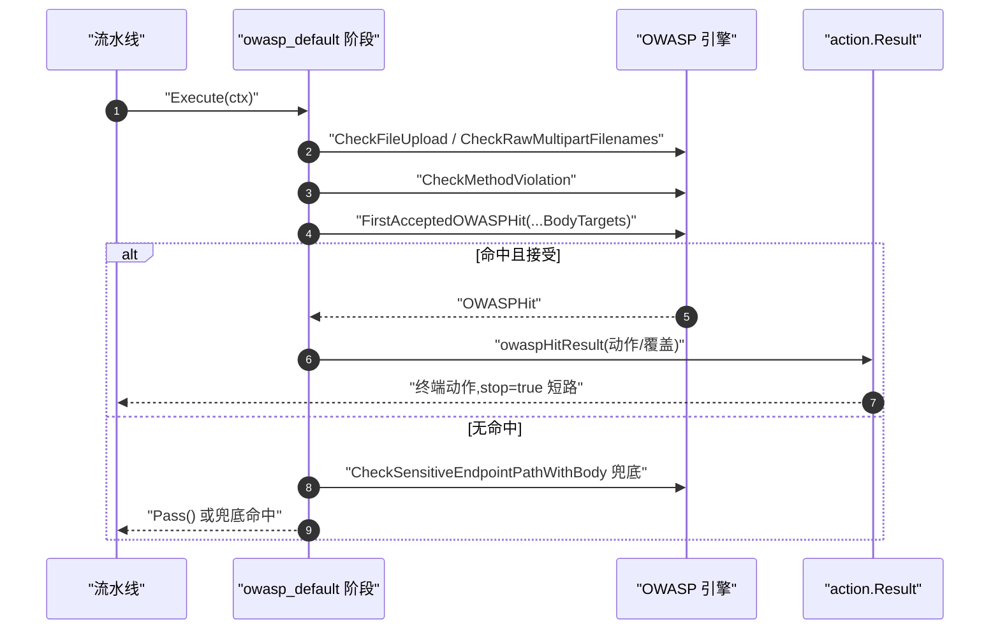
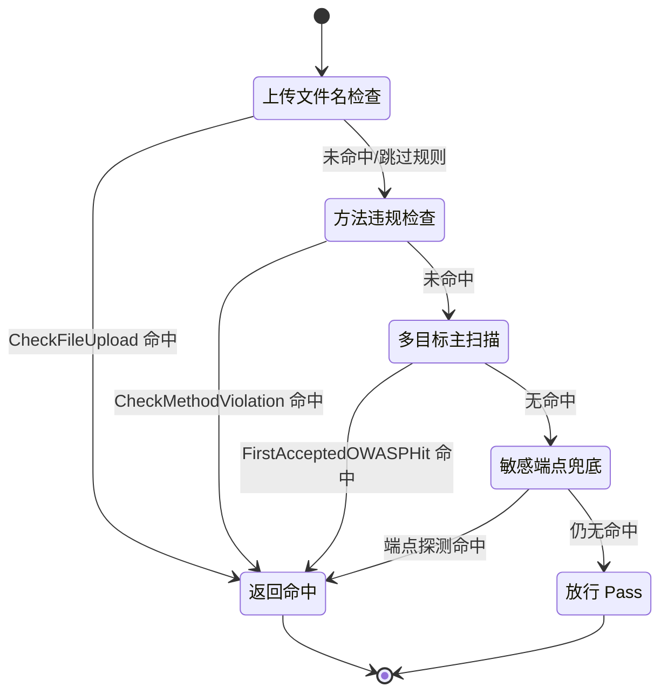
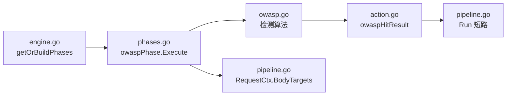

# OWASP 默认检测阶段

> [返回 WAF 引擎系统](../WAF 引擎系统.md)

> 分工说明：本篇只写**引擎侧**内容——`owasp_default` 阶段的注册、执行入口、与流水线的交互、请求体目标抽取与命中结果构造。规则清单、检测算法、误报抑制与配置项详见 [OWASP 检测](file://docs/安全防护功能/OWASP 检测/OWASP 检测.md)、[基本 OWASP 规则](file://docs/安全防护功能/OWASP 检测/基本 OWASP 规则.md)、[检测算法与技术](file://docs/安全防护功能/OWASP 检测/检测算法与技术.md)、[配置与管理](file://docs/安全防护功能/OWASP 检测/配置与管理.md)，两处不重复同一张规则明细表。

<cite>
**本文档引用的文件**
- [phases.go](file://internal/core/rules/phases.go)
- [phase_skip.go](file://internal/core/rules/phase_skip.go)
- [owasp.go](file://internal/waf/owasp/owasp.go)
- [engine.go](file://internal/core/engine/engine.go)
- [pipeline.go](file://internal/core/pipeline/pipeline.go)
- [action.go](file://internal/core/action/action.go)
</cite>

## 目录

1. [简介](#简介)
2. [项目结构](#项目结构)
3. [核心组件](#核心组件)
4. [架构总览](#架构总览)
5. [详细组件分析](#详细组件分析)
6. [依赖关系分析](#依赖关系分析)
7. [性能考虑](#性能考虑)
8. [故障排查指南](#故障排查指南)
9. [结论](#结论)
10. [附录](#附录)

## 简介
本文件系统梳理 My-OpenWaf 的 `owasp_default` 阶段在 WAF 引擎中的定位与实现。该阶段是全 11 阶段链的第 5 位（`ip_reputation → anti_replay → acl → lua_pre → owasp_default → cve_detection → bot_detection → browser_sign → rate_limit → signature → custom`，engine.go:465-548），在昂贵的深度检测链中承担 OWASP Top 10 类攻击的默认扫描。引擎侧关注三点：如何按防护配置条件入链、`Execute` 如何在管道内组织多源目标扫描并返回动作、命中后如何归一化为 `action.Result`。规则本身的内容与算法不在本篇展开。

> 关键订正：ACL 的 `allow` 动作**不短路**，因此命中 ACL 白名单后请求仍会进入 OWASP；要绕过 OWASP 昂贵检测需使用 IP 信誉**全局白名单**（stop=true）或配置按路径跳过（`GetSkipPathByPhase`）。

## 项目结构
OWASP 检测能力分布在"算法包 + 引擎阶段"两侧：

| 位置 | 角色 | 说明 |
|---|---|---|
| [internal/waf/owasp/owasp.go](file://internal/waf/owasp/owasp.go) | 检测算法 | 归一化、阈值、规则命中，详见子文档 |
| [internal/core/rules/phases.go](file://internal/core/rules/phases.go) | 引擎阶段 | `owaspPhase` 执行入口与结果构造 |
| [internal/core/engine/engine.go](file://internal/core/engine/engine.go) | 装配 | 条件入链与阶段缓存 |

`owasp_default` 阶段在引擎中的相关符号：

| 符号 | 文件:行 | 签名 | 职责 |
|---|---|---|---|
| `owaspPhase` | phases.go:593-601 | struct | 持有 cfg、阈值、覆盖等编译期快照 |
| `NewOWASPPhase` | phases.go:603-614 | `(cfg *store.ProtectionConfig) pipeline.Phase` | 预计算类别敏感度/阈值/上传与协议开关 |
| `owaspPhase.Name` | phases.go:616 | `() string` | 返回 `"owasp_default"` |
| `owaspPhase.Execute` | phases.go:618-685 | `(ctx) (action.Result,bool)` | 多源扫描并返回首个接受命中 |
| `owaspHitResult` | phases.go:687-718 | `(hit,cfg,overrides) action.Result` | 命中→动作/规则名/覆盖归一化 |

**章节来源**
- [phases.go:593-718](file://internal/core/rules/phases.go#L593-L718)
- [engine.go:496-498](file://internal/core/engine/engine.go#L496-L498)

## 核心组件
- 阶段构造：`NewOWASPPhase` 一次性把 `ProtectionConfig` 折算为类别敏感度映射、`CompiledThresholds`、文件上传与协议违规开关，避免每请求重算（phases.go:603-614）。
- 执行入口：`Execute` 按"上传文件名 → 方法违规 → 主扫描 → 敏感端点兜底"的顺序检查，命中即经 `owaspHitResult` 返回（phases.go:618-685）。
- 目标缓存：请求体目标经 `extractBodyTargets` 抽取后缓存在 `RequestCtx.BodyTargets`，供 OWASP 与 CVE 复用（pipeline.go:53-56、phases.go:653-657）。
- 动作归一化：`owaspHitResult` 用规则级覆盖优先、否则用 `cfg.OWASPAction`，并从注册表补 `RuleName`/`RuleDesc`（phases.go:687-718）。

**章节来源**
- [phases.go:593-718](file://internal/core/rules/phases.go#L593-L718)
- [pipeline.go:53-56](file://internal/core/pipeline/pipeline.go#L53-L56)

## 架构总览
`owasp_default` 仅当 `prot.OWASPEnabled` 为真时入链（engine.go:496-498），且可被按路径跳过装饰包裹。请求在阶段内的判定流转如下：

| 步 | 动作 | 执行位置 | 命中产物 | 短路 |
|:--:|---|---|---|---|
| 1 | 上传文件名检查 | phases.go:628-651 | upload 命中 | 终端动作 stop=true |
| 2 | 抽取并缓存 body 目标 | phases.go:653-657 | `BodyTargets` | - |
| 3 | 方法违规检查 | phases.go:660-667 | proto 命中 | 终端动作 stop=true |
| 4 | 主扫描（多目标） | phases.go:669 | `OWASPHit` | 终端动作 stop=true |
| 5 | 敏感端点兜底 | phases.go:675-680 | endpoint 命中 | 终端动作 stop=true |

**图表来源**
- [phases.go:618-685](file://internal/core/rules/phases.go#L618-L685)

**章节来源**
- [engine.go:496-498](file://internal/core/engine/engine.go#L496-L498)
- [phases.go:618-685](file://internal/core/rules/phases.go#L618-L685)

## 详细组件分析

### 阶段注册与入链
`getOrBuildPhases` 在 `prot.OWASPEnabled` 时调用 `rules.NewOWASPPhase(prot)` 并经 `addPhase` 入链；`addPhase` 会按 `GetSkipPathByPhase()` 决定是否包一层 `skipByPathPhase` 装饰器（engine.go:471-498）。阶段链按 `{policyID,siteID,antiReplayEnabled}` 缓存，命中缓存需同时满足 `prot`/`lua`/`luaRevision`/`deps` 四判据（engine.go:461）。装饰器命中跳过路径时返回 `Pass(), false`——只跳过本阶段，不影响其余阶段（phase_skip.go:19-49）。

入链相关条件速查：

| 条件 | 取值来源 | 效果 |
|---|---|---|
| OWASPEnabled | `EffectiveProtection` 合并结果 | 决定是否入链 |
| 跳过路径 | `GetSkipPathByPhase()["owasp_default"]` | 命中则该阶段短路返回 Pass |
| 缓存四判据 | prot/lua/luaRevision/deps | 任一变更则重建链 |

**章节来源**
- [engine.go:461-498](file://internal/core/engine/engine.go#L461-L498)
- [phase_skip.go](file://internal/core/rules/phase_skip.go)

### 执行入口与判定顺序
`Execute` 首先检查 `cfg.OWASPEnabled` 兜底，再按固定顺序短路返回。`fileUploadEnabled` 且 Content-Type 含 `multipart/form-data` 且有请求体时，先解析上传文件名逐个 `CheckFileUpload`，并做 `CheckRawMultipartFilenames` 原文兜底，防止 Go multipart 解析器漏掉被 `filepath.Base` 剥掉的路径穿越（phases.go:628-651）。方法违规在主扫描前检查，敏感端点探测刻意放在主扫描之后，只填补原本放行的请求（phases.go:660-680）。

**图表来源**
- [phases.go:618-685](file://internal/core/rules/phases.go#L618-L685)

**章节来源**
- [phases.go:618-685](file://internal/core/rules/phases.go#L618-L685)

### 请求体目标抽取
`extractBodyTargets` 依 Content-Type 分派抽取器，并对误导性头部做嗅探，防止改头绕过（phases.go:950-1030）。上限常量：

| Content-Type | 抽取器 | 规模上限 | 位置 |
|---|---|---|---|
| `application/x-www-form-urlencoded` | `extractFormValues`（键与值均扫） | 整串+分段 | [phases.go:1052-1094](file://internal/core/rules/phases.go#L1052-L1094) |
| `application/json` | `extractJSONValues` | 深度≤10、值>100 剪枝 | [phases.go:1097-1144](file://internal/core/rules/phases.go#L1097-L1144) |
| `multipart/form-data` | `extractMultipartFieldValues` | 20 段 × 4096 字节 | [phases.go:1177-1216](file://internal/core/rules/phases.go#L1177-L1216) |
| `text/*`、`application/xml`、`soap` | 原文截取 | 8192 字节 | [phases.go:970-976](file://internal/core/rules/phases.go#L970-L976) |
| 其他/缺失 | 嗅探或原始兜底 | `WAFBodyScanLimit` | [phases.go:977-1014](file://internal/core/rules/phases.go#L977-L1014) |

> JSON 键按字典序遍历，使 `BodyTargets` 顺序稳定；OWASP 归因取"首个跨阈 target"，顺序即决定安全事件记录的 RuleID（phases.go:1107-1144）。

**章节来源**
- [phases.go:943-1144](file://internal/core/rules/phases.go#L943-L1144)

### 命中结果与动作归一化
`owaspHitResult` 先取 `cfg.OWASPAction` 经 `normalizeConfiguredAction`，若规则级覆盖 `override.Action` 非空则覆盖；补齐 `StatusCode`/`RedirectTo`/`CaptchaType`，且仅当动作为 `captcha_challenge` 时保留 `CaptchaType`。命中归因从注册表 `DefaultOWASPRegistry.Get` 取规则名与描述（phases.go:687-718）。返回值的 `stop` 由 `result.IsTerminal()` 决定，`normalizeConfiguredAction` 会把 `log` 归一化为 `observe`、非法动作回落 `intercept`（phases.go:1301-1310）。

| 命中结果字段 | 来源 | 说明 |
|---|---|---|
| `Type` | `owaspHitResult` 归一化 | 配置动作或规则覆盖 |
| `RuleIDStr` | `hit.RuleID` | 形如 `owasp:sqli:001`，须带 `owasp:` 前缀 |
| `MatchScore` | `hit.Score` | 累计风险分 |
| `Category` | `hit.Category` | 攻击类别 |

**章节来源**
- [phases.go:687-718](file://internal/core/rules/phases.go#L687-L718)
- [phases.go:1301-1310](file://internal/core/rules/phases.go#L1301-L1310)

### 敏感度与阈值
引擎把档位折算为类别阈值：`sensitivityThresholdForNormalizedLevel` 定义六档取值（owasp.go:840-892），`NewOWASPPhase` 经 `CompileThresholds` 预计算（phases.go:603-614）。

| 档位 | 阈值 | 语义 | 证据 |
|---|:--:|---|---|
| `off` | 停用 | 该类别不参与 | [owasp.go:862-870](file://internal/waf/owasp/owasp.go#L862-L870) |
| `low` | 7 | 最宽松，误报最少 | [owasp.go:881-882](file://internal/waf/owasp/owasp.go#L881-L882) |
| `mid`（默认） | 4 | 平衡档 | [owasp.go:889-890](file://internal/waf/owasp/owasp.go#L889-L890) |
| `high` | 3 | 提高检出 | [owasp.go:883-884](file://internal/waf/owasp/owasp.go#L883-L884) |
| `very_high` | 2 | 高威胁 | [owasp.go:885-886](file://internal/waf/owasp/owasp.go#L885-L886) |
| `strict` | 1 | 最严格 | [owasp.go:887-888](file://internal/waf/owasp/owasp.go#L887-L888) |

类别级、规则级覆盖通过 `EffectiveCategorySensitivity` 与 `OWASPRuleOverride` 生效，取值与配置口径详见 [配置与管理](file://docs/安全防护功能/OWASP 检测/配置与管理.md)。

**章节来源**
- [owasp.go:840-892](file://internal/waf/owasp/owasp.go#L840-L892)
- [phases.go:603-614](file://internal/core/rules/phases.go#L603-L614)

### 与流水线的短路交互
`owasp_default` 返回 `(result, stop)` 后由 `pipeline.Run` 统一裁决（pipeline.go:517-560）：
- `stop=true` 且非挑战类动作（intercept/drop/redirect/rate_limit）：立即返回，后续 `cve_detection`、`bot_detection`、`browser_sign`、`rate_limit`、`signature`、`custom` 均不再执行。
- `stop=true` 且为挑战类（`challenge`/`captcha_challenge`/`shield_challenge`/`chain_challenge`）：作为 `pendingChallenge` 按 `TerminalPriority` 择优保留，链继续，可能被更高优先级终止动作覆盖。
- Observe 类命中（`ShouldLog && !IsTerminal`）被收集进 `ObserveHits`，不短路。

| 命中动作 | IsTerminal | 终端优先级 | 链上后续 | 默认状态码 |
|---|:--:|:--:|---|:--:|
| `intercept` | 是 | 80 | 立即短路 | 403 |
| `drop` | 是 | 90 | 立即短路并关 TCP | - |
| `challenge` | 是 | 60 | 延迟保留，链继续 | 403 |
| `captcha_challenge` | 是 | 60 | 延迟保留，链继续 | 403 |
| `redirect` | 是 | 50 | 立即短路 | 302 |
| `observe` | 否 | 10 | 收集观察命中，链继续 | - |

**章节来源**
- [pipeline.go:517-560](file://internal/core/pipeline/pipeline.go#L517-L560)
- [action.go:88-119](file://internal/core/action/action.go#L88-L119)
- [action.go:168-203](file://internal/core/action/action.go#L168-L203)

## 依赖关系分析
`owasp_default` 的依赖以"引擎装配 → 阶段 → 算法包"单向流动，无反向依赖。

| 依赖方 | 被依赖对象 | 证据 |
|---|---|---|
| engine → owaspPhase | `NewOWASPPhase(prot)` 条件入链 | [engine.go:496-498](file://internal/core/engine/engine.go#L496-L498) |
| owaspPhase → owasp 算法 | `FirstAcceptedOWASPHit...` 等 | [phases.go:669](file://internal/core/rules/phases.go#L669) |
| owaspPhase → RequestCtx | `BodyTargets`/`BodyTargetsDone` | [pipeline.go:53-56](file://internal/core/pipeline/pipeline.go#L53-L56) |
| owaspPhase → action | `IsTerminal`/`Normalize` | [action.go:168-179](file://internal/core/action/action.go#L168-L179) |

**图表来源**
- [engine.go:496-498](file://internal/core/engine/engine.go#L496-L498)
- [phases.go:618-718](file://internal/core/rules/phases.go#L618-L718)

**章节来源**
- [phases.go:618-718](file://internal/core/rules/phases.go#L618-L718)
- [engine.go:496-498](file://internal/core/engine/engine.go#L496-L498)

## 性能考虑
- 编译期预计算：`NewOWASPPhase` 在入链时把敏感度、阈值、上传/协议开关算好，运行期不再解析配置（phases.go:603-614）。
- 目标复用：`BodyTargets` 只抽取一次并缓存，OWASP 与 CVE 共享（pipeline.go:53-56）。
- 抽取上限约束：JSON 深度 10/值 100、multipart 20 段×4096、XML 8192，避免正则扫描在超大目标上失控（phases.go:1097-1216）。
- 快速回落：主扫描取"首个跨阈 target"，命中后立即短路后续阶段，减少无谓扫描。
- 派生头部按需：`needsDerivedHeaders` 仅在含相关 kind 的规则时才计算 TLS/头部派生字段（phases.go:72-104、227-249）。
- 归一化成本：多轮解码与正则扫描的开销控制属算法侧，详见 [检测算法与技术](file://docs/安全防护功能/OWASP 检测/检测算法与技术.md)。

## 故障排查指南
- 误报/漏报：调整敏感度档位（六档）与类别覆盖，详见 [配置与管理](file://docs/安全防护功能/OWASP 检测/配置与管理.md)。
- 白名单未绕过 OWASP：ACL allow 不短路；应使用全局 IP 白名单或按路径跳过配置。
- 上传漏检：确认 `fileUploadEnabled` 开启且 Content-Type 为 multipart；原文兜底可捕获被解析器剥掉的穿越文件名。
- 归因漂移：同一请求记录成不同 RuleID 时，检查 `BodyTargets` 顺序是否因解析顺序变化（JSON 已按字典序固定）。

| 症状 | 可能原因 | 排查点 |
|---|---|---|
| OWASP 未触发 | 全局默认关闭/站点未启用 | `OWASPEnabled`、入链条件 |
| 上传文件名未拦 | 上传开关关闭 | `fileUploadEnabled` |
| 动作与配置不符 | 规则级覆盖优先 | `owaspHitResult` 覆盖分支 |

**章节来源**
- [phases.go:618-718](file://internal/core/rules/phases.go#L618-L718)
- [engine.go:496-498](file://internal/core/engine/engine.go#L496-L498)

## 结论
`owasp_default` 阶段以"编译期预计算 + 运行期顺序短路"的方式把 OWASP 检测嵌入 11 阶段链的第 5 位。引擎侧只关心入链条件、执行入口顺序、请求体目标抽取与命中结果归一化；具体规则与算法由 owasp 包与子文档承载。理解 ACL allow 不短路这一语义，是正确配置白名单绕过路径的前提：若需跳过 OWASP，应使用全局 IP 白名单或按路径跳过装饰，而非依赖 ACL 允许规则。

## 附录

### 与子文档的分工
| 主题 | 归属文档 |
|---|---|
| 阶段注册/执行入口/流水线交互 | 本篇 |
| 规则清单与检测算法 | [OWASP 检测](file://docs/安全防护功能/OWASP 检测/OWASP 检测.md) 、[基本 OWASP 规则](file://docs/安全防护功能/OWASP 检测/基本 OWASP 规则.md) |
| 归一化与误报抑制细节 | [检测算法与技术](file://docs/安全防护功能/OWASP 检测/检测算法与技术.md) |
| 敏感度/覆盖配置 | [配置与管理](file://docs/安全防护功能/OWASP 检测/配置与管理.md) |

### 阶段属性速查
| 属性 | 取值 |
|---|---|
| 阶段名 | `owasp_default` |
| 注册位置 | [engine.go:496-498](file://internal/core/engine/engine.go#L496-L498) |
| 入链前置 | `prot.OWASPEnabled` |
| 链上位置 | 第 5 位 |
| 短路策略 | 命中终端动作短路；Challenge 延迟 |

**章节来源**
- [phases.go:593-718](file://internal/core/rules/phases.go#L593-L718)
- [engine.go:496-498](file://internal/core/engine/engine.go#L496-L498)
