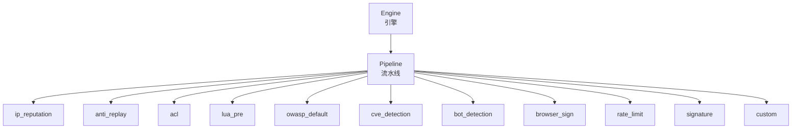
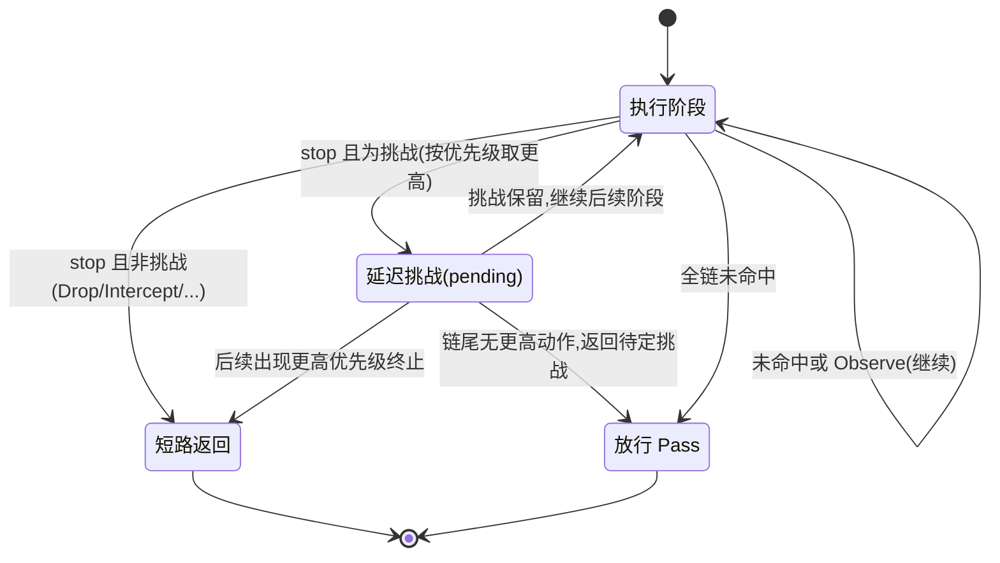
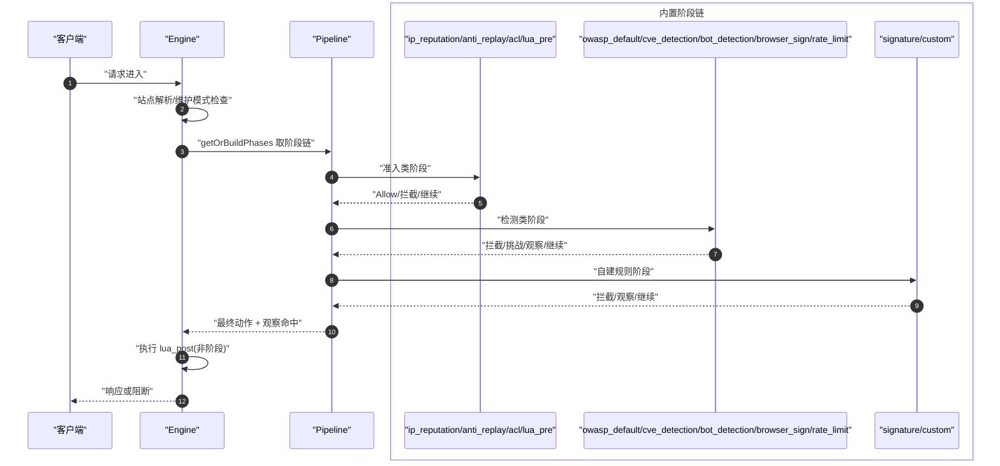
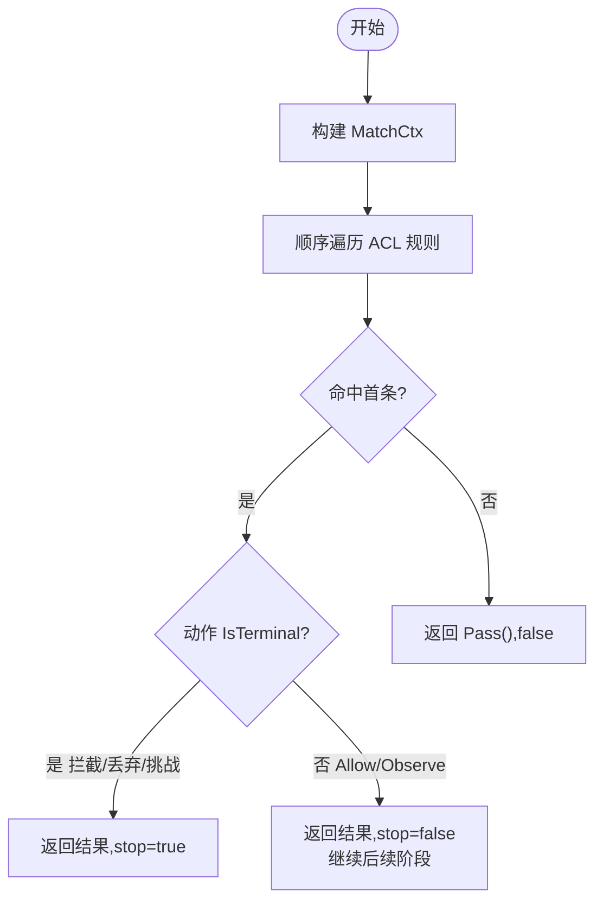
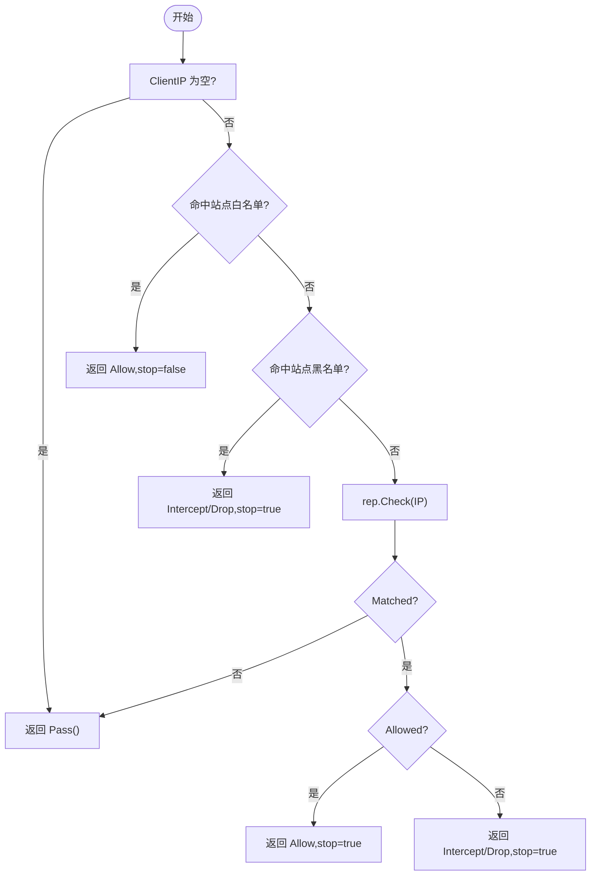
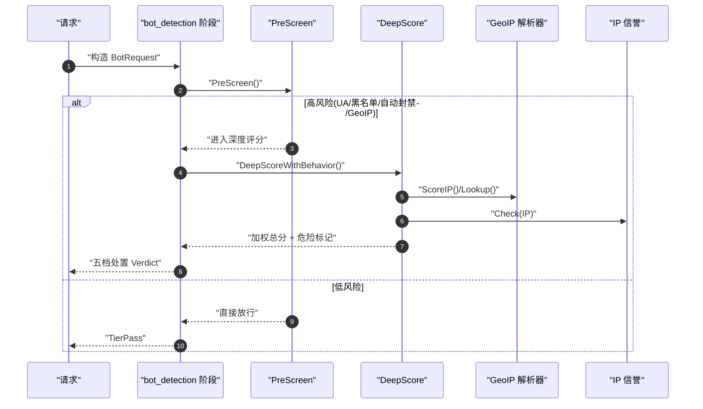
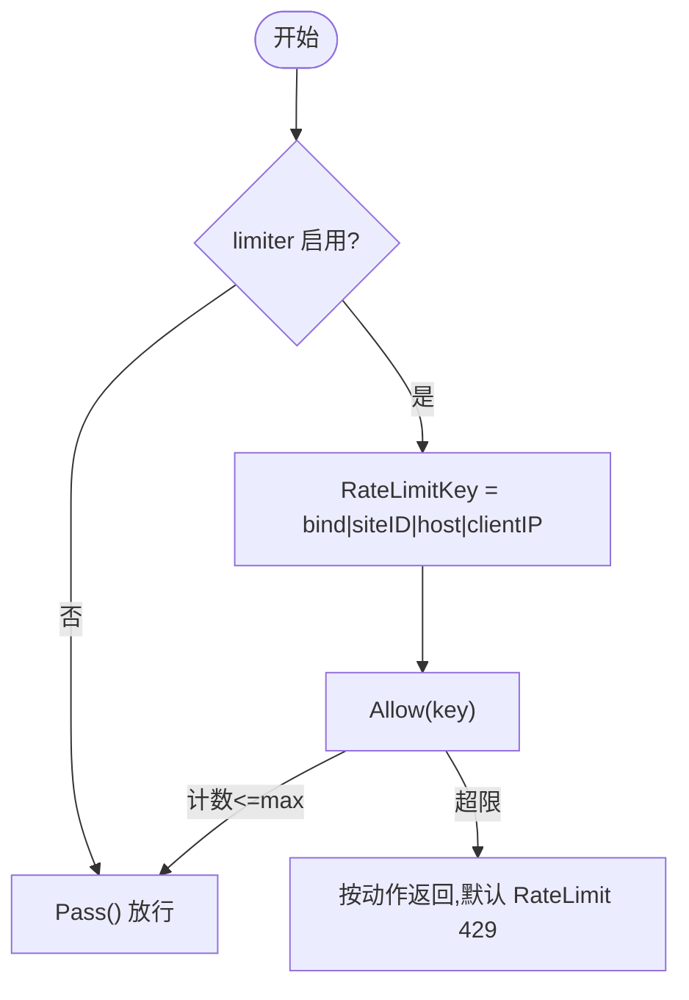
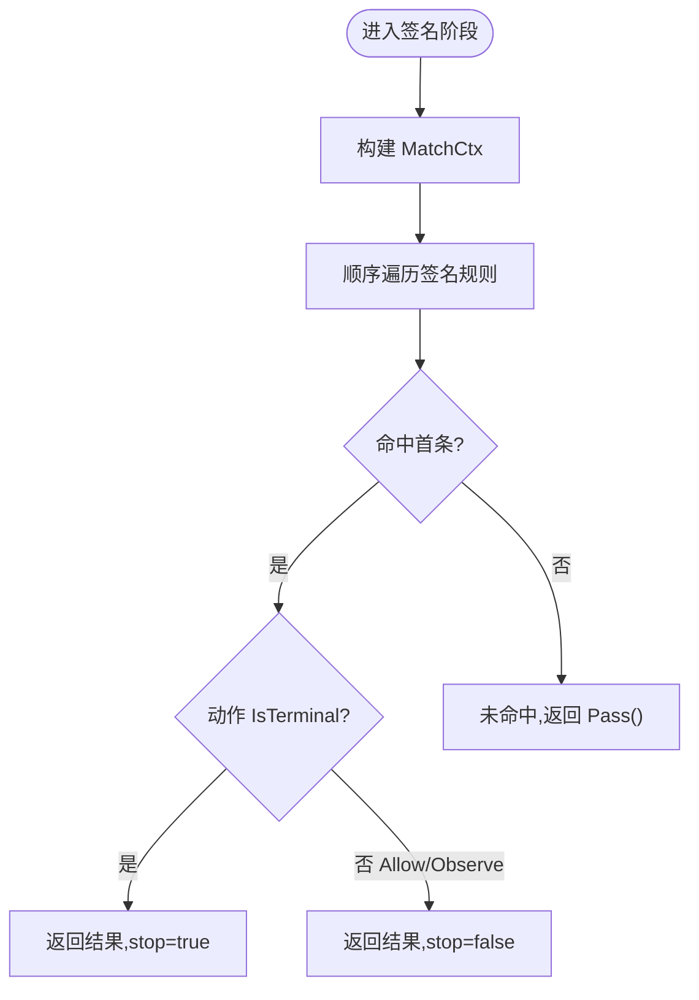
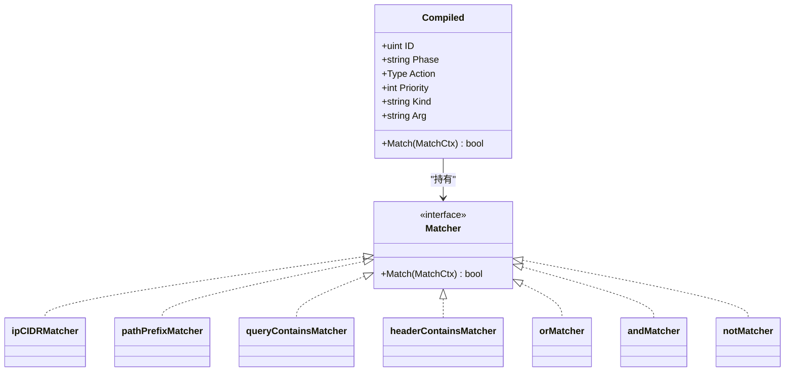
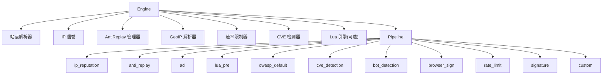

# 处理阶段详解

> [返回 WAF 引擎系统](../WAF 引擎系统.md)

<cite>
**本文档引用的文件**
- [engine.go](file://internal/core/engine/engine.go)
- [phases.go](file://internal/core/rules/phases.go)
- [lua_phase.go](file://internal/core/rules/lua_phase.go)
- [phase_skip.go](file://internal/core/rules/phase_skip.go)
- [compiler.go](file://internal/core/rules/compiler.go)
- [matcher.go](file://internal/core/rules/matcher.go)
- [pipeline.go](file://internal/core/pipeline/pipeline.go)
- [action.go](file://internal/core/action/action.go)
- [iprep.go](file://internal/waf/iprep/iprep.go)
- [bot.go](file://internal/waf/bot/bot.go)
- [ratelimit.go](file://internal/waf/ratelimit/ratelimit.go)
- [detector.go](file://internal/waf/cve/detector.go)
</cite>

## 目录

1. [简介](#简介)
2. [项目结构](#项目结构)
3. [核心组件](#核心组件)
4. [架构总览](#架构总览)
5. [详细组件分析](#详细组件分析)
6. [依赖关系分析](#依赖关系分析)
7. [性能考虑](#性能考虑)
8. [故障排查指南](#故障排查指南)
9. [结论](#结论)
10. [附录](#附录)

## 简介
本文件系统性梳理 OpenWAF 的处理阶段实现，覆盖当前主引擎链路的 **11 个处理阶段**的设计理念、执行顺序、匹配逻辑、动作决策与短路机制。按 [internal/core/engine/engine.go:465-548] 实测入链顺序，阶段链为：`ip_reputation → anti_replay → acl → lua_pre → owasp_default → cve_detection → bot_detection → browser_sign → rate_limit → signature → custom`，容量按 11 预分配（engine.go:467）。各阶段按防护配置与站点规则是否启用条件入链，未启用的阶段不入链，因此单个请求实际经过的阶段数可少于 11。文档还提供阶段配置的最佳实践、性能调优指南，以及阶段扩展开发方法。TLS 指纹不是独立流水线阶段，而是数据面采集到 RequestCtx 后供 Bot 检测、审计日志和 `tls_*` 规则匹配器使用；Lua 后置策略（`lua_post`）同样不在阶段链内，而是在管道返回后由引擎执行（engine.go:369-371）。

## 项目结构
OpenWAF 将请求处理抽象为"流水线（Pipeline）"，每个处理阶段封装为独立的 Phase 实现，按固定顺序串联执行。核心模块分布如下：
- 引擎层：负责站点解析、维护模式检查、规则编译与流水线组装
- 流水线层：定义统一的 `Phase` 接口（`Name()` + `Execute()`）与执行模型
- 规则阶段层：`internal/core/rules/phases.go` 具体实现各处理阶段（IP 信誉、AntiReplay、ACL、OWASP、CVE、机器人、浏览器签名、速率限制、签名、自定义），`lua_phase.go` 实现 Lua 前置阶段，`phase_skip.go` 提供按路径跳过的装饰器
- WAF 核心算法层：IP 信誉、机器人检测、OWASP 检测、速率限制、CVE 检测、TLS 指纹元数据采集与匹配输入等

| 层 | 代表文件 | 核心符号 | 职责 |
|---|---|---|---|
| 引擎层 | [engine.go](file://internal/core/engine/engine.go) | `Engine.Process`、`getOrBuildPhases` | 站点解析、阶段链组装与缓存 |
| 流水线层 | [pipeline.go](file://internal/core/pipeline/pipeline.go) | `Phase`、`Run`、`RequestCtx` | 顺序执行与短路/观察收集 |
| 规则阶段层 | [phases.go](file://internal/core/rules/phases.go) | `ipReputationPhase`、`aclPhase`、`owaspPhase` 等 | 各阶段判定与结果构造 |
| 匹配与编译 | [matcher.go](file://internal/core/rules/matcher.go) 、[compiler.go](file://internal/core/rules/compiler.go) | `Matcher`、`Compiled`、`Compile` | DSL/JSON 规则编译与匹配 |
| 动作系统 | [action.go](file://internal/core/action/action.go) | `Type`、`Result`、`TerminalPriority` | 动作定义与终止优先级 |

**图表来源**
- [engine.go:465-548](file://internal/core/engine/engine.go#L465-L548)
- [pipeline.go:276-280](file://internal/core/pipeline/pipeline.go#L276-L280)

**章节来源**
- [engine.go:441-548](file://internal/core/engine/engine.go#L441-L548)
- [pipeline.go:276-560](file://internal/core/pipeline/pipeline.go#L276-L560)
- [phases.go:32-1391](file://internal/core/rules/phases.go#L32-L1391)

## 核心组件
- 引擎 Engine：负责站点匹配、维护模式检查、规则编译与流水线构建（engine.go:82-127）
- 流水线 Pipeline：顺序执行各 Phase，支持终端动作立即短路、挑战类动作按优先级延迟保留、Observe 命中收集（pipeline.go:517-560）
- 规则阶段 Phase：各处理阶段的具体实现，共 11 个阶段，见「架构总览」全序表
- 跳过装饰器 skipByPathPhase：为配置了跳过路径的阶段包一层按路径短路，命中跳过时返回 `Pass(), false`，只跳过该检测而非放行整请求（phase_skip.go:19-49）
- WAF 算法模块：IP 信誉、机器人检测、OWASP 检测、速率限制、CVE 检测、TLS 指纹元数据采集与匹配输入等

| 组件 | 位置 | 关键方法 | 说明 |
|---|---|---|---|
| `Engine` | [engine.go:83](file://internal/core/engine/engine.go#L83) | `Process`、`processResolved` | 请求编排入口 |
| `Pipeline.Run` | [pipeline.go:517](file://internal/core/pipeline/pipeline.go#L517) | `Run(phases, ctx)` | 阶段链执行与短路 |
| `Phase` 接口 | [pipeline.go:277](file://internal/core/pipeline/pipeline.go#L277) | `Name()`、`Execute()` | 阶段统一契约 |
| `action.Result` | [action.go:127](file://internal/core/action/action.go#L127) | `IsTerminal`、`TerminalPriority` | 判定与终止优先级 |

**章节来源**
- [engine.go:82-127](file://internal/core/engine/engine.go#L82-L127)
- [pipeline.go:276-560](file://internal/core/pipeline/pipeline.go#L276-L560)
- [phases.go:32-1391](file://internal/core/rules/phases.go#L32-L1391)
- [phase_skip.go:19-49](file://internal/core/rules/phase_skip.go#L19-L49)

## 架构总览
OpenWAF 的处理流程以 Engine 为中心，`getOrBuildPhases` 按以下顺序条件入链阶段（engine.go:465-548）。下表为 **11 阶段全序表**，列出口径以代码实测为准：

| 序 | 阶段名 | 注册位置 | 前置条件 | 短路行为 |
|:--:|---|---|---|---|
| 1 | `ip_reputation` | [engine.go:479](file://internal/core/engine/engine.go#L479) | `e.ipRep != nil` | 全局白/黑名单命中 `stop=true`；站点白名单返回 Allow 不短路 |
| 2 | `anti_replay` | [engine.go:482](file://internal/core/engine/engine.go#L482) | `deps.antiReplay != nil` 且 `rt.AntiReplayEnabled` | 非法/重放 nonce → Intercept 短路 |
| 3 | `acl` | [engine.go:486](file://internal/core/engine/engine.go#L486) | `len(cr.ACL) > 0` | 终端动作短路；**Allow 不短路** |
| 4 | `lua_pre` | [engine.go:492](file://internal/core/engine/engine.go#L492) | Lua 引擎存在且有 StagePre 脚本 | 非 tag/observe 动作短路 |
| 5 | `owasp_default` | [engine.go:496](file://internal/core/engine/engine.go#L496) | `prot.OWASPEnabled` | 命中终端动作短路；Challenge 延迟 |
| 6 | `cve_detection` | [engine.go:499](file://internal/core/engine/engine.go#L499) | `prot.CVEEnabled` 且 detector 非空 | 命中终端动作短路 |
| 7 | `bot_detection` | [engine.go:503](file://internal/core/engine/engine.go#L503) | `prot.BotDetectionEnabled` | Drop/Intercept/Challenge 短路；Observe 继续 |
| 8 | `browser_sign` | [engine.go:513](file://internal/core/engine/engine.go#L513) | `prot.BrowserSignEnabled` | 校验失败按配置动作短路（Observe 除外） |
| 9 | `rate_limit` | [engine.go:517](file://internal/core/engine/engine.go#L517) | `prot.RequestRateLimitEnabled` 且 limiter 非空 | 超限按动作短路（RateLimit 429） |
| 10 | `signature` | [engine.go:524](file://internal/core/engine/engine.go#L524) | `len(cr.Signature) > 0` | 终端动作短路；Allow 不短路 |
| 11 | `custom` | [engine.go:527](file://internal/core/engine/engine.go#L527) | `len(cr.Custom) > 0` | 终端动作短路；Observe 命中收集后继续 |

> 说明：`signature` 与 `custom` 是用户自建规则，不参与按路径跳过装饰，直接 `append` 入链（engine.go:522-529）；其余阶段经 `addPhase` 可被 `skipByPathPhase` 包裹。阶段名（`Name()`）与全序表中 `cve`/`bot` 简写对应实测字符串 `cve_detection`/`bot_detection`（phases.go:742、488）。

**章节来源**
- [engine.go:465-548](file://internal/core/engine/engine.go#L465-L548)
- [phases.go:146-742](file://internal/core/rules/phases.go#L146-L742)
- [phase_skip.go:19-49](file://internal/core/rules/phase_skip.go#L19-L49)

一次请求在阶段链上的判定流转可用状态图表达：管道按序执行阶段，遇 Drop 立即返回，遇终端非挑战动作立即返回，遇挑战动作延迟保留并继续，全部执行完取优先级最高的待定挑战或放行。

**图表来源**
- [pipeline.go:517-560](file://internal/core/pipeline/pipeline.go#L517-L560)
- [action.go:88-119](file://internal/core/action/action.go#L88-L119)

整体调用时序如下：

**图表来源**
- [engine.go:331-378](file://internal/core/engine/engine.go#L331-L378)
- [pipeline.go:517-560](file://internal/core/pipeline/pipeline.go#L517-L560)

**章节来源**
- [engine.go:331-378](file://internal/core/engine/engine.go#L331-L378)

## 详细组件分析

### ACL 访问控制阶段
- 输入：客户端 IP、方法、路径、查询、头部映射（经 `MatchCtx` 构造）
- 输出：命中动作结果与 `stop` 布尔；未命中返回 `Pass(), false`
- 决策机制：`executeCompiledPhase` 顺序遍历已编译 ACL 规则，命中**首条**即返回该规则结果，返回值为 `(hit(rule), hit(rule).IsTerminal())`
- 短路订正：`executeCompiledPhase` 的 `allowShortCircuit` 形参在函数体内**未被使用**（phases.go:112-129）。因此 ACL 的 `allow` 动作 `IsTerminal()` 为假，返回 `stop=false`，**不短路**后续阶段——请求继续经过 OWASP、CVE 等检测；只有拦截/丢弃/挑战等终端动作才短路。切勿理解为"ACL 命中 allow 即终止整条链"

| 符号 | 位置 | 签名 | 职责 |
|---|---|---|---|
| `aclPhase.Execute` | [phases.go:148](file://internal/core/rules/phases.go#L148) | `Execute(ctx) (action.Result, bool)` | 调用 `executeCompiledPhase`，`allowShortCircuit=true` 但未生效 |
| `executeCompiledPhase` | [phases.go:112](file://internal/core/rules/phases.go#L112) | `(ctx, rules, allowShortCircuit, needsDerived)` | 命中首条即返回 `(r, r.IsTerminal())` |
| `Compiled.Match` | [compiler.go:32](file://internal/core/rules/compiler.go#L32) | `Match(ctx MatchCtx) bool` | 委托预构建匹配器 |

**图表来源**
- [phases.go:112-150](file://internal/core/rules/phases.go#L112-L150)

**章节来源**
- [phases.go:112-150](file://internal/core/rules/phases.go#L112-L150)
- [compiler.go:32-37](file://internal/core/rules/compiler.go#L32-L37)

### IP 信誉检查阶段
- 输入：客户端 IP、站点级黑白名单（`rt.SiteIPWhitelist/Blacklist`）、全局 IP 信誉与自动封禁
- 输出：`action.Result`（类型 Allow/Intercept/Drop）与 `stop` 布尔
- 决策机制（phases.go:368-433）：
  - 先匹配**站点白名单**：命中返回 `Allow, false`（不短路，继续后续阶段）
  - 再匹配**站点黑名单**：命中返回 Intercept/Drop，`stop=true`
  - 最后调用全局 `rep.Check`：白名单命中返回 `Allow, true`（短路）；黑名单/自动封禁命中返回 Intercept/Drop，`stop=true`
- 自动封禁默认参数（iprep.go:44-47）：阈值 10、窗口 60 秒、持续 3600 秒、动作 `intercept`

| 触发来源 | 命中动作 | stop | 分类 Category |
|---|---|:--:|---|
| 站点白名单 `SiteIPWhitelist` | Allow | 否 | `whitelist` |
| 站点黑名单 `SiteIPBlacklist` | Intercept/Drop | 是 | `site_blacklist` |
| 全局白名单 `rep.Check.Allowed` | Allow | 是 | `whitelist` |
| 全局黑名单/自动封禁 | Intercept/Drop | 是 | `blacklist`/`auto_ban` |

**图表来源**
- [phases.go:368-433](file://internal/core/rules/phases.go#L368-L433)
- [iprep.go:105-137](file://internal/waf/iprep/iprep.go#L105-L137)

**章节来源**
- [iprep.go:11-137](file://internal/waf/iprep/iprep.go#L11-L137)
- [phases.go:342-433](file://internal/core/rules/phases.go#L342-L433)

### 机器人检测阶段（两阶段：预筛选 + 深度评分）
- 输入：方法、路径、头部、UA、Cookie、连接方式、ClientIP
- 输出：BotVerdict（是否机器人、分数、类别、原因、规则 ID），以及 BotScore（深度评分明细）
- 预筛选（PreScreen）快速判定高风险：
  - 已知恶意工具 UA
  - 黑名单/自动封禁 IP
  - 高风险 GeoIP（数据中心/VPN/高危国家）
- 深度评分（DeepScore）综合评估：
  - GeoIP 风险评分与信息
  - UA/头部指纹评分
  - TLS/HTTP2 指纹评分
  - IP 信誉评分
- 决策机制：阈值决定拦截级别，恶意工具直接拦截，可疑行为仅记录观察

**图表来源**
- [bot.go:922-942](file://internal/waf/bot/bot.go#L922-L942)
- [bot.go:120-136](file://internal/waf/bot/bot.go#L120-L136)
- [phases.go:514-591](file://internal/core/rules/phases.go#L514-L591)

**章节来源**
- [bot.go:85-168](file://internal/waf/bot/bot.go#L85-L168)
- [bot.go:649-663](file://internal/waf/bot/bot.go#L649-L663)
- [phases.go:435-591](file://internal/core/rules/phases.go#L435-L591)

### 请求速率限制阶段（请求级）
- 输入：客户端 IP，与 `bind`、`siteID`、归一化 `Host` 组成计数键 `RateLimitKey = bind|siteID|host|clientIP`（phases.go:63-70），保证限流按站点隔离
- 输出：允许放行 / 按配置动作（默认 RateLimit，状态码 429）
- 决策机制：固定窗口计数，超过阈值即返回终端动作；支持运行时重配置与禁用
- 关键点：Bot 行为分使用同窗口但带 `|bot` 后缀的独立键，避免与限流计数相互干扰（phases.go:490-512）

**图表来源**
- [phases.go:316-340](file://internal/core/rules/phases.go#L316-L340)
- [ratelimit.go:96-118](file://internal/waf/ratelimit/ratelimit.go#L96-L118)

**章节来源**
- [phases.go:305-340](file://internal/core/rules/phases.go#L305-L340)
- [ratelimit.go:9-162](file://internal/waf/ratelimit/ratelimit.go#L9-L162)

### OWASP 默认检测阶段
- 引擎侧职责：`owaspPhase` 在管道内的执行入口与结果构造（phases.go:603-718），规则内容、检测算法与配置项详见 [安全防护功能/OWASP 检测/OWASP 检测.md](file://docs/安全防护功能/OWASP 检测/OWASP 检测.md)
- 输入：路径、查询、头部、正文目标（按内容类型抽取，`extractBodyTargets`）
- 执行顺序（phases.go:618-685）：文件上传文件名检查 → 方法违规检查 → `FirstAcceptedOWASPHit` 主扫描 → 敏感端点探测兜底
- 决策机制：命中后经 `owaspHitResult` 归一化配置动作与规则级覆盖，返回终端动作短路；规则 ID 带 `owasp:` 前缀

**章节来源**
- [phases.go:593-718](file://internal/core/rules/phases.go#L593-L718)

### TLS 指纹匹配输入
- 数据来源：数据面监听器或 HTTP/3 内部元数据会采集 JA3、JA3 Hash、JA4、TLS 版本、SNI、ALPN、cipher suites 等信息，写入 `RequestCtx.TLS`。
- 使用位置：Bot 检测、访问日志、安全事件日志、签名规则和自定义规则均可读取这些字段。
- 规则入口：`tls_ja3`、`tls_ja3_hash`、`tls_ja4`、`tls_version`、`tls_sni`、`tls_alpn`、`tls_cipher_suites` 等匹配器经 `tlsFingerprintValue` 读取 `MatchCtx.TLS`（matcher.go:155-204）。
- 阶段边界：当前主引擎不会注册独立的 TLS 指纹 Phase，TLS 指纹只作为请求上下文中的匹配输入。

**章节来源**
- [matcher.go:155-204](file://internal/core/rules/matcher.go#L155-L204)
- [phases.go:72-104](file://internal/core/rules/phases.go#L72-L104)

### CVE 检测阶段
- 引擎侧职责：`cvePhase` 的执行入口与动作覆盖（phases.go:744-871）
- 输入：路径、查询、头部、正文、内容类型，支持自定义规则与外部威胁情报
- 检测架构：`CVEDetector` 下挂 General、PHP、Java、Node.js 四个子检测器与自定义规则注册表（detector.go:20-29）
- 决策机制：先做原始可疑内容预筛选（`HasRawCVESuspiciousContent`），再取首个未禁用命中；优先规则级动作覆盖，其次配置动作，`critical`/`high` 且开关打开时自动升级为 Drop（phases.go:827-839）

**章节来源**
- [detector.go:20-60](file://internal/waf/cve/detector.go#L20-L60)
- [phases.go:720-871](file://internal/core/rules/phases.go#L720-L871)

### 签名检测阶段
- 输入：从 `MatchCtx` 提取客户端 IP、方法、路径、原始查询串、头部映射
- 匹配：`executeCompiledPhase(ctx, rules, false, ...)` 顺序匹配，命中首条即返回 `(r, r.IsTerminal())`（phases.go:169-171）
- 短路订正：`allowShortCircuit=false` 形参未被使用；只有终端动作（Intercept/Drop/Challenge/…）短路，Allow 与 Observe 不短路
- 返回：未命中则放行到下一阶段

**图表来源**
- [phases.go:152-171](file://internal/core/rules/phases.go#L152-L171)

**章节来源**
- [phases.go:152-171](file://internal/core/rules/phases.go#L152-L171)

### 自定义规则阶段
- 输入：从 `MatchCtx` 提取客户端 IP、方法、路径、原始查询串、头部映射
- 匹配：`executeCustomPhase` 顺序遍历，Observe 命中先收集（`AppendPhaseObserveHits`），遇终端动作才返回并短路（phases.go:194-225）
- 短路订正：终端动作短路；Observe/Allow 不短路，观察命中随结果一并上交给管道汇总
- 匹配器类型：IP/CIDR、路径前缀/精确/正则、查询参数、请求头、方法、内容类型、Body、TLS 指纹、复合 AND/OR/NOT/if-else/cc_rate 等，统一实现 `Matcher.Match(ctx MatchCtx) bool`（matcher.go:21-23）

**图表来源**
- [compiler.go:13-37](file://internal/core/rules/compiler.go#L13-L37)
- [matcher.go:21-23](file://internal/core/rules/matcher.go#L21-L23)
- [matcher.go:317-321](file://internal/core/rules/matcher.go#L317-L321)

**章节来源**
- [phases.go:173-225](file://internal/core/rules/phases.go#L173-L225)
- [compiler.go:13-78](file://internal/core/rules/compiler.go#L13-L78)
- [matcher.go:1473-1775](file://internal/core/rules/matcher.go#L1473-L1775)

## 依赖关系分析
- Engine 依赖：站点解析器、IP 信誉、AntiReplay 管理器、GeoIP 解析器、速率限制器、CVE 检测器
- Pipeline 依赖：各 Phase 实现
- 各 Phase 依赖：WAF 算法模块（IP 信誉、AntiReplay、OWASP、CVE 检测、机器人检测、速率限制、GeoIP）
- 动作系统：统一的动作类型定义与短路判定逻辑

**图表来源**
- [engine.go:82-127](file://internal/core/engine/engine.go#L82-L127)
- [engine.go:465-548](file://internal/core/engine/engine.go#L465-L548)

**章节来源**
- [engine.go:82-127](file://internal/core/engine/engine.go#L82-L127)
- [engine.go:465-548](file://internal/core/engine/engine.go#L465-L548)

## 性能考虑
- 并发与锁：IP 信誉与速率限制均采用互斥锁保护状态，注意在高并发下的竞争
- 计数与清理：IP 信誉与速率限制均有后台清理任务，避免内存无限增长
- 归一化成本：OWASP 归一化涉及多次解码与正则扫描，建议：
  - 控制目标长度（maxTargetLen）
  - 使用快速过滤跳过明显安全的目标
  - 限制正文扫描大小（如 multipart 字段值限制）
- GeoIP 查询：使用哈希集合进行 O(1) 快速判定，建议热更新配置而非频繁重载数据库
- 两阶段机器人检测：预筛选快速过滤，仅对高风险 IP 进行深度评分，降低 CPU 开销
- CVE 检测：先做可疑内容预筛选，再按固定检测器顺序查找首个命中，避免每个请求产生 goroutine 开销
- TLS 指纹：数据面缓存 JA3、JA4、TLS 版本、SNI、ALPN 和 cipher suites 到 RequestCtx，规则匹配时按需构造派生 MatchCtx 字段
- 规则匹配优化：签名与自定义阶段使用正则缓存，复合规则实现短路逻辑，减少不必要的匹配成本

## 故障排查指南
- IP 信誉
  - 症状：白名单未生效、封禁未解除
  - 排查：确认列表格式（CIDR/单 IP）、备注字段、过期时间；检查自动封禁阈值与窗口设置
- 机器人检测
  - 症状：误判正常浏览器、漏判已知恶意工具
  - 排查：检查 UA 模式、GeoIP 配置、阈值设置；确认两阶段流程是否启用
- 速率限制
  - 症状：限流不生效或过度拦截
  - 排查：确认启用状态、窗口秒数与最大请求数；检查键生成 `bind|siteID|host|clientIP`（phases.go:63-70）
- OWASP 检测
  - 症状：误报/漏报
  - 排查：调整敏感度档位（off/low/mid/high/very_high/strict 六档）、检查误报抑制逻辑、确认头部跳过列表，详见 [安全防护功能/OWASP 检测/OWASP 检测.md](file://docs/安全防护功能/OWASP 检测/OWASP 检测.md)
- TLS 指纹识别
  - 症状：指纹未识别、误报高风险
  - 排查：确认上游代理正确传递 X-JA3-Hash、X-JA4-Hash、X-TLS-Version 等头部；检查浏览器指纹数据库完整性
- CVE 检测
  - 症状：未触发或动作不当
  - 排查：确认 CVE 开关、检测器初始化、严重程度与动作映射；检查自定义规则正则表达式有效性
- 签名与自定义规则
  - 症状：规则不生效、正则异常、复合规则结构错误
  - 排查：检查规则阶段、启用状态、优先级设置；使用测试接口验证模式解析与匹配
- 动作系统
  - 症状：动作未生效、短路异常
  - 排查：检查动作类型规范化、终端优先级、短路策略

**章节来源**
- [iprep.go:105-137](file://internal/waf/iprep/iprep.go#L105-L137)
- [bot.go:649-663](file://internal/waf/bot/bot.go#L649-L663)
- [ratelimit.go:96-162](file://internal/waf/ratelimit/ratelimit.go#L96-L162)
- [phases.go:618-685](file://internal/core/rules/phases.go#L618-L685)
- [phases.go:112-129](file://internal/core/rules/phases.go#L112-L129)
- [action.go:88-119](file://internal/core/action/action.go#L88-L119)

## 结论
OpenWAF 的处理阶段以流水线为核心，通过严格的阶段顺序与动作短路机制实现高效的安全防护。IP 信誉、AntiReplay 与 ACL 提供基础准入控制，OWASP 与 CVE 检测覆盖主流攻击面，机器人检测结合 GeoIP 与指纹技术提升识别精度，速率限制保障服务稳定性。TLS 指纹由数据面采集并作为 Bot 检测、审计日志和 `tls_*` 规则匹配输入，不作为独立流水线阶段。签名与自定义规则阶段提供了灵活的扩展能力，支持复杂的业务场景。阻断机制提供了灵活的响应策略，既能在用户体验和性能之间取得平衡，又能应对高风险攻击场景。合理配置阈值与动作、优化归一化与扫描策略，可在准确性与性能之间取得最佳平衡。

## 附录

### 阶段配置参数与建议
下表为各阶段的关键可配置项与其代码默认值（来源见各阶段实现）。

| 阶段 | 配置项 | 代码默认值 | 作用域 | 证据 |
|---|---|---|---|---|
| ip_reputation | 自动封禁阈值/窗口/持续 | 10 / 60 秒 / 3600 秒 | 全局 | [iprep.go:44-47](file://internal/waf/iprep/iprep.go#L44-L47) |
| ip_reputation | 自动封禁动作 | intercept | 全局 | [iprep.go:47](file://internal/waf/iprep/iprep.go#L47) |
| bot_detection | 处置阈值 threshold | 80（≤0 时回落） | 引擎 | [phases.go:469-473](file://internal/core/rules/phases.go#L469-L473) |
| bot_detection | 模块权重 | UA40/指纹25/行为15/GeoIP5/信誉15 | 全局 | [bot.go:85](file://internal/waf/bot/bot.go#L85) |
| rate_limit | 限流键 | bind\|siteID\|host\|clientIP | 站点隔离 | [phases.go:63-70](file://internal/core/rules/phases.go#L63-L70) |
| rate_limit | 超限默认动作/状态码 | rate_limit / 429 | 配置 | [phases.go:324-338](file://internal/core/rules/phases.go#L324-L338) |
| owasp_default | 敏感度档位 | 六档，默认 mid | 站点/全局 | [owasp 配置](file://docs/安全防护功能/OWASP 检测/配置与管理.md) |
| cve_detection | 默认动作 | intercept | 配置 | [phases.go:790-794](file://internal/core/rules/phases.go#L790-L794) |
| signature/custom | 规则排序 | 优先级升序、ID 升序 | 站点 | [compiler.go:71-76](file://internal/core/rules/compiler.go#L71-L76) |

- 建议：限流键含站点 ID 与 bind，避免跨站点/跨监听器共享计数；正则缓存复用（matcher.go:1791-1808）；复合规则用 and/or/not 收敛命中面。

**章节来源**
- [iprep.go:44-47](file://internal/waf/iprep/iprep.go#L44-L47)
- [bot.go:85-136](file://internal/waf/bot/bot.go#L85-L136)
- [phases.go:63-70](file://internal/core/rules/phases.go#L63-L70)
- [phases.go:316-338](file://internal/core/rules/phases.go#L316-L338)
- [compiler.go:71-76](file://internal/core/rules/compiler.go#L71-L76)
- [matcher.go:1785-1808](file://internal/core/rules/matcher.go#L1785-L1808)

### 阶段扩展开发方法
- 新增处理阶段步骤：
  1. 定义 Phase 接口实现：实现 `Name()` 与 `Execute(ctx *pipeline.RequestCtx) (action.Result, bool)` 方法（pipeline.go:277-280）
  2. 在 `getOrBuildPhases` 中按顺序注册阶段：通过 `addPhase` 入链，使其可被按路径跳过装饰（engine.go:471-477）
  3. 处理短路逻辑：返回 `stop` 布尔与 `action.Result.IsTerminal()` 共同决定后续阶段是否执行
  4. 集成动作系统：使用统一的 `action.Type` 与 `TerminalPriority` 判定
  5. 性能优化：复用 `atomic.Pointer` 无锁缓存与写时复制，避免热路径加锁
- 自定义阶段实现要点：
  - 使用 `MatchCtx` 结构作为统一的请求数据匹配上下文（phases.go:32-52）
  - 遵循短路原则：终端动作优先处理，Observe 类命中经 `AppendPhaseObserveHits` 收集
  - 阶段链缓存失效需同时比对 `prot`/`lua`/`luaRevision`/`deps` 四判据（engine.go:461）

**章节来源**
- [pipeline.go:277-280](file://internal/core/pipeline/pipeline.go#L277-L280)
- [engine.go:461-548](file://internal/core/engine/engine.go#L461-L548)
- [phases.go:32-52](file://internal/core/rules/phases.go#L32-L52)
