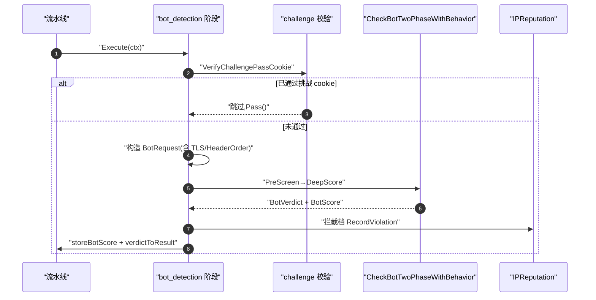
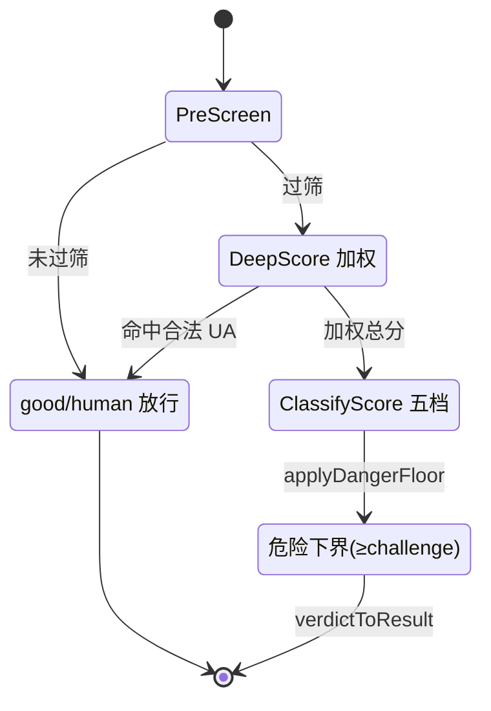
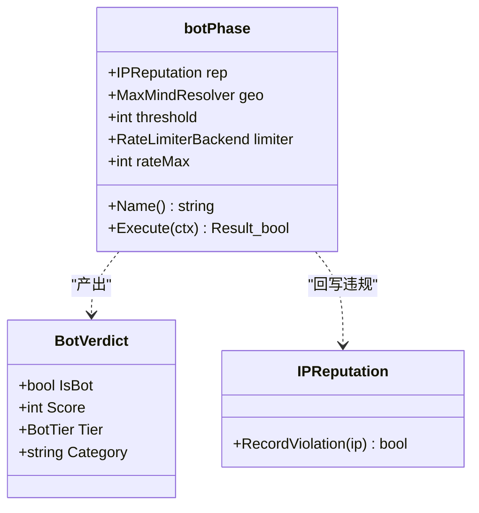

# 机器人检测阶段

> [返回 WAF 引擎系统](../WAF 引擎系统.md)

> 分工说明：本篇只写**引擎侧**内容——`bot_detection` 阶段如何入链、如何调用两阶段评分、如何把档位映射为动作并回写违规与评分。机器人识别算法、UA/指纹/GeoIP 评分细节与阈值调优详见 [安全防护功能/机器人检测.md](file://docs/安全防护功能/机器人检测.md)，两处不重复同一张评分明细表。

<cite>
**本文档引用的文件**
- [phases.go](file://internal/core/rules/phases.go)
- [bot.go](file://internal/waf/bot/bot.go)
- [iprep.go](file://internal/waf/iprep/iprep.go)
- [engine.go](file://internal/core/engine/engine.go)
- [action.go](file://internal/core/action/action.go)
- [pipeline.go](file://internal/core/pipeline/pipeline.go)
</cite>

## 目录

1. [简介](#简介)
2. [项目结构](#项目结构)
3. [核心组件](#核心组件)
4. [架构总览](#架构总览)
5. [详细组件分析](#详细组件分析)
6. [依赖关系分析](#依赖关系分析)
7. [性能考虑](#性能考虑)
8. [故障排查指南](#故障排查指南)
9. [结论](#结论)
10. [附录](#附录)

## 简介
本文件面向 My-OpenWaf 的 `bot_detection` 阶段。它是全 11 阶段链的第 7 位（`ip_reputation → anti_replay → acl → lua_pre → owasp_default → cve_detection → bot_detection → browser_sign → rate_limit → signature → custom`，engine.go:465-548），位于 OWASP 与 CVE 检测之后、浏览器签名与限流之前。引擎侧关注：阶段如何在 `prot.BotDetectionEnabled` 时入链并注入依赖、`Execute` 如何走"已通过挑战 cookie 跳过 → 构造 BotRequest → 两阶段评分 → 档位映射"、行为分如何借用限流窗口而不干扰限流计数、终端判定如何回写 IP 信誉违规。

## 项目结构
机器人检测能力由"算法包 + 引擎阶段"构成：

| 位置 | 角色 | 说明 |
|---|---|---|
| [internal/waf/bot/bot.go](file://internal/waf/bot/bot.go) | 评分算法 | 两阶段流程、模块权重、档位分类 |
| [internal/core/rules/phases.go](file://internal/core/rules/phases.go) | 引擎阶段 | `botPhase` 执行入口与动作映射 |
| [internal/waf/bot/geoip](file://internal/waf/bot/geoip) | GeoIP 加权 | 数据中心/VPN/高风险国家评分（详见子文档） |

阶段在引擎中的相关符号：

| 符号 | 文件:行 | 签名 | 职责 |
|---|---|---|---|
| `botPhase` | phases.go:435-441 | struct{rep,geo,threshold,limiter,rateMax} | 阶段载体 |
| `NewBotPhaseWithGeoAndLimiter` | phases.go:469-474 | `(rep,geo,threshold,limiter,rateMax) Phase` | 注入行为限流，threshold≤0→80 |
| `botPhase.Name` | phases.go:488 | `() string` | 返回 `"bot_detection"` |
| `botPhase.Execute` | phases.go:514-534 | `(ctx) (action.Result,bool)` | 两阶段评分主入口 |
| `verdictToResult` | phases.go:561-591 | `(v,ctx) (action.Result,bool)` | 五档→动作与短路 |

**章节来源**
- [phases.go:435-591](file://internal/core/rules/phases.go#L435-L591)
- [engine.go:503-510](file://internal/core/engine/engine.go#L503-L510)

## 核心组件
- 两阶段评分：`CheckBotTwoPhaseWithBehavior` 先 `PreScreen` 快速判定高风险，未过筛直接 `TierPass` 放行；过筛后 `DeepScoreWithBehavior` 加权评分，命中已知合法 UA 归 `good` 放行（bot.go:922-942）。
- 档位分类：`ClassifyScore` 按加权总分映射五档，`applyDangerFloor` 对危险判定抬升到不低于挑战档（bot.go:120-136、956-959）。
- 行为分：`behaviorScore` 借用限流后端，但使用带 `|bot` 后缀的独立键，避免与限流计数相互干扰（phases.go:501-512）。
- 结果映射：`verdictToResult` 把 Drop/Intercept/Challenge 返回 `stop=true`，Observe 返回 `stop=false`，其余 `Pass()`；拦截档调用 `IPReputation.RecordViolation`（phases.go:561-591）。
- 评分落库：`storeBotScore` 对 human/good 不写库，其余写 `BotScoreResult` 供数据面异步日志（phases.go:536-559）。

| 组件 | 位置 | 输入 | 输出 |
|---|---|---|---|
| PreScreen | [bot.go:923](file://internal/waf/bot/bot.go#L923) | BotRequest | 是否深度评分 |
| DeepScoreWithBehavior | [bot.go:926](file://internal/waf/bot/bot.go#L926) | BotRequest+行为分 | BotScore |
| ClassifyScore | [bot.go:120](file://internal/waf/bot/bot.go#L120) | 总分+阈值 | BotTier |
| verdictToResult | [phases.go:561](file://internal/core/rules/phases.go#L561) | BotVerdict | action.Result |

**章节来源**
- [bot.go:120-942](file://internal/waf/bot/bot.go#L120-L942)
- [phases.go:501-559](file://internal/core/rules/phases.go#L501-L559)

## 架构总览
`getOrBuildPhases` 在 `prot.BotDetectionEnabled` 时构造 `botPhase`，并按限流是否启用决定是否注入 `reqRateLimiter`（engine.go:503-510）。请求在阶段内的判定流转如下：

**图表来源**
- [phases.go:514-591](file://internal/core/rules/phases.go#L514-L591)
- [bot.go:922-942](file://internal/waf/bot/bot.go#L922-L942)

**章节来源**
- [engine.go:503-510](file://internal/core/engine/engine.go#L503-L510)
- [phases.go:514-591](file://internal/core/rules/phases.go#L514-L591)

## 详细组件分析

### 阶段注册与依赖注入
`NewBotPhaseWithGeoAndLimiter(e.ipRep, deps.geoResolver, deps.botThreshold, botLimiter, prot.RequestRateLimitMax)` 在 `prot.BotDetectionEnabled` 时入链（engine.go:503-510）。`botLimiter` 仅当限流后端存在且 `Enabled()` 时注入，否则传 nil，行为分恒 0（engine.go:505-508）。`threshold <= 0` 回落默认 80（phases.go:470-472）。

**章节来源**
- [engine.go:503-510](file://internal/core/engine/engine.go#L503-L510)
- [phases.go:435-474](file://internal/core/rules/phases.go#L435-L474)

### 预筛选与两阶段短路
`CheckBotTwoPhaseWithBehavior` 先执行 `PreScreen`，未过筛立即返回 `TierPass`（Category=human），无需深度评分（bot.go:922-925）。过筛后再做 `DeepScoreWithBehavior`，并优先匹配已知合法 UA：命中归 `good` 放行，否则进入 `ClassifyScore` 五档分类（bot.go:926-931）。

| 阶段 | 命中 | 结果 | 是否深度评分 |
|---|---|---|:--:|
| PreScreen 未过 | 常规浏览器特征 | TierPass(human) | 否 |
| 合法 UA 匹配 | googlebot/bingbot 等 | TierPass(good) | 是（先评分再放行） |
| 过筛且非合法 | 可疑特征 | 五档之一 | 是 |

这一前置短路把高成本的指纹/GeoIP 评分限制在可疑流量上，是吞吐的关键（详见 [安全防护功能/机器人检测.md](file://docs/安全防护功能/机器人检测.md)）。

**章节来源**
- [bot.go:887-942](file://internal/waf/bot/bot.go#L887-L942)

### 执行入口与档位映射
`Execute` 先用 `challengePassIdentity` + `VerifyChallengePassCookieWithClaims` 让已通过签名验证的请求跳过挑战（phases.go:514-519），随后用 `NewBotRequest(method,path,headers)` 构造特征，补齐 ClientIP、HeaderKeys/HeaderOrder、TLS 与 HostHeader（用于 TLS+SNI 一致性判定），调用 `CheckBotTwoPhaseWithBehavior`，最后 `verdictToResult` 映射动作（phases.go:521-534）。

五档处置与动作、短路关系如下：

| 档位 | action.Type | Category | LogAction | stop |
|---|---|---|---|:--:|
| TierDrop | `drop` | bot_drop | drop | 是 |
| TierIntercept | `intercept` | bot_intercept | intercept | 是 |
| TierChallenge | `challenge` | bot_challenge | challenge | 是 |
| TierObserve | `observe` | bot_observe | observe | 否 |
| TierPass | `Pass()` | bot_pass | allow | 否 |

**图表来源**
- [phases.go:514-591](file://internal/core/rules/phases.go#L514-L591)
- [bot.go:120-168](file://internal/waf/bot/bot.go#L120-L168)

**章节来源**
- [phases.go:514-591](file://internal/core/rules/phases.go#L514-L591)
- [bot.go:120-168](file://internal/waf/bot/bot.go#L120-L168)

### 模块权重与总分
加权总分 = Σ(模块原始分 × 权重)/100，落在 [0,100]（bot.go:671-678）。权重表（bot.go:85）：

| 模块 | 权重 | 依据 |
|---|:--:|---|
| UA | 40 | 空 UA 需独立跨过 observe 下界 |
| 指纹 | 25 | 头缺失/头序/TLS 一致性 |
| 行为 | 15 | 请求频率，需限流后端供数 |
| IP 声誉 | 15 | 名单命中由危险标记终止 |
| GeoIP | 5 | 环境概率，不单独定性 |

**章节来源**
- [bot.go:85-136](file://internal/waf/bot/bot.go#L85-L136)
- [bot.go:671-678](file://internal/waf/bot/bot.go#L671-L678)

### 行为分与限流窗口隔离
行为分与限流共用窗口长度与阈值基准，但使用独立键，避免每请求被计两次使限流阈值减半（phases.go:490-512）。`botBehaviorKeySuffix = "|bot"`（phases.go:512）。`BehaviorScoreFromCount` 把窗口计数折算为原始分（bot.go:649-663）：

| 计数相对 max | 行为原始分 |
|---|:--:|
| ≥ 3× | 100 |
| ≥ 2× | 60 |
| ≥ 1.5× | 30 |
| 其他 | 0 |

**章节来源**
- [phases.go:490-512](file://internal/core/rules/phases.go#L490-L512)
- [bot.go:649-663](file://internal/waf/bot/bot.go#L649-L663)

### 危险标记与评分回写
危险标记与加权总分为两条正交通道：总分只决定档位，危险保证终止。`applyDangerFloor` 把"危险 + 低分"抬到挑战档，避免一次性断连（bot.go:956-959）。`storeBotScore` 仅在非 human/good 时写 `BotScoreResult`，动作串取自 `Tier.LogAction()`，与 `verdictToResult` 共用档位避免双写（phases.go:536-559）。

**章节来源**
- [bot.go:944-959](file://internal/waf/bot/bot.go#L944-L959)
- [phases.go:536-559](file://internal/core/rules/phases.go#L536-L559)

## 依赖关系分析
`bot_detection` 依赖 IP 信誉、GeoIP 解析器与限流后端，被流水线顺序调度，无反向依赖。

| 依赖方 | 被依赖对象 | 证据 |
|---|---|---|
| engine → botPhase | `NewBotPhaseWithGeoAndLimiter` | [engine.go:509](file://internal/core/engine/engine.go#L509) |
| botPhase → IPReputation | `RecordViolation` | [iprep.go:144](file://internal/waf/iprep/iprep.go#L144) |
| botPhase → 行为限流 | `Increment(key+"|bot")` | [phases.go:501-508](file://internal/core/rules/phases.go#L501-L508) |
| botPhase → action | `IsTerminal`/`TerminalPriority` | [action.go:88-179](file://internal/core/action/action.go#L88-L179) |

**图表来源**
- [phases.go:435-591](file://internal/core/rules/phases.go#L435-L591)
- [bot.go:170-201](file://internal/waf/bot/bot.go#L170-L201)

**章节来源**
- [phases.go:435-591](file://internal/core/rules/phases.go#L435-L591)

## 性能考虑
- 两阶段前置：`PreScreen` 未过筛直接放行，规避深度评分开销（bot.go:922-925）。
- 行为分独立键：与限流分窗计数，既不干扰限流阈值又复用同一频率数据（phases.go:490-512）。
- 良性流量不写库：human/good 档 `storeBotScore` 提前返回，省下 DB 写入（phases.go:537-538）。
- Details 惰性分配：干净流量不产生 `Details` map 分配（bot.go 深度评分注释，详见子文档）。

## 故障排查指南
- 误判正常浏览器：档位偏低时检查阈值（默认 80）与 UA/指纹模块原始分，调优见子文档。
- 已知工具未拦截：明确攻击工具靠危险标记终止而非权重，确认 UA 严重度达危险下界（bot.go:91）。
- 限流阈值疑似减半：确认行为分使用 `|bot` 独立键，未与限流计数共用（phases.go:506）。
- 挑战反复触发：确认已通过挑战 cookie 的跳过分支生效（phases.go:516-519）。

| 症状 | 原因 | 排查点 |
|---|---|---|
| 高频请求只被记录不拦截 | 总分未达 intercept 档 | `ClassifyScore` 边界/阈值 |
| 行为分恒 0 | 限流未启用 | engine.go:505-508 注入条件 |
| bot 拦截未进自动封禁 | `RecordViolation` 前提未满足 | iprep.go:144-167 |

**章节来源**
- [bot.go:91-942](file://internal/waf/bot/bot.go#L91-L942)
- [phases.go:514-591](file://internal/core/rules/phases.go#L514-L591)
- [iprep.go:144-167](file://internal/waf/iprep/iprep.go#L144-L167)

## 结论
`bot_detection` 以两阶段评分为核心，将加权总分映射为五档处置，危险标记保证终止不被权重稀释；行为分借独立限流窗口供数，终端判定回写 IP 信誉形成闭环。作为链上第 7 位，它在 OWASP/CVE 之后进一步识别自动化与扫描流量。评分算法细节调优参见 [安全防护功能/机器人检测.md](file://docs/安全防护功能/机器人检测.md)。

## 附录

### 阶段属性速查
| 属性 | 取值 |
|---|---|
| 阶段名 | `bot_detection` |
| 注册位置 | [engine.go:503-510](file://internal/core/engine/engine.go#L503-L510) |
| 入链前置 | `prot.BotDetectionEnabled` |
| 链上位置 | 第 7 位 |
| 默认阈值 | 80（threshold≤0 回落） |
| 短路策略 | Drop/Intercept/Challenge 短路；Observe 继续 |

### 档位→状态码
| 档位动作 | 默认状态码 | 证据 |
|---|:--:|---|
| `intercept` | 403 | [action.go:284-306](file://internal/core/action/action.go#L284-L306) |
| `challenge` | 403 | [action.go:284-306](file://internal/core/action/action.go#L284-L306) |
| `drop` | 无（关 TCP） | [action.go:181-190](file://internal/core/action/action.go#L181-L190) |

**章节来源**
- [engine.go:503-510](file://internal/core/engine/engine.go#L503-L510)
- [action.go:181-306](file://internal/core/action/action.go#L181-L306)
