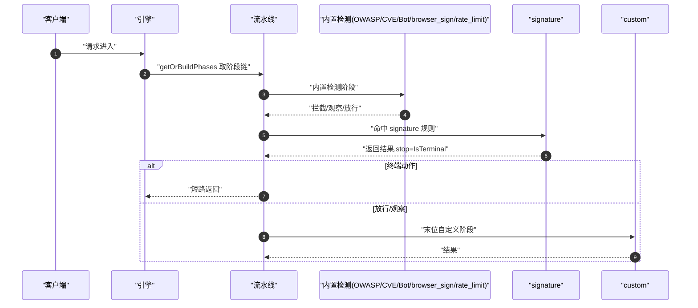
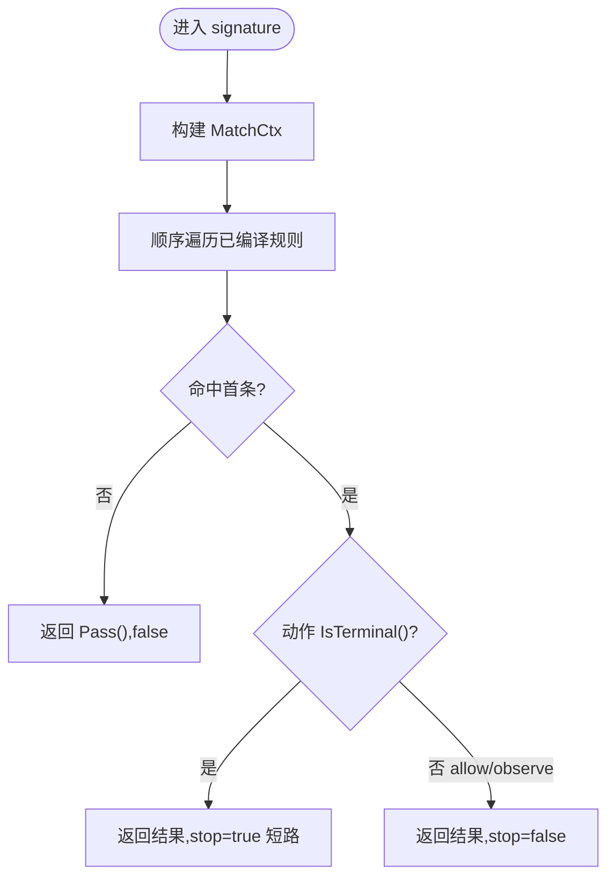
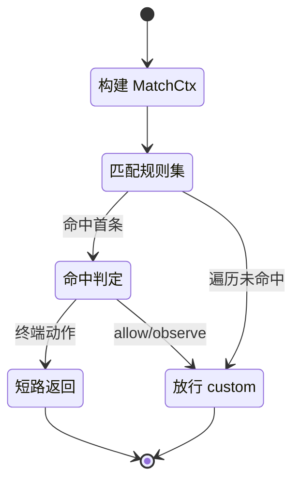
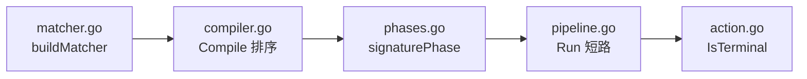

# 签名检测阶段

> [返回 WAF 引擎系统](../WAF 引擎系统.md)

> 分工说明：本篇只写**引擎侧**内容——`signature` 阶段的注册位置、执行入口、与 ACL/自定义阶段的共用编译链路及短路差异。规则 DSL 的匹配器清单与算法详见 [规则匹配器](file://docs/WAF 引擎系统/规则匹配器/规则匹配器.md) 与 [自定义规则阶段](file://docs/WAF 引擎系统/处理阶段详解/自定义规则阶段.md)。

<cite>
**本文档引用的文件**
- [phases.go](file://internal/core/rules/phases.go)
- [compiler.go](file://internal/core/rules/compiler.go)
- [matcher.go](file://internal/core/rules/matcher.go)
- [engine.go](file://internal/core/engine/engine.go)
- [action.go](file://internal/core/action/action.go)
- [pipeline.go](file://internal/core/pipeline/pipeline.go)
</cite>

## 目录

1. [简介](#简介)
2. [项目结构](#项目结构)
3. [核心组件](#核心组件)
4. [架构总览](#架构总览)
5. [详细组件分析](#详细组件分析)
6. [依赖关系分析](#依赖关系分析)
7. [性能考虑](#性能考虑)
8. [故障排查指南](#故障排查指南)
9. [结论](#结论)
10. [附录](#附录)

## 简介
本文件聚焦 My-OpenWaf 的 `signature` 阶段。它是全 11 阶段链的第 10 位（`ip_reputation → anti_replay → acl → lua_pre → owasp_default → cve_detection → bot_detection → browser_sign → rate_limit → signature → custom`，engine.go:465-548），属于"用户自建规则"类阶段，与末位的 `custom` 阶段共用同一套编译与匹配机制。签名阶段命中后依据动作是否为终端动作决定短路；与 OWASP/CVE 等内置检测阶段相比，它位于其后，用于对已放行的检测流量再做一层特征匹配。

> 订正：OWASP、CVE、Bot、限流均在签名阶段**之前**执行；签名与自定义是链上最后两个阶段。ACL 与签名都走 `executeCompiledPhase`，其 `allowShortCircuit` 形参未被使用，Allow 不短路。签名阶段的规则由 `cr.Signature` 预分区供给，运行期不再按 Phase 过滤。

## 项目结构
签名阶段位于核心规则引擎中，采用"编译期构建匹配器 + 运行期顺序匹配"的设计：

| 层 | 代表文件 | 核心符号 | 职责 |
|---|---|---|---|
| 规则编译 | [compiler.go](file://internal/core/rules/compiler.go) | `Compile`、`Compiled` | DSL/JSON→匹配器并排序 |
| 匹配执行 | [matcher.go](file://internal/core/rules/matcher.go) | `Matcher.Match(MatchCtx)` | 字段级匹配 |
| 阶段实现 | [phases.go](file://internal/core/rules/phases.go) | `signaturePhase` | 顺序命中与短路 |
| 引擎装配 | [engine.go](file://internal/core/engine/engine.go) | `getOrBuildPhases` | 条件入链（不走跳过装饰） |

阶段相关符号：

| 符号 | 文件:行 | 签名 | 职责 |
|---|---|---|---|
| `signaturePhase` | phases.go:152-155 | struct{rules,needsDerivedHeaders} | 阶段载体 |
| `NewSignaturePhasePrecompiled` | phases.go:163-165 | `(rules) Phase` | 由已分区规则构造 |
| `signaturePhase.Name` | phases.go:167 | `() string` | 返回 `"signature"` |
| `signaturePhase.Execute` | phases.go:169-171 | `(ctx) (Result,bool)` | 委托 `executeCompiledPhase(...,false,...)` |
| `executeCompiledPhase` | phases.go:112-129 | `(ctx,rules,allowShortCircuit,needsDerived)` | 命中首条即返回 |

**章节来源**
- [phases.go:112-171](file://internal/core/rules/phases.go#L112-L171)
- [engine.go:524-526](file://internal/core/engine/engine.go#L524-L526)

## 核心组件
- 编译器：`Compile` 过滤启用规则、`ParsePattern` 解析 kind/arg、`buildMatcher` 构建匹配器，按优先级升序、ID 升序排序（compiler.go:39-78）。
- 匹配器：统一实现 `Matcher.Match(ctx MatchCtx) bool`，非法模式回落 `neverMatcher`（matcher.go:21-23、1772-1773）。
- 签名阶段：`executeCompiledPhase(ctx, rules, false, ...)` 顺序遍历，命中首条即返回 `(hit, hit.IsTerminal())`（phases.go:169-171）。
- 引擎：`getOrBuildPhases` 在 `len(cr.Signature) > 0` 时把签名阶段**直接 append** 入链，不包跳过装饰器（engine.go:522-526）。

| 组件 | 位置 | 契约 | 说明 |
|---|---|---|---|
| 阶段名 | [phases.go:167](file://internal/core/rules/phases.go#L167) | `"signature"` | 链上第 10 位 |
| 短路 | [phases.go:120-126](file://internal/core/rules/phases.go#L120-L126) | `stop=IsTerminal` | Allow/Observe 不短路 |
| 排序 | [compiler.go:71-76](file://internal/core/rules/compiler.go#L71-L76) | 优先级/ID 升序 | 稳定匹配顺序 |

**章节来源**
- [compiler.go:39-78](file://internal/core/rules/compiler.go#L39-L78)
- [phases.go:112-171](file://internal/core/rules/phases.go#L112-L171)

## 架构总览
签名阶段与相邻阶段的顺序关系如下（内置检测在前、用户自建在后）：

**图表来源**
- [engine.go:496-529](file://internal/core/engine/engine.go#L496-L529)
- [phases.go:169-171](file://internal/core/rules/phases.go#L169-L171)

**章节来源**
- [engine.go:496-529](file://internal/core/engine/engine.go#L496-L529)

## 详细组件分析

### 签名阶段执行流程
`Execute` 委托 `executeCompiledPhase`：规则为空返回 `Pass(), false`；否则构造 `MatchCtx` 并顺序匹配，命中首条即返回该规则结果与 `IsTerminal()`（phases.go:112-129）。`allowShortCircuit` 形参在函数体内未被引用（phases.go:112），因此 Allow 命中不短路，请求继续进入 `custom` 阶段。

**图表来源**
- [phases.go:112-171](file://internal/core/rules/phases.go#L112-L171)
- [action.go:168-179](file://internal/core/action/action.go#L168-L179)

**章节来源**
- [phases.go:112-171](file://internal/core/rules/phases.go#L112-L171)
- [action.go:168-179](file://internal/core/action/action.go#L168-L179)

### 规则编译与匹配器构建
`Compile` 流程：跳过 `!Enabled` 规则 → `ParsePattern` 取 kind/arg → `validateParsedPattern` 通过后 `buildMatcher`，否则回落 `neverMatcher` → 追加 `runtimeAction`/`ruleIDStr`/`matchDesc` 元信息 → 排序（compiler.go:39-78）。

| 步 | 动作 | 位置 | 失败分支 |
|:--:|---|---|---|
| 1 | 过滤启用规则 | [compiler.go:43-45](file://internal/core/rules/compiler.go#L43-L45) | 跳过 |
| 2 | 解析 kind/arg | [compiler.go:46-49](file://internal/core/rules/compiler.go#L46-L49) | kind 空跳过 |
| 3 | 校验并构建匹配器 | [compiler.go:50-53](file://internal/core/rules/compiler.go#L50-L53) | neverMatcher |
| 4 | 填充元信息 | [compiler.go:66-68](file://internal/core/rules/compiler.go#L66-L68) | - |
| 5 | 优先级/ID 排序 | [compiler.go:71-76](file://internal/core/rules/compiler.go#L71-L76) | - |

**章节来源**
- [compiler.go:39-78](file://internal/core/rules/compiler.go#L39-L78)

### 匹配算法与请求状态
匹配器对 `MatchCtx` 的字段求值，命中即返回布尔。请求在阶段内的状态流转可用状态图表达：

**图表来源**
- [phases.go:112-129](file://internal/core/rules/phases.go#L112-L129)
- [matcher.go:1473-1775](file://internal/core/rules/matcher.go#L1473-L1775)

**章节来源**
- [matcher.go:1473-1775](file://internal/core/rules/matcher.go#L1473-L1775)

### 与其它检测阶段的区别与协作
- 与 `custom`：两者都用 `Compiled`，但 `custom` 走 `executeCustomPhase` 会内部累积 Observe 命中（phases.go:194-225），`signature` 走 `executeCompiledPhase` 单条命中即返回，Observe 命中由 `pipeline.Run` 统一收集（pipeline.go:523）。
- 与内置检测：OWASP/CVE/Bot/限流在签名之前执行；签名不参与按路径跳过装饰（engine.go:522-526），停用规则本身即可关停。

| 对比维度 | signature | custom |
|---|---|---|
| 链上位置 | 第 10 | 第 11（末位） |
| 执行函数 | executeCompiledPhase | executeCustomPhase |
| Observe 累积 | 由 pipeline 收集 | 阶段内累积多条 |
| 跳过装饰 | 不适用 | 不适用 |

**章节来源**
- [phases.go:152-225](file://internal/core/rules/phases.go#L152-L225)
- [engine.go:522-529](file://internal/core/engine/engine.go#L522-L529)

### 规则来源与编译缓存
签名规则与 ACL、custom 同源：引擎 `getCompiledRules` 把快照里的 `CompiledRule` 经 `convertAndCompile` 转为 `rules.Compiled`，并按 `Phase` 预分区到 `cr.Signature`（engine.go:399-410、623-645）。编译结果按 `{siteID,policyID}` 键缓存于 `compiledSnapshot`，同一快照 revision 内每站点至多编译一次（engine.go:34-42、386-431）。

`Compiled` 结构承载运行期所需的全部字段：

| 字段 | 类型 | 说明 |
|---|---|---|
| ID | uint | 规则 ID，排序次键 |
| Phase | string | `signature` 分区依据 |
| Action | action.Type | 命中动作 |
| Priority | int | 排序主键（升序） |
| Kind/Arg | string | 解析后的匹配类型与参数 |
| StatusCode | int | 自定义状态码（0 用默认） |
| RedirectTo | string | 重定向目标 |
| CaptchaType | string | 规则级验证码类型（空继承全局） |
| matcher | Matcher（私有） | 预构建匹配器 |

> `convertAndCompile` 对复合规则把原始 JSON 存于 `Arg` 并以 `{` 前缀识别，非复合规则拼成 `kind:arg` 交 `ParsePattern` 解析（engine.go:625-644、compiler.go:146-170）。

**章节来源**
- [engine.go:399-410](file://internal/core/engine/engine.go#L399-L410)
- [engine.go:623-645](file://internal/core/engine/engine.go#L623-L645)
- [compiler.go:13-29](file://internal/core/rules/compiler.go#L13-L29)

### 与 ACL 阶段的异同
签名与 ACL 都经 `executeCompiledPhase` 顺序命中首条，唯一入参差异是 `allowShortCircuit`（ACL 传 `true`、签名传 `false`），但该形参未被使用，因此两者短路语义完全一致——只有终端动作短路（phases.go:148-150、169-171）。

| 维度 | acl | signature |
|---|---|---|
| 链上位置 | 第 3 | 第 10 |
| 跳过装饰 | 适用 | 不适用（直接 append） |
| Allow 短路 | 否 | 否 |
| 命中策略 | 首条命中即返回 | 首条命中即返回 |

**章节来源**
- [phases.go:112-171](file://internal/core/rules/phases.go#L112-L171)
- [engine.go:486-488](file://internal/core/engine/engine.go#L486-L488)
- [engine.go:522-526](file://internal/core/engine/engine.go#L522-L526)

## 依赖关系分析

| 依赖方 | 被依赖对象 | 证据 |
|---|---|---|
| engine → signature | `NewSignaturePhasePrecompiled` | [engine.go:524-526](file://internal/core/engine/engine.go#L524-L526) |
| signature → compiler | `Compiled.Match` | [compiler.go:32-37](file://internal/core/rules/compiler.go#L32-L37) |
| signature → matcher | `buildMatcher` | [matcher.go:1473-1775](file://internal/core/rules/matcher.go#L1473-L1775) |
| pipeline → signature | `Run` 短路 | [pipeline.go:517-560](file://internal/core/pipeline/pipeline.go#L517-L560) |

**图表来源**
- [phases.go:152-171](file://internal/core/rules/phases.go#L152-L171)
- [compiler.go:39-78](file://internal/core/rules/compiler.go#L39-L78)

**章节来源**
- [phases.go:152-171](file://internal/core/rules/phases.go#L152-L171)
- [compiler.go:39-78](file://internal/core/rules/compiler.go#L39-L78)

## 性能考虑
- 编译期排序：优先级与 ID 升序，使高优先级规则先匹配、命中即停（compiler.go:71-76）。
- 正则缓存：`cachedCompile` 用全局 `RWMutex` 缓存复用已编译正则，非法模式回落永不匹配（matcher.go:1785-1808）。
- 匹配器短路：AND/OR 在匹配器内部短路（matcher.go:281-307），避免无关子条件继续计算。
- 派生头部按需：仅当含 `tls_alpn`/`header_order_*` 等 kind 时才构造派生字段（phases.go:227-249）。
- 编译缓存复用：签名规则按 `{siteID,policyID}` 缓存，同 revision 每站点至多编译一次，避免热路径重复编译（engine.go:386-431）。
- 分区预置：引擎在缓存阶段即把规则按 `Phase` 分入 `cr.Signature`，运行期 `NewSignaturePhasePrecompiled` 无需再过滤（engine.go:405-406、phases.go:163-165）。

## 故障排查指南
- 规则不生效：确认 `Phase=="signature"`、启用、kind 在 `knownPrefixes` 内（compiler.go:119-142）。
- Allow 未绕过后续：这是预期——签名 Allow 不短路，但签名在链尾，其后仅 `custom`；如需绕过内置检测应在前置阶段处理。
- 正则异常：非法正则回落 `neverMatcher`，检查语法（matcher.go:1791-1808）。
- Observe 记录缺失：签名阶段的 Observe 命中由 pipeline 收集，而非阶段内累积（pipeline.go:523）。
- 规则分区错配：确认规则 `Phase` 为 `signature`；分区在 `getCompiledRules` 完成，错配将导致规则根本不入本阶段链（engine.go:405-406）。

**章节来源**
- [compiler.go:119-180](file://internal/core/rules/compiler.go#L119-L180)
- [matcher.go:1785-1808](file://internal/core/rules/matcher.go#L1785-L1808)
- [pipeline.go:517-560](file://internal/core/pipeline/pipeline.go#L517-L560)

## 结论
签名阶段通过"编译期排序 + 运行期单条命中短路"实现用户自建特征匹配，位于内置检测之后、自定义之前（链上第 10 位）。它与自定义阶段共用编译链路，差异在 Observe 命中收集方式；`allowShortCircuit` 形参已废弃，短路语义统一由 `IsTerminal()` 决定。作为链尾倒数第二站，签名对已放行检测流量做最终特征过滤，命中终端动作即结束整条链。

## 附录

### 阶段属性速查
| 属性 | 取值 |
|---|---|
| 阶段名 | `signature` |
| 注册位置 | [engine.go:524-526](file://internal/core/engine/engine.go#L524-L526) |
| 入链前置 | `len(cr.Signature) > 0` |
| 链上位置 | 第 10 位 |
| 短路策略 | 终端动作短路；Allow/Observe 不短路 |
| 跳过装饰 | 不参与（直接 append 入链） |

### 术语速查
| 术语 | 含义 | 出处 |
|---|---|---|
| 终端动作 | `IsTerminal()` 为真，短路整条链 | [action.go:168-179](file://internal/core/action/action.go#L168-L179) |
| 首条命中 | `executeCompiledPhase` 命中即返回 | [phases.go:120-126](file://internal/core/rules/phases.go#L120-L126) |
| neverMatcher | 非法模式的 fail-closed 匹配器 | [matcher.go:504-508](file://internal/core/rules/matcher.go#L504-L508) |

**章节来源**
- [engine.go:522-526](file://internal/core/engine/engine.go#L522-L526)
- [phases.go:152-171](file://internal/core/rules/phases.go#L152-L171)
- [action.go:168-179](file://internal/core/action/action.go#L168-L179)
