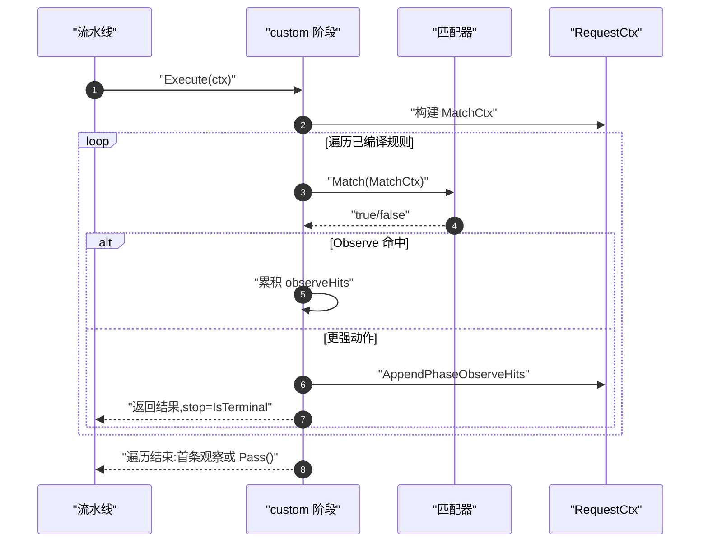
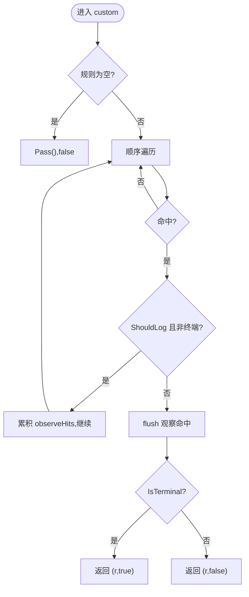
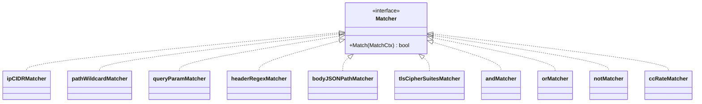
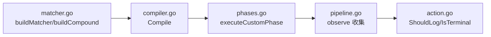

# 自定义规则阶段

> [返回 WAF 引擎系统](../WAF 引擎系统.md)

> 分工说明：本篇只写**引擎侧**内容——`custom` 阶段的注册位置、执行入口、Observe 命中累积语义与匹配器全谱。规则匹配器逐个实现细节参见 [规则匹配器](file://docs/WAF 引擎系统/规则匹配器/规则匹配器.md)；`signature` 阶段共用同一编译链路，差异见 [签名检测阶段](file://docs/WAF 引擎系统/处理阶段详解/签名检测阶段.md)。

<cite>
**本文档引用的文件**
- [phases.go](file://internal/core/rules/phases.go)
- [compiler.go](file://internal/core/rules/compiler.go)
- [matcher.go](file://internal/core/rules/matcher.go)
- [engine.go](file://internal/core/engine/engine.go)
- [action.go](file://internal/core/action/action.go)
- [pipeline.go](file://internal/core/pipeline/pipeline.go)
</cite>

## 目录

1. [简介](#简介)
2. [项目结构](#项目结构)
3. [核心组件](#核心组件)
4. [架构总览](#架构总览)
5. [详细组件分析](#详细组件分析)
6. [依赖关系分析](#依赖关系分析)
7. [性能考虑](#性能考虑)
8. [故障排查指南](#故障排查指南)
9. [结论](#结论)
10. [附录](#附录)

## 简介
本文件聚焦 My-OpenWaf 的 `custom` 阶段。它是全 11 阶段链的**末位第 11 位**（`... → rate_limit → signature → custom`，engine.go:465-548），用于用户自定义规则的最终匹配与处置。与 `signature` 阶段同用 `Compiled` 规则与 `Matcher` 匹配器，核心差异在于 `custom` 走 `executeCustomPhase`：命中 Observe 类动作时不立即返回，而是先累积观察命中，待遇到更强终止动作时一并上交给管道，实现"同一阶段内多条观察命中 + 一条终止"的审计场景。

## 项目结构
自定义规则阶段由"编译 + 匹配 + 阶段"三层构成：

| 层 | 代表文件 | 核心符号 | 职责 |
|---|---|---|---|
| 规则编译 | [compiler.go](file://internal/core/rules/compiler.go) | `Compile`、`ParsePattern` | DSL/JSON→匹配器并排序 |
| 匹配执行 | [matcher.go](file://internal/core/rules/matcher.go) | `Matcher.Match(MatchCtx)` | 字段级与复合匹配 |
| 阶段实现 | [phases.go](file://internal/core/rules/phases.go) | `customPhase`、`executeCustomPhase` | Observe 累积与短路 |
| 引擎装配 | [engine.go](file://internal/core/engine/engine.go) | `getOrBuildPhases` | 末位 append，不走跳过装饰 |

阶段相关符号：

| 符号 | 文件:行 | 签名 | 职责 |
|---|---|---|---|
| `customPhase` | phases.go:173-176 | struct{rules,needsDerivedHeaders} | 阶段载体 |
| `NewCustomPhasePrecompiled` | phases.go:184-186 | `(rules) Phase` | 由已分区规则构造 |
| `customPhase.Name` | phases.go:188 | `() string` | 返回 `"custom"` |
| `executeCustomPhase` | phases.go:194-225 | `(ctx,rules,needsDerived)` | 累积 Observe 后短路 |

**章节来源**
- [phases.go:173-225](file://internal/core/rules/phases.go#L173-L225)
- [engine.go:527-529](file://internal/core/engine/engine.go#L527-L529)

## 核心组件
- 规则模型：`Compiled` 含 ID/Phase/Action/Priority/Kind/Arg/StatusCode/RedirectTo/CaptchaType/CaptchaMinutes 与私有匹配器（compiler.go:13-29）。
- 匹配器：统一 `Matcher.Match(ctx MatchCtx) bool`，非法模式 fail-closed 到 `neverMatcher`（matcher.go:21-23、504-508）。
- 阶段实现：`executeCustomPhase` 顺序遍历，Observe 命中累积进 `observeHits`，遇更强动作先 `AppendPhaseObserveHits` 再返回（phases.go:194-225）。
- 动作系统：`normalizeConfiguredAction` 把 `log`→`observe`、非法→`intercept`（phases.go:1301-1310）。

| 组件 | 位置 | 契约 | 说明 |
|---|---|---|---|
| 阶段名 | [phases.go:188](file://internal/core/rules/phases.go#L188) | `"custom"` | 链上末位 |
| Observe 累积 | [phases.go:203-216](file://internal/core/rules/phases.go#L203-L216) | AppendPhaseObserveHits | 多命中审计 |
| 排序 | [compiler.go:71-76](file://internal/core/rules/compiler.go#L71-L76) | 优先级/ID 升序 | 稳定顺序 |

**章节来源**
- [compiler.go:13-29](file://internal/core/rules/compiler.go#L13-L29)
- [phases.go:173-225](file://internal/core/rules/phases.go#L173-L225)
- [phases.go:1301-1310](file://internal/core/rules/phases.go#L1301-L1310)

## 架构总览
`custom` 位于 `signature` 之后、链尾。引擎在 `len(cr.Custom) > 0` 时直接 append 入链，不参与按路径跳过（engine.go:527-529）。请求处理时序如下：

**图表来源**
- [phases.go:194-225](file://internal/core/rules/phases.go#L194-L225)
- [pipeline.go:214-230](file://internal/core/pipeline/pipeline.go#L214-L230)

**章节来源**
- [engine.go:527-529](file://internal/core/engine/engine.go#L527-L529)
- [phases.go:194-225](file://internal/core/rules/phases.go#L194-L225)

## 详细组件分析

### 执行阶段与 Observe 累积
`executeCustomPhase` 的分支语义（phases.go:194-225）：规则为空返回 `Pass(), false`；命中后若 `r.ShouldLog() && !r.IsTerminal()`（即 Observe 类），累积到 `observeHits` 并继续遍历；否则把已累积命中 `AppendPhaseObserveHits` 后返回 `(r, r.IsTerminal())`；遍历结束若无命中返回 `Pass()`，若有 Observe 命中则返回首条、其余追加进上下文，`stop=false`。

| 场景 | observeHits | 更强动作 | 返回 |
|---|:--:|:--:|---|
| 仅 Observe 命中 | 多条 | 无 | `(首条, false)` + 追加其余 |
| Observe 后遇 Intercept | 已有 | 有 | 先 flush，再 `(Intercept, true)` |
| 直接终端命中 | 空 | 有 | `(r, true)` |
| 全未命中 | 空 | 无 | `(Pass(), false)` |

**图表来源**
- [phases.go:194-225](file://internal/core/rules/phases.go#L194-L225)

**章节来源**
- [phases.go:194-225](file://internal/core/rules/phases.go#L194-L225)

### 匹配器全谱
`buildMatcher` 依 kind 分派匹配器实例（matcher.go:1473-1775），`knownPrefixes` 约束可解析前缀（compiler.go:119-142）。代表类别：

| 类别 | 代表 kind | 匹配器 | 大小写 |
|---|---|---|---|
| IP/网段 | `allow_ip`、`block_ip` | `ipCIDRMatcher` | - |
| 路径 | `block_path`、`block_path_exact`、`path_wildcard` | `pathPrefixMatcher`/`exactPathMatcher`/`pathWildcardMatcher` | 敏感 |
| 查询 | `block_query_regex`、`query_param`、`query_param_regex` | `queryRegexMatcher`/`queryParamMatcher` | - |
| 头部 | `block_header`、`block_header_regex`、`header_wildcard` | `headerContainsMatcher`/`headerRegexMatcher` | 名折叠 |
| 方法/类型 | `block_method`、`block_content_type` | `methodMatcher`/`contentTypeMatcher` | 折叠 |
| 请求体 | `block_body_contains`、`block_body_regex`、`block_body_json_path` | `bodyContainsMatcher`/`bodyRegexMatcher`/`bodyJSONPathMatcher` | - |
| TLS 指纹 | `tls_ja3_hash`、`tls_ja4`、`tls_cipher_suites` | `tlsFingerprintMatcher`/`tlsCipherSuitesMatcher` | - |
| Host/URL | `host_contains`、`full_url_wildcard` | `hostContainsMatcher`/`fullURLWildcardMatcher` | 折叠 |

> 所有匹配器签名统一为 `Match(ctx MatchCtx) bool`（matcher.go:21-23），非按参数拆分的多参签名。

**图表来源**
- [matcher.go:1473-1775](file://internal/core/rules/matcher.go#L1473-L1775)
- [matcher.go:281-321](file://internal/core/rules/matcher.go#L281-L321)

**章节来源**
- [matcher.go:21-321](file://internal/core/rules/matcher.go#L21-L321)
- [compiler.go:119-142](file://internal/core/rules/compiler.go#L119-L142)

### 复合规则与频次匹配
`buildCompound` 递归构建逻辑树（matcher.go:1878-1928）：

| op | 结构要求 | 匹配器 | 失败回落 |
|---|---|---|---|
| `and`/`or` | `children` 非空 | `andMatcher`/`orMatcher` | 空→neverMatcher |
| `not` | `children` 恰 1 | `notMatcher` | 数量不符→neverMatcher |
| `if`/`if_else` | `if`+`then`，可选 `else` | `ifElseMatcher` | 缺 if/then→neverMatcher |
| `cc_rate` | 1 child + window>0 + threshold>0 | `ccRateMatcher` | 非法→neverMatcher |

`cc_rate` 用 `RateLimitKey` 同源键做窗口频次判定，`state.count>=threshold` 触发并按 `duration` 设阻断窗口（matcher.go:25-91、107-109），每 60 秒清扫过期状态（matcher.go:67-74）。

**章节来源**
- [matcher.go:25-91](file://internal/core/rules/matcher.go#L25-L91)
- [matcher.go:1878-1928](file://internal/core/rules/matcher.go#L1878-L1928)

### 通配符匹配器与快路径
`*_wildcard` 类 kind（`path_wildcard`/`full_url_wildcard`/`host_wildcard`/`body_wildcard`/`header_wildcard`）经 `compileWildcard` 编译为 `wildcardTester`（matcher.go:1341-1377）。`parseGlob` 把通配模式翻译为锚定正则源码，`*` 有意匹配含 `/` 的任意序列（区别于 `path.Match` 的段边界），避免 `*bot*` 静默失配（matcher.go:1054-1185）。

编译后按形态选择实现，纯字面量形态退化为 `strings`/`bytes` 快路径：

| 形态 | 模式示例 | 实现 |
|---|---|---|
| wcAny | `*` | 恒真 |
| wcExact | `abc` | 相等比较 |
| wcContains | `*abc*` | 子串（可 ASCII 折叠） |
| wcPrefix | `abc*` | 前缀 |
| wcSuffix | `*abc` | 后缀 |
| wcRegex | 含 `?`/字符类/中缀 `*` | RE2 正则 |

非法通配模式（空、星号数 > 8、悬空转义）编译失败回落 `neverMatcher`，fail-closed 与全 `*_regex` 方向一致（matcher.go:1120-1122、1341-1344）。

**章节来源**
- [matcher.go:1054-1185](file://internal/core/rules/matcher.go#L1054-L1185)
- [matcher.go:1301-1377](file://internal/core/rules/matcher.go#L1301-L1377)

### 懒解析缓存复用
`bodyJSONPath` 与 `queryParam` 类匹配器借 `RequestCtx` 缓存每请求至多解析一次 JSON 对象或查询值，`MatchCtx` 无 `RequestCtx`（纯值测试）时直接解析不缓存，行为与原实现一致（matcher.go:529-606、phases.go:48-51）。

**章节来源**
- [matcher.go:529-606](file://internal/core/rules/matcher.go#L529-L606)
- [phases.go:48-51](file://internal/core/rules/phases.go#L48-L51)

## 依赖关系分析

| 依赖方 | 被依赖对象 | 证据 |
|---|---|---|
| engine → custom | `NewCustomPhasePrecompiled` | [engine.go:527-529](file://internal/core/engine/engine.go#L527-L529) |
| custom → compiler | `Compiled.Match` | [compiler.go:32-37](file://internal/core/rules/compiler.go#L32-L37) |
| custom → matcher | `buildMatcher`/`buildCompound` | [matcher.go:1473-1928](file://internal/core/rules/matcher.go#L1473-L1928) |
| custom → pipeline | `AppendPhaseObserveHits` | [pipeline.go:214-220](file://internal/core/pipeline/pipeline.go#L214-L220) |

**图表来源**
- [phases.go:173-225](file://internal/core/rules/phases.go#L173-L225)
- [compiler.go:39-78](file://internal/core/rules/compiler.go#L39-L78)

**章节来源**
- [phases.go:173-225](file://internal/core/rules/phases.go#L173-L225)

## 性能考虑
- Observe 累积：多条观察命中在阶段内合并后一次性 flush，减少多次 `AppendPhaseObserveHits` 调用（phases.go:212-223）。
- 匹配器短路：AND 遇任一假即返回、OR 遇任即真（matcher.go:281-307），复合树避免无谓求值。
- 正则缓存：`cachedCompile` 全局缓存复用（matcher.go:1785-1808）。
- 懒解析复用：`bodyJSONPath`/`queryParam` 借 `RequestCtx` 缓存每请求至多解析一次（matcher.go:574-606）。

## 故障排查指南
- 规则无法匹配：确认启用、`Phase=="custom"`、kind 在 `knownPrefixes` 内（compiler.go:119-142）。
- 复合结构错误：`and/or` children 不能为空、`not` 恰一个子、`cc_rate` 需 window/threshold>0，否则回落永不匹配（matcher.go:1878-1928）。
- 动作漂移：`log`/`log_only` 归一化为 `observe`，非法动作归一化为 `intercept`（phases.go:1301-1310）。
- Observe 未上报：由 pipeline 统一收集，检查 `ShouldLog` 判定（action.go:260-272）。

**章节来源**
- [compiler.go:119-142](file://internal/core/rules/compiler.go#L119-L142)
- [matcher.go:1878-1928](file://internal/core/rules/matcher.go#L1878-L1928)
- [action.go:260-272](file://internal/core/action/action.go#L260-L272)

## 结论
`custom` 阶段作为链尾最终匹配环节，通过 `executeCustomPhase` 实现"多条 Observe 命中 + 一条终止动作"的审计语义，与 `signature` 共享编译与匹配器体系。匹配器全谱与复合逻辑树覆盖 IP/路径/查询/头部/方法/内容类型/请求体/TLS 指纹/频次等维度，非法模式统一 fail-closed，保证规则错误不会放大为误封。

## 附录

### 阶段属性速查
| 属性 | 取值 |
|---|---|
| 阶段名 | `custom` |
| 注册位置 | [engine.go:527-529](file://internal/core/engine/engine.go#L527-L529) |
| 入链前置 | `len(cr.Custom) > 0` |
| 链上位置 | 第 11 位（末位） |
| 执行函数 | `executeCustomPhase` |
| Observe | 阶段内累积后 flush |

**章节来源**
- [engine.go:527-529](file://internal/core/engine/engine.go#L527-L529)
- [phases.go:173-225](file://internal/core/rules/phases.go#L173-L225)
