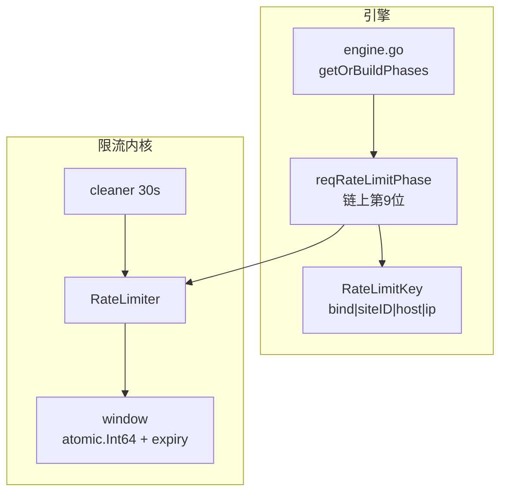
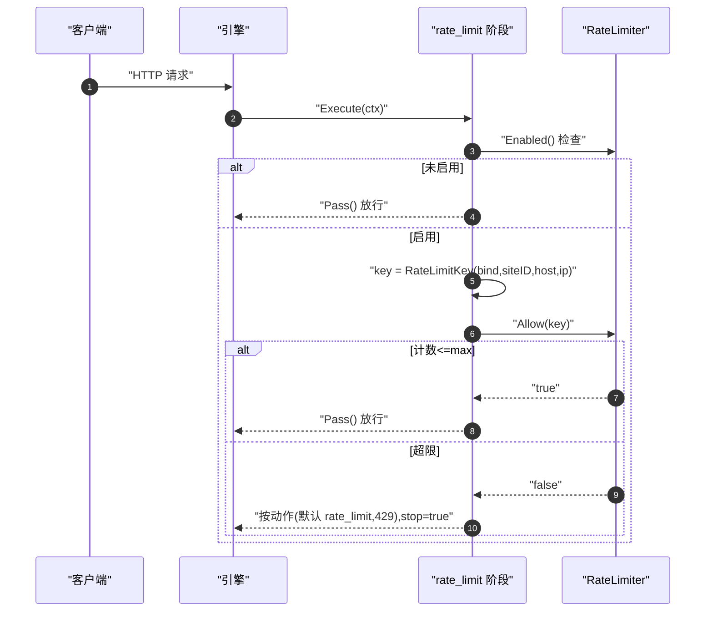
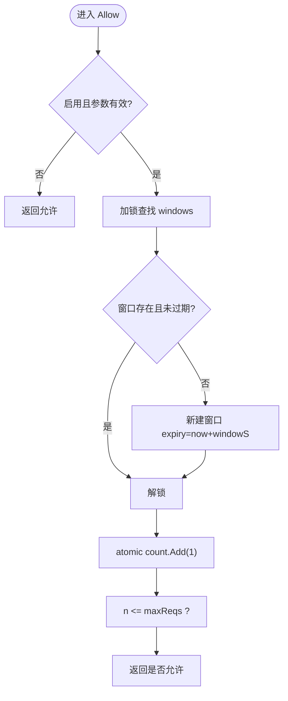
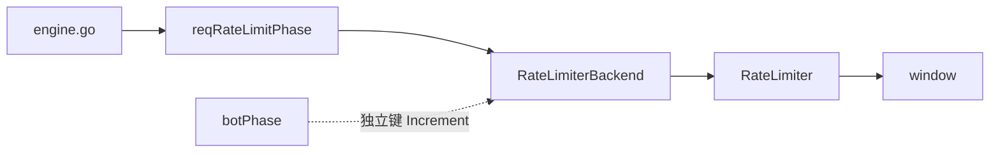

# 请求速率限制阶段

> [返回 WAF 引擎系统](../WAF 引擎系统.md)

<cite>
**本文档引用的文件**
- [ratelimit.go](file://internal/waf/ratelimit/ratelimit.go)
- [phases.go](file://internal/core/rules/phases.go)
- [engine.go](file://internal/core/engine/engine.go)
- [bot.go](file://internal/waf/bot/bot.go)
- [pipeline.go](file://internal/core/pipeline/pipeline.go)
- [action.go](file://internal/core/action/action.go)
</cite>

## 目录

1. [简介](#简介)
2. [项目结构](#项目结构)
3. [核心组件](#核心组件)
4. [架构总览](#架构总览)
5. [详细组件分析](#详细组件分析)
6. [依赖关系分析](#依赖关系分析)
7. [性能考虑](#性能考虑)
8. [故障排查指南](#故障排查指南)
9. [结论](#结论)
10. [附录](#附录)

## 简介
本文件系统解析 My-OpenWaf 的请求速率限制阶段（`rate_limit`）。它是全 11 阶段链的第 9 位（`... → bot_detection → browser_sign → rate_limit → signature → custom`，engine.go:465-548），位于浏览器签名校验之后、签名/自定义自建规则之前。文档围绕固定窗口算法的实现与并发安全展开，涵盖：`RateLimitKey` 如何按站点隔离、`reqRateLimitPhase.Execute` 如何判定超限并映射动作、`RateLimiter` 的互斥锁与原子计数、`Allow`/`Increment`/`IsOverLimit` 语义、`cleaner` 过期回收，以及配置项与默认值。

> 订正：限流计数键并非旧文档所述"客户端IP + Host"，而是 `RateLimitKey = bind|siteID|归一化Host|clientIP`（phases.go:63-70），确保不同监听器、不同站点互不挤占配额。

## 项目结构
请求速率限制位于 `internal/waf/ratelimit/ratelimit.go`，阶段实现在 `internal/core/rules/phases.go`，由引擎条件入链：

| 层 | 代表文件 | 核心符号 | 职责 |
|---|---|---|---|
| 限流算法 | [ratelimit.go](file://internal/waf/ratelimit/ratelimit.go) | `RateLimiter`、`window` | 固定窗口计数 |
| 引擎阶段 | [phases.go](file://internal/core/rules/phases.go) | `reqRateLimitPhase` | 超限判定与动作映射 |
| 引擎装配 | [engine.go](file://internal/core/engine/engine.go) | `getOrBuildPhases` | 条件入链 |

阶段相关符号（行号实读）：

| 符号 | 文件:行 | 签名 | 职责 |
|---|---|---|---|
| `reqRateLimitPhase` | phases.go:305-308 | struct{limiter,act} | 阶段载体 |
| `RateLimitKey` | phases.go:63-70 | `(bind,siteID,host,clientIP) string` | 站点隔离计数键 |
| `reqRateLimitPhase.Name` | phases.go:314 | `() string` | 返回 `"rate_limit"` |
| `reqRateLimitPhase.Execute` | phases.go:316-340 | `(ctx) (Result,bool)` | Allow 判定与动作 |
| `RateLimiter.Allow` | ratelimit.go:96-118 | `(key) bool` | 固定窗口放行判定 |

**图表来源**
- [engine.go:517-520](file://internal/core/engine/engine.go#L517-L520)
- [phases.go:305-340](file://internal/core/rules/phases.go#L305-L340)
- [ratelimit.go:9-118](file://internal/waf/ratelimit/ratelimit.go#L9-L118)

**章节来源**
- [phases.go:63-340](file://internal/core/rules/phases.go#L63-L340)
- [engine.go:517-520](file://internal/core/engine/engine.go#L517-L520)

## 核心组件
- `RateLimiter`：固定窗口限流器，按 `RateLimitKey` 计数，互斥锁保护窗口映射、原子计数递增（ratelimit.go:20-118）。
- `window`：单键窗口对象，含 `atomic.Int64 count` 与 `expiry`（unix 秒）（ratelimit.go:31-34）。
- `cleaner` 协程：每 30 秒扫描删除过期窗口（ratelimit.go:175-196）。
- `Allow`/`Increment`/`IsOverLimit`：请求通过判定、错误率计数、只读阈值检查（ratelimit.go:96-162）。

| 方法 | 位置 | 返回 | 副作用 |
|---|---|---|---|
| `Allow` | [ratelimit.go:96](file://internal/waf/ratelimit/ratelimit.go#L96) | 是否不超过 max | 计数 +1 |
| `Increment` | [ratelimit.go:121](file://internal/waf/ratelimit/ratelimit.go#L121) | 当前计数 | 计数 +1 |
| `IsOverLimit` | [ratelimit.go:144](file://internal/waf/ratelimit/ratelimit.go#L144) | 是否超限 | 无 |

**章节来源**
- [ratelimit.go:9-196](file://internal/waf/ratelimit/ratelimit.go#L9-L196)

## 架构总览
`getOrBuildPhases` 在 `prot.RequestRateLimitEnabled` 且 `deps.reqRateLimiter != nil` 时以 `action.Type(prot.RequestRateLimitAction)` 构造限流阶段入链（engine.go:517-520）。请求处理时序：

**图表来源**
- [phases.go:316-340](file://internal/core/rules/phases.go#L316-L340)
- [ratelimit.go:96-118](file://internal/waf/ratelimit/ratelimit.go#L96-L118)

**章节来源**
- [engine.go:517-520](file://internal/core/engine/engine.go#L517-L520)
- [phases.go:316-340](file://internal/core/rules/phases.go#L316-L340)

## 详细组件分析

### RateLimiter 结构体与并发安全
- 字段说明（ratelimit.go:20-34）：
  - `mu`：互斥锁，保护 `windows` 映射的读写。
  - `configMu`：`RWMutex`，保护配置读取与 `Reconfigure`。
  - `windows`：键（`RateLimitKey` 生成的不透明串）到 `window` 的内存映射。
  - `windowS` / `maxReqs`：窗口长度（秒）与窗口内最大请求数。
  - `enabled`：`atomic.Bool` 启用标志。
- 并发安全：`Allow`/`Increment` 先以 `configMu` 读配置，再用 `mu` 取/建窗口后立即解锁，最后 `atomic.Int64` 递增，临界区最小（ratelimit.go:96-141）。
- 构造防护：`NewRateLimiter` 在 `windowSec<=0 || maxReqs<=0` 时强制 `enabled=false`，避免 max=0 让首请求即 429（ratelimit.go:36-51）。

| 字段 | 类型 | 位置 | 说明 |
|---|---|---|---|
| `windows` | `map[string]*window` | [ratelimit.go:23](file://internal/waf/ratelimit/ratelimit.go#L23) | 键→窗口 |
| `enabled` | `atomic.Bool` | [ratelimit.go:26](file://internal/waf/ratelimit/ratelimit.go#L26) | 原子启用标志 |
| `window` | struct{atomic.Int64,int64} | [ratelimit.go:31-34](file://internal/waf/ratelimit/ratelimit.go#L31-L34) | 计数+过期 |

**章节来源**
- [ratelimit.go:20-51](file://internal/waf/ratelimit/ratelimit.go#L20-L51)
- [ratelimit.go:96-141](file://internal/waf/ratelimit/ratelimit.go#L96-L141)

### Allow 方法决策逻辑
`Allow` 流程（ratelimit.go:96-118）：
1) `rl==nil` 或未启用或 `windowS/maxReqs<=0` → 返回允许。
2) 取当前 unix 秒，加锁查找窗口；不存在或 `expiry<=now` 则新建 `window{expiry:now+windowS}`。
3) 解锁后 `count.Add(1)`，返回 `n <= maxReqs`。

键由 `reqRateLimitPhase.Execute` 用 `RateLimitKey(ctx.Bind, ctx.SiteID, ctx.Host, ctx.ClientIP)` 生成，形如 `bind|siteID|归一化Host|clientIP`（phases.go:320）。

**图表来源**
- [ratelimit.go:96-118](file://internal/waf/ratelimit/ratelimit.go#L96-L118)

**章节来源**
- [ratelimit.go:96-118](file://internal/waf/ratelimit/ratelimit.go#L96-L118)
- [phases.go:63-70](file://internal/core/rules/phases.go#L63-L70)

### 阶段超限动作映射
`reqRateLimitPhase.Execute`（phases.go:316-340）：`limiter==nil || !Enabled()` 或 `Allow` 为真 → `Pass()`；超限则取 `normalizeConfiguredAction(prot.RequestRateLimitAction)`，空值回落 `rate_limit`，并在动作为 `rate_limit` 时设 `StatusCode=429`，`stop=IsTerminal`。

| 配置动作 | 归一化 | 终端 | 状态码 |
|---|---|:--:|:--:|
| `rate_limit`（默认） | `rate_limit` | 是 | 429 |
| `intercept` | `intercept` | 是 | 403 |
| `drop` | `drop` | 是 | 无 |
| `observe` | `observe` | 否 | - |

**章节来源**
- [phases.go:316-340](file://internal/core/rules/phases.go#L316-L340)
- [phases.go:1301-1310](file://internal/core/rules/phases.go#L1301-L1310)

### Increment / IsOverLimit / Reconfigure
- `Increment`（ratelimit.go:121-141）：与 `Allow` 同窗口逻辑，返回当前计数，用于错误率统计与 bot 行为分。
- `IsOverLimit`（ratelimit.go:144-162）：只读检查 `count>maxReqs`，不改变计数。
- `Reconfigure`（ratelimit.go:80-94）：原子更新 windowS/maxReqs/enabled，非法参数强制禁用。

**章节来源**
- [ratelimit.go:80-162](file://internal/waf/ratelimit/ratelimit.go#L80-L162)

### cleaner 协程与过期清理机制
`cleaner` 每 30 秒用 `Ticker` 扫描 `windows`，删除 `expiry<=now` 的键；映射清空后置换新 map；`Close` 经 `closeOnce` 关闭 `stopCh` 优雅退出（ratelimit.go:164-196）。

**章节来源**
- [ratelimit.go:164-196](file://internal/waf/ratelimit/ratelimit.go#L164-L196)

### 配置项与后端契约
- `RateLimiterBackend` 接口由本地固定窗口与 Redis 滑动窗口两套实现共享：`Enabled/Reconfigure/Allow/Increment/IsOverLimit/Close`（ratelimit.go:10-17）。本地实现适合单机、延迟更低；Redis 实现适合分布式共享状态（属概念说明，本库以本地实现为准）。
- 引擎在 `prot.RequestRateLimitEnabled` 且后端非空时入链，动作取 `prot.RequestRateLimitAction`（engine.go:517-520）。
- Bot 行为分复用同一后端但带 `|bot` 后缀独立键，避免与限流计数互相干扰（phases.go:501-512、bot.go:649-663）。

| 配置项 | 来源 | 作用 |
|---|---|---|
| RequestRateLimitEnabled | `ProtectionConfig` | 是否入链（engine.go:517） |
| RequestRateLimitAction | `ProtectionConfig` | 超限动作（phases.go:518） |
| RequestRateLimitMax | `ProtectionConfig` | 窗口阈值，bot 行为分基准（engine.go:509） |

**章节来源**
- [ratelimit.go:10-17](file://internal/waf/ratelimit/ratelimit.go#L10-L17)
- [engine.go:503-520](file://internal/core/engine/engine.go#L503-L520)
- [phases.go:501-512](file://internal/core/rules/phases.go#L501-L512)

## 依赖关系分析
- 阶段耦合：`reqRateLimitPhase` 依赖 `RateLimiterBackend`（limiter 字段）与配置动作（phases.go:305-311）。
- 引擎装配：`getOrBuildPhases` 从 `phaseRuntimeConfig.reqRateLimiter` 注入后端，仅在启用且非空时入链（engine.go:517-520）。
- Bot 联动：bot 行为分借用同一后端但使用 `|bot` 独立键（phases.go:501-512）。
- 标准库依赖：`sync`、`sync/atomic`、`time`（ratelimit.go:3-7）。

| 依赖方 | 被依赖对象 | 证据 |
|---|---|---|
| engine → rate_limit | `NewReqRateLimitPhase` | [engine.go:517-520](file://internal/core/engine/engine.go#L517-L520) |
| rate_limit → RateLimiterBackend | `Enabled/Allow` | [phases.go:317-321](file://internal/core/rules/phases.go#L317-L321) |
| rate_limit → action | `normalizeConfiguredAction` | [phases.go:324-339](file://internal/core/rules/phases.go#L324-L339) |
| bot → 限流后端 | `Increment` 行为分 | [bot.go:649-663](file://internal/waf/bot/bot.go#L649-L663) |

**图表来源**
- [engine.go:517-520](file://internal/core/engine/engine.go#L517-L520)
- [phases.go:305-340](file://internal/core/rules/phases.go#L305-L340)
- [ratelimit.go:10-118](file://internal/waf/ratelimit/ratelimit.go#L10-L118)

**章节来源**
- [phases.go:305-340](file://internal/core/rules/phases.go#L305-L340)
- [engine.go:517-520](file://internal/core/engine/engine.go#L517-L520)

## 性能考虑
- 原子计数：`count.Add(1)` 无锁递增，降低竞争（ratelimit.go:116-117）。
- 最小临界区：仅在取/建窗口时加 `mu`，解锁后再原子操作（ratelimit.go:109-117）。
- 清理策略：30 秒周期回收过期窗口，平衡内存与 CPU（ratelimit.go:176）。
- 键隔离：`RateLimitKey` 含 bind 与 siteID，避免跨站点/跨监听器共享计数导致误限（phases.go:63-70）。
- 可扩展：`RateLimiterBackend` 抽象使本地与 Redis 实现可互换（ratelimit.go:10-17）。

## 故障排查指南
- 限流未生效：确认 `enabled`、`windowS/maxReqs>0`、键构造 `bind|siteID|host|clientIP`（phases.go:63-70）。
- 瞬时峰值误判：固定窗口在边界存在"桶破裂"，可增大窗口或结合其它策略。
- 内存增长：确认 `cleaner` 运行、`stopCh` 未提前关闭（ratelimit.go:164-196）。
- 调试：`IsOverLimit` 只读检查，`Reconfigure` 动态调参验证（ratelimit.go:80-162）。

| 症状 | 原因 | 排查点 |
|---|---|---|
| 首请求即 429 | maxReqs≤0 未拦住 | `NewRateLimiter` 强制禁用逻辑 |
| 限流跨站点串扰 | 键缺 siteID/bind | `RateLimitKey` 组装 |
| bot 阈值疑似减半 | 行为分共用限流键 | `|bot` 后缀独立键 |

**章节来源**
- [ratelimit.go:36-51](file://internal/waf/ratelimit/ratelimit.go#L36-L51)
- [ratelimit.go:164-196](file://internal/waf/ratelimit/ratelimit.go#L164-L196)
- [phases.go:63-70](file://internal/core/rules/phases.go#L63-L70)

## 结论
请求速率限制采用固定窗口算法，以 `RateLimitKey` 实现站点隔离，用原子计数与最小临界区保证高并发稳定。`RateLimiterBackend` 抽象兼容本地与分布式实现，`Reconfigure` 支持热重配。作为链上第 9 位，它在浏览器签名之后、自建规则之前控制频率，并向 bot 行为分供数。

## 附录

### 阶段属性速查
| 属性 | 取值 |
|---|---|
| 阶段名 | `rate_limit` |
| 注册位置 | [engine.go:517-520](file://internal/core/engine/engine.go#L517-L520) |
| 入链前置 | `prot.RequestRateLimitEnabled` 且后端非空 |
| 链上位置 | 第 9 位 |
| 计数键 | `bind|siteID|归一化Host|clientIP` |
| 默认超限动作 | `rate_limit`（429） |

**章节来源**
- [phases.go:63-70](file://internal/core/rules/phases.go#L63-L70)
- [engine.go:517-520](file://internal/core/engine/engine.go#L517-L520)

### 配置示例（概念）
- 基础防护：窗口 60 秒、最大 100 请求、动作 `intercept`。
- 进阶防护：窗口 60 秒、最大 300 请求、动作 `challenge`，配合 bot 行为分抬升可疑流量档位。

> 上述为运维建议示例，实际数值以管理端 `ProtectionConfig` 与代码默认值为准。

[本节为总结，无需特定文件来源]

### 性能测试与基准建议
- 测试场景建议
  - 单节点 QPS 压测：从 1000 QPS 逐步提升至 10000 QPS
  - 并发客户端压测：100-1000 个并发连接
  - 窗口边界测试：在窗口切换时刻的请求处理能力
  - 内存泄漏检测：运行 24 小时观察内存增长
- 监控指标
  - 请求成功率与错误率
  - 平均响应时间与 P95/P99 延迟
  - 内存使用量与 goroutine 数
  - 清理协程的执行频率

[本节为总结，无需特定文件来源]