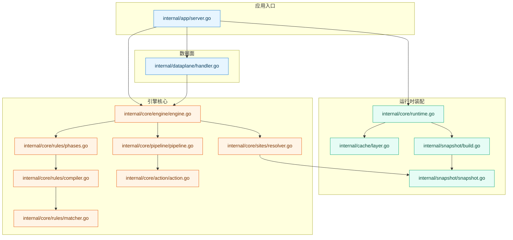
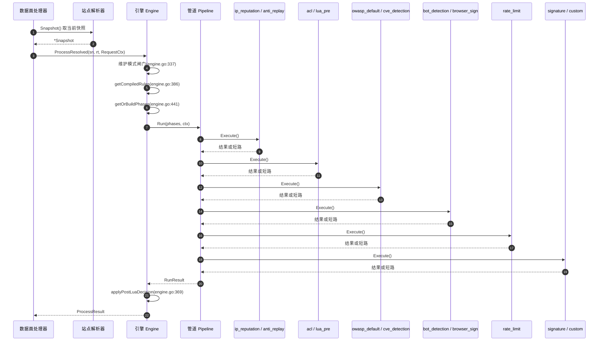
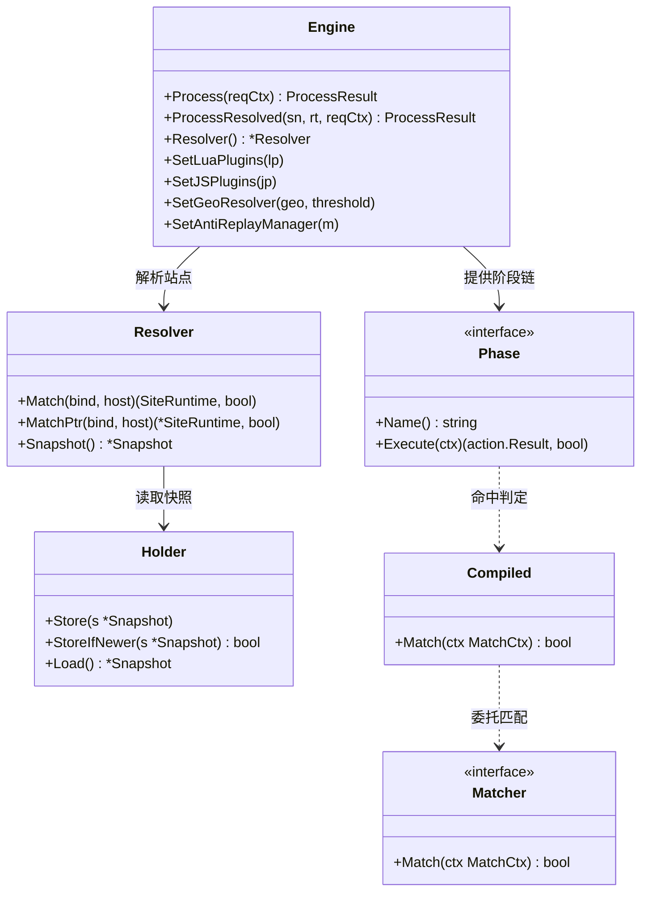

# 引擎核心架构

> [返回 WAF 引擎系统](../WAF 引擎系统.md)

<cite>
**本文档引用的文件**
- [engine.go](file://internal/core/engine/engine.go)
- [pipeline.go](file://internal/core/pipeline/pipeline.go)
- [pool.go](file://internal/core/pipeline/pool.go)
- [compiler.go](file://internal/core/rules/compiler.go)
- [matcher.go](file://internal/core/rules/matcher.go)
- [phases.go](file://internal/core/rules/phases.go)
- [lua_phase.go](file://internal/core/rules/lua_phase.go)
- [phase_skip.go](file://internal/core/rules/phase_skip.go)
- [snapshot.go](file://internal/snapshot/snapshot.go)
- [build.go](file://internal/snapshot/build.go)
- [resolver.go](file://internal/core/sites/resolver.go)
- [action.go](file://internal/core/action/action.go)
- [runtime.go](file://internal/core/runtime.go)
- [layer.go](file://internal/cache/layer.go)
- [protection.go](file://internal/store/protection.go)
- [server.go](file://internal/app/server.go)
- [handler.go](file://internal/dataplane/handler.go)
</cite>

## 目录

1. [简介](#简介)
2. [项目结构](#项目结构)
3. [核心组件](#核心组件)
4. [架构总览](#架构总览)
5. [详细组件分析](#详细组件分析)
6. [依赖关系分析](#依赖关系分析)
7. [性能考虑](#性能考虑)
8. [故障排查指南](#故障排查指南)
9. [结论](#结论)
10. [附录](#附录)

## 简介
本文件面向引擎核心架构，系统化阐述 WAF 引擎 Engine 的设计与实现，重点覆盖以下方面：
- 站点解析器：基于快照的站点匹配与路由
- 规则编译器：规则 DSL 到可执行匹配器的转换
- 管道执行器：阶段链的构建、执行顺序与短路机制
- 快照系统：配置不可变性与热重载
- 请求处理全流程：从站点匹配到最终动作决策
- 性能优化策略与故障排查

目标是帮助读者在不深入源码细节的前提下，理解引擎如何以“快照 + 缓存 + 管道”的方式实现高吞吐、低延迟、可热重载的 WAF 处理。

## 项目结构
引擎相关的核心模块分布如下：

| 模块路径 | 职责 | 核心符号 | 规模(行) | 对外暴露 |
|---|---|---|---:|---|
| `internal/core/engine` | 请求编排、两级缓存、阶段链装配 | `Engine`、`New`、`Process` | 646 | `Engine.Process`、`Engine.ProcessResolved` |
| `internal/core/pipeline` | 阶段接口、请求上下文、链执行 | `Phase`、`Run`、`RequestCtx` | 678 | `pipeline.Run`、`AcquireCtx` |
| `internal/core/rules` | 规则 DSL 编译、匹配器、各检测阶段 | `Compile`、`Matcher`、`*Phase` | 4048 | `rules.New*Phase`、`rules.Compile` |
| `internal/snapshot` | 不可变配置视图与构建 | `Snapshot`、`SiteRuntime`、`Holder` | 3071 | `snapshot.Build`、`Holder.Load` |
| `internal/core/sites` | 绑定地址 + Host 到站点的解析 | `Resolver` | 44 | `Resolver.Match`、`Resolver.Snapshot` |
| `internal/core/action` | 动作类型、判定结果、优先级 | `Type`、`Result`、`TerminalPriority` | 393 | `action.Result`、`action.Normalize` |
| `internal/core/runtime.go` | 进程级运行时与快照重载 | `Runtime`、`ReloadSnapshot` | 313 | `core.NewRuntime`、`Runtime.ReloadSnapshot` |
| `internal/cache/layer.go` | 进程内快照缓存（ristretto） | `Layer` | 70 | `Layer.GetSnapshot`、`Layer.SetSnapshot` |
| `internal/dataplane` | 数据面入口与引擎调用 | `Handler` | 8836 | `dataplane.Handler` |

**图表来源**
- [engine.go:82-127](file://internal/core/engine/engine.go#L82-L127)
- [pipeline.go:276-280](file://internal/core/pipeline/pipeline.go#L276-L280)
- [compiler.go:39-78](file://internal/core/rules/compiler.go#L39-L78)
- [matcher.go:20-23](file://internal/core/rules/matcher.go#L20-L23)
- [phases.go:131-192](file://internal/core/rules/phases.go#L131-L192)
- [snapshot.go:213-287](file://internal/snapshot/snapshot.go#L213-L287)
- [build.go:47-51](file://internal/snapshot/build.go#L47-L51)
- [resolver.go:10-44](file://internal/core/sites/resolver.go#L10-L44)
- [action.go:5-26](file://internal/core/action/action.go#L5-L26)
- [runtime.go:23-34](file://internal/core/runtime.go#L23-L34)
- [layer.go:24-39](file://internal/cache/layer.go#L24-L39)
- [server.go:395-401](file://internal/app/server.go#L395-L401)
- [handler.go:39-141](file://internal/dataplane/handler.go#L39-L141)

**章节来源**
- [engine.go:82-127](file://internal/core/engine/engine.go#L82-L127)
- [runtime.go:23-34](file://internal/core/runtime.go#L23-L34)
- [server.go:395-401](file://internal/app/server.go#L395-L401)

## 核心组件
下表为引擎侧组件清单（职责单一、边界清晰）：

| 组件 | 位置 | 职责 | 关键依赖 | 可观测点 |
|---|---|---|---|---|
| 引擎 `Engine` | `engine.go:83-113` | 编排解析→编译→阶段链→执行 | `Resolver`、`Holder`、`ratelimit` | `ProcessResult` |
| 管道 `Run` | `pipeline.go:517-560` | 顺序执行阶段、短路与挑战延迟 | `Phase`、`action.Result` | `RunResult.ObserveHits` |
| 规则编译器 | `compiler.go:40-78` | DSL 串转排序后的 `Compiled` | `store.Rule`、`Matcher` | 编译失败降级为 `neverMatcher` |
| 匹配器集合 | `matcher.go:21-23`、`1473` | 单条件命中判定 | `MatchCtx` | 命中 `RuleIDStr` |
| 快照 `Snapshot` | `snapshot.go:213-287` | 不可变配置视图 | `SiteRuntime` | `Revision` |
| 持有器 `Holder` | `snapshot.go:453-489` | 原子发布与读取快照 | `atomic.Pointer` | `StoreIfNewer` 返回值 |
| 站点解析器 | `resolver.go:10-44` | 按当前快照解析 (bind, host) | `Holder` | 命中的 `SiteRuntime` |

**章节来源**
- [engine.go:83-113](file://internal/core/engine/engine.go#L83-L113)
- [pipeline.go:517-560](file://internal/core/pipeline/pipeline.go#L517-L560)
- [compiler.go:40-78](file://internal/core/rules/compiler.go#L40-L78)
- [matcher.go:21-23](file://internal/core/rules/matcher.go#L21-L23)
- [snapshot.go:213-287](file://internal/snapshot/snapshot.go#L213-L287)
- [resolver.go:10-44](file://internal/core/sites/resolver.go#L10-L44)

## 架构总览
引擎以“快照 + 缓存 + 管道”为核心设计，分层与依赖方向如下：

| 层 | 组成 | 核心职责 | 允许依赖 | 禁止依赖 | 代表位置 |
|---|---|---|---|---|---|
| 接入层 | 数据面监听器与中间件 | 协议解析、请求上下文构造 | 引擎层 | 直接读数据库 | `internal/dataplane/handler.go:39` |
| 编排层 | `Engine` | 解析站点、取缓存、跑管道 | 快照层、规则层 | 接入层对象 | `internal/core/engine/engine.go:551` |
| 执行层 | `pipeline` + 各 `Phase` | 顺序判定与短路 | 动作层、WAF 能力包 | 快照写路径 | `internal/core/pipeline/pipeline.go:517` |
| 配置层 | `Snapshot`/`Holder`/`Layer` | 不可变视图与原子切换 | `store` 模型 | 请求期反查 DB | `internal/snapshot/snapshot.go:453` |
| 构建层 | `Build`/`Runtime.ReloadSnapshot` | DB→快照一次性解析编译 | `store`、`cache` | 请求热路径 | `internal/snapshot/build.go:47` |

- 快照：从数据库构建不可变配置视图，通过 `Holder.StoreIfNewer` 原子替换（`snapshot.go:474-487`）
- 编译缓存：键为 `{siteID, policyID}`，以快照 `Revision` 为代次守卫（`engine.go:34-42`）
- 阶段缓存：键为 `{policyID, siteID, antiReplayEnabled}`，另需匹配防护配置指针、Lua 引擎与 Lua 代次（`engine.go:60-64`、`461`）
- 管道执行：严格顺序执行，终端动作短路、挑战类延迟比较（`pipeline.go:517-560`）

**图表来源**
- [engine.go:331-378](file://internal/core/engine/engine.go#L331-L378)
- [engine.go:441-548](file://internal/core/engine/engine.go#L441-L548)
- [pipeline.go:517-560](file://internal/core/pipeline/pipeline.go#L517-L560)
- [handler.go:529-529](file://internal/dataplane/handler.go#L529-L529)

**章节来源**
- [engine.go:331-378](file://internal/core/engine/engine.go#L331-L378)
- [pipeline.go:517-560](file://internal/core/pipeline/pipeline.go#L517-L560)
- [snapshot.go:474-487](file://internal/snapshot/snapshot.go#L474-L487)

## 详细组件分析

### 引擎 Engine 设计与职责
- 职责边界
  - 站点解析：`Process` 内部经 `resolver.Snapshot()` 取快照，再调 `MatchSitePtr`（`engine.go:551-562`）
  - 规则编译：`getCompiledRules` 按 `{siteID, policyID}` 缓存 `*compiledRules`（`engine.go:386-431`）
  - 阶段构建：`getOrBuildPhases` 按站点有效保护配置动态组装阶段链（`engine.go:441-548`）
  - 管道执行：调用 `pipeline.Run` 执行阶段链，返回最终动作（`engine.go:363`）
  - 辅助能力：IP 信誉、GeoIP 阈值、CVE 检测器、防重放、分级升级挂载点（`engine.go:161-215`、`603-621`）

- 关键数据结构

| 符号 | 定义位置 | 签名/字段 | 职责 |
|---|---|---|---|
| `Engine` | `engine.go:83-113` | `struct{resolver; phaseDeps atomic.Pointer; compiledPtr; phasesPtr; luaPlugins; jsPlugins}` | 编排入口与缓存宿主 |
| `compiledRules` | `engine.go:26-30` | `ACL / Signature / Custom []rules.Compiled` | 按阶段分区的已编译规则 |
| `compiledRulesKey` | `engine.go:34-37` | `{siteID, policyID uint}` | 编译缓存键 |
| `phasesCacheKey` | `engine.go:60-64` | `{policyID, siteID uint; antiReplayEnabled bool}` | 阶段链缓存键 |
| `phasesEntry` | `engine.go:52-58` | `{prot, lua, luaRevision, deps, phases}` | 缓存条目与有效性判据 |
| `phaseRuntimeConfig` | `engine.go:75-80` | `{reqRateLimiter, antiReplay, geoResolver, botThreshold}` | 阶段链依赖的不可变打包体 |
| `ProcessResult` | `engine.go:324-329` | `{Action, Site, ObserveHits, Maintenance}` | 单次请求最终输出 |

- 并发模型：读侧一律 `atomic.Pointer.Load()`，无锁；写侧由 `compiledWriteMu`/`phasesWriteMu` 串行化后做写时复制再 `Store`（`engine.go:98-103`、`413-428`、`532-545`）。运行时依赖（限流后端、防重放、GeoIP、bot 阈值）通过 `updatePhaseDeps` 的 CAS 循环整体原子替换（`engine.go:146-158`）。

- 维护模式与短路：全局 `Protection.MaintenanceGlobalEnabled` 或站点 `rt.MaintenanceEnabled` 命中时，直接返回 `intercept` 且 `Maintenance=true`，不进入管道（`engine.go:337-348`）。

**章节来源**
- [engine.go:26-113](file://internal/core/engine/engine.go#L26-L113)
- [engine.go:146-158](file://internal/core/engine/engine.go#L146-L158)
- [engine.go:324-378](file://internal/core/engine/engine.go#L324-L378)
- [engine.go:386-548](file://internal/core/engine/engine.go#L386-L548)
- [engine.go:551-562](file://internal/core/engine/engine.go#L551-L562)

### 阶段链注册顺序
`getOrBuildPhases` 按下列顺序装配链，容量预分配 11（`engine.go:467`）。仅当对应开关或依赖满足时才入链：

| 序 | 阶段名 | 构造函数 | 注册位置 | 入链条件 | 可否路径跳过 |
|:--:|---|---|---|---|:--:|
| 1 | `ip_reputation` | `rules.NewIPReputationPhase` | `engine.go:479-481` | `e.ipRep != nil` | 是 |
| 2 | `anti_replay` | `rules.NewAntiReplayPhase` | `engine.go:482-484` | 已挂载管理器且 `rt.AntiReplayEnabled` | 是 |
| 3 | `acl` | `rules.NewACLPhasePrecompiled` | `engine.go:486-488` | `len(cr.ACL) > 0` | 是 |
| 4 | `lua_pre` | `rules.NewLuaPhase(StagePre)` | `engine.go:492-494` | Lua 引擎存在 pre 脚本 | 是 |
| 5 | `owasp_default` | `rules.NewOWASPPhase` | `engine.go:496-498` | `prot.OWASPEnabled` | 是 |
| 6 | `cve_detection` | `rules.NewCVEPhase` | `engine.go:499-501` | `prot.CVEEnabled` 且检测器非空 | 是 |
| 7 | `bot_detection` | `rules.NewBotPhaseWithGeoAndLimiter` | `engine.go:503-510` | `prot.BotDetectionEnabled` | 是 |
| 8 | `browser_sign` | `rules.NewBrowserSignPhase` | `engine.go:513-515` | `prot.BrowserSignEnabled` | 是 |
| 9 | `rate_limit` | `rules.NewReqRateLimitPhase` | `engine.go:517-520` | 开关开启且限流后端非空 | 是 |
| 10 | `signature` | `rules.NewSignaturePhasePrecompiled` | `engine.go:524-526` | `len(cr.Signature) > 0` | 否 |
| 11 | `custom` | `rules.NewCustomPhasePrecompiled` | `engine.go:527-529` | `len(cr.Custom) > 0` | 否 |

- `lua_post` 不是链上阶段：管道遇终止动作即返回，链尾阶段读不到「已被拦截」的判定，因此后置脚本在 `Run` 之后执行（`engine.go:366-371`、`234-322`）。
- 「可否路径跳过」取 `store.SkipPathPhaseKeys()` 的白名单（`protection.go:326-336`）；配置了跳过路径的阶段会被 `rules.NewSkipByPathPhase` 包一层装饰器（`engine.go:471-477`、`phase_skip.go:31-49`）。
- `signature` 与 `custom` 属用户自建规则，停用规则本身即可，不参与按路径跳过，故直接 `append` 而不走 `addPhase`（`engine.go:522-529`）。

**章节来源**
- [engine.go:467-529](file://internal/core/engine/engine.go#L467-L529)
- [engine.go:366-371](file://internal/core/engine/engine.go#L366-L371)
- [phase_skip.go:19-49](file://internal/core/rules/phase_skip.go#L19-L49)
- [protection.go:326-336](file://internal/store/protection.go#L326-L336)

### 管道执行器 Pipeline
- 接口与数据结构
  - `Phase` 接口：`Name() string` 与 `Execute(ctx *RequestCtx) (action.Result, bool)`（`pipeline.go:277-280`）
  - `RunResult`：`{Action, ObserveHits}`（`pipeline.go:494-497`）
  - `RequestCtx`：承载请求解码数据与各类每请求缓存（`pipeline.go:15-100`）

- 执行语义（`pipeline.go:517-560`）

| 情形 | 阶段返回 | 管道行为 |
|---|---|---|
| 未命中 | `stop=false`，`Matched=false` | 进入下一阶段 |
| 观察命中 | `stop=false`，需记日志且非终端 | 追加进 `ObserveHits`，继续 |
| 非终端短路 | `stop=true` 且非挑战 | 立即返回该结果 |
| 挑战短路 | `stop=true` 且为挑战 | 暂存，继续执行后续阶段 |
| Drop | `Matched && IsDrop()` | 立即返回，不再评估 |
| 其他终端 | `IsTerminal()` 且非挑战 | 立即返回 |

- 终端优先级取自 `action.TerminalPriority`（`action.go:88-119`）：`drop=90 > intercept=80 > rate_limit=70 > 挑战族=60 > redirect=50 > observe=10`，仅当更高优先级时才替换已暂存的挑战。
- 热路径优化：`Run` 直接遍历阶段切片，不额外分配 `Pipeline` 包装（`pipeline.go:508-517`）；观察命中复用 `ctx.observeHitsBuf`，避免每请求分配（`pipeline.go:518`、`pool.go:25`）。管道本身无锁，阶段链为每请求只读切片。

**章节来源**
- [pipeline.go:276-280](file://internal/core/pipeline/pipeline.go#L276-L280)
- [pipeline.go:494-560](file://internal/core/pipeline/pipeline.go#L494-L560)
- [action.go:88-119](file://internal/core/action/action.go#L88-L119)
- [pool.go:19-28](file://internal/core/pipeline/pool.go#L19-L28)

### 规则编译器与匹配器
- 编译流程
  - `ParsePattern`：从 `block_ip:1.2.3.0/24` 之类 DSL 串取 `kind`/`arg`，以 `{` 开头判为 `compound`（`compiler.go:146-170`）
  - `Compile`：过滤停用规则、校验模式、构建 `matcher`，按 `Priority` 升序、`ID` 升序排序（`compiler.go:40-78`）
  - `buildMatcher`：按 `kind` 生成具体匹配器实例（`matcher.go:1473`）

- 匹配器体系

| 类别 | 代表实现 | 位置 |
|---|---|---|
| 网络 | `ipCIDRMatcher` | `matcher.go:317-321` |
| 路径 | `pathPrefixMatcher`、`pathRegexMatcher`、`exactPathMatcher`、`pathWildcardMatcher` | `matcher.go:323-333`、`457-461`、`1422-1428` |
| 查询 | `queryContainsMatcher`、`queryParamMatcher`、`queryParamRegexMatcher` | `matcher.go:335-345`、`670-761` |
| 请求头 | `headerExactMatcher`、`headerContainsMatcher`、`headerRegexMatcher`、`headerWildcardMatcher` | `matcher.go:347-366`、`452-455`、`1462-1471` |
| 主机与 URL | `hostMatcher`、`hostRegexMatcher`、`fullURLContainsMatcher` | `matcher.go:817-826`、`953-962`、`995-1007` |
| 主体 | `bodyContainsMatcher`、`bodyRegexMatcher`、`bodyJSONPathMatcher`、`multipartMatcher` | `matcher.go:510-592`、`600-602` |
| TLS 指纹 | `tlsFingerprintMatcher`、`tlsCipherSuitesMatcher` | `matcher.go:381-422` |
| 地理 | `geoBlockMatcher` | `matcher.go:653-668` |
| 复合 | `andMatcher`、`orMatcher`、`notMatcher`、`ifElseMatcher`、`ccRateMatcher` | `matcher.go:281-315`、`488-502`、`25-47` |

- 正则缓存：包级 `regexCache`（`sync.RWMutex` + map）由 `cachedCompile` 读写（`matcher.go:1785-1808`）。
- 匹配输入统一为 `MatchCtx`（`phases.go:33-52`），由 `fillMatchCtxFromPipeline` 从 `RequestCtx` 派生，仅在规则需要时才拼接 ALPN / 密码套件 / 头顺序（`phases.go:72-104`）。
- 校验失败降级：`validateParsedPattern` 返回非空错误时，匹配器被置为 `neverMatcher`，规则保留但永不命中（`compiler.go:50-53`、`validate.go:36`）。

**章节来源**
- [compiler.go:40-78](file://internal/core/rules/compiler.go#L40-L78)
- [compiler.go:144-170](file://internal/core/rules/compiler.go#L144-L170)
- [matcher.go:317-471](file://internal/core/rules/matcher.go#L317-L471)
- [matcher.go:670-761](file://internal/core/rules/matcher.go#L670-L761)
- [matcher.go:1785-1808](file://internal/core/rules/matcher.go#L1785-L1808)
- [phases.go:33-104](file://internal/core/rules/phases.go#L33-L104)
- [validate.go:36-36](file://internal/core/rules/validate.go#L36-L36)

### 快照系统与热重载
- 不可变快照
  - `Snapshot`：站点映射 `map[string]*SiteRuntime`、页面配置、SNI 证书映射、全局 `Protection`（`snapshot.go:213-287`）
  - `Holder`：`atomic.Pointer[Snapshot]`，提供 `Store`/`StoreIfNewer`/`Load`（`snapshot.go:453-489`）
  - `MatchSite`：精确 → 通配（`*.` 父域，非 IP）→ catch-all 键 `*` 三级回退（`snapshot.go:337-362`）

- 快照构建
  - `Build`：一次性读取站点、策略、监听器、证书、规则、系统设置并编译（`build.go:47-217`）
  - `registerSiteKeys`：按逗号拆分站点 Host，为每个 (bind, host) 生成映射键；不同站点冲突直接返回错误（`build.go:787-804`）
  - 合并保护：站点字段覆盖全局配置，形成每站点 `EffectiveProtection`（`snapshot.go:95`、`build.go:762-768`）

- 热重载
  - `Runtime.ReloadSnapshot` → `ReloadSnapshotWithPrePublish`：读当前修订号，优先命中 `cache.Layer`，否则 `snapshot.Build` 后写缓存并 `StoreIfNewer`（`runtime.go:201-274`）
  - 修订号来源 `config_revisions` 单行表，`store.BumpRevision` 递增（`store/migrate.go:141-150`、`server.go:1006`）

**章节来源**
- [snapshot.go:213-287](file://internal/snapshot/snapshot.go#L213-L287)
- [snapshot.go:337-362](file://internal/snapshot/snapshot.go#L337-L362)
- [snapshot.go:453-489](file://internal/snapshot/snapshot.go#L453-L489)
- [build.go:47-217](file://internal/snapshot/build.go#L47-L217)
- [build.go:762-804](file://internal/snapshot/build.go#L762-L804)
- [runtime.go:201-289](file://internal/core/runtime.go#L201-L289)
- [migrate.go:141-150](file://internal/store/migrate.go#L141-L150)
- [server.go:1006-1006](file://internal/app/server.go#L1006-L1006)

### 站点解析器
- `Resolver` 仅 44 行，是 `Holder` 的薄封装：`Match` 返回 `SiteRuntime` 值拷贝，`MatchPtr` 返回零拷贝指针，`Snapshot` 直接暴露当前快照（`resolver.go:24-44`）。
- 匹配算法不是前缀树：站点映射是哈希表，键为 `bind + NUL + 规范化 host`（`snapshot.go:294-296`），逐级尝试精确、`*.` 父域、catch-all 三张固定键（`snapshot.go:337-362`）。
- 引擎的 `Process` 走的是 `sn.MatchSitePtr`，而数据面 `Handler` 走 `sn.MatchSite`（`engine.go:557`、`handler.go:141`）。

**章节来源**
- [resolver.go:10-44](file://internal/core/sites/resolver.go#L10-L44)
- [snapshot.go:294-296](file://internal/snapshot/snapshot.go#L294-L296)
- [snapshot.go:337-398](file://internal/snapshot/snapshot.go#L337-L398)
- [engine.go:551-562](file://internal/core/engine/engine.go#L551-L562)
- [handler.go:141-163](file://internal/dataplane/handler.go#L141-L163)

### 请求处理全流程
- 初始化

| 步 | 动作 | 执行位置 | 输入 | 输出 | 失败分支 |
|:--:|---|---|---|---|---|
| 1 | 构建运行时 | `runtime.go:36` | 环境变量与库内覆盖 | `Runtime` | 返回 error |
| 2 | 首次加载快照 | `runtime.go:201` | `DB`、修订号 | `Holder` 内快照 | 构建失败终止 |
| 3 | 创建引擎 | `server.go:395` | `Holder`、限流后端、IP 信誉 | `*Engine` | — |
| 4 | 挂载 Lua 引擎 | `server.go:400-401` | RedisKV、logger | 插件可用 | 记录日志 |

- 请求处理

| 步 | 动作 | 执行位置 | 输入 | 输出 | 可观测点 |
|:--:|---|---|---|---|---|
| 1 | 取快照 | `handler.go:119-127` | `Holder` | `*Snapshot` | 未加载返回 503 |
| 2 | 站点匹配 | `handler.go:141` | bind、Host | `SiteRuntime` | 未匹配写欢迎页 |
| 3 | 解析客户端 IP | `handler.go:170` | XFF 模式、受信网段 | `net.IP` | 指标 `RecordClientIP` |
| 4 | 构造上下文 | `handler.go:340-385` | Hertz 请求 | `*RequestCtx` | Body 上限 48 KB |
| 5 | 维护闸门 | `engine.go:337-348` | `Protection`、`rt` | `intercept` | `ProcessResult.Maintenance` |
| 6 | 取编译规则 | `engine.go:386-431` | `rt.Rules`、Revision | `*compiledRules` | 缓存命中/未命中 |
| 7 | 取阶段链 | `engine.go:441-548` | 有效保护配置 | `[]Phase` | 缓存条目判据 |
| 8 | 执行管道 | `pipeline.go:517-560` | 阶段链、`ctx` | `RunResult` | `ObserveHits` |
| 9 | 后置 Lua | `engine.go:369-371` | 内置判定 | 最终判定 | `lua_post` 阶段名 |
| 10 | 回写响应 | `handler.go:529-533` | `ProcessResult` | 阻断/转发 | 访问日志 |

- 配置更新
  - 控制面触发 reload：`store.BumpRevision` 递增修订号、重建快照、原子发布、协调监听器（`server.go:1006`、`runtime.go:211-274`）
  - 其他节点经 Redis 订阅收到通知后各自重建本地快照

**章节来源**
- [runtime.go:36-203](file://internal/core/runtime.go#L36-L203)
- [server.go:395-401](file://internal/app/server.go#L395-L401)
- [handler.go:119-385](file://internal/dataplane/handler.go#L119-L385)
- [engine.go:331-378](file://internal/core/engine/engine.go#L331-L378)
- [migrate.go:141-150](file://internal/store/migrate.go#L141-L150)

## 依赖关系分析

**图表来源**
- [engine.go:83-127](file://internal/core/engine/engine.go#L83-L127)
- [engine.go:551-601](file://internal/core/engine/engine.go#L551-L601)
- [resolver.go:10-44](file://internal/core/sites/resolver.go#L10-L44)
- [snapshot.go:453-489](file://internal/snapshot/snapshot.go#L453-L489)
- [pipeline.go:276-280](file://internal/core/pipeline/pipeline.go#L276-L280)
- [compiler.go:12-37](file://internal/core/rules/compiler.go#L12-L37)
- [matcher.go:20-23](file://internal/core/rules/matcher.go#L20-L23)

内部依赖矩阵（`↓ 调用方 / 被调方 →`，`✓` 存在依赖，`—` 无依赖）：

| 调用方 ↓ / 被调方 → | sites | snapshot | pipeline | rules | action | cache | store |
|---|:---:|:---:|:---:|:---:|:---:|:---:|:---:|
| engine | ✓ | ✓ | ✓ | ✓ | ✓ | — | ✓ |
| sites | — | ✓ | — | — | — | — | — |
| rules | — | ✓ | ✓ | — | ✓ | — | ✓ |
| pipeline | — | — | — | — | ✓ | — | — |
| snapshot | — | — | — | — | — | — | ✓ |
| cache | — | ✓ | — | — | — | — | — |

依赖方向严格自上而下：`snapshot`、`pipeline`、`sites` 均不反向依赖 `engine`，`action` 不依赖任何引擎侧包，故无循环依赖与跨层反向依赖。

**章节来源**
- [engine.go:8-23](file://internal/core/engine/engine.go#L8-L23)
- [resolver.go:3-5](file://internal/core/sites/resolver.go#L3-L5)
- [pipeline.go:3-12](file://internal/core/pipeline/pipeline.go#L3-L12)
- [compiler.go:3-10](file://internal/core/rules/compiler.go#L3-L10)
- [snapshot.go:3-17](file://internal/snapshot/snapshot.go#L3-L17)
- [layer.go:10-16](file://internal/cache/layer.go#L10-L16)

## 性能考虑
- 编译与缓存
  - 规则编译昂贵，按 `{siteID, policyID}` 与快照代次缓存；revision 变化时整表重建（`engine.go:386-431`）
  - 阶段链同样缓存，命中判据含保护配置指针、Lua 引擎、Lua 代次与依赖打包体指针（`engine.go:461`）
- 管道执行
  - `Run` 直接遍历切片、复用观察缓冲，避免每请求分配（`pipeline.go:517-518`）
  - 终端优先级比较与挑战延迟在热路径内完成，无额外数据结构（`pipeline.go:533-552`）
- 匹配器优化
  - 全局正则编译缓存（`matcher.go:1791-1808`）
  - `MatchCtx` 的派生请求头（ALPN、密码套件、头顺序）按 `needsDerivedHeaders` 惰性计算并缓存（`phases.go:72-104`、`pipeline.go:232-257`）
- 上下文复用
  - `RequestCtx` 经 `sync.Pool` 复用，超过容量上限时重建，避免峰值后 RSS 不回落（`pool.go:12-17`、`37-113`）
- 快照与热重载
  - 快照不可变、原子替换，读路径零锁（`snapshot.go:453-489`）
  - 同修订号快照命中 ristretto 缓存，避免重复构建（`layer.go:44-62`、`runtime.go:223-245`）

[本节为总结，无需特定文件来源]

## 故障排查指南

| 症状 | 可能原因 | 排查方向 | 处置方案 |
|---|---|---|---|
| 全部请求返回维护页 | 全局或站点维护开关开启 | `engine.go:337-348` 读取的 `MaintenanceGlobalEnabled`/`rt.MaintenanceEnabled` | 关闭开关并重载快照 |
| 规则改动不生效 | 阶段链缓存仍指向旧保护配置指针 | `engine.go:461` 的 `entry.prot == prot` 判据 | 确认新快照已 `StoreIfNewer` 成功 |
| Lua 脚本改动不生效 | 快照代次未变导致缓存未失效 | `engine.go:452-461` 的 `luaRevision` | 核对 `luaplugin.Engine.Revision()` 是否递增 |
| 高 CPU | 缓存未命中反复编译规则 | `engine.go:398-410` 的编译分支 | 减少站点级差异化配置、稳定修订号 |
| 动作与预期不符 | 挑战延迟与终端优先级覆盖 | `pipeline.go:529-552`、`action.go:88-119` | 核对命中阶段与优先级数值 |
| 观察命中缺失 | 动作 `ShouldLog()` 为假 | `action.go:261-272` | 用 `observe` 或终端动作复测 |
| 站点无法匹配 | Host 规范化与键空间不匹配 | `snapshot.go:337-398`、`handler.go:141` | 检查 bind 与 Host 配置 |

**章节来源**
- [engine.go:337-461](file://internal/core/engine/engine.go#L337-L461)
- [pipeline.go:529-552](file://internal/core/pipeline/pipeline.go#L529-L552)
- [action.go:88-119](file://internal/core/action/action.go#L88-L119)
- [action.go:261-272](file://internal/core/action/action.go#L261-L272)
- [handler.go:141-163](file://internal/dataplane/handler.go#L141-L163)

## 结论
引擎通过“快照 + 编译缓存 + 阶段缓存 + 管道执行”的组合，实现了高吞吐、低延迟、可热重载的 WAF 处理框架。其关键优势在于：
- 不可变快照与 `StoreIfNewer` 保证一致性与原子切换
- 两级缓存以原子指针读取、写时复制发布，热路径无锁
- 管道短路与挑战延迟机制兼顾安全强度与用户体验
- 阶段链按站点有效配置动态装配，能力开关互不影响

[本节为总结，无需特定文件来源]

## 附录

### 动作取值速查

| 动作 | 常量 | 终端优先级 | 默认状态码 | 是否终止管道 |
|---|---|:---:|:---:|:---:|
| `allow` | `action.Allow` | 0 | 0 | 否 |
| `observe` | `action.Observe` | 10 | 0 | 否 |
| `redirect` | `action.Redirect` | 50 | 302 | 是 |
| `challenge` 及三类进阶挑战 | `action.Challenge` 等 | 60 | 403 | 是（可被更高优先级覆盖） |
| `rate_limit` | `action.RateLimit` | 70 | 429 | 是 |
| `intercept` | `action.Intercept` | 80 | 403 | 是 |
| `drop` | `action.Drop` | 90 | 0 | 是（立即关闭 TCP） |

**章节来源**
- [action.go:8-26](file://internal/core/action/action.go#L8-L26)
- [action.go:88-119](file://internal/core/action/action.go#L88-L119)
- [action.go:284-307](file://internal/core/action/action.go#L284-L307)

### 关键实现索引
- 编排入口：`engine.go:331-378`
- 阶段装配：`engine.go:441-548`
- 管道执行：`pipeline.go:517-560`
- 规则编译：`compiler.go:40-78`
- 快照构建：`build.go:47-217`
- 热重载：`runtime.go:211-274`

[本节为总结，无需特定文件来源]