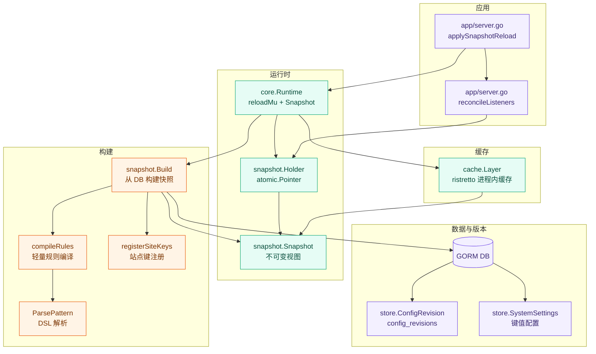
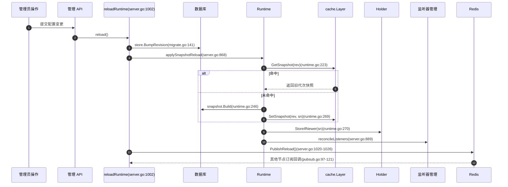
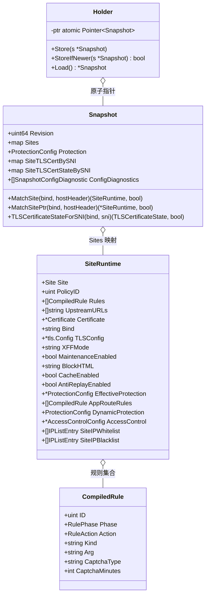
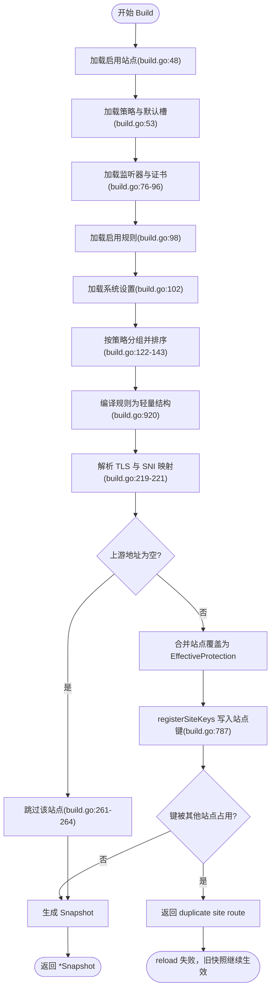
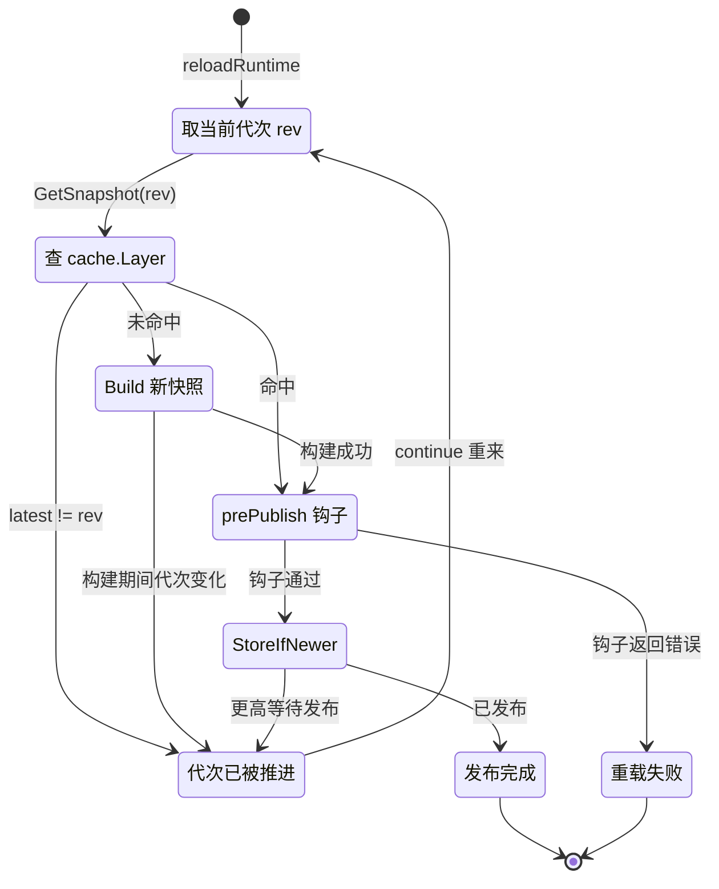
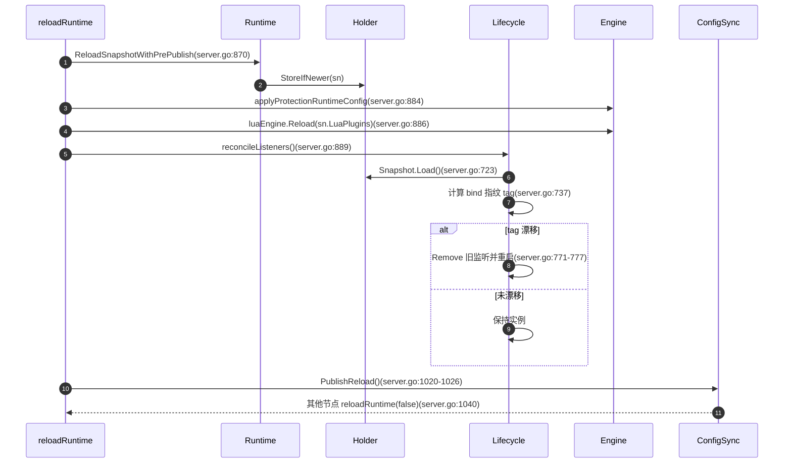
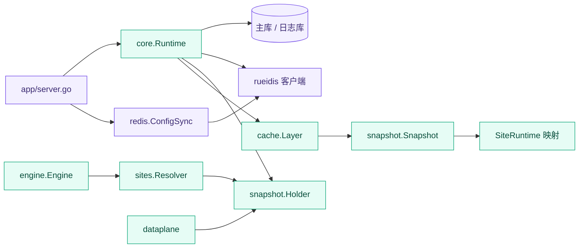

# 快照系统

> [返回 WAF 引擎系统](../WAF 引擎系统.md)

<cite>
**本文档引用的文件**
- [snapshot.go](file://internal/snapshot/snapshot.go)
- [build.go](file://internal/snapshot/build.go)
- [runtime.go](file://internal/core/runtime.go)
- [layer.go](file://internal/cache/layer.go)
- [migrate.go](file://internal/store/migrate.go)
- [system.go](file://internal/store/system.go)
- [pubsub.go](file://internal/core/redis/pubsub.go)
- [server.go](file://internal/app/server.go)
- [protection.go](file://internal/store/protection.go)
- [engine.go](file://internal/core/engine/engine.go)
- [resolver.go](file://internal/core/sites/resolver.go)
</cite>

## 目录

1. [简介](#简介)
2. [项目结构](#项目结构)
3. [核心组件](#核心组件)
4. [架构总览](#架构总览)
5. [详细组件分析](#详细组件分析)
6. [依赖关系分析](#依赖关系分析)
7. [性能考虑](#性能考虑)
8. [故障排查指南](#故障排查指南)
9. [结论](#结论)
10. [附录](#附录)

## 简介
本文件系统性阐述快照系统的理念、实现与工程实践，覆盖以下关键主题：
- 快照模式的设计与不可变性保障
- 快照版本管理与 `Revision` 字段的作用
- 快照构建流程：从原始配置到最终运行时配置的转换
- 变更检测与热重载：代次递增、进程内缓存命中与两级引擎缓存失效
- 引擎中的作用：如何确保配置更新的原子性与一致性
- 构建期配置诊断的分流策略
- 提供代码位置，帮助定位实现细节

## 项目结构
围绕配置快照的关键模块分布如下：

| 模块 | 路径 | 职责 | 关键符号 | 规模(行) |
|---|---|---|---|---:|
| 快照定义与匹配 | `internal/snapshot/snapshot.go` | 不可变视图与站点键空间 | `Snapshot`、`SiteRuntime`、`Holder` | 520 |
| 快照构建 | `internal/snapshot/build.go` | DB → 快照一次性解析编译 | `Build`、`compileRules`、`registerSiteKeys` | 1644 |
| 运行时装配 | `internal/core/runtime.go` | 重载与原子发布 | `Runtime.ReloadSnapshotWithPrePublish` | 313 |
| 进程内快照缓存 | `internal/cache/layer.go` | 按代次缓存快照对象 | `Layer.GetSnapshot` | 70 |
| 修订号模型 | `internal/store/migrate.go`、`internal/store/system.go` | 单调递增版本 | `BumpRevision`、`ConfigRevision` | 168 / 34 |
| 分布式同步 | `internal/core/redis/pubsub.go` | 跨节点重载广播 | `ConfigSync` | 132 |
| 应用装配与监听协调 | `internal/app/server.go` | reload 链与监听器热切换 | `applySnapshotReload`、`reconcileListeners` | 2121 |
| 消费方 | `internal/core/engine`、`internal/core/sites` | 无锁读取快照 | `Engine.getCompiledRules`、`Resolver` | 646 / 44 |

**图表来源**
- [runtime.go:23-34](file://internal/core/runtime.go#L23-L34)
- [runtime.go:211-274](file://internal/core/runtime.go#L211-L274)
- [snapshot.go:213-287](file://internal/snapshot/snapshot.go#L213-L287)
- [snapshot.go:453-489](file://internal/snapshot/snapshot.go#L453-L489)
- [build.go:47-47](file://internal/snapshot/build.go#L47-L47)
- [build.go:920-936](file://internal/snapshot/build.go#L920-L936)
- [build.go:787-804](file://internal/snapshot/build.go#L787-L804)
- [layer.go:24-62](file://internal/cache/layer.go#L24-L62)
- [migrate.go:141-150](file://internal/store/migrate.go#L141-L150)
- [system.go:3-8](file://internal/store/system.go#L3-L8)
- [server.go:868-889](file://internal/app/server.go#L868-L889)
- [server.go:720-777](file://internal/app/server.go#L720-L777)

**章节来源**
- [runtime.go:23-34](file://internal/core/runtime.go#L23-L34)
- [snapshot.go:213-287](file://internal/snapshot/snapshot.go#L213-L287)
- [build.go:47-47](file://internal/snapshot/build.go#L47-L47)
- [layer.go:24-62](file://internal/cache/layer.go#L24-L62)
- [server.go:720-889](file://internal/app/server.go#L720-L889)

## 核心组件

| 组件 | 位置 | 职责 | 核心字段/方法 | 失败影响 |
|---|---|---|---|---|
| `Snapshot` | `snapshot.go:213-287` | 数据面可见的不可变配置视图 | `Revision`、`Sites`、`Protection`、`SiteTLSCertBySNI` | 为 nil 时数据面返回 503 |
| `SiteRuntime` | `snapshot.go:44-134` | 站点解析后的运行时视图 | `PolicyID`、`Rules`、`EffectiveProtection`、`Bind` | 站点不可路由 |
| `CompiledRule` | `snapshot.go:24-36` | 轻量运行时规则（文本 kind/arg） | `Phase`、`Kind`、`Arg`、`CaptchaType` | 规则不生效 |
| `Holder` | `snapshot.go:453-489` | 原子持有当前快照 | `Store`、`StoreIfNewer`、`Load` | 读到旧配置 |
| `Build` | `build.go:47-217` | DB → 快照的唯一入口 | `func Build(db, rev, dynamicKeyBase)` | 本次 reload 失败，旧快照继续生效 |
| `Runtime.ReloadSnapshotWithPrePublish` | `runtime.go:211-274` | 取代次、查缓存、构建、发布 | `reloadMu`、`Cache.GetSnapshot` | 返回 error 由调用方记录 |
| `cache.Layer` | `layer.go:24-62` | 进程内按代次缓存快照对象 | `SetSnapshot`、`GetSnapshot`、`InvalidateAll` | 退化为每次重建 |
| `ConfigSync` | `pubsub.go:29-132` | Redis 发布/订阅重载事件 | `PublishReload`、`Subscribe` | 其他节点不感知变更 |

**章节来源**
- [snapshot.go:24-36](file://internal/snapshot/snapshot.go#L24-L36)
- [snapshot.go:44-134](file://internal/snapshot/snapshot.go#L44-L134)
- [snapshot.go:213-287](file://internal/snapshot/snapshot.go#L213-L287)
- [snapshot.go:453-489](file://internal/snapshot/snapshot.go#L453-L489)
- [build.go:47-217](file://internal/snapshot/build.go#L47-L217)
- [runtime.go:211-274](file://internal/core/runtime.go#L211-L274)
- [layer.go:24-62](file://internal/cache/layer.go#L24-L62)
- [pubsub.go:29-132](file://internal/core/redis/pubsub.go#L29-L132)

## 架构总览
快照系统以「控制面变更 → 修订号递增 → 数据面重建 → 原子发布 → 监听器热切换」的闭环实现，并借助 Redis 发布/订阅完成多节点同步。

**图表来源**
- [server.go:868-889](file://internal/app/server.go#L868-L889)
- [server.go:1002-1042](file://internal/app/server.go#L1002-L1042)
- [runtime.go:211-274](file://internal/core/runtime.go#L211-L274)
- [layer.go:44-62](file://internal/cache/layer.go#L44-L62)
- [migrate.go:141-150](file://internal/store/migrate.go#L141-L150)
- [pubsub.go:64-121](file://internal/core/redis/pubsub.go#L64-L121)

**章节来源**
- [server.go:868-1042](file://internal/app/server.go#L868-L1042)
- [runtime.go:211-274](file://internal/core/runtime.go#L211-L274)
- [pubsub.go:64-121](file://internal/core/redis/pubsub.go#L64-L121)

## 详细组件分析

### 快照结构与不可变性
`Snapshot` 的关键字段与语义：

| 字段 | 类型 | 位置 | 语义 |
|---|---|---|---|
| `Revision` | `uint64` | `snapshot.go:214` | 代次守卫，驱动引擎两级缓存失效 |
| `Sites` | `map[string]*SiteRuntime` | `snapshot.go:216` | 键为 `bind + NUL + 规范化 host` |
| `Protection` | `store.ProtectionConfig` | `snapshot.go:230` | 从 `SystemSettings` 加载的全局防护配置 |
| `SiteTLSCertBySNI` | `map[string]tls.Certificate` | `snapshot.go:226` | 键由 `SNICertKey` 生成 |
| `SiteTLSCertStateBySNI` | `map[string]TLSCertificateState` | `snapshot.go:227` | `valid`/`unconfigured`/`invalid` |
| `LuaPlugins` / `LuaPluginErrors` | `[]*Script` / `map` | `snapshot.go:238-240` | 构建期编译，单脚本失败不影响整体 |
| `ConfigDiagnostics` | `[]SnapshotConfigDiagnostic` | `snapshot.go:248` | 构建期跳过的无效配置，随快照原子发布 |

- 不可变性保障：一次构建、全程只读，请求期不改写任何字段，reload 只是换指针（`snapshot.go:207-212`）。
- 读取入口：`Holder.Load()` 单次原子加载（`snapshot.go:489`）；`Resolver` 只在该 holder 上做薄封装（`resolver.go:14-44`）。
- 发布入口：`StoreIfNewer` 用 CAS 循环保证不会用旧代次覆盖新代次（`snapshot.go:474-487`）；`Store` 是无条件发布，仅供初始化使用（`snapshot.go:456-464`）。

**图表来源**
- [snapshot.go:213-287](file://internal/snapshot/snapshot.go#L213-L287)
- [snapshot.go:44-134](file://internal/snapshot/snapshot.go#L44-L134)
- [snapshot.go:24-36](file://internal/snapshot/snapshot.go#L24-L36)
- [snapshot.go:453-489](file://internal/snapshot/snapshot.go#L453-L489)

**章节来源**
- [snapshot.go:24-36](file://internal/snapshot/snapshot.go#L24-L36)
- [snapshot.go:44-134](file://internal/snapshot/snapshot.go#L44-L134)
- [snapshot.go:207-287](file://internal/snapshot/snapshot.go#L207-L287)
- [snapshot.go:453-489](file://internal/snapshot/snapshot.go#L453-L489)
- [resolver.go:14-44](file://internal/core/sites/resolver.go#L14-L44)

### 快照构建流程
`Build(db, rev, dynamicKeyBase)` 是配置生效的唯一入口：致命错误直接返回 error 让 reload 失败，可跳过的无效项记入 `ConfigDiagnostics` 随快照发布（`build.go:34-47`）。

| 步 | 动作 | 执行位置 | 输入 | 输出 | 失败分支 |
|:--:|---|---|---|---|---|
| 1 | 加载启用站点 | `build.go:48-51` | `sites` 表 | `[]store.Site` | 返回 error |
| 2 | 加载策略与默认槽 | `build.go:53-74` | `policies` 表 | `policyByID`、`defaultPolicyID` | 缺默认策略报错 |
| 3 | 加载监听器 | `build.go:76-87` | `site_listeners` 表 | 按站点启用列表 | 无行则回退站点 `Bind` |
| 4 | 加载证书 | `build.go:89-96` | `certificates` 表 | `certByID` | 返回 error |
| 5 | 加载启用规则 | `build.go:98-101` | `rules` 表 | `[]store.Rule` | 返回 error |
| 6 | 加载系统设置 | `build.go:102-112` | `system_settings` 表 | `ProtectionConfig` | 返回 error |
| 7 | 编译 CC 规则 | `build.go:113` | `protection.CCRules` | 复合规则 | 记入诊断 |
| 8 | 按策略分组排序 | `build.go:122-143` | 规则集合 | `rulesByPolicy` | `policy_id=0` 或悬空报错 |
| 9 | 编译应用路由 | `build.go:145-157` | 路由规则表 | `appRulesBySite` | 返回 error |
| 10 | 解析动态防护与图像 | `build.go:159-184` | `bot_settings` | 配置体 | 图像配置写坏则退回默认 |
| 11 | 加载访问控制与 IP 名单 | `build.go:186-196` | 对应表 | 站点级配置 | 返回 error |
| 12 | 逐站点逐监听器构建 | `build.go:260-475` | 上述聚合结果 | `SiteRuntime` | 上游为空跳过站点 |
| 13 | 注册站点键 | `build.go:475` | `rt.Bind` + Host | `siteMap` | 重复路由报错终止 |
| 14 | 生成快照对象 | `build.go` 收尾 | `rev` 与全部映射 | `*Snapshot` | — |

**图表来源**
- [build.go:47-221](file://internal/snapshot/build.go#L47-L221)
- [build.go:260-275](file://internal/snapshot/build.go#L260-L275)
- [build.go:787-804](file://internal/snapshot/build.go#L787-L804)
- [build.go:920-936](file://internal/snapshot/build.go#L920-L936)

**章节来源**
- [build.go:47-221](file://internal/snapshot/build.go#L47-L221)
- [build.go:260-475](file://internal/snapshot/build.go#L260-L475)
- [build.go:762-822](file://internal/snapshot/build.go#L762-L822)
- [build.go:920-936](file://internal/snapshot/build.go#L920-L936)

### 版本管理与变更检测
- 配置修订号：单行表 `config_revisions`（`store.ConfigRevision`，`system.go:30-34`），`BumpRevision` 递增（`migrate.go:141-150`）；读取路径用 `FirstOrCreate` 保证首次也有行（`runtime.go:283-289`）。
- 缓存命中：`ReloadSnapshotWithPrePublish` 先 `GetSnapshot(rev)`，命中后仍会**再次核对** `currentRevision` 未变才发布（`runtime.go:223-245`）。
- 竞态处理：整个重载过程包在 `for` 循环里，任何一次核对发现代次被并发推进就 `continue` 重来（`runtime.go:218-273`）。
- 前置发布钩子：`prePublish` 在新一代对请求处理器可见之前执行，返回错误时当前已发布快照保持不变（`runtime.go:205-211`、`231-235`）。
- Redis 同步：频道固定为 `openwaf:config:reload`，消息体带 `source_id` 用于回环抑制（`pubsub.go:16-22`、`64-82`）。

| 机制 | 取值/位置 | 说明 |
|---|---|---|
| 修订号表 | `config_revisions`，`system.go:30-34` | 单行 `ID=1`，`Revision` 单调递增 |
| 递增入口 | `migrate.go:141-150` | 由 `reloadRuntime(propagate=true)` 调用 |
| 读取入口 | `runtime.go:283-289` | `FirstOrCreate` 兜底建行 |
| 重载互斥 | `reloadMu`，`runtime.go:33`、`212` | 同进程串行化 reload |
| 发布判据 | `StoreIfNewer`，`snapshot.go:474-487` | 只接受更高代次 |
| 缓存键 | `snapshot:{rev}`，`layer.go:41-48` | 进程内 ristretto |
| 同步频道 | `openwaf:config:reload`，`pubsub.go:16` | 跨节点广播 |
| 回环抑制 | `event.SourceID == cs.sourceID`，`pubsub.go:114-116` | 自身发起的广播不再重载 |
| 发布超时 | 2 秒，`pubsub.go:77` | 失败仅告警不阻塞 |

**图表来源**
- [runtime.go:201-274](file://internal/core/runtime.go#L201-L274)
- [layer.go:44-62](file://internal/cache/layer.go#L44-L62)
- [snapshot.go:466-487](file://internal/snapshot/snapshot.go#L466-L487)

**章节来源**
- [runtime.go:201-289](file://internal/core/runtime.go#L201-L289)
- [migrate.go:141-150](file://internal/store/migrate.go#L141-L150)
- [system.go:30-34](file://internal/store/system.go#L30-L34)
- [snapshot.go:466-487](file://internal/snapshot/snapshot.go#L466-L487)
- [pubsub.go:16-116](file://internal/core/redis/pubsub.go#L16-L116)
- [layer.go:41-62](file://internal/cache/layer.go#L41-L62)

### 热重载与监听器协调
`applySnapshotReload` 是重载后的联动中心（`server.go:868-889`）：

| 步 | 动作 | 执行位置 | 触发条件 |
|:--:|---|---|---|
| 1 | 记录旧快照 | `server.go:869` | 每次重载 |
| 2 | 重载并挂 JS 引擎 | `server.go:870-878` | `ReloadSnapshotWithPrePublish` |
| 3 | 清理响应缓存 | `server.go:879-882` | 快照指针变化 |
| 4 | 应用防护运行期配置 | `server.go:884` | 新快照非空 |
| 5 | 热替换 Lua 脚本集合 | `server.go:886` | 新快照非空 |
| 6 | 重载 IP 黑白名单 | `server.go:888` | 每次重载 |
| 7 | 协调监听器 | `server.go:889` | 每次重载 |
| 8 | 清理上游传输池 | `server.go:890-895` | 上游端点集合变化 |

- 监听器热切换按 `bind` 级别的指纹标签比较：`siteListenerFingerprint(bind, sn)` 与已运行实例的 tag 不符才 `Remove` 并重启（`server.go:733-777`）。
- HTTP/3 计划独立协调，同样按 tag 判定漂移（`server.go:740-760`）。
- 未出现在期望集合中的监听会被直接移除，因此删除站点也能收敛（`server.go:766-769`）。
- Redis 订阅者收到消息后调用 `reloadRuntime(false)`，不再递增代次，只重建本地视图（`server.go:1040-1042`）。

**图表来源**
- [server.go:720-777](file://internal/app/server.go#L720-L777)
- [server.go:868-895](file://internal/app/server.go#L868-L895)
- [server.go:1002-1042](file://internal/app/server.go#L1002-L1042)
- [runtime.go:211-274](file://internal/core/runtime.go#L211-L274)

**章节来源**
- [server.go:720-895](file://internal/app/server.go#L720-L895)
- [server.go:1002-1042](file://internal/app/server.go#L1002-L1042)
- [runtime.go:211-274](file://internal/core/runtime.go#L211-L274)

### 站点覆盖合并与规则编译
- 有效保护配置：`SiteRuntime.EffectiveProtection` 为 nil 时数据面回退全局 `Snapshot.Protection`，非 nil 即站点覆盖（`snapshot.go:93-95`、`engine.go:354-357`）。
- 按阶段跳过：站点级 `SkipPathByPhase` 为 nil 继承全局，非 nil **整体覆盖**，不做逐 phase 深合并，否则站点无法关掉全局的某项跳过（`build.go:762-766`）。
- nullable 字段：`maybeSiteString` 把站点级可空字段解析为「nil = 未覆盖（空串）」「非 nil = 覆盖值」（`build.go:771-778`）。
- 规则编译：`compileRules` 调 `ParsePattern` 解析 DSL，空 kind 直接丢弃；随后 `applyRuleFrequencyLimit` 把规则级窗口与次数包装为 `cc_rate` 复合条件（`build.go:920-936`、`938-950`）。
- 分组排序：规则按 `PolicyID` 分组，组内按 `Priority` 升序、`ID` 升序（`build.go:122-143`）。

| 配置项 | 类型 | 位置 | 覆盖语义 |
|---|---|---|---|
| `EffectiveProtection` | `*ProtectionConfig` | `snapshot.go:95` | nil 继承全局 |
| `SkipPathByPhase` | `*string` | `build.go:764-766` | 非 nil 整体覆盖 |
| `ChallengeAction` | `string` | `snapshot.go:75` | 空串继承全局 |
| `ChallengeCaptchaType` | `string` | `snapshot.go:76` | 空串继承全局 |
| `AntiReplayCookieMode` | `string` | `snapshot.go:91`、`build.go:780-785` | 非 `dual` 一律按 `standard` |
| `CaptchaType`（规则级） | `string` | `snapshot.go:33` | 空串继承全局 |

**章节来源**
- [build.go:122-143](file://internal/snapshot/build.go#L122-L143)
- [build.go:762-785](file://internal/snapshot/build.go#L762-L785)
- [build.go:920-950](file://internal/snapshot/build.go#L920-L950)
- [snapshot.go:24-95](file://internal/snapshot/snapshot.go#L24-L95)
- [engine.go:354-357](file://internal/core/engine/engine.go#L354-L357)
- [protection.go:63-66](file://internal/store/protection.go#L63-L66)

### 站点匹配与键空间
| 键空间 | 生成函数 | 格式 | 位置 |
|---|---|---|---|
| 站点映射 | `siteMapKeyNorm` | `bind + "\x00" + 已规范化 host` | `snapshot.go:293-296` |
| 站点映射（对外） | `SiteMapKey` | `bind + "\x00" + 小写去空白 host` | `snapshot.go:289-291` |
| SNI 证书 | `SNICertKey` | `"sni:" + bind + "\x00" + NormalizeMatchHost(sni)` | `snapshot.go:298-300` |

- 匹配策略三级：精确 `bind+host` → `*.父域`（非 IP 且含点号）→ catch-all `*`（`snapshot.go:337-362`、`373-398`）。
- 归一化：`NormalizeMatchHost` 小写化、去首尾空白、剥离纯数字端口，并对已规范输入走零分配快路径（`snapshot.go:409-439`）。
- IP 判定：`isIPAddress` 仅允许点、冒号、十六进制字符，再交给 `net.ParseIP` 终判（`snapshot.go:441-450`）。
- 跨 bind 隔离：三级查找全部在同一 `bind` 前缀内进行，因此不存在跨监听地址回退（`snapshot.go:343-359`）。
- 零拷贝读取：`MatchSitePtr` 直接返回 map 中的指针，调用方不得在请求期内改写其指向内容（`snapshot.go:364-373`）。

**章节来源**
- [snapshot.go:289-300](file://internal/snapshot/snapshot.go#L289-L300)
- [snapshot.go:312-398](file://internal/snapshot/snapshot.go#L312-L398)
- [snapshot.go:400-450](file://internal/snapshot/snapshot.go#L400-L450)

### 构建期配置诊断
构建期发现的问题按严重程度分流，诊断结构只保留定位所需的稳定标识，不含原始配置值（`snapshot.go:170-187`）：

| 常量 | 取值 | 位置 |
|---|---|---|
| `DiagnosticSourcePolicyOWASP` | `policy_owasp_rule_configs` | `snapshot.go:190` |
| `DiagnosticSourceIPList` | `ip_list_entries` | `snapshot.go:191` |
| `DiagnosticSourceSites` | `sites` | `snapshot.go:192` |
| `DiagnosticSourceListeners` | `site_listeners` | `snapshot.go:193` |
| `DiagnosticSourceCertificates` | `certificates` | `snapshot.go:194` |
| `DiagnosticHandlingSkipInvalidField` | `skip_invalid_field` | `snapshot.go:202` |
| `DiagnosticHandlingSkipInvalidEntry` | `skip_invalid_entry` | `snapshot.go:203` |
| `DiagnosticHandlingRejectInvalidCertificate` | `reject_invalid_certificate` | `snapshot.go:204` |

典型用例：图像转换配置 JSON 写坏时不终止构建，退回 `imagery.DefaultConfig()` 并追加一条 `skip_invalid_field` 诊断（`build.go:169-183`）；上游 mTLS PEM 超限或不配对也走同一分流（`build.go:226-258`）。

**章节来源**
- [snapshot.go:170-205](file://internal/snapshot/snapshot.go#L170-L205)
- [build.go:169-183](file://internal/snapshot/build.go#L169-L183)
- [build.go:226-258](file://internal/snapshot/build.go#L226-L258)

## 依赖关系分析
- 控制面与数据面通过「修订号 + 不可变快照 + Pub/Sub」解耦：控制面只写库并递增代次，数据面只读快照。
- 监听器协调只依赖快照与 bind 级指纹标签，避免全局重启。

| 调用方 ↓ / 被调方 → | snapshot | store | cache | redis | engine | lifecycle |
|---|:---:|:---:|:---:|:---:|:---:|:---:|
| core.Runtime | ✓ | ✓ | ✓ | ✓ | — | — |
| app/server | ✓ | ✓ | — | ✓ | ✓ | ✓ |
| cache.Layer | ✓ | — | — | — | — | — |
| sites.Resolver | ✓ | — | — | — | — | — |
| engine.Engine | ✓ | ✓ | — | — | — | — |
| snapshot.Build | — | ✓ | — | — | — | — |
| redis.ConfigSync | — | — | — | — | — | — |

- 外部依赖：Redis 用于跨节点通知（可选，未配置时 `OptionalClient` 返回 nil，`runtime.go:99-116`）；GORM 承载持久化（`runtime.go:63-70`）；Ristretto 承载进程内快照缓存（`layer.go:30-34`）。

**图表来源**
- [runtime.go:23-34](file://internal/core/runtime.go#L23-L34)
- [runtime.go:99-141](file://internal/core/runtime.go#L99-L141)
- [layer.go:24-39](file://internal/cache/layer.go#L24-L39)
- [snapshot.go:213-216](file://internal/snapshot/snapshot.go#L213-L216)
- [resolver.go:10-17](file://internal/core/sites/resolver.go#L10-L17)
- [server.go:1040-1042](file://internal/app/server.go#L1040-L1042)
- [pubsub.go:29-54](file://internal/core/redis/pubsub.go#L29-L54)

**章节来源**
- [runtime.go:23-141](file://internal/core/runtime.go#L23-L141)
- [layer.go:24-39](file://internal/cache/layer.go#L24-L39)
- [resolver.go:10-17](file://internal/core/sites/resolver.go#L10-L17)
- [pubsub.go:29-54](file://internal/core/redis/pubsub.go#L29-L54)
- [server.go:1040-1042](file://internal/app/server.go#L1040-L1042)

## 性能考虑
- 快照与原子指针：读路径只有一次 `atomic.Pointer.Load()`，写路径仅在重载时持有 `reloadMu`，适合读多写极少（`snapshot.go:489`、`runtime.go:212`）。
- 进程内缓存：同代次快照命中 `cache.Layer`，省掉全表读取与编译（`runtime.go:223-245`、`layer.go:54-62`）。
- 缓存参数：`NumCounters=1e4`、`MaxCost=1<<20`、`BufferItems=64`，写入后 `Wait()` 保证立即可读（`layer.go:30-34`、`50`）。
- 监听器隔离：只重启指纹漂移的 bind，其余实例保持（`server.go:771-777`）。
- 上游连接池收敛：仅当上游端点集合变化时才关闭空闲传输（`server.go:890-895`）。
- Redis 通知降级：发布带 2 秒超时且失败仅告警，不阻塞主流程；客户端为 nil 时 `PublishReload` 直接返回（`pubsub.go:65-82`）。

**章节来源**
- [runtime.go:212-245](file://internal/core/runtime.go#L212-L245)
- [layer.go:30-54](file://internal/cache/layer.go#L30-L54)
- [snapshot.go:489-489](file://internal/snapshot/snapshot.go#L489-L489)
- [server.go:771-895](file://internal/app/server.go#L771-L895)
- [pubsub.go:65-82](file://internal/core/redis/pubsub.go#L65-L82)

## 故障排查指南

| 症状 | 可能原因 | 排查方向 | 处置方案 |
|---|---|---|---|
| 503 `configuration_snapshot not loaded` | 首次快照未加载 | `runtime.go:246-249` 构建错误、`handler` 判空 | 检查库连接与 `Build` 返回的错误 |
| 重载返回 `duplicate site route` | 两个站点争用同一 bind+host | `build.go:795-800` | 调整站点 Host 或监听地址 |
| 重载返回 `default policy not configured` | 策略表无默认槽 | `build.go:64-73` | 设置唯一默认策略 |
| 重载返回 `dynamic protection key base must be 32 bytes` | 密钥基长度不符 | `runtime.go:145-151`、`build.go:162-164` | 正确挂载 32 字节基值 |
| 配置改了但行为不变 | `StoreIfNewer` 未接受更低代次 | `snapshot.go:474-487`、`runtime.go:270` | 确认 `BumpRevision` 被调用 |
| 多节点不同步 | Redis 未启用或回环被抑制 | `pubsub.go:65-82`、`114-116` | 检查频道可达与 `source_id` |
| 监听器未热切换 | bind 指纹标签未变 | `server.go:737`、`771-777` | 核对参与指纹计算的字段 |
| 管理端出现无效配置提示 | 构建期跳过项记入诊断 | `snapshot.go:170-205`、`build.go:169-183` | 按 `source`/`field` 定位修数 |

**章节来源**
- [build.go:64-164](file://internal/snapshot/build.go#L64-L164)
- [build.go:795-800](file://internal/snapshot/build.go#L795-L800)
- [runtime.go:145-270](file://internal/core/runtime.go#L145-L270)
- [snapshot.go:170-205](file://internal/snapshot/snapshot.go#L170-L205)
- [snapshot.go:474-487](file://internal/snapshot/snapshot.go#L474-L487)
- [pubsub.go:65-116](file://internal/core/redis/pubsub.go#L65-L116)
- [server.go:737-777](file://internal/app/server.go#L737-L777)

## 结论
快照系统通过不可变视图与原子指针实现了配置更新的原子性与一致性：`Build` 是配置生效的唯一入口，`Holder.StoreIfNewer` 保证只接受更高代次，`cache.Layer` 让同代次重载免于重复构建，`reconcileListeners` 把影响面收敛到指纹漂移的 bind。构建期的致命错误与可跳过项分流，使单个可选能力的配置错误不会拖垮整个控制面。

[本节为总结，无需特定文件来源]

## 附录

### 快照默认值速查

| 常量 | 取值 | 位置 | 说明 |
|---|---|---|---|
| `WAFBodyScanLimit` | `48 * 1024` | `snapshot.go:493` | 请求体扫描上限 |
| `OneDaySeconds` | `86400` | `snapshot.go:498` | 时间常量 |
| `DefaultExpectCTValue` | `max-age=86400, enforce` | `snapshot.go:503` | Expect-CT 缺省值 |
| `DefaultHPKPValue` | 空串 | `snapshot.go:504` | HPKP 默认不启用 |
| `DefaultResponseCompressionEnabled` | `true` | `snapshot.go:514` | 缺设置行按开处理 |
| `DefaultResponseCompressionGzipEnabled` | `true` | `snapshot.go:515` | 同上 |
| `DefaultResponseCompressionMinBytes` | `1024` | `snapshot.go:516` | 压缩阈值 |
| `DefaultBrotliEnabled` | `true` | `snapshot.go:517` | brotli 与 deflate/zstd 共用缺省 |
| `DefaultResponseCompressionDeflate` | `true` | `snapshot.go:518` | 同上 |
| `DefaultResponseCompressionZstd` | `true` | `snapshot.go:519` | 同上 |

**章节来源**
- [snapshot.go:491-520](file://internal/snapshot/snapshot.go#L491-L520)

### 代码示例路径

| 主题 | 位置 |
|---|---|
| 快照结构定义 | `internal/snapshot/snapshot.go:24-134` |
| 不可变视图与诊断 | `internal/snapshot/snapshot.go:161-287` |
| 站点匹配与归一化 | `internal/snapshot/snapshot.go:289-450` |
| 持有者与原子发布 | `internal/snapshot/snapshot.go:452-489` |
| 构建主流程 | `internal/snapshot/build.go:47-217` |
| 站点键注册 | `internal/snapshot/build.go:787-822` |
| 规则编译 | `internal/snapshot/build.go:920-950` |
| 重载与代次核对 | `internal/core/runtime.go:201-289` |
| 进程内快照缓存 | `internal/cache/layer.go:24-70` |
| 修订号递增 | `internal/store/migrate.go:141-165` |
| 重载联动与监听协调 | `internal/app/server.go:720-895` |
| 跨节点同步 | `internal/core/redis/pubsub.go:64-121` |

[本节为总结，无需特定文件来源]