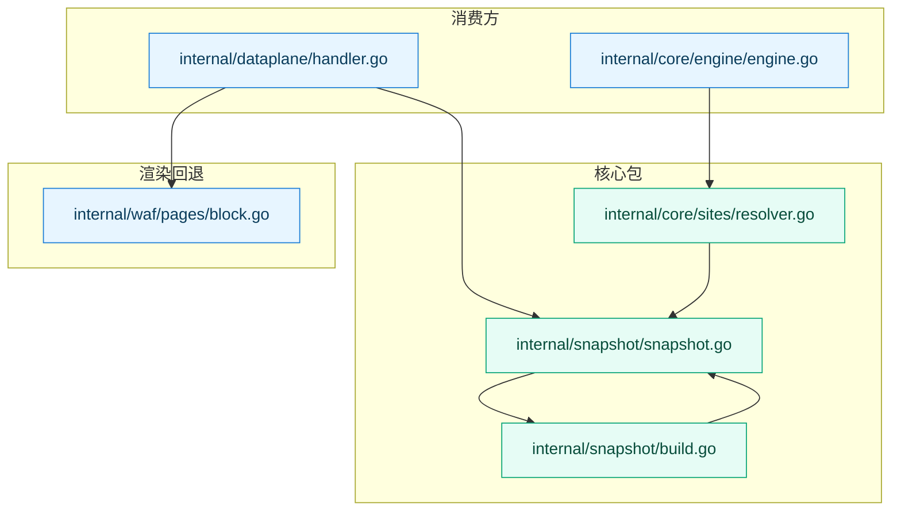
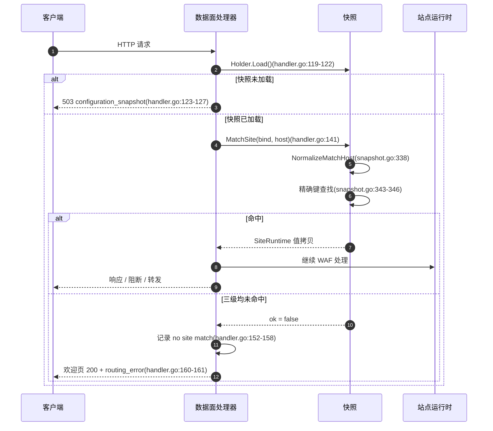
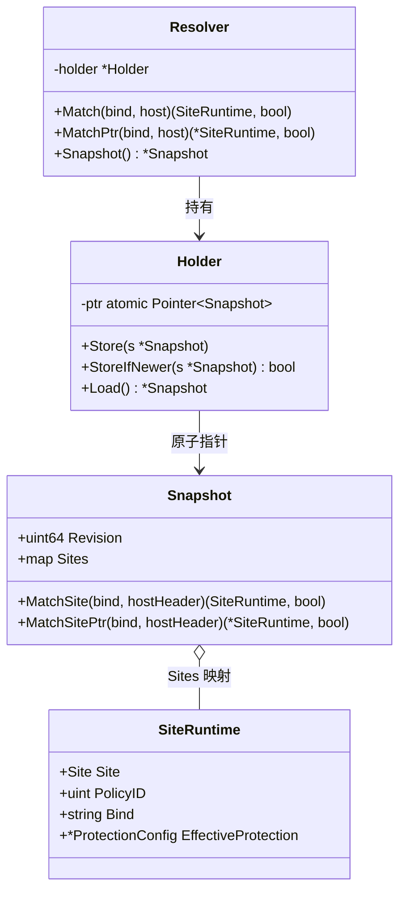
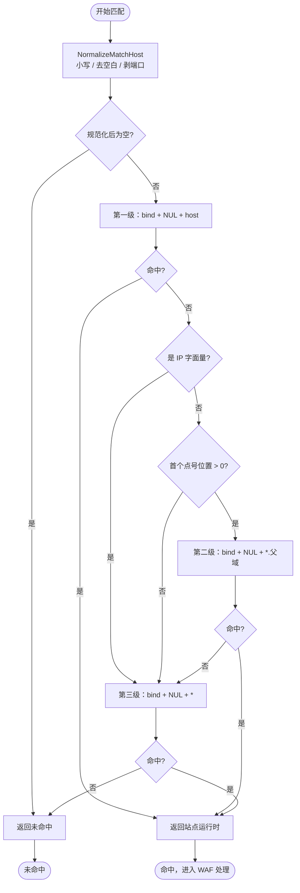
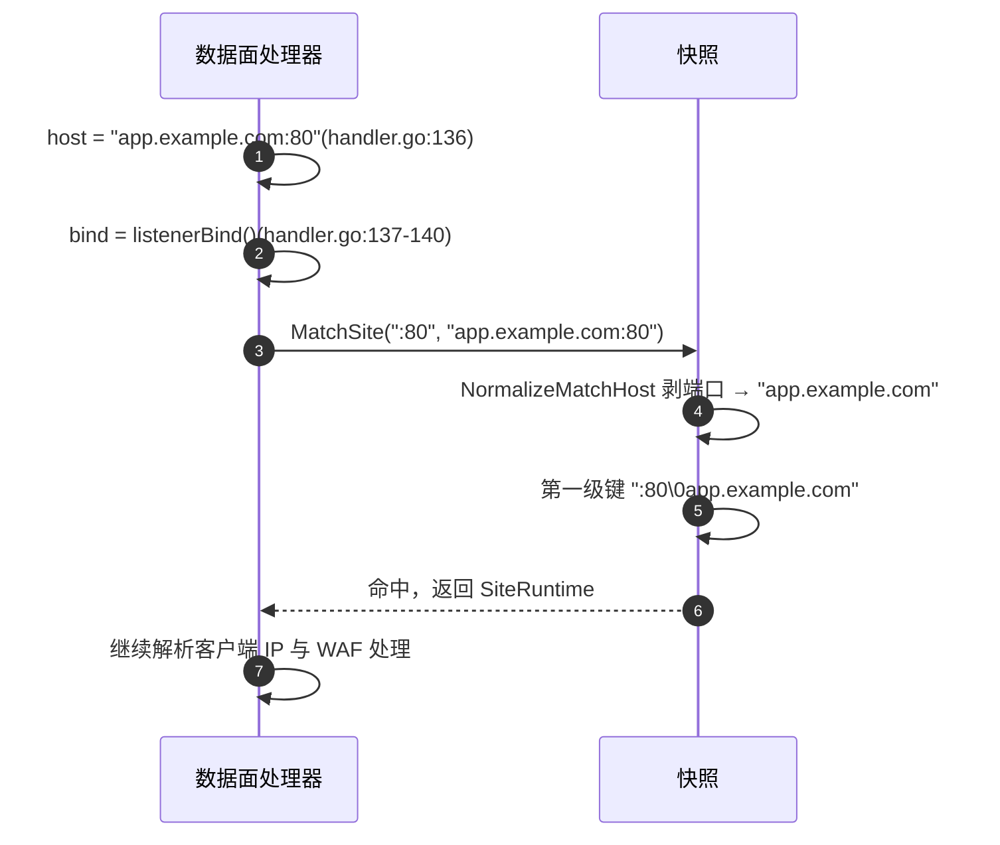
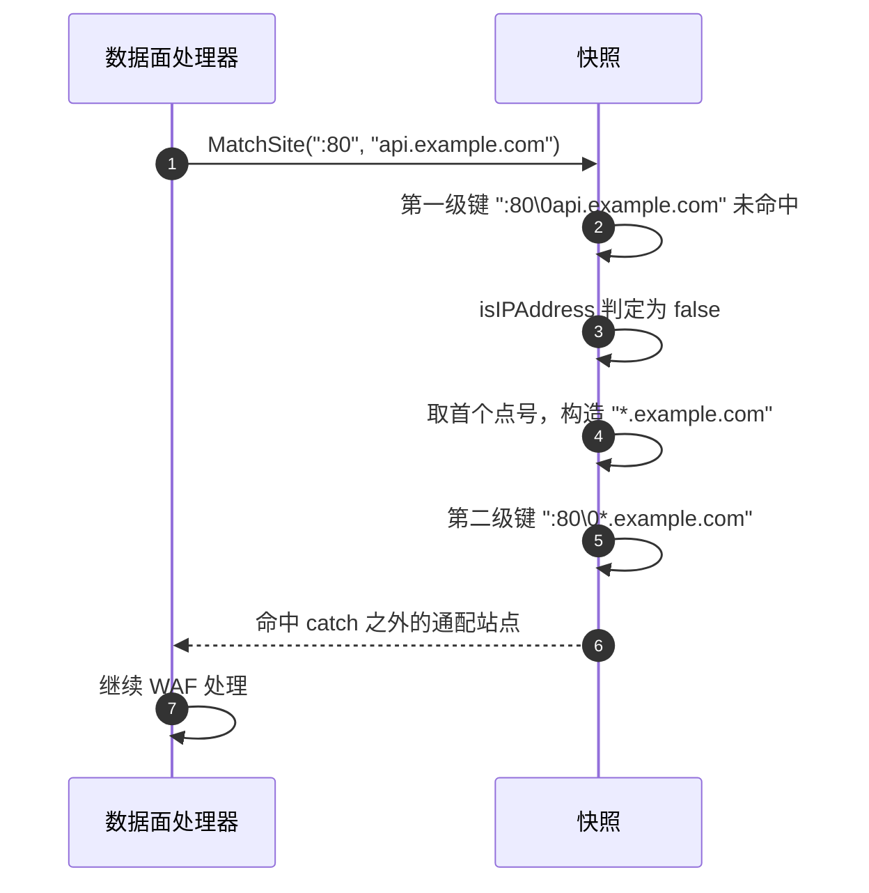
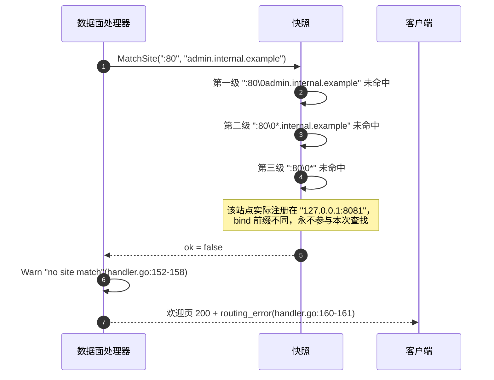
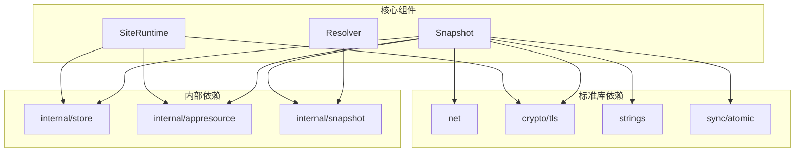

# 站点解析器

> [返回 WAF 引擎系统](../WAF 引擎系统.md)

<cite>
**本文档引用的文件**
- [resolver.go](file://internal/core/sites/resolver.go)
- [snapshot.go](file://internal/snapshot/snapshot.go)
- [build.go](file://internal/snapshot/build.go)
- [engine.go](file://internal/core/engine/engine.go)
- [handler.go](file://internal/dataplane/handler.go)
- [block.go](file://internal/waf/pages/block.go)
</cite>

## 目录

1. [简介](#简介)
2. [项目结构](#项目结构)
3. [核心组件](#核心组件)
4. [架构总览](#架构总览)
5. [详细组件分析](#详细组件分析)
6. [依赖关系分析](#依赖关系分析)
7. [性能考虑](#性能考虑)
8. [故障排查指南](#故障排查指南)
9. [结论](#结论)
10. [附录](#附录)

## 简介
本文档解析 My-OpenWaf 的站点解析器实现，涵盖 `Resolver` 结构体设计、`MatchSite`/`MatchSitePtr` 的工作机制、绑定地址与主机头匹配策略、精确/通配/catch-all 三级优先级、多站点与多监听器场景处理、路由冲突的构建期判定、与快照系统的集成方式以及解析结果的实时性保证。

需要先纠正一个常见误解：**站点解析不使用任何前缀树（Trie）**。全库不存在 trie 实现，站点匹配是「哈希表 + 至多三次固定键查找」，键由 `bind + NUL + 规范化 host` 拼成（`snapshot.go:293-296`、`337-362`）。本文所有描述均以 `internal/core/sites/resolver.go` 与 `internal/snapshot/snapshot.go` 的实际实现为准。

## 项目结构
站点解析器位于 `internal/core/sites` 包，`resolver.go` 全文仅 44 行，核心实现围绕 `Resolver` 与 `Snapshot` 两个组件展开：

| 组件 | 路径 | 职责 | 规模(行) | 对外暴露 |
|---|---|---|---:|---|
| 解析器封装 | `internal/core/sites/resolver.go` | 持有 holder，暴露 Match/MatchPtr/Snapshot | 44 | `Resolver`、`NewResolver` |
| 匹配实现 | `internal/snapshot/snapshot.go` | 键空间与三级查找、Host 归一化 | 520 | `Snapshot.MatchSite`、`MatchSitePtr` |
| 键注册 | `internal/snapshot/build.go` | 构建期写入站点映射、冲突判定 | 1644 | `registerSiteKeys` |
| 消费方：引擎 | `internal/core/engine/engine.go` | `Process` 内解析 bind+host | 646 | `Engine.Process` |
| 消费方：数据面 | `internal/dataplane/handler.go` | 请求入口解析站点 | 1280 | `dataplane.Handler` |

**图表来源**
- [resolver.go:10-44](file://internal/core/sites/resolver.go#L10-L44)
- [snapshot.go:289-398](file://internal/snapshot/snapshot.go#L289-L398)
- [build.go:787-822](file://internal/snapshot/build.go#L787-L822)
- [engine.go:551-562](file://internal/core/engine/engine.go#L551-L562)
- [handler.go:141-163](file://internal/dataplane/handler.go#L141-L163)
- [block.go:20-58](file://internal/waf/pages/block.go#L20-L58)

**章节来源**
- [resolver.go:10-44](file://internal/core/sites/resolver.go#L10-L44)
- [snapshot.go:289-398](file://internal/snapshot/snapshot.go#L289-L398)
- [build.go:787-822](file://internal/snapshot/build.go#L787-L822)
- [handler.go:141-163](file://internal/dataplane/handler.go#L141-L163)

## 核心组件

### Resolver 结构体

| 成员 | 位置 | 签名 | 职责 |
|---|---|---|---|
| `holder` | `resolver.go:11` | `*snapshot.Holder` | 唯一的非导出字段，快照来源 |
| `NewResolver` | `resolver.go:15-17` | `func NewResolver(h *snapshot.Holder) *Resolver` | 构造解析器 |
| `Match` | `resolver.go:24-30` | `func (r *Resolver) Match(bind, host string) (snapshot.SiteRuntime, bool)` | 值拷贝返回，快照为 nil 时返回零值 |
| `MatchPtr` | `resolver.go:33-39` | `func (r *Resolver) MatchPtr(bind, host string) (*snapshot.SiteRuntime, bool)` | 零拷贝返回指针 |
| `Snapshot` | `resolver.go:42-44` | `func (r *Resolver) Snapshot() *snapshot.Snapshot` | 直接暴露当前快照，首次加载前可为 nil |

- `Resolver` 自身不含任何索引结构，也不做匹配计算：它只是 `Holder` 的薄封装，把真正的查找委托给 `Snapshot.MatchSite` / `MatchSitePtr`（`resolver.go:29`、`38`）。

**章节来源**
- [resolver.go:10-44](file://internal/core/sites/resolver.go#L10-L44)

### Snapshot 结构体

| 成员 | 位置 | 类型 | 职责 |
|---|---|---|---|
| `Sites` | `snapshot.go:216` | `map[string]*SiteRuntime` | 站点映射表，值为指针 |
| `Revision` | `snapshot.go:214` | `uint64` | 快照代次 |
| `Protection` | `snapshot.go:230` | `store.ProtectionConfig` | 全局保护配置 |
| `MatchSite` | `snapshot.go:337-362` | 返回 `SiteRuntime` 值 | 三级查找并拷贝 |
| `MatchSitePtr` | `snapshot.go:373-398` | 返回 `*SiteRuntime` | 三级查找零拷贝 |
| `SiteMapKey` | `snapshot.go:289-291` | 导出键函数 | 小写并去空白，不剥端口 |
| `siteMapKeyNorm` | `snapshot.go:293-296` | 非导出键函数 | 假定 host 已规范化 |
| `NormalizeMatchHost` | `snapshot.go:409-439` | 归一化函数 | 小写、去空白、剥端口 |
| `isIPAddress` | `snapshot.go:441-450` | 判定函数 | 通配跳过的前置条件 |

**章节来源**
- [snapshot.go:213-230](file://internal/snapshot/snapshot.go#L213-L230)
- [snapshot.go:289-296](file://internal/snapshot/snapshot.go#L289-L296)
- [snapshot.go:337-450](file://internal/snapshot/snapshot.go#L337-L450)

### SiteRuntime 结构体
- 职责：站点经解析后的运行时视图，构建期把站点、规则、上游、证书与各类保护覆盖一次性解析进来，数据面只读、不再回查数据库（`snapshot.go:38-44`）。
- 关键字段：`Site`、`PolicyID`、`Rules`、`UpstreamURLs`、`Bind`、`TLSConfig`、`EffectiveProtection`、`SiteIPWhitelist`/`SiteIPBlacklist`（`snapshot.go:45-133`）。
- 与匹配的关系：`Bind` 决定该条目挂在哪个监听地址下，`Site.Host` 决定它在键空间中占据哪些 host 位置（`build.go:326-330`、`787-802`）。

**章节来源**
- [snapshot.go:38-133](file://internal/snapshot/snapshot.go#L38-L133)
- [build.go:321-330](file://internal/snapshot/build.go#L321-L330)
- [build.go:787-802](file://internal/snapshot/build.go#L787-L802)

## 架构总览
站点解析器采用「快照驱动 + 原子切换」的设计：解析器每次调用都重新 `Holder.Load()`，因此 reload 之后的下一次查找立刻读到新一代映射。

**图表来源**
- [handler.go:119-161](file://internal/dataplane/handler.go#L119-L161)
- [snapshot.go:337-362](file://internal/snapshot/snapshot.go#L337-L362)
- [snapshot.go:409-439](file://internal/snapshot/snapshot.go#L409-L439)

**章节来源**
- [handler.go:119-161](file://internal/dataplane/handler.go#L119-L161)
- [snapshot.go:337-362](file://internal/snapshot/snapshot.go#L337-L362)

## 详细组件分析

### 代码上下文
把核心符号放进上下游网络中，便于判断改动影响面：

| 符号 | 位置 | 职责 | 上游调用者 | 下游依赖 | 副作用 | 影响面 |
|---|---|---|---|---|---|---|
| `Resolver.Match` | `resolver.go:24` | 值拷贝解析站点 | `engine.go` 未使用（走 `MatchSitePtr`） | `Holder.Load`、`Snapshot.MatchSite` | 无 | 高 |
| `Resolver.MatchPtr` | `resolver.go:33` | 零拷贝解析站点 | 测试与外部调用方 | `Snapshot.MatchSitePtr` | 无 | 高 |
| `Resolver.Snapshot` | `resolver.go:42` | 暴露当前快照 | `engine.go:552` | `Holder.Load` | 无 | 高 |
| `Snapshot.MatchSite` | `snapshot.go:337` | 三级键查找 | `handler.go:141`、`challenge.go:552`、`access_control.go:118` | `NormalizeMatchHost`、`isIPAddress` | 无 | 高 |
| `Snapshot.MatchSitePtr` | `snapshot.go:373` | 零拷贝三级查找 | `engine.go:557` | 同上 | 无 | 高 |
| `registerSiteKeys` | `build.go:787` | 构建期写键 | `build.go:475` | `splitHosts`、`NormalizeMatchHost` | 写 `siteMap` | 高 |

**章节来源**
- [resolver.go:24-44](file://internal/core/sites/resolver.go#L24-L44)
- [engine.go:551-562](file://internal/core/engine/engine.go#L551-L562)
- [snapshot.go:337-398](file://internal/snapshot/snapshot.go#L337-L398)
- [handler.go:141-141](file://internal/dataplane/handler.go#L141-L141)
- [build.go:475-475](file://internal/snapshot/build.go#L475-L475)
- [build.go:787-804](file://internal/snapshot/build.go#L787-L804)

### Resolver 结构体设计
Resolver 采用最小化设计，只负责「取快照 + 委托匹配」两件事：

**图表来源**
- [resolver.go:10-44](file://internal/core/sites/resolver.go#L10-L44)
- [snapshot.go:213-216](file://internal/snapshot/snapshot.go#L213-L216)
- [snapshot.go:337-398](file://internal/snapshot/snapshot.go#L337-L398)
- [snapshot.go:453-489](file://internal/snapshot/snapshot.go#L453-L489)
- [snapshot.go:44-95](file://internal/snapshot/snapshot.go#L44-L95)

#### Match 方法工作机制
1. `r.holder.Load()` 取当前快照（`resolver.go:25`）
2. 快照为 nil 时返回零值 `SiteRuntime{}` 与 `false`（`resolver.go:26-28`）
3. 否则把匹配整体委托给 `sn.MatchSite(bind, host)`（`resolver.go:29`）

**章节来源**
- [resolver.go:24-39](file://internal/core/sites/resolver.go#L24-L39)
- [snapshot.go:337-398](file://internal/snapshot/snapshot.go#L337-L398)

### Snapshot.MatchSite 匹配算法
匹配是**至多三次哈希查找**，不做任何树遍历：

| 级 | 构造的键 | 前置条件 | 位置 |
|:--:|---|---|---|
| 1 | `siteMapKeyNorm(bind, host)` | `host` 规范化后非空 | `snapshot.go:343-346` |
| 2 | `siteMapKeyNorm(bind, "*." + 父域)` | `host` 不是 IP 且首个点号不在位置 0 | `snapshot.go:348-355` |
| 3 | `siteMapKeyNorm(bind, "*")` | 站点显式把 `Host` 配成 `*` | `snapshot.go:357-359` |

- 父域取自 `strings.Index(host, ".")`，即只把**第一级标签**替换为 `*`：`a.b.example.com` → `*.b.example.com`，不会继续尝试 `*.example.com`（`snapshot.go:349-351`）。
- 值拷贝 vs 指针：`MatchSite` 返回 `*rt` 的拷贝（`snapshot.go:345`），`MatchSitePtr` 直接返回 map 里的指针（`snapshot.go:381`），后者要求调用方在请求期内不改写指向内容（`snapshot.go:364-372`）。

**图表来源**
- [snapshot.go:337-362](file://internal/snapshot/snapshot.go#L337-L362)
- [snapshot.go:373-398](file://internal/snapshot/snapshot.go#L373-L398)
- [snapshot.go:409-450](file://internal/snapshot/snapshot.go#L409-L450)

#### 匹配优先级规则
1. **精确匹配**优先：第一级键命中即返回，不再尝试通配（`snapshot.go:343-346`）。
2. **单级通配**次之：仅替换第一级标签，且 IP 字面量主机不参与通配（`snapshot.go:348-355`）。
3. **catch-all** 最后：`Host` 配成 `*` 的站点在第三级命中（`snapshot.go:357-359`）。
4. 三级查找**始终限定在同一 `bind` 前缀内**，不存在跨监听地址回退。
5. `TLSCertificateStateForSNI` 使用同一优先级顺序，保证「站点命中」与「证书取值」一致（`snapshot.go:302-335`）。

**章节来源**
- [snapshot.go:302-335](file://internal/snapshot/snapshot.go#L302-L335)
- [snapshot.go:337-398](file://internal/snapshot/snapshot.go#L337-L398)

### 多站点场景处理
系统支持复杂的多站点场景，键空间全部在构建期展开：

#### 多绑定地址场景
- 站点可配置多个监听器，`Build` 为每个**启用的** listener 生成一条独立的 `SiteRuntime`，并把 `rt.Bind` 覆写为该 listener 的 bind（`build.go:309-330`）。
- 没有 listener 行且站点 `Bind` 非空时，会用站点自身的 bind 合成一条默认监听记录（`build.go:310-319`）。
- 匹配时 bind 是键的前缀，因此天然限定在同一监听地址内。

#### 多主机头场景
- `Site.Host` 按逗号切分，每个非空 host 生成一个独立映射键（`build.go:787-794`、`splitHosts` 于 `build.go:812-822`）。
- 每个 host 在写入前都会过一遍 `NormalizeMatchHost`（`build.go:790`）。
- 上游地址为空的站点会被整体跳过，不进入键空间（`build.go:261-264`）。

#### 域名冲突处理
| 情形 | 判定 | 结果 | 位置 |
|---|---|---|---|
| 同站点重复声明同一键 | `existing.Site.ID == rt.Site.ID` | 幂等跳过 `continue` | `build.go:795-797` |
| 不同站点争用同一键 | 两个不同 `Site.ID` | 返回 `duplicate site route` 错误 | `build.go:798-799` |
| 本次 reload 的后续处理 | `Build` 返回 error | 重载失败，**旧快照继续生效** | `runtime.go:246-249` |

- 与「first-come-first-served」不同：冲突不是被静默忽略，而是让整次快照构建失败，从而强制配置唯一性。

**章节来源**
- [build.go:261-264](file://internal/snapshot/build.go#L261-L264)
- [build.go:309-330](file://internal/snapshot/build.go#L309-L330)
- [build.go:787-822](file://internal/snapshot/build.go#L787-L822)
- [runtime.go:246-249](file://internal/core/runtime.go#L246-L249)

### 与快照系统的集成
站点解析器与快照系统采用「原子指针 + 不可变快照」的设计：

**图表来源**
- [build.go:47-47](file://internal/snapshot/build.go#L47-L47)
- [build.go:787-804](file://internal/snapshot/build.go#L787-L804)
- [snapshot.go:216-216](file://internal/snapshot/snapshot.go#L216-L216)
- [snapshot.go:466-489](file://internal/snapshot/snapshot.go#L466-L489)
- [resolver.go:24-39](file://internal/core/sites/resolver.go#L24-L39)

#### 实时性保证机制
- **原子切换**：`Holder.StoreIfNewer` 用 CAS 循环发布新快照，只接受更高代次（`snapshot.go:474-487`）。
- **每次调用重取**：`Resolver.Match` 与 `MatchPtr` 都在函数内 `holder.Load()`，不缓存快照指针，因此不存在「解析器还看到旧映射」的窗口（`resolver.go:25`、`34`）。
- **不可变性**：`Snapshot` 一次构建全程只读，请求期不改写任何字段（`snapshot.go:207-212`）。
- **键空间稳定**：`siteMapKeyNorm` 只做字符串拼接，不做分配以外的规范化处理，规范化在写入与查找两侧各由 `NormalizeMatchHost` 保证（`snapshot.go:293-296`、`409-439`）。

**章节来源**
- [resolver.go:24-44](file://internal/core/sites/resolver.go#L24-L44)
- [snapshot.go:207-212](file://internal/snapshot/snapshot.go#L207-L212)
- [snapshot.go:293-296](file://internal/snapshot/snapshot.go#L293-L296)
- [snapshot.go:409-439](file://internal/snapshot/snapshot.go#L409-L439)
- [snapshot.go:474-487](file://internal/snapshot/snapshot.go#L474-L487)

### 完整解析流程示例

#### 场景一：精确匹配成功

**图表来源**
- [handler.go:136-141](file://internal/dataplane/handler.go#L136-L141)
- [snapshot.go:337-346](file://internal/snapshot/snapshot.go#L337-L346)
- [snapshot.go:409-439](file://internal/snapshot/snapshot.go#L409-L439)

#### 场景二：单级通配匹配成功

**图表来源**
- [snapshot.go:337-355](file://internal/snapshot/snapshot.go#L337-L355)
- [snapshot.go:441-450](file://internal/snapshot/snapshot.go#L441-L450)
- [build.go:787-794](file://internal/snapshot/build.go#L787-L794)

#### 场景三：跨绑定地址不命中

**图表来源**
- [snapshot.go:337-362](file://internal/snapshot/snapshot.go#L337-L362)
- [handler.go:136-161](file://internal/dataplane/handler.go#L136-L161)
- [build.go:321-330](file://internal/snapshot/build.go#L321-L330)

**章节来源**
- [handler.go:136-161](file://internal/dataplane/handler.go#L136-L161)
- [snapshot.go:337-362](file://internal/snapshot/snapshot.go#L337-L362)
- [build.go:321-330](file://internal/snapshot/build.go#L321-L330)
- [build.go:787-794](file://internal/snapshot/build.go#L787-L794)

## 依赖关系分析
站点解析器的依赖关系清晰且内聚：

**图表来源**
- [resolver.go:3-5](file://internal/core/sites/resolver.go#L3-L5)
- [snapshot.go:3-17](file://internal/snapshot/snapshot.go#L3-L17)
- [snapshot.go:44-134](file://internal/snapshot/snapshot.go#L44-L134)
- [snapshot.go:213-287](file://internal/snapshot/snapshot.go#L213-L287)

### 组件耦合度
- **低耦合**：`Resolver` 只持有 `*snapshot.Holder` 一个具体类型指针，`resolver.go` 的 import 段只有 `My-OpenWaf/internal/snapshot` 一项（`resolver.go:3-5`）。
- **高内聚**：全部匹配逻辑集中在 `Snapshot` 中，`Resolver` 不含任何匹配代码。
- **无循环依赖**：依赖方向为 `engine → sites → snapshot → store`，`snapshot` 不反向引用 `sites` 或 `engine`。
- **消费面广**：除引擎外，挑战、访问控制与端点路由也各自复用 `MatchSite`（`handler.go:141` 及 `challenge.go`、`access_control.go`、`endpoints.go` 的同名调用）。

**章节来源**
- [resolver.go:3-5](file://internal/core/sites/resolver.go#L3-L5)
- [snapshot.go:3-17](file://internal/snapshot/snapshot.go#L3-L17)
- [engine.go:8-23](file://internal/core/engine/engine.go#L8-L23)

## 性能考虑

### 复杂度与分配
| 维度 | 取值 | 依据 |
|---|---|---|
| 最坏查找次数 | 3 次哈希查找 | `snapshot.go:343-359` |
| 单次查找复杂度 | O(1)，与站点总数无关 | Go map 查找语义 |
| 键构造分配 | 每次查找拼接一次字符串 | `snapshot.go:294-296` |
| Host 归一化 | 已规范输入零分配 | `snapshot.go:410-421` |
| 值拷贝 | `MatchSite` 拷贝一份 `SiteRuntime` | `snapshot.go:345` |
| 零拷贝路径 | `MatchSitePtr` 直接返回指针 | `snapshot.go:381` |
| IP 判定 | 逐字符扫描 + `net.ParseIP` | `snapshot.go:441-450` |

- `NormalizeMatchHost` 先做一次字节扫描判断是否需要处理，规范客户端的绝大多数请求走「原样返回」快路径（`snapshot.go:410-421`）。
- 端口剥离只在最后一个冒号之后全为数字时才执行，避免误伤无端口 host（`snapshot.go:424-437`）。

**章节来源**
- [snapshot.go:293-296](file://internal/snapshot/snapshot.go#L293-L296)
- [snapshot.go:337-359](file://internal/snapshot/snapshot.go#L337-L359)
- [snapshot.go:409-450](file://internal/snapshot/snapshot.go#L409-L450)

### 热路径取舍
- 数据面在进入预检查之前已解析过 bind+host，引擎因此提供 `ProcessResolved` 复用该结果，避免第二次 `MatchSite` 查找及其附带的每请求拷贝（`engine.go:564-572`）。
- 需要零拷贝时使用 `MatchSitePtr`；`Resolver.MatchPtr` 是等价入口，供外部调用方复用（`resolver.go:33-39`）。
- `isIPAddress` 的字符集预筛让非 IP 域名可以提前进入通配分支，不必每次都调 `net.ParseIP`（`snapshot.go:442-449`）。

**章节来源**
- [engine.go:551-572](file://internal/core/engine/engine.go#L551-L572)
- [resolver.go:33-39](file://internal/core/sites/resolver.go#L33-L39)
- [snapshot.go:441-450](file://internal/snapshot/snapshot.go#L441-L450)

### 并发安全性
- `Holder.Load()` 是无锁原子读，多 goroutine 并发解析互不阻塞（`snapshot.go:489`）。
- 解析过程不修改任何状态：`Sites` map 只在构建期写入，发布后全程只读（`snapshot.go:207-216`、`build.go:222`）。
- `MatchSitePtr` 返回的指针指向共享条目，调用方不得在请求期内改写其内容（`snapshot.go:364-372`）；需要改动时先复制。

**章节来源**
- [snapshot.go:207-216](file://internal/snapshot/snapshot.go#L207-L216)
- [snapshot.go:364-372](file://internal/snapshot/snapshot.go#L364-L372)
- [snapshot.go:489-489](file://internal/snapshot/snapshot.go#L489-L489)
- [build.go:222-222](file://internal/snapshot/build.go#L222-L222)

## 故障排查指南

### 常见问题诊断

| 现象 | 可能原因 | 排查步骤 | 处置方案 |
|---|---|---|---|
| 日志 `no site match`，返回欢迎页 | 三级键均未命中 | 打印 bind 与规范化后的 host，比对 `Sites` 键（`snapshot.go:343-359`） | 补配站点或改 Host |
| 通配站点不生效 | 通配只替换第一级标签 | 确认请求 host 为 `x.example.com` 而非 `x.y.example.com`（`snapshot.go:349-351`） | 为多级子域单独配置通配站点 |
| IP 型 host 匹配不到通配 | `isIPAddress` 为真时跳过通配 | 检查 host 是否被判定为 IP（`snapshot.go:441-450`） | 改用精确键或 catch-all |
| 重载失败 `duplicate site route` | 两站点争用同一 bind+host | 读错误里的 `site_ids`（`build.go:798-799`） | 消除重复 Host 或调整 bind |
| Host 带端口匹配不上 | 端口未剥离 | 确认端口段是否全数字（`snapshot.go:424-437`） | 修正 Host 头来源或代理配置 |
| 站点命中但证书不对 | bind 与 SNI 组合键不同代 | 核对 `SNICertKey` 与状态优先级（`snapshot.go:298-335`） | 对齐监听器与证书配置 |

**章节来源**
- [snapshot.go:298-359](file://internal/snapshot/snapshot.go#L298-L359)
- [snapshot.go:409-450](file://internal/snapshot/snapshot.go#L409-L450)
- [build.go:787-804](file://internal/snapshot/build.go#L787-L804)
- [handler.go:151-161](file://internal/dataplane/handler.go#L151-L161)

### 验证与观测建议
- 复用站点匹配逻辑做自检：对同一 (bind, host) 分别调 `MatchSite` 与 `MatchSitePtr`，两者必须命中同一 `Site.ID`。
- 校验键空间一致性：用 `SiteMapKey(bind, host)` 反查 `Sites`，可确认构建期写入与运行期查找是否同构（`snapshot.go:289-291`）。
- 关注重载失败日志：`snapshot build: ...` 前缀的 error 即来自 `ReloadSnapshotWithPrePublish`（`runtime.go:246-249`）。
- 需要吞吐数据时以基准测试为准，不要在解析路径上加埋点：单键查找本身开销极低，埋点成本会反超被测对象。

**章节来源**
- [snapshot.go:289-291](file://internal/snapshot/snapshot.go#L289-L291)
- [snapshot.go:337-398](file://internal/snapshot/snapshot.go#L337-L398)
- [runtime.go:246-249](file://internal/core/runtime.go#L246-L249)

## 结论
My-OpenWaf 的站点解析器由 44 行的 `Resolver` 薄封装与快照内约 60 行的查找实现组成：哈希键、至多三级回退、每次调用重取快照。它不依赖前缀树，也不需要前缀树——键空间大小由站点与监听器数量界定，三级固定查找把开销压到常数。精确优先于通配、通配优先于 catch-all，跨 bind 永不回退，路由冲突在构建期直接失败而非静默覆盖，这些取舍共同保证了虚拟主机解析的确定性与可运维性。

[本节为总结，无需特定文件来源]

## 附录

### 键构造速查

| 场景 | 输入 | 规范化后 | 生成的键 |
|---|---|---|---|
| 带端口 Host | `Example.COM:8443` | `example.com` | `:443\0example.com` |
| 大写 Host | `API.Example.com` | `api.example.com` | `:443\0api.example.com` |
| 首尾空白 | `" a.example.com "` | `a.example.com` | `:443\0a.example.com` |
| 通配查找 | `a.example.com` | `a.example.com` → 父域 `example.com` | `:443\0*.example.com` |
| catch-all 查找 | 任意未命中 host | 原值 | `:443\0*` |
| 空 Host | `""` | `""` | 直接返回未命中 |

**章节来源**
- [snapshot.go:289-296](file://internal/snapshot/snapshot.go#L289-L296)
- [snapshot.go:337-362](file://internal/snapshot/snapshot.go#L337-L362)
- [snapshot.go:409-439](file://internal/snapshot/snapshot.go#L409-L439)

### 代码示例路径

| 主题 | 位置 |
|---|---|
| 解析器封装 | `internal/core/sites/resolver.go:10-44` |
| 值拷贝匹配 | `internal/snapshot/snapshot.go:337-362` |
| 零拷贝匹配 | `internal/snapshot/snapshot.go:373-398` |
| Host 归一化 | `internal/snapshot/snapshot.go:409-439` |
| IP 判定 | `internal/snapshot/snapshot.go:441-450` |
| 键构造函数 | `internal/snapshot/snapshot.go:289-300` |
| 构建期键注册与冲突 | `internal/snapshot/build.go:787-804` |
| 多监听器展开 | `internal/snapshot/build.go:309-330` |
| 数据面调用点 | `internal/dataplane/handler.go:136-161` |
| 引擎调用点 | `internal/core/engine/engine.go:551-572` |

[本节为总结，无需特定文件来源]