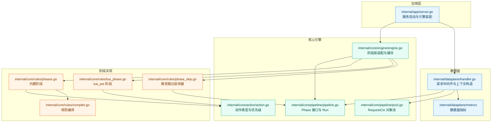
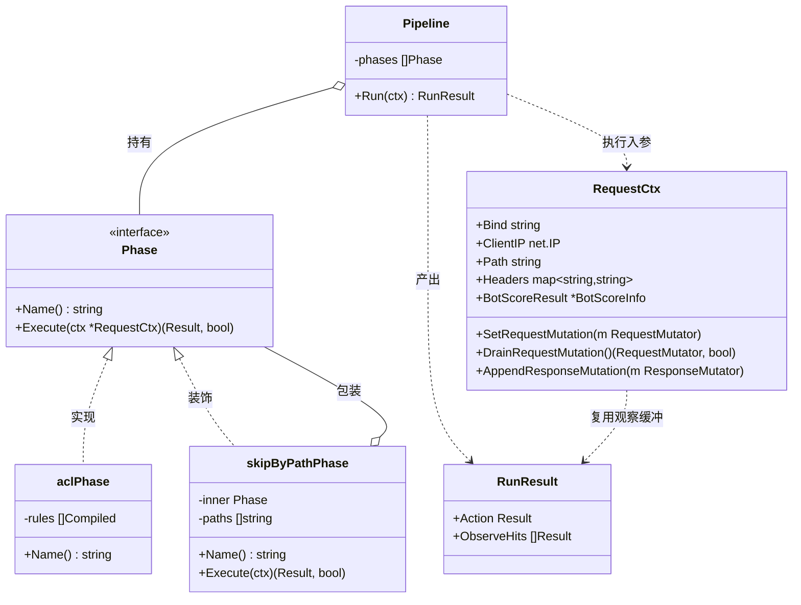
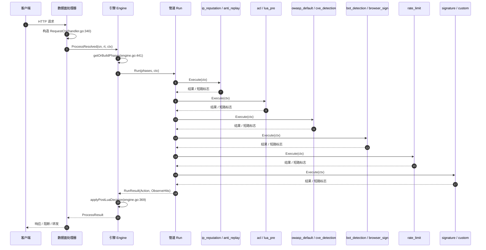
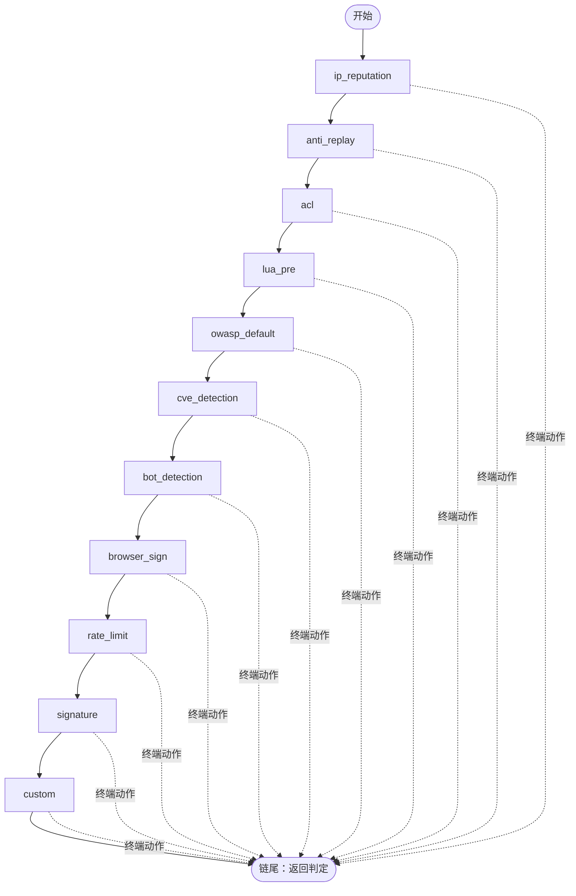
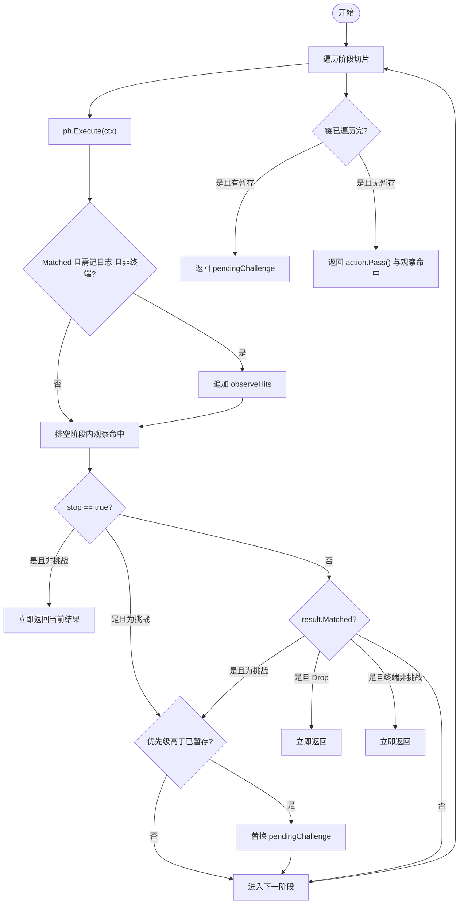
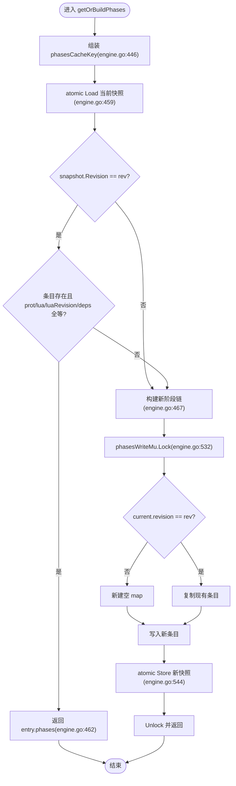
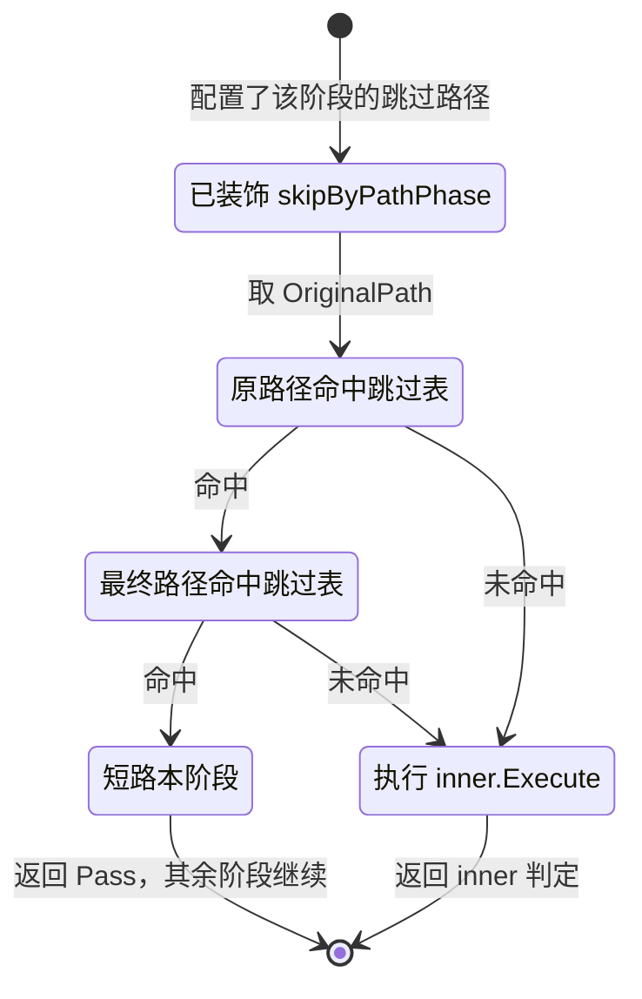
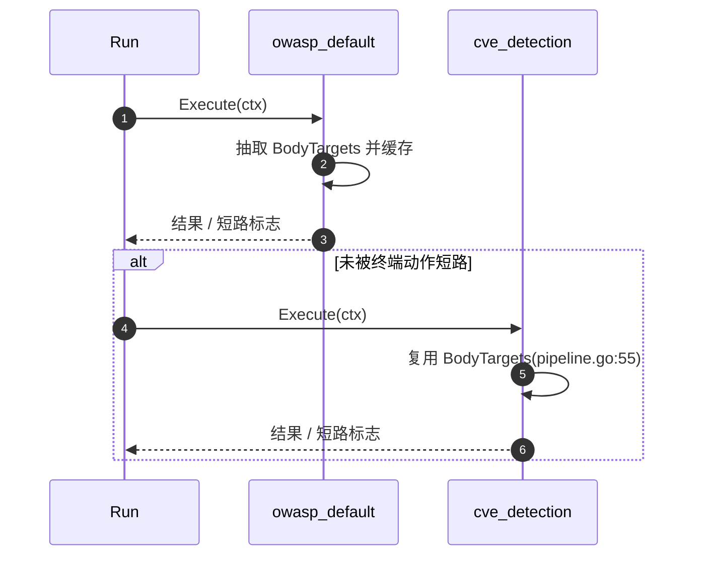
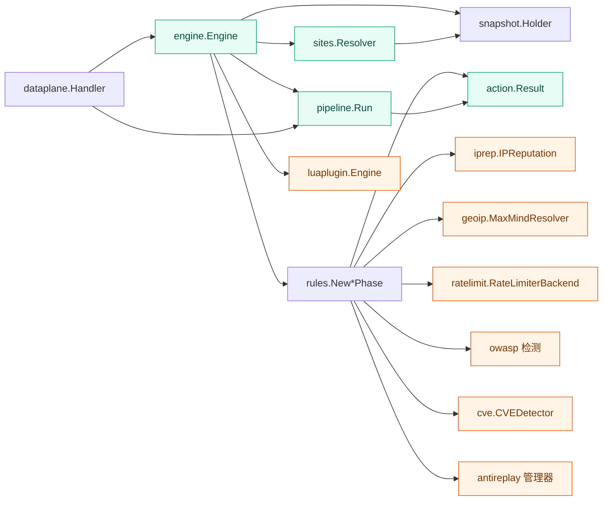

# 管道执行机制

> [返回 WAF 引擎系统](../WAF 引擎系统.md)

<cite>
**本文档引用的文件**
- [pipeline.go](file://internal/core/pipeline/pipeline.go)
- [pool.go](file://internal/core/pipeline/pool.go)
- [engine.go](file://internal/core/engine/engine.go)
- [phases.go](file://internal/core/rules/phases.go)
- [lua_phase.go](file://internal/core/rules/lua_phase.go)
- [phase_skip.go](file://internal/core/rules/phase_skip.go)
- [compiler.go](file://internal/core/rules/compiler.go)
- [action.go](file://internal/core/action/action.go)
- [snapshot.go](file://internal/snapshot/snapshot.go)
- [protection.go](file://internal/store/protection.go)
- [runtime.go](file://internal/waf/luaplugin/runtime.go)
- [server.go](file://internal/app/server.go)
- [handler.go](file://internal/dataplane/handler.go)
- [metrics.go](file://internal/dataplane/metrics/metrics.go)
</cite>

## 目录

1. [简介](#简介)
2. [项目结构](#项目结构)
3. [核心组件](#核心组件)
4. [架构总览](#架构总览)
5. [详细组件分析](#详细组件分析)
6. [依赖关系分析](#依赖关系分析)
7. [性能考虑](#性能考虑)
8. [故障排查指南](#故障排查指南)
9. [结论](#结论)
10. [附录](#附录)

## 简介
本文档系统性阐述 My-OpenWaf 的管道执行机制，围绕 Phase 接口、Run 函数、阶段链执行顺序、并行执行策略、短路机制与缓存失效机制进行深入解析。文档同时提供性能监控与调试技巧，帮助开发者理解并优化 WAF 请求处理流水线。

## 项目结构
My-OpenWaf 的管道执行机制由以下模块协同实现：

| 模块 | 路径 | 职责 | 规模(行) | 对外暴露 |
|---|---|---|---:|---|
| 管道与上下文 | `internal/core/pipeline` | `Phase` 接口、`RequestCtx`、`Run` | 678 | `pipeline.Run`、`pipeline.Phase` |
| 上下文对象池 | `internal/core/pipeline/pool.go` | `sync.Pool` 复用 `RequestCtx` | 113 | `AcquireCtx`、`ReleaseCtx` |
| 阶段实现 | `internal/core/rules` | 各检测阶段与匹配器 | 4048 | `rules.New*Phase` |
| 阶段跳过装饰器 | `internal/core/rules/phase_skip.go` | 按路径短路单个阶段 | 49 | `rules.NewSkipByPathPhase` |
| 引擎编排 | `internal/core/engine` | 装配阶段链并驱动执行 | 646 | `Engine.Process`、`Engine.ProcessResolved` |
| 动作模型 | `internal/core/action` | 动作类型、终端优先级 | 393 | `action.TerminalPriority` |
| 数据面入口 | `internal/dataplane` | 构造上下文、调用引擎 | 8836 | `dataplane.Handler` |
| 数据面指标 | `internal/dataplane/metrics` | QPS 与命中聚合 | 161 | `Metrics` |

**图表来源**
- [engine.go:82-127](file://internal/core/engine/engine.go#L82-L127)
- [engine.go:441-548](file://internal/core/engine/engine.go#L441-L548)
- [pipeline.go:276-280](file://internal/core/pipeline/pipeline.go#L276-L280)
- [pipeline.go:517-560](file://internal/core/pipeline/pipeline.go#L517-L560)
- [pool.go:19-34](file://internal/core/pipeline/pool.go#L19-L34)
- [phases.go:131-192](file://internal/core/rules/phases.go#L131-L192)
- [lua_phase.go:35-53](file://internal/core/rules/lua_phase.go#L35-L53)
- [phase_skip.go:31-49](file://internal/core/rules/phase_skip.go#L31-L49)
- [compiler.go:39-78](file://internal/core/rules/compiler.go#L39-L78)
- [handler.go:340-529](file://internal/dataplane/handler.go#L340-L529)
- [server.go:395-401](file://internal/app/server.go#L395-L401)

**章节来源**
- [engine.go:82-127](file://internal/core/engine/engine.go#L82-L127)
- [pipeline.go:276-280](file://internal/core/pipeline/pipeline.go#L276-L280)
- [pool.go:19-34](file://internal/core/pipeline/pool.go#L19-L34)
- [handler.go:340-529](file://internal/dataplane/handler.go#L340-L529)

## 核心组件

| 符号 | 定义位置 | 签名 | 职责 |
|---|---|---|---|
| `Phase` | `pipeline.go:277-280` | `Name() string; Execute(ctx *RequestCtx) (action.Result, bool)` | 单个管道阶段的契约 |
| `Run` | `pipeline.go:517` | `Run(phases []Phase, ctx *RequestCtx) RunResult` | 顺序执行阶段链 |
| `RunResult` | `pipeline.go:494-497` | `{Action action.Result; ObserveHits []action.Result}` | 链执行的最终输出 |
| `RequestCtx` | `pipeline.go:15-100` | 请求解码数据 + 每请求缓存 + 改写意图 | 阶段间唯一上下文载体 |
| `Pipeline` | `pipeline.go:500-506` | `New(phases ...Phase) *Pipeline` | 兼容包装，`Run` 委托到包级函数 |
| `RequestMutator` | `pipeline.go:290-297` | `{Method,Path,RawQuery,Body *; SetHeaders; DeleteHeaders}` | 阶段产生的请求改写意图 |
| `ResponseMutator` | `pipeline.go:463-473` | `{ScriptName, StatusCode, Body, SetHeaders, DeleteHeaders}` | 管道外阶段的响应改写意图 |
| `TerminalPriority` | `action.go:88-119` | `func(t Type) int` | 挑战延迟的覆盖判据 |
| `ctxPool` | `pool.go:20-28` | `sync.Pool` | 复用 `RequestCtx` |

**图表来源**
- [pipeline.go:276-280](file://internal/core/pipeline/pipeline.go#L276-L280)
- [pipeline.go:494-506](file://internal/core/pipeline/pipeline.go#L494-L506)
- [pipeline.go:15-100](file://internal/core/pipeline/pipeline.go#L15-L100)
- [pipeline.go:290-297](file://internal/core/pipeline/pipeline.go#L290-L297)
- [pipeline.go:463-473](file://internal/core/pipeline/pipeline.go#L463-L473)
- [phase_skip.go:19-49](file://internal/core/rules/phase_skip.go#L19-L49)
- [phases.go:131-146](file://internal/core/rules/phases.go#L131-L146)

**章节来源**
- [pipeline.go:15-100](file://internal/core/pipeline/pipeline.go#L15-L100)
- [pipeline.go:276-297](file://internal/core/pipeline/pipeline.go#L276-L297)
- [pipeline.go:463-506](file://internal/core/pipeline/pipeline.go#L463-L506)
- [phase_skip.go:19-49](file://internal/core/rules/phase_skip.go#L19-L49)
- [phases.go:131-146](file://internal/core/rules/phases.go#L131-L146)
- [action.go:88-119](file://internal/core/action/action.go#L88-L119)
- [pool.go:19-28](file://internal/core/pipeline/pool.go#L19-L28)

## 架构总览
执行阶段系统采用“阶段链”模式：引擎按站点有效保护配置动态构建阶段序列（`engine.go:467-529`），`Run` 依次执行并遵循严格的优先级短路策略（`pipeline.go:517-560`）。阶段间通过 `RequestCtx` 共享数据，动作结果携带阶段名与分类，便于审计与可视化。

**图表来源**
- [engine.go:331-378](file://internal/core/engine/engine.go#L331-L378)
- [engine.go:441-548](file://internal/core/engine/engine.go#L441-L548)
- [pipeline.go:517-560](file://internal/core/pipeline/pipeline.go#L517-L560)
- [handler.go:340-529](file://internal/dataplane/handler.go#L340-L529)

**章节来源**
- [engine.go:331-378](file://internal/core/engine/engine.go#L331-L378)
- [engine.go:441-548](file://internal/core/engine/engine.go#L441-L548)
- [pipeline.go:517-560](file://internal/core/pipeline/pipeline.go#L517-L560)

## 详细组件分析

### Phase 接口与执行顺序
- 阶段接口：`Phase` 定义 `Name()` 与 `Execute(ctx)` 两个方法，返回 `(action.Result, bool)`，其中 `bool` 表示该阶段是否要求短路（`pipeline.go:277-280`）。
- 执行顺序：引擎在 `getOrBuildPhases` 中按下列顺序装配，仅当开关或依赖满足时入链（`engine.go:467-529`，容量预分配 11）：

| 序 | 阶段名 | 构造位置 | 入链条件 | 短路语义 |
|:--:|---|---|---|---|
| 1 | `ip_reputation` | `engine.go:479-481` | `e.ipRep != nil` | 黑名单 `intercept` 立即短路 |
| 2 | `anti_replay` | `engine.go:482-484` | 管理器已挂载且 `rt.AntiReplayEnabled` | 校验失败按配置动作 |
| 3 | `acl` | `engine.go:486-488` | `len(cr.ACL) > 0` | 首条命中即返回其动作 |
| 4 | `lua_pre` | `engine.go:492-494` | Lua 引擎存在 pre 脚本 | 脚本动作可终止 |
| 5 | `owasp_default` | `engine.go:496-498` | `prot.OWASPEnabled` | 命中按 `OWASPAction` |
| 6 | `cve_detection` | `engine.go:499-501` | `prot.CVEEnabled` 且检测器非空 | 命中按 `CVEAction` |
| 7 | `bot_detection` | `engine.go:503-510` | `prot.BotDetectionEnabled` | 高危可终止 |
| 8 | `browser_sign` | `engine.go:513-515` | `prot.BrowserSignEnabled` | 失败按 `BrowserSignAction` |
| 9 | `rate_limit` | `engine.go:517-520` | 开关开启且限流后端非空 | 超限按配置动作 |
| 10 | `signature` | `engine.go:524-526` | `len(cr.Signature) > 0` | 首条命中即返回 |
| 11 | `custom` | `engine.go:527-529` | `len(cr.Custom) > 0` | 命中终端动作即短路 |

- `lua_post` 不在链上：管道遇终止动作即返回，链尾阶段读不到「已被拦截」的判定，故后置脚本在 `Run` 之后执行（`engine.go:366-371`）。
- 阶段名取值以 `Name()` 实现为准：`acl`(phases.go:146)、`signature`(167)、`custom`(188)、`rate_limit`(314)、`ip_reputation`(356)、`bot_detection`(488)、`owasp_default`(616)、`cve_detection`(742)、`anti_replay`(1251)、`browser_sign`(1351)、`lua_pre`/`lua_post`(lua_phase.go:39-43)。

**图表来源**
- [engine.go:467-529](file://internal/core/engine/engine.go#L467-L529)
- [engine.go:366-371](file://internal/core/engine/engine.go#L366-L371)
- [phases.go:146-1351](file://internal/core/rules/phases.go#L146-L1351)
- [lua_phase.go:39-43](file://internal/core/rules/lua_phase.go#L39-L43)

**章节来源**
- [engine.go:366-371](file://internal/core/engine/engine.go#L366-L371)
- [engine.go:467-529](file://internal/core/engine/engine.go#L467-L529)
- [phases.go:146-1351](file://internal/core/rules/phases.go#L146-L1351)
- [lua_phase.go:39-43](file://internal/core/rules/lua_phase.go#L39-L43)

### Run 函数工作机制
`Run` 顺序遍历阶段切片，每步的输入输出与失败分支如下（`pipeline.go:517-560`）：

| 步 | 动作 | 执行位置 | 输入 | 输出 | 可观测点 |
|:--:|---|---|---|---|---|
| 1 | 复用观察缓冲 | `pipeline.go:518` | `ctx.observeHitsBuf` | 长度 0 的切片 | 无分配 |
| 2 | 执行阶段 | `pipeline.go:522` | `ctx` | `(result, stop)` | `result.Phase` |
| 3 | 收集观察命中 | `pipeline.go:523-525` | `Matched && ShouldLog && !IsTerminal` | 追加 `observeHits` | `RunResult.ObserveHits` |
| 4 | 排空阶段内命中 | `pipeline.go:526-528` | `ctx.DrainPhaseObserveHits()` | 追加缓冲命中 | 阶段内多次观察 |
| 5 | 短路分支 | `pipeline.go:529-537` | `stop == true` | 立即返回或暂存挑战 | `pendingChallenge` |
| 6 | 挑战优先级比较 | `pipeline.go:533` | 两侧 `TerminalPriority` | 保留更严重者 | `action.go:88-119` |
| 7 | 非短路命中分支 | `pipeline.go:539-553` | `result.Matched` | Drop/终端立即返回 | 返回码 |
| 8 | 链尾收敛 | `pipeline.go:556-559` | `pendingChallenge` | 挑战或 `action.Pass()` | 默认放行 |

- 观察命中只在 `ShouldLog()` 为真且非终端时收集（`pipeline.go:523-525`、`action.go:261-272`）。
- `Pipeline.Run` 方法保留向后兼容，实际委托到包级 `Run`（`pipeline.go:562-565`）。

**图表来源**
- [pipeline.go:517-565](file://internal/core/pipeline/pipeline.go#L517-L565)
- [action.go:168-179](file://internal/core/action/action.go#L168-L179)
- [action.go:261-272](file://internal/core/action/action.go#L261-L272)

**章节来源**
- [pipeline.go:517-565](file://internal/core/pipeline/pipeline.go#L517-L565)
- [action.go:168-179](file://internal/core/action/action.go#L168-L179)
- [action.go:261-272](file://internal/core/action/action.go#L261-L272)

### getOrBuildPhases 方法与阶段链构建
`getOrBuildPhases` 返回缓存的阶段链，未命中则构建一条（`engine.go:441-548`）。

| 步 | 动作 | 执行位置 | 输入 | 输出 | 失败分支 |
|:--:|---|---|---|---|---|
| 1 | 组装缓存键 | `engine.go:446-450` | `rt.PolicyID`、`rt.Site.ID`、`rt.AntiReplayEnabled` | `phasesCacheKey` | — |
| 2 | 读取 Lua 代次 | `engine.go:451-455` | `luaPlugins.Load()` | `luaRevision` | 引擎为 nil 取 0 |
| 3 | 读取依赖打包体 | `engine.go:456` | `phaseDeps.Load()` | `*phaseRuntimeConfig` | 回退默认（`engine.go:129-144`） |
| 4 | 无锁快路径 | `engine.go:459-464` | `phasesPtr.Load()` | 命中则返回 `entry.phases` | 代次不符则重建 |
| 5 | 逐阶段装配 | `engine.go:467-529` | 编译规则 + 有效保护配置 | `[]Phase` | 开关关闭则跳过 |
| 6 | 写锁写时复制 | `engine.go:532-545` | 当前快照 map | 新 `phasesSnapshot` | 代次不符则整表重建 |

- 快路径为单次 `atomic.Pointer.Load()`，不加锁、无缓存行争用（`engine.go:458-464`）。
- 写侧由 `phasesWriteMu` 串行化：复制现有 map、加入新条目、整体 `Store`（`engine.go:532-545`）。
- 装配时若配置了按阶段跳过路径，阶段会被 `rules.NewSkipByPathPhase` 包一层装饰器；未配置则原样入链（`engine.go:471-477`、`phase_skip.go:31-36`）。

**图表来源**
- [engine.go:129-144](file://internal/core/engine/engine.go#L129-L144)
- [engine.go:441-548](file://internal/core/engine/engine.go#L441-L548)
- [phase_skip.go:31-36](file://internal/core/rules/phase_skip.go#L31-L36)

**章节来源**
- [engine.go:129-144](file://internal/core/engine/engine.go#L129-L144)
- [engine.go:441-548](file://internal/core/engine/engine.go#L441-L548)
- [phase_skip.go:31-36](file://internal/core/rules/phase_skip.go#L31-L36)

### phasesCache 失效机制
缓存条目的有效性由「快照代次 + 四项目录」共同判定，任一不符即重建（`engine.go:460-463`）：

| 判据 | 字段 | 位置 | 失效场景 |
|---|---|---|---|
| 快照代次 | `phasesSnapshot.revision` | `engine.go:68-71` | 任意配置 reload 使 `Snapshot.Revision` 变化 |
| 保护配置 | `entry.prot == prot` | `engine.go:53` | 站点 `EffectiveProtection` 指针变化 |
| Lua 引擎 | `entry.lua == lp` | `engine.go:54` | `SetLuaPlugins` 热替换 |
| Lua 代次 | `entry.luaRevision == luaRevision` | `engine.go:55` | 脚本增删改但快照代次未变 |
| 依赖打包体 | `entry.deps == deps` | `engine.go:56` | 限流后端 / 防重放 / GeoIP / bot 阈值变更 |
| 缓存键 | `policyID + siteID + antiReplayEnabled` | `engine.go:60-64` | 站点或策略维度隔离 |

- 之所以引入 Lua「代次」而非只比 revision：`ProtectionConfig` 在单个快照内不可变，指针相等即可判定；但脚本被增删改时快照 revision 可能不变，必须靠 `luaRevision` 让缓存失效（`engine.go:44-51`）。
- 依赖运行时通过 `updatePhaseDeps` 的 CAS 循环整体原子替换，保证请求路径读到始终是一致的打包体（`engine.go:146-158`）。

**章节来源**
- [engine.go:44-71](file://internal/core/engine/engine.go#L44-L71)
- [engine.go:146-158](file://internal/core/engine/engine.go#L146-L158)
- [engine.go:451-463](file://internal/core/engine/engine.go#L451-L463)

### 阶段跳过装饰器
`skipByPathPhase` 是装饰器而非独立前置阶段，用于表达「跳过 OWASP 但保留 CVE 与 Bot」这类细粒度需求（`phase_skip.go:9-49`）：

| 项 | 取值 | 位置 |
|---|---|---|
| 跳过命中返回 | `(action.Pass(), false)` | `phase_skip.go:46` |
| 参与匹配的路径 | `OriginalPath` 与 `Path` 都需命中 | `phase_skip.go:41-45` |
| `Name()` 透传 | `p.inner.Name()` | `phase_skip.go:38` |
| 允许跳过的阶段 | 9 个键 | `protection.go:326-336` |
| 空路径列表 | 直接返回 `inner`，不加装饰 | `phase_skip.go:32-34` |

允许的 9 个阶段键为 `ip_reputation`、`anti_replay`、`acl`、`lua_pre`、`owasp_default`、`cve_detection`、`bot_detection`、`browser_sign`、`rate_limit`；`signature` 与 `custom` 不在其列（`engine.go:522-523`）。

**图表来源**
- [phase_skip.go:19-49](file://internal/core/rules/phase_skip.go#L19-L49)
- [engine.go:471-477](file://internal/core/engine/engine.go#L471-L477)
- [protection.go:326-336](file://internal/store/protection.go#L326-L336)

**章节来源**
- [phase_skip.go:9-49](file://internal/core/rules/phase_skip.go#L9-L49)
- [engine.go:471-477](file://internal/core/engine/engine.go#L471-L477)
- [engine.go:522-523](file://internal/core/engine/engine.go#L522-L523)
- [protection.go:326-336](file://internal/store/protection.go#L326-L336)

### OWASP 与 CVE 执行关系
当前引擎将 OWASP 与 CVE 追加为两个独立的有序阶段：`owasp_default` 先入链（`engine.go:496-498`），`cve_detection` 后入链（`engine.go:499-501`）。两者都受保护配置控制，关闭对应开关或缺少检测器时不会进入阶段链；请求体目标由 `RequestCtx.BodyTargets` 缓存复用，避免两个阶段重复解析（`pipeline.go:53-56`）。

**图表来源**
- [engine.go:496-501](file://internal/core/engine/engine.go#L496-L501)
- [pipeline.go:53-56](file://internal/core/pipeline/pipeline.go#L53-L56)
- [phases.go:616-616](file://internal/core/rules/phases.go#L616-L616)
- [phases.go:742-742](file://internal/core/rules/phases.go#L742-L742)

**章节来源**
- [engine.go:496-501](file://internal/core/engine/engine.go#L496-L501)
- [pipeline.go:53-56](file://internal/core/pipeline/pipeline.go#L53-L56)

### 阶段间的短路机制与早期退出
短路语义完全由 `action.Result` 的三个谓词决定（`action.go:168-203`）：

| 谓词 | 位置 | 覆盖动作 | 管道后果 |
|---|---|---|---|
| `IsDrop()` | `action.go:182-190` | `drop` | 立即返回，不发送任何 HTTP 响应 |
| `IsTerminal()` | `action.go:168-179` | `intercept`/`drop`/`rate_limit`/挑战族/`redirect` | 非挑战立即返回 |
| `IsChallenge()` | `action.go:193-203` | `challenge`/`captcha_challenge`/`shield_challenge`/`chain_challenge` | 暂存并继续执行后续阶段 |
| `ShouldLog()` | `action.go:261-272` | 上述全部 + `observe` | 非终端时计入 `ObserveHits` |

- 优先级取值（`action.go:88-119`）：`drop=90`、`intercept=80`、`rate_limit=70`、挑战族=`60`、`redirect=50`、`observe=10`、其余 `0`。
- `allow` 与 `observe` 均非终端动作：ACL 命中 `allow` 时返回 `Matched=true` 但 `IsTerminal()=false`，管道继续执行后续阶段（`phases.go:112-128`、`action.go:168-179`）。
- 首个命中的规则即决定该阶段结果：`executeCompiledPhase` 在循环内命中后直接返回，不再评估同阶段其余规则（`phases.go:120-126`）。

**章节来源**
- [action.go:88-119](file://internal/core/action/action.go#L88-L119)
- [action.go:168-203](file://internal/core/action/action.go#L168-L203)
- [action.go:261-272](file://internal/core/action/action.go#L261-L272)
- [pipeline.go:529-553](file://internal/core/pipeline/pipeline.go#L529-L553)
- [phases.go:112-128](file://internal/core/rules/phases.go#L112-L128)

### RequestCtx 对象池与内存优化
对象池以 `sync.Pool` 复用 `RequestCtx`，`AcquireCtx` 取、`ReleaseCtx` 清（`pool.go:20-34`、`37-113`）。归还前会逐字段清零，并按容量上限决定是否重建，避免高并发偶发超大请求把 map/slice 永久抬高（`pool.go:10-17`）。

| 配置项 | 类型 | 默认值 | 作用域 | 生效方式 | 说明 |
|---|---|---|---|---|---|
| `maxPooledHeaderMapLen` | int | 128 | 池对象 | 归还时判定 | 超限则重建 `Headers` map（`pool.go:13`、`96-97`） |
| `maxPooledHeaderKeysCap` | int | 64 | 池对象 | 归还时判定 | 超限则重建 `HeaderKeys`（`pool.go:14`、`107-108`） |
| `maxPooledObserveHitsCap` | int | 32 | 池对象 | 归还时判定 | 命中/观察缓冲上限（`pool.go:15`、`74-87`） |
| `pooledHeaderKeysBaseCap` | int | 24 | 池对象 | 新建与重建 | `HeaderKeys` 基础容量（`pool.go:16`、`24`） |
| `Headers` 预分配容量 | int | 32 | 池对象 | `New` 与重建 | 减少扩容（`pool.go:23`） |
| `observeHitsBuf` 预分配容量 | int | 4 | 池对象 | `New` 与重建 | 观察命中缓冲（`pool.go:25`、`83`） |
| 请求体扫描上限 | int | 48 KB | 每请求 | 构造上下文时截断 | `handler.go:377-385`、`snapshot.go:493` |

- 非别名的 `matcherHeaders` 若曾装入大量键，归还时直接丢弃，避免 map bucket 残留（`pool.go:67-70`）。
- 改写后会调用 `ResetMutationCaches` 清空派生缓存，防止后续阶段读到改写前的解析结果（`pipeline.go:105-120`、`386`）。

**章节来源**
- [pool.go:10-113](file://internal/core/pipeline/pool.go#L10-L113)
- [pipeline.go:105-120](file://internal/core/pipeline/pipeline.go#L105-L120)
- [pipeline.go:386-386](file://internal/core/pipeline/pipeline.go#L386-L386)
- [handler.go:377-387](file://internal/dataplane/handler.go#L377-L387)
- [snapshot.go:493-493](file://internal/snapshot/snapshot.go#L493-L493)

### 请求与响应改写出口
阶段在管道内拿不到真实请求对象，因此改写意图先落在 `RequestCtx`，由数据面在管道返回后写回（`pipeline.go:282-297`）。

| 符号 | 位置 | 签名 | 职责 |
|---|---|---|---|
| `SetRequestMutation` | `pipeline.go:300-306` | `(mutation RequestMutator)` | 记录改写意图，后写覆盖先写 |
| `ApplyRequestMutation` | `pipeline.go:319-388` | `error` | 先整体校验再整体应用 |
| `DrainRequestMutation` | `pipeline.go:448-455` | `(RequestMutator, bool)` | 数据面取走意图 |
| `AppendResponseMutation` | `pipeline.go:476-481` | `(ResponseMutator)` | 保持脚本执行顺序 |
| `DrainResponseMutations` | `pipeline.go:484-491` | `[]ResponseMutator` | 转交 proxy 响应变换链 |
| `mutationHeaderName` | `pipeline.go:398-410` | `(string) (string, bool)` | 归一化并拒绝保留头 |

保留头清单：`host`、`content-length`、`transfer-encoding`、`connection`、`keep-alive`、`te`、`trailer`、`upgrade`、`proxy-authenticate`、`proxy-authorization`、`proxy-connection`（`pipeline.go:405-407`）。

**章节来源**
- [pipeline.go:282-306](file://internal/core/pipeline/pipeline.go#L282-L306)
- [pipeline.go:319-410](file://internal/core/pipeline/pipeline.go#L319-L410)
- [pipeline.go:448-491](file://internal/core/pipeline/pipeline.go#L448-L491)

## 依赖关系分析
- 组件耦合：
  - `Engine` 依赖 `sites.Resolver`、`snapshot.Holder`、`ratelimit`、`iprep`、`cve`、`drop`、`escalation`、`luaplugin`、`jsplugin`（`engine.go:8-23`、`83-113`）
  - 各阶段实现依赖 `waf` 能力包（`phases.go:20-30`）
  - `pipeline` 仅依赖 `action` 与 `bot/tlsfp`，不依赖 `engine`，接口契约解耦（`pipeline.go:3-12`）

| 调用方 ↓ / 被调方 → | action | pipeline | rules | engine | snapshot | waf 能力 |
|---|:---:|:---:|:---:|:---:|:---:|:---:|
| engine | ✓ | ✓ | ✓ | — | ✓ | ✓ |
| rules | ✓ | ✓ | — | ✗ | ✓ | ✓ |
| pipeline | ✓ | — | — | ✗ | — | ✓ |
| dataplane | ✓ | ✓ | ✓ | ✓ | ✓ | ✓ |
| action | — | — | — | ✗ | — | — |
| snapshot | — | — | — | ✗ | — | ✓ |

> `rules`、`pipeline`、`action`、`snapshot` 均不引用 `engine`（`✗` 表示「不允许」而非实际存在的违规依赖）；经核查其 import 段（`phases.go:3-30`、`pipeline.go:3-12`、`action.go:3-3`、`snapshot.go:3-17`）确实无反向引用，故无循环依赖。

**图表来源**
- [engine.go:8-23](file://internal/core/engine/engine.go#L8-L23)
- [engine.go:83-113](file://internal/core/engine/engine.go#L83-L113)
- [phases.go:3-30](file://internal/core/rules/phases.go#L3-L30)
- [pipeline.go:3-12](file://internal/core/pipeline/pipeline.go#L3-L12)
- [resolver.go:3-5](file://internal/core/sites/resolver.go#L3-L5)
- [handler.go:529-529](file://internal/dataplane/handler.go#L529-L529)

**章节来源**
- [engine.go:8-23](file://internal/core/engine/engine.go#L8-L23)
- [engine.go:83-113](file://internal/core/engine/engine.go#L83-L113)
- [phases.go:3-30](file://internal/core/rules/phases.go#L3-L30)
- [pipeline.go:3-12](file://internal/core/pipeline/pipeline.go#L3-L12)
- [action.go:3-3](file://internal/core/action/action.go#L3-L3)
- [snapshot.go:3-17](file://internal/snapshot/snapshot.go#L3-L17)

## 性能考虑
- 对象池：`RequestCtx` 复用配合容量上限回收，既降 GC 又避免 RSS 不回落（`pool.go:10-17`、`37-113`）。
- 无锁读取：两级缓存在热路径各只有一次 `atomic.Pointer.Load()`（`engine.go:391`、`459`）。
- 惰性派生：ALPN、密码套件、头顺序只在规则需要时才拼接并缓存（`phases.go:72-104`、`pipeline.go:232-257`）。
- 解析复用：`BodyTargets`、JSON 主体、查询值均带 Done 标记，跨阶段只解析一次（`pipeline.go:53-66`）。
- 短路策略：`drop`/终端动作立即返回，减少后续阶段无效计算（`pipeline.go:539-553`）。
- 预分配：阶段链切片按最大规模 11 预分配容量（`engine.go:467`）。

**章节来源**
- [pool.go:10-113](file://internal/core/pipeline/pool.go#L10-L113)
- [engine.go:391-467](file://internal/core/engine/engine.go#L391-L467)
- [pipeline.go:53-66](file://internal/core/pipeline/pipeline.go#L53-L66)
- [pipeline.go:232-257](file://internal/core/pipeline/pipeline.go#L232-L257)
- [phases.go:72-104](file://internal/core/rules/phases.go#L72-L104)

## 故障排查指南

| 症状 | 可能原因 | 排查方向 | 处置方案 |
|---|---|---|---|
| 阶段数与预期不符 | 开关或依赖未满足导致未入链 | `engine.go:479-529` 各条 `if` 条件 | 核对 `EffectiveProtection` 与挂载 setter |
| 修改 Lua 脚本不生效 | 缓存条目判据未覆盖代次 | `engine.go:452-461` 的 `luaRevision` | 确认 `luaplugin.Engine.Revision()` 递增 |
| 挑战页未出现 | 后续阶段产生了更高优先级终端动作 | `pipeline.go:533`、`action.go:88-119` | 查安全事件的 `Phase` 与动作类型 |
| 观察命中缺失 | 动作 `ShouldLog()` 为假 | `action.go:261-272` | 用 `observe` 或终端动作复测 |
| 跳过路径不生效 | 请求头/路径改写后最终路径未命中 | `phase_skip.go:41-45` 双路径判定 | 同时配置原始与最终路径 |
| 阶段跳过无效 | 该阶段不在允许键集合中 | `protection.go:326-336` | `signature`/`custom` 需停用规则本身 |
| 内存持续上涨 | 未归还池对象 | `handler.go:387` 的 `defer ReleaseCtx` | 检查自定义调用点是否成对归还 |
| 请求改写丢失 | 意图被后写覆盖或未 Drain | `pipeline.go:300-306`、`448-455` | 确认改写阶段顺序与消费点 |

**章节来源**
- [engine.go:452-529](file://internal/core/engine/engine.go#L452-L529)
- [pipeline.go:300-553](file://internal/core/pipeline/pipeline.go#L300-L553)
- [action.go:88-119](file://internal/core/action/action.go#L88-L119)
- [action.go:261-272](file://internal/core/action/action.go#L261-L272)
- [phase_skip.go:41-45](file://internal/core/rules/phase_skip.go#L41-L45)
- [protection.go:326-336](file://internal/store/protection.go#L326-L336)
- [handler.go:387-387](file://internal/dataplane/handler.go#L387-L387)

## 结论
执行阶段系统通过清晰的阶段划分、严格的优先级短路与可插拔的阶段实现，实现了高性能、可观测且易于扩展的 WAF 处理流水线。借助对象池、无锁缓存读取、惰性派生字段与完善的短路语义，系统在保障安全性的前提下兼顾了吞吐与稳定性。新增能力只需实现 `Phase` 并在 `getOrBuildPhases` 中按序注册，无需改动 `Run` 的判定逻辑。

[本节为总结，无需特定文件来源]

## 附录

### 关键实现索引

| 主题 | 位置 |
|---|---|
| `Phase` 接口契约 | `internal/core/pipeline/pipeline.go:277-280` |
| `Run` 主循环与短路 | `internal/core/pipeline/pipeline.go:517-560` |
| 阶段链装配顺序 | `internal/core/engine/engine.go:467-529` |
| 阶段链缓存判据 | `internal/core/engine/engine.go:441-464` |
| 后置 Lua 覆盖规则 | `internal/core/engine/engine.go:234-322` |
| 路径跳过装饰器 | `internal/core/rules/phase_skip.go:19-49` |
| 终端优先级定义 | `internal/core/action/action.go:88-119` |
| 对象池与容量上限 | `internal/core/pipeline/pool.go:10-113` |

[本节为总结，无需特定文件来源]

### 最佳实践建议
- 新阶段必须返回稳定的 `Name()`，且与 `SkipPathPhaseKeys` 白名单一致，否则路径跳过配置会被静默丢弃（`protection.go:354-360`）。
- 阶段内应尽早短路，把昂贵检测放在链尾之后，与现有 `signature`/`custom` 排位保持一致（`engine.go:522-529`）。
- 阶段不应直接改写真实请求对象，一律通过 `RequestMutator` 表达意图（`pipeline.go:282-297`）。
- 判定失败路径要区分「未命中」与「命中但仅观察」，避免 `ObserveHits` 与终端动作混淆（`pipeline.go:523-525`）。

[本节为总结，无需特定文件来源]
