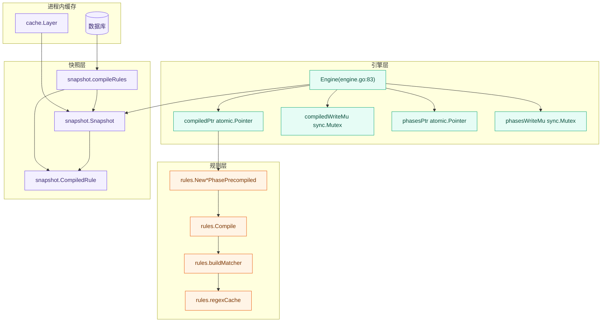
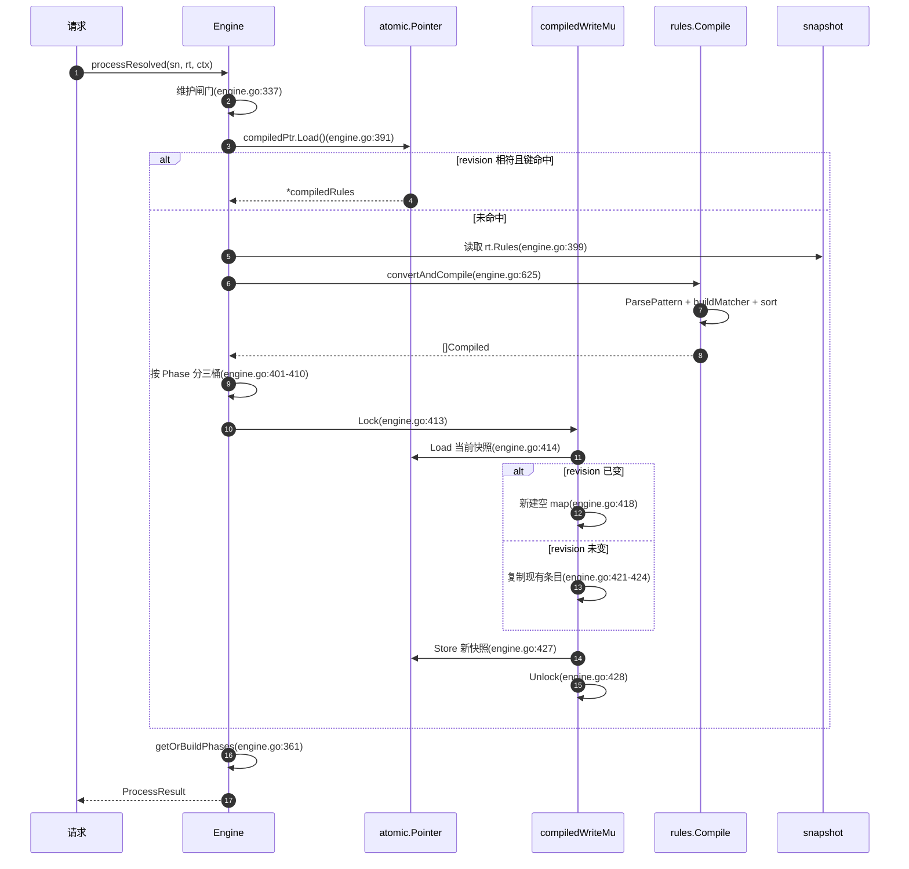
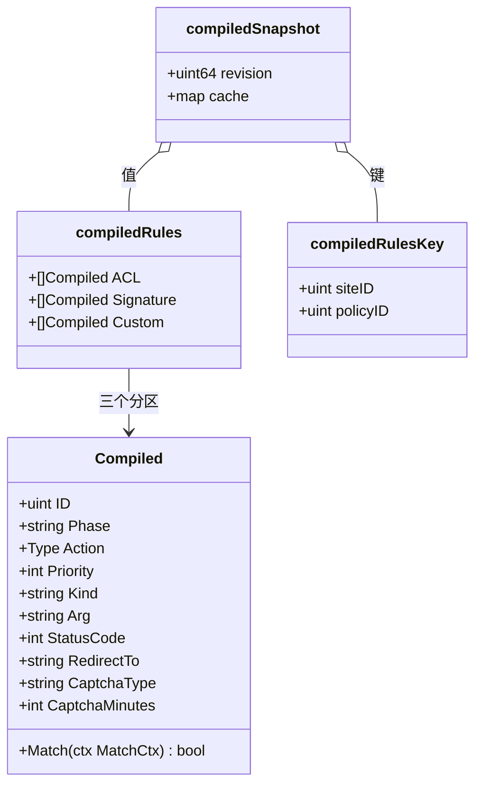
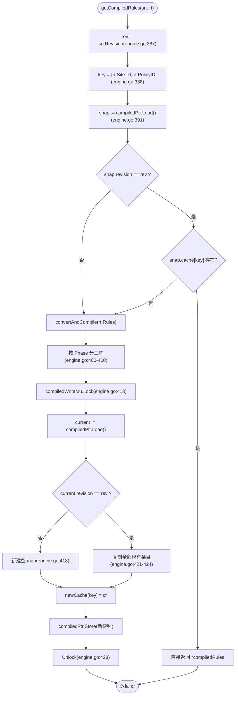
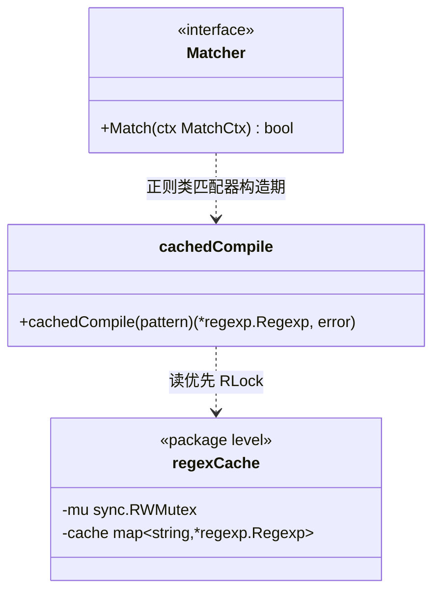
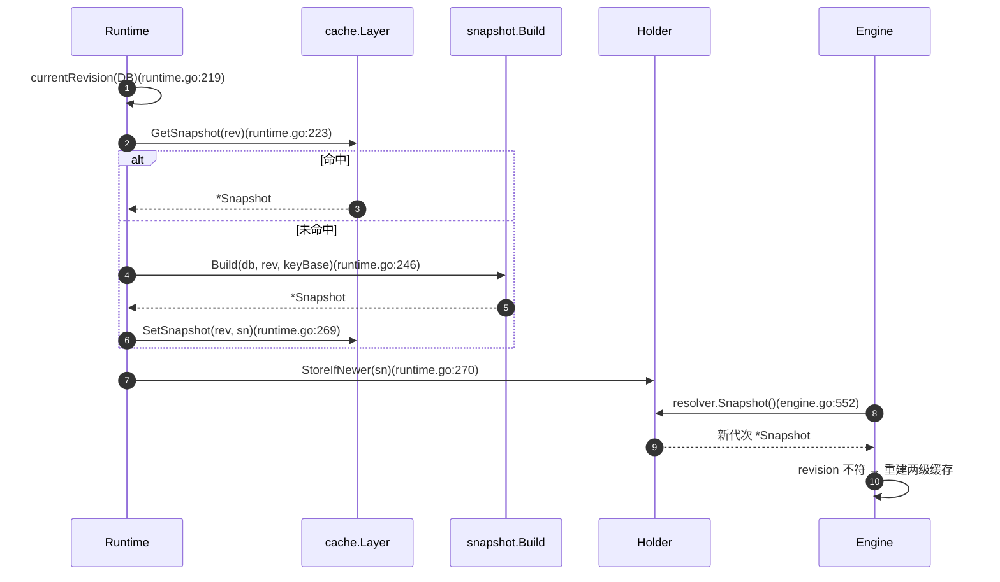
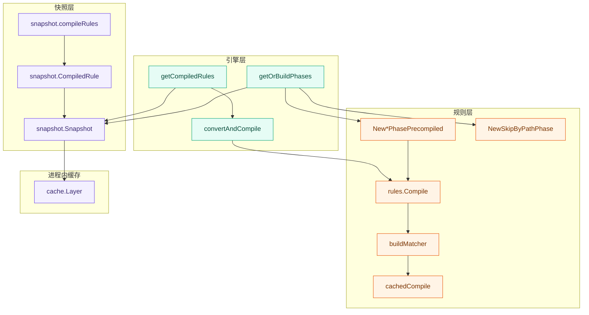

# 规则编译缓存

> [返回 WAF 引擎系统](../WAF 引擎系统.md)

<cite>
**本文档引用的文件**
- [engine.go](file://internal/core/engine/engine.go)
- [compiler.go](file://internal/core/rules/compiler.go)
- [matcher.go](file://internal/core/rules/matcher.go)
- [phases.go](file://internal/core/rules/phases.go)
- [phase_skip.go](file://internal/core/rules/phase_skip.go)
- [validate.go](file://internal/core/rules/validate.go)
- [snapshot.go](file://internal/snapshot/snapshot.go)
- [build.go](file://internal/snapshot/build.go)
- [policy.go](file://internal/store/policy.go)
- [migrate.go](file://internal/store/migrate.go)
- [layer.go](file://internal/cache/layer.go)
- [runtime.go](file://internal/core/runtime.go)
</cite>

## 目录

1. [简介](#简介)
2. [项目结构](#项目结构)
3. [核心组件](#核心组件)
4. [架构总览](#架构总览)
5. [详细组件分析](#详细组件分析)
6. [依赖关系分析](#依赖关系分析)
7. [性能考虑](#性能考虑)
8. [故障排查指南](#故障排查指南)
9. [结论](#结论)
10. [附录](#附录)

## 简介

规则编译缓存是 My-OpenWaf WAF 引擎中的关键性能组件，用于避免每个请求重复执行「规则 DSL 解析 + 匹配器构建 + 排序」这一昂贵开销。本文档说明其真实实现：`compiledRules` 的三分区结构、`compiledSnapshot` 的不可变快照形态、`getCompiledRules` 的无锁读与写时复制、缓存键的实际构成，以及与阶段链缓存、快照代次之间的协同关系。

需要澄清的一点：引擎侧的规则缓存**没有 LRU、没有淘汰参数、没有命中率指标**，它靠「快照代次整体切换」来失效；带 `NumCounters`/`MaxCost`/`BufferItems` 的是另一层——进程内快照缓存 `cache.Layer`（`layer.go:29-39`）。两者常被混为一谈，本文分节说明。

## 项目结构

规则编译缓存位于引擎核心层，与规则层、快照层协作：

| 层 | 路径 | 职责 | 关键符号 | 位置 |
|---|---|---|---|---|
| 引擎缓存 | `internal/core/engine` | 缓存宿主与发布 | `compiledPtr`、`compiledWriteMu` | `engine.go:98-99` |
| 编译分区 | `internal/core/engine` | 按阶段分桶 | `compiledRules` | `engine.go:26-30` |
| 规则编译 | `internal/core/rules` | DSL → `Compiled` | `Compile`、`ParsePattern` | `compiler.go:40`、`146` |
| 匹配器 | `internal/core/rules` | 单条件判定 | `Matcher`、`buildMatcher` | `matcher.go:21`、`1473` |
| 正则缓存 | `internal/core/rules` | 复用已编译正则 | `regexCache`、`cachedCompile` | `matcher.go:1785-1808` |
| 快照层 | `internal/snapshot` | 轻量规则与代次 | `CompiledRule`、`Revision` | `snapshot.go:24-36`、`214` |
| 构建层 | `internal/snapshot` | 构建期编译 | `compileRules` | `build.go:920-936` |
| 快照缓存 | `internal/cache` | 进程内代次缓存 | `Layer` | `layer.go:24-62` |

**图表来源**
- [engine.go:26-113](file://internal/core/engine/engine.go#L26-L113)
- [engine.go:386-431](file://internal/core/engine/engine.go#L386-L431)
- [compiler.go:40-78](file://internal/core/rules/compiler.go#L40-L78)
- [matcher.go:1473-1473](file://internal/core/rules/matcher.go#L1473-L1473)
- [matcher.go:1785-1808](file://internal/core/rules/matcher.go#L1785-L1808)
- [snapshot.go:24-36](file://internal/snapshot/snapshot.go#L24-L36)
- [build.go:920-936](file://internal/snapshot/build.go#L920-L936)
- [layer.go:24-62](file://internal/cache/layer.go#L24-L62)

**章节来源**
- [engine.go:26-113](file://internal/core/engine/engine.go#L26-L113)
- [compiler.go:40-78](file://internal/core/rules/compiler.go#L40-L78)
- [snapshot.go:24-36](file://internal/snapshot/snapshot.go#L24-L36)
- [build.go:920-936](file://internal/snapshot/build.go#L920-L936)
- [layer.go:24-62](file://internal/cache/layer.go#L24-L62)

## 核心组件

| 符号 | 位置 | 类型 | 职责 |
|---|---|---|---|
| `compiledRules` | `engine.go:26-30` | `struct{ACL, Signature, Custom []rules.Compiled}` | 按阶段预分区的已编译规则 |
| `compiledRulesKey` | `engine.go:34-37` | `struct{siteID, policyID uint}` | 规则缓存键 |
| `compiledSnapshot` | `engine.go:39-42` | `struct{revision uint64; cache map[...]}` | 不可变缓存快照 |
| `Engine.compiledPtr` | `engine.go:98` | `atomic.Pointer[compiledSnapshot]` | 无锁读取入口 |
| `Engine.compiledWriteMu` | `engine.go:99` | `sync.Mutex` | 串行化写时复制 |
| `phasesSnapshot` | `engine.go:68-71` | `struct{revision; cache map[...]}` | 阶段链缓存快照 |
| `phasesEntry` | `engine.go:52-58` | `struct{prot, lua, luaRevision, deps, phases}` | 阶段链条目与有效性判据 |
| `rules.Compiled` | `compiler.go:13-29` | 含非导出 `matcher`/`runtimeAction`/`ruleIDStr`/`matchDesc` | 运行时可直接使用的规则 |
| `regexCache` | `matcher.go:1785-1788` | `struct{mu sync.RWMutex; cache map}` | 进程级正则复用 |

两级缓存形态对照：

| 维度 | 规则编译缓存 | 阶段链缓存 |
|---|---|---|
| 快照类型 | `compiledSnapshot` | `phasesSnapshot` |
| 缓存键 | `{siteID, policyID}` | `{policyID, siteID, antiReplayEnabled}` |
| 条目值 | `*compiledRules` | `*phasesEntry` |
| 额外判据 | 仅代次 | 保护配置指针、Lua 引擎、Lua 代次、依赖打包体指针 |
| 读取 | 单次 `atomic.Pointer.Load()` | 单次 `atomic.Pointer.Load()` |
| 写入 | `compiledWriteMu` 串行化后整体 `Store` | `phasesWriteMu` 串行化后整体 `Store` |
| 失效 | 代次不符时整表重建 | 代次不符时整表重建 |
| 定义位置 | `engine.go:26-42`、`98-99` | `engine.go:52-71`、`102-103` |

**章节来源**
- [engine.go:26-71](file://internal/core/engine/engine.go#L26-L71)
- [engine.go:98-103](file://internal/core/engine/engine.go#L98-L103)
- [compiler.go:13-29](file://internal/core/rules/compiler.go#L13-L29)
- [matcher.go:1785-1788](file://internal/core/rules/matcher.go#L1785-L1788)

## 架构总览

规则编译缓存在请求路径中的位置：

**图表来源**
- [engine.go:331-378](file://internal/core/engine/engine.go#L331-L378)
- [engine.go:386-431](file://internal/core/engine/engine.go#L386-L431)
- [engine.go:623-646](file://internal/core/engine/engine.go#L623-L646)
- [compiler.go:40-78](file://internal/core/rules/compiler.go#L40-L78)

**章节来源**
- [engine.go:331-431](file://internal/core/engine/engine.go#L331-L431)
- [engine.go:623-646](file://internal/core/engine/engine.go#L623-L646)

## 详细组件分析

### compiledRules 三分区结构

`getCompiledRules` 把编译结果按 `Compiled.Phase` 分到三个桶，供阶段链直接构造阶段：

| 分区 | 字段 | 来源 Phase | 消费的构造函数 | 位置 |
|---|---|---|---|---|
| ACL | `cr.ACL` | `"acl"` | `rules.NewACLPhasePrecompiled` | `engine.go:402-404`、`486-488` |
| Signature | `cr.Signature` | `"signature"` | `rules.NewSignaturePhasePrecompiled` | `engine.go:405-406`、`524-526` |
| Custom | `cr.Custom` | `"custom"` | `rules.NewCustomPhasePrecompiled` | `engine.go:407-408`、`527-529` |

- 其余 `Phase` 取值（`rate_limit`、`owasp_default`）不来自用户规则，因此 `switch` 分支不落入这三桶（`engine.go:401-410`、`policy.go:29-35`）。
- 规则模型 `store.Rule` 的 `Phase`/`Priority`/`Enabled`/`StatusCode`/`RedirectTo`/`CaptchaType`/`CaptchaMinutes` 字段即编译输入（`policy.go:70-97`）。

**图表来源**
- [engine.go:26-42](file://internal/core/engine/engine.go#L26-L42)
- [engine.go:401-410](file://internal/core/engine/engine.go#L401-L410)
- [compiler.go:13-29](file://internal/core/rules/compiler.go#L13-L29)

**章节来源**
- [engine.go:26-42](file://internal/core/engine/engine.go#L26-L42)
- [engine.go:401-410](file://internal/core/engine/engine.go#L401-L410)
- [engine.go:486-529](file://internal/core/engine/engine.go#L486-L529)
- [compiler.go:13-29](file://internal/core/rules/compiler.go#L13-L29)
- [policy.go:29-97](file://internal/store/policy.go#L29-L97)

### getCompiledRules 方法实现

| 步 | 动作 | 执行位置 | 输入 | 输出 | 说明 |
|:--:|---|---|---|---|---|
| 1 | 读代次 | `engine.go:387` | `sn.Revision` | `rev` | 缓存代次守卫 |
| 2 | 组装键 | `engine.go:388` | `rt.Site.ID`、`rt.PolicyID` | `compiledRulesKey` | 结构体键，非位运算 |
| 3 | 无锁快路径 | `engine.go:391-396` | `compiledPtr.Load()` | 命中返回 `*compiledRules` | 代次相符才认命中 |
| 4 | 编译 | `engine.go:399` | `rt.Rules` | `[]rules.Compiled` | 每站点每代至多一次 |
| 5 | 分区 | `engine.go:400-410` | `Phase` 字段 | `compiledRules` | 三分桶 |
| 6 | 写锁 | `engine.go:413` | — | 临界区 | 串行化发布 |
| 7 | 复制或删除 | `engine.go:414-425` | 当前快照 | `newCache` | 代次变更则整表重建 |
| 8 | 原子发布 | `engine.go:426-428` | 新 `compiledSnapshot` | — | 读者只会看到完整快照 |

- 缓存键就是 `{siteID, policyID}` 二元结构体（`engine.go:34-37`），代次不在键里，而是作为整张快照的守卫字段 `compiledSnapshot.revision`（`engine.go:40`）。
- 未命中路径的写时复制语义：先 `Load` 最新快照再决定是否复制，避免并发写者互相覆盖（`engine.go:414-425`）。

**图表来源**
- [engine.go:386-431](file://internal/core/engine/engine.go#L386-L431)
- [engine.go:623-646](file://internal/core/engine/engine.go#L623-L646)

**章节来源**
- [engine.go:386-431](file://internal/core/engine/engine.go#L386-L431)
- [engine.go:623-646](file://internal/core/engine/engine.go#L623-L646)

#### 缓存键生成机制

| 要素 | 取值 | 位置 |
|---|---|---|
| 键类型 | `compiledRulesKey` 结构体 | `engine.go:34-37` |
| 字段一 | `siteID uint`，来自 `rt.Site.ID` | `engine.go:388` |
| 字段二 | `policyID uint`，来自 `rt.PolicyID` | `engine.go:388` |
| 代次 | 不在键内，置于快照的 `revision` 字段 | `engine.go:40` |
| map 类型 | `map[compiledRulesKey]*compiledRules` | `engine.go:41` |

按站点分键的原因：同一策略在不同站点可能配套不同的站点级 CC 规则，构建期会把 `siteCCRules` 追加进该站点的规则集合（`build.go:275`），因此不能只按策略缓存。

#### 版本检查与失效机制

| 检查项 | 判据 | 不满足时 | 位置 |
|---|---|---|---|
| 快路径代次 | `snap.revision == rev` | 视为未命中，走编译 | `engine.go:392` |
| 写侧代次 | `current.revision != rev` | 整表重建而非清理单条 | `engine.go:416-418` |
| 阶段链保护配置 | `entry.prot == prot` | 重建链 | `engine.go:461` |
| 阶段链 Lua 代次 | `entry.luaRevision == luaRevision` | 重建链 | `engine.go:461` |
| 阶段链依赖体 | `entry.deps == deps` | 重建链 | `engine.go:461` |

- 失效策略是「整代替换」：新代次的第一次访问会建立一张只含自身条目的新 map，旧代条目随旧快照一起被垃圾回收，不存在逐条淘汰（`engine.go:416-427`）。
- 之所以阶段链要额外比 Lua 代次：脚本增删改时快照 `revision` 可能不变，只比代次会让缓存留下过期链（`engine.go:44-51`）。

**章节来源**
- [engine.go:34-51](file://internal/core/engine/engine.go#L34-L51)
- [engine.go:388-427](file://internal/core/engine/engine.go#L388-L427)
- [engine.go:451-461](file://internal/core/engine/engine.go#L451-L461)
- [build.go:275-275](file://internal/snapshot/build.go#L275-L275)

### 规则编译器工作流程

`rules.Compile` 的每步都是可核对的（`compiler.go:40-78`）：

| 步 | 动作 | 执行位置 | 失败处理 |
|:--:|---|---|---|
| 1 | 过滤停用规则 | `compiler.go:43-45` | 直接跳过 |
| 2 | 解析 pattern | `compiler.go:46` | `kind` 为空则跳过 |
| 3 | 校验 kind/arg | `compiler.go:51` | 有错误则降级 `neverMatcher` |
| 4 | 构建匹配器 | `compiler.go:52` | 见 `buildMatcher` |
| 5 | 填充元数据 | `compiler.go:54-69` | `ruleIDStr`、`matchDesc`、`runtimeAction` |
| 6 | 排序 | `compiler.go:71-76` | `Priority` 升序，同优先级按 `ID` 升序 |

- `ParsePattern` 把以 `{` 开头的 pattern 判为 `compound`，其余按首个冒号切分并校验前缀是否在 `knownPrefixes` 白名单内（`compiler.go:119-142`、`146-170`）。
- `neverMatcher` 保证坏规则「保留但不命中」，而不是让整条链失效（`compiler.go:50-53`、`matcher.go:504-508`）。
- `ensureCompiledMetadata` 只在缓存来的条目缺元数据时才复制切片补齐，避免热路径无谓分配（`compiler.go:87-115`）。

#### 正则表达式缓存

**图表来源**
- [matcher.go:1785-1808](file://internal/core/rules/matcher.go#L1785-L1808)
- [matcher.go:21-23](file://internal/core/rules/matcher.go#L21-L23)
- [matcher.go:1321-1378](file://internal/core/rules/matcher.go#L1321-L1378)

- 读路径 `RLock` 命中即返回，未命中释放读锁后编译，再以 `Lock` 回填（`matcher.go:1791-1807`）。
- 编译发生在**构建期**而非请求期：规则一旦进入缓存，匹配器里的 `*regexp.Regexp` 已被解析完毕，请求期只做 `Match`。
- 通配符类规则不走正则缓存，而是构建期编译成 `wildcardTester`（`matcher.go:1321-1378`）。

**章节来源**
- [matcher.go:21-23](file://internal/core/rules/matcher.go#L21-L23)
- [matcher.go:1321-1378](file://internal/core/rules/matcher.go#L1321-L1378)
- [matcher.go:1785-1808](file://internal/core/rules/matcher.go#L1785-L1808)
- [compiler.go:50-53](file://internal/core/rules/compiler.go#L50-L53)

#### 复合条件与频次限制

复合规则以 JSON 表达式树承载，`parseCompoundJSON` 递归构造 `and`/`or`/`not`/`if_else`/`cc_rate` 匹配器（`matcher.go:1810-1825`、`1878`）。规则级频次限制在**快照构建期**就被包装成 `cc_rate` 节点：`WindowSeconds` 与 `RequestCount` 同时大于 0 时生效，已是复合 JSON 的 pattern 不重复嵌套（`build.go:927`、`938-950`）。

`ccRateMatcher` 的计数键由 `ccRateKey` 生成，与阶段级限流的 `RateLimitKey` 是两套键空间（`matcher.go:107-109`、`phases.go:63-70`）。

**章节来源**
- [build.go:920-950](file://internal/snapshot/build.go#L920-L950)
- [matcher.go:107-109](file://internal/core/rules/matcher.go#L107-L109)
- [matcher.go:1810-1878](file://internal/core/rules/matcher.go#L1810-L1878)
- [phases.go:63-70](file://internal/core/rules/phases.go#L63-L70)

### 与快照系统的协同

快照层与引擎层各编译一次，职责不同：

| 阶段 | 执行位置 | 产物 | 是否含匹配器 |
|---|---|---|:--:|
| 构建期编译 | `build.go:920-936` | `snapshot.CompiledRule`（`Kind`/`Arg` 文本） | 否 |
| 引擎期编译 | `engine.go:625`、`compiler.go:40` | `rules.Compiled`（含 `matcher`） | 是 |

- 引擎入口 `convertAndCompile` 会用 `Kind + ":" + Arg` 还原 pattern；`compound` 规则例外，直接把原始 JSON 当 pattern 返回（以 `{` 开头）（`engine.go:623-646`、`compiler.go:152-154`）。
- 重载时 `Runtime.ReloadSnapshotWithPrePublish` 先读 `currentRevision`，再 `cache.Layer.GetSnapshot(rev)`；命中则直接 `StoreIfNewer`，未命中才 `snapshot.Build` 并回写缓存（`runtime.go:211-274`）。
- 每次重载都会用新 `Revision` 构造新快照对象，因此引擎两级缓存的代次守卫会同时失效（`snapshot.go:214`、`engine.go:392`、`engine.go:460`）。

**图表来源**
- [runtime.go:201-274](file://internal/core/runtime.go#L201-L274)
- [layer.go:44-62](file://internal/cache/layer.go#L44-L62)
- [build.go:47-47](file://internal/snapshot/build.go#L47-L47)
- [snapshot.go:213-214](file://internal/snapshot/snapshot.go#L213-L214)
- [engine.go:386-392](file://internal/core/engine/engine.go#L386-L392)

**章节来源**
- [runtime.go:201-274](file://internal/core/runtime.go#L201-L274)
- [layer.go:44-62](file://internal/cache/layer.go#L44-L62)
- [build.go:47-47](file://internal/snapshot/build.go#L47-L47)
- [build.go:920-936](file://internal/snapshot/build.go#L920-L936)
- [engine.go:386-392](file://internal/core/engine/engine.go#L386-L392)
- [engine.go:551-562](file://internal/core/engine/engine.go#L551-L562)

## 依赖关系分析

| 调用方 ↓ / 被调方 → | compiler | matcher | phases | snapshot | store | engine |
|---|:---:|:---:|:---:|:---:|:---:|:---:|
| engine | ✓ | ✓ | ✓ | ✓ | ✓ | — |
| compiler | — | ✓ | ✓ | — | ✓ | — |
| matcher | — | — | ✓ | — | — | ✗ |
| phases | — | ✓ | — | ✓ | ✓ | ✗ |
| snapshot | — | ✓ | — | — | ✓ | ✗ |
| store | — | — | — | ✗ | — | ✗ |

> `✗` 表示「不允许出现」而非实测存在的违规依赖。经核对 import 段（`compiler.go:3-10`、`phases.go:3-30`、`snapshot.go:3-17`、`store/policy.go:3-9`）均无反向引用 `engine` 或 `snapshot`，故无循环依赖。

**图表来源**
- [engine.go:386-431](file://internal/core/engine/engine.go#L386-L431)
- [engine.go:441-548](file://internal/core/engine/engine.go#L441-L548)
- [engine.go:623-646](file://internal/core/engine/engine.go#L623-L646)
- [compiler.go:3-10](file://internal/core/rules/compiler.go#L3-L10)
- [matcher.go:1473-1473](file://internal/core/rules/matcher.go#L1473-L1473)
- [phase_skip.go:31-36](file://internal/core/rules/phase_skip.go#L31-L36)
- [build.go:920-936](file://internal/snapshot/build.go#L920-L936)

**章节来源**
- [compiler.go:3-10](file://internal/core/rules/compiler.go#L3-L10)
- [phases.go:3-30](file://internal/core/rules/phases.go#L3-L30)
- [snapshot.go:3-17](file://internal/snapshot/snapshot.go#L3-L17)
- [policy.go:3-9](file://internal/store/policy.go#L3-L9)
- [engine.go:386-548](file://internal/core/engine/engine.go#L386-L548)

## 性能考虑

### 缓存收益与代价

| 机制 | 收益 | 代价 | 位置 |
|---|---|---|---|
| 代次守卫 | 热路径单次 `Load()` | 代次变更后首请求要重建整表 | `engine.go:391-396` |
| 按站点分键 | 站点级规则差异可缓存 | 站点数放大条目数 | `engine.go:34-37`、`388` |
| 三分区 | 构造阶段免过滤 | 需 `ensureCompiledMetadata` 补元数据 | `engine.go:400-410`、`compiler.go:87-115` |
| 构建期正则编译 | 请求期零正则解析 | 正则内存常驻至代次结束 | `matcher.go:1785-1808` |
| 写时复制发布 | 读者永远看到一致快照 | 每次未命中复制整张 map | `engine.go:413-428` |
| 阶段链预分配 | 免扩容 | 容量常量需与最大链长同步 | `engine.go:467` |

- 编译成本只在「每个站点、每个快照代次」至多发生一次（`engine.go:398` 注释）；稳态下所有请求走快路径。
- 规则缓存本身无淘汰与容量参数：map 大小由「站点数 × 策略数」界定，代次切换即整体丢弃，因此不需要 LRU（`engine.go:416-427`）。
- 只有进程内**快照**缓存带 ristretto 参数（`NumCounters=1e4`、`MaxCost=1<<20`、`BufferItems=64`，`layer.go:30-34`），其容量是「快照对象个数」而非规则数。

**章节来源**
- [engine.go:34-37](file://internal/core/engine/engine.go#L34-L37)
- [engine.go:388-427](file://internal/core/engine/engine.go#L388-L427)
- [engine.go:467-467](file://internal/core/engine/engine.go#L467-L467)
- [compiler.go:87-115](file://internal/core/rules/compiler.go#L87-L115)
- [matcher.go:1785-1808](file://internal/core/rules/matcher.go#L1785-L1808)
- [layer.go:30-34](file://internal/cache/layer.go#L30-L34)

### 调优建议

1. 控制站点差异化配置的数量：同一策略被尽量多站点共用，可让 `policyID` 相同的站点复用同一条目结构（键仍按站点区分，见 `engine.go:388`）。
2. 避免高频 reload：每次 `store.BumpRevision` 都会使两级缓存整体作废（`migrate.go:141-150`、`runtime.go:219-270`）。
3. 保持规则 `Enabled` 与 `Priority` 稳定：`Compile` 每次全量重排（`compiler.go:71-76`）。
4. 谨慎使用复合规则嵌套层数：`buildCompound` 为递归构造，深度直接影响单次编译耗时（`matcher.go:1878`）。

**章节来源**
- [engine.go:388-388](file://internal/core/engine/engine.go#L388-L388)
- [compiler.go:71-76](file://internal/core/rules/compiler.go#L71-L76)
- [matcher.go:1878-1878](file://internal/core/rules/matcher.go#L1878-L1878)
- [migrate.go:141-150](file://internal/store/migrate.go#L141-L150)
- [runtime.go:219-270](file://internal/core/runtime.go#L219-L270)

## 故障排查指南

| 症状 | 可能原因 | 诊断步骤 | 解决方案 |
|---|---|---|---|
| 规则改动不生效 | 快照代次未变，缓存仍命中 | 核对 `sn.Revision` 是否变化（`engine.go:387`） | 确认 `BumpRevision` 被调用并重载 |
| 阶段链是旧的 | 保护配置指针未变 | 检查 `rt.EffectiveProtection` 是否重建（`engine.go:354-357`） | 让构建期产出新的 `ProtectionConfig` |
| Lua 改动不生效 | 只比代次不够 | 打印 `lp.Revision()`（`engine.go:452-455`） | 确认脚本重载会推进 Lua 代次 |
| 编译耗时异常升高 | 大量站点同时首次访问 | 观察未命中是否集中在 reload 后 | 预热关键站点或降低 reload 频率 |
| 规则永不命中 | pattern 校验失败被降级 | `validateParsedPattern` 返回值（`validate.go:36`、`compiler.go:51-53`） | 修正 kind/arg 组合 |
| 规则被静默丢弃 | `Enabled=false` 或 `ParsePattern` 返回空 kind | `compiler.go:43-49` | 启用规则或修正 pattern 前缀 |
| 内存不回落 | 旧代快照被在途请求持有 | 检查 reload 是否在高峰期密集发生 | 降低 reload 频率，复用同代配置 |

**章节来源**
- [engine.go:354-461](file://internal/core/engine/engine.go#L354-L461)
- [compiler.go:43-53](file://internal/core/rules/compiler.go#L43-L53)
- [validate.go:36-36](file://internal/core/rules/validate.go#L36-L36)
- [runtime.go:219-270](file://internal/core/runtime.go#L219-L270)

## 结论

规则编译缓存用「结构体键 + 代次守卫 + 无锁读 + 写时复制发布」四个手段，把昂贵的 DSL 解析与匹配器构造压缩到「每站点每代至多一次」。它与阶段链缓存共享同一失效语义，差别在于阶段链条目额外携带保护配置指针、Lua 引擎与 Lua 代次、依赖打包体指针四项判据，以覆盖「快照代次不变但插件已更新」这一场景。规则缓存不设淘汰策略，容量由站点与策略的组合数天然界定；带容量参数的是进程内快照缓存 `cache.Layer`，二者不应混淆。

[本节为总结，无需特定文件来源]

## 附录

### 代码示例路径

| 主题 | 位置 |
|---|---|
| 缓存结构定义 | `internal/core/engine/engine.go:26-71` |
| 缓存宿主字段 | `internal/core/engine/engine.go:96-113` |
| 读快路径与写发布 | `internal/core/engine/engine.go:386-431` |
| 阶段链缓存判据 | `internal/core/engine/engine.go:441-464` |
| 规则编译入口 | `internal/core/rules/compiler.go:40-78` |
| pattern 解析 | `internal/core/rules/compiler.go:119-170` |
| 匹配器构造 | `internal/core/rules/matcher.go:1473` |
| 正则缓存 | `internal/core/rules/matcher.go:1785-1808` |
| 构建期规则编译 | `internal/snapshot/build.go:920-936` |
| 快照重载 | `internal/core/runtime.go:211-274` |

[本节为总结，无需特定文件来源]

### 配置项速查

| 配置项 | 类型 | 取值 | 作用域 | 说明 |
|---|---|---|---|---|
| 规则缓存键 | 结构体 | `{siteID, policyID}` | 引擎进程 | `engine.go:34-37` |
| 阶段链缓存键 | 结构体 | `{policyID, siteID, antiReplayEnabled}` | 引擎进程 | `engine.go:60-64` |
| 链容量预分配 | int | 11 | 单次构建 | `engine.go:467` |
| `NumCounters` | int64 | `1e4` | 快照缓存 | `layer.go:31` |
| `MaxCost` | int64 | `1 << 20` | 快照缓存 | `layer.go:32` |
| `BufferItems` | int64 | `64` | 快照缓存 | `layer.go:33` |
| 快照缓存键格式 | string | `snapshot:{revision}` | 快照缓存 | `layer.go:41`、`48` |
| 请求体扫描上限 | int | `48 * 1024` | 每请求 | `snapshot.go:493` |

**章节来源**
- [engine.go:34-64](file://internal/core/engine/engine.go#L34-L64)
- [engine.go:467-467](file://internal/core/engine/engine.go#L467-L467)
- [layer.go:30-48](file://internal/cache/layer.go#L30-L48)
- [snapshot.go:493-493](file://internal/snapshot/snapshot.go#L493-L493)