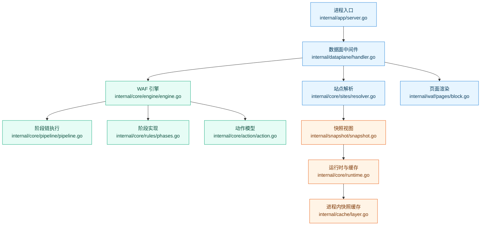
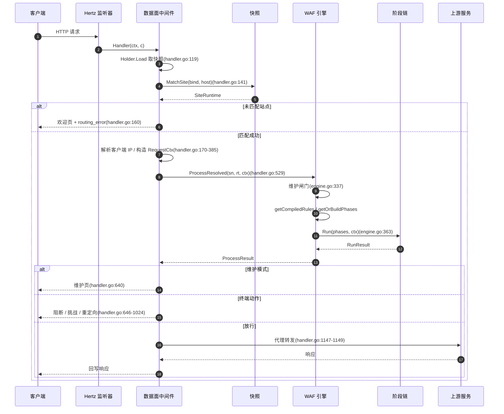
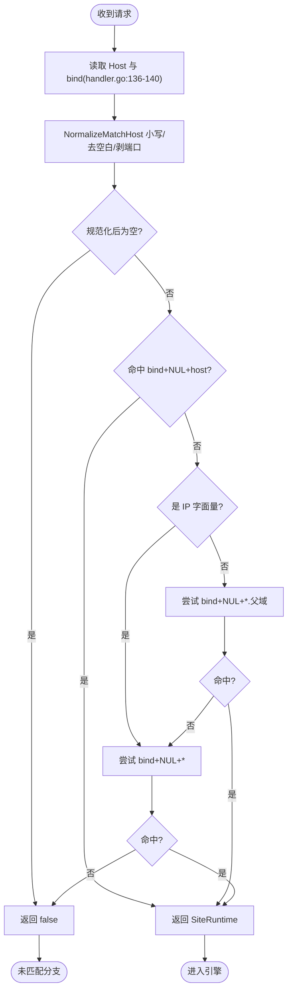
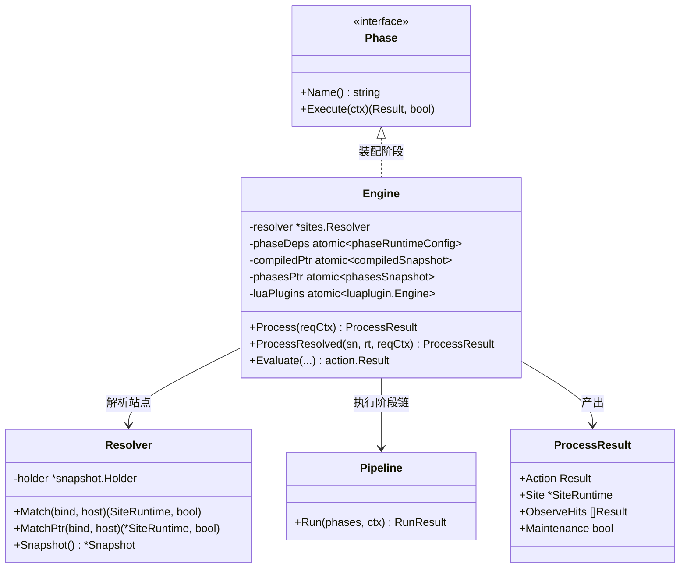
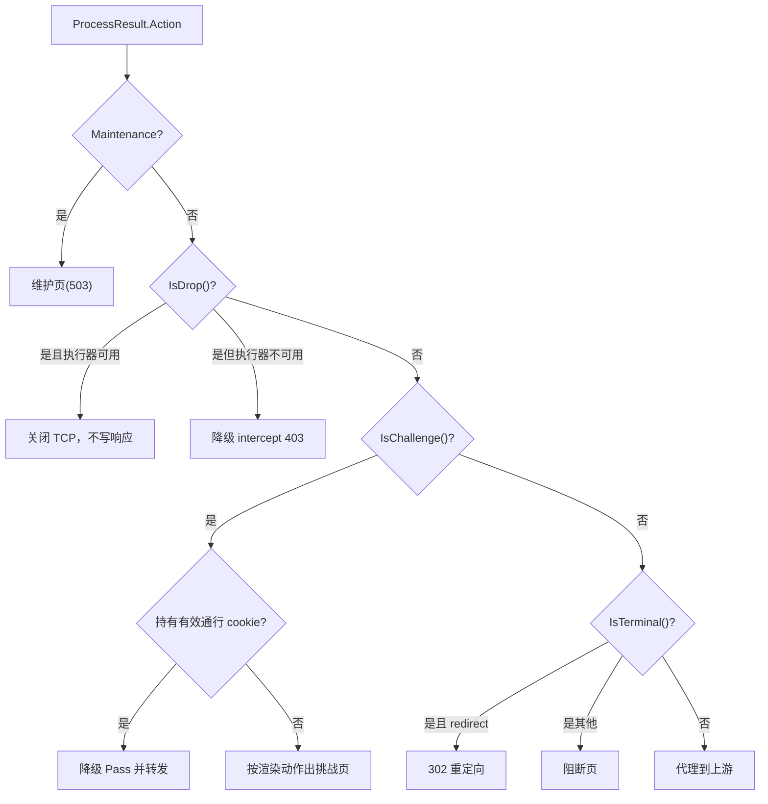
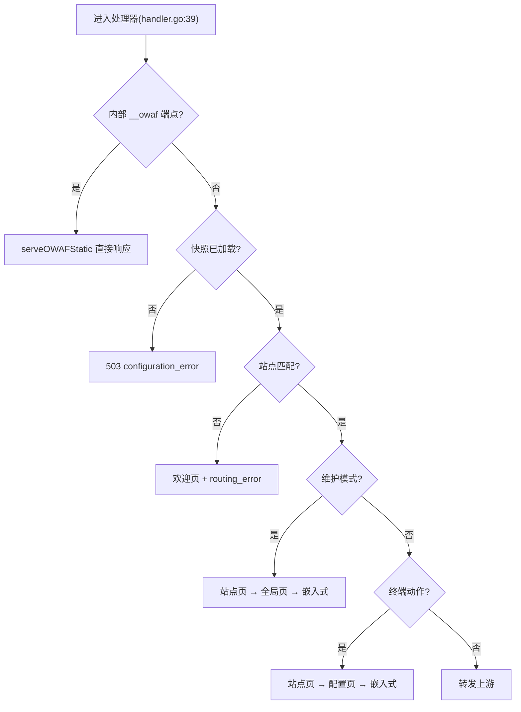
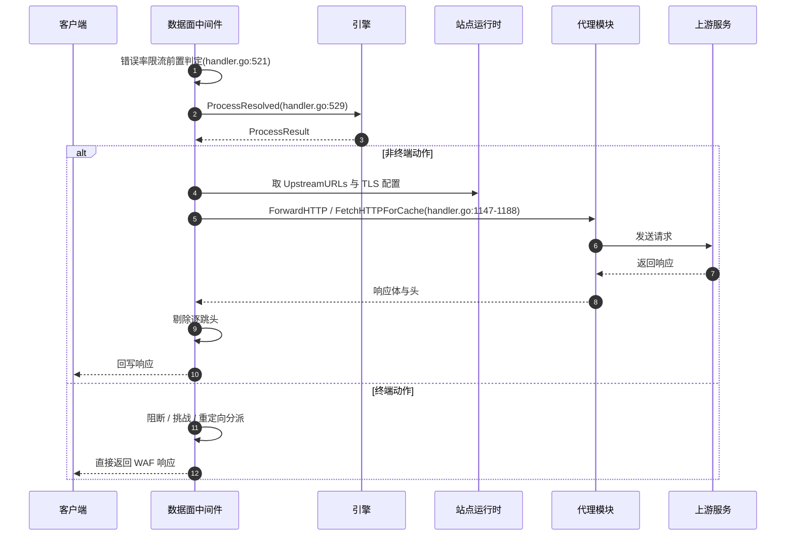
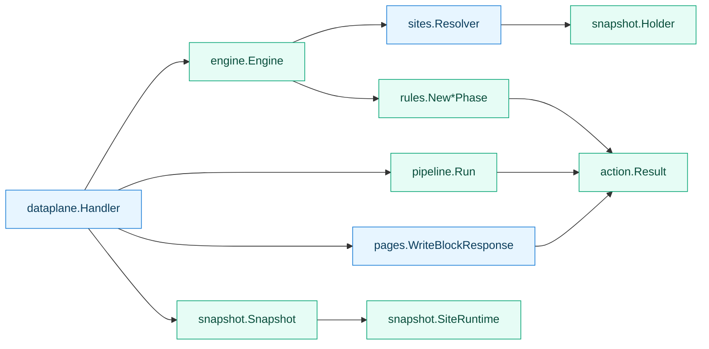

# 请求处理流程

> [返回 WAF 引擎系统](../WAF 引擎系统.md)

<cite>
**本文档引用的文件**
- [engine.go](file://internal/core/engine/engine.go)
- [pipeline.go](file://internal/core/pipeline/pipeline.go)
- [pool.go](file://internal/core/pipeline/pool.go)
- [compiler.go](file://internal/core/rules/compiler.go)
- [phases.go](file://internal/core/rules/phases.go)
- [action.go](file://internal/core/action/action.go)
- [snapshot.go](file://internal/snapshot/snapshot.go)
- [build.go](file://internal/snapshot/build.go)
- [resolver.go](file://internal/core/sites/resolver.go)
- [handler.go](file://internal/dataplane/handler.go)
- [block.go](file://internal/waf/pages/block.go)
- [runtime.go](file://internal/core/runtime.go)
- [layer.go](file://internal/cache/layer.go)
</cite>

## 目录

1. [简介](#简介)
2. [项目结构](#项目结构)
3. [核心组件](#核心组件)
4. [架构总览](#架构总览)
5. [详细组件分析](#详细组件分析)
6. [依赖关系分析](#依赖关系分析)
7. [性能考虑](#性能考虑)
8. [故障排查指南](#故障排查指南)
9. [结论](#结论)
10. [附录](#附录)

## 简介
本文面向请求处理流程，系统性阐述引擎如何处理单个 HTTP 请求的完整生命周期：从站点解析、上下文构造、阶段链执行到最终动作分派的每个步骤；深入解释 `Engine.Process` 与 `Engine.ProcessResolved` 的实现差异；阐明 `RequestCtx` 上下文的作用与传递机制、`ProcessResult` 的构成；给出关键路径的代码位置，覆盖维护模式、无站点匹配、降级与上游失败等异常场景，并总结缓存与对象池带来的性能收益。

## 项目结构
My-OpenWaf 的请求处理以“站点级监听 + 数据面中间件 + WAF 引擎 + 阶段链”为核心，配合不可变快照与预编译规则，形成高吞吐、低延迟的防护链路。

| 模块 | 路径 | 职责 | 关键符号 | 位置 |
|---|---|---|---|---|
| 数据面中间件 | `internal/dataplane` | 站点匹配、上下文构造、动作分派 | `Handler` | `handler.go:39` |
| 站点解析 | `internal/core/sites` | 按快照解析 (bind, host) | `Resolver.Match` | `resolver.go:24` |
| 快照视图 | `internal/snapshot` | 不可变配置与站点映射 | `Snapshot.MatchSite` | `snapshot.go:337` |
| WAF 引擎 | `internal/core/engine` | 缓存与编排 | `Engine.processResolved` | `engine.go:331` |
| 阶段链 | `internal/core/pipeline` | 顺序执行与短路 | `pipeline.Run` | `pipeline.go:517` |
| 阶段实现 | `internal/core/rules` | 各检测阶段 | `rules.New*Phase` | `phases.go:136-1347` |
| 动作模型 | `internal/core/action` | 判定与优先级 | `action.Result` | `action.go:127-165` |
| 页面渲染 | `internal/waf/pages` | 阻断/维护/挑战页 | `WriteBlockResponse` | `block.go:20` |
| 运行时装配 | `internal/core` | 快照重载 | `Runtime.ReloadSnapshot` | `runtime.go:201` |

**图表来源**
- [handler.go:39-141](file://internal/dataplane/handler.go#L39-L141)
- [resolver.go:10-44](file://internal/core/sites/resolver.go#L10-L44)
- [engine.go:331-562](file://internal/core/engine/engine.go#L331-L562)
- [pipeline.go:517-560](file://internal/core/pipeline/pipeline.go#L517-L560)
- [phases.go:136-1347](file://internal/core/rules/phases.go#L136-L1347)
- [action.go:127-165](file://internal/core/action/action.go#L127-L165)
- [block.go:20-86](file://internal/waf/pages/block.go#L20-L86)
- [snapshot.go:337-398](file://internal/snapshot/snapshot.go#L337-L398)
- [runtime.go:201-274](file://internal/core/runtime.go#L201-L274)
- [layer.go:29-62](file://internal/cache/layer.go#L29-L62)

**章节来源**
- [handler.go:39-141](file://internal/dataplane/handler.go#L39-L141)
- [engine.go:331-562](file://internal/core/engine/engine.go#L331-L562)
- [runtime.go:201-274](file://internal/core/runtime.go#L201-L274)

## 核心组件

| 组件 | 位置 | 职责 | 上游调用者 | 下游依赖 | 影响面 |
|---|---|---|---|---|---|
| `Handler` | `handler.go:39` | 中间件主循环，串起解析→引擎→分派 | Hertz 监听器 | `Snapshot.MatchSite`、`Engine.ProcessResolved` | 高 |
| `Resolver` | `resolver.go:10-44` | 薄封装快照读取与站点匹配 | `Engine.Process` | `Holder`、`Snapshot` | 高 |
| `Engine.processResolved` | `engine.go:331-378` | 维护闸门 + 取缓存 + 跑链 | `Process`、`ProcessResolved` | `pipeline.Run`、`compiledRules` | 高 |
| `pipeline.Run` | `pipeline.go:517-560` | 阶段顺序执行与短路 | `Engine` | `Phase.Execute`、`action` | 高 |
| `ProcessResult` | `engine.go:324-329` | 判定、站点、观察命中、维护标记 | 数据面分派逻辑 | `action.Result` | 高 |
| `WriteBlockResponse` | `block.go:20-58` | 拦截页三级回退渲染 | `handler.go:1018` | `SiteRuntime`、`Snapshot` | 中 |
| `WriteMaintenanceResponse` | `block.go:61-86` | 维护页渲染，缺省 503 | `handler.go:640` | 站点/全局 HTML 与状态码 | 中 |

`Engine.Process` 与 `Engine.ProcessResolved` 的差异是本文的关键：前者自行取快照并做一次站点匹配（`engine.go:551-562`），后者复用数据面已经解析好的 `(sn, rt)`，避免第二次 `MatchSite` 查找与其附带的每请求值拷贝（`engine.go:564-572`）。数据面走的是后者（`handler.go:529`）。

**章节来源**
- [handler.go:39-529](file://internal/dataplane/handler.go#L39-L529)
- [resolver.go:10-44](file://internal/core/sites/resolver.go#L10-L44)
- [engine.go:324-572](file://internal/core/engine/engine.go#L324-L572)
- [pipeline.go:517-560](file://internal/core/pipeline/pipeline.go#L517-L560)
- [block.go:20-86](file://internal/waf/pages/block.go#L20-L86)

## 架构总览
一次请求从进入站点监听器到最终响应的关键交互如下：

**图表来源**
- [handler.go:119-160](file://internal/dataplane/handler.go#L119-L160)
- [handler.go:170-385](file://internal/dataplane/handler.go#L170-L385)
- [handler.go:529-640](file://internal/dataplane/handler.go#L529-L640)
- [handler.go:1018-1149](file://internal/dataplane/handler.go#L1018-L1149)
- [engine.go:331-378](file://internal/core/engine/engine.go#L331-L378)
- [snapshot.go:337-362](file://internal/snapshot/snapshot.go#L337-L362)

**章节来源**
- [handler.go:119-1149](file://internal/dataplane/handler.go#L119-L1149)
- [engine.go:331-378](file://internal/core/engine/engine.go#L331-L378)

## 详细组件分析

### 请求匹配站点配置（虚拟主机与绑定地址）
- 匹配策略：站点映射是哈希表，键由 `bind + "\x00" + 规范化 host` 组成（`snapshot.go:294-296`）。查找固定尝试三把键，不做任何树形遍历：

| 级 | 尝试键 | 条件 | 位置 |
|:--:|---|---|---|
| 1 | `bind + NUL + host` | 精确命中 | `snapshot.go:343-346` |
| 2 | `bind + NUL + "*." + 父域` | host 非 IP 且含点号 | `snapshot.go:348-355` |
| 3 | `bind + NUL + "*"` | 站点显式配置 `Host` 为 `*` 的 catch-all | `snapshot.go:357-359` |

- 归一化：`NormalizeMatchHost` 做小写化、去首尾空白、剥离纯数字端口；已规范化的输入走零分配快路径（`snapshot.go:409-439`）。
- 键空间来源：构建期按逗号拆分站点 `Host`，为每个 (bind, host) 写入映射；不同站点争用同一键时 `registerSiteKeys` 直接返回错误使本次快照构建失败（`build.go:787-804`）。
- 与 TLS 的一致性：`TLSCertificateStateForSNI` 采用与站点匹配相同的精确 → 通配 → catch-all 优先级，避免「站点命中 A、证书取到 B」（`snapshot.go:312-335`）。
- 绑定地址：每个站点可有多个监听器，构建期为每个启用的 listener 生成独立站点条目，因此匹配严格限定在同一 bind 内，不会跨 bind 回退（`build.go:309-330`）。

**图表来源**
- [snapshot.go:337-398](file://internal/snapshot/snapshot.go#L337-L398)
- [snapshot.go:409-450](file://internal/snapshot/snapshot.go#L409-L450)
- [handler.go:136-163](file://internal/dataplane/handler.go#L136-L163)
- [build.go:309-330](file://internal/snapshot/build.go#L309-L330)

**章节来源**
- [snapshot.go:294-398](file://internal/snapshot/snapshot.go#L294-L398)
- [snapshot.go:312-450](file://internal/snapshot/snapshot.go#L312-L450)
- [handler.go:136-163](file://internal/dataplane/handler.go#L136-L163)
- [build.go:309-330](file://internal/snapshot/build.go#L309-L330)
- [build.go:787-822](file://internal/snapshot/build.go#L787-L822)

### WAF 引擎处理步骤
| 步 | 动作 | 执行位置 | 输入 | 输出 | 失败分支 | 可观测点 |
|:--:|---|---|---|---|---|---|
| 1 | 维护闸门 | `engine.go:337-348` | `sn.Protection`、`rt.MaintenanceEnabled` | `intercept` + `Maintenance=true` | 直接返回 | 访问日志 `maintenance` |
| 2 | 取编译规则 | `engine.go:351` | `rt.Rules`、`sn.Revision` | `*compiledRules` | 未命中则整批编译 | 单次 `atomic.Load` |
| 3 | 取有效保护配置 | `engine.go:354-357` | `rt.EffectiveProtection` | `*ProtectionConfig` | 回退全局 | 阶段链入链条件 |
| 4 | 取阶段链 | `engine.go:361` | 缓存键 + 判据 | `[]Phase` | 判据不符则重建 | `phasesSnapshot.revision` |
| 5 | 执行链 | `engine.go:363` | 阶段链、`reqCtx` | `RunResult` | 终端动作短路 | `result.Action.Phase` |
| 6 | 后置 Lua | `engine.go:369-371` | 内置判定 | 可能覆盖的判定 | 无 pre/post 脚本则跳过 | `Phase="lua_post"` |

- 规则编译入口 `convertAndCompile`：把快照里的 `CompiledRule` 还原为 `store.Rule` 再交给 `rules.Compile`；复合规则保留原始 JSON 作为 pattern（`engine.go:623-646`、`compiler.go:40-78`）。
- 分区：按 `Phase` 字段把编译结果分为 `ACL`/`Signature`/`Custom` 三桶（`engine.go:401-410`）。
- 上下文来源：`RequestCtx` 由 `pipeline.AcquireCtx` 从池中取出，字段在 `handler.go:341-385` 填充，请求结束后 `defer pipeline.ReleaseCtx` 归还（`handler.go:387`、`pool.go:31-37`）。

**图表来源**
- [engine.go:83-113](file://internal/core/engine/engine.go#L83-L113)
- [engine.go:324-378](file://internal/core/engine/engine.go#L324-L378)
- [engine.go:551-588](file://internal/core/engine/engine.go#L551-L588)
- [pipeline.go:276-280](file://internal/core/pipeline/pipeline.go#L276-L280)
- [pipeline.go:508-517](file://internal/core/pipeline/pipeline.go#L508-L517)
- [resolver.go:10-44](file://internal/core/sites/resolver.go#L10-L44)

**章节来源**
- [engine.go:83-113](file://internal/core/engine/engine.go#L83-L113)
- [engine.go:324-410](file://internal/core/engine/engine.go#L324-L410)
- [engine.go:551-646](file://internal/core/engine/engine.go#L551-L646)
- [compiler.go:40-78](file://internal/core/rules/compiler.go#L40-L78)
- [pool.go:31-37](file://internal/core/pipeline/pool.go#L31-L37)
- [handler.go:340-387](file://internal/dataplane/handler.go#L340-L387)

### 动作分派与响应渲染
数据面拿到 `ProcessResult` 后按动作类型分派，全部判定谓词来自 `action.Result`（`action.go:168-203`）：

| 序 | 判定 | 执行位置 | 渲染/动作 | 状态码 | 短路 |
|:--:|---|---|---|---|:--:|
| 1 | `Maintenance` | `handler.go:632-643` | `WriteMaintenanceResponse` | 站点/全局配置，缺省 503 | 是 |
| 2 | 质询 cookie 已有效 | `handler.go:646-657` | 降级为 `Pass` | — | 否 |
| 3 | `IsDrop()` 且执行器可用 | `handler.go:713-820` | 关闭 TCP | 0 | 是 |
| 4 | `IsDrop()` 但执行器不可用 | `handler.go:664-668` | 降级为 `intercept` | 403 | 是 |
| 5 | `IsChallenge()` | `handler.go:852-931` | 按渲染动作分派验证码/5 秒盾/链式/JS | 403 或自定义 | 是 |
| 6 | `IsRedirect()` | `handler.go:934-973` | `c.Redirect` | 302 或自定义 | 是 |
| 7 | 其余终端动作 | `handler.go:976-1024` | `WriteBlockResponse` | `ResponseStatusCode()` | 是 |
| 8 | 非终端 | `handler.go:1027-1220` | 代理转发上游 | 上游返回码 | 否 |

- 质询渲染只允许站点/全局 `challenge_action` 覆盖泛化 `challenge`，规则显式选择的 `captcha_challenge`/`shield_challenge`/`chain_challenge` 不被顶替（`handler.go:889-927`）。
- `drop` 与分级升级：终端动作确定后先经 `EscalationManager.Evaluate`，更严重者才替换（`handler.go:679-702`）。

**图表来源**
- [handler.go:632-1024](file://internal/dataplane/handler.go#L632-L1024)
- [handler.go:1147-1149](file://internal/dataplane/handler.go#L1147-L1149)
- [action.go:168-203](file://internal/core/action/action.go#L168-L203)

**章节来源**
- [handler.go:632-1024](file://internal/dataplane/handler.go#L632-L1024)
- [action.go:168-203](file://internal/core/action/action.go#L168-L203)
- [action.go:274-312](file://internal/core/action/action.go#L274-L312)

### 观察命中与安全事件记录
- 观察命中来源：`pipeline.Run` 收集「命中且需记日志且非终端」的结果，以及阶段内部通过 `AppendPhaseObserveHits` 缓冲的额外命中（`pipeline.go:523-528`、`pipeline.go:214-230`）。
- 消费位置：数据面遍历 `result.ObserveHits` 逐条上报观察指标与安全日志（`handler.go:595`、`handler.go:1267`）。
- 事件字段：终端动作分派时统一写入 `store.SecurityEvent`，含请求 ID、客户端 IP、Host、路径、方法、UA、规则 ID、阶段、动作、分类、匹配描述、命中片段与危险度（`handler.go:988-1015`）。

| 事件字段 | 来源 | 说明 |
|---|---|---|
| `Phase` | `action.go:153` | 命中的阶段名 |
| `RuleIDStr` | `compiler.go:67` | 形如 `rule:acl:block_ip` |
| `MatchSnippet` | `action.go:139-140` | 已按上限截断并脱敏 |
| `MatchScore` | `action.go:137-138` | OWASP 累计风险分值 |
| `Severity` / `CVSSScore` | `action.go:143-149` | CVE 命中明细 |
| `HeaderOrder` | `pipeline.go:241-248` | 派生请求头顺序，惰性计算 |

**章节来源**
- [pipeline.go:214-230](file://internal/core/pipeline/pipeline.go#L214-L230)
- [pipeline.go:523-528](file://internal/core/pipeline/pipeline.go#L523-L528)
- [handler.go:595-1267](file://internal/dataplane/handler.go#L595-L1267)
- [handler.go:988-1015](file://internal/dataplane/handler.go#L988-L1015)
- [action.go:127-165](file://internal/core/action/action.go#L127-L165)
- [compiler.go:67-67](file://internal/core/rules/compiler.go#L67-L67)

### 静态资源处理与维护模式
- 静态资源：`/__owaf/` 前缀的内部端点在站点匹配之前由 `serveOWAFStatic` 分流，嵌入式前端文件系统由 `adminweb.ResolveFS` 提供（`handler.go:51`、`handler.go:110`）。
- 维护模式优先级：站点级 `MaintenanceHTML`/`MaintenanceStatus` 优先，其次全局 `MaintenanceGlobalHTML`/`MaintenanceGlobalStatus`，都为空时回退嵌入式 `maintenance/index.html`，状态码缺省 503（`block.go:61-86`）。
- 阻断页三级回退：站点 `BlockHTML` → 快照配置页 `sn.BlockPage` → 嵌入式 `block/index.html`；403 时允许站点 `BlockStatus` 覆盖（`block.go:20-58`）。

**图表来源**
- [handler.go:39-163](file://internal/dataplane/handler.go#L39-L163)
- [handler.go:632-643](file://internal/dataplane/handler.go#L632-L643)
- [block.go:20-86](file://internal/waf/pages/block.go#L20-L86)

**章节来源**
- [handler.go:39-163](file://internal/dataplane/handler.go#L39-L163)
- [handler.go:632-643](file://internal/dataplane/handler.go#L632-L643)
- [block.go:20-86](file://internal/waf/pages/block.go#L20-L86)

### 上游转发与错误率限制
- 上游转发：仅在非终端动作时进入；按站点缓存策略选择缓冲或直转，命中响应缓存时直接回写（`handler.go:1136-1210`）。
- 错误率限制在管道之前判定：`shouldApplyErrorRateLimit` 命中时直接构造结果，不进入阶段链；配置动作是 `observe` 时降级为放行并记一条观察命中（`handler.go:521-527`）。
- 脚本裁决优先：请求阶段 JS 插件给出终端裁决时跳过内置管道，避免更严重的内置结果盖掉脚本意图（`handler.go:514-520`）。

**图表来源**
- [handler.go:514-529](file://internal/dataplane/handler.go#L514-L529)
- [handler.go:1136-1210](file://internal/dataplane/handler.go#L1136-L1210)
- [snapshot.go:44-134](file://internal/snapshot/snapshot.go#L44-L134)

**章节来源**
- [handler.go:514-529](file://internal/dataplane/handler.go#L514-L529)
- [handler.go:1136-1210](file://internal/dataplane/handler.go#L1136-L1210)
- [snapshot.go:44-134](file://internal/snapshot/snapshot.go#L44-L134)

## 依赖关系分析
- 组件耦合：数据面中间件依赖快照、引擎、指标与页面渲染（`handler.go:119-529`）；引擎依赖站点解析器、规则阶段、限流与 IP 信誉（`engine.go:8-23`）；阶段实现依赖 `waf` 能力包与动作模型（`phases.go:3-30`）。

| 调用方 ↓ / 被调方 → | snapshot | sites | engine | pipeline | rules | action | pages |
|---|:---:|:---:|:---:|:---:|:---:|:---:|:---:|
| dataplane | ✓ | ✓ | ✓ | ✓ | ✓ | ✓ | ✓ |
| engine | ✓ | ✓ | — | ✓ | ✓ | ✓ | — |
| sites | ✓ | — | — | — | — | — | — |
| rules | ✓ | — | — | ✓ | — | ✓ | — |
| pipeline | — | — | — | — | — | ✓ | — |
| pages | ✓ | — | — | — | — | ✓ | — |
| action | — | — | — | — | — | — | — |

- 外部集成：Hertz 作为 HTTP 框架（`handler.go:13`）、GORM 承载配置存储（`runtime.go:19`）、Redis 可选用于配置同步与分布式限流（`runtime.go:18`、`99-116`）。
- 依赖方向自数据面指向基础设施，`action` 与 `sites` 不反向依赖上层，未发现循环导入。

**图表来源**
- [handler.go:39-529](file://internal/dataplane/handler.go#L39-L529)
- [engine.go:8-23](file://internal/core/engine/engine.go#L8-L23)
- [resolver.go:3-5](file://internal/core/sites/resolver.go#L3-L5)
- [phases.go:3-30](file://internal/core/rules/phases.go#L3-L30)
- [block.go:3-17](file://internal/waf/pages/block.go#L3-L17)
- [snapshot.go:3-17](file://internal/snapshot/snapshot.go#L3-L17)

**章节来源**
- [handler.go:39-529](file://internal/dataplane/handler.go#L39-L529)
- [engine.go:8-23](file://internal/core/engine/engine.go#L8-L23)
- [resolver.go:3-5](file://internal/core/sites/resolver.go#L3-L5)
- [phases.go:3-30](file://internal/core/rules/phases.go#L3-L30)
- [block.go:3-17](file://internal/waf/pages/block.go#L3-L17)
- [runtime.go:99-116](file://internal/core/runtime.go#L99-L116)

## 性能考虑
- 对象池与内存：`RequestCtx` 来自 `sync.Pool`，请求结束成对归还（`handler.go:340`、`handler.go:387`）；归还时按容量上限重建 map/slice，避免峰值后 RSS 不回落（`pool.go:10-17`）。
- 扫描上限：请求体进入上下文时截断到 48 KB，与快照常量 `WAFBodyScanLimit` 一致（`handler.go:377-385`、`snapshot.go:493`）。
- 每请求缓存：`BodyTargets`、JSON 主体、查询值、匹配器请求头、派生 ALPN/头顺序/密码套件均带 Done 标记，跨阶段只算一次（`pipeline.go:53-100`）。
- 缓存复用：规则与阶段链各一次 `atomic.Pointer.Load()` 即命中，热路径无锁（`engine.go:391`、`engine.go:459`）。
- 零拷贝匹配：`MatchSitePtr` 直接返回 map 中的指针；数据面复用已解析结果，避免第二次匹配与值拷贝（`snapshot.go:364-398`、`engine.go:564-572`）。
- 快路径归一化：`NormalizeMatchHost` 在输入已规范化时原样返回，不产生分配（`snapshot.go:409-421`）。

**章节来源**
- [handler.go:340-387](file://internal/dataplane/handler.go#L340-L387)
- [handler.go:377-385](file://internal/dataplane/handler.go#L377-L385)
- [pool.go:10-17](file://internal/core/pipeline/pool.go#L10-L17)
- [pipeline.go:53-100](file://internal/core/pipeline/pipeline.go#L53-L100)
- [engine.go:391-459](file://internal/core/engine/engine.go#L391-L459)
- [snapshot.go:364-421](file://internal/snapshot/snapshot.go#L364-L421)
- [snapshot.go:493-493](file://internal/snapshot/snapshot.go#L493-L493)

## 故障排查指南

| 症状 | 可能原因 | 排查方向 | 处置方案 |
|---|---|---|---|
| 返回欢迎页且日志 `routing_error` | 站点未匹配 | `handler.go:151-162`、`snapshot.go:337-362` | 核对 bind 与 Host，必要时配置 `*` catch-all |
| 503 `configuration_error` | 快照未加载或引擎为空 | `handler.go:123-127`、`handler.go:164-168` | 确认首次 `ReloadSnapshot` 成功 |
| 503 `js_plugin_fail_closed` | JS 请求阶段脚本失败 | `handler.go:411-434` | 查看脚本名与错误，停用该脚本 |
| 所有请求返回维护页 | 全局或站点维护开启 | `engine.go:337-348` | 关闭开关并重载配置 |
| 期望拦截却放行 | 内置判定被后置 Lua `allow` 覆盖 | `engine.go:297-300` | 检查后置脚本白名单逻辑 |
| drop 变成 403 | 丢包执行器未挂载或协议层不可用 | `handler.go:664-668`、`handler.go:836-849` | 确认 `SetDropExecutor` 已调用 |
| 站点匹配成功但证书不符 | SNI 状态解析与站点匹配不一致 | `snapshot.go:312-335` | 检查 `SiteTLSCertStateBySNI` 键 |
| 内存持续上涨 | `RequestCtx` 未归还 | `handler.go:387` 的 `defer` | 排查自定义调用点配对 |

**章节来源**
- [handler.go:123-168](file://internal/dataplane/handler.go#L123-L168)
- [handler.go:387-434](file://internal/dataplane/handler.go#L387-L434)
- [handler.go:664-849](file://internal/dataplane/handler.go#L664-L849)
- [engine.go:297-348](file://internal/core/engine/engine.go#L297-L348)
- [snapshot.go:312-362](file://internal/snapshot/snapshot.go#L312-L362)

## 结论
My-OpenWaf 的请求处理以“站点级监听 + 数据面中间件 + WAF 引擎 + 阶段链”为核心，具备完善的站点匹配、维护与阻断页面、异步事件记录、指标采集与上游转发能力。通过不可变快照、两级无锁缓存、上下文对象池与严格的短路策略，既能保障性能，又能灵活扩展防护能力。关键取舍是把「已解析的站点」沿调用链透传（`ProcessResolved`），使每请求只做一次哈希查找。

[本节为总结，无需特定文件来源]

## 附录

### 动作与内部状态码速查

| 动作 | 终端优先级 | 默认状态码 | 内部码 | 内部码含义 |
|---|:---:|:---:|:---:|---|
| `drop` | 90 | 0 | 1000 | TCP 立即断开，不发 HTTP 响应 |
| `intercept` | 80 | 403 | 1001 | WAF 拦截 |
| `rate_limit` | 70 | 429 | 1002 | 速率限制 |
| `challenge` | 60 | 403 | 1003 | JS 验证挑战 |
| `captcha_challenge` | 60 | 403 | 1004 | 图形验证码 |
| `shield_challenge` | 60 | 403 | 1005 | 5 秒盾 |
| `chain_challenge` | 60 | 403 | 1006 | 多步链式验证 |
| `redirect` | 50 | 302 | 1007 | 安全重定向 |
| `observe` | 10 | 0 | 1008 | 仅观察，请求放行 |

内部 1xxx 码仅用于日志与指标，不作为 HTTP 响应码发送给客户端（`action.go:317-340`）。

**章节来源**
- [action.go:88-119](file://internal/core/action/action.go#L88-L119)
- [action.go:284-307](file://internal/core/action/action.go#L284-L307)
- [action.go:317-340](file://internal/core/action/action.go#L317-L340)

### 关键实现索引

| 主题 | 位置 |
|---|---|
| 站点匹配三级键 | `internal/snapshot/snapshot.go:337-362` |
| Host 归一化快路径 | `internal/snapshot/snapshot.go:409-439` |
| 维护闸门 | `internal/core/engine/engine.go:337-348` |
| 规则编译入口 | `internal/core/engine/engine.go:623-646` |
| 阶段链装配 | `internal/core/engine/engine.go:467-529` |
| 后置 Lua 覆盖 | `internal/core/engine/engine.go:234-322` |
| 上下文构造与归还 | `internal/dataplane/handler.go:340-387` |
| 终端动作分派 | `internal/dataplane/handler.go:646-1024` |

[本节为总结，无需特定文件来源]