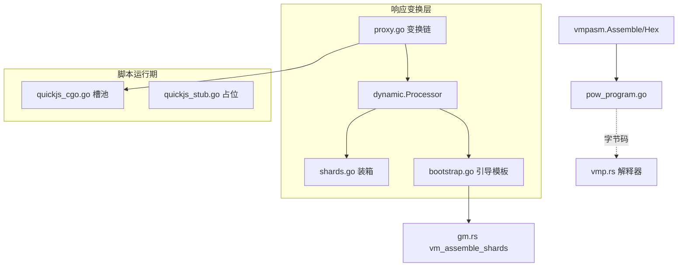
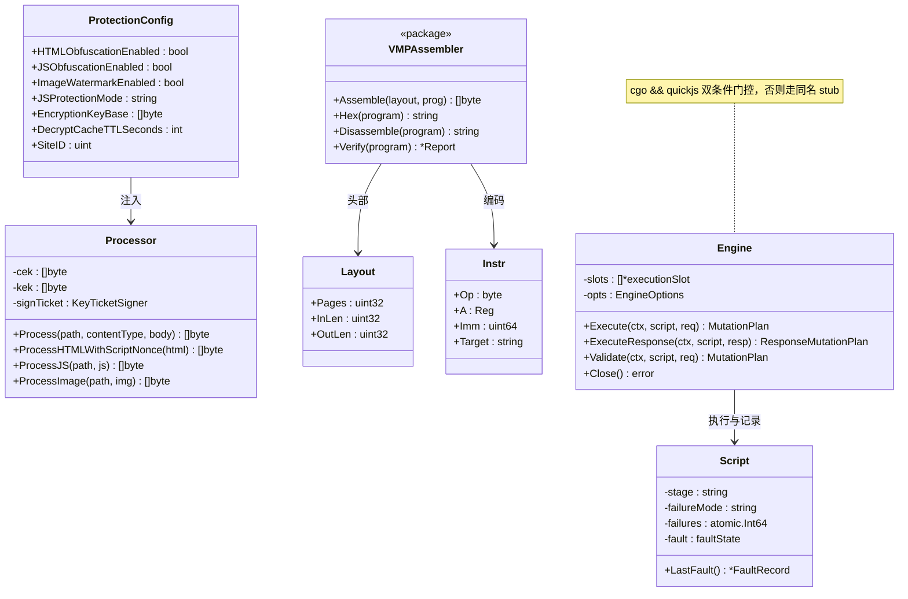
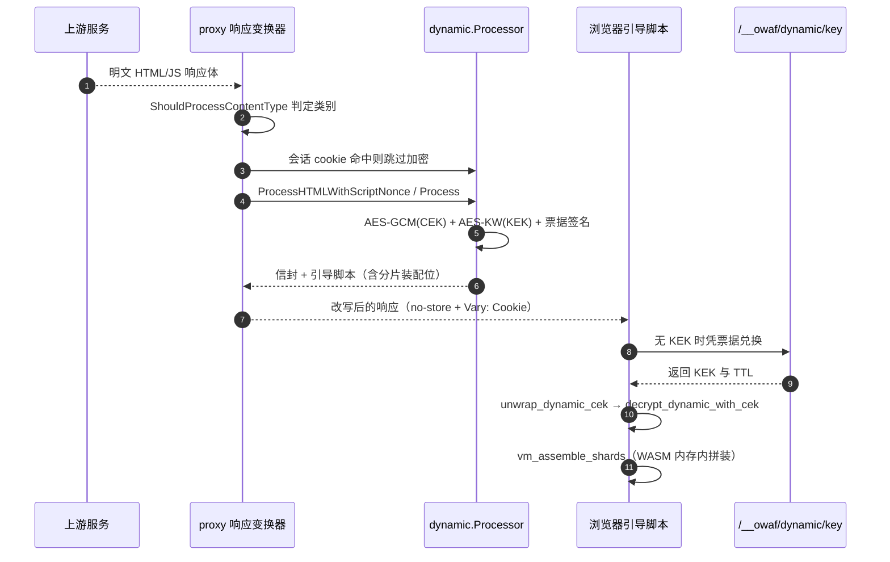
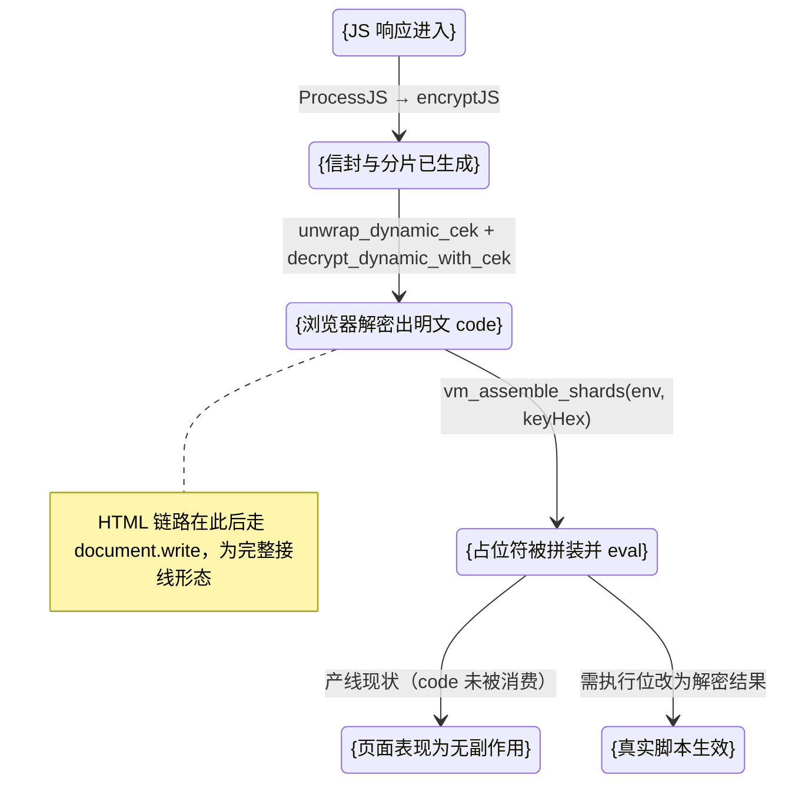
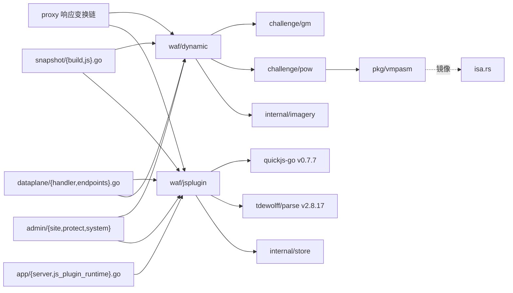

# 动态混淆与 VMP

> [返回 WAF 引擎系统](../WAF 引擎系统.md) · 同域：[挑战与验证](挑战与验证.md)、[国密与PoW原语.md](./国密与PoW原语.md)

<cite>
**本文档引用的文件**
- [processor.go](file://internal/waf/dynamic/processor.go)
- [shards.go](file://internal/waf/dynamic/shards.go)
- [crypto.go](file://internal/waf/dynamic/crypto.go)
- [bootstrap.go](file://internal/waf/dynamic/bootstrap.go)
- [templates.go](file://internal/waf/dynamic/templates.go)
- [html-bootstrap.html](file://internal/waf/dynamic/templates/html-bootstrap.html)
- [dynamic_shards_test.go](file://internal/waf/dynamic/dynamic_shards_test.go)
- [asm.go](file://internal/pkg/vmpasm/asm.go)
- [instr.go](file://internal/pkg/vmpasm/instr.go)
- [opcodes.go](file://internal/pkg/vmpasm/opcodes.go)
- [disasm.go](file://internal/pkg/vmpasm/disasm.go)
- [verify.go](file://internal/pkg/vmpasm/verify.go)
- [reference.go](file://internal/pkg/vmpasm/reference.go)
- [crypto_ref.go](file://internal/pkg/vmpasm/crypto_ref.go)
- [pow_program.go](file://internal/pkg/vmpasm/pow_program.go)
- [quickjs_cgo.go](file://internal/waf/jsplugin/quickjs_cgo.go)
- [quickjs_stub.go](file://internal/waf/jsplugin/quickjs_stub.go)
- [types.go](file://internal/waf/jsplugin/types.go)
- [script.go](file://internal/waf/jsplugin/script.go)
- [faults.go](file://internal/waf/jsplugin/faults.go)
- [plan_contract.go](file://internal/waf/jsplugin/plan_contract.go)
- [proxy.go](file://internal/proxy/proxy.go)
- [js_plugin_response.go](file://internal/proxy/js_plugin_response.go)
- [endpoints.go](file://internal/dataplane/endpoints.go)
- [handler.go](file://internal/dataplane/handler.go)
- [js.go](file://internal/snapshot/js.go)
- [build.go](file://internal/snapshot/build.go)
- [snapshot.go](file://internal/snapshot/snapshot.go)
- [server.go](file://internal/app/server.go)
- [js_plugin_runtime.go](file://internal/app/js_plugin_runtime.go)
- [engine.go](file://internal/core/engine/engine.go)
- [phases.go](file://internal/core/rules/phases.go)
- [js_plugin.go](file://internal/admin/system/jsplugin/js_plugin.go)
- [bot.go](file://internal/admin/protect/bot/bot.go)
- [site.go](file://internal/admin/site/site.go)
- [token.go](file://internal/waf/challenge/token.go)
- [pow.go](file://internal/waf/challenge/pow/pow.go)
- [gm.rs](file://wasm-pow-solver/src/gm.rs)
- [isa.rs](file://wasm-pow-solver/src/isa.rs)
- [vmp.rs](file://wasm-pow-solver/src/vmp.rs)
- [go.mod](file://go.mod)
</cite>

## 目录
1. [简介](#简介)
2. [项目结构](#项目结构)
3. [核心组件](#核心组件)
4. [架构总览](#架构总览)
5. [详细组件分析](#详细组件分析)
6. [依赖关系分析](#依赖关系分析)
7. [性能考虑](#性能考虑)
8. [故障排查指南](#故障排查指南)
9. [结论](#结论)
10. [附录](#附录)

## 简介

本篇覆盖三条相互配套的实现：**动态防护**（响应侧 HTML/JS 信封加密与代码分片装箱）、**VMP 字节码层**（Go 侧汇编器、静态校验器与参考解释器），以及 **QuickJS 插件后端**（脚本编译、槽池执行与失败记录）。读者为防护功能开发与运维。核心约束有两条：一是密钥分层——站点级 `EncryptionKeyBase` 派生 CEK/KEK，任何原始密钥材料不得下发或落日志；二是构建门控——JS 后端依赖 `cgo && quickjs` 双条件，非 QuickJS 构建带脚本启动会直接退出。

本篇定位是**实现原理与运维/开发要点**，不是攻击或逆向手册：所有密钥、CEK、KEK、票据值一律 `{占位}`；只描述布局、调用关系与失败语义，不给出具解密脚本或可复用的绕过步骤。

| 项 | 内容 |
|----|------|
| 所属业务域 | WAF 引擎系统 / 挑战与验证 |
| 本篇形态 | C 三级实现文档（一实现一节，节内 `####` 拆接口/注册/调用） |
| 覆盖范围 | `internal/waf/dynamic`（非测试 5 文件 954 行）、`internal/pkg/vmpasm`（8 文件 2588 行）、`internal/waf/jsplugin`（6 文件 2191 行） |
| 不覆盖 | 国密信封与 PoW 求解（见同级 [国密与 PoW 原语](./国密与PoW原语.md)）、Lua 插件、图片水印实现本体（已迁至 `internal/imagery`） |
| 上级索引 | [WAF 引擎系统](../WAF 引擎系统.md) |

**章节来源**
- [processor.go:1-47](file://internal/waf/dynamic/processor.go#L1-L47)
- [opcodes.go:1-19](file://internal/pkg/vmpasm/opcodes.go#L1-L19)
- [quickjs_cgo.go:1-29](file://internal/waf/jsplugin/quickjs_cgo.go#L1-L29)

## 项目结构

三块实现分属「响应变换」「编译期工具」「脚本运行时」三个职责层，彼此只有单向依赖。

```text
internal/waf/dynamic/       # 动态防护（响应侧）
├── processor.go            # Processor/ProtectionConfig、密钥缓存、Process* 入口
├── crypto.go               # HKDF 派生、AES-256-GCM、RFC 3394 AES-KW
├── shards.go               # 3..5 片切分 + XOR + GM 信封装箱与 VM 薄壳
├── bootstrap.go            # 引导脚本模板（环境自检 + CEK 兑换 + 解密执行）
└── templates.go + templates/html-bootstrap.html
internal/pkg/vmpasm/        # VMP 汇编与校验（编译期）
├── opcodes.go / instr.go   # opcode 镜像、编码格式与指令模型
├── asm.go / disasm.go      # Assemble / Disassemble / ParseText
├── verify.go / reference.go# 静态校验器 / 参考解释器（仅测试）
├── crypto_ref.go           # SHA-256/SM3 参照实现（仅测试）
└── pow_program.go          # PoW 字节码程序的生产定义
internal/waf/jsplugin/      # QuickJS 插件后端（运行期）
├── quickjs_cgo.go          # cgo && quickjs：槽池、编译、执行
├── quickjs_stub.go         # !cgo || !quickjs：同接口不可用后端
└── types.go / script.go / plan_contract.go / faults.go
```

| 路径 | 职责 | 主要语言 | 文件数 | 代表文件 | 对外暴露 |
|------|------|----------|:------:|----------|:--------:|
| `internal/waf/dynamic` | 响应侧加密/装箱/引导脚本 | Go | 5 | `processor.go` | 是（`proxy`、`snapshot`、`admin`） |
| `internal/pkg/vmpasm` | 字节码汇编、反汇编、静态校验 | Go | 8 | `asm.go` | 部分（仅 `Assemble`/`Hex` 进产线） |
| `internal/waf/jsplugin` | JS 脚本编译与执行 | Go | 6 | `quickjs_cgo.go` | 是（`app`、`snapshot`、`dataplane`、`proxy`、`admin`） |
| `wasm-pow-solver/src` | VM 执行器与分片装配 | Rust | 2 | `vmp.rs`、`gm.rs` | 产物内嵌 |



**图表来源**
- [proxy.go:163-237](file://internal/proxy/proxy.go#L163-L237)
- [processor.go:275-305](file://internal/waf/dynamic/processor.go#L275-L305)
- [asm.go:11-70](file://internal/pkg/vmpasm/asm.go#L11-L70)
- [quickjs_cgo.go:215-249](file://internal/waf/jsplugin/quickjs_cgo.go#L215-L249)

**章节来源**
- [templates.go:9-14](file://internal/waf/dynamic/templates.go#L9-L14)
- [instr.go:5-31](file://internal/pkg/vmpasm/instr.go#L5-L31)

## 核心组件

| 模块 | 路径 | 职责 | 核心接口/符号 | 依赖模块 | 被依赖 | 规模(行) | 测试 |
|------|------|------|---------------|----------|--------|:--------:|:----:|
| 动态防护处理器 | `internal/waf/dynamic` | 信封加密与响应改写 | `Processor` `Process` `ProcessHTMLWithScriptNonce` | `crypto`、`hkdf`、`imagery`、`challenge/pow` | `proxy`、`snapshot`、`admin` | 954 | 有 |
| 密钥分层 | `dynamic/crypto.go` | HKDF 派生 CEK/KEK、AES-GCM/KW | `deriveKey` `aesGCMEncrypt` `aesKeyWrap` | `golang.org/x/crypto/hkdf` | `dynamic/processor.go` | 123 | 有 |
| 分片装箱 | `dynamic/shards.go` | 切分、XOR、GM 信封、VM 薄壳 | `GenerateEncryptedShardedCode` | `challenge/gm` | `dynamic/processor.go` | 264 | 有 |
| VMP 汇编器 | `internal/pkg/vmpasm` | 指令流→字节码容器 | `Assemble` `Hex` `BuildRaw` `Label` | 无外部依赖 | `challenge/pow`、测试 | 260 | 有 |
| 校验与参照实现 | `pkg/vmpasm` | 控制流检查 + 纯 Go 执行 | `Verify` `Inspect` `NewRefMachine` `StdSHA256` | `gmsm`、`crypto/sha256` | **仅测试** | 495+422+251 | 有 |
| JS 插件后端 | `internal/waf/jsplugin` | 编译、槽池执行、失败记录 | `Compile` `NewEngine` `Engine` `FaultRecord` | `quickjs-go`、`tdewolff/parse` | `app`、`snapshot`、`dataplane`、`proxy` | 2191 | 有 |



**图表来源**
- [processor.go:14-71](file://internal/waf/dynamic/processor.go#L14-L71)
- [asm.go:20-70](file://internal/pkg/vmpasm/asm.go#L20-L70)
- [instr.go:16-31](file://internal/pkg/vmpasm/instr.go#L16-L31)
- [opcodes.go:199-210](file://internal/pkg/vmpasm/opcodes.go#L199-L210)
- [quickjs_cgo.go:256-267](file://internal/waf/jsplugin/quickjs_cgo.go#L256-L267)

**章节来源**
- [processor.go:9-18](file://internal/waf/dynamic/processor.go#L9-L18)
- [types.go:29-49](file://internal/waf/jsplugin/types.go#L29-L49)
- [verify.go:9-53](file://internal/pkg/vmpasm/verify.go#L9-L53)

## 架构总览

一次命中动态保护的 HTML/JS 响应端到端：变换链按站点判定能力，浏览器解密后按同一把 CEK 走分片装配，密钥兑换走票据端点。



**图表来源**
- [proxy.go:173-237](file://internal/proxy/proxy.go#L173-L237)
- [processor.go:230-305](file://internal/waf/dynamic/processor.go#L230-L305)
- [bootstrap.go:86-107](file://internal/waf/dynamic/bootstrap.go#L86-L107)
- [endpoints.go:177-254](file://internal/dataplane/endpoints.go#L177-L254)

**章节来源**
- [proxy.go:163-237](file://internal/proxy/proxy.go#L163-L237)
- [endpoints.go:177-254](file://internal/dataplane/endpoints.go#L177-L254)

## 详细组件分析

### 动态防护处理器（internal/waf/dynamic）

#### 接口与注册

```go
func NewProcessor(cfg ProtectionConfig) *Processor
func NewProcessorWithKeyTicketSigner(cfg ProtectionConfig, signer KeyTicketSigner) *Processor
func (p *Processor) Process(path string, contentType string, body []byte) ([]byte, error)
func (p *Processor) ProcessHTMLWithScriptNonce(html []byte) ([]byte, string, error)
func (p *Processor) ProcessJS(path string, js []byte) ([]byte, error)
func ShouldProcessContentType(ct string) string
```

装配点在**响应侧**而非请求阶段链：`responseEntityTransformerForSiteWithClient` 在 `dynEnabled` 为真时构造 `Processor`，HTML 走 `ProcessHTMLWithScriptNonce`（附带 CSP nonce），JS/图片走 `Process` 分派 [proxy.go:196-233](file://internal/proxy/proxy.go#L196-L233)。带票据的构造器由 proxy 注入 `challenge.SignDynamicProtectionKeyTicket`，从而让 KEK 不再明文出现在响应里 [processor.go:245-249](file://internal/waf/dynamic/processor.go#L245-L249)。

#### 配置与凭据

| 配置项 | 类型 | 默认值 | 必填 | 说明 | 证据位置 |
|--------|------|--------|:----:|------|----------|
| `html_obfuscation` / `js_obfuscation` / `image_watermark` | bool | 假 | 否 | 子开关，且必须 `dynamic_protection_enabled` 为真才生效 | [build.go:1307-1332](file://internal/snapshot/build.go#L1307-L1332) |
| `js_protection_mode` | string | `""`（视作 `all`） | 否 | 仅 `all`/`paths`，非法值归零 | [processor.go:60-63](file://internal/waf/dynamic/processor.go#L60-L63) |
| `js_obfuscation_paths` | []string | 空 | 否 | `paths` 模式下空集合表示**不覆盖任何 JS** | [processor.go:185-190](file://internal/waf/dynamic/processor.go#L185-L190) |
| `decrypt_cache_ttl_seconds` | int | 300 | 否 | 归一到 `[1,1800]` | [processor.go:42-58](file://internal/waf/dynamic/processor.go#L42-L58) |
| `EncryptionKeyBase` | []byte | 由快照注入 | 是 | 必须 32 字节，否则快照构建失败 | [build.go:162-165](file://internal/snapshot/build.go#L162-L165)、[build.go:427-429](file://internal/snapshot/build.go#L427-L429) |

站点级覆盖字段（`dynamic_protection_enabled`、`dynamic_html_enabled`、`dynamic_js_enabled`、`dynamic_js_mode`、`dynamic_js_paths`、`dynamic_decrypt_cache_ttl`）在 `buildSiteDynamicProtection` 合并，站点总开关关闭时三个子项一起关闭 [build.go:1358-1398](file://internal/snapshot/build.go#L1358-L1398)。控制面写入侧也做同一枚举校验 [bot.go:124-128](file://internal/admin/protect/bot/bot.go#L124-L128)、[site.go:410-413](file://internal/admin/site/site.go#L410-L413)。

凭据分层（值一律 `{占位}`）：

```go
cek: deriveKey(cfg.EncryptionKeyBase, fmt.Sprintf("owaf-brp/1:cek:site:%d", cfg.SiteID), 32)
kek: deriveKey(cfg.EncryptionKeyBase, fmt.Sprintf("owaf-brp/1:kek:site:%d", cfg.SiteID), 32)
```

基值本身来自 JWT 密钥的 HKDF 派生（`info = "my-openwaf/dynamic-protection/encryption-key-base/v1"`），刻意不与 JWT 复用同一密钥 [server.go:1479-1497](file://internal/app/server.go#L1479-L1497)。

#### 调用与差异

| 步 | 动作 | 执行位置 | 输入 | 输出 | 失败分支 | 可观测点 |
|:--:|------|----------|------|------|----------|----------|
| 1 | 图像转换先行 | [proxy.go:183-188](file://internal/proxy/proxy.go#L183-L188) | 上游原图 | 已转换 body | 关闭时跳过 | `ImageVariant` |
| 2 | browser-sign 注入 | [proxy.go:189-195](file://internal/proxy/proxy.go#L189-L195) | HTML | 注入脚本的 HTML | 未启用跳过 | `ScriptNonces` |
| 3 | 会话 cookie 判定 | [proxy.go:203-207](file://internal/proxy/proxy.go#L203-L207) | `Cookie` 头 | 命中即返回原文并标 `DynamicVariant` | 票据失效继续加密 | `markDynamicResponseVariant` |
| 4 | CEK 加密 + KEK 包装 | [processor.go:230-259](file://internal/waf/dynamic/processor.go#L230-L259) | 明文 body | `envelope` 七字段 | 返回原文并报错 | 错误上抛给变换器 |
| 5 | 模板渲染 | [templates.go:28-45](file://internal/waf/dynamic/templates.go#L28-L45) | envelope + nonce | 完整 HTML 壳 | 模板错误回原文 | [html-bootstrap.html:11](file://internal/waf/dynamic/templates/html-bootstrap.html#L11) |
| 6 | 客户端解密 | [bootstrap.go:96-106](file://internal/waf/dynamic/bootstrap.go#L96-L106) | `decrypt_dynamic_with_cek` | `document.write` | 失败页 + 调试摘要 | `__owaf_dp_blocked` |

与国密信封的差异要点：动态保护的内容加密**不使用 SM4**，而是 AES-256-GCM + RFC 3394 AES-KW，以适配浏览器 WebCrypto 与 WASM 侧 `aes-gcm` crate；只有「分片装箱」和「密钥票据」两处才落到 GM 信封（域 0x06 与 0x05）[crypto.go:52-123](file://internal/waf/dynamic/crypto.go#L52-L123)、[shards.go:180](file://internal/waf/dynamic/shards.go#L180)、[token.go:354-375](file://internal/waf/challenge/token.go#L354-L375)。

#### 限制与回退

`ProcessImage` 只做一行转发，图像实现已整体迁到 `internal/imagery`，依赖方向保持单向 [processor.go:194-212](file://internal/waf/dynamic/processor.go#L194-L212)。KEK 下发有两种形态：无票据签发器时把 KEK 直接写进属性（本地/测试），有票据时 `kek` 置空并靠 `/__owaf/dynamic/key` 兑换 [processor.go:245-249](file://internal/waf/dynamic/processor.go#L245-L249)、[endpoints.go:243-253](file://internal/dataplane/endpoints.go#L243-L253)。兑换端点明确**不把浏览器自报的环境信号当授权条件**，只校验票据与 claims 绑定 [endpoints.go:152-158](file://internal/dataplane/endpoints.go#L152-L158)。解密失败时页面显示调试卡片，其载荷只含阶段、错误、字段长度，不含密钥与密文 [bootstrap.go:57-68](file://internal/waf/dynamic/bootstrap.go#L57-L68)。

**章节来源**
- [processor.go:65-305](file://internal/waf/dynamic/processor.go#L65-L305)
- [templates.go:9-45](file://internal/waf/dynamic/templates.go#L9-L45)
- [proxy.go:163-237](file://internal/proxy/proxy.go#L163-L237)

### JS 分片装箱与 VM 拼装（dynamic/shards.go ↔ gm.rs）

#### 接口与注册

```go
func GenerateEncryptedShardedCode(code string, cek []byte, aad []byte) (envelope string, shell string, err error)
```

装箱侧注册为包内导出，供测试与 `cekJSDynamicShardChain` 复用；浏览器侧的解码入口是 WASM 导出 `vm_assemble_shards`，两侧以内层 JSON `{shards:[{k,d}],crc,v}` 为契约 [gm.rs:1353-1415](file://wasm-pow-solver/src/gm.rs#L1353-L1415)。

#### 配置与凭据

| 项 | 取值 | 说明 | 证据位置 |
|----|------|------|----------|
| 分片数 | 3..5 | 随机；`k > len(body)` 时收敛到片数=字节数 | [shards.go:17-20](file://internal/waf/dynamic/shards.go#L17-L20)、[shards.go:75-107](file://internal/waf/dynamic/shards.go#L75-L107) |
| 每片密钥 | 单字节 XOR，取值 `1..255` | 仅作形态混淆，不承担保密 | [shards.go:160-170](file://internal/waf/dynamic/shards.go#L160-L170) |
| 内层校验 | FNV-1a 32（十进制字符串） | 拼接后逐字节比对，不等返回空串 | [shards.go:48-60](file://internal/waf/dynamic/shards.go#L48-L60) |
| 加密域 | `gm.DomainPowShards` 0x06 | 密钥取 CEK 前 16 字节（SM4-128） | [shards.go:180](file://internal/waf/dynamic/shards.go#L180) |
| AAD | `owaf-dyn-shards:v2\|challenge-data` | 由标签生成器产出，禁止散落字面量 | [shards.go:24](file://internal/waf/dynamic/shards.go#L24) |

CEK 以 `{占位:cek32}` 表述，其 hex 形态会进入薄壳脚本字符串，属于「下发给持有票据的客户端」的既有设计，本篇不重复其取值来源。

#### 调用与差异

`GenerateEncryptedShardedCode` 的生产调用点只有一个：`cekJSDynamicShardChain`，链路是 `ProcessJS → encryptJS → renderJSSelfDecryptWithShardChain` [processor.go:275-305](file://internal/waf/dynamic/processor.go#L275-L305)、[shards.go:238-253](file://internal/waf/dynamic/shards.go#L238-L253)。

**关键实测结论：JS 侧分片装箱已接线，但载荷是合成占位符，真实代码未被执行。**

- `cekJSDynamicShardChain` 传入的 `code` 是常量 `codeEvalHoldGuard()`，即字符串 `owaf_dynamic_void_statement;`，而不是解密得到的脚本 [shards.go:239](file://internal/waf/dynamic/shards.go#L239)、[shards.go:255-264](file://internal/waf/dynamic/shards.go#L255-L264)。
- JS 模板里 `var code = new TextDecoder().decode(pt);` 之后，`__ASSEMBLY__` 被替换成「拼装占位符并 eval 占位符」的 IIFE，`code` 变量在产线形态下没有任何消费点 [bootstrap.go:128-131](file://internal/waf/dynamic/bootstrap.go#L128-L131)。
- 能执行真实解密代码的旧形态 `(0,eval)(code);` 只存在于 `renderJSSelfDecrypt` / `asmPlaceholderSyntheticLegacy`，其实测调用点只有 `dynamic_shards_test.go:170`，**产线无调用点** [bootstrap.go:135-152](file://internal/waf/dynamic/bootstrap.go#L135-L152)。
- 结论：HTML 链路完整可用（解密后 `document.write`），JS 链路是**半接线**——加密、兑换、解密都跑通，最后一步执行位缺失；这与 `codeEvalHoldGuard` 注释里「实际响应流程中的 code 来自解密结果」的描述相互矛盾，应以代码为准。



**图表来源**
- [processor.go:275-305](file://internal/waf/dynamic/processor.go#L275-L305)
- [shards.go:229-264](file://internal/waf/dynamic/shards.go#L229-L264)
- [bootstrap.go:109-152](file://internal/waf/dynamic/bootstrap.go#L109-L152)

#### 限制与回退

切点会回退到非 UTF-8 延续字节之外，保证正文不被切碎；分片只以数据形态进入信封，不存在引号/转义注入路径 [shards.go:69-107](file://internal/waf/dynamic/shards.go#L69-L107)。渲染后若仍残留 `__ASSEMBLY__` 或缺少 `vm_assemble_shards` 标记，`renderJSSelfDecryptWithShardChain` 直接返回错误而不是下发半成品 [processor.go:298-303](file://internal/waf/dynamic/processor.go#L298-L303)。浏览器侧 `wasm_bindgen` 或 `vm_assemble_shards` 不可用时抛出可见错误并进入既有失败页 [shards.go:37-46](file://internal/waf/dynamic/shards.go#L37-L46)。

**章节来源**
- [shards.go:17-107](file://internal/waf/dynamic/shards.go#L17-L107)
- [bootstrap.go:109-169](file://internal/waf/dynamic/bootstrap.go#L109-L169)
- [gm.rs:1353-1415](file://wasm-pow-solver/src/gm.rs#L1353-L1415)

### VMP 字节码层（internal/pkg/vmpasm）

#### 接口与注册

```go
func Assemble(layout Layout, prog []Instr) ([]byte, error)
func Hex(program []byte) string
func Disassemble(program []byte) (string, error)
func ParseText(text string) ([]Instr, map[int]string, error)
func Verify(program []byte) (*Report, error)
func Inspect(program []byte) ([]Finding, error)
func NewRefMachine(program []byte) (*RefMachine, error)
```

产线注册方式：`challenge/pow` 的 `GenerateVMProgram` 调 `Assemble(vmpasm.PoWProgramLayout(), vmpasm.BuildPoWProgram())` 再 `Hex`，这是本包**唯一**的生产入口 [pow.go:181-189](file://internal/waf/challenge/pow/pow.go#L181-L189)。`Verify`、`Inspect`、`Disassemble`、`BuildRaw`、`CodeOffsets`、`NewRefMachine`、`StdSHA256`、`StdSM3` 的调用点全部落在测试文件（`vmp_contract_test.go`、`chain_test.go`、`pow_program_test.go`、`crypto_ref_test.go`），**产线无调用点**——这一点 [reference.go:10-12](file://internal/pkg/vmpasm/reference.go#L10-L12) 与 [crypto_ref.go:13-18](file://internal/pkg/vmpasm/crypto_ref.go#L13-L18) 的注释自述一致：它们是验证用参照，不进生产调用链。

#### 配置与凭据

| 常量 | 取值 | 含义 | 证据位置 |
|------|------|------|----------|
| `Magic` / `Version` | `"OWVM"` / `0x01` | 容器魔数与 ISA 版本 | [opcodes.go:193-197](file://internal/pkg/vmpasm/opcodes.go#L193-L197) |
| `HeaderLen` | 24 | 头部字节数（magic/version/flags/reserved/pages/in/out/code_len） | [opcodes.go:165-166](file://internal/pkg/vmpasm/opcodes.go#L165-L166) |
| `MaxCodeBytes` / `MaxPages` / `MaxInBytes` / `MaxOutBytes` | 65536 / 256 / 4096 / 4096 | 结构与内存上界 | [opcodes.go:167-174](file://internal/pkg/vmpasm/opcodes.go#L167-L174) |
| `PerIterBudget` / `MaxStepsAbs` / `BatchSizeLimit` | 2048 / `1<<30` / 1e6 | 步数预算与批量上界 | [opcodes.go:185-191](file://internal/pkg/vmpasm/opcodes.go#L185-L191) |
| `RegCount` | 16 | 通用寄存器，无隐含约定（R0 非零寄存器、R15 非栈指针） | [opcodes.go:46-47](file://internal/pkg/vmpasm/opcodes.go#L46-L47) |
| `PoWProgramLayout` | `{Pages:1, InLen:96, OutLen:48}` | PoW 程序布局 | [pow_program.go:130-132](file://internal/pkg/vmpasm/pow_program.go#L130-L132) |

本包不涉及任何密钥材料；`crypto_ref.go` 的 SHA-256/SM3 参照实现只做摘要运算比对。

#### 调用与差异

指令编码格式共 6 类，长度分别 1/2/3/10/6/5 字节；跳转指令 rel32 不压缩，`Label` 是伪 opcode `0xFF`，只存在于指令流、不进字节码 [instr.go:112-162](file://internal/pkg/vmpasm/instr.go#L112-L162)、[asm.go:72-87](file://internal/pkg/vmpasm/asm.go#L72-L87)。

| 检查类别 | 结论码 | 严重度 | 语义 |
|----------|--------|:------:|------|
| 空字节码 | `empty_code` | error | 容器无指令 |
| 入口不可达 | `unreachable` | error | 从第 0 条正向不可达 |
| 无法终止 | `no_path_to_halt` | error | 反向可达性不含 HALT |
| 负偏移 | `negative_offset` | finding | 内存偏移为负 |
| 越界偏移 | `offset_beyond_memory` | finding | 偏移超过内存上界 |
| 恒零比较 | `zero_constant_compare` | finding | `SUB r,r,r` 后 `CMP r,r` |

`successors` 把 `HALT` 视为**无后继**，这是终止性分析的基石；把 HALT 当成顺序后继会把其后的死指令误判为可达 [verify.go:60-90](file://internal/pkg/vmpasm/verify.go#L60-L90)。内存检查之所以只报 finding：基址是运行期任意 u64，静态不可知，报 error 会拒绝合法程序 [verify.go:92-101](file://internal/pkg/vmpasm/verify.go#L92-L101)。

与 Rust 侧的分工是**单一真源 + 镜像**：opcode 数值权威在 `wasm-pow-solver/src/isa.rs`，Go 侧 `OpcodeTable` 是镜像，`vmp_contract_test.go` 逐条解析 Rust 源文本比对，命名按 `OP_SHA256_COMPRESS ↔ OpSha256Compress` 机械映射 [opcodes.go:6-18](file://internal/pkg/vmpasm/opcodes.go#L6-L18)、[opcodes.go:134-161](file://internal/pkg/vmpasm/opcodes.go#L134-L161)、[isa.rs:1-22](file://wasm-pow-solver/src/isa.rs#L1-L22)。执行语义（寄存器、标志、预算循环）只在 Rust `vmp.rs`，Go 侧不实现 [vmp.rs:1-56](file://wasm-pow-solver/src/vmp.rs#L1-L56)。

PoW 程序本身「无 PoW 专用指令」：前导零判定是循环 + 无符号比较 + 条件跳转，程序自己遍历整个批次，因为 Go worker 的推进约定是 `off += bs*nc`，若每调用只试一个 counter 其余会被永久跳过 [pow_program.go:12-25](file://internal/pkg/vmpasm/pow_program.go#L12-L25)。寄存器约定（R4 工作区基址、R5 nonceLen、R6 difficulty、R9 循环变量、R10 结束值、R12 块 1 基址、R14 常数 1、R15 常数 0）是修改 `BuildPoWProgram` 时必须维持的私约 [pow_program.go:160-176](file://internal/pkg/vmpasm/pow_program.go#L160-L176)。

#### 限制与回退

`Assemble` 对任何编码错误（未知 opcode、寄存器越界、标签未定义/重复、指令截断）返回错误且**不产出部分结果**；字节码长度超 `MaxCodeBytes` 直接拒绝 [asm.go:11-70](file://internal/pkg/vmpasm/asm.go#L11-L70)。产线的失败回退是「返回空串」：`GenerateVMProgram` 汇编失败时不把错误上抛，而是让 WASM 侧以 `vm_bad_magic` 显式失败，避免静默降级 [pow.go:183-187](file://internal/waf/challenge/pow/pow.go#L183-L187)。反汇编是规范性的：同一字节码输出唯一，且可被 `ParseText` + `Assemble` 逐字节还原 [disasm.go:7-22](file://internal/pkg/vmpasm/disasm.go#L7-L22)。

**章节来源**
- [asm.go:11-260](file://internal/pkg/vmpasm/asm.go#L11-L260)
- [opcodes.go:21-210](file://internal/pkg/vmpasm/opcodes.go#L21-L210)
- [verify.go:9-210](file://internal/pkg/vmpasm/verify.go#L9-L210)
- [pow_program.go:1-176](file://internal/pkg/vmpasm/pow_program.go#L1-L176)
- [isa.rs:1-60](file://wasm-pow-solver/src/isa.rs#L1-L60)

### QuickJS 插件后端（internal/waf/jsplugin）

#### 接口与注册

构建门控是**双条件**，两个文件的第一行即证据：

```go
// internal/waf/jsplugin/quickjs_cgo.go:1
//go:build cgo && quickjs
// internal/waf/jsplugin/quickjs_stub.go:1
//go:build !cgo || !quickjs
```

同一组 API 在两文件中形状一致（`Compile`、`NewEngine`、`Engine.Execute`/`ExecuteResponse`/`Validate`/`Close`），stub 一律返回 `ErrCGODisabled` 并保留 `RuntimeAvailable() == false`，调用方因此无需按构建分支写两套逻辑 [quickjs_stub.go:12-92](file://internal/waf/jsplugin/quickjs_stub.go#L12-L92)。

```go
func Compile(name, source string, opts ScriptOptions) (*Script, error)
func NewEngine(opts EngineOptions) (*Engine, error)
func (e *Engine) ExecuteResponse(ctx context.Context, script *Script, resp ResponseSnapshot) (ResponseMutationPlan, error)
func ObserveScriptFault(executor any, script *Script, stage string, err error)
```

#### 配置与凭据

| 参数 | 类型 | 默认值 | 必填 | 说明 | 证据位置 |
|------|------|--------|:----:|------|----------|
| `PoolSize` | int | 4 | 否 | 每槽独占一条锁定 OS 线程 | [types.go:36-37](file://internal/waf/jsplugin/types.go#L36-L37)、[quickjs_cgo.go:301-311](file://internal/waf/jsplugin/quickjs_cgo.go#L301-L311) |
| `CompiledCacheSize` | int | 256 | 否 | 每槽 LRU 编译缓存上限 | [types.go:38-39](file://internal/waf/jsplugin/types.go#L38-L39) |
| `MemoryLimit` / `StackLimit` | uint64 | 8 MiB / 512 KiB | 否 | QuickJS 堆与栈上限 | [types.go:40-43](file://internal/waf/jsplugin/types.go#L40-L43) |
| `Timeout` / `ValidationTimeout` | Duration | 10ms / 1s | 否 | 执行挂钟与编译校验挂钟相互独立 | [types.go:44-47](file://internal/waf/jsplugin/types.go#L44-L47) |
| `MaxScriptBytes` | int | 256 KiB | 是 | 编译期即拒绝超限源码 | [types.go:48-49](file://internal/waf/jsplugin/types.go#L48-L49) |
| `timeout_ms`（DB 列） | int | 0 | 否 | 合法域 `0..1000`，越界且 fail-closed 时装入失败守卫 | [js.go:26](file://internal/snapshot/js.go#L26)、[js.go:85-95](file://internal/snapshot/js.go#L85-L95) |
| `stage` / `failure_mode` | string | — | 是 | 仅 `request`/`response` 与 `fail_open`/`fail_closed` | [js.go:66-73](file://internal/snapshot/js.go#L66-L73) |

本包不持有任何密钥或凭据；脚本可读写的是请求/响应快照字段，其体积上限由 `MaxRequestSnapshotBytes`、`MaxMutationStringBytes` 等一组常量界定 [types.go:50-79](file://internal/waf/jsplugin/types.go#L50-L79)。

#### 调用与差异

启动门控的真实行为：**快照含启用脚本且引擎创建失败时，进程直接退出**。

```go
if sn := rt.Snapshot.Load(); sn != nil {
    if err := ensureJSEngine(sn.JSPlugins); err != nil {
        log.Error("create JavaScript plugin engine failed", slog.Any("err", err))
        os.Exit(1)
    }
}
```
[server.go:432-436](file://internal/app/server.go#L432-L436)

关键前提是 `ensureJSPluginEngine` 在 `len(scripts) == 0 || current != nil` 时直接返回，因此「非 QuickJS 构建 + 零脚本」不会触发退出；一旦库里存在启用脚本，stub 返回 `ErrCGODisabled` 就会被包装成错误并导致 `os.Exit(1)` [js_plugin_runtime.go:19-28](file://internal/app/js_plugin_runtime.go#L19-L28)；管理端 dry-run 走另一分支，只把错误转成 nil 执行器返回，不影响数据面 [server.go:418-428](file://internal/app/server.go#L418-L428)、[js_plugin_runtime.go:39-48](file://internal/app/js_plugin_runtime.go#L39-L48)。

与 dynamic 的配合方式：两者都是**身份响应变换器**，JS 变换器排在 dynamic 之后，因为响应脚本需要看到接近最终形态的 body/headers，且它只做追加修改 [proxy.go:93-120](file://internal/proxy/proxy.go#L93-L120)、[js_plugin_response.go:46-61](file://internal/proxy/js_plugin_response.go#L46-L61)。执行器与脚本经注入式查找函数跨包获得，避免 `proxy → dataplane` 反向依赖成环；未注入时响应阶段按 fail-open 跳过 [js_plugin_response.go:15-23](file://internal/proxy/js_plugin_response.go#L15-L23)、[handler.go:389-395](file://internal/dataplane/handler.go#L389-L395)。快照装载侧同样按构建门控决定是否创建校验引擎：`RuntimeAvailable()` 为假时只做 `Compile` 级校验，不跑 dry-run [js.go:46-54](file://internal/snapshot/js.go#L46-L54)。

失败记录（`FaultRecord{At,Stage,Message,Count}`）与 [script.go:11-34](file://internal/waf/jsplugin/script.go#L11-L34) 的 `Script.Stats` failures 计数**同源但独立计数**：前者只在失败记录路径递增；同一脚本同一原因只写一条宿主日志，原因变化才重写；fail-closed 按 Error、fail-open 按 Warn；消息先截断到 2 KiB 再条带化 CR/LF [faults.go:9-20](file://internal/waf/jsplugin/faults.go#L9-L20)、[faults.go:61-132](file://internal/waf/jsplugin/faults.go#L61-L132)、[faults.go:151-159](file://internal/waf/jsplugin/faults.go#L151-L159)。计划契约侧 `canonicalizeMutationPlan` 负责别名归一与 `delete_headers` 形态折叠，`validateMutationVerdict` 约束裁决字段，两者都在写回 hertz 之前生效 [plan_contract.go:31-137](file://internal/waf/jsplugin/plan_contract.go#L31-L137)、[plan_contract.go:210-261](file://internal/waf/jsplugin/plan_contract.go#L210-L261)。

#### 限制与回退

fail-closed 脚本编译失败时装入固定守卫源码（`fetch()` 直接抛错），保证该脚本命中的请求不会静默放行，同时不阻断其他脚本发布；两个阶段共用同一守卫 [js.go:16-24](file://internal/snapshot/js.go#L16-L24)、[js.go:121-131](file://internal/snapshot/js.go#L121-L131)。`ObserveScriptFault` 对非本包执行器（测试替身或 stub）安全忽略 [faults.go:161-190](file://internal/waf/jsplugin/faults.go#L161-L190)。管理端把「运行时不可用」与「引擎未就绪」合并成一个可用性标志上报 [js_plugin.go:407](file://internal/admin/system/jsplugin/js_plugin.go#L407)、[js_plugin.go:627](file://internal/admin/system/jsplugin/js_plugin.go#L627)。流式（SSE/WS）路径不使用 identity 响应实体，因此响应阶段脚本对其不生效，属已注记边界 [js_plugin_response.go:49-56](file://internal/proxy/js_plugin_response.go#L49-L56)。

**章节来源**
- [quickjs_cgo.go:1-70](file://internal/waf/jsplugin/quickjs_cgo.go#L1-L70)
- [quickjs_cgo.go:215-330](file://internal/waf/jsplugin/quickjs_cgo.go#L215-L330)
- [quickjs_stub.go:1-92](file://internal/waf/jsplugin/quickjs_stub.go#L1-L92)
- [types.go:14-79](file://internal/waf/jsplugin/types.go#L14-L79)
- [faults.go:9-190](file://internal/waf/jsplugin/faults.go#L9-L190)
- [js.go:15-135](file://internal/snapshot/js.go#L15-L135)

## 依赖关系分析



**图表来源**
- [proxy.go:25-28](file://internal/proxy/proxy.go#L25-L28)
- [js_plugin_response.go:10-13](file://internal/proxy/js_plugin_response.go#L10-L13)
- [build.go:23-25](file://internal/snapshot/build.go#L23-L25)
- [snapshot.go:12-14](file://internal/snapshot/snapshot.go#L12-L14)

### 依赖矩阵

| 调用方 ↓ / 被调方 → | dynamic | vmpasm | jsplugin | gm | pow | store | imagery |
|---------------------|:-------:|:------:|:--------:|:--:|:---:|:-----:|:-------:|
| `dynamic` | — | ✗ | ✗ | ✓ | ✓ | ✗ | ✓ |
| `vmpasm` | ✗ | — | ✗ | ✗ | ✗ | ✗ | ✗ |
| `jsplugin` | ✗ | ✗ | — | ✗ | ✗ | ✓ | ✗ |
| `pow` | ✗ | ✓ | ✗ | ✗ | — | ✗ | ✗ |
| `proxy` | ✓ | ✗ | ✓ | ✓ | ✗ | ✓ | ✗ |
| `snapshot` | ✓ | ✗ | ✓ | ✗ | ✗ | ✓ | ✗ |

`✗ dynamic → vmpasm` 不是违规：分片装箱走的是「XOR + GM 信封 + WASM 拼装」，与 VMP 字节码是两套互不相干的机制，混淆二者会导致错误改动方向。`jsplugin → store` 只读取常量与模型，不反向依赖数据面。

**章节来源**
- [processor.go:4-12](file://internal/waf/dynamic/processor.go#L4-L12)
- [shards.go:3-15](file://internal/waf/dynamic/shards.go#L3-L15)
- [pow.go:16-20](file://internal/waf/challenge/pow/pow.go#L16-L20)
- [quickjs_cgo.go:5-23](file://internal/waf/jsplugin/quickjs_cgo.go#L5-L23)

### 外部实体

| 外部实体 | 类型 | 方向 | 协议/方式 | 触发时机 | 数据内容 | 失败影响 | 容错处理 |
|----------|------|------|-----------|----------|----------|----------|----------|
| 上游站点的 HTML/JS | 第三方源 | 入向 | HTTP 响应体 | 每次转发 | 明文 body | 无法保护 | 加密失败返回原文并上抛错误 |
| `quickjs-go v0.7.7` | cgo 绑定 | 出向 | C 调用 | 脚本执行/校验 | 快照 JSON | 引擎创建失败可致进程退出 | stub 分支 + `os.Exit(1)` 门控 |
| `tdewolff/parse v2.8.17` | Go 库 | 出向 | 源码解析 | 编译期 | JS 源码 | 语法错误拒绝保存 | 返回编译错误 |
| `golang.org/x/crypto/hkdf` | Go 库 | 出向 | KDF | 密钥派生 | `{占位:基值}` | 派生失败 panic | 视为不可恢复系统错误 |
| 浏览器 `WebCrypto`/WASM | 运行环境 | 双向 | JS API | 解密与兑换 | 信封、票据 | 页面显示失败卡片 | 带长度的调试摘要 |

**章节来源**
- [crypto.go:30-50](file://internal/waf/dynamic/crypto.go#L30-L50)
- [go.mod:8-25](file://go.mod#L8-L25)
- [quickjs_cgo.go:176-213](file://internal/waf/jsplugin/quickjs_cgo.go#L176-L213)

## 性能考虑

### 站点密钥的进程级缓存

- **问题**：响应转换器对**每个响应**都构造一次 `Processor`，而 CEK/KEK 派生要跑两次 HKDF-SHA256，曾是 pprof 中最大的单点分配来源。
- **优化**：`lookupDerivedKeys` 以 `{base string, siteID}` 为键缓存派生结果，超 1024 条整体清空重建；密钥按值共享，故内容不可修改 [processor.go:91-138](file://internal/waf/dynamic/processor.go#L91-L138)。
- **效果**：稳态下每请求零 HKDF；条目数由「站点数 × 配置变体数」界定（推断，`processor_bench_test.go` 有基准入口）。

**章节来源**
- [processor.go:91-149](file://internal/waf/dynamic/processor.go#L91-L149)
- [crypto.go:35-50](file://internal/waf/dynamic/crypto.go#L35-L50)

### 编译期与运行期的成本闸门

- **问题**：把非法字节码交给浏览器解释器会表现为「挑战永不通过」；QuickJS 原生句柄不能跨 goroutine 共享，且每次执行重新解析模块会把编译成本压到请求期。
- **优化**：`Verify` 在不依赖 WASM 的前提下做解码与控制流检查（可达性、能否到达 HALT），语义可疑项降级为 finding 以免拒绝合法程序，执行侧以步数预算硬限 [verify.go:92-129](file://internal/pkg/vmpasm/verify.go#L92-L129)、[opcodes.go:185-191](file://internal/pkg/vmpasm/opcodes.go#L185-L191)；每槽 `LockOSThread` 终生独占线程（默认 4 槽），`compiled` map + LRU 链表（默认 256 条）复用已求值模块并关闭模块导入 [quickjs_cgo.go:236-247](file://internal/waf/jsplugin/quickjs_cgo.go#L236-L247)、[quickjs_cgo.go:301-327](file://internal/waf/jsplugin/quickjs_cgo.go#L301-L327)。
- **效果**：产线只走 `Assemble`/`Hex`，`Verify` 目前仅在契约与单元测试执行，收益体现为回归拦截；执行挂钟 10ms 与校验挂钟 1s 互不挤占 [types.go:44-47](file://internal/waf/jsplugin/types.go#L44-L47)。

**章节来源**
- [verify.go:92-129](file://internal/pkg/vmpasm/verify.go#L92-L129)
- [quickjs_cgo.go:230-330](file://internal/waf/jsplugin/quickjs_cgo.go#L230-L330)
- [pow.go:181-189](file://internal/waf/challenge/pow/pow.go#L181-L189)

## 故障排查指南

### 问题：启用 JS 插件后进程启动即退出

**症状**：日志出现 `create JavaScript plugin engine failed`，随后进程退出码 1，无数据面监听。

**可能原因**：二进制未按 `cgo && quickjs` 构建，而库里存在启用脚本；或 QuickJS 运行时创建失败（内存/栈上限过低）。

**排查步骤**：
1. `go list -f '{{.GoFiles}}' ./internal/waf/jsplugin` 看是否含 `quickjs_cgo.go`（只含 stub 即命中本因）。
2. 查管理端 `Available` 标志（= `RuntimeAvailable() && engineReady`），或临时停用脚本行后重启验证。

**解决方案**：用 `CGO_ENABLED=1 go build -tags=quickjs` 重编（`scripts/build.sh` 的既有形态）；或先禁用相关 `js_plugins` 行再重启。

**章节来源**
- [server.go:432-436](file://internal/app/server.go#L432-L436)
- [quickjs_stub.go:1-26](file://internal/waf/jsplugin/quickjs_stub.go#L1-L26)
- [js_plugin.go:627](file://internal/admin/system/jsplugin/js_plugin.go#L627)

### 问题：页面显示「正在解密页面内容…」后卡住或报解密失败

**症状**：HTML 命中动态保护的站点白屏/失败卡片；控制台有 `dynamic shard assembly failed` 或 `dynamic vm assembler unavailable`。

**可能原因**：WASM/glue 资产 URL 与实际文件不匹配；票据兑换失败（IP、UA、Host 与签发时不一致）；CEK 缓存键漂移。

**排查步骤**：先看失败卡片的 `stage` 与 `envelope` 字段长度（不含密钥）以区分 `html-decrypt` 与 `js-decrypt`；再复现 `POST /__owaf/dynamic/key`——403 为票据校验失败、503 为快照未加载、404 为站点未匹配。

**解决方案**：核对 `?v=` 版本串与资产（见同级 [国密与 PoW 原语](./国密与PoW原语.md)）；确认站点 `XFFMode`/信任网段未变导致 ClientIP 漂移；必要时把 TTL 调低以强制重新兑换。

**章节来源**
- [bootstrap.go:55-59](file://internal/waf/dynamic/bootstrap.go#L55-L59)
- [bootstrap.go:92-106](file://internal/waf/dynamic/bootstrap.go#L92-L106)
- [endpoints.go:177-253](file://internal/dataplane/endpoints.go#L177-L253)
- [shards.go:37-46](file://internal/waf/dynamic/shards.go#L37-L46)

### 问题：JS 资源解密成功但脚本没有生效

**症状**：控制台无错误、`owafRemoveStatus()` 已执行，但应用行为如同脚本未运行；网络面板可见 `__owaf_dp_session` cookie 已签发。

**可能原因**：这是本篇实测的**半接线缺陷**——`cekJSDynamicShardChain` 装箱的是常量占位符 `codeEvalHoldGuard()`，模板里的 `code` 变量没有消费点，真实解密结果未被执行。

**排查步骤**：
1. 在响应里检索 `vm_assemble_shards` 与 `owaf_dynamic_void_statement`：两者同时出现即命中该形态。
2. 对照 `(0,eval)(code)` 形态：该执行位只存在于 `renderJSSelfDecrypt`（无产线调用点）。

**解决方案**：把执行位改为消费解密得到的 `code`（例如恢复 `(0,eval)(code)` 或让装箱接收真实明文），并补一条端到端回归锁；不改代码时，站点侧应临时关闭 `js_obfuscation` 以避免 JS 资源失效。

**章节来源**
- [shards.go:229-264](file://internal/waf/dynamic/shards.go#L229-L264)
- [bootstrap.go:128-152](file://internal/waf/dynamic/bootstrap.go#L128-L152)
- [processor.go:275-305](file://internal/waf/dynamic/processor.go#L275-L305)

### 问题：快照构建报「requires a 32-byte encryption key base」

**症状**：reload 失败并记录该错误，站点动态防护整体不生效。

**可能原因**：JWT 密钥被清空或派生链改动，导致注入快照的基值长度不为 32；或站点强制开启子开关而基值缺失。

**排查步骤**：确认 `deriveDynamicProtectionKeyBase` 输入非空（`MY_OPENWAF_JWT_SECRET` 或 DB 记录），并核对 `SetSnapshotDynamicKeyBase` 在 `ReloadSnapshot` 之前完成。

**解决方案**：恢复持久化 JWT 密钥后重启；不要在站点侧绕过——`build.go` 的两处 32 字节门是刻意的前置拒绝，避免以半长密钥签发信封。

**章节来源**
- [build.go:162-165](file://internal/snapshot/build.go#L162-L165)
- [build.go:427-429](file://internal/snapshot/build.go#L427-L429)
- [server.go:1479-1497](file://internal/app/server.go#L1479-L1497)

## 结论

本篇把「动态混淆 + VMP + JS 后端」三块实现按接线状态如实落账：`dynamic` 完整接入响应变换链（HTML 路径端到端可用），`vmpasm` 只有汇编器进产线，`jsplugin` 是构建门控下的双形态后端。

- **优势**：密钥三层分离（基值/CEK/KEK）且按站点隔离；HKDF 结果进程级缓存；VMP 的 opcode 单一真源 + 契约测试；插件后端用 stub 保持 API 同形，调用方无需分支；失败摘要统一截断与条带化。
- **建议**（对应已识别缺口）：
  1. 修复 JS 执行位——让装箱链路接收真实解密代码，或删除合成占位形态与 `renderJSSelfDecrypt` 的死代码，避免两套语义并存。
  2. `browser_sign` 阶段（[engine.go:513-515](file://internal/core/engine/engine.go#L513-L515)）只装配 `rules.NewBrowserSignPhase`，与动态保护无调用关系；如需在请求阶段介入内容保护，应显式设计而不是隐含假设。
  3. 把 `Verify`/`Disassemble` 的静态检查纳入构建产线的可选闸门（当前仅测试使用）。
  4. 管理端把 `RuntimeAvailable()` 与 `os.Exit(1)` 门控做成可见告警，避免运维只看到「进程消失」。

## 附录

### 配置参数说明

| 配置项 | 类型 | 默认值 | 必填 | 说明 | 证据位置 |
|--------|------|--------|:----:|------|----------|
| `dynamic_protection_enabled` | bool | 假 | 否 | 总开关，子项在其为真时才生效 | [build.go:1308-1329](file://internal/snapshot/build.go#L1308-L1329) |
| `image_watermark_paths` / `watermark_text` | []string / string | 空 / `Protected` | 否 | 命中路径才加水印 | [processor.go:199-212](file://internal/waf/dynamic/processor.go#L199-L212) |
| `DecryptCacheTTLSeconds` | int | 300（上限 1800） | 否 | 同时是客户端 CEK 缓存与票据有效期 | [processor.go:42-58](file://internal/waf/dynamic/processor.go#L42-L58) |
| `MaxPages` / `MaxCodeBytes` | uint32 | 256 / 65536 | 是 | 字节码容器硬上界，`validateLayout` 前置拒绝 | [opcodes.go:167-170](file://internal/pkg/vmpasm/opcodes.go#L167-L170)、[asm.go:89-106](file://internal/pkg/vmpasm/asm.go#L89-L106) |
| `BlobOutLen` | int | 48 | 是 | PoW 输出区（hash+magic+counter） | [pow_program.go:70-76](file://internal/pkg/vmpasm/pow_program.go#L70-L76) |
| `MaxScriptBytes` | int | 256 KiB | 是 | 超限在保存期即失败 | [types.go:48-49](file://internal/waf/jsplugin/types.go#L48-L49) |
| `reportMaxMessageBytes` | int | 2 KiB | 是 | 失败摘要截断长度 | [faults.go:9-14](file://internal/waf/jsplugin/faults.go#L9-L14) |

**章节来源**
- [processor.go:17-63](file://internal/waf/dynamic/processor.go#L17-L63)
- [opcodes.go:163-197](file://internal/pkg/vmpasm/opcodes.go#L163-L197)
- [types.go:35-79](file://internal/waf/jsplugin/types.go#L35-L79)

### 调用示例

凭据一律 `{占位}`；示例只用于说明调用形态。

```go
// 服务端：构造带票据的动态保护处理器并加密 HTML
cfg := dynamic.ProtectionConfig{
    HTMLObfuscationEnabled: true,
    EncryptionKeyBase:      []byte("{占位:32B 基值}"),
    SiteID:                 7,
}
proc := dynamic.NewProcessorWithKeyTicketSigner(cfg, signer) // signer 由 challenge 包提供
out, nonce, err := proc.ProcessHTMLWithScriptNonce(html)
_ = nonce // 追加进 CSP script 白名单
```

```go
// 编译期：汇编一段最小字节码并静态检查
prog := []vmpasm.Instr{{Op: vmpasm.OpMovi, A: vmpasm.R1, Imm: 7}, {Op: vmpasm.OpHalt}}
container, err := vmpasm.Assemble(vmpasm.Layout{Pages: 1, InLen: 96, OutLen: 48}, prog)
rep, err := vmpasm.Verify(container) // rep.OK() 为假时 rep.Errors 内含结论码
_ = rep
```

```bash
# 确认 JS 插件后端是否被编进当前二进制
go list -f '{{.GoFiles}}' -tags=quickjs ./internal/waf/jsplugin
# 期望包含 quickjs_cgo.go；缺 -tags=quickjs 时只包含 quickjs_stub.go

# 检索产线分片装箱的合成占位符（命中即为本篇描述的半接线形态）
rg -l "owaf_dynamic_void_statement" internal/waf/dynamic
```

**章节来源**
- [processor.go:140-174](file://internal/waf/dynamic/processor.go#L140-L174)
- [asm.go:20-70](file://internal/pkg/vmpasm/asm.go#L20-L70)
- [verify.go:103-129](file://internal/pkg/vmpasm/verify.go#L103-L129)
- [shards.go:255-264](file://internal/waf/dynamic/shards.go#L255-L264)

### 特性与限制对比

| 能力 | dynamic(HTML) | dynamic(JS) | vmpasm | jsplugin | 备注 |
|------|:-------------:|:-----------:|:------:|:--------:|------|
| 内容保密（对称加密） | ✓ | ✓ | — | — | AES-256-GCM，密钥按站点派生 |
| 密钥分层交付 | ✓ | ✓ | — | — | AES-KW + 票据兑换，KEK 可不下发 |
| 执行真实解密代码 | ✓ | ✗ | — | — | JS 为半接线，见故障排查 |
| 代码分片装箱 | 部分 | ✓ | ✓ | — | HTML 不装箱，仅 JS 走 VM 拼装 |
| 字节码静态校验 | — | — | ✓ | — | `Verify` 产线无调用点 |
| 请求/响应改写契约 | — | — | — | ✓ | `MutationPlan` / `ResponseMutationPlan` |
| 无 cgo 可用 | ✓ | ✓ | ✓ | 部分 | 仅 jsplugin 退化为 stub，且带脚本会退出 |

| 符号 | 包 | 生产调用点 | 判定 |
|------|----|------------|------|
| `NewProcessor*` / `Process*` | `dynamic` | `proxy.go:208/227` | 已接线 |
| `GenerateEncryptedShardedCode` | `dynamic` | `shards.go:239`（经 `cekJSDynamicShardChain`） | 已接线（载荷为合成占位） |
| `renderJSSelfDecrypt` / `asmPlaceholderSyntheticLegacy` | `dynamic` | 仅 `dynamic_shards_test.go:170` | **未接线** |
| `Processor.ProcessImage` | `dynamic` → `imagery` | `proxy.go:217` 分派 | 已接线（转发） |
| `vmpasm.Assemble` / `Hex` | `pkg/vmpasm` | `pow.go:182/188` | 已接线 |
| `vmpasm.Verify` / `Inspect` / `Disassemble` / `ParseText` | `pkg/vmpasm` | 仅契约与单元测试 | **未接线** |
| `vmpasm.NewRefMachine` / `StdSHA256` / `StdSM3` | `pkg/vmpasm` | 仅 `go test` | **未接线** |
| `jsplugin.Compile` / `NewEngine` | `jsplugin` | `snapshot/js.go`、`app/server.go` | 已接线（受 `cgo && quickjs` 门控） |
| `Engine.ExecuteResponse` | `jsplugin` | `proxy/js_plugin_response.go:63-70` | 已接线 |
| `ObserveScriptFault` | `jsplugin` | 数据面执行器外两处上报 | 已接线 |
| `dynamic` ← `browser_sign` 阶段 | [engine.go:513-515](file://internal/core/engine/engine.go#L513-L515) | 该阶段只装 `NewBrowserSignPhase` | **未接线** |

**章节来源**
- [proxy.go:196-233](file://internal/proxy/proxy.go#L196-L233)
- [dynamic_shards_test.go:160-175](file://internal/waf/dynamic/dynamic_shards_test.go#L160-L175)
- [reference.go:3-31](file://internal/pkg/vmpasm/reference.go#L3-L31)
- [phases.go:1400-1410](file://internal/core/rules/phases.go#L1400-L1410)
