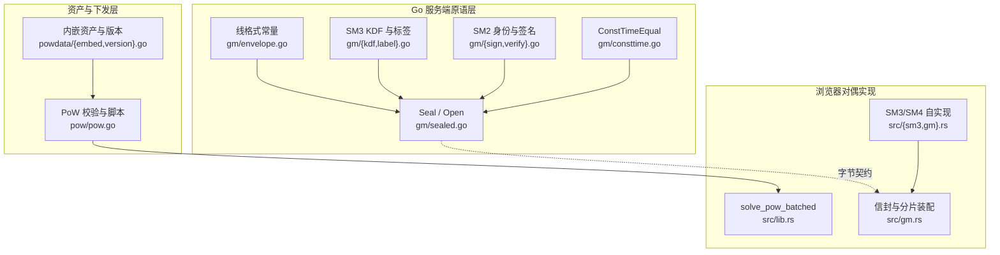
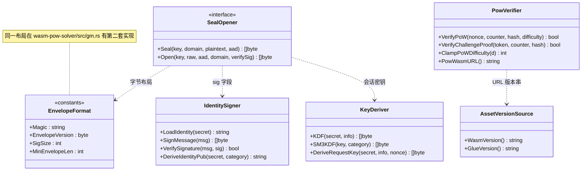
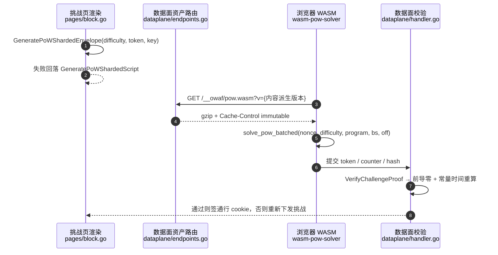
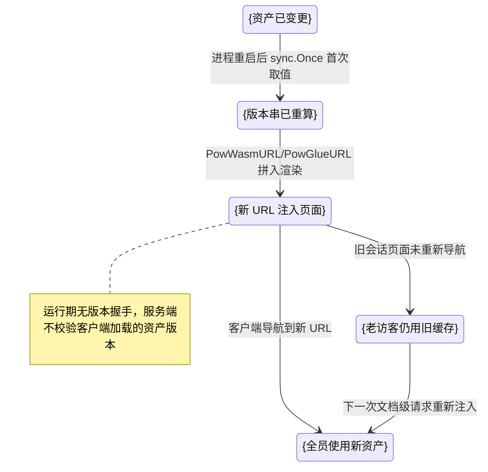
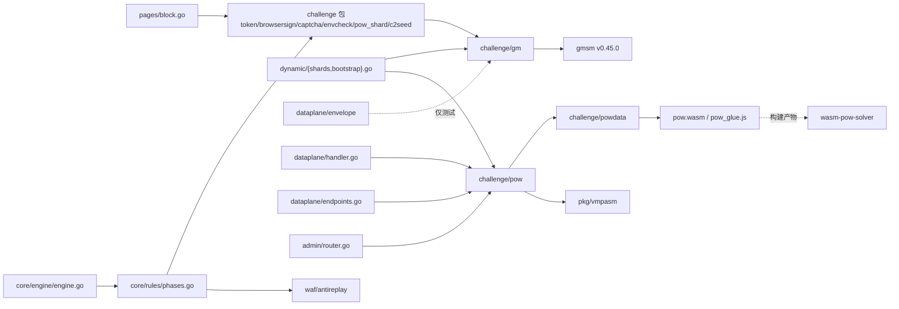

# 国密与 PoW 原语

> [返回 WAF 引擎系统](../WAF 引擎系统.md) · 同域：[挑战与验证](挑战与验证.md)、[动态混淆与VMP.md](./动态混淆与VMP.md)

<cite>
**本文档引用的文件**
- [doc.go](file://internal/waf/challenge/gm/doc.go)
- [envelope.go](file://internal/waf/challenge/gm/envelope.go)
- [sealed.go](file://internal/waf/challenge/gm/sealed.go)
- [sm4gcm.go](file://internal/waf/challenge/gm/sm4gcm.go)
- [kdf.go](file://internal/waf/challenge/gm/kdf.go)
- [label.go](file://internal/waf/challenge/gm/label.go)
- [sign.go](file://internal/waf/challenge/gm/sign.go)
- [verify.go](file://internal/waf/challenge/gm/verify.go)
- [consttime.go](file://internal/waf/challenge/gm/consttime.go)
- [vector_helpers.go](file://internal/waf/challenge/gm/vector_helpers.go)
- [pow.go](file://internal/waf/challenge/pow/pow.go)
- [embed.go](file://internal/waf/challenge/powdata/embed.go)
- [version.go](file://internal/waf/challenge/powdata/version.go)
- [browsersign.go](file://internal/waf/challenge/browsersign.go)
- [pow_shard.go](file://internal/waf/challenge/pow_shard.go)
- [token.go](file://internal/waf/challenge/token.go)
- [captcha.go](file://internal/waf/challenge/captcha.go)
- [envcheck.go](file://internal/waf/challenge/envcheck.go)
- [c2seed.go](file://internal/waf/challenge/c2seed.go)
- [shield.go](file://internal/waf/challenge/shield.go)
- [chain.go](file://internal/waf/challenge/chain.go)
- [block.go](file://internal/waf/pages/block.go)
- [endpoints.go](file://internal/dataplane/endpoints.go)
- [handler.go](file://internal/dataplane/handler.go)
- [envelope_verify.go](file://internal/dataplane/envelope/envelope_verify.go)
- [antireplay.go](file://internal/waf/antireplay/antireplay.go)
- [phases.go](file://internal/core/rules/phases.go)
- [engine.go](file://internal/core/engine/engine.go)
- [server.go](file://internal/app/server.go)
- [router.go](file://internal/admin/router.go)
- [bootstrap.go](file://internal/waf/dynamic/bootstrap.go)
- [shards.go](file://internal/waf/dynamic/shards.go)
- [opcodes.go](file://internal/pkg/vmpasm/opcodes.go)
- [crypto_ref.go](file://internal/pkg/vmpasm/crypto_ref.go)
- [lib.rs](file://wasm-pow-solver/src/lib.rs)
- [gm.rs](file://wasm-pow-solver/src/gm.rs)
- [sm3.rs](file://wasm-pow-solver/src/sm3.rs)
- [crypto.rs](file://wasm-pow-solver/src/crypto.rs)
- [label.rs](file://wasm-pow-solver/src/label.rs)
- [fingerprint.rs](file://wasm-pow-solver/src/fingerprint.rs)
- [env.rs](file://wasm-pow-solver/src/env.rs)
- [integrity.rs](file://wasm-pow-solver/src/integrity.rs)
- [obfuscate.rs](file://wasm-pow-solver/src/obfuscate.rs)
- [Cargo.toml](file://wasm-pow-solver/Cargo.toml)
- [Makefile](file://wasm-pow-solver/Makefile)
- [build.sh](file://scripts/build.sh)
- [build.ps1](file://scripts/build.ps1)
- [README.md](file://README.md)
- [go.mod](file://go.mod)
</cite>

## 目录
1. [简介](#简介)
2. [项目结构](#项目结构)
3. [核心组件](#核心组件)
4. [架构总览](#架构总览)
5. [详细组件分析](#详细组件分析)
6. [依赖关系分析](#依赖关系分析)
7. [性能考虑](#性能考虑)
8. [故障排查指南](#故障排查指南)
9. [结论](#结论)
10. [附录](#附录)

## 简介

本篇覆盖挑战链路最底层的两组原语：**国密信封原语**（SM2 签名 / SM3 摘要与 KDF / SM4-GCM 保密）与 **PoW 原语**（难度钳制、批量求解协议、常量时间校验、WASM 资产下发）。读者为挑战模块开发与运维，核心约束是「Go 服务端与 Rust WASM 客户端逐字节同构」——同一份线格式有两套实现，任何偏移改动都要两侧同批。

本篇定位是**实现原理与运维/开发要点**，不是攻击或绕过手册：所有密钥、CEK、token、签名值一律 `{占位}`，只描述协议布局、调用关系与失败语义。

| 项 | 内容 |
|----|------|
| 所属业务域 | WAF 引擎系统 / 挑战与验证 |
| 本篇形态 | C 三级实现文档（一实现一节，节内 `####` 拆接口/注册/调用） |
| 覆盖范围 | `internal/waf/challenge/gm`（10 文件 705 行）、`pow`（313 行）、`powdata`（45 行）、`wasm-pow-solver/`（Rust 11 源文件 + `Cargo.toml` + `Makefile`） |
| 不覆盖 | 验证码题型、5 秒盾会话编排、链式状态机（同域其他实现文档） |
| 同级与上级 | [动态混淆与 VMP](./动态混淆与VMP.md)、[WAF 引擎系统](../WAF 引擎系统.md) |

**章节来源**
- [doc.go:1-9](file://internal/waf/challenge/gm/doc.go#L1-L9)
- [pow.go:131-157](file://internal/waf/challenge/pow/pow.go#L131-L157)

## 项目结构

四组实现按「原语 → 资产 → 构建」三层落位：Go 原语包只导出字节操作，资产包只嵌字节，Rust 侧是同一线格式的对偶实现。

```text
internal/waf/challenge/
├── gm/          # 国密信封原语（非测试 10 文件 705 行）
│   ├── envelope.go  # OWVE v2 布局常量、6 个用途域、base64url 编解码
│   ├── sealed.go    # Seal/Open（SM4-GCM + SM2 签名 + SM3 整体 tag）
│   ├── sm4gcm.go    # cipher.AEAD 之上的 SM4-GCM 薄封装
│   ├── sign.go      # SM2 身份装载与签名（含派生式一次性身份）
│   ├── verify.go    # SM2 验签（ZA 语义 + 外部公钥验签）
│   └── {kdf,label,consttime,vector_helpers,doc}.go
├── pow/pow.go   # PoW 校验、难度钳制、worker 脚本生成、资产下发
└── powdata/     # go:embed 资产 + 内容派生版本串（embed.go + version.go）
wasm-pow-solver/ # Rust 对偶实现：src/{lib,gm,sm3,crypto,label,fingerprint,env,integrity,obfuscate,isa,vmp}.rs
```

| 路径 | 职责 | 主要语言 | 文件数 | 代表文件 | 对外暴露 |
|------|------|----------|:------:|----------|:--------:|
| `internal/waf/challenge/gm` | 信封线格式与 SM2/SM3/SM4 原语 | Go | 10 | `sealed.go` | 是 |
| `internal/waf/challenge/pow` | PoW 校验与资产下发 | Go | 1 | `pow.go` | 是 |
| `internal/waf/challenge/powdata` | 内嵌字节并派生版本串 | Go | 2 | `version.go` | 是（仅 `pow` 与测试） |
| `wasm-pow-solver` | 浏览器侧求解、信封、分片装配、指纹 | Rust | 11 + 2 | `src/lib.rs` | 产物经 `powdata` 内嵌 |



**图表来源**
- [envelope.go:8-84](file://internal/waf/challenge/gm/envelope.go#L8-L84)
- [sealed.go:28-119](file://internal/waf/challenge/gm/sealed.go#L28-L119)
- [version.go:8-35](file://internal/waf/challenge/powdata/version.go#L8-L35)
- [lib.rs:60-169](file://wasm-pow-solver/src/lib.rs#L60-L169)

**章节来源**
- [embed.go:1-9](file://internal/waf/challenge/powdata/embed.go#L1-L9)
- [pow.go:1-27](file://internal/waf/challenge/pow/pow.go#L1-L27)
- [sm4gcm.go:16-26](file://internal/waf/challenge/gm/sm4gcm.go#L16-L26)

## 核心组件

| 模块 | 路径 | 职责 | 核心接口/符号 | 依赖模块 | 被依赖 | 规模(行) | 测试 |
|------|------|------|---------------|----------|--------|:--------:|:----:|
| GM 信封 | `challenge/gm` | OWVE v2 签发/验证 | `Seal` `Open` `Encode` `Decode` | `gmsm`、`crypto/cipher` | `challenge`、`dynamic`、`dataplane/envelope` | 705 | 有 |
| 常量时间比较 | `challenge/gm` | 防 tag/MAC 时序旁路 | `ConstTimeEqual` `ConstTimeEqualHex` | 无 | `browsersign`、`token`、`c2seed` | 56 | 有 |
| SM2 身份 | `challenge/gm` | 进程内身份 + 派生式一次性身份 | `LoadIdentity` `DeriveIdentityPub` `DerivedSignMessage` | `gmsm/sm2` | `browsersign`、`token` | 161+58 | 有 |
| PoW 校验 | `challenge/pow` | 前导零判定与常量时间重算 | `VerifyPoW` `VerifyChallengeProof` `ClampPoWDifficulty` | `powdata`、`pkg/vmpasm` | `dataplane`、`shield`、`chain` | 313 | 有 |
| 资产下发 | `challenge/pow` | gzip + immutable 下发 | `ServePoWWASM` `ServePowGlueJS` `PowWasmURL` `PowGlueURL` | `powdata`、hertz `app` | `endpoints.go`、`router.go` | 同上 | 有 |
| 资产与版本 | `challenge/powdata` | 内嵌字节并按内容派生版本 | `WASMBinary` `WasmVersion` `GlueVersion` | `embed`、`crypto/sha256` | `pow`、`dynamic/bootstrap.go` | 45 | 有 |
| WASM 求解器 | `wasm-pow-solver/src` | 批量求解、信封对偶、分片装配 | `solve_pow_batched` `vm_assemble_shards` `gm_sm3_hmac` | `wasm-bindgen`、`smcrypto`、`sha2`、`aes-gcm` | 仅浏览器 | 5726 | 有 |



**图表来源**
- [sealed.go:28-79](file://internal/waf/challenge/gm/sealed.go#L28-L79)
- [sign.go:25-53](file://internal/waf/challenge/gm/sign.go#L25-L53)
- [kdf.go:16-46](file://internal/waf/challenge/gm/kdf.go#L16-L46)
- [pow.go:44-51](file://internal/waf/challenge/pow/pow.go#L44-L51)

Go 侧对外签名逐字取自实测：

```go
func Seal(key []byte, domain byte, plaintext []byte, aad []byte) ([]byte, error)
func Open(key []byte, raw []byte, aad []byte, domain byte, verifySig bool) ([]byte, error)
func VerifyPoW(nonce string, counter int64, hash string, difficulty int) bool
func VerifyChallengeProof(token, counter, hash string) bool
```

`Open` 的失败一律折叠为不可区分的 `ErrOpenFailed`，避免向调用方泄露具体原因形成 oracle [sealed.go:74-119](file://internal/waf/challenge/gm/sealed.go#L74-L119)、[envelope.go:64-68](file://internal/waf/challenge/gm/envelope.go#L64-L68)。

**章节来源**
- [sealed.go:21-119](file://internal/waf/challenge/gm/sealed.go#L21-L119)
- [envelope.go:64-84](file://internal/waf/challenge/gm/envelope.go#L64-L84)
- [consttime.go:7-26](file://internal/waf/challenge/gm/consttime.go#L7-L26)

## 架构总览

一次「浏览器提交 PoW 解答」的端到端：挑战页渲染版本化资产 URL，求解在 WASM 内完成，校验在 Go 侧常量时间重算；国密信封在环境指纹与分片装箱上独立参与。



**图表来源**
- [block.go:118-136](file://internal/waf/pages/block.go#L118-L136)
- [endpoints.go:136-146](file://internal/dataplane/endpoints.go#L136-L146)
- [pow.go:296-313](file://internal/waf/challenge/pow/pow.go#L296-L313)
- [lib.rs:60-159](file://wasm-pow-solver/src/lib.rs#L60-L159)

## 详细组件分析

### 国密信封原语（internal/waf/challenge/gm）

#### 接口与注册

包内无注册中心：`Seal`/`Open` 是包级函数；SM2 身份由 `atomic.Pointer[signCtx]` 进程内单例持有，装载入口是 `challenge` 包的 `init()` [token.go:33-37](file://internal/waf/challenge/token.go#L33-L37)。

```go
const (
    Magic              = "OWVE" // 与旧 AES-GCM v1 天然冲突，零回退拒绝
    EnvelopeVersion byte = 0x02
    NonceSize, TagSize, SigSize, Sm3TagSize = 12, 16, 64, 32
    MinEnvelopeLen     = headerLen + NonceSize + TagSize + SigSize + Sm3TagSize // 132
    MaxEnvelopeTextLen = 1 << 20
)
// 用途域（envelope.go:77-84）
DomainEnv=0x01  DomainCaptchaItem=0x02  DomainCaptchaAnswer=0x03
DomainBrowserSign=0x04  DomainToken=0x05  DomainPowShards=0x06
```

线格式偏移（`envelope.go:11-29`）：`magic(4) | version(1) | domain(1) | reserved(1) | sig_len(1) | nonce(12) | ciphertext(N) | gcm_tag(16) | sig(64) | sm3_tag(32)`；SM2 的 `e = SM3(signed)[:32]`，`signed` 覆盖 4 字节全零 headerid 到 `gcm_tag` 末尾，`sm3_tag` 覆盖 magic 到 `sig` 末尾。

| 域 | 用途 | 方向 | 是否验签 | 证据位置 |
|----|------|------|:----:|----------|
| 0x01 | 环境指纹 | 浏览器 → 服务端 | 否 | [envcheck.go:745-758](file://internal/waf/challenge/envcheck.go#L745-L758) |
| 0x02 / 0x03 | captcha 题目 / 答案 | 双向 | 否 | [captcha.go:98-139](file://internal/waf/challenge/captcha.go#L98-L139) |
| 0x04 | browser-sign 票据 | 服务端签署 | — | [envelope.go:81](file://internal/waf/challenge/gm/envelope.go#L81) |
| 0x05 | 通行 cookie / `dpkey` 票据 | 自签自验 | **是** | [token.go:500-519](file://internal/waf/challenge/token.go#L500-L519) |
| 0x06 | PoW / 动态保护 / C2 种子分片 | 服务端 → 浏览器 | 自检时是 | [pow_shard.go:190-210](file://internal/waf/challenge/pow_shard.go#L190-L210) |

#### 配置与凭据

- `challengeSecret`：32 字节，来自 `init()` 的 `crypto/rand`，同时是 SM2 私钥派生种子与所有 KDF 输入；本篇一律写作 `{占位:32B secret}`，不外传原始材料。
- `MY_OPENWAF_JWT_SECRET`：`server.go:299` 交给 `SetChallengeSecret`，而其中 `gm.LoadIdentity` 的内门条件 `len(secret) == 32` 恒假——该值的生成路径是 `rand(32B) → hex`，实得 **64 字符** [server.go:1468-1476](file://internal/app/server.go#L1468-L1476)、[token.go:53-80](file://internal/waf/challenge/token.go#L53-L80)。签名身份因此**跨重启变化**。
- `DefaultSM2UserID = "owaf-gm-challenge"`：ZA 的固定用户标识，两侧硬编码 [verify.go:11-22](file://internal/waf/challenge/gm/verify.go#L11-L22)、[gm.rs:18](file://wasm-pow-solver/src/gm.rs#L18)。

#### 调用与差异

**gm 确实用于挑战签名链路**：`token.go` 的通行 cookie 与 `dpkey` 密钥票据走 `gm.Seal/Open` + 域 0x05 + `KDF(CategoryPassToken)`；`browsersign.go` 的票据 MAC 与请求 MAC 走 `KDF`/`DeriveRequestKey` + SM3-HMAC，票据额外用派生式一次性身份 `DeriveIdentityPub(secret, "browsersign-sign")` 做标准 ZA 签名 [browsersign.go:91-102](file://internal/waf/challenge/browsersign.go#L91-L102)、[browsersign.go:304-327](file://internal/waf/challenge/browsersign.go#L304-L327)。`ConstTimeEqual` 的全部使用位置：`gm/sealed.go:86`（sm3_tag）、`gm/sign.go:29`（身份缓存比对）、`challenge/browsersign.go:136` 与 `:144`（票据 MAC 与请求签名）、`challenge/token.go:156`（token）、[c2seed.go:206](file://internal/waf/challenge/c2seed.go#L206)（种子 MAC）。

三条跨语言差异必须记清：

1. **AAD 不参与认证**：`Seal/Open` 传给 SM4-GCM 的 AAD 实为信封前 8 字节头部，形参 `aad` 只影响上层派生文本；域内多用途隔离完全依赖三条链的密钥互不相同 [sealed.go:53-56](file://internal/waf/challenge/gm/sealed.go#L53-L56)、[pow_shard.go:216-226](file://internal/waf/challenge/pow_shard.go#L216-L226)。
2. **`domain == 0` 不对称**：Go 把 0 当通配（`if domain != 0 && ...`），Rust `open_raw` 恒严格比较 `raw[5] != domain`，调用侧必须传具体域值 [sealed.go:93-95](file://internal/waf/challenge/gm/sealed.go#L93-L95)、[gm.rs:496-505](file://wasm-pow-solver/src/gm.rs#L496-L505)。
3. **空明文不对称**：Go 允许空密文（`MinEnvelopeLen` 按 N=0 计算），Rust 的 `seal_raw`/`open_raw` 对空明文与空密文直接拒绝 [envelope.go:19-29](file://internal/waf/challenge/gm/envelope.go#L19-L29)、[gm.rs:404-408](file://wasm-pow-solver/src/gm.rs#L404-L408)。

#### 限制与回退

`ConstTimeEqual` 先比长度再逐字节异或，与 `crypto/subtle` 同语义，长度可观测量属既定取舍 [consttime.go:7-16](file://internal/waf/challenge/gm/consttime.go#L7-L16)；`ConstTimeEqualHex` 把解码失败等价为「不等」，不开错误旁路 [consttime.go:19-26](file://internal/waf/challenge/gm/consttime.go#L19-L26)。身份缺失时 `SignMessage` 返回 `errMissingIdentity`，`Seal` 随之失败，`IssueBrowserSignTicket` 退化为「票据无 SM2 签名字段」而非阻断 [sign.go:53-75](file://internal/waf/challenge/gm/sign.go#L53-L75)。`vector_helpers.go` 的两个辅助只被向量生成测试使用 [vector_helpers.go:12-28](file://internal/waf/challenge/gm/vector_helpers.go#L12-L28)。

**章节来源**
- [envelope.go:31-107](file://internal/waf/challenge/gm/envelope.go#L31-L107)
- [sealed.go:21-119](file://internal/waf/challenge/gm/sealed.go#L21-L119)
- [kdf.go:16-56](file://internal/waf/challenge/gm/kdf.go#L16-L56)
- [label.go:10-55](file://internal/waf/challenge/gm/label.go#L10-L55)
- [sign.go:12-161](file://internal/waf/challenge/gm/sign.go#L12-L161)
- [verify.go:11-58](file://internal/waf/challenge/gm/verify.go#L11-L58)
- [token.go:33-80](file://internal/waf/challenge/token.go#L33-L80)
- [browsersign.go:91-155](file://internal/waf/challenge/browsersign.go#L91-L155)

### PoW 校验与资产下发（internal/waf/challenge/pow）

#### 接口与注册

```go
func ClampPoWDifficulty(difficulty int) int
func GeneratePoWNonce() string
func GenerateVMProgram() string
func GeneratePoWScriptBody(difficulty int, nonce string) string
func ServePoWWASM(c *app.RequestContext)
func PowWasmURL() string
func PowGlueURL() string
func VerifyChallengeProof(token, counter, hash string) bool
```

注册点：数据面 `handleWASMAssets` 精确匹配 `/__owaf/pow.wasm`、`/__owaf/pow_glue.js` [endpoints.go:136-146](file://internal/dataplane/endpoints.go#L136-L146)；控制面另注册一份供管理端口预览 [router.go:418-422](file://internal/admin/router.go#L418-L422)。

#### 配置与凭据

| 参数 | 类型 | 取值 | 说明 | 证据位置 |
|------|------|------|------|----------|
| `MinPoWDifficulty` | int | 1 | 难度 0 等于零工作量，必须拒绝 | [pow.go:92-94](file://internal/waf/challenge/pow/pow.go#L92-L94) |
| `MaxPoWDifficulty` | int | 7 | 每位前导零期望次数 ×16，7 约 2.7e8 | [pow.go:96-100](file://internal/waf/challenge/pow/pow.go#L96-L100) |
| `ChallengeProofDifficulty` | int | 4 | JS 挑战页固定难度 | [pow.go:295](file://internal/waf/challenge/pow/pow.go#L295) |
| `bs` / `nc` | int | 50000 / `hardwareConcurrency\|\|4` | 单批 counter 数与 Worker 并行度，推进约定 `off += bs*nc` | [pow.go:204-214](file://internal/waf/challenge/pow/pow.go#L204-L214) |

PoW 自身不持密钥，解答绑定的是挑战页 `token`（hex 会话密钥材料），写作 `{占位:token}`；派生入口是 `EnvSessionKeyFromChallengeToken` [envcheck.go:782-789](file://internal/waf/challenge/envcheck.go#L782-L789)。

#### 调用与差异

| 步 | 动作 | 执行位置 | 输入 | 输出 | 失败分支 | 可观测点 |
|:--:|------|----------|------|------|----------|----------|
| 1 | 难度钳制 | [pow.go:105-113](file://internal/waf/challenge/pow/pow.go#L105-L113) | 配置难度 | 钳到 `[1,7]` | 越界由校验侧判假 | `shield.go:194/275/300` |
| 2 | 生成字节码 | [pow.go:181-189](file://internal/waf/challenge/pow/pow.go#L181-L189) | `vmpasm` 汇编 | hex 容器 | 汇编失败返空串 | `vm_bad_magic` [lib.rs:70-73](file://wasm-pow-solver/src/lib.rs#L70-L73) |
| 3 | 渲染脚本 | [pow.go:195-240](file://internal/waf/challenge/pow/pow.go#L195-L240) | 难度/nonce | 多 Worker IIFE | Worker 创建失败 | `__owaf_pow_last_error` |
| 4 | 批量求解 | [lib.rs:60-159](file://wasm-pow-solver/src/lib.rs#L60-L159) | 96 字节 blob | `{found,counter,hash}` | 未命中却写脏输出 → `vm_output_magic` | 返回 JSON 的 `error` |
| 5 | 服务端校验 | [pow.go:139-157](file://internal/waf/challenge/pow/pow.go#L139-L157) | 三元组 | bool | 非法难度/非小写 hex/前导零不足 | `handler.go:245` |
| 6 | 资产下发 | [pow.go:61-79](file://internal/waf/challenge/pow/pow.go#L61-L79) | 内嵌字节 | gzip 响应 | 无 IO 错误面 | `Content-Encoding`、`Cache-Control` |

调用面差异：5 秒盾与链式挑战走**明文脚本** `GeneratePoWWASMScript`（[shield.go:520](file://internal/waf/challenge/shield.go#L520)、[chain.go:572](file://internal/waf/challenge/chain.go#L572)），只有 JS 挑战页 `WriteChallengeResponse` 走**分片 + GM 信封**，失败回落明文分片装配器 [block.go:118-133](file://internal/waf/pages/block.go#L118-L133)。`VerifyChallengeProof` 与 `VerifyPoW` 的差别只在入口形态：前者接收 HTTP 字符串并固定难度 4，`counter` 解析失败即无效 [pow.go:297-313](file://internal/waf/challenge/pow/pow.go#L297-L313)。

#### 限制与回退

生成侧与校验侧必须用同一钳制结果，否则出现「永远无法通过」的挑战 [pow.go:96-113](file://internal/waf/challenge/pow/pow.go#L96-L113)；`hash` 必须 64 位**小写**十六进制，大小写变体能绕过前导零前缀检查，故 `isLowerHexSHA256` 置于链首 [pow.go:115-129](file://internal/waf/challenge/pow/pow.go#L115-L129)。字节码是编译期确定量，多态性由外层随机变量名与 `PolymorphicEncode` 的 5 种编码形态承担 [pow.go:171-179](file://internal/waf/challenge/pow/pow.go#L171-L179)、[pow.go:252-280](file://internal/waf/challenge/pow/pow.go#L252-L280)。

**章节来源**
- [pow.go:22-79](file://internal/waf/challenge/pow/pow.go#L22-L79)
- [pow.go:81-313](file://internal/waf/challenge/pow/pow.go#L81-L313)
- [endpoints.go:136-146](file://internal/dataplane/endpoints.go#L136-L146)
- [router.go:418-422](file://internal/admin/router.go#L418-L422)
- [block.go:118-136](file://internal/waf/pages/block.go#L118-L136)
- [lib.rs:42-159](file://wasm-pow-solver/src/lib.rs#L42-L159)

### 资产版本一致性（internal/waf/challenge/powdata）

#### 接口与注册

```go
//go:embed pow.wasm
var WASMBinary []byte
//go:embed pow_glue.js
var PowGlueJS []byte

func WasmVersion() string // sha256(WASMBinary)[:4] 的 hex，8 字符
func GlueVersion() string // sha256(PowGlueJS)[:4] 的 hex，8 字符
```

版本串由 `sync.Once` 首次取值时计算并常驻 [version.go:8-35](file://internal/waf/challenge/powdata/version.go#L8-L35)。

#### 配置与凭据

| 产物 | 实测大小 | 版本来源 | URL 形态 | 消费方 |
|------|:--------:|----------|----------|--------|
| `pow.wasm` | 229 KiB | `sha256[:4]` | `/__owaf/pow.wasm?v={8hex}` | `PowWasmURL()` |
| `pow_glue.js` | 133 KiB | `sha256[:4]` | `/__owaf/pow_glue.js?v={8hex}` | `PowGlueURL()` |

| 注入点 | 注入内容 | 证据位置 |
|--------|----------|----------|
| PoW worker 脚本 | `importScripts(origin+glue)` 与 `wasm_bindgen(origin+wasm)` | [pow.go:212](file://internal/waf/challenge/pow/pow.go#L212) |
| browser-sign 脚本 | 槽位先 wasm 后 glue | [browsersign.go:174-181](file://internal/waf/challenge/browsersign.go#L174-L181) |
| PoW 分片引导壳 | 槽位先 glue 后 wasm | [pow_shard.go:315-325](file://internal/waf/challenge/pow_shard.go#L315-L325) |
| 动态保护引导脚本 | 替换 `__OWAF_WASM_URL__`/`__OWAF_GLUE_URL__` | [bootstrap.go:154-169](file://internal/waf/dynamic/bootstrap.go#L154-L169) |

#### 调用与差异

一致性机制的真实边界：**版本串的作用域只到「URL 与内容一一绑定」，不存在运行期回传校验**。

- `VerifyBrowserSignHeaders` 校验票据 MAC、时间偏移、请求 SM3-HMAC 与环境信封解密，**没有任何资产版本字段** [browsersign.go:104-155](file://internal/waf/challenge/browsersign.go#L104-L155)。
- `AntiReplayManager.ValidateAndRotate` 轮换成对 nonce（`__waf_nonce`/`__waf_nonce2`），与 WASM 资产无耦合 [antireplay.go:101](file://internal/waf/antireplay/antireplay.go#L101)、[phases.go:1303-1314](file://internal/core/rules/phases.go#L1303-L1314)。
- `immutable` 与版本串互为反向约束：只调大 `max-age` 而 URL 不随内容变，会把「旧资产滞留一小时」恶化成「滞留 30 天」 [pow.go:53-60](file://internal/waf/challenge/pow/pow.go#L53-L60)。
- 历史上此处曾写死 `?v=f54bf002`/`?v=7ad1dbac` 且资产换版后从未更新，属已修复缺陷，现由 `pow_version_contract_test.go`、`pow_version_injection_test.go`、`version_test.go` 三类离线闸门锁定 [browsersign.go:174-178](file://internal/waf/challenge/browsersign.go#L174-L178)。

#### 限制与回退

`versionOf` 只取 4 字节摘要，是缓存串而非完整性凭证，不得当工件签名用 [version.go:15-19](file://internal/waf/challenge/powdata/version.go#L15-L19)；glue/wasm 槽位互换不会编译失败，只会静默用错 URL，注释已要求按模板出现顺序排列 [pow_shard.go:319-322](file://internal/waf/challenge/pow_shard.go#L319-L322)。



**图表来源**
- [version.go:8-35](file://internal/waf/challenge/powdata/version.go#L8-L35)
- [pow.go:37-79](file://internal/waf/challenge/pow/pow.go#L37-L79)
- [browsersign.go:159-188](file://internal/waf/challenge/browsersign.go#L159-L188)

**章节来源**
- [embed.go:1-9](file://internal/waf/challenge/powdata/embed.go#L1-L9)
- [version.go:1-36](file://internal/waf/challenge/powdata/version.go#L1-L36)
- [pow.go:37-79](file://internal/waf/challenge/pow/pow.go#L37-L79)
- [antireplay.go:101](file://internal/waf/antireplay/antireplay.go#L101)

### WASM 求解器与构建链（wasm-pow-solver）

#### 接口与注册

导出面即浏览器可见 API（`#[wasm_bindgen]`）：

```rust
pub fn solve_pow_batched(nonce: &str, difficulty: u32, program: &str,
                         batch_size: u32, start_counter: u64) -> String
pub fn verify_pow(nonce: &str, counter: u64, hash: &str, difficulty: u32) -> bool
pub fn gm_sm3_hmac(keyhex: &str, msg: &str) -> String
pub fn gm_decrypt_challenge_data(envelope: &str, key_hex: &str) -> String
pub fn gm_encrypt_challenge_answer(answer: &str, key_hex: &str) -> String
pub fn gm_sign_challenge(json: &str, priv_hex: &str) -> String
pub fn gm_open_verify_sig(envelope: &str, key_hex: &str, domain: u8, pub_hex: &str) -> String
pub fn vm_assemble_shards(envelope: &str, key_hex: &str) -> String
pub fn gm_sm3_kdf(keyhex: &str, category: &str) -> String
```

另有 `decrypt_dynamic_payload`、`unwrap_dynamic_cek`、`decrypt_dynamic_with_cek`（[crypto.rs:117-141](file://wasm-pow-solver/src/crypto.rs#L117-L141)，动态保护侧使用，详见同级 [动态混淆与 VMP](./动态混淆与VMP.md)）。输入 blob 定长 96 字节（`IN_LEN = 32 + 64`），整数字段一律小端 u64；输出区 48 字节 = `hash(32) ‖ OUTPUT_MAGIC(8) ‖ found_counter(8)`，魔数内存字节 `"OWAOUTP\0"` [lib.rs:14-58](file://wasm-pow-solver/src/lib.rs#L14-L58)。

#### 配置与凭据

| 配置项 | 位置 | 实测值 | 作用 |
|--------|------|--------|------|
| `wasm-opt` | `Cargo.toml:7-8` | **false** | 关闭 wasm-bindgen 的字节码优化后处理 |
| `opt-level`/`lto`/`codegen-units`/`panic` | `Cargo.toml:42-47` | `z`/`true`/`1`/`abort` | 体积优先 release 档 |
| `smcrypto`/`sha2`/`aes-gcm`/`wasm-bindgen` | `Cargo.toml:13-24` | 0.3.1/0.11.0/0.11/0.2.127 | SM2 与 SHA/AES 依赖 |
| 输出目录 | `Makefile:1-4` | `../internal/waf/challenge/powdata` | 产物直接落到 `go:embed` 位置 |
| 构建目标 | `Makefile:9` | `wasm-pack build --target no-modules --release --out-name pow` | 生成 `pkg/pow.js` 与 `pkg/pow_bg.wasm` |

浏览器侧 SM2 私钥是**会话级一次性 keypair**，签名即弃，本篇写作 `{占位:priv_hex}`；`gm_sign_challenge` 的输入上限 512 KiB [gm.rs:1229-1241](file://wasm-pow-solver/src/gm.rs#L1229-L1241)。

#### 调用与差异

**`make optimize` 名不符实**，这是本篇最重要的构建结论：

- `optimize` 不执行任何 `wasm-opt`：`Cargo.toml:8` 显式关闭，产物体积只受 `opt-level = "z"` + `lto` 影响。
- 它实际做的是 **glue JS 的 terser 压缩 + `javascript-obfuscator` 混淆**（控制流平坦化、死代码注入、字符串数组 RC4、`--self-defending true`）[Makefile:31-41](file://wasm-pow-solver/Makefile#L31-L41)。
- 默认**复用**旧混淆件：`pow_glue.js` 若已含 `function _0x`，目标只打印「reusing the existing obfuscated」并跳过覆盖，Rust 侧 glue 改动不生效；必须 `FORCE_GLUE=1 make optimize` 才从 `pkg/pow.js` 重生 [Makefile:20-30](file://wasm-pow-solver/Makefile#L20-L30)；`build` 目标同样在检测到已混淆时保留现件 [Makefile:11-17](file://wasm-pow-solver/Makefile#L11-L17)。
- 平台不对称：`scripts/build.sh:9-10` 在 Linux 侧无条件执行 `make optimize`，且脚本 `set -euo pipefail`，`wasm-pack`/`npx` 缺失即整构建失败；`scripts/build.ps1` 全文 20 行**无任何 WASM 步骤** [build.sh:1-13](file://scripts/build.sh#L1-L13)、[build.ps1:1-20](file://scripts/build.ps1#L1-L20)。
- 与文档冲突：`README.md:295` 把 Rust 工具链标注为「可选（仅重建 WASM PoW 时需要）」，与 Linux 侧硬依赖不符 [README.md:295](file://README.md#L295)。

国密算法与第三方库的对应关系：

| 算法 | Go 侧来源 | Rust 侧来源 | 是否同源 |
|------|-----------|--------------|:--------:|
| SM3 | `github.com/emmansun/gmsm/sm3`（v0.45.0） | `src/sm3.rs` 自实现压缩函数 | 否 |
| SM4 | `gmsm/sm4` + `crypto/cipher` GCM | `src/gm.rs` 自实现 S-BOX/FK/CK + 自建 GCM | 否 |
| SM2 | `gmsm/sm2`（ZA + `Sign`/`Verify`） | `smcrypto` 的 `sign_raw`/`verify_raw` + 自算 `e = SM3(ZA‖M)`（标签与 KDF 对偶见 [label.rs:10-24](file://wasm-pow-solver/src/label.rs#L10-L24)） | 否 |
| SHA-256 | 标准库 `crypto/sha256` | `sha2`，经 [obfuscate.rs:3-10](file://wasm-pow-solver/src/obfuscate.rs#L3-L10) 的 `sha256_compute` 四分支包装 | 否 |

不同源正是跨语言向量测试存在的理由：`gen_vectors_test.go`、`a2_interop_test.go`、`sm4gcm_vector_test.go`、`nist_d1_test.go` 与 `vmp_contract_test.go` 负责钉死布局、opcode 数值与字节序；`vmpasm/crypto_ref.go` 在 Go 侧另备一份参照实现对照标准库 [crypto_ref.go:11-33](file://internal/pkg/vmpasm/crypto_ref.go#L11-L33)。

#### 限制与回退

`fingerprint.rs` 采集结果上限 64 KiB，超限返回空串，浏览器侧表现为「环境指纹不可用」[fingerprint.rs:7](file://wasm-pow-solver/src/fingerprint.rs#L7)；`gm_encrypt_fingerprint_gcm` 对空 `aad` 失败关闭 [gm.rs:1171-1183](file://wasm-pow-solver/src/gm.rs#L1171-L1183)；`vm_assemble_shards` 任何异常（信封、格式、解码、CRC、UTF-8）统一返回空串，由薄壳转成可见错误 [gm.rs:1353-1415](file://wasm-pow-solver/src/gm.rs#L1353-L1415)；求解侧回退是「本批未命中继续下一批」，不静默降级 [lib.rs:124-135](file://wasm-pow-solver/src/lib.rs#L124-L135)。另注：`integrity::self_check` 未被求解路径调用，`env::live_monitoring`/`perf_now` 带 `#[allow(dead_code)]`，均属未接线探针 [integrity.rs:4-24](file://wasm-pow-solver/src/integrity.rs#L4-L24)、[env.rs:9-43](file://wasm-pow-solver/src/env.rs#L9-L43)。

**章节来源**
- [lib.rs:1-179](file://wasm-pow-solver/src/lib.rs#L1-L179)
- [gm.rs:1-50](file://wasm-pow-solver/src/gm.rs#L1-L50)
- [gm.rs:400-560](file://wasm-pow-solver/src/gm.rs#L400-L560)
- [gm.rs:1146-1440](file://wasm-pow-solver/src/gm.rs#L1146-L1440)
- [sm3.rs:1-30](file://wasm-pow-solver/src/sm3.rs#L1-L30)
- [Cargo.toml:1-47](file://wasm-pow-solver/Cargo.toml#L1-L47)
- [Makefile:1-50](file://wasm-pow-solver/Makefile#L1-L50)
- [build.sh:1-13](file://scripts/build.sh#L1-L13)

## 依赖关系分析



**图表来源**
- [pow.go:1-20](file://internal/waf/challenge/pow/pow.go#L1-L20)
- [shards.go:1-25](file://internal/waf/dynamic/shards.go#L1-L25)
- [engine.go:510-516](file://internal/core/engine/engine.go#L510-L516)
- [phases.go:1400-1410](file://internal/core/rules/phases.go#L1400-L1410)

### 依赖矩阵

| 调用方 ↓ / 被调方 → | gm | pow | powdata | vmpasm | antireplay | gmsm |
|---------------------|:--:|:---:|:-------:|:------:|:----------:|:----:|
| `challenge/*` | ✓ | ✓ | — | — | ✓ | ✓ |
| `challenge/pow` | — | — | ✓ | ✓ | — | — |
| `dynamic/*` | ✓ | ✓ | 间接 | — | — | — |
| `dataplane/*` | ✓ | ✓ | — | — | ✓ | — |
| `core/rules` | — | — | — | — | ✓ | — |
| `pkg/vmpasm` | — | — | — | — | — | ✓ |

`dataplane/envelope → gm` 无生产调用点，属结构依赖而非运行期依赖；`dynamic → pow` 只经 `applyAssetURLs` 取 URL，不解 PoW [envelope_verify.go:30-42](file://internal/dataplane/envelope/envelope_verify.go#L30-L42)。

**章节来源**
- [envelope_verify.go:17-42](file://internal/dataplane/envelope/envelope_verify.go#L17-L42)
- [bootstrap.go:154-169](file://internal/waf/dynamic/bootstrap.go#L154-L169)

### 外部实体

| 外部实体 | 类型 | 方向 | 方式 | 触发时机 | 数据内容 | 失败影响 | 容错处理 |
|----------|------|------|------|----------|----------|----------|----------|
| `gmsm v0.45.0` | 第三方库 | 出向 | 进程内 | 每次 Seal/Open/签验 | `{占位:派生密钥}` | 无法签发信封 | 返 `error`/`false`，失败关闭 |
| `smcrypto 0.3.1` | crate | 出向 | WASM 内 | 浏览器签验 | 一次性私钥 | sig 字段零填充 | 空串，失败关闭 |
| 浏览器 `WebAssembly` | 运行环境 | 双向 | HTTP + WASM | 页面加载 | 版本化资产 URL | 挑战不通过 | `__owaf_pow_error` + 重新下发 |
| OS `crypto/rand` | 系统熵源 | 出向 | `rand.Reader` | 每次 Seal/nonce | nonce | 极端失败得零值 | `RandomBytes` 忽略错误，属已知薄弱点 |

**章节来源**
- [go.mod:8-25](file://go.mod#L8-L25)
- [Cargo.toml:13-24](file://wasm-pow-solver/Cargo.toml#L13-L24)
- [kdf.go:49-56](file://internal/waf/challenge/gm/kdf.go#L49-L56)

## 性能考虑

### 签发与拒绝路径的算力分配

- **问题**：每次签名都从 32 字节 secret 重做曲线标量乘法；篡改密文若先进入 AEAD，会付出完整 SM4-GCM 与验签成本。
- **优化**：`signIdent atomic.Pointer[signCtx]` 缓存 secret→私钥/公钥，派生身份按 `(secret, category)` 存 `catIdentities sync.Map`；`Open` 第一步算 `sm3.Sum` 并常量时间比较，廉价拒绝，Rust `open_raw` 保持同一顺序 [sign.go:12-19](file://internal/waf/challenge/gm/sign.go#L12-L19)、[sign.go:89-138](file://internal/waf/challenge/gm/sign.go#L89-L138)、[sealed.go:83-88](file://internal/waf/challenge/gm/sealed.go#L83-L88)。
- **效果**：同 secret 装载幂等，缓存命中比较本身仍走 `ConstTimeEqual`，不引入新旁路；拒绝成本从「SM4-GCM + SM2 验签」降为「一次 SM3」（推断，无基准数据）。

**章节来源**
- [sign.go:12-138](file://internal/waf/challenge/gm/sign.go#L12-L138)
- [sealed.go:83-88](file://internal/waf/challenge/gm/sealed.go#L83-L88)
- [gm.rs:523-530](file://wasm-pow-solver/src/gm.rs#L523-L530)
- [consttime.go:7-16](file://internal/waf/challenge/gm/consttime.go#L7-L16)

### 批量求解与资产压缩

- **问题**：逐 counter 跨 WASM/JS 边界会把边界开销放大到与工作量同级；229 KiB WASM 若每请求重压则稳定耗 CPU。
- **优化**：程序自身遍历 `[start, start+batch_size)`，宿主按 `PerIterBudget × batch_size` 设步数预算 [lib.rs:90-97](file://wasm-pow-solver/src/lib.rs#L90-L97)、[opcodes.go:185-190](file://internal/pkg/vmpasm/opcodes.go#L185-L190)；`gzipWASMOnce`/`gzipGlueOnce` 各压一次并复用切片，配合 `immutable` 让绝大多数请求不回源 [pow.go:22-35](file://internal/waf/challenge/pow/pow.go#L22-L35)。
- **效果**：Worker 只需按 `off += bs*nc` 推进；内存常驻约 360 KiB 量级（按压缩前尺寸推断）。

**章节来源**
- [lib.rs:90-97](file://wasm-pow-solver/src/lib.rs#L90-L97)
- [opcodes.go:185-190](file://internal/pkg/vmpasm/opcodes.go#L185-L190)
- [pow.go:22-79](file://internal/waf/challenge/pow/pow.go#L22-L79)

## 故障排查指南

### 问题：浏览器报 `vm_bad_magic`，PoW 永不通过

**症状**：`__owaf_pow_last_error` 为 `vm_bad_magic`，挑战反复下发。

**可能原因**：`GenerateVMProgram` 汇编失败返回空串；客户端 `program` 与解释器版本混用。

**排查步骤**：
1. 核对页面里的 `?v=` 与资产摘要是否同源：
   ```bash
   sha256sum internal/waf/challenge/powdata/pow.wasm | cut -c1-8
   ```
2. 跑 `go test ./internal/waf/challenge/pow/...` 复现程序生成，确认 `vmpasm.Assemble` 未报错。

**解决方案**：重建资产（见附录命令）；若确为汇编报错，按 `pow.go:184-187` 的注释当作代码缺陷处理，不得放开难度掩盖。

**章节来源**
- [pow.go:181-189](file://internal/waf/challenge/pow/pow.go#L181-L189)
- [lib.rs:70-73](file://wasm-pow-solver/src/lib.rs#L70-L73)
- [version.go:15-19](file://internal/waf/challenge/powdata/version.go#L15-L19)

### 问题：改 Rust glue 后行为没变

**症状**：`make optimize` 打印 `reusing the existing obfuscated .../pow_glue.js`，新导出函数在浏览器 `undefined`。

**可能原因**：`Makefile:27-30` 默认复用旧混淆件，`build` 目标检测到 `function _0x` 后同样不覆盖。

**排查步骤**：比对 `pkg/pow.js` 与 `powdata/pow_glue.js`；确认版本串是否随内容变化（未变说明文件没被替换）。

**解决方案**：`FORCE_GLUE=1 make optimize` 强制重生后重编 Go 二进制。注意 `optimize` 不跑 `wasm-opt`，需要字节码优化须另行显式处理。

**章节来源**
- [Makefile:11-30](file://wasm-pow-solver/Makefile#L11-L30)
- [Cargo.toml:7-8](file://wasm-pow-solver/Cargo.toml#L7-L8)

### 问题：Windows 构建成功但 Linux 构建报 wasm-pack 缺失

**症状**：`./scripts/build.sh` 在 `make optimize` 处中断，`build.ps1` 正常。

**可能原因**：Linux 脚本含 WASM 步骤且 `set -euo pipefail`，Windows 脚本无该步骤，README 又把 Rust 标为可选。

**排查步骤**：`command -v wasm-pack && command -v npx`；确认 `powdata` 资产是否人工更新过。

**解决方案**：补齐 Rust 工具链与 `terser`/`javascript-obfuscator`（二者经 `npx -y` 在线拉取）；跳过该步骤只在不需更新资产时可接受。

**章节来源**
- [build.sh:1-13](file://scripts/build.sh#L1-L13)
- [build.ps1:1-20](file://scripts/build.ps1#L1-L20)
- [README.md:295](file://README.md#L295)

### 问题：重启后 browser-sign 票据大面积失败

**症状**：升级或重启后「浏览器签名票据 MAC 校验失败」「缺少浏览器环境指纹」激增。

**可能原因**：SM2 身份来自 `init()` 随机 secret，重启即换，跨重启存活的信封不再可验 [token.go:33-37](file://internal/waf/challenge/token.go#L33-L37)。

**排查步骤**：区分「同进程内失败」（多为篡改或域/密钥错配）与「跨重启失败」；检查 `gm.PubKeyHex()` 是否为空——空值表示内部不变量被破坏，按 error 级日志处理 [envelope_verify.go:58-67](file://internal/dataplane/envelope/envelope_verify.go#L58-L67)。

**解决方案**：让票据寿命短于重启间隔（`defaultBrowserSignTTL = 300` 秒）是事实上的兜底；若必须跨重启验签，需把身份绑到持久 secret，并同时处理「改 JWT secret 即换签名身份」的隐蔽副作用 [browsersign.go:28-29](file://internal/waf/challenge/browsersign.go#L28-L29)。

**章节来源**
- [token.go:33-80](file://internal/waf/challenge/token.go#L33-L80)
- [browsersign.go:26-155](file://internal/waf/challenge/browsersign.go#L26-L155)

## 结论

本篇把「国密信封 + PoW 原语」按四个实现逐一拆清：`gm` 提供 OWVE v2 的字节级权威布局与 SM2/SM3/SM4 原语，`pow` 提供难度钳制、常量时间校验与资产下发，`powdata` 用内容派生版本串解决 immutable 缓存下的旧资产滞留，`wasm-pow-solver` 是同一协议的浏览器对偶实现。

- **优势**：失败语义统一（不可区分拒绝）、比较一律常量时间、原语包零业务依赖（只靠 `gmsm` 与标准库）、跨语言差异在注释里就近写明并配向量测试。
- **建议**（均对应正文已识别缺口）：`make optimize` 改名或在文档标注其不跑 `wasm-opt`；统一 `README.md:295` 与 `build.sh:9-10` 的依赖口径；处置无调用点的 `EnvelopeVerifier`；修掉 `SetChallengeSecret` 的恒假分支或撤消其「跨重启一致」承诺；统一两端「域必传具体值、明文非空」的约束。

[本节为总结，无需特定文件来源]

## 附录

### 配置参数说明

| 配置项 | 类型 | 默认值 | 必填 | 说明 | 证据位置 |
|--------|------|--------|:----:|------|----------|
| `MaxEnvelopeTextLen` | int | 1048576 | — | 信封文本上限，覆盖 512 KiB 明文的编码膨胀 | [envelope.go:58-61](file://internal/waf/challenge/gm/envelope.go#L58-L61) |
| `aad` 长度 | int | ≤512（env）/≤2046（Seal） | 是 | 两侧上限不同 | [envcheck.go:791-811](file://internal/waf/challenge/envcheck.go#L791-L811)、[sealed.go:32-34](file://internal/waf/challenge/gm/sealed.go#L32-L34) |
| `KDF` info 上限 | int | 512 | 是 | 超限返回 32 字节零值（调用方错误） | [kdf.go:16-25](file://internal/waf/challenge/gm/kdf.go#L16-L25) |
| `DefaultSM2UserID` | string | `owaf-gm-challenge` | 是 | 两侧硬编码，改动即全量验签失败 | [verify.go:11](file://internal/waf/challenge/gm/verify.go#L11) |
| `defaultBrowserSignTTL` | int | 300 | 否 | 票据有效期秒，`<=0` 取默认 | [browsersign.go:28-58](file://internal/waf/challenge/browsersign.go#L28-L58) |
| `browserSignSkewSecs` | int | 60 | — | 时间戳偏移上限 | [browsersign.go:124-134](file://internal/waf/challenge/browsersign.go#L124-L134) |
| `MAX_GM_PLAINTEXT_BYTES` | usize | 512 KiB | — | Rust 侧明文上限 | [gm.rs:15-16](file://wasm-pow-solver/src/gm.rs#L15-L16) |
| `NONCE_MAX` | usize | 64 | — | 输入 blob nonce 区定长，超出按 `program_too_large` 拒绝 | [lib.rs:26-56](file://wasm-pow-solver/src/lib.rs#L26-L56) |
| `Cache-Control` | string | `public,max-age=2592000,immutable` | 是 | 与版本串互为约束，须同批改动 | [pow.go:66-77](file://internal/waf/challenge/pow/pow.go#L66-L77) |

**章节来源**
- [envelope.go:31-107](file://internal/waf/challenge/gm/envelope.go#L31-L107)
- [sealed.go:21-52](file://internal/waf/challenge/gm/sealed.go#L21-L52)
- [browsersign.go:19-58](file://internal/waf/challenge/browsersign.go#L19-L58)
- [lib.rs:42-58](file://wasm-pow-solver/src/lib.rs#L42-L58)

### 调用示例

载荷全部脱敏，密钥与签名值一律 `{占位}`。

```go
// 服务端：签发环境指纹域信封（密钥来自会话派生）
sessionKey := []byte("{占位:32B 会话主密钥}")
aad := []byte(challenge.EnvFingerprintAAD("challenge", reqID, binding))
raw, _ := gm.Seal(sessionKey[:16], gm.DomainEnv, payload, aad)
envelopeText := gm.Encode(raw) // base64url，可直接放进请求头

// 服务端：自检 0x06 域信封的 SM2 签名（域必须具体，不能传 0）
plain := challenge.VerifyShardEnvelopeSignature(envelopeText, keyHex, gm.PubKeyHex())
```

```javascript
// 浏览器侧（glue 已加载）：批量求解与请求签名
const r = JSON.parse(wasm_bindgen.solve_pow_batched(nonce, difficulty, program, 50000, off));
const sig = wasm_bindgen.gm_sm3_hmac(signKeyHex,
  method + "|" + path + "|" + query + "|" + ts + "|" + nonce + "|" + env);
```

```bash
# 校验资产与 URL 版本串同源（输出应等于页面里的 ?v= 值）
sha256sum internal/waf/challenge/powdata/pow.wasm    | cut -c1-8
sha256sum internal/waf/challenge/powdata/pow_glue.js | cut -c1-8
# 重新生成混淆 glue（同时触发 wasm-pack build）
cd wasm-pow-solver && FORCE_GLUE=1 make optimize
```

**章节来源**
- [sealed.go:28-72](file://internal/waf/challenge/gm/sealed.go#L28-L72)
- [envcheck.go:861-870](file://internal/waf/challenge/envcheck.go#L861-L870)
- [pow_shard.go:190-210](file://internal/waf/challenge/pow_shard.go#L190-L210)
- [browsersign.go:329-348](file://internal/waf/challenge/browsersign.go#L329-L348)
- [Makefile:20-30](file://wasm-pow-solver/Makefile#L20-L30)

### 特性与限制对比

| 能力 | Go `gm` | Rust `gm.rs` | Go `pow` | 备注 |
|------|:-------:|:------------:|:--------:|------|
| Seal（带 SM2 签名） | ✓ | ✓ | — | Go 用进程内身份，Rust 用一次性私钥入参 |
| Open + 验签 | ✓ | ✓ | — | Go 走 `signIdent`，Rust 走外部公钥 |
| 空明文信封 | 部分 | ✗ | — | Go 允许（N 可为 0），Rust 拒绝 |
| `domain == 0` 通配 | ✓ | ✗ | — | 调用侧必须传具体域 |
| PoW 批量求解 | ✗ | ✓ | — | 求解只发生在浏览器 |
| PoW 校验 | ✗ | ✓ | ✓ | Rust `verify_pow` 仅调试，权威在服务端 |
| 常量时间比较 | ✓ | ✓ | ✓ | `ct_eq` / `ConstTimeEqual` / `subtle` |
| `wasm-opt` 字节码优化 | — | ✗ | — | `Cargo.toml:8` 显式关闭 |
| glue JS 混淆 | — | — | — | 由 `javascript-obfuscator` 完成，非构建器保证 |

接线状态判定口径：**是否存在生产调用点**；测试与服务端自检调用一律记为未接线。

| 符号 | 包 | 生产调用点 | 判定 |
|------|----|------------|------|
| `gm.Seal` / `gm.Open` | `challenge/gm` | `token.go:502/512`、`envcheck.go:799/810`、`pow_shard.go:310`、`dynamic/shards.go:180` | 已接线 |
| `gm.ConstTimeEqual` | `challenge/gm` | `sealed.go:86`、`sign.go:29`、`browsersign.go:136/144`、`token.go:156`、`c2seed.go:206` | 已接线 |
| `gm.VerifyExternalSignature` | `challenge/gm` | 仅测试 | 未接线 |
| `pubFromBytes` / `sm3Sum` | `challenge/gm` | 仅 `gen_vectors_test.go` | 未接线 |
| `pow.VerifyChallengeProof` | `challenge/pow` | `dataplane/handler.go:245` | 已接线 |
| `pow.ServePoWWASM` / `ServePowGlueJS` | `challenge/pow` | `endpoints.go:140-144`、`router.go:418-422` | 已接线 |
| `powdata.WasmVersion` / `GlueVersion` | `challenge/powdata` | `pow.go:45/50` | 已接线 |
| `envelope.EnvelopeVerifier` | `dataplane/envelope` | 无（自述见 `envelope_verify.go:30-33`） | **未接线** |
| `integrity.self_check` | `wasm-pow-solver` | 未被求解路径调用 | 未接线 |
| `env.live_monitoring` / `perf_now` | `wasm-pow-solver` | `#[allow(dead_code)]` | 未接线 |
| `browser_sign` 阶段 → 本篇原语 | `core/engine.go:513-515` | 阶段链只调 `rules.NewBrowserSignPhase` | 间接接线 |

**章节来源**
- [handler.go:245](file://internal/dataplane/handler.go#L245)
- [engine.go:513-515](file://internal/core/engine/engine.go#L513-L515)
- [envelope_verify.go:30-42](file://internal/dataplane/envelope/envelope_verify.go#L30-L42)
- [vector_helpers.go:12-28](file://internal/waf/challenge/gm/vector_helpers.go#L12-L28)
- [env.rs:9-43](file://wasm-pow-solver/src/env.rs#L9-L43)
