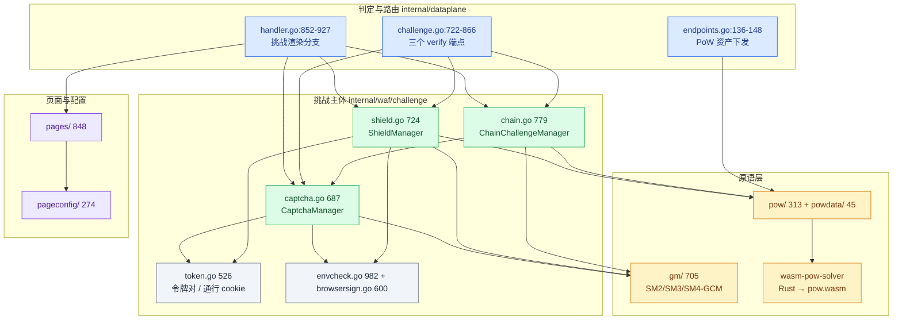
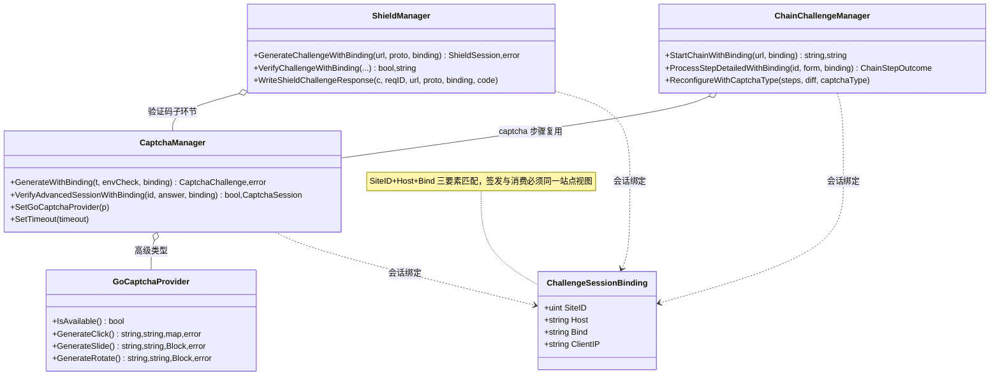
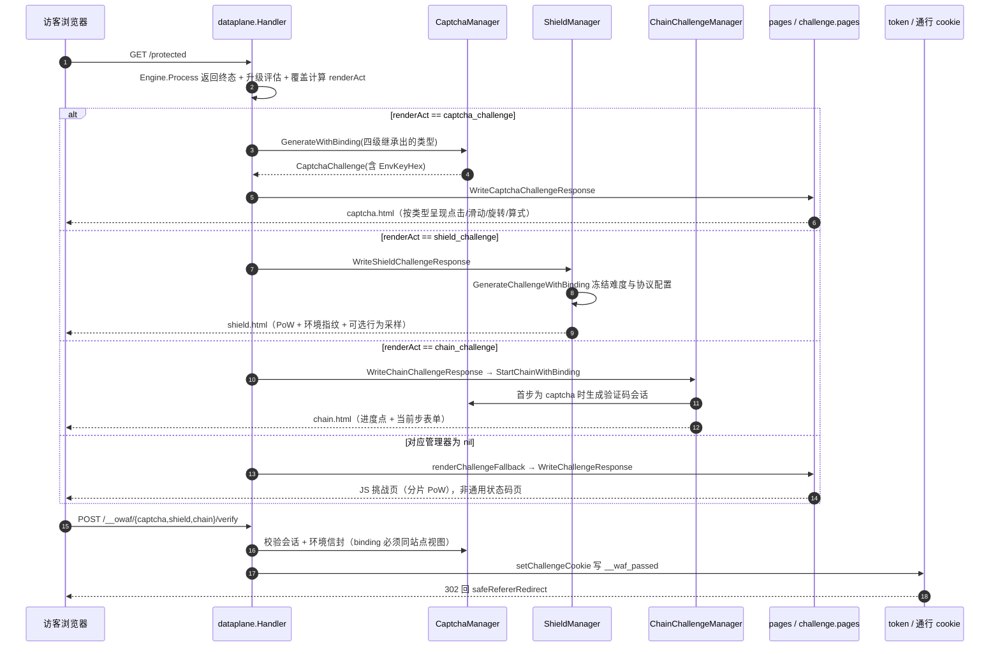
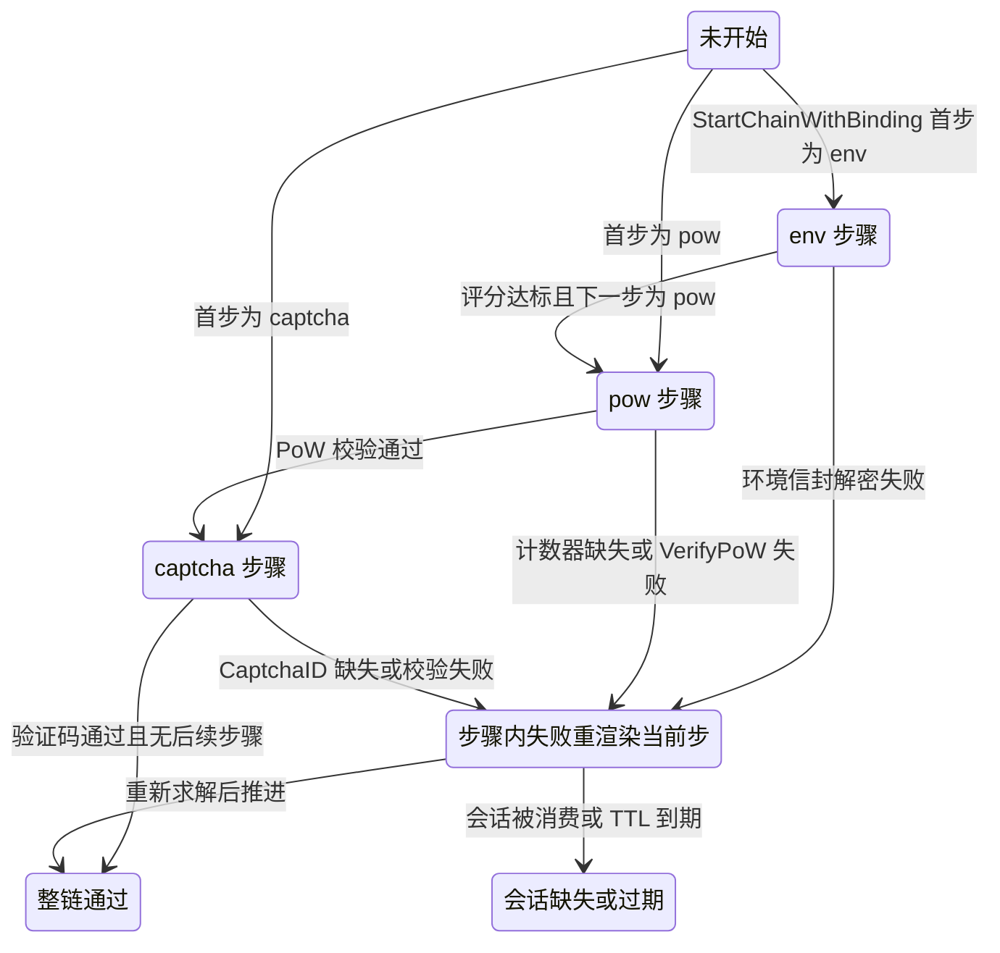
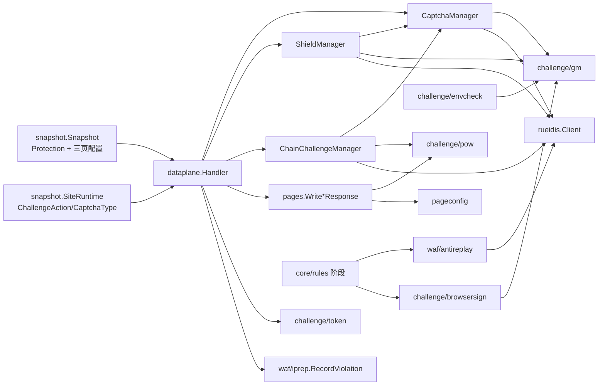

# 挑战与验证

> [返回 WAF 引擎系统](../WAF 引擎系统.md)

<cite>
**本文档引用的文件**
- [captcha.go](file://internal/waf/challenge/captcha.go)
- [shield.go](file://internal/waf/challenge/shield.go)
- [chain.go](file://internal/waf/challenge/chain.go)
- [pages.go](file://internal/waf/challenge/pages.go)
- [token.go](file://internal/waf/challenge/token.go)
- [gocaptcha.go](file://internal/waf/challenge/gocaptcha.go)
- [envcheck.go](file://internal/waf/challenge/envcheck.go)
- [browsersign.go](file://internal/waf/challenge/browsersign.go)
- [consttime.go](file://internal/waf/challenge/gm/consttime.go)
- [doc.go](file://internal/waf/challenge/gm/doc.go)
- [label.go](file://internal/waf/challenge/gm/label.go)
- [envelope.go](file://internal/waf/challenge/gm/envelope.go)
- [pow.go](file://internal/waf/challenge/pow/pow.go)
- [version.go](file://internal/waf/challenge/powdata/version.go)
- [config.go](file://internal/waf/pageconfig/config.go)
- [block.go](file://internal/waf/pages/block.go)
- [antireplay.go](file://internal/waf/antireplay/antireplay.go)
- [handler.go](file://internal/dataplane/handler.go)
- [challenge.go](file://internal/dataplane/challenge.go)
- [endpoints.go](file://internal/dataplane/endpoints.go)
- [pipeline.go](file://internal/core/pipeline/pipeline.go)
- [action.go](file://internal/core/action/action.go)
- [phases.go](file://internal/core/rules/phases.go)
- [server.go](file://internal/app/server.go)
- [router.go](file://internal/admin/router.go)
- [protection.go](file://internal/store/protection.go)
- [captcha.go](file://internal/admin/protect/captcha/captcha.go)
- [chain.go](file://internal/admin/protect/chain/chain.go)
- [page_templates.go](file://internal/admin/protect/page/page_templates.go)
- [redis.go](file://internal/waf/ratelimit/redis.go)
- [build.go](file://internal/snapshot/build.go)
- [snapshot.go](file://internal/snapshot/snapshot.go)
- [Makefile](file://wasm-pow-solver/Makefile)
- [Cargo.toml](file://wasm-pow-solver/Cargo.toml)
</cite>

## 目录

1. [简介](#简介)
2. [项目结构](#项目结构)
3. [核心组件](#核心组件)
4. [架构总览](#架构总览)
5. [详细组件分析](#详细组件分析)
6. [依赖关系分析](#依赖关系分析)
7. [性能考虑](#性能考虑)
8. [故障排查指南](#故障排查指南)
9. [结论](#结论)
10. [附录](#附录)

## 简介

「挑战与验证」是 WAF 引擎系统里唯一以**改变访客可见页面**为目标的子域：判定命中后不再简单返回一个状态码，而是下发一份必须由真实浏览器完成的页面，并在服务端校验其回交结果。本篇是该子域的**域总览（形态 A）**，只给全景、体系清单与索引；国密信封与 PoW 原语的实现细节、动态混淆与 VMP 的实现细节分别由同目录的下级文档承担。

本篇要钉死的是四条既有约定，它们是全库一致性的验收线：

1. **按 WAF action 触发语义建模**。`captcha_challenge` 渲染配置好的验证码类型，`shield_challenge` 走 5 秒盾流程，`chain_challenge` 显示链式步骤。三者都不得用通用状态码页面替代。
2. **四种挑战类动作同档**。`drop` 90 / `intercept` 80 / `rate_limit` 70 / `challenge`+`captcha_challenge`+`shield_challenge`+`chain_challenge` 同 60 / `redirect` 50；同档取先出现者。
3. **失败语义按模块方向相反**。防重放是 fail-closed（Redis 80ms，出错即判 Intercept），限流是 fail-open（Redis 50ms，出错放行）。
4. **实时通道是 WebSocket**。`/api/v1/realtime/ws` 走 `WebSocketHandler`，不存在 SSE 端点；`internal/dataplane/sse.go` 是面向客户业务的事件流透传，与挑战无关。

| 项 | 内容 |
|----|------|
| 所属业务域 | `docs/WAF 引擎系统/`，本篇是其 `挑战与验证/` 子域总览 |
| 本篇形态 | A 域总览（详细组件分析按业务切面分节，附录为索引型） |
| 覆盖范围 | 挑战动作语义与终态选择、三个挑战管理器、会话与通行凭证、页面渲染与动态资产、验证端点与失败语义、控制面配置入口 |
| 明确不覆盖 | 国密算法字节布局与 PoW 原语实现（见 [国密与PoW原语](./国密与PoW原语.md)）、动态混淆与 VMP 汇编（见 [动态混淆与VMP](./动态混淆与VMP.md)） |
| 代码规模 | `internal/waf/challenge/` 6110 行 + `gm/` 705 + `pow/` 313 + `powdata/` 45 + `pageconfig/` 274 + `pages/` 848 + `antireplay/` 214，另有 Rust 侧 `wasm-pow-solver/` |
| 上级与下级 | [WAF 引擎系统](../WAF 引擎系统.md)、[动作与结果系统](../动作与结果系统.md)、[处理阶段详解](../处理阶段详解/处理阶段详解.md) |

**章节来源**
- [pipeline.go:517-560](file://internal/core/pipeline/pipeline.go#L517-L560)
- [action.go:86-118](file://internal/core/action/action.go#L86-L118)
- [antireplay.go:139-147](file://internal/waf/antireplay/antireplay.go#L139-L147)
- [redis.go:127-127](file://internal/waf/ratelimit/redis.go#L127-L127)
- [router.go:424-424](file://internal/admin/router.go#L424-L424)

## 项目结构

挑战子域按「**判定入口在数据面、状态在服务端、渲染与算法在 WAF 侧**」三分：`internal/dataplane/` 负责把动作路由到对应渲染分支并处理 verify 端点；`internal/waf/challenge/` 承载三个管理器与会话/令牌；`internal/waf/pages/` 与 `internal/waf/pageconfig/` 负责页面与品牌配置；`internal/waf/antireplay/` 是与挑战并列但方向相反的独立失败语义。

```text
internal/waf/challenge/        挑战主体 6110 行（12 个非测试文件）
├── captcha.go / shield.go / chain.go   三个管理器：687 / 724 / 779 行
├── gocaptcha.go / captcha_dynamic.go   高级验证码提供器与动态执行脚本
├── envcheck.go / browsersign.go / c2seed.go / pow_shard.go   环境与签名侧 2122 行
├── token.go / pages.go / templates/    令牌与通行 cookie、页面渲染入口
├── gm/ 705 · pow/ 313 · powdata/ 45    原语层（下级两篇覆盖细节）
internal/waf/pageconfig/       274 行：三类页面配置与净化函数
internal/waf/pages/            848 行：拦截/挑战/维护/错误/续期页写出
internal/waf/antireplay/       214 行：nonce 签发、轮换与 fail-closed 判定
wasm-pow-solver/               Rust：make optimize 产物落 powdata/
```

| 路径 | 职责 | 主要语言 | 规模(行) | 代表符号 | 对外暴露 |
|------|------|----------|:--------:|----------|:--------:|
| `internal/waf/challenge/` | 三类挑战的签发、渲染、校验 | Go | 6110 | `CaptchaManager`、`ShieldManager`、`ChainChallengeManager` | 是 |
| `internal/waf/challenge/gm/` | 国密信封原语（唯一权威实现） | Go | 705 | `Seal`/`Open`、`ConstTimeEqual`、`EnvelopeLabel` | 是 |
| `internal/waf/challenge/pow/` | PoW 生成与校验、WASM/glue 下发 | Go | 313 | `VerifyPoW`、`VerifyChallengeProof`、`PowWasmURL` | 是 |
| `internal/waf/challenge/powdata/` | 嵌入资产与内容派生版本 | Go | 45 | `WASMBinary`、`WasmVersion`、`GlueVersion` | 是 |
| `internal/waf/pageconfig/` | 页面品牌配置与净化 | Go | 274 | `CaptchaPageConfig`、`SafeLogoURL`、`SanitizeCSS` | 是 |
| `internal/waf/pages/` | 终态页面写出 | Go | 848 | `WriteBlockResponse`、`WriteChallengeResponse` | 是 |
| `internal/waf/antireplay/` | nonce 防重放 | Go | 214 | `AntiReplayManager`、`GenerateNonce`、`ValidateAndRotate` | 是 |
| `internal/dataplane/` | 动作路由与 verify 端点 | Go | 8836 | `handleChallengeVerify`、`effectiveCaptchaType` | 否（同进程） |
| `wasm-pow-solver/` | 客户端求解器与环境采集 | Rust | 11 源文件 | `crypto/env/fingerprint/gm/vmp` 等模块 | 产物嵌入 |



**图表来源**
- [handler.go:852-927](file://internal/dataplane/handler.go#L852-L927)
- [challenge.go:722-866](file://internal/dataplane/challenge.go#L722-L866)
- [endpoints.go:136-148](file://internal/dataplane/endpoints.go#L136-L148)
- [captcha.go:184-215](file://internal/waf/challenge/captcha.go#L184-L215)
- [shield.go:177-208](file://internal/waf/challenge/shield.go#L177-L208)
- [chain.go:136-166](file://internal/waf/challenge/chain.go#L136-L166)

**章节来源**
- [doc.go:1-9](file://internal/waf/challenge/gm/doc.go#L1-L9)
- [Makefile:1-14](file://wasm-pow-solver/Makefile#L1-L14)
- [Cargo.toml:1-20](file://wasm-pow-solver/Cargo.toml#L1-L20)

## 核心组件

| 模块 | 路径 | 职责 | 核心接口/符号 | 依赖模块 | 被依赖 | 规模(行) | 测试 |
|------|------|------|---------------|----------|--------|:--------:|:----:|
| 验证码管理器 | `internal/waf/challenge/captcha.go` | math/click/slide/rotate 签发与校验 | `CaptchaManager`、`GenerateWithBinding`、`VerifyAdvancedSessionWithBinding` | gm、pow、rueidis | dataplane、chain、admin | 687 | 有 |
| 高级验证码提供器 | `internal/waf/challenge/gocaptcha.go` | 点击/滑动/旋转图像生成 | `GoCaptchaProvider`、`NewGoCaptchaProvider`、`IsAvailable` | utls 无关；`go-captcha` 三族 | `CaptchaManager` | 744 | 有 |
| 5 秒盾管理器 | `internal/waf/challenge/shield.go` | PoW+环境指纹+协议门槛的挑战 | `ShieldManager`、`GenerateChallengeWithBinding`、`WriteShieldChallengeResponse` | captcha、gm、pow | dataplane、admin | 724 | 有 |
| 链式挑战管理器 | `internal/waf/challenge/chain.go` | env/pow/captcha 多步状态机 | `ChainChallengeManager`、`StartChainWithBinding`、`ProcessStepDetailedWithBinding` | captcha、pow、gm | dataplane、admin | 779 | 有 |
| 令牌与通行凭证 | `internal/waf/challenge/token.go` | 挑战令牌对、`__waf_passed`、动态保护票据 | `GenerateChallengeTokenPairWithClaims`、`BuildChallengePassCookieWithClaims` | gm | dataplane | 526 | 有 |
| 环境指纹 | `internal/waf/challenge/envcheck.go` | 采集结构、评分与硬信号判定 | `EnvFingerprint`、`ValidateEnvFingerprint`、`DecryptEnvFingerprintWithAAD` | gm | captcha/shield/chain/handler | 982 | 有 |
| 浏览器签名 | `internal/waf/challenge/browsersign.go` | `X-OWAF-BS-*` 头校验与脚本注入 | `IssueBrowserSignTicket`、`VerifyBrowserSignHeaders` | gm、pow | rules 的 browser_sign 阶段 | 600 | 有 |
| 页面写出与配置 | `internal/waf/pages/block.go`、`internal/waf/pageconfig/config.go` | 拦截页/JS 挑战页/维护页；三类页面配置与输入净化 | `WriteBlockResponse`、`WriteChallengeResponse`、`CaptchaPageConfig`、`SanitizeCSS` | `html/template`、challenge | dataplane、snapshot、admin | 307 + 274（pages 共 848） | 有 |
| 防重放 | `internal/waf/antireplay/antireplay.go` | HMAC nonce 签发/校验/轮换 | `AntiReplayManager`、`GenerateNonce`、`ValidateAndRotate` | rueidis、snapshot | rules 阶段、dataplane | 214 | 有 |
| PoW 原语 | `internal/waf/challenge/pow/` | 难度钳制、解答校验、资产下发 | `VerifyPoW`、`VerifyChallengeProof`、`ClampPoWDifficulty` | powdata、vmpasm | challenge 三包 | 313 | 有 |

`被依赖` 列由 `internal/dataplane/handler.go`、`internal/dataplane/challenge.go`、`internal/app/server.go` 与 `internal/admin/router.go` 的引用关系确认；`VerifyBrowserSignHeaders` 的唯一生产调用点是 `internal/core/rules/phases.go:1406`（browser_sign 阶段）。



**图表来源**
- [captcha.go:184-302](file://internal/waf/challenge/captcha.go#L184-L302)
- [shield.go:177-381](file://internal/waf/challenge/shield.go#L177-L381)
- [chain.go:136-356](file://internal/waf/challenge/chain.go#L136-L356)
- [gocaptcha.go:76-238](file://internal/waf/challenge/gocaptcha.go#L76-L238)
- [token.go:96-115](file://internal/waf/challenge/token.go#L96-L115)

**章节来源**
- [captcha.go:28-53](file://internal/waf/challenge/captcha.go#L28-L53)
- [gocaptcha.go:31-73](file://internal/waf/challenge/gocaptcha.go#L31-L73)
- [phases.go:1406-1406](file://internal/core/rules/phases.go#L1406-L1406)

## 架构总览

一次完整的挑战生命周期：**判定 → 渲染对应类型挑战页 → 客户端求解 → verify 端点 → 服务端校验 → 签发通行 cookie → 放行并回跳**。图中 `alt` 分支明确三种挑战各自的渲染入口互不替代。



**图表来源**
- [handler.go:852-931](file://internal/dataplane/handler.go#L852-L931)
- [pages.go:112-159](file://internal/waf/challenge/pages.go#L112-L159)
- [shield.go:511-539](file://internal/waf/challenge/shield.go#L511-L539)
- [challenge.go:722-866](file://internal/dataplane/challenge.go#L722-L866)
- [challenge.go:674-691](file://internal/dataplane/challenge.go#L674-L691)

| 上下文 | 参与者 | 输入 | 输出 | 边界约定 |
|--------|--------|------|------|----------|
| 判定 | `Engine.Process` + `pipeline.Run` | 请求 + 快照 | 终态 `action.Result` | 挑战类动作同档 60，取先出现者 |
| 渲染 | `dataplane` 分支 + `challenge`/`pages` | 动作 + 配置 | HTML 挑战页 | 三种类型各走各的渲染器 |
| 提交 | `handleChallengeVerify` | 表单 + 会话 ID | 通行 cookie 或 302 回跳 | 仅 POST，仅这三个路径 |
| 资产 | `handleWASMAssets` / admin 根 | `GET /__owaf/pow.{wasm,glue.js}` | gzip + immutable | 管理端口与数据面**双注册** |
| 观测 | `recordChallengeFailure` | 失败提交 | IP 信誉违规 + `RecordWAFBlock` | 站点白名单直接返回不计数 |

**章节来源**
- [pipeline.go:517-559](file://internal/core/pipeline/pipeline.go#L517-L559)
- [endpoints.go:136-148](file://internal/dataplane/endpoints.go#L136-L148)
- [router.go:418-424](file://internal/admin/router.go#L418-L424)

## 详细组件分析

### 质询动作语义与终态选择

**职责**：把「命中一条规则」翻译成「访客看到哪一种页面」，并在多阶段同时给出挑战时确定唯一胜者。

**要点**：

- **动作定义**：`CaptchaChallenge = "captcha_challenge"`、`ShieldChallenge = "shield_challenge"`、`ChainChallenge = "chain_challenge"`，另有泛化 `Challenge = "challenge"`；`Block`/`LogOnly` 是仅用于兼容历史数据的遗留别名，`Normalize` 会把它们映射为 `intercept`/`observe`。
- **同档裁决**：四种挑战在 `TerminalPriority` 中同为 60，`pipeline.Run` 用**严格大于**比较（`pipeline.go:533` 与 `:545`），因此同档时保留**先出现者**，后来的同类挑战不会顶替它。
- **覆盖只作用于泛化挑战**：`renderAct` 只有在 `actType == action.Challenge` 时才被 `siteChallengeAction` 改写（站点 `rt.ChallengeAction` 优先，其次全局 `sn.Protection.ChallengeAction`）；规则显式选择的三种挑战类型保持原样，不被站点/全局默认值顶替。
- **升级可改写类型**：`escalation.Evaluate` 返回更高严重度动作时，`handler.go:683-696` 会把类型改写为 `drop`/`intercept`/`challenge`/`captcha_challenge`/`shield_challenge`/`chain_challenge`，并在 `MatchDesc` 追加 `[escalated→<动作>]`。
- **反重放也可产出挑战**：`normalizeAntiReplayAction` 把配置值收敛到上述五种之一，默认落 `challenge`。

| 动作 | 优先级 | 访客可见形态 | 判定来源 | 可否被站点/全局覆盖 |
|------|:------:|--------------|----------|:-------------------:|
| `drop` | 90 | 无响应（连接关闭） | 检测阶段命中且 drop 开启 | 否 |
| `intercept` | 80 | 拦截页（`WriteBlockResponse`） | 规则/防重放/访问控制 | 否 |
| `rate_limit` | 70 | 拦截页 + 429 文案 | 限流阶段 | 否 |
| `captcha_challenge` | 60 | **配置的验证码类型**页面 | 规则显式或覆盖 | 否（规则显式时） |
| `shield_challenge` | 60 | **5 秒盾**流程页 | 规则显式或覆盖 | 否（规则显式时） |
| `chain_challenge` | 60 | **链式步骤**页面 | 规则显式或覆盖 | 否（规则显式时） |
| `challenge` | 60 | JS 挑战页，可被覆盖成上述三种 | 泛化挑战 | 是 |
| `redirect` | 50 | 3xx 跳转 | 规则 | 否 |

**章节来源**
- [action.go:8-45](file://internal/core/action/action.go#L8-L45)
- [action.go:86-118](file://internal/core/action/action.go#L86-L118)
- [pipeline.go:517-559](file://internal/core/pipeline/pipeline.go#L517-L559)
- [handler.go:659-701](file://internal/dataplane/handler.go#L659-L701)
- [handler.go:889-927](file://internal/dataplane/handler.go#L889-L927)
- [challenge.go:493-510](file://internal/dataplane/challenge.go#L493-L510)
- [challenge.go:400-415](file://internal/dataplane/challenge.go#L400-L415)

### 验证码类型四级继承与管理器缺失回落

**职责**：决定 `captcha_challenge` 到底渲染哪一种验证码，以及在缺少对应管理器时给出可接受的降级形态。

**要点**：`effectiveCaptchaType` 是一条严格四级的取值链，任何一级取值都必须先过 `IsValidCaptchaType`。

| 级 | 取值来源 | 位置 | 校验 | 不满足时 |
|:--:|----------|------|------|----------|
| 1 | 规则级 `result.Action.CaptchaType` | [challenge.go:518](file://internal/dataplane/challenge.go#L518) | `IsValidCaptchaType` | 降到第 2 级 |
| 2 | 站点级 `rt.ChallengeCaptchaType` | [challenge.go:521-525](file://internal/dataplane/challenge.go#L521-L525) | 同上 | 降到第 3 级 |
| 3 | 全局级 `sn.Protection.CaptchaType` | [challenge.go:526-530](file://internal/dataplane/challenge.go#L526-L530) | 同上 | 降到第 4 级 |
| 4 | 兜底常量 `"math"` | [challenge.go:531](file://internal/dataplane/challenge.go#L531) | 恒合法 | — |

合法类型只有四种：`click`、`slide`、`rotate`、`math`；其中 `math` 为内置算式验证码，**不依赖任何外部资源**，因此成为兜底值。`click/slide/rotate` 依赖 `GoCaptchaProvider`，其默认 `ResourceDir` 为 `./data/captcha`，可通过 `core.Config.CaptchaDir` 覆盖（装配点 `internal/app/server.go:607-613`）。

**管理器缺失回落**：`handler.go:903-927` 的 `switch renderAct` 里，三个分支都先判 `opts.CaptchaManager != nil` / `opts.ShieldManager != nil` / `opts.ChainManager != nil`；缺失时统一走 `renderChallengeFallback()`，它调用 `pages.WriteChallengeResponse` 渲染 **JS 挑战页**（`challenge.html`，含分片 PoW 与可选环境采集），**而不是通用状态码页或拦截页**。泛化 `challenge` 与三种具名挑战在兜底形态上因此可区分：兜底仍是「必须求解的验证页」。

**章节来源**
- [challenge.go:512-532](file://internal/dataplane/challenge.go#L512-L532)
- [challenge.go:889-927](file://internal/dataplane/handler.go#L889-L927)
- [captcha.go:27-53](file://internal/waf/challenge/captcha.go#L27-L53)
- [gocaptcha.go:31-73](file://internal/waf/challenge/gocaptcha.go#L31-L73)
- [server.go:603-618](file://internal/app/server.go#L603-L618)
- [block.go:88-137](file://internal/waf/pages/block.go#L88-L137)

### 三个挑战管理器与会话生命周期

**职责**：维护「已签发但未消费」的挑战状态，并保证签发方与消费方属于同一客户端视图。

**要点**：

- **绑定三要素**：`ChallengeSessionBinding{SiteID, Host, Bind}` 随每个 captcha/shield/chain 会话持久化，消费或推进前必须比对（`normalized()` 只做 Host 小写与去空白）。`ClientIP` 不参与 `matches`，shield 会话另有独立 `client_ip` 字段。
- **双存储形态**：三个管理器都接受 `rueidis.Client`，Redis 为 nil 时使用内存会话库；`CaptchaManager` 的 `sessions` map 注释明确它是「部署形态，非兼容回退」。内存态一律读写深拷贝（`ChainState.clone`），避免并发 map 写致命错误；链式挑战另用引用计数的 `chainSessionGate` 把「读状态 → 校验 → 推进 → 写状态」做成原子序列，`chainStateTTL` 为 10 分钟。
- **难度与配置冻结**：`ChainState.Difficulty` 与 `ShieldSession` 的 `EnvConfigFrozen`/`ProtocolConfigFrozen` 都是签发时锁定。原因写在注释里——挑战进行中改全局难度会让已按旧难度求解的访客永远无法通过。
- **清理协程随进程停止**：三个管理器各自 `go cleanupLoop()`，`Close()` 用 `sync.Once` 关闭 `done`；`internal/app/server.go:603-618` 对三者都注册了 `defer Close()`。

| 管理器 | 会话类型 | Redis 前缀 | 有效期 | 缺失时端点表现 |
|--------|----------|-----------|--------|----------------|
| `CaptchaManager` | `CaptchaSession` | `owaf:captcha:` | `CaptchaTimeout`，默认 120 秒 | `503 captcha not configured` |
| `ShieldManager` | `ShieldSession` | 由内部前缀管理 | `TimeoutSecs`（默认 30 秒），缺字段按立即过期 | `503 shield not configured` |
| `ChainChallengeManager` | `ChainState` | 由内部前缀管理 | `chainStateTTL = 10 分钟` | `503 chain challenge not configured` |

**章节来源**
- [token.go:94-115](file://internal/waf/challenge/token.go#L94-L115)
- [captcha.go:55-215](file://internal/waf/challenge/captcha.go#L55-L215)
- [shield.go:99-145](file://internal/waf/challenge/shield.go#L99-L145)
- [chain.go:37-133](file://internal/waf/challenge/chain.go#L37-L133)
- [chain.go:250-268](file://internal/waf/challenge/chain.go#L250-L268)
- [challenge.go:739-830](file://internal/dataplane/challenge.go#L739-L830)
- [server.go:601-618](file://internal/app/server.go#L601-L618)

### 链式挑战状态机与进度呈现

**职责**：把多道验证按配置顺序串成一条链，向访客显示已完成/当前/未开始三种进度点。



**图表来源**
- [chain.go:372-456](file://internal/waf/challenge/chain.go#L372-L456)
- [chain.go:531-590](file://internal/waf/challenge/chain.go#L531-L590)

**要点**：

- **步骤类型只有三种**：`ChainStepEnv`（`"env"`）、`ChainStepPoW`（`"pow"`）、`ChainStepCaptcha`（`"captcha"`）；未知类型在 `renderStepHTML` 的 `default` 分支返回空串。
- **失败与推进必须可区分**：`ChainStepOutcome` 的 `Failed` 位是唯一能把「步内校验失败重渲染当前步」与「当前步通过渲染下一步」分开的字段——两者的 `(passed, redirectURL, nextHTML)` 完全相同。数据面必须用 `ProcessStepDetailedWithBinding`，否则正常推进多步的访客会被误计为失败。
- **步内失败会重置该步素材**：`env` 步骤失败时清空 `EnvKey` 并重新保存；`pow` 步骤失败时重新生成 `Nonce`；`captcha` 步骤失败时重新签发验证码会话。
- **进度点是服务端算出来的**：`renderStepHTML` 遍历 `state.Steps` 给每个点打 `done`/`active`/`sd` 类名，访客看到的「第 N 步 / 共 M 步」来自服务端状态，不是客户端推断。
- **PoW 步骤引用带版本的资产 URL**：页面里的 `WasmURL`/`GlueURL` 由 `pow.PowWasmURL()`/`PowGlueURL()` 生成，末段是内容派生版本串。

**章节来源**
- [chain.go:21-62](file://internal/waf/challenge/chain.go#L21-L62)
- [chain.go:330-366](file://internal/waf/challenge/chain.go#L330-L366)
- [chain.go:372-456](file://internal/waf/challenge/chain.go#L372-L456)
- [chain.go:531-590](file://internal/waf/challenge/chain.go#L531-L590)
- [challenge.go:825-866](file://internal/dataplane/challenge.go#L825-L866)
- [pow.go:44-51](file://internal/waf/challenge/pow/pow.go#L44-L51)

### 页面渲染与动态资产下发

**职责**：把配置化的品牌与文案安全地渲染成挑战页，并把 PoW 资产以可长期缓存的方式送出去。

**要点**：

- **三类页面配置互相独立**：`SettingKeyCaptchaPage` / `SettingKeyChallengePage` / `SettingKeyBlockPage` 三个设置键分别对应 `CaptchaPageConfig` / `ChallengePageConfig` / `BlockPageConfig`，共同内嵌 `PageConfig`（品牌名、主色、背景渐变、Logo、标题、页脚、自定义 CSS）。
- **净化在模板之前**：`SafePrimaryColor`、`SafeBackground`、`SafeLogoURL`、`SanitizeCSS`、`SafeHTMLAttr` 五个函数把用户可控值收敛后才交给 `html/template`；`BrandName` 为空即视为「未配置」，整份配置回落 `Default*PageConfig()`。
- **快照携带配置**：`internal/snapshot/build.go:215-217` 在建快照时把三个设置键解析为 `sn.CaptchaPage`/`sn.ChallengePage`/`sn.BlockPage`，数据面只读快照，不再回查数据库。
- **挑战页禁缓存、资产页长缓存**：`prepareChallengeResponseHeaders` 统一写 `X-Request-ID`、删除 `Server`、设 `Cache-Control: no-store, no-cache, must-revalidate`；而 PoW 资产用 `public,max-age=2592000,immutable`。两者不冲突的前提是**资产 URL 带内容派生版本串**——换资产即换 URL；版本串由 `powdata.versionOf()` 对嵌入字节取 `sha256` 前 8 位 hex 得出，进程内 `sync.Once` 计算一次。
- **双注册与产物链**：`/__owaf/pow.wasm` 与 `/__owaf/pow_glue.js` 同时注册在管理入口（`internal/admin/router.go:418-423`）与数据面 `handleWASMAssets`（`internal/dataplane/endpoints.go:137-148`）；Rust 侧 `wasm-pack build --target no-modules` 产出 `pow_bg.wasm` 与 `pkg/pow.js`，`make optimize` 用 `terser` + `javascript-obfuscator` 就地混淆 `pow_glue.js`，产物落到 `internal/waf/challenge/powdata/`。

| 步 | 动作 | 执行位置 | 输入 | 输出 | 失败分支 | 可观测点 |
|:--:|------|----------|------|------|----------|----------|
| 1 | 解析页面配置 | [build.go:215-217](file://internal/snapshot/build.go#L215-L217) | 三个设置键原始 JSON | `sn.CaptchaPage` 等 | 空/非法回落默认 | 页面品牌是否与 UI 一致 |
| 2 | 装配快照字段 | [snapshot.go:221-224](file://internal/snapshot/snapshot.go#L221-L224) | `PageConfig` 三结构 | 只读快照 | — | 重载后代次 |
| 3 | 渲染验证码页 | [pages.go:112-129](file://internal/waf/challenge/pages.go#L112-L129) | `CaptchaChallenge` + 配置 | HTML | 生成失败 500 | `captcha generation failed` |
| 4 | 渲染盾页 | [shield.go:511-539](file://internal/waf/challenge/shield.go#L511-L539) | 会话 + `ShieldConfig` | HTML | 初始化失败 500 | `shield environment initialization failed` |
| 5 | 渲染 JS 挑战页 | [block.go:97-137](file://internal/waf/pages/block.go#L97-L137) | 令牌对 + PoW 信封 | HTML | 环境密钥生成失败 500 | `environment challenge key generation failed` |
| 6 | 下发 PoW 资产 | [pow.go:61-79](file://internal/waf/challenge/pow/pow.go#L61-L79) | 嵌入字节 | gzip 体 | 无（`sync.Once` 压缩） | `Cache-Control` 与 URL 版本串 |

**章节来源**
- [config.go:10-272](file://internal/waf/pageconfig/config.go#L10-L272)
- [build.go:215-217](file://internal/snapshot/build.go#L215-L217)
- [pages.go:99-159](file://internal/waf/challenge/pages.go#L99-L159)
- [block.go:88-171](file://internal/waf/pages/block.go#L88-L171)
- [pow.go:37-79](file://internal/waf/challenge/pow/pow.go#L37-L79)
- [version.go:9-36](file://internal/waf/challenge/powdata/version.go#L9-L36)
- [endpoints.go:136-148](file://internal/dataplane/endpoints.go#L136-L148)
- [router.go:418-423](file://internal/admin/router.go#L418-L423)
- [Makefile:1-40](file://wasm-pow-solver/Makefile#L1-L40)

### 验证端点、通行凭证与失败语义

**职责**：接收客户端回交、完成服务端判定，并在失败时给出方向正确的处罚。

**要点**：

- **三个端点都只认 POST**：`handleChallengeVerify` 先判方法，非 POST 直接返回 false 交回主流程；路径恰为 `/__owaf/captcha/verify`、`/__owaf/shield/verify`、`/__owaf/chain/verify`。
- **表单字段约定**：captcha 用 `__waf_captcha_session`/`__waf_captcha_answer`/`__waf_env_fp`；shield 额外用 `__waf_shield_session`/`__waf_pow_counter`/`__waf_pow_hash`/`__waf_shield_probe`；chain 用 `__waf_chain_session`/`__waf_chain_step` 并把四类字段统一成 `formData`。
- **判定权在服务端**：probe 的 `dt`/`auto` 只是软信号，由服务端加并入盾的硬门槛；客户端 WASM 输出、score、markers 与编译期盐都不是授权根。泛化挑战页的提交还要依次过 `VerifyChallengeTokenWithClaims`（5 分钟窗口）、`VerifyChallengeProof`（难度固定 `ChallengeProofDifficulty = 4`）、以及可选的环境指纹校验。
- **成功即签发无状态通行 cookie**：`setChallengeCookie` 用站点视图解析客户端 IP，写 `__waf_passed`；属性为 `Path=/; HttpOnly; SameSite=Strict`，`Secure` 随站点 TLS。`__waf_passed` 服务端无存储，吊销语义即追加清除头，且清除属性必须与签发侧完全一致，否则浏览器视作不同 cookie 而清不掉。
- **失败计入 IP 信誉**：`recordChallengeFailure` 用 `XFFModeStrip` 先解一次 IP，若能在快照里匹配到站点则改用站点自己的 XFF/可信代理策略重解；命中站点 IP 白名单则直接返回不计数；`ipRep.RecordViolation` 返回真时记一次 `RecordWAFBlock`。

失败语义的方向差异必须并列记住，三者互不类推：

| 机制 | 后端故障时的方向 | 超时预算 | 代码证据 | 后果 |
|------|------------------|----------|----------|------|
| 防重放 `antireplay` | **fail-closed** | 80ms | [antireplay.go:140-147](file://internal/waf/antireplay/antireplay.go#L140-L147) | Redis 出错或畸形应答一律判 `Intercept` |
| 限流 `ratelimit` | **fail-open** | 50ms | [redis.go:127](file://internal/waf/ratelimit/redis.go#L127) | 出错放行，不产生 429 |
| 挑战签发 | 返错 | 无外部调用 | [pages.go:115-127](file://internal/waf/challenge/pages.go#L115-L127)、[shield.go:514-535](file://internal/waf/challenge/shield.go#L514-L535) | 500，不放行也不处罚 |
| 链式推进 | 静默丢状态 | 无外部调用 | [chain.go:379-382](file://internal/waf/challenge/chain.go#L379-L382) | 会话取不到即 `Failed=true`，重新出链首 |
| 会话存储 | 回落内存 | 无 | [captcha.go:194-197](file://internal/waf/challenge/captcha.go#L194-L197) | Redis 为 nil 时用进程内 map |

**章节来源**
- [challenge.go:624-866](file://internal/dataplane/challenge.go#L624-L866)
- [handler.go:235-272](file://internal/dataplane/handler.go#L235-L272)
- [token.go:25-270](file://internal/waf/challenge/token.go#L25-L270)
- [antireplay.go:101-180](file://internal/waf/antireplay/antireplay.go#L101-L180)
- [phases.go:1291-1327](file://internal/core/rules/phases.go#L1291-L1327)
- [pow.go:295-313](file://internal/waf/challenge/pow/pow.go#L295-L313)

## 依赖关系分析



**图表来源**
- [handler.go:852-931](file://internal/dataplane/handler.go#L852-L931)
- [server.go:603-622](file://internal/app/server.go#L603-L622)
- [chain.go:136-166](file://internal/waf/challenge/chain.go#L136-L166)
- [phases.go:1285-1327](file://internal/core/rules/phases.go#L1285-L1327)

### 依赖矩阵

| 调用方 ↓ / 被调方 → | dataplane | waf/challenge | waf/challenge/gm | waf/pages | waf/antireplay | rueidis |
|---------------------|:---------:|:-------------:|:----------------:|:---------:|:--------------:|:-------:|
| `internal/app` | ✓ | ✓ | — | — | ✓ | ✓ |
| `internal/dataplane` | — | ✓ | ✓ | ✓ | ✓ | — |
| `internal/core/rules` | — | ✓ | — | — | ✓ | — |
| `internal/waf/challenge` | ✗ | — | ✓ | — | ✗ | ✓ |
| `internal/waf/pages` | ✗ | ✓ | ✗ | — | ✗ | ✗ |
| `internal/admin` | — | ✓ | — | — | — | — |

`waf/challenge` 行出现两个 `✗`，含义是「不得被反向依赖」而非违规：挑战包不引用数据面，也不引用 `antireplay`（后者的 nonce 校验在 `core/rules` 阶段与 `dataplane` 完成）。经检索确认 `internal/waf/challenge/` 下无任何文件导入 `My-OpenWaf/internal/dataplane` 或 `My-OpenWaf/internal/waf/antireplay`。

**章节来源**
- [handler.go:19-30](file://internal/dataplane/handler.go#L19-L30)
- [block.go:3-17](file://internal/waf/pages/block.go#L3-L17)
- [chain.go:3-19](file://internal/waf/challenge/chain.go#L3-L19)
- [phases.go:21-24](file://internal/core/rules/phases.go#L21-L24)

### 外部实体

| 外部实体 | 类型 | 交互方向 | 协议/方式 | 触发时机 | 数据内容 | 失败影响 | 容错处理 |
|----------|------|----------|-----------|----------|----------|----------|----------|
| Redis | 中间件 | 双向 | rueidis + Lua | 会话读写、nonce 轮换 | 会话 JSON、spent/idem 键 | 防重放判 `Intercept`；会话回落内存 | 80ms 超时 / 内存态 |
| `go-captcha` 三族 | 第三方库 | 出向 | 进程内 API | 生成 click/slide/rotate | 底图、滑片、字体 | 该类型不可用 | `IsAvailable()` 为假时由 `math` 兜底 |
| 访客浏览器 | 协议对端 | 双向 | HTTP + JS + WASM | 求解并 POST 表单 | 答案、PoW counter/hash、环境密文 | 校验失败 302 回跳 | `safeRefererRedirect` |
| `wasm-pow-solver` 产物 | 内嵌资产 | 单向 | `go:embed` | 构建期 | `pow.wasm`、`pow_glue.js` | 缺产物则无资产可发 | 版本串 `sha256` 前 8 位 |
| 控制面 UI | 展示消费方 | 出向 | REST + WebSocket | 配置与实时观测 | 验证码/链式/页面模板配置 | 配置不生效 | 保存后触发 `reload` |

**章节来源**
- [redis.go:127-127](file://internal/waf/ratelimit/redis.go#L127-L127)
- [antireplay.go:35-48](file://internal/waf/antireplay/antireplay.go#L35-L48)
- [gocaptcha.go:104-127](file://internal/waf/challenge/gocaptcha.go#L104-L127)
- [version.go:15-36](file://internal/waf/challenge/powdata/version.go#L15-L36)
- [router.go:229-338](file://internal/admin/router.go#L229-L338)

## 性能考虑

### PoW 难度是访客 CPU 预算的直接函数

- **问题**：每增加 1 个前导零，期望哈希次数 ×16。难度 7 的期望工作量约 2.7e8 次 SHA-256，多 Worker 求解器上已是数秒级，再高会让真实用户超时。
- **优化**：`ClampPoWDifficulty` 把配置钳到 `[1,7]`，且**生成与校验两侧必须使用同一钳制结果**；泛化挑战页固定用 `ChallengeProofDifficulty = 4`，不受配置影响。
- **效果**：不存在「永远无法通过」的挑战；服务端校验为一次重算加常量时间比较，成本与难度无关地受控。

[本节为通用指导，无需特定文件来源]

### 会话存储从每请求 Redis 往返收敛为一次脚本

- **问题**：nonce 轮换若拆成 `SET NX` + `GET` + `SET` 多次往返，Redis 抖动会直接放大成请求尾延迟。
- **优化**：`redisNonceLua` 把「标记已用 + 写幂等轮换 + 读回轮换值」合成一次 Lua 执行，并只接受 RESP 整数判定类型；无 Redis 时走本地 `spentUntil`/`idemRotated` 双 map，超 20000/5000 条时惰性清理过期项。
- **效果**：单次往返内完成判定与轮换；80ms 超时把最坏情况封在可接受的尾延迟内。

[本节为通用指导，无需特定文件来源]

### 挑战页 HTML 与资产缓存的分层

- **问题**：挑战页含一次性令牌，绝不能缓存；PoW 资产体量大且每访客都要取，不缓存会重复传输。
- **优化**：`prepareChallengeResponseHeaders` 统一 `no-store`；资产用 `immutable` + 30 天，靠 URL 版本串承担失效责任；gzip 压缩在 `sync.Once` 里只做一次。
- **效果**：反向约束也被写进注释——只调大 `max-age` 而 URL 不随内容变，会把「旧 wasm 滞留 1 小时」恶化成「滞留 30 天」；两处必须同批改。

[本节为通用指导，无需特定文件来源]

## 故障排查指南

### 问题：命中 captcha_challenge 却看到通用页面

**症状**：访客得到一份 JS 挑战页或拦截页，而不是配置的验证码。

**可能原因**：`opts.CaptchaManager` 为 nil 走了 `renderChallengeFallback`；命中的其实是泛化 `challenge` 且站点/全局 `challenge_action` 为空；`CaptchaType` 非法逐级回落到 `math`。

**排查步骤**：
1. 看安全事件的 `challenge_type` 与 `waf_action` 字段，确认动作到底是 `challenge` 还是 `captcha_challenge`。
2. 若事件里是 `captcha_challenge` 而页面仍是 JS 挑战，检查装配链是否创建了管理器（`internal/app/server.go:603-613`）。
3. 若动作是 `challenge`，核对 `rt.ChallengeAction` → `sn.Protection.ChallengeAction` 两级覆盖值。

```bash
# 期望：返回 captcha 挑战页 HTML，含 __waf_captcha_session 字段
curl -s "http://127.0.0.1:{数据端口}/" -H "Host: {站点域名}" | grep -c '__waf_captcha_session'
# 期望：输出 click|slide|rotate|math 之一；输出为空说明落到了 JS 挑战页分支
curl -s "http://127.0.0.1:{数据端口}/" -H "Host: {站点域名}" | grep -oE '__waf_captcha_(session|answer)'
```

**解决方案**：补齐装配或修正 `challenge_action` 配置；`click/slide/rotate` 需确认 `ResourceDir`（默认 `./data/captcha`）内字体与背景图存在，否则按非法类型处理。

**章节来源**
- [handler.go:889-927](file://internal/dataplane/handler.go#L889-L927)
- [challenge.go:493-532](file://internal/dataplane/challenge.go#L493-L532)
- [gocaptcha.go:31-73](file://internal/waf/challenge/gocaptcha.go#L31-L73)

### 问题：5 秒盾始终不通过

**症状**：访客反复停在盾页，`__waf_passed` 始终不出现。

**可能原因**：会话签发时冻结的难度/协议配置与校验时不同源；客户端协议不满足 `RequireHTTP2`/`RequireHTTP3`/`AllowHTTP1` 门槛；环境信封 AAD 不匹配；重试次数超过 `MaxRetries`。

**排查步骤**：
1. 比对盾页请求与 `POST /__owaf/shield/verify` 的 `request_protocol` 归一结果（`h2`/`h3`/`http/1.1`）——`shield.go:392` 要求两者逐字相等。
2. 检查 `ShieldEnvStrictness` 与 `EnableEnvCheck`；`hasFrozenConfig()` 为假说明会话字段不齐，应按损坏处理。
3. 关注 `shield environment initialization failed`，它意味着 `EnvCheckJSEncrypted` 返回空，而非访客侧问题。

**解决方案**：修改难度或协议门槛后需让在途会话自然过期（`TimeoutSecs`），不要期待热切换生效。

**章节来源**
- [shield.go:22-97](file://internal/waf/challenge/shield.go#L22-L97)
- [shield.go:122-145](file://internal/waf/challenge/shield.go#L122-L145)
- [shield.go:511-539](file://internal/waf/challenge/shield.go#L511-L539)
- [challenge.go:775-810](file://internal/dataplane/challenge.go#L775-L810)

### 问题：链式挑战正常推进却被计为失败

**症状**：`openwaf_dataplane_waf_actions_total{action="block"}` 随链步数增长，IP 信誉对正常访客计分。

**可能原因**：调用方使用了不返回 `Failed` 位的旧形态，把「渲染下一步」当成失败；同一会话被并发提交。

**排查步骤**：
1. 确认数据面走的是 `ProcessStepDetailedWithBinding`。
2. 检查会话 ID 是否在多标签页共享，`chainSessionGate` 是否被绕过（不应有第二条写入路径）。

**解决方案**：`Failed=false` 且 `NextHTML != ""` 属正常推进，不得计入失败；正常推进返回 403 页面但**不**触发 `recordChallengeFailure`。

[本节为总结，无需特定文件来源]

### 问题：Redis 故障时出现大量 403 而限流同时失效

**症状**：同一时间窗内 `intercept` 暴增、`rate_limit` 归零。

**可能原因**：防重放 fail-closed（80ms）与限流 fail-open（50ms）方向相反，一次 Redis 抖动会同时产生这两种表现。

**排查步骤**：
1. 看事件 `rule_id_str` 是否为 `antireplay:nonce`/`antireplay:nonce_reuse`/`antireplay:invalid_nonce`。
2. 核对 `owaf_cache_*{cache="hot"}` 的 `errors` 是否与命中数背离。

**解决方案**：这是设计后果而非缺陷；若站点确实不需要强制 nonce，应按站点关闭防重放而不是调超时预算。

[本节为总结，无需特定文件来源]

## 结论

挑战与验证子域以「动作类型 → 渲染器 → 校验端点 → 通行凭证」四段闭环，把拦截从「给个状态码」升级为「要求真实浏览器付出可验证的成本」。

- **优势**：三种挑战类型在数据面分支上彼此独立，不存在互相顶替；难度与协议配置在签发时冻结，避免热切换造成「永不通过」；`ChainStepOutcome.Failed` 把正常推进与失败重渲染显式分开；页面配置与快照构建同源，数据面零回查；资产缓存与令牌页禁缓存的责任划分清晰。
- **建议**：把「管理器缺失 → JS 挑战页」这条回落路径在 UI 上显式提示，避免运维误以为验证码生效；`antireplay` 的 80ms 与限流的 50ms 目前都是硬编码常量，若要做成可调项必须同时写明 fail-closed/fail-open 的方向不变；下级两篇（国密与 PoW 原语、动态混淆与 VMP）补写后，本篇原语层表格应只保留接口名并链接过去。

[本节为总结，无需特定文件来源]

## 附录

### 挑战体系清单

| 体系 | 动作/阶段 | 服务端实现 | 客户端形态 | 提交端点 | 下级文档 |
|------|-----------|------------|------------|----------|----------|
| 算式验证码 | `captcha_challenge` + `math` | `CaptchaManager.generateMath` | 图片算式输入框 | `POST /__owaf/captcha/verify` | 本篇 |
| 高级验证码 | `captcha_challenge` + `click`/`slide`/`rotate` | `CaptchaManager.generateClick/Slide/Rotate` | 底图点击 / 滑块对缺口 / 旋转到位 | 同上 | 本篇 |
| 5 秒盾 | `shield_challenge` | `ShieldManager` | 自动 PoW + 环境采集 + 探针 | `POST /__owaf/shield/verify` | [动态混淆与VMP](./动态混淆与VMP.md) |
| 链式挑战 | `chain_challenge` | `ChainChallengeManager` | env/pow/captcha 进度步 | `POST /__owaf/chain/verify` | 本篇 |
| JS 泛化挑战 | `challenge` | `pages.WriteChallengeResponse` | 分片 PoW + 可选环境采集 | 主流程 POST 提交 | [国密与PoW原语](./国密与PoW原语.md) |
| 浏览器签名 | `browser_sign` 阶段 | `VerifyBrowserSignHeaders` | 站点挂载 JS 写 `X-OWAF-BS-*` | 随业务请求 | 本篇 |
| 防重放 | `anti_replay` 阶段 | `AntiReplayManager` | `X-Nonce` 请求头 / nonce cookie | 随业务请求 | 本篇 |

**章节来源**
- [captcha.go:450-481](file://internal/waf/challenge/captcha.go#L450-L481)
- [gocaptcha.go:264-374](file://internal/waf/challenge/gocaptcha.go#L264-L374)
- [shield.go:324-381](file://internal/waf/challenge/shield.go#L324-L381)
- [chain.go:531-590](file://internal/waf/challenge/chain.go#L531-L590)
- [block.go:97-137](file://internal/waf/pages/block.go#L97-L137)
- [phases.go:1285-1327](file://internal/core/rules/phases.go#L1285-L1327)

### 关键配置与默认值速查

| 配置键（snake_case） | 类型 | 默认值 | 消费点 | 说明 |
|----------------------|------|--------|--------|------|
| `captcha_type` | string | `math` | `effectiveCaptchaType` 第 3 级 | 全局验证码模式，需过 `ValidateCaptchaType` |
| `captcha_timeout` | int | 120 | `NewCaptchaManager` / `SetTimeout` | 会话有效期（秒），非正值回落 120 |
| `captcha_pass_ttl` | int | 120 | `challengePassTTL` | `__waf_passed` 有效期；≤0 时依次回落 `captcha_timeout`、1 小时 |
| `challenge_action` | string | `challenge` | `siteChallengeAction` | 泛化挑战的具体形态覆盖 |
| `shield_difficulty` | int | 4 | `ShieldManager.SetConfig` | PoW 前导零数，钳制到 `[1,7]` |
| `shield_timeout_secs` | int | 30 | `ShieldSession.sessionTTL` | 缺字段的会话按立即过期处置 |
| `shield_auto_start_delay` / `shield_max_retries` | int | 800 / 3 | 盾页模板 | 自动启动延迟（毫秒）/ 客户端重试上限 |
| `shield_env_strictness` | int | 1 | 环境校验档位 | 0 宽松 / 1 标准 / 2 严格 |
| `shield_allow_http1` / `shield_enable_env_check` | bool | true / true | `shieldProtocolAllowed`、盾页与泛化挑战 | 协议门槛 / 是否注入环境采集 |
| `chain_steps` | string(JSON) | — | `parseChainSteps` → `ReconfigureWithCaptchaType` | 步骤数组，类型仅 `env`/`pow`/`captcha` |
| `page_template_captcha` / `_challenge` / `_block` | string(JSON) | 默认品牌配置 | `snapshot.Build` → `sn.{Captcha,Challenge,Block}Page` | `BrandName` 为空即整份回落默认；block 含拦截与限流两套文案 |

`ProtectionConfig` 中的站点级对应字段为 `*bool`/带覆盖语义的三态：站点 `ChallengeAction`、`ChallengeCaptchaType` 存在于 `snapshot.SiteRuntime`，未设置时由全局值生效，不存在「空值即关闭」的隐式语义。

**章节来源**
- [protection.go:73-101](file://internal/store/protection.go#L73-L101)
- [protection.go:145-199](file://internal/store/protection.go#L145-L199)
- [challenge.go:493-532](file://internal/dataplane/challenge.go#L493-L532)
- [shield.go:22-54](file://internal/waf/challenge/shield.go#L22-L54)
- [config.go:10-122](file://internal/waf/pageconfig/config.go#L10-L122)

### 相关端点索引

| 方法 | 路径 | 归属 | 用途 | 位置 |
|:----:|------|------|------|------|
| POST | `/__owaf/captcha/verify` | 数据面 | 验证码提交 | [challenge.go:729](file://internal/dataplane/challenge.go#L729) |
| POST | `/__owaf/shield/verify` | 数据面 | 5 秒盾提交 | [challenge.go:731](file://internal/dataplane/challenge.go#L731) |
| POST | `/__owaf/chain/verify` | 数据面 | 链式步骤提交 | [challenge.go:733](file://internal/dataplane/challenge.go#L733) |
| GET | `/__owaf/pow.wasm` | 数据面 + 管理面 | PoW WASM 二进制 | [endpoints.go:140](file://internal/dataplane/endpoints.go#L140)、[router.go:418](file://internal/admin/router.go#L418) |
| GET | `/__owaf/pow_glue.js` | 数据面 + 管理面 | wasm-bindgen glue | [endpoints.go:143](file://internal/dataplane/endpoints.go#L143)、[router.go:421](file://internal/admin/router.go#L421) |
| GET | `/api/v1/captcha/config` | 管理面 | 读验证码配置 | [router.go:229](file://internal/admin/router.go#L229) |
| POST | `/api/v1/captcha/config` | 管理面 | 写配置并 reload | [router.go:330](file://internal/admin/router.go#L330) |
| POST | `/api/v1/captcha/test` | 管理面 | 生成一份测试验证码 | [router.go:331](file://internal/admin/router.go#L331) |
| GET | `/api/v1/chain/config` | 管理面 | 读链式步骤 | [router.go:231](file://internal/admin/router.go#L231) |
| POST | `/api/v1/chain/config` | 管理面 | 写链式步骤并 reload | [router.go:337](file://internal/admin/router.go#L337) |
| GET | `/api/v1/chain/sessions` | 管理面 | 列出在途链会话 | [router.go:232](file://internal/admin/router.go#L232) |
| POST | `/api/v1/chain/sessions/:id/delete` | 管理面 | 删除单条链会话 | [router.go:338](file://internal/admin/router.go#L338) |
| GET | `/api/v1/page-templates[/:type][/preview]` | 管理面 | 三类模板的列表/读取/预览 | [router.go:250-252](file://internal/admin/router.go#L250-L252) |
| POST | `/api/v1/page-templates/:type` | 管理面 | 写模板并 reload | [router.go:333](file://internal/admin/router.go#L333) |
| POST | `/api/v1/page-templates/:type/{reset,preview}` | 管理面 | 重置默认 / 预览草稿 | [router.go:334-335](file://internal/admin/router.go#L334-L335) |
| GET | `/api/v1/realtime/{ticket,ws}` | 管理面 | 票据 / **WebSocket** 实时流（非 SSE） | [router.go:248](file://internal/admin/router.go#L248)、[router.go:424](file://internal/admin/router.go#L424) |

写操作一律为 POST（`/{id}/update`、`/{id}/delete`、`/toggle` 等形态），不存在 PUT/DELETE 路由。

**章节来源**
- [router.go:229-252](file://internal/admin/router.go#L229-L252)
- [router.go:330-338](file://internal/admin/router.go#L330-L338)
- [router.go:418-424](file://internal/admin/router.go#L418-L424)
- [challenge.go:722-737](file://internal/dataplane/challenge.go#L722-L737)

### 子域文档索引

| 文档 | 覆盖范围 | 状态 |
|------|----------|------|
| [挑战与验证](./挑战与验证.md) | 本域总览：动作语义、管理器、页面与端点、失败方向 | 本篇 |
| [国密与PoW原语](./国密与PoW原语.md) | `challenge/gm/` 705 行的 SM2/SM3/SM4-GCM 与 `ConstTimeEqual`；`challenge/pow/` 313 行与 `powdata/` 45 行 | 同子域下级文档 |
| [动态混淆与VMP](./动态混淆与VMP.md) | `pow_shard.go`、`GenerateVMProgram`、`PolymorphicEncode`、`obfuscateShieldJS` 与 Rust `vmp.rs`/`obfuscate.rs` 侧 | 同子域下级文档 |

上级相关链接：[WAF 引擎系统](../WAF 引擎系统.md)、[动作与结果系统](../动作与结果系统.md)、[处理阶段详解](../处理阶段详解/处理阶段详解.md)、[引擎核心架构](../引擎核心架构/引擎核心架构.md)。

**章节来源**
- [doc.go:1-9](file://internal/waf/challenge/gm/doc.go#L1-L9)
- [label.go:11-48](file://internal/waf/challenge/gm/label.go#L11-L48)
- [consttime.go:3-26](file://internal/waf/challenge/gm/consttime.go#L3-L26)
- [envelope.go:35-74](file://internal/waf/challenge/gm/envelope.go#L35-L74)
