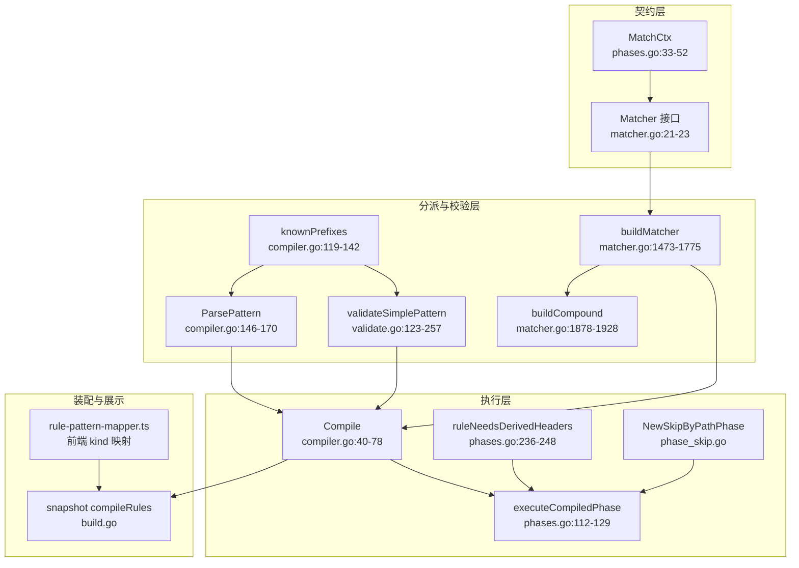
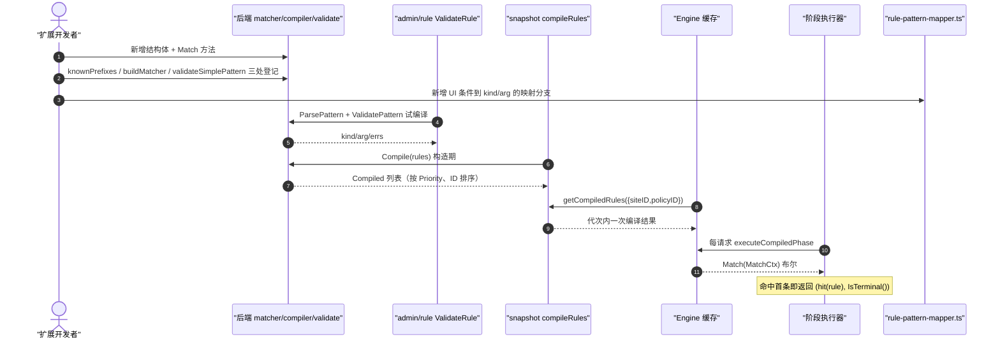
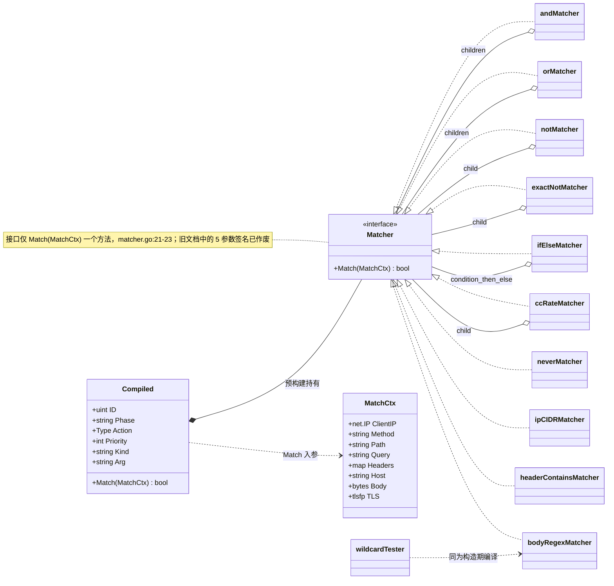
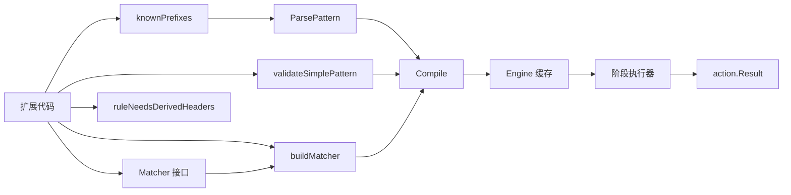

# 匹配器扩展开发

> [返回 WAF 引擎系统](../WAF 引擎系统.md) · [返回规则匹配器](规则匹配器.md)

<cite>
**本文档引用的文件**
- [matcher.go](file://internal/core/rules/matcher.go)
- [compiler.go](file://internal/core/rules/compiler.go)
- [validate.go](file://internal/core/rules/validate.go)
- [phases.go](file://internal/core/rules/phases.go)
- [phase_skip.go](file://internal/core/rules/phase_skip.go)
- [pipeline.go](file://internal/core/pipeline/pipeline.go)
- [action.go](file://internal/core/action/action.go)
- [engine.go](file://internal/core/engine/engine.go)
- [build.go](file://internal/snapshot/build.go)
- [policy.go](file://internal/store/policy.go)
- [validate.go](file://internal/admin/rule/validate.go)
- [rule-pattern-mapper.ts](file://frontend/app/(dashboard)/rules/components/rule-pattern-mapper.ts)
- [matcher_uncovered_test.go](file://internal/core/rules/matcher_uncovered_test.go)
</cite>

## 目录

1. [简介](#简介)
2. [项目结构](#项目结构)
3. [核心组件](#核心组件)
4. [架构总览](#架构总览)
5. [详细组件分析](#详细组件分析)
6. [依赖关系分析](#依赖关系分析)
7. [性能考虑](#性能考虑)
8. [故障排查指南](#故障排查指南)
9. [结论](#结论)
10. [附录](#附录)

## 简介
本指南面向需要新增规则匹配器的开发者，给出从接口实现到前端联动的完整落地路径。与一般插件体系不同，本仓库的匹配器**没有注册中心**：`buildMatcher` 是一张 `switch kind` 静态分派表（matcher.go:1473-1775），`knownPrefixes` 是唯一合法前缀清单（compiler.go:119-142），保存期校验 `validateSimplePattern` 与之逐项对应（validate.go:123-257）。因此扩展一个匹配器是**四处同步改动**，缺一处就会出现"能保存但永不命中"或"保存即被拒"的不对称缺陷。

本文档的实测契约：

- 接口签名是 `Match(MatchCtx) bool`（matcher.go:21-23），**不是**多参数形式
- 任何不可用模式一律回落 `neverMatcher`（matcher.go:504-508），全库**没有** `alwaysMatcher`
- 匹配器必须是**无副作用**的纯读函数：同一 `MatchCtx` 重复调用结果一致，且不得改写请求
- 规则编译结果按 `{siteID,policyID}` 缓存，代次内只编译一次（engine.go:34-37、386-431）

内置匹配器的逐个说明见 [内置匹配器](../%E5%86%85%E7%BD%AE%E5%8C%B9%E9%85%8D%E5%99%A8/%E5%86%85%E7%BD%AE%E5%8C%B9%E9%85%8D%E5%99%A8.md)，复合条件树见 [复合匹配器](复合匹配器.md)，正则与通配符成本口径见 [正则表达式优化](正则表达式优化.md)。

## 项目结构
扩展点分布在四个包内，各自的修改动机不同。



**图表来源**
- [matcher.go:21-23](file://internal/core/rules/matcher.go#L21-L23)
- [matcher.go:1473-1775](file://internal/core/rules/matcher.go#L1473-L1775)
- [matcher.go:1878-1928](file://internal/core/rules/matcher.go#L1878-L1928)
- [compiler.go:40-170](file://internal/core/rules/compiler.go#L40-L170)
- [validate.go:123-257](file://internal/core/rules/validate.go#L123-L257)
- [phases.go:112-248](file://internal/core/rules/phases.go#L112-L248)

| 模块 | 路径 | 职责 | 核心接口/符号 | 依赖模块 | 被依赖 | 规模(行) | 测试 |
|---|---|---|---|---|---|---:|:--:|
| 匹配器集合 | `internal/core/rules/matcher.go` | 匹配器实现与构造分派 | `Matcher`、`buildMatcher` | `pipeline`、`tlsmeta` | `compiler`、`phases` | 1928 | 有 |
| 规则编译器 | `internal/core/rules/compiler.go` | DSL 解析、校验、排序 | `Compiled`、`Compile`、`knownPrefixes` | `matcher`、`action`、`store` | `engine`、`snapshot` | 170 | 有 |
| 模式校验 | `internal/core/rules/validate.go` | 保存期语法语义校验 | `ValidatePattern`、`validateSimplePattern` | `matcher`、`tlsmeta` | `admin/rule` | 257 | 有 |
| 阶段执行 | `internal/core/rules/phases.go` | `MatchCtx` 构造与规则遍历 | `MatchCtx`、`hit`、`executeCompiledPhase` | `pipeline`、`matcher` | `engine` | 1391 | 有 |
| 阶段跳过装饰 | `internal/core/rules/phase_skip.go` | 按路径短路某阶段 | `NewSkipByPathPhase` | `pipeline` | `engine` | 49 | 有 |
| 快照装配 | `internal/snapshot/build.go` | 规则/CC 规则编译与频次包装 | `compileRules`、`applyRuleFrequencyLimit` | `rules`、`store` | `engine` | 1644 | 有 |
| Admin 校验入口 | `internal/admin/rule/validate.go` | 规则表达式校验与模板 | `ValidateRule`、`GetRuleTemplates` | `rules` | 前端 | 277 | 有 |

**章节来源**
- [matcher.go:21-1928](file://internal/core/rules/matcher.go#L21-L1928)
- [compiler.go:1-170](file://internal/core/rules/compiler.go#L1-L170)
- [validate.go:1-257](file://internal/core/rules/validate.go#L1-L257)
- [phases.go:112-302](file://internal/core/rules/phases.go#L112-L302)
- [phase_skip.go:1-49](file://internal/core/rules/phase_skip.go#L1-L49)
- [build.go:920-969](file://internal/snapshot/build.go#L920-L969)

## 核心组件
- `Matcher`：单条件判定抽象，`Match(ctx MatchCtx) bool`
- `MatchCtx`：匹配视图的值拷贝，含 `ClientIP`/`Method`/`Path`/`Query`/`Headers`/`HeadersLowercase`/`Host`/`SiteID`/`Bind`/`HeaderOrder`/`TLSALPN`/`TLSCipherSuites`/`TLS`/`Body` 与非导出的 `reqCtx`
- `Compiled`：编译后规则，公开字段 + 非公开 `matcher`/`runtimeAction`/`ruleIDStr`/`matchDesc`
- `buildCompound`：JSON 条件树分派器，叶子复用 `buildMatcher`
- `cachedCompile`：进程级正则缓存，构造期使用（matcher.go:1791-1808）

| 符号 | 位置 | 职责 | 上游调用者 | 下游依赖 | 副作用 | 影响面 |
|---|---|---|---|---|---|---|
| `Matcher.Match` | [matcher.go:21-23](file://internal/core/rules/matcher.go#L21-L23) | 单条件判定契约 | `Compiled.Match`（compiler.go:32-37）、`andMatcher`/`orMatcher` | 无 | 无（纯读） | 高：所有规则语义 |
| `buildMatcher` | [matcher.go:1473](file://internal/core/rules/matcher.go#L1473) | kind → 匹配器实例 | `Compile`（compiler.go:52）、`buildCompound` 叶子（matcher.go:1922） | `cachedCompile`、`compileWildcard`、`net.ParseCIDR` | 无 | 高：新 kind 唯一入口 |
| `knownPrefixes` | [compiler.go:119-142](file://internal/core/rules/compiler.go#L119-L142) | 合法前缀白名单 | `ParsePattern`（compiler.go:162）、`validateSimplePattern`（validate.go:124） | 无 | 无 | 高：决定能否解析 |
| `validateSimplePattern` | [validate.go:123-257](file://internal/core/rules/validate.go#L123-L257) | 保存期参数校验 | `ValidatePattern`、`Compile`（经 `validateParsedPattern`） | `cachedCompile`、`globToRegexSource`、`tlsmeta` | 无 | 高：拒写与降级的分水岭 |
| `ruleNeedsDerivedHeaders` | [phases.go:236-248](file://internal/core/rules/phases.go#L236-L248) | 是否需要派生请求头 | `compiledRulesNeedDerivedHeaders`（phases.go:227） | `compoundNeedsDerivedHeaders` | 无 | 中：新增 TLS/头顺序类 kind 必须同步 |
| `hit` | [phases.go:1312-1339](file://internal/core/rules/phases.go#L1312-L1339) | 命中转 `action.Result` | `executeCompiledPhase`、`executeCustomPhase` | `action.Result` | 无 | 中：动作与归因字段来源 |
| `applyRuleFrequencyLimit` | [build.go:955-969](file://internal/snapshot/build.go#L955-L969) | 规则频次参数包装为 `cc_rate` | `compileRules` | `json.Marshal` | 无 | 中：影响 `kind` 最终形态 |

**章节来源**
- [matcher.go:21-23](file://internal/core/rules/matcher.go#L21-L23)
- [matcher.go:1473-1928](file://internal/core/rules/matcher.go#L1473-L1928)
- [compiler.go:32-170](file://internal/core/rules/compiler.go#L32-L170)
- [validate.go:123-257](file://internal/core/rules/validate.go#L123-L257)
- [phases.go:112-339](file://internal/core/rules/phases.go#L112-L339)

## 架构总览
一个匹配器从"写出"到"生效"要穿过四条独立链路，图中给出它们与请求路径的关系。



**图表来源**
- [compiler.go:40-78](file://internal/core/rules/compiler.go#L40-L78)
- [admin/rule/validate.go:34-81](file://internal/admin/rule/validate.go#L34-L81)
- [build.go:920-969](file://internal/snapshot/build.go#L920-L969)
- [engine.go:386-431](file://internal/core/engine/engine.go#L386-L431)
- [phases.go:112-129](file://internal/core/rules/phases.go#L112-L129)

## 详细组件分析

### 接口契约与上下文能力边界
新增匹配器前，必须先确认目标字段能否从 `MatchCtx` 取到。下表给出上下文提供的取值入口与既有惯例。

| 字段 | 类型 | 取值入口 | 大小写惯例 | 备注 |
|---|---|---|---|---|
| `ClientIP` | `net.IP` | 直接读 | - | `nil` 表示未解析，匹配器应返回 false |
| `Method` | `string` | 直接读 | 上游已大写 | `methodMatcher` 用 `EqualFold` |
| `Path` | `string` | 直接读 | 原样不解码 | 与 `OriginalPath` 的区别在改写后 |
| `Query` | `string` | 直接读（原始查询串） | 原样 | 需值时用 `cachedQueryValues` |
| `Headers` | `map[string]string` | `headerValue(ctx, name)` | 视 `HeadersLowercase` | 大小写不敏感由工具函数承担 |
| `HeadersLowercase` | `bool` | 决定查表快路径 | - | matcher.go:116-129 |
| `Host` | `string` | `hostValue(ctx)` | 已 trim | 去端口用 `splitHostPortHeader` |
| `Body` | `[]byte` | 直接读 | 原样 | 优先 `bytes` 系工具避免拷贝 |
| `TLS` / `TLSALPN` / `TLSCipherSuites` | 指针/串 | `tlsFingerprintValue` | - | `TLS` 为 nil 时回落请求头 |
| `HeaderOrder` | `string` | `headerOrderValue(ctx)` | 逗号拼接 | 需 `needsDerivedHeaders` |
| `SiteID` / `Bind` | `uint` / `string` | 直接读 | - | 计数键构成要素 |
| `reqCtx` | `*pipeline.RequestCtx` | `Cached*`/`Store*` | 非导出 | nil 时懒缓存自动退化 |

三条硬性惯例（违反会造成同类匹配器行为分裂）：

- 字符串工具优先复用 `containsFoldASCII` / `containsFoldASCIIBytes` / `lowerASCIIIfNeeded`（matcher.go:206-279），不要在包内引入第二套折叠语义
- 头部名一律在**构造期**小写（`strings.ToLower(name)`），运行期经 `lookupHeaderValueInCtx` 查表
- 需要每请求一次的重解析，必须走 `ctx.reqCtx` 的 `Cached*/Store*` 对；纯值 `MatchCtx` 下自然降级为不缓存

**章节来源**
- [phases.go:33-104](file://internal/core/rules/phases.go#L33-L104)
- [matcher.go:111-279](file://internal/core/rules/matcher.go#L111-L279)
- [matcher.go:522-596](file://internal/core/rules/matcher.go#L522-L596)
- [pipeline.go:58-200](file://internal/core/pipeline/pipeline.go#L58-L200)

### 匹配器类型体系与继承关系
接口只有一个方法，所有实现（含复合匹配器）都通过它参与分派。下图给出体系结构，其中复合匹配器以**聚合**方式持有子匹配器，这是递归树能在构造期一次性成形的原因。



**图表来源**
- [matcher.go:21-23](file://internal/core/rules/matcher.go#L21-L23)
- [matcher.go:281-320](file://internal/core/rules/matcher.go#L281-L320)
- [matcher.go:488-520](file://internal/core/rules/matcher.go#L488-L520)
- [matcher.go:25-31](file://internal/core/rules/matcher.go#L25-L31)
- [matcher.go:1321-1327](file://internal/core/rules/matcher.go#L1321-L1327)
- [compiler.go:13-37](file://internal/core/rules/compiler.go#L13-L37)
- [phases.go:33-52](file://internal/core/rules/phases.go#L33-L52)

`wcRegex` 形态的 `wildcardTester` 内部同样持有 `*regexp.Regexp`，但它不是 `Matcher` 实现，而是被 `pathWildcardMatcher` 等四个包装器复用（matcher.go:1422-1472）——扩展时应区分"新增形态"与"新增 kind"：前者只加包装器，后者必须走四张表。

**章节来源**
- [matcher.go:21-31](file://internal/core/rules/matcher.go#L21-L31)
- [matcher.go:281-320](file://internal/core/rules/matcher.go#L281-L320)
- [matcher.go:488-520](file://internal/core/rules/matcher.go#L488-L520)
- [matcher.go:1321-1472](file://internal/core/rules/matcher.go#L1321-L1472)
- [compiler.go:13-37](file://internal/core/rules/compiler.go#L13-L37)

### 新增一个匹配器的最小步骤（后端）
以新增 `block_accept_language:<子串>`（按 `Accept-Language` 头包含判定）为例，后端只需四个改动点。

第 1 步，实现匹配器类型（放在 matcher.go 同族匹配器附近）：

```go
// headerContainsMatcher 已具备同样的语义，新 kind 直接复用即可。
// 若确需新类型，遵循：构造期归一化、Match 期零分配、失败方向 false。
type acceptLanguageMatcher struct{ substr string }

func (m *acceptLanguageMatcher) Match(ctx MatchCtx) bool {
    return containsFoldASCII(headerValue(ctx, "accept-language"), m.substr)
}
```

第 2 步，把前缀加进 `knownPrefixes`（compiler.go:119-142），否则 `ParsePattern` 直接返回空 kind，规则连 `Compiled` 都进不去。

第 3 步，在 `buildMatcher` 增加分派分支（matcher.go:1473-1775）：

```go
case "block_accept_language":
    if arg == "" {
        return &neverMatcher{}
    }
    return &acceptLanguageMatcher{substr: arg}
```

第 4 步，在 `validateSimplePattern` 增加校验（validate.go:123-257），保证"保存期拒绝"与"运行期降级"判据一致：

```go
case "block_accept_language":
    if strings.TrimSpace(arg) == "" {
        return "规则表达式不能为空"
    }
```

| 步 | 动作 | 执行位置 | 输入 | 输出 | 失败分支 | 可观测点 |
|:--:|---|---|---|---|---|---|
| 1 | 实现 `Match(MatchCtx)` | [matcher.go](file://internal/core/rules/matcher.go) 同族区段 | `MatchCtx` | `bool` | 数据缺失返回 `false` | 单元测试断言 |
| 2 | 登记 `knownPrefixes` | [compiler.go:119-142](file://internal/core/rules/compiler.go#L119-L142) | kind 字面量 | 前缀集合新增 | 漏登记 → `ParsePattern` 返回空 kind | `ValidateRule` 返回"格式无效" |
| 3 | 增加 `buildMatcher` 分支 | [matcher.go:1473-1775](file://internal/core/rules/matcher.go#L1473-L1775) | `kind,arg` | 匹配器实例 | 参数非法 → `neverMatcher` | 规则"配了不生效" |
| 4 | 增加 `validateSimplePattern` 分支 | [validate.go:123-257](file://internal/core/rules/validate.go#L123-L257) | `kind,arg` | 错误串或空 | 漏写 → 保存期放行、构造期降级 | 校验接口 `valid:true` 但无效果 |
| 5 | 判定是否需要派生头 | [phases.go:236-248](file://internal/core/rules/phases.go#L236-L248) | `kind` | `bool` | 漏改 → `HeaderOrder`/`TLS*` 恒空，永不命中 | `MatchCtx` 派生字段为空 |
| 6 | 补单测与编译断言 | `matcher_test.go`、`compiler_test.go` | 规则样例 | 通过/失败 | 见故障排查 | `go test ./internal/core/rules/` |

第 5 步只在匹配目标依赖派生请求头时需要改动；普通头部 kind 无需处理。

**章节来源**
- [compiler.go:119-170](file://internal/core/rules/compiler.go#L119-L170)
- [matcher.go:1473-1775](file://internal/core/rules/matcher.go#L1473-L1775)
- [validate.go:123-257](file://internal/core/rules/validate.go#L123-L257)
- [phases.go:236-248](file://internal/core/rules/phases.go#L236-L248)

### 新增一个匹配器的最小步骤（复合支持与前端联动）
后端跑通之后，还有两条链路必须同步，否则该 kind 只存在于数据库而进不了规则编辑器。

第一，**复合条件支持**。叶子节点由 `buildCompound` 在 `op` 为空时回调 `buildMatcher(cond.Kind, cond.Arg)`（matcher.go:1920-1924），因此新 kind 天然可在 `and/or/not/if/cc_rate` 树中使用；保存期校验由 `validateCompoundNode` 递归到 `validateSimplePattern`（validate.go:93-100）。**唯一需要显式改动的是派生头判定**：`compoundConditionNeedsDerivedHeaders` 会递归扫描 `children`/`if`/`then`/`else`（phases.go:251-302），只要第 5 步改的是 `ruleNeedsDerivedHeaders` 的 kind 清单，复合树会自动覆盖。

第二，**前端映射与模板**。`rule-pattern-mapper.ts` 把 UI 条件行翻译成后端 `kind/arg`（例如 `backend: { kind: "block_path", arg: value }`），新增 kind 需要在该文件的分支表中加入对应映射，并处理反向解析（`backendToRow` / `notLeafToRow`），否则已保存的复合规则在编辑界面会退化成不可编辑节点。若希望该 kind 出现在模板下拉里，还需在 `GetRuleTemplates` 的模板清单中加一条（admin/rule/validate.go:83-277）。

第三，**站点/全局字段联动**。如果新 kind 引入新的动作参数（如自定义验证码类型），必须同步 `store.Rule` 字段（policy.go:69-97）、`Compiled` 字段（compiler.go:13-29）、`convertAndCompile` 的还原逻辑（engine.go:625-646）与 `snapshot.compileRules` 的传递（build.go:920-936），这是本仓库既有的"WAF 配置与前端一致性"约定。

| 联动点 | 位置 | 改动内容 | 漏改后果 |
|---|---|---|---|
| 复合叶子校验 | [validate.go:93-100](file://internal/core/rules/validate.go#L93-L100) | 无需改（递归复用） | - |
| 派生头清单 | [phases.go:236-248](file://internal/core/rules/phases.go#L236-L248) | 新 kind 入清单 | 复合树同样失效 |
| 频次包装 | [build.go:955-969](file://internal/snapshot/build.go#L955-L969) | 无需改（按 kind 透明包装） | `kind=="compound"` 不重复包装，行为正确 |
| 前端正向映射 | `rule-pattern-mapper.ts` | UI 条件 → `kind/arg` | 编辑器无法产出该规则 |
| 前端反向解析 | `rule-pattern-mapper.ts` | `kind/arg` → UI 行 | 已存规则不可视化编辑 |
| 规则模板 | [admin/rule/validate.go:83-277](file://internal/admin/rule/validate.go#L83-L277) | 增加一条模板 | 运营侧无示例可用 |
| 阶段跳过键 | [phase_skip.go](file://internal/core/rules/phase_skip.go) | 仅新增阶段时需要 | - |

**章节来源**
- [matcher.go:1878-1928](file://internal/core/rules/matcher.go#L1878-L1928)
- [validate.go:54-121](file://internal/core/rules/validate.go#L54-L121)
- [phases.go:227-302](file://internal/core/rules/phases.go#L227-L302)
- [build.go:920-969](file://internal/snapshot/build.go#L920-L969)
- [engine.go:623-646](file://internal/core/engine/engine.go#L623-L646)
- [policy.go:69-97](file://internal/store/policy.go#L69-L97)

### 需要状态或跨请求计数的匹配器
若扩展目标不是"单请求单条件"而是"窗口内累计"，正确做法**不是**新建带状态的匹配器，而是复用 `cc_rate` 机制。其结构值得作为参考实现：

| 组成 | 位置 | 说明 |
|---|---|---|
| `ccRateMatcher` | [matcher.go:25-31](file://internal/core/rules/matcher.go#L25-L31) | 包装 child + window/threshold/duration |
| `ccRateSharedState` | [matcher.go:33-37](file://internal/core/rules/matcher.go#L33-L37) | `sync.Mutex` + `map[string]*ccRateState` |
| `ccRateKey` | [matcher.go:107-109](file://internal/core/rules/matcher.go#L107-L109) | 复用 `RateLimitKey(bind,siteID,host,clientIP)` |
| `ccRateStateKey` | [matcher.go:1858-1876](file://internal/core/rules/matcher.go#L1858-L1876) | 对条件 JSON 取 MD5，相同条件共享同一状态表 |
| `ccRateStates` | [matcher.go:45](file://internal/core/rules/matcher.go#L45) | 进程级 `sync.Map`，按状态键存 `*ccRateSharedState` |
| 清扫 | [matcher.go:67-74](file://internal/core/rules/matcher.go#L67-L74) | 每 60 秒清掉窗口与阻断都已过期的客户端条目 |

要点：状态挂在**跨请求共享表**上、由互斥锁保护，而匹配器实例本身保持"可被快照代次替换"的无状态形态。新增同类机制时必须沿用这个分层，否则规则重载会让计数凭空丢失或永久泄漏。

**章节来源**
- [matcher.go:25-109](file://internal/core/rules/matcher.go#L25-L109)
- [matcher.go:1837-1928](file://internal/core/rules/matcher.go#L1837-L1928)
- [phases.go:63-70](file://internal/core/rules/phases.go#L63-L70)

### 排序、命中归因与动作产出
匹配器只回答"是否命中"；命中之后的一切由编译器与阶段执行器决定。

| 环节 | 位置 | 规则 |
|---|---|---|
| 排序 | [compiler.go:71-76](file://internal/core/rules/compiler.go#L71-L76) | `Priority` 升序，同值按 `ID` 升序 |
| 遍历 | [phases.go:112-129](file://internal/core/rules/phases.go#L112-L129) | 命中**首条**即返回，`allowShortCircuit` 形参未被使用 |
| 结果构造 | [phases.go:1312-1339](file://internal/core/rules/phases.go#L1312-L1339) | `Category` 取 `Kind`，`RuleIDStr` 取 `rule:<phase>:<kind>` |
| 动作归一 | [phases.go:1301-1310](file://internal/core/rules/phases.go#L1301-L1310) | `log` → `observe`，非法动作回落 `intercept` |
| Observe 收集 | [phases.go:194-225](file://internal/core/rules/phases.go#L194-L225) | 自定义阶段先攒观察命中，遇终端动作一并上交 |
| 终止优先级 | [action.go:88-119](file://internal/core/action/action.go#L88-L119) | drop 90 / intercept 80 / rate 70 / 四类挑战同 60 / redirect 50，同档取先出现者 |
| 元数据补齐 | [compiler.go:87-115](file://internal/core/rules/compiler.go#L87-L115) | 空字段时按 `Phase`/`Kind` 重建，必要时整体拷贝 |

**关键订正**：`allow` **不短路**。`IsTerminal()` 对 `allow`/`observe` 均为 false（action.go:168-179），ACL 命中 allow 后请求继续进入后续检测阶段。任何"Allow 命中即跳过后续阶段"的描述都是错误的。

**章节来源**
- [compiler.go:71-115](file://internal/core/rules/compiler.go#L71-L115)
- [phases.go:112-225](file://internal/core/rules/phases.go#L112-L225)
- [action.go:88-179](file://internal/core/action/action.go#L88-L179)

## 依赖关系分析


**图表来源**
- [compiler.go:40-170](file://internal/core/rules/compiler.go#L40-L170)
- [matcher.go:1473-1775](file://internal/core/rules/matcher.go#L1473-L1775)
- [validate.go:123-257](file://internal/core/rules/validate.go#L123-L257)
- [phases.go:236-248](file://internal/core/rules/phases.go#L236-L248)

| 依赖方向 | 说明 | 是否允许新增 |
|---|---|:--:|
| `rules` → `pipeline` | 取 `RequestCtx` 懒缓存 | 是 |
| `rules` → `tlsmeta` | TLS 令牌归一 | 是 |
| `rules` → `store` | 仅读模型（`Compile` 入参） | 是 |
| `rules` → `internal/waf/*` | 已有 `bot`/`owasp`/`cve`/`ratelimit` 等 | 谨慎：会拖入重依赖 |
| `pipeline` → `rules` | 反向依赖 | **否**（分层违规） |

**章节来源**
- [matcher.go:1-18](file://internal/core/rules/matcher.go#L1-L18)
- [compiler.go:1-10](file://internal/core/rules/compiler.go#L1-L10)
- [phases.go:1-31](file://internal/core/rules/phases.go#L1-L31)

## 性能考虑
- 构造期成本被缓存吸收：新 kind 的正则/CIDR/glob 解析只在 `Compile` 时发生一次，代次内复用（engine.go:386-431）
- 运行期避免拷贝：`[]byte` 目标一律用 `bytes` 系工具，字符串目标避免 `strings.ToLower` 产生新串（`lowerASCIIIfNeeded` 已先扫一遍决定是否需折叠）
- 单请求只解析一次：任何需要 `url.ParseQuery` / `json.Unmarshal` 的匹配器都必须接 `ctx.reqCtx` 的 `Cached*/Store*` 对，否则 N 条规则会解析 N 次
- 派生头是按需的：`needsDerivedHeaders` 为假时不拼 `HeaderOrder`/`TLSCipherSuites`，新增 TLS 类 kind 若忘记登记会静默不命中而非变慢
- 头部扫描有下界：`lookupHeaderValue` 在前两次直接查表失败后才做 `EqualFold` 全表扫描（matcher.go:131-146），`HeadersLowercase` 为真时直接短路
- 匹配器数量线性影响延迟：阶段内是顺序遍历且命中首条即止，把高命中率规则放在小 `Priority` 值上即可缩短路径

**章节来源**
- [matcher.go:131-279](file://internal/core/rules/matcher.go#L131-L279)
- [phases.go:72-129](file://internal/core/rules/phases.go#L72-L129)
- [engine.go:380-431](file://internal/core/engine/engine.go#L380-L431)

## 故障排查指南
- 规则保存成功但永不命中
  - 原因一：只改了 `buildMatcher`，未登记 `knownPrefixes`，`ParsePattern` 返回空 kind 使规则被 `Compile` 跳过（compiler.go:46-49）
  - 原因二：参数非法触发 `neverMatcher`（compiler.go:50-53）
  - 排查：写一条 `Compile` + `Match` 的最小单测；或调 `ValidateRule` 看返回的 `kind`/`arg` 是否符合预期
  - 方案：补齐第 2 步与第 4 步，保持两侧判据一致
- 单请求匹配器正确、放进 `and/or` 复合树后失效
  - 原因：匹配器读取了 `HeaderOrder`/`TLSALPN`/`TLSCipherSuites`，但 `ruleNeedsDerivedHeaders` 未登记该 kind
  - 排查：打印 `MatchCtx.HeaderOrder` 是否为空
  - 方案：改 phases.go:236-248 的清单，复合树由 `compoundNeedsDerivedHeaders` 自动递归
- 新 kind 在编辑器里选不到
  - 原因：`rule-pattern-mapper.ts` 没有正向映射分支
  - 方案：补映射与反向解析；需要示例时补 `GetRuleTemplates`
- 站点级字段丢失
  - 原因：`Compiled` 加了字段但 `convertAndCompile` 或 `snapshot.compileRules` 未传递（engine.go:625-646、build.go:920-936）
  - 方案：沿链路逐段核对赋值，注意 `compound` 规则的 `pattern` 是原始 JSON 而非 `kind:arg`
- 引入状态后重载行为异常
  - 原因：状态存在匹配器实例上，随快照代次被替换
  - 方案：改为 `sync.Map` 共享表 + 显式清扫键，参照 `ccRateStates` / `ccRateStateKey`
- 验证命令
  - `go test ./internal/core/rules/...`：匹配器与编译器单测
  - `go build ./...`：分派表漏改常在编译期即暴露（未使用变量/缺 case）
  - 观察 `MatchDesc` 与安全事件的 `category` 字段是否等于新 kind，可确认规则已进入执行链

**章节来源**
- [compiler.go:40-78](file://internal/core/rules/compiler.go#L40-L78)
- [engine.go:623-646](file://internal/core/engine/engine.go#L623-L646)
- [build.go:920-969](file://internal/snapshot/build.go#L920-L969)
- [phases.go:227-302](file://internal/core/rules/phases.go#L227-L302)
- [matcher.go:25-109](file://internal/core/rules/matcher.go#L25-L109)

## 结论
匹配器扩展的关键不在"写一个 Match 方法"，而在**四张静态表的一致性**：`knownPrefixes`（能否解析）、`buildMatcher`（能否构造）、`validateSimplePattern`（能否保存）、`ruleNeedsDerivedHeaders`（能否拿到派生输入）。任何一处遗漏都会产生静默失效，而静默失效在 WAF 上等价于防护缺口。本文给出的两个「最小步骤」小节即为这条一致性清单的执行顺序：先后端四点跑通单测，再补复合支持与前端联动，最后按需要处理状态与站点字段。既有 `cc_rate` 与 TLS 类匹配器可直接作为参考实现，两者分别覆盖了"跨请求状态"与"派生输入"这两类最难的场景。

## 附录

### 扩展改动清单速查
| 目标 | 需改动文件 | 必改点数 | 验证方式 |
|---|---|:--:|---|
| 新增无状态字段匹配器 | `matcher.go`、`compiler.go`、`validate.go` | 4 | `go test ./internal/core/rules/...` |
| 新增 TLS/头顺序类匹配器 | 上述 + `phases.go` | 5 | 打印 `MatchCtx` 派生字段 |
| 新增跨请求计数匹配器 | `matcher.go`（复用 `cc_rate` 优先） | 1-4 | 重载后计数连续性 |
| 新增站点级可继承字段 | `store` + `Compiled` + `engine` + `snapshot` + 前端 | 5+ | 三态（继承/覆盖开/覆盖关）用例 |
| 新增处理阶段 | `phases.go` + `engine.getOrBuildPhases` | 2 | 阶段链顺序断言 |

**章节来源**
- [compiler.go:40-170](file://internal/core/rules/compiler.go#L40-L170)
- [matcher.go:1473-1775](file://internal/core/rules/matcher.go#L1473-L1775)
- [validate.go:123-257](file://internal/core/rules/validate.go#L123-L257)
- [phases.go:236-248](file://internal/core/rules/phases.go#L236-L248)

### 与扩展开发相关的接口与数据结构速查
```go
// 接口契约（matcher.go:21-23）
type Matcher interface {
    Match(ctx MatchCtx) bool
}

// 编译后规则的可公开字段（compiler.go:13-29）
type Compiled struct {
    ID          uint
    Phase       string
    Action      action.Type
    Priority    int
    Kind        string
    Arg         string
    StatusCode  int
    RedirectTo  string
    CaptchaType string
    // 非公开：matcher / runtimeAction / ruleIDStr / matchDesc
}
```

**章节来源**
- [matcher.go:21-23](file://internal/core/rules/matcher.go#L21-L23)
- [compiler.go:13-29](file://internal/core/rules/compiler.go#L13-L29)

### 测试编写规范
- 覆盖矩阵：命中 / 不匹配 / 空目标 / 非法参数 / 大小写变体 / 纯值 `MatchCtx`（`reqCtx == nil`）六种输入
- 降级方向：非法参数必须断言"不命中"，而不是断言返回错误（匹配器无错误返回通道）
- 参照实现：`matcher_uncovered_test.go` 用 `matchCase{name,ctx,want,why}` 四元组钉住 16 个 kind 的边界语义（`host`/`host_full`/`host_contains`/`host_not_contains`/`host_regex`、`full_url_contains`/`full_url_regex`、`body_contains`/`body_regex`/`block_body_json_path`、`block_query_contains`、`cookie_contains`/`referer_contains`、`geo_block`、`header_order_regex`、`block_multipart`），每条断言都写明"守的是哪条语义"
- 关键陷阱：`runMatchCases` 会先拒绝 `neverMatcher`（matcher_uncovered_test.go:32-37）。若不做这道检查，kind 拼错时所有"期望 false"的断言都会假装通过——只有"期望 true"的会失败
- 与既有测试同文件同风格，避免为单条 kind 新开测试包

**章节来源**
- [matcher_uncovered_test.go:1-362](file://internal/core/rules/matcher_uncovered_test.go#L1-L362)
- [compiler.go:40-78](file://internal/core/rules/compiler.go#L40-L78)
