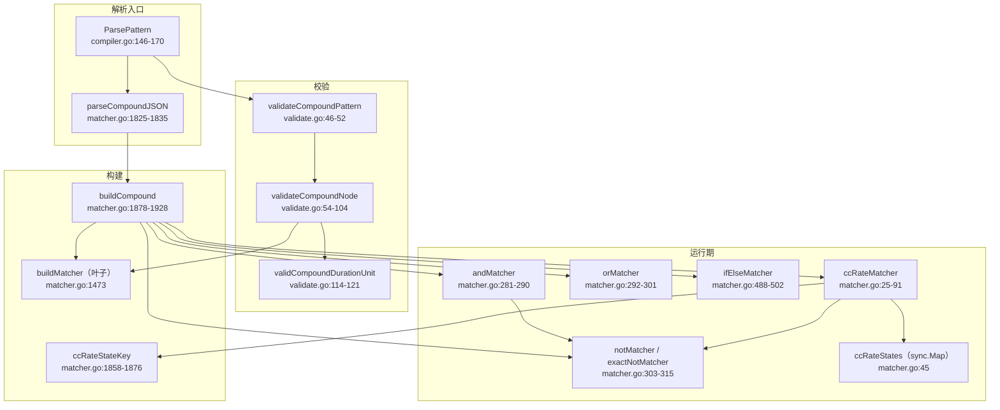
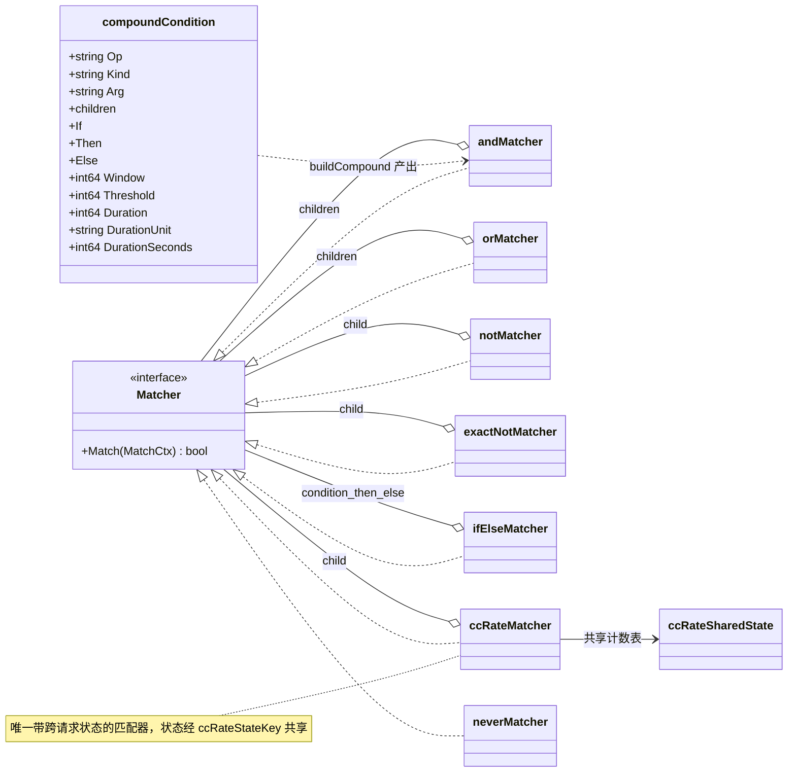
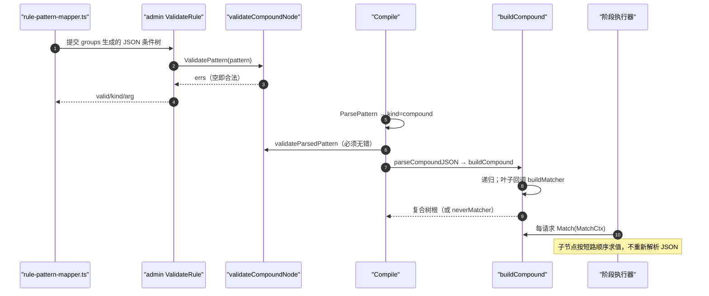
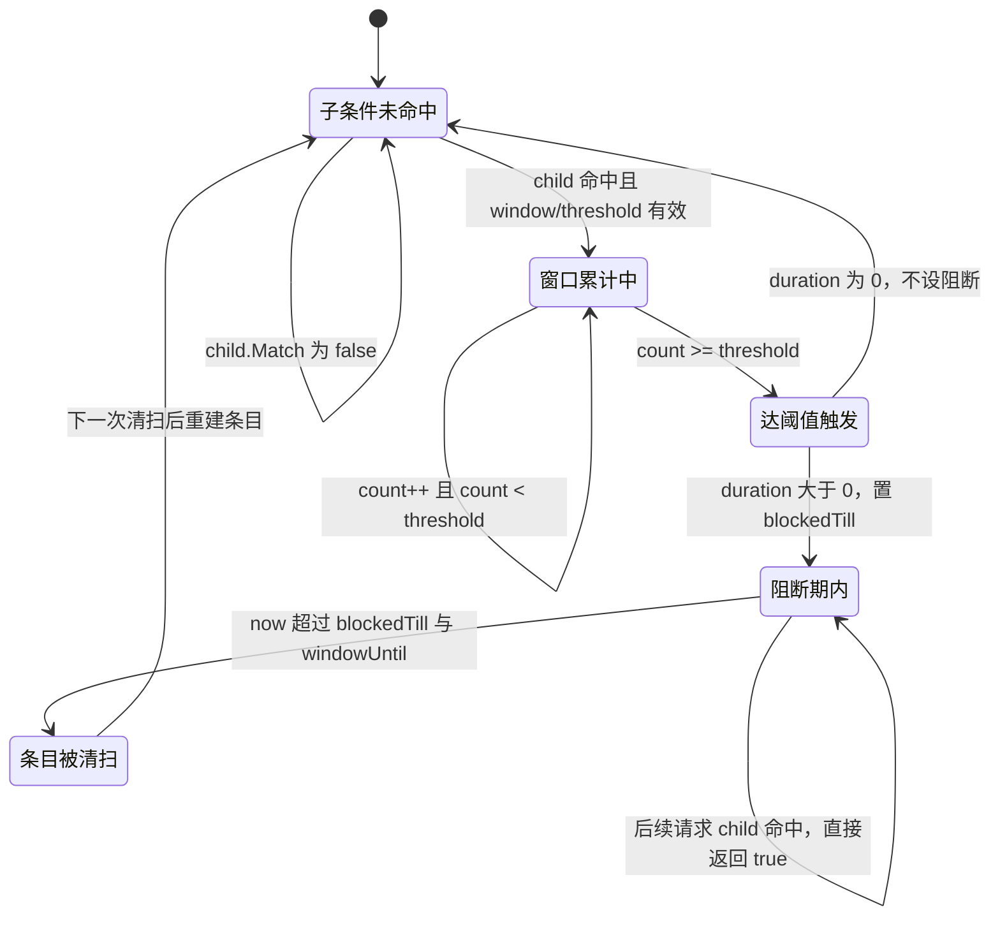
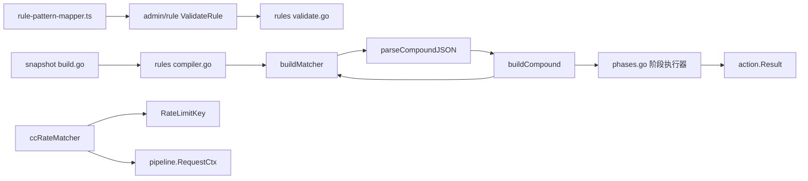

# 复合匹配器

> [返回 WAF 引擎系统](../WAF 引擎系统.md) · [返回规则匹配器](规则匹配器.md)

<cite>
**本文档引用的文件**
- [matcher.go](file://internal/core/rules/matcher.go)
- [compiler.go](file://internal/core/rules/compiler.go)
- [validate.go](file://internal/core/rules/validate.go)
- [phases.go](file://internal/core/rules/phases.go)
- [pipeline.go](file://internal/core/pipeline/pipeline.go)
- [engine.go](file://internal/core/engine/engine.go)
- [build.go](file://internal/snapshot/build.go)
- [policy.go](file://internal/store/policy.go)
- [validate.go](file://internal/admin/rule/validate.go)
- [rule-pattern-mapper.ts](file://frontend/app/(dashboard)/rules/components/rule-pattern-mapper.ts)
</cite>

## 目录

1. [简介](#简介)
2. [项目结构](#项目结构)
3. [核心组件](#核心组件)
4. [架构总览](#架构总览)
5. [详细组件分析](#详细组件分析)
6. [依赖关系分析](#依赖关系分析)
7. [性能考虑](#性能考虑)
8. [故障排查指南](#故障排查指南)
9. [结论](#结论)
10. [附录](#附录)

## 简介
本篇是复合匹配器的**唯一**实现文档，逐 kind 的内置匹配器篇目不再单独承载复合条件。它覆盖三件事：

- **逻辑组合**：`and` / `or` / `not` 三种布尔组合如何递归构建成匹配器树
- **条件分支与取反**：`if` / `if_else` / `ifelse` 三分支语义，以及 UI `ne` 映射专用的 `exactNotMatcher`
- **频次限制**：`cc_rate` 的窗口累计、阈值触发、阻断持续期与跨请求共享状态

复合条件是规则 DSL 的第二种形态：`Pattern` 以 `{` 开头即判为 `kind="compound"`，`arg` 保留原始 JSON（compiler.go:152-154）。运行期求值发生在**构造期的同一棵树上**，因此不存在解释器或 AST 二次解析。

必须与旧描述区分的三点：

- `Matcher` 签名是 `Match(MatchCtx) bool`（matcher.go:21-23）
- `cc_rate` 的计数键是 `bind|siteID|host|clientIP`（`RateLimitKey`，phases.go:63-70），**不是** "IP + Host"
- 非法结构一律回落 `neverMatcher`，没有 `alwaysMatcher`

## 项目结构
复合匹配器的代码集中在 `matcher.go` 的三段：布尔组合体（281-320）、分支与频次体（25-109、488-508）、JSON 解析与构建体（1810-1928）。



**图表来源**
- [compiler.go:146-170](file://internal/core/rules/compiler.go#L146-L170)
- [matcher.go:25-109](file://internal/core/rules/matcher.go#L25-L109)
- [matcher.go:281-320](file://internal/core/rules/matcher.go#L281-L320)
- [matcher.go:488-508](file://internal/core/rules/matcher.go#L488-L508)
- [matcher.go:1810-1928](file://internal/core/rules/matcher.go#L1810-L1928)
- [validate.go:46-121](file://internal/core/rules/validate.go#L46-L121)

| 符号 | 位置 | 职责 | 上游调用者 | 下游依赖 | 副作用 | 影响面 |
|---|---|---|---|---|---|---|
| `compoundCondition` | [matcher.go:1810-1823](file://internal/core/rules/matcher.go#L1810-L1823) | JSON 反序列化目标 | `parseCompoundJSON`、`ccRateDurationSeconds`、`ccRateStateKey` | `encoding/json` | 无 | 高：条件结构契约 |
| `parseCompoundJSON` | [matcher.go:1825-1835](file://internal/core/rules/matcher.go#L1825-L1835) | 解析 + 二次校验 + 构建 | `buildMatcher` 的 `compound` 分支 | `validateCompoundNode`、`buildCompound` | 无 | 高 |
| `buildCompound` | [matcher.go:1878-1928](file://internal/core/rules/matcher.go#L1878-L1928) | op 分派与递归建树 | `parseCompoundJSON`、自身递归 | `buildMatcher`、各匹配器 | 写入 `ccRateStates` | 高 |
| `ccRateMatcher.Match` | [matcher.go:47-91](file://internal/core/rules/matcher.go#L47-L91) | 窗口计数与阻断判定 | 规则遍历（phases.go:120-126） | `ccRateSharedState` | **有**：累加计数、置阻断期 | 高：唯一带外部状态的匹配器 |
| `ccRateStateKey` | [matcher.go:1858-1876](file://internal/core/rules/matcher.go#L1858-L1876) | 条件指纹（MD5） | `buildCompound` 的 `cc_rate` 分支 | `json.Marshal`、`md5` | 无 | 中：决定状态共享粒度 |
| `ifElseMatcher.Match` | [matcher.go:494-502](file://internal/core/rules/matcher.go#L494-L502) | 条件分支求值 | 规则遍历 | `Matcher.Match` | 无 | 中 |
| `exactNotMatcher.Match` | [matcher.go:313-315](file://internal/core/rules/matcher.go#L313-L315) | 精确匹配取反 | `block_header_not_exact` 等六个 kind | `Matcher.Match` | 无 | 中：`ne` 语义载体 |

**章节来源**
- [matcher.go:25-109](file://internal/core/rules/matcher.go#L25-L109)
- [matcher.go:281-320](file://internal/core/rules/matcher.go#L281-L320)
- [matcher.go:1810-1928](file://internal/core/rules/matcher.go#L1810-L1928)
- [validate.go:46-121](file://internal/core/rules/validate.go#L46-L121)

## 核心组件
复合树由七类节点组成，全部实现同一接口，因此任意嵌套深度下求值路径一致。



**图表来源**
- [matcher.go:21-43](file://internal/core/rules/matcher.go#L21-L43)
- [matcher.go:281-315](file://internal/core/rules/matcher.go#L281-L315)
- [matcher.go:488-508](file://internal/core/rules/matcher.go#L488-L508)
- [matcher.go:1810-1823](file://internal/core/rules/matcher.go#L1810-L1823)

| op（`op` 字段） | 产出节点 | 结构要求 | 违反要求的落点 |
|---|---|---|---|
| `and` | `andMatcher` | `children` 非空 | 空 `children` → `neverMatcher`；校验期报"复合条件至少需要一个子条件" |
| `or` | `orMatcher` | `children` 非空 | 同上 |
| `not` | `notMatcher` | `children` **恰好 1 个** | 否则 `neverMatcher`；校验期报"非条件必须且只能包含一个子条件" |
| `if` / `if_else` / `ifelse` | `ifElseMatcher` | `if` 与 `then` 必须同时存在，`else` 可选 | 否则 `neverMatcher`；校验期报"条件必须同时提供 if 和 then 分支" |
| `cc_rate` | `ccRateMatcher` | `children` 恰好 1 个，`window>0`、`threshold>0`、`duration>=0`、`duration_unit ∈ {"", seconds, minutes}` | 任一不满足 → `neverMatcher` |
| `""`（缺省） | 叶子 `buildMatcher(Kind, Arg)` | `kind` 必须属于 `knownPrefixes` | `kind` 为空 → `neverMatcher`；未知 kind → 校验期报错 |
| 其他任意值 | 无 | - | `neverMatcher`；校验期报"复合条件使用了不支持的操作符" |

`op` 判定前统一做 `strings.ToLower(strings.TrimSpace(...))`（matcher.go:1879），因此 `"AND"` 与 `" and "` 等价；但叶子 `kind` 与 `arg` 不做大小写归一。

**章节来源**
- [matcher.go:21-43](file://internal/core/rules/matcher.go#L21-L43)
- [matcher.go:281-320](file://internal/core/rules/matcher.go#L281-L320)
- [matcher.go:1810-1928](file://internal/core/rules/matcher.go#L1810-L1928)
- [validate.go:54-121](file://internal/core/rules/validate.go#L54-L121)
- [compiler.go:119-142](file://internal/core/rules/compiler.go#L119-L142)

## 架构总览
复合条件的生命周期分四段：前端生成 → 保存期校验 → 编译期建树 → 运行期递归求值。



**图表来源**
- [compiler.go:40-78](file://internal/core/rules/compiler.go#L40-L78)
- [matcher.go:1825-1928](file://internal/core/rules/matcher.go#L1825-L1928)
- [validate.go:26-112](file://internal/core/rules/validate.go#L26-L112)
- [admin/rule/validate.go:34-81](file://internal/admin/rule/validate.go#L34-L81)
- [phases.go:112-129](file://internal/core/rules/phases.go#L112-L129)

| 阶段 | 起点形态 | 转换动作 | 终点形态 | 位置 | 敏感处理 |
|---|---|---|---|---|---|
| 前端生成 | 条件行（source/field/method/value） | 逐行映射为 `{kind,arg}`，多条件包 `and` | 嵌套 JSON 字符串 | `rule-pattern-mapper.ts` | — |
| 保存校验 | JSON 字符串 | `ParsePattern` + `validateCompoundNode` | `errs` 列表 | validate.go:26-112 | 无 |
| 快照包装 | 规则行 + 频次参数 | `applyRuleFrequencyLimit` 生成 `cc_rate` 信封 | `kind=compound` 的 `CompiledRule` | build.go:955-969 | 无 |
| 编译建树 | `compound` + `arg` | 双次反序列化 + 递归构建 | `Matcher` 树 | matcher.go:1825-1928 | 无 |
| 运行求值 | `MatchCtx` | 短路递归 | `bool` | matcher.go:283-301 | 不记录命中片段 |

**章节来源**
- [compiler.go:40-78](file://internal/core/rules/compiler.go#L40-L78)
- [validate.go:26-112](file://internal/core/rules/validate.go#L26-L112)
- [build.go:955-969](file://internal/snapshot/build.go#L955-L969)
- [matcher.go:1825-1928](file://internal/core/rules/matcher.go#L1825-L1928)

## 详细组件分析

### AND / OR / NOT 的短路真值
三种布尔节点的求值语义与真值边界：

| 节点 | 求值实现 | 空集合结果 | 短路点 | 位置 |
|---|---|:--:|---|---|
| `andMatcher` | 顺序遍历，任一 false 立即 false | **false**（`len(children) > 0` 是必要条件） | 首个 false 子节点 | matcher.go:283-290 |
| `orMatcher` | 顺序遍历，任一 true 立即 true | false | 首个 true 子节点 | matcher.go:294-301 |
| `notMatcher` | 对唯一子节点取反 | 不可能为空（构建期已要求恰好 1 个） | 无 | matcher.go:305-307 |
| `exactNotMatcher` | 对唯一**精确**子节点取反 | 同上 | 无 | matcher.go:313-315 |

`andMatcher` 的空集合返回 false 是一个刻意的边界：若返回 true，则 `"op":"and","children":[]` 会退化为"恒不命中"之外的"恒真"，与 `neverMatcher` 的 fail-closed 方向相反。

`exactNotMatcher` 与 `notMatcher` 的实现体相同，区分存在的原因是语义注释（matcher.go:309-311）：UI 的 `ne`（不等于）必须表达为"精确相等的取反"，而不是"不包含"。当前六个 kind 走这条路：

| kind | 被取反的精确匹配器 | 位置 |
|---|---|---|
| `block_header_not_exact` | `headerExactMatcher` | matcher.go:1517-1519 |
| `path_not_exact` | `exactPathMatcher` | matcher.go:1540-1541 |
| `full_url_not_exact` | `fullURLExactMatcher` | matcher.go:1543-1544 |
| `host_not_exact` | `hostMatcher` | matcher.go:1546-1547 |
| `body_not_exact` | `bodyExactMatcher` | matcher.go:1622-1623 |
| `query_param_not_exact` | `queryParamExactMatcher` | matcher.go:1636-1638 |

**章节来源**
- [matcher.go:281-315](file://internal/core/rules/matcher.go#L281-L315)
- [matcher.go:1513-1638](file://internal/core/rules/matcher.go#L1513-L1638)

### if / else 条件分支
`ifElseMatcher` 持有三个可选子节点，求值规则：

- `condition` 为 nil → 直接 false（matcher.go:495-497）
- `condition` 为 true → 结果为 `thenMatch != nil && thenMatch.Match(ctx)`
- `condition` 为 false → 结果为 `elseMatch != nil && elseMatch.Match(ctx)`；即**未写 `else` 时分支不命中**

三个 `op` 别名 `if`、`if_else`、`ifelse` 走同一分支（matcher.go:1898），但校验侧 `validateCompoundNode` 同样接受这三个值（validate.go:67）。

典型用法是"除某来源外的全部 POST /login 请求"：

```json
{"op":"if","if":{"kind":"block_method","arg":"POST"},"then":{"kind":"block_path","arg":"/login"},"else":{"kind":"block_ip","arg":"10.0.0.0/8"}}
```

**章节来源**
- [matcher.go:488-502](file://internal/core/rules/matcher.go#L488-L502)
- [matcher.go:1898-1906](file://internal/core/rules/matcher.go#L1898-L1906)
- [validate.go:67-75](file://internal/core/rules/validate.go#L67-L75)

### cc_rate 的窗口状态机
`cc_rate` 是复合体系里唯一带跨请求状态的节点。其判定路径：



**图表来源**
- [matcher.go:47-91](file://internal/core/rules/matcher.go#L47-L91)
- [matcher.go:1907-1919](file://internal/core/rules/matcher.go#L1907-L1919)

| 参数 | 类型 | 取值约束 | 语义 | 缺省/非法行为 |
|---|---|---|---|---|
| `window` | int64 秒 | 必须 > 0 | 计数窗口长度 | ≤0 → `neverMatcher` |
| `threshold` | int64 次 | 必须 > 0 | 窗口内命中次数阈值 | ≤0 → `neverMatcher` |
| `duration` | int64 | 必须 ≥ 0 | 阻断时长，按 `duration_unit` 解释 | <0 → `neverMatcher` |
| `duration_unit` | string | `""` / `seconds` / `minutes` | 时长单位 | 非法 → `neverMatcher` |
| `duration_seconds` | int64 | 必须 ≥ 0 | 已换算的秒数，**优先于** `duration`+`duration_unit` | 为 0 时回落到 `ccDurationSeconds` |

单位换算规则（matcher.go:1844-1856）：`seconds/second/sec/s` → 原值；`""`/`minutes/minute/min/m` → 乘 60；其余 → 也乘 60（兜底按分钟）。因此 **`duration` 单独写而不带单位时，语义是分钟**。

三条易被误读的实现细节：

- 计数键不是 "IP + Host"：`ccRateKey` 复用 `RateLimitKey(bind, siteID, host, clientIP)`，即 `bind|siteID|归一化 Host|clientIP`（matcher.go:107-109、phases.go:63-70）。同一 `bind` 下 `*` 兜底站点与显式 host 站点因此不会互抢配额。
- 状态表**按条件指纹共享**：`ccRateStateKey` 对 `{child, window, threshold, duration_seconds}` 序列化后取 MD5（matcher.go:1858-1876），再经 `ccRateStates.LoadOrStore` 落到进程级 `sync.Map`（matcher.go:45、1912）。两条规则若条件与参数完全相同，会共享同一份计数。
- 清扫周期固定 60 秒，且只清"窗口与阻断都已过期"的条目（matcher.go:67-74）；因此条目数上界是"60 秒内活跃过的客户端数"，没有容量上限。

`window <= 0 || threshold <= 0` 在 `Match` 内也有一道防御性短路（matcher.go:51-53，直接返回 true），但正常路径不可能到达——`buildCompound` 已在建树时把这些参数挡成 `neverMatcher`。

**章节来源**
- [matcher.go:25-109](file://internal/core/rules/matcher.go#L25-L109)
- [matcher.go:1837-1919](file://internal/core/rules/matcher.go#L1837-L1919)
- [phases.go:54-70](file://internal/core/rules/phases.go#L54-L70)
- [validate.go:76-92](file://internal/core/rules/validate.go#L76-L92)

### JSON 解析的双次反序列化
`parseCompoundJSON` 刻意做两次 `json.Unmarshal`（matcher.go:1825-1835）：

| 步 | 动作 | 执行位置 | 输入 | 输出 | 失败分支 | 可观测点 |
|:--:|---|---|---|---|---|---|
| 1 | 反序列化为运行期结构 | [matcher.go:1826-1829](file://internal/core/rules/matcher.go#L1826-L1829) | `arg` 原文 | `compoundCondition` | 解析失败 → `neverMatcher` | 规则"配了不生效" |
| 2 | 反序列化为校验结构 | [matcher.go:1830-1833](file://internal/core/rules/matcher.go#L1830-L1833) | 同一原文 | `compoundPattern` | 失败或有 errs → `neverMatcher` | 同上 |
| 3 | 递归校验 | [validate.go:54-104](file://internal/core/rules/validate.go#L54-L104) | `compoundPattern` | `errs` | 非空即视为非法 | `ValidateRule` 返回中文错误串 |
| 4 | 建树 | [matcher.go:1878-1928](file://internal/core/rules/matcher.go#L1878-L1928) | `compoundCondition` | `Matcher` 树 | 叶子非法 → 该子树 `neverMatcher` | `MatchDesc` 显示 `compound:{...}` |

两个结构体字段集完全一致，分开定义的原因是把校验模型与运行期模型解耦：`validateParsedPattern` 在编译期也会被调用（compiler.go:51），若校验依赖运行期结构，任何字段新增都会同时改变校验面。

`compiledMatchDesc` 对超过 60 字符的复合 `arg` 折叠为 `compound:{...}`（compiler.go:80-85），避免长 JSON 进入日志与安全事件的 `match_desc` 字段。

**章节来源**
- [matcher.go:1810-1928](file://internal/core/rules/matcher.go#L1810-L1928)
- [validate.go:36-112](file://internal/core/rules/validate.go#L36-L112)
- [compiler.go:50-85](file://internal/core/rules/compiler.go#L50-L85)

### 复合条件的两个生产入口
除手写 DSL 外，复合树还有两个自动来源，理解它们才能判断"这条 compound 规则从哪来"。

| 入口 | 位置 | 触发条件 | 生成的结构 | 优先级/阶段 |
|---|---|---|---|---|
| 规则级频次限制 | [build.go:955-969](file://internal/snapshot/build.go#L955-L969) | `store.Rule.WindowSeconds > 0` 且 `RequestCount > 0` 且原 `kind != "compound"` | `{"op":"cc_rate","children":[{kind,arg}],"window":W,"threshold":N}`（**不含 duration**） | 规则自身 Phase；`Priority` 不变 |
| CC 防护页 cc_rules | [build.go:1051-1116](file://internal/snapshot/build.go#L1051-L1116) | 站点/全局 `cc_rules` JSON 且 `Window>0 && Threshold>0` | `cc_rate` 信封，内含单条件或 `and` 树，带 `duration`/`duration_unit`/`duration_seconds` | 固定 `Phase=custom`、`Priority=10000`、ID 由 `ccRuleIDCounter` 递增 |

规则级包装明确**不叠加**已是 compound 的 pattern（`kind == "compound"` 直接原样返回），以免生成 `cc_rate` 套 `cc_rate` 这种无法从表单还原的结构；`cc_rules` 的多条件在 `len(children) > 1` 时先包一层 `and`（build.go:1079-1081），无频次参数时同样落为 `compound`。

`store.Rule` 的对应字段语义写在模型注释里：`WindowSeconds`/`RequestCount` 任一为 0 表示不做频次限制（policy.go:88-96）。

**章节来源**
- [build.go:955-969](file://internal/snapshot/build.go#L955-L969)
- [build.go:1051-1116](file://internal/snapshot/build.go#L1051-L1116)
- [policy.go:69-97](file://internal/store/policy.go#L69-L97)

## 依赖关系分析


**图表来源**
- [compiler.go:40-78](file://internal/core/rules/compiler.go#L40-L78)
- [matcher.go:1473-1928](file://internal/core/rules/matcher.go#L1473-L1928)
- [phases.go:63-129](file://internal/core/rules/phases.go#L63-L129)
- [admin/rule/validate.go:34-81](file://internal/admin/rule/validate.go#L34-L81)

| 依赖 | 用途 | 接入方式 | 配置来源 | 超时 | 重试 | 降级 | 可用性影响 |
|---|---|---|---|:--:|:--:|---|---|
| `encoding/json` | 条件树解析、状态指纹序列化 | Go 标准库 | - | 未设置（风险） | 无 | 解析失败 → `neverMatcher` | 单条规则失效 |
| `crypto/md5` | `ccRateStateKey` 条件指纹 | Go 标准库 | - | - | 无 | `Marshal` 失败时退回用 `op` 作键 | 极端情况下状态共享变粗 |
| `pipeline.RequestCtx` | 每请求懒解析缓存 | `MatchCtx.reqCtx` | 进程内 | - | 无 | nil 时不缓存 | 解析成本按规则数放大 |
| `sync.Map`（`ccRateStates`） | 跨请求计数表 | 进程内 | - | - | 无 | 无（容量无上限，风险） | 重启后计数清零 |
| `tlsmeta` / `net` | 叶子 kind 的参数归一 | 标准库与内部包 | - | - | 无 | 归一为空 → `neverMatcher` | 叶子子树失效 |

复合树的叶子只能是 `knownPrefixes` 中的 kind，因此叶子集合与 [内置匹配器](../%E5%86%85%E7%BD%AE%E5%8C%B9%E9%85%8D%E5%99%A8/%E5%86%85%E7%BD%AE%E5%8C%B9%E9%85%8D%E5%99%A8.md) 完全一致，不存在"复合专用叶子"。

**章节来源**
- [compiler.go:119-142](file://internal/core/rules/compiler.go#L119-L142)
- [validate.go:123-126](file://internal/core/rules/validate.go#L123-L126)
- [matcher.go:45-109](file://internal/core/rules/matcher.go#L45-L109)
- [matcher.go:568-596](file://internal/core/rules/matcher.go#L568-L596)
- [matcher.go:1858-1876](file://internal/core/rules/matcher.go#L1858-L1876)

## 性能考虑
- 建树一次性、求值零解析：`arg` 只在 `Compile` 时被解析，请求路径只走 `Match`；每代次每 `{siteID,policyID}` 只编译一次（engine.go:34-37、386-431）
- 短路顺序即成本顺序：`and` 把廉价条件放前面（`block_method`、`block_path_exact`），`or` 把高命中条件放前面
- 深度嵌套的代价在构造期而非请求期，但递归 `Match` 会增加调用栈与分支预测压力，建议层级 ≤3
- `cc_rate` 的锁粒度是**每条件指纹一把 `sync.Mutex`**（matcher.go:33-37），高并发下同一条件的所有客户端共用一把锁；需要更细粒度时应拆成多条不同条件的规则，而不是加锁分级
- `cc_rate` 的 `child.Match` 在锁**外**执行（matcher.go:48-50），因此子条件的昂贵正则不会长时间持锁
- 观察命中不受影响：`cc_rate` 未达阈值返回 false，不产生 observe 记录

**章节来源**
- [matcher.go:33-91](file://internal/core/rules/matcher.go#L33-L91)
- [engine.go:380-431](file://internal/core/engine/engine.go#L380-L431)
- [phases.go:112-129](file://internal/core/rules/phases.go#L112-L129)

## 故障排查指南
- 规则保存时报中文错误
  - 症状：`valid:false`，`errors` 含"复合条件至少需要一个子条件"等
  - 原因：结构不满足 `validateCompoundNode` 约束
  - 排查：对照本文 op 取值表逐项核对 `children` 数量、`if/then` 是否成对、`cc_rate` 参数范围
  - 方案：修正 JSON；`duration_unit` 只能留空、`seconds` 或 `minutes`
- 保存通过但规则永不命中
  - 原因：编译期二次校验失败或被降级为 `neverMatcher`（compiler.go:50-53）
  - 排查：确认叶子 `kind` 在 `knownPrefixes` 内；确认 `arg` 里没有多余空白（`ParsePattern` 对 `*_wildcard` 保留首个冒号后的空白）
  - 方案：用 `ValidateRule` 入口复现，再逐层拆树定位到出错叶子
- `cc_rate` 看起来"没有按 IP 限"
  - 原因：计数键包含 `bind` 与 `siteID`，跨监听器或跨站点的同一 IP 是**不同**计数
  - 排查：核对请求命中的站点与 `bind`
  - 方案：这是隔离设计，不应用它做"全局单 IP 限流"；全局口径应走请求速率限制阶段
- `cc_rate` 阻断时长与预期差 60 倍
  - 原因：`duration` 未带 `duration_unit` 时按分钟解释（matcher.go:1851-1854）
  - 方案：显式写 `duration_unit:"seconds"`，或直接由快照层生成 `duration_seconds`
- 两条相同规则互相稀释配额
  - 原因：条件与参数完全相同的两条 `cc_rate` 共享同一状态表（`ccRateStateKey`）
  - 方案：若需要独立计数，改变条件中任一字段（含 `arg` 文本）即可自然分裂状态键
- 复合规则在界面上不可回显
  - 原因：`rule-pattern-mapper.ts` 的反向解析（`backendToRow`/`notLeafToRow`）未覆盖该叶子
  - 方案：补映射分支，不要手改 `pattern` 字段绕过编辑器

**章节来源**
- [validate.go:54-121](file://internal/core/rules/validate.go#L54-L121)
- [compiler.go:40-85](file://internal/core/rules/compiler.go#L40-L85)
- [matcher.go:107-109](file://internal/core/rules/matcher.go#L107-L109)
- [matcher.go:1844-1876](file://internal/core/rules/matcher.go#L1844-L1876)

## 结论
复合匹配器的设计核心是"构造期把 JSON 变成对象树，运行期只走多态调用"。布尔三类节点实现极简且方向一致（空集合非恒真）；`cc_rate` 是体系中唯一带跨请求状态的节点，其状态共享粒度由条件指纹决定，计数键与限流、bot 行为窗口同源，从而保证站点与监听器维度的隔离。校验侧与构建侧使用两套同构结构体，是为了让"能否保存"与"能否生效"这两个判据始终一致——这也是本篇反复出现的 fail-closed 方向的来源。已知代价有二：`cc_rate` 状态表无容量上限，`cc_rate` 共享锁按条件而非按客户端划分，两者都应在规则规模与并发量增长时纳入评估。

## 附录

### 复合条件书写示例
| 目标 | 表达式 |
|---|---|
| 路径前缀 | `block_path:/admin` |
| 同时满足路径与方法 | `{"op":"and","children":[{"kind":"block_path","arg":"/admin"},{"kind":"block_method","arg":"POST"}]}` |
| 任一满足 IP 或 UA | `{"op":"or","children":[{"kind":"block_ip","arg":"1.2.3.4"},{"kind":"block_user_agent","arg":"scanner"}]}` |
| 排除某网段 | `{"op":"not","children":[{"kind":"allow_ip","arg":"10.0.0.0/8"}]}` |
| 分支：非该网段的 POST 才命中 | `{"op":"if","if":{"kind":"block_method","arg":"POST"},"then":{"kind":"block_ip","arg":"203.0.113.0/24"},"else":{"kind":"block_ip","arg":"10.0.0.0/8"}}` |
| 60 秒内命中 3 次、阻断 5 分钟 | `{"op":"cc_rate","window":60,"threshold":3,"duration":5,"duration_unit":"minutes","children":[{"kind":"block_path","arg":"/login"}]}` |
| 60 秒内命中 3 次、阻断 30 秒 | `{"op":"cc_rate","window":60,"threshold":3,"duration_seconds":30,"children":[{"kind":"block_path","arg":"/login"}]}` |
| 两层嵌套 | `{"op":"and","children":[{"op":"or","children":[{"kind":"block_ip","arg":"1.2.3.0/24"},{"kind":"block_ip","arg":"5.6.7.0/24"}]},{"kind":"block_method","arg":"POST"}]}` |

**章节来源**
- [matcher.go:1810-1876](file://internal/core/rules/matcher.go#L1810-L1876)
- [validate.go:54-104](file://internal/core/rules/validate.go#L54-L104)
- [admin/rule/validate.go:254-265](file://internal/admin/rule/validate.go#L254-L265)

### 校验错误信息与成因对照
| 错误串 | 成因 | 出处 |
|---|---|---|
| 复合条件 JSON 格式无效 | `json.Unmarshal` 失败 | [validate.go:46-50](file://internal/core/rules/validate.go#L46-L50) |
| 复合条件至少需要一个子条件 | `and`/`or` 的 `children` 为空 | [validate.go:57-61](file://internal/core/rules/validate.go#L57-L61) |
| 非条件必须且只能包含一个子条件 | `not` 的子节点数不为 1 | [validate.go:62-66](file://internal/core/rules/validate.go#L62-L66) |
| 条件必须同时提供 if 和 then 分支 | 缺 `if` 或 `then` | [validate.go:67-75](file://internal/core/rules/validate.go#L67-L75) |
| cc_rate window/threshold 必须大于 0 | 参数非正 | [validate.go:80-85](file://internal/core/rules/validate.go#L80-L85) |
| cc_rate duration_unit 必须为 seconds 或 minutes | 非法单位 | [validate.go:86-88](file://internal/core/rules/validate.go#L86-L88) |
| cc_rate duration 和 duration_seconds 不能小于 0 | 负时长 | [validate.go:89-91](file://internal/core/rules/validate.go#L89-L91) |
| 复合条件叶子节点必须定义 kind | 缺省 `op` 且 `kind` 为空 | [validate.go:93-96](file://internal/core/rules/validate.go#L93-L96) |
| 复合条件叶子节点使用了不支持的 kind | `kind` 不在 `knownPrefixes` | [validate.go:123-126](file://internal/core/rules/validate.go#L123-L126) |
| 复合条件使用了不支持的操作符 | `op` 不在合法集合 | [validate.go:101-103](file://internal/core/rules/validate.go#L101-L103) |

**章节来源**
- [validate.go:46-126](file://internal/core/rules/validate.go#L46-L126)
- [compiler.go:119-142](file://internal/core/rules/compiler.go#L119-L142)
