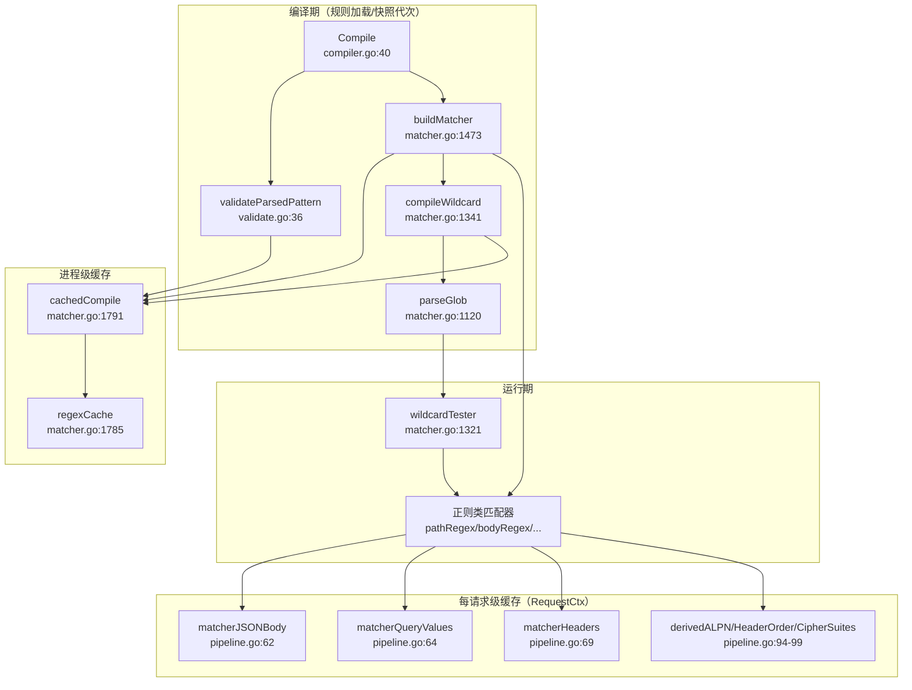
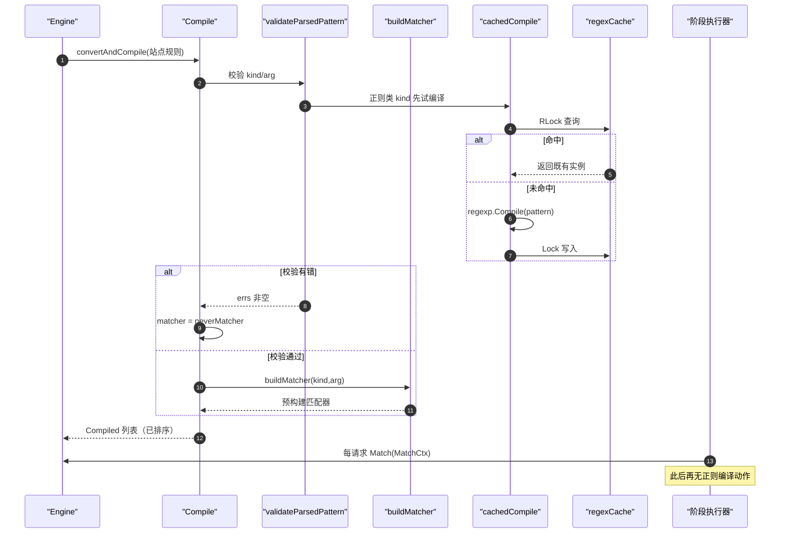
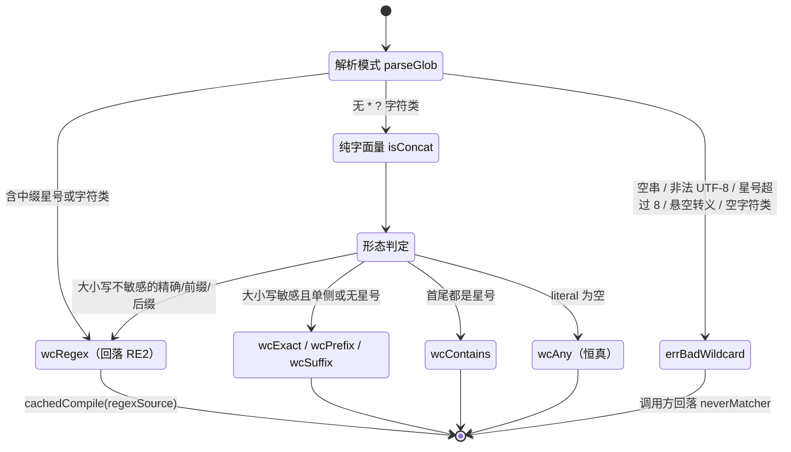
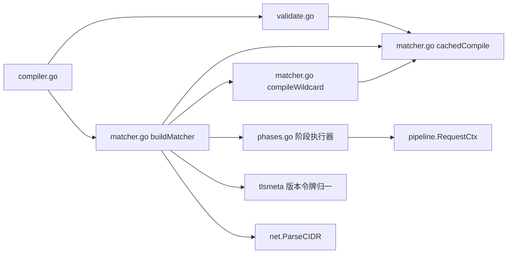

# 正则表达式优化

> [返回 WAF 引擎系统](../WAF 引擎系统.md) · [返回规则匹配器](规则匹配器.md)

<cite>
**本文档引用的文件**
- [matcher.go](file://internal/core/rules/matcher.go)
- [compiler.go](file://internal/core/rules/compiler.go)
- [validate.go](file://internal/core/rules/validate.go)
- [phases.go](file://internal/core/rules/phases.go)
- [pipeline.go](file://internal/core/pipeline/pipeline.go)
- [engine.go](file://internal/core/engine/engine.go)
- [matcher_cache_bench_test.go](file://internal/core/rules/matcher_cache_bench_test.go)
- [wildcard_test.go](file://internal/core/rules/wildcard_test.go)
</cite>

## 目录

1. [简介](#简介)
2. [项目结构](#项目结构)
3. [核心组件](#核心组件)
4. [架构总览](#架构总览)
5. [详细组件分析](#详细组件分析)
6. [依赖关系分析](#依赖关系分析)
7. [性能考虑](#性能考虑)
8. [故障排查指南](#故障排查指南)
9. [结论](#结论)
10. [附录](#附录)

## 简介
本文件聚焦 My-OpenWaf 规则匹配层的正则与通配符优化机制，回答四个问题：

- 正则在**什么时候**被编译：编译期（`Compile` → `buildMatcher`）而非请求期，热路径只做 `Match`
- 编译结果**如何复用**：进程级 `regexCache`（读写锁 + `map[string]*regexp.Regexp`，matcher.go:1785-1788）
- 通配符类规则**如何绕开正则**：`wildcardTester` 的字面量快路径（matcher.go:1301-1419）
- 无法编译的模式**如何降级**：统一回落 `neverMatcher`，fail-closed（compiler.go:50-53）

文档同时给出每请求级懒解析缓存（JSON 请求体、query values、派生请求头）的复用口径，以及缓存无上限、无负缓存这两项已知代价。阶段全序与短路语义见 [处理阶段详解](../处理阶段详解/处理阶段详解.md)，规则 DSL 到匹配器的完整编译链见 [规则编译器](../规则编译器.md)，本文不重复其表格。

## 项目结构
正则与通配符优化不是独立模块，而是分布在匹配器、校验器与请求上下文三层的具体符号上。

**图表来源**
- [matcher.go:1301-1419](file://internal/core/rules/matcher.go#L1301-L1419)
- [matcher.go:1473-1808](file://internal/core/rules/matcher.go#L1473-L1808)
- [compiler.go:40-78](file://internal/core/rules/compiler.go#L40-L78)
- [validate.go:36-257](file://internal/core/rules/validate.go#L36-L257)
- [pipeline.go:58-99](file://internal/core/pipeline/pipeline.go#L58-L99)

| 模块 | 路径 | 职责 | 核心符号 | 依赖 | 被依赖 | 规模(行) | 测试 |
|---|---|---|---|---|---|---:|:--:|
| 匹配器与缓存 | `internal/core/rules/matcher.go` | 具体匹配器构造、正则缓存、glob 编译 | `cachedCompile`、`compileWildcard` | `regexp`、`pipeline` | `compiler.go`、`phases.go` | 1928 | 有 |
| 规则编译器 | `internal/core/rules/compiler.go` | DSL 解析、校验、预构建匹配器 | `Compile`、`ParsePattern` | `matcher.go`、`store` | `engine.go`、`snapshot` | 170 | 有 |
| 模式校验 | `internal/core/rules/validate.go` | 保存期语法与语义校验 | `ValidatePattern`、`validateParsedPattern` | `matcher.go`、`tlsmeta` | `admin/rule/validate.go` | 257 | 有 |
| 阶段执行 | `internal/core/rules/phases.go` | `MatchCtx` 构造、派生头判定 | `MatchCtx`、`ruleNeedsDerivedHeaders` | `pipeline`、`matcher` | `engine.go` | 1391 | 有 |
| 请求上下文 | `internal/core/pipeline/pipeline.go` | 每请求懒解析缓存与代次清理 | `RequestCtx`、`ResetMutationCaches` | 无（被 rules 依赖） | `rules`、`dataplane` | 565 | 有 |

**章节来源**
- [matcher.go:1301-1928](file://internal/core/rules/matcher.go#L1301-L1928)
- [compiler.go:1-170](file://internal/core/rules/compiler.go#L1-L170)
- [validate.go:1-257](file://internal/core/rules/validate.go#L1-L257)
- [phases.go:33-302](file://internal/core/rules/phases.go#L33-L302)
- [pipeline.go:14-257](file://internal/core/pipeline/pipeline.go#L14-L257)

## 核心组件
- `regexCache` + `cachedCompile`：进程级正则复用表，键为模式原文，值为 `*regexp.Regexp`
- `wildcardTester`：通配符形态选择器，把 `*foo*` / `foo*` / `*foo` / `foo` 四类纯字面量形态退化为 `strings`/`bytes` 操作
- `parseGlob` + `parsedGlob.regexSource`：单趟 glob 解析与锚点省略策略
- 每请求懒解析缓存：`matcherJSONBody`、`matcherQueryValues`、`matcherHeaders`、三个 `derived*` 串
- `neverMatcher`：所有不可编译模式的统一 fail-closed 落点

| 组件 | 位置 | 关键方法/字段 | 缓存粒度 | 淘汰策略 |
|---|---|---|---|---|
| `regexCache` | [matcher.go:1785](file://internal/core/rules/matcher.go#L1785) | `mu sync.RWMutex`、`cache map[string]*regexp.Regexp` | 进程级 | 无（不淘汰） |
| `cachedCompile` | [matcher.go:1791](file://internal/core/rules/matcher.go#L1791) | `(pattern) (*regexp.Regexp, error)` | 进程级 | 失败不入缓存 |
| `wildcardTester` | [matcher.go:1321](file://internal/core/rules/matcher.go#L1321) | `shape`、`lit`、`litB`、`fold`、`re` | 规则编译期 | 随规则快照代次 |
| `parsedGlob` | [matcher.go:1081](file://internal/core/rules/matcher.go#L1081) | `body`、`literal`、`isConcat`、`starHead`、`starTail` | 单次编译 | 栈上临时值 |
| `RequestCtx` 懒缓存 | [pipeline.go:58-71](file://internal/core/pipeline/pipeline.go#L58-L71) | `CachedJSONBodyObject`、`CachedMatcherQueryValues` | 每请求 | `ReleaseCtx`/`ResetMutationCaches` |

**章节来源**
- [matcher.go:1081-1419](file://internal/core/rules/matcher.go#L1081-L1419)
- [matcher.go:1785-1808](file://internal/core/rules/matcher.go#L1785-L1808)
- [pipeline.go:58-200](file://internal/core/pipeline/pipeline.go#L58-L200)

## 架构总览
正则成本被刻意推到编译期：`Engine.getCompiledRules` 在每个快照代次内对每个 `{siteID,policyID}` 只编译一次（engine.go:34-37、386-431），请求路径只调用已持有的匹配器实例。

**图表来源**
- [compiler.go:40-78](file://internal/core/rules/compiler.go#L40-L78)
- [validate.go:36-257](file://internal/core/rules/validate.go#L36-L257)
- [matcher.go:1473-1808](file://internal/core/rules/matcher.go#L1473-L1808)
- [engine.go:386-431](file://internal/core/engine/engine.go#L386-L431)

| 层次 | 触发时机 | 频率 | 是否含正则编译 | 失败后果 |
|---|---|---|:--:|---|
| 保存期校验 | Admin 规则增改、备份导入 | 每次写操作 | 是（试编译） | 返回 400/校验错误，不落库 |
| 快照编译期 | 代次变更后的首个请求 | 每代次每站点每策略一次 | 是（经缓存复用） | 降级 `neverMatcher` |
| 请求匹配期 | 每个请求每条规则 | 最高 | 否 | 未命中，继续下一条 |

**章节来源**
- [engine.go:380-431](file://internal/core/engine/engine.go#L380-L431)
- [compiler.go:40-78](file://internal/core/rules/compiler.go#L40-L78)

## 详细组件分析

### cachedCompile 的三步流程与并发语义
`cachedCompile` 是「读锁查 → 无锁编译 → 写锁存」三段式：

| 步 | 动作 | 执行位置 | 输入 | 输出 | 失败分支 | 可观测点 |
|:--:|---|---|---|---|---|---|
| 1 | 读锁查缓存 | [matcher.go:1792-1797](file://internal/core/rules/matcher.go#L1792-L1797) | `pattern` 原文 | 命中则返回实例 | 未命中释放读锁 | 无 |
| 2 | 直接编译 | [matcher.go:1799-1802](file://internal/core/rules/matcher.go#L1799-L1802) | `pattern` | `*regexp.Regexp` | `err` 原样返回，**不写缓存** | 调用方回落 `neverMatcher` |
| 3 | 写锁回填 | [matcher.go:1804-1807](file://internal/core/rules/matcher.go#L1804-L1807) | 实例 | 缓存新增条目 | 无 | 无 |

并发语义要点（必须理解后再判断"缓存命中"是否等价于"同一实例"）：

- 步骤 2 在**锁外**执行，故两个 goroutine 同时首次编译同一模式会各自成功，后写者覆盖前写者；两者行为等价（`regexp` 不可变且并发安全），但**指针可能不同**，不能把实例地址当身份。
- 缓存键是模式原文，**不做任何归一化**：`"(?i)foo"` 与 `"(?i)FOO"`、带尾随空格的串都是不同键。
- 无容量上限、无淘汰、无负缓存：非法模式每次调用都会重新走一遍编译失败路径（这正是保存期校验必须拦住非法正则的原因）。
- `regexCache` 在包初始化时即建好空 map（matcher.go:1785-1788），无需显式预热。

**章节来源**
- [matcher.go:1785-1808](file://internal/core/rules/matcher.go#L1785-L1808)
- [validate.go:147-238](file://internal/core/rules/validate.go#L147-L238)

### 使用正则缓存的匹配器与 kind
`buildMatcher` 中所有 `*_regex` 与部分特化 kind 都经 `cachedCompile` 取得实例，构造期完成后匹配器只持有 `*regexp.Regexp` 字段。

| kind | 匹配器类型 | 参数格式 | 正则用途 | 目标来源 | 非法时降级 |
|---|---|---|---|---|---|
| `block_path_regex` | `pathRegexMatcher` | 纯正则 | `MatchString` | `ctx.Path` | `neverMatcher` |
| `block_query_regex` | `queryRegexMatcher` | 纯正则 | `MatchString` | `ctx.Query` | `neverMatcher` |
| `block_header_regex`、`header_regex` | `headerRegexMatcher` | `name:pattern` | `MatchString` | 请求头值 | `neverMatcher` |
| `block_user_agent_regex` | `headerRegexMatcher` | 纯正则 | `MatchString` | `user-agent` | `neverMatcher` |
| `header_order_regex` | `headerOrderRegexMatcher` | 纯正则 | `MatchString` | 派生头顺序 | `neverMatcher` |
| `body_regex`、`block_body_regex` | `bodyRegexMatcher` | 纯正则 | `Match`（字节） | `ctx.Body` | `neverMatcher` |
| `host_regex` | `hostRegexMatcher` | 纯正则 | `MatchString` | Host（去端口） | `neverMatcher` |
| `full_url_regex` | `fullURLRegexMatcher` | 纯正则 | `MatchString` | `path?query` | `neverMatcher` |
| `query_param_regex` | `queryParamRegexMatcher` | `param:regex` | `MatchString` | 懒解析 query 值 | 缺冒号或编译失败 → `neverMatcher` |
| `block_body_json_path` | `bodyJSONPathMatcher` | `$.a.b:regex` | 可选 `MatchString` | 懒解析 JSON 对象 | pattern 编译失败 → `neverMatcher` |
| `block_multipart` | `multipartMatcher` | 可选正则 | 文件名匹配 | multipart 段 | `neverMatcher` |

`block_multipart` 在 `arg` 为空时使用内置默认正则 `\.(php[0-9]?|phtml|jsp|jspx|asp|aspx|exe|dll|sh|bat|cmd|cgi|pl|py|rb|war|ear)$`（matcher.go:1746-1755），该默认串同样走缓存。

派生请求头只在这四个 kind 出现时才构造（phases.go:236-248），复合条件会递归扫描叶子：

| 触发 kind | 派生字段 | 计算入口 |
|---|---|---|
| `tls_cipher_suite`、`tls_cipher_suites` | `TLSCipherSuites` | `DerivedCipherSuites`（pipeline.go:251） |
| `header_order_contains`、`header_order_regex` | `HeaderOrder` | `DerivedHeaderOrder`（pipeline.go:242） |
| `tls_alpn`（含 TLS 元数据时） | `TLSALPN` | `DerivedALPN`（pipeline.go:233） |

**章节来源**
- [matcher.go:1493-1755](file://internal/core/rules/matcher.go#L1493-L1755)
- [matcher.go:448-520](file://internal/core/rules/matcher.go#L448-L520)
- [phases.go:227-302](file://internal/core/rules/phases.go#L227-L302)
- [pipeline.go:232-257](file://internal/core/pipeline/pipeline.go#L232-L257)

### 通配符形态选择：让 RE2 让位于字符串快路径
`*_wildcard` 类 kind 不直接编译正则，而是先经 `compileWildcard` 判定形态。真实规则绝大多数是 `*foo*` / `foo*` / `*foo` / `foo` 四种纯字面量组合，这些形态退化为 `strings`/`bytes` 操作。

**图表来源**
- [matcher.go:1341-1377](file://internal/core/rules/matcher.go#L1341-L1377)
- [matcher.go:1120-1185](file://internal/core/rules/matcher.go#L1120-L1185)

| 形态 | 判定条件 | 匹配实现 | 大小写不敏感处理 |
|---|---|---|---|
| `wcAny` | `isConcat` 且 literal 为空 | 恒 `true` | 无差异 |
| `wcContains` | 首尾均有未转义 `*` | `strings.Contains` / `bytes.Contains` | `containsFoldASCII(Bytes)` |
| `wcExact` | 无首尾星号 | `s == lit` / `bytes.Equal` | 不产生该形态，回落 RE2 |
| `wcPrefix` | 仅尾星号 | `HasPrefix` | 回落 RE2 |
| `wcSuffix` | 仅首星号 | `HasSuffix` | 回落 RE2 |
| `wcRegex` | 含 `?`、字符类、中缀星号 | `re.MatchString` / `re.Match` | `(?i)` 前缀 |

`matchBytes` 分支存在的意义是避免请求体 `[]byte → string` 的每请求拷贝（matcher.go:1401-1419），`body_wildcard` 因此零分配。

**章节来源**
- [matcher.go:1291-1419](file://internal/core/rules/matcher.go#L1291-L1419)
- [matcher.go:1422-1472](file://internal/core/rules/matcher.go#L1422-L1472)

### 锚点省略与 (?s)：globToRegexSource 的两个非显然决定
`parsedGlob.regexSource` 生成的正则有两个刻意选择：

| 决定 | 写法 | 理由 | 代价 |
|---|---|---|---|
| 恒加 `(?s)` | `"(?s)"` 前缀 | 让 `.` 覆盖换行，防止载荷插入换行绕过 `*` | 无 |
| 首尾星号**不**翻译成 `\A.*` / `.*\z` | 仅在无首/尾星号时补 `\A` / `\z` | `MatchString` 本是非锚定搜索，省掉前导 `.*` 才能让 RE2 用上字面量预扫描（memchr） | 需保证语义等价，已由 `isConcat` 判定覆盖 |
| `*` 匹配含 `/` 的任意序列 | `.*` | 有意偏离 `path.Match` 的段边界语义：header 值、请求体、含 query 的 URL 天然含 `/`，沿用段语义会让 `*bot*` 静默永不命中 | glob 与文件系统语义不再一致，文档需明示 |

`collapseGlobStars` 在星号计数**之后**执行（matcher.go:1121-1125）：连续星号同样占用复杂度预算，因此 `a***b` 与 `a**b` 都按 2 个星号计入上限判定后再归并。字符类内部整体原样复制，避免把类内 `*` 当通配符归并（matcher.go:1261-1277）。

**章节来源**
- [matcher.go:1054-1112](file://internal/core/rules/matcher.go#L1054-L1112)
- [matcher.go:1120-1289](file://internal/core/rules/matcher.go#L1120-L1289)

### 每请求懒解析缓存：把重复解析从 N 条规则降到 1 次
`query_param*` 与 `block_body_json_path` 类规则共享同一份解析结果，缓存挂在 `MatchCtx.reqCtx` 指向的 `pipeline.RequestCtx` 上。

| 缓存 | 写入方 | 读取方 | 解析失败是否记 Done | 纯值 MatchCtx 行为 |
|---|---|---|:--:|---|
| `matcherJSONBody` | `storeJSONBodyObject`（matcher.go:582） | `cachedJSONBodyObject`（matcher.go:574） | 是 | 直接解析且不缓存 |
| `matcherQueryValues` | `StoreMatcherQueryValues`（pipeline.go:164） | `cachedQueryValues`（matcher.go:790） | 是（`matcherQueryValuesOK`） | 每条规则各自 `url.ParseQuery` |
| `matcherHeaders` | `StoreMatcherHeaders` / `StoreAliasedMatcherHeaders` | `CachedMatcherHeaders` | 是（`matcherHeadersReady`） | `-` |
| `derivedHeaderOrder` 等 | `Derived*` 首次调用计算 | 同左 | 是（`derived*Done`） | `-` |

`ResetMutationCaches`（pipeline.go:105-120）在 Lua pre / JS 改写路径生效后被调用，确保改写之后的阶段不会读到改写前的解析结果——这是"缓存键相同但值已过期"的唯一真实风险面，代码上以显式清理而非 TTL 处理。

`query_param` 还存在一层前置短路：`rawQueryMayContainParam` 与 `rawQueryContainsParamName` 在未解码的原始查询串上先判名字是否可能出现（matcher.go:689-717），不出现则直接返回 false，不触发 `url.ParseQuery`。

**章节来源**
- [matcher.go:522-596](file://internal/core/rules/matcher.go#L522-L596)
- [matcher.go:670-815](file://internal/core/rules/matcher.go#L670-L815)
- [pipeline.go:58-200](file://internal/core/pipeline/pipeline.go#L58-L200)

### 失败降级：编译失败一律 fail-closed
模式不可用时的落点在两处，方向一致：

| 失败点 | 判定位置 | 触发条件 | 降级结果 | 是否影响其他规则 |
|---|---|---|---|:--:|
| 保存期 | `ValidateRule` 处理器（`admin/rule/validate.go:34-81`） | `ParsePattern` 返回空 kind，或 `ValidatePattern` 有 errs | 400/`valid:false` | 规则不落库 |
| 编译期 | `compiler.go:50-53` | `validateParsedPattern(kind,arg)` 返回非空 | `matcher = neverMatcher{}` | 否 |
| 构造期 | `buildMatcher` 各分支（matcher.go:1497-1773） | 正则/CIDR/glob/TLS 令牌解析失败 | `neverMatcher` | 否 |
| 复合树 | `parseCompoundJSON`（matcher.go:1825-1835） | JSON 反序列化失败或校验节点报错 | `neverMatcher` | 否 |
| 通配符 | `compileWildcard`（matcher.go:1341-1345） | `errBadWildcard` | `neverMatcher` | 否 |

`neverMatcher` 是空结构体，`Match(MatchCtx)` 恒返回 false（matcher.go:504-508）。设计依据写在注释里：语法错误的规则宁可不生效，也不能拦下全部流量。全库**没有** `alwaysMatcher`，任何"恒真"需求应由 `path_wildcard:*` 之类形态表达。

**章节来源**
- [compiler.go:40-78](file://internal/core/rules/compiler.go#L40-L78)
- [matcher.go:504-508](file://internal/core/rules/matcher.go#L504-L508)
- [matcher.go:1341-1377](file://internal/core/rules/matcher.go#L1341-L1377)
- [validate.go:36-104](file://internal/core/rules/validate.go#L36-L104)

## 依赖关系分析

**图表来源**
- [compiler.go:1-10](file://internal/core/rules/compiler.go#L1-L10)
- [matcher.go:1-18](file://internal/core/rules/matcher.go#L1-L18)
- [validate.go:1-9](file://internal/core/rules/validate.go#L1-L9)

| 依赖 | 用途 | 接入方式 | 超时 | 重试 | 降级 | 可用性影响 |
|---|---|---|:--:|:--:|---|---|
| Go 标准库 `regexp`（RE2） | 正则编译与匹配 | 直接调用 | 未设置（风险） | 无 | 编译失败 → `neverMatcher` | 单条规则失效，不影响整体 |
| `net.ParseCIDR/ParseIP` | `allow_ip`/`block_ip` | 直接调用 | - | 无 | 非法 → `neverMatcher` | 同上 |
| `internal/tlsmeta` | `tls_version` 令牌归一 | 函数调用 | - | 无 | 空归一 → `neverMatcher` | 同上 |
| `internal/pipeline` | 每请求懒解析缓存 | `MatchCtx.reqCtx` | - | 无 | `reqCtx` 为 nil 时不缓存 | 命中判定不变，仅成本上升 |

`cachedCompile` 无超时与无上限是本篇登记的两项已知风险：恶意或失误构造的超大模式会在**编译期**（而非请求期）占用 CPU，但因每代次每站点只编译一次，攻击面被限制在规则写入与重载路径。

**章节来源**
- [matcher.go:1-18](file://internal/core/rules/matcher.go#L1-L18)
- [compiler.go:1-10](file://internal/core/rules/compiler.go#L1-L10)
- [phases.go:72-110](file://internal/core/rules/phases.go#L72-L110)

## 性能考虑
- 把编译成本固定在快照代次上：`getCompiledRules` 以 `{siteID,policyID}` 为键、按 `revision` 判存（engine.go:34-37、386-431），并发为 `atomic.Pointer` 无锁读 + 写时复制（engine.go:98-103、413-428），非 RWMutex。
- 通配符优先于正则：同语义下 `path_wildcard:/admin*` 走 `HasPrefix`，`block_path_regex:^/admin` 走 RE2；代码注释记录的实测口径是 2 KiB 请求体上未加快路径时 `*<script>*` 约 24µs/op，加快路径后进入亚微秒级。
- 保持模式字符串稳定以命中缓存：缓存键不做归一化，`(?i)` 前缀、空白与大小写差异都会产生新条目。
- 少用中缀星号与字符类：这两类会把 `isConcat` 置假从而强制走 RE2。
- `query_param` 类规则受益于原始串前置短路（`rawQueryMayContainParam`），查询串不含该参数名时几乎零成本。
- 谨慎对待缓存无上限：规则量级与唯一模式数成正比，无 LRU 与 MaxCost，清理只能靠进程重启。

**章节来源**
- [engine.go:34-103](file://internal/core/engine/engine.go#L34-L103)
- [engine.go:380-431](file://internal/core/engine/engine.go#L380-L431)
- [matcher.go:1313-1327](file://internal/core/rules/matcher.go#L1313-L1327)

## 故障排查指南
- 「规则配了但不生效」
  - 症状：保存成功、无报错、流量照常通过
  - 原因：模式在编译期被降级为 `neverMatcher`，或该规则 kind 未进 `knownPrefixes`
  - 排查：先用 `POST /api/v1/rules/validate` 类校验入口跑 `ValidatePattern`；再确认 `ParsePattern` 返回的 kind 非空（compiler.go:119-142 是唯一合法前缀清单）
  - 方案：修正模式或改用已支持 kind；不要依赖"重启后就好了"
- 「同一模式看起来命中不了」
  - 症状：正则本身正确，规则间微小差异导致行为不同
  - 原因：缓存键为模式原文，尾随空格/大小写差异产生不同条目；`*_wildcard` 首个冒号后的空白是模式的一部分（compiler.go:146-168 注释）
  - 排查：对比规则 `pattern` 字段的字节级差异
  - 方案：统一书写规范，避免手工拼接模式
- 「通配符规则报错保存不了」
  - 症状：`validateCompoundNode` / `validateSimplePattern` 返回非法通配符模式
  - 原因：空串、非法 UTF-8、未转义星号 > 8、悬空 `\`、空字符类、未闭合 `[`
  - 排查：对照 `parseGlob` 的五条拒绝条件逐一核对（matcher.go:1120-1185、1198-1236）
  - 方案：删减星号数量或改用 `*_regex`
- 「CPU 在重载时抖一下」
  - 原因：新快照代次下规则重新编译，缓存未命中的模式集中编译
  - 排查：确认抖动时刻是否与 `BumpRevision`/reload 对齐
  - 方案：合并同义模式、减少唯一正则数量
- 基准与回归
  - `matcher_cache_bench_test.go` 的 `BenchmarkQueryParamMatchersSharedCtx` 对比共享 `RequestCtx` 与纯值 `MatchCtx` 两条路线，可直接用于验证懒缓存未被破坏
  - `wildcard_test.go` 覆盖 `ParsePattern` 对 `*_wildcard` 前缀的识别与边界空白保留，以及 path/full_url/host/body 四类通配匹配器的行为

**章节来源**
- [matcher.go:1027-1236](file://internal/core/rules/matcher.go#L1027-L1236)
- [compiler.go:119-170](file://internal/core/rules/compiler.go#L119-L170)
- [matcher_cache_bench_test.go:48-60](file://internal/core/rules/matcher_cache_bench_test.go#L48-L60)
- [wildcard_test.go:1-637](file://internal/core/rules/wildcard_test.go#L1-L637)

## 结论
My-OpenWaf 的正则优化策略可以概括为三句话：**编译期承担全部成本，进程级缓存消除重复编译，通配符形态判定把多数规则留在字符串路径上**。缓存实现刻意保持简单（一把读写锁、一个 map、无淘汰、无负缓存），其可接受性依赖于「快照代次内每站点每策略只编译一次」这一上层约束。失败方向统一为 fail-closed 的 `neverMatcher`，保证模式书写错误不会升级为误封。已知代价是缓存无上限与正则编译无超时，两者都应在规则规模增长时纳入容量评估。

## 附录

### 正则相关约束与默认值速查
| 约束项 | 取值 | 位置 | 说明 |
|---|---|---|---|
| 未转义星号上限 | 8 | [matcher.go:1027](file://internal/core/rules/matcher.go#L1027) | 归并前统计，连续星号也计数 |
| 通配符空模式 | 保存期即拒绝 | [validate.go:212-238](file://internal/core/rules/validate.go#L212-L238) | 空模式等同永不命中 |
| glob 正则前缀 | `(?s)`，可选 `(?i)` | [matcher.go:1096-1112](file://internal/core/rules/matcher.go#L1096-L1112) | 覆盖换行 |
| `block_multipart` 默认正则 | 见正文 | [matcher.go:1746-1755](file://internal/core/rules/matcher.go#L1746-L1755) | `arg` 为空时启用 |
| JSON 路径切分 | 编译期 `strings.Split` | [matcher.go:594-597](file://internal/core/rules/matcher.go#L594-L597) | 剥 `$.` 前缀，空段保留 |
| 正则缓存淘汰 | 无 | [matcher.go:1785-1808](file://internal/core/rules/matcher.go#L1785-L1808) | 进程生命周期内驻留 |
| 规则缓存并发 | `atomic.Pointer` + 写时复制 | [engine.go:98-103](file://internal/core/engine/engine.go#L98-L103) | 非 RWMutex |

**章节来源**
- [matcher.go:1027-1112](file://internal/core/rules/matcher.go#L1027-L1112)
- [matcher.go:594-597](file://internal/core/rules/matcher.go#L594-L597)
- [matcher.go:1746-1755](file://internal/core/rules/matcher.go#L1746-L1755)
- [validate.go:212-238](file://internal/core/rules/validate.go#L212-L238)
- [engine.go:34-103](file://internal/core/engine/engine.go#L34-L103)

### 最佳实践清单
- 模式选择
  - 前缀/后缀/包含能表达的，用 `*_wildcard` 或 `*_contains`，不要用 `*_regex`
  - 需要大小写不敏感时显式写 `(?i)`，不要依赖匹配器默认（`block_user_agent` 是不区分大小写的包含，`block_user_agent_regex` 由模式自己决定）
  - 避免 `(a|b|c)*`、嵌套量词等在长 body 上放大的写法；RE2 无线性保证之外的回溯风险，但仍有常数差异
- 缓存友好性
  - 同一模式在多条规则间逐字复用，不要为可读性加空白
  - 复合规则里的叶子 `kind`/`arg` 由前端 `rule-pattern-mapper.ts` 生成，避免手写产生变体
- 规模控制
  - 站点规则数量增长时关注重载耗时而非请求延迟：成本集中在编译期
  - `tls_*`、`header_order_*` 类规则会触发派生头构造，按站点实际需要启用

**章节来源**
- [matcher.go:1555-1616](file://internal/core/rules/matcher.go#L1555-L1616)
- [matcher.go:1746-1755](file://internal/core/rules/matcher.go#L1746-L1755)
- [phases.go:227-248](file://internal/core/rules/phases.go#L227-L248)
