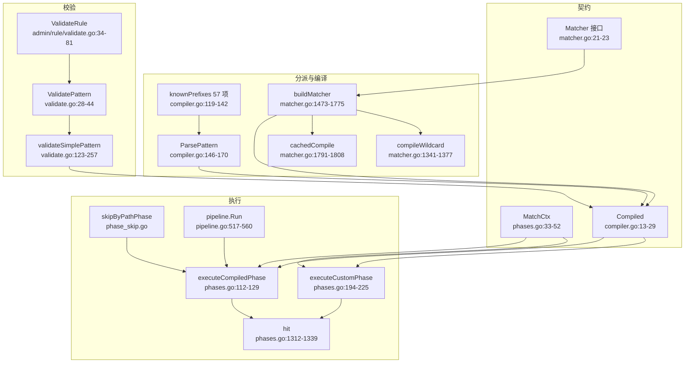
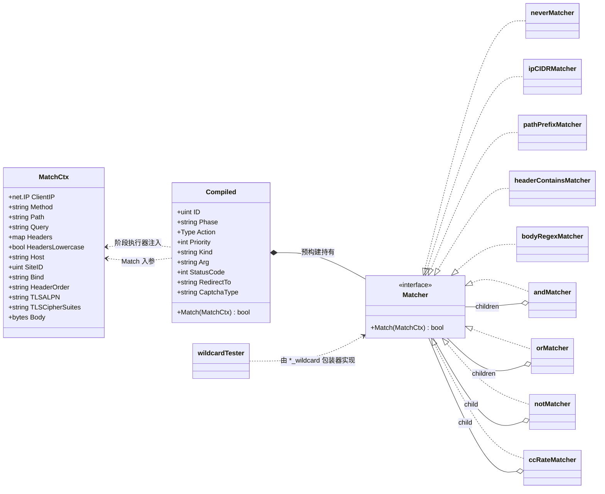
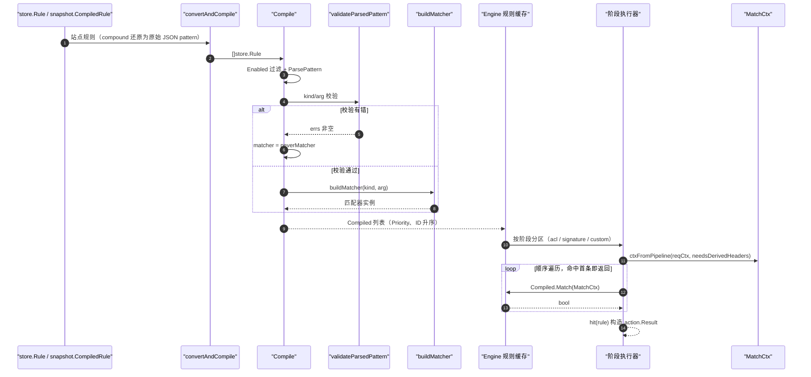
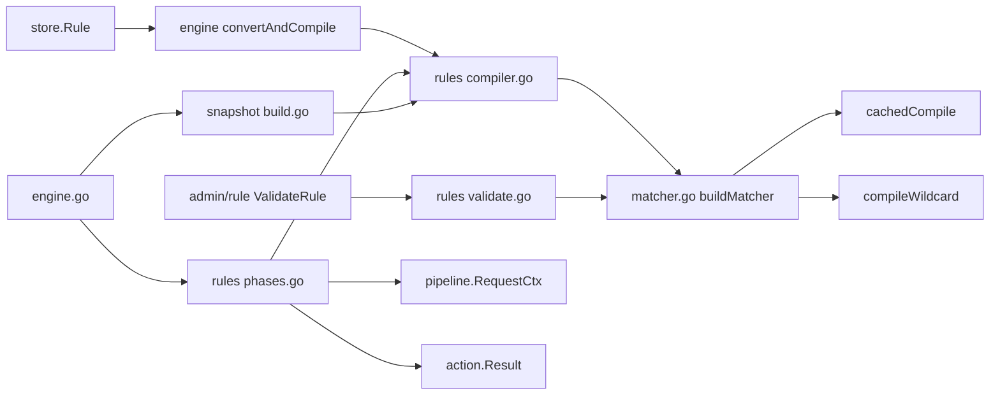

# 规则匹配器

> [返回 WAF 引擎系统](../WAF 引擎系统.md)

<cite>
**本文档引用的文件**
- [matcher.go](file://internal/core/rules/matcher.go)
- [compiler.go](file://internal/core/rules/compiler.go)
- [validate.go](file://internal/core/rules/validate.go)
- [phases.go](file://internal/core/rules/phases.go)
- [phase_skip.go](file://internal/core/rules/phase_skip.go)
- [lua_phase.go](file://internal/core/rules/lua_phase.go)
- [pipeline.go](file://internal/core/pipeline/pipeline.go)
- [engine.go](file://internal/core/engine/engine.go)
- [action.go](file://internal/core/action/action.go)
- [policy.go](file://internal/store/policy.go)
- [build.go](file://internal/snapshot/build.go)
- [validate.go](file://internal/admin/rule/validate.go)
- [challenge.go](file://internal/dataplane/challenge.go)
- [rule-pattern-mapper.ts](file://frontend/app/(dashboard)/rules/components/rule-pattern-mapper.ts)
</cite>

## 目录

1. [简介](#简介)
2. [项目结构](#项目结构)
3. [核心组件](#核心组件)
4. [架构总览](#架构总览)
5. [详细组件分析](#详细组件分析)
6. [依赖关系分析](#依赖关系分析)
7. [性能考虑](#性能考虑)
8. [故障排查指南](#故障排查指南)
9. [结论](#结论)
10. [附录](#附录)

## 简介
本篇是「规则匹配器」域的总览，回答四个问题：

- 一条规则如何从数据库行变成可调用的匹配器：`ParsePattern` → `validateParsedPattern` → `buildMatcher` → `Compiled`
- 匹配器的统一契约是什么：`Matcher` 接口只有 `Match(MatchCtx) bool` 一个方法（matcher.go:21-23）
- 有哪些可用前缀：`knownPrefixes` 共 **57 个** kind，加 `compound` 一种 JSON 形态（compiler.go:119-142）
- 匹配结果如何变成动作：`hit(Compiled)` 构造 `action.Result`，短路与否由 `IsTerminal()` 决定

两条必须澄清的旧误解：

- **`allow` 不短路**。`IsTerminal()` 对 `allow`/`observe` 均为 false（action.go:168-179），ACL 命中 allow 后请求继续进入 OWASP、CVE 等后续检测；`executeCompiledPhase` 的 `allowShortCircuit` 形参在函数体内未被使用（phases.go:112-129）
- 阶段链是 **11 阶段**（含 `lua_pre`、`browser_sign`），全序与短路语义见 [处理阶段详解](../处理阶段详解/处理阶段详解.md)，本篇不重复该表

子文档分工：[复合匹配器](复合匹配器.md) 讲 `and/or/not/if/cc_rate` 树；[正则表达式优化](正则表达式优化.md) 讲 `cachedCompile` 与通配符快路径；[匹配器扩展开发](匹配器扩展开发.md) 讲新增 kind 的四张表同步；逐 kind 参数说明见 [内置匹配器](../%E5%86%85%E7%BD%AE%E5%8C%B9%E9%85%8D%E5%99%A8/%E5%86%85%E7%BD%AE%E5%8C%B9%E9%85%8D%E5%99%A8.md)；编译链细节见 [规则编译器](../规则编译器.md)。

## 项目结构
匹配器子系统由「契约 + 分派 + 校验 + 执行」四段组成，没有注册中心。

**图表来源**
- [matcher.go:21-23](file://internal/core/rules/matcher.go#L21-L23)
- [matcher.go:1473-1808](file://internal/core/rules/matcher.go#L1473-L1808)
- [compiler.go:13-170](file://internal/core/rules/compiler.go#L13-L170)
- [validate.go:28-257](file://internal/core/rules/validate.go#L28-L257)
- [phases.go:33-239](file://internal/core/rules/phases.go#L33-L239)
- [pipeline.go:517-560](file://internal/core/pipeline/pipeline.go#L517-L560)

| 模块 | 路径 | 职责 | 核心接口/符号 | 依赖模块 | 被依赖 | 规模(行) | 测试 |
|---|---|---|---|---|---|---:|:--:|
| 匹配器集合 | `internal/core/rules/matcher.go` | 匹配器实现与 kind 分派 | `Matcher`、`buildMatcher`、`cachedCompile` | `pipeline`、`tlsmeta` | `compiler`、`phases` | 1928 | 有 |
| 规则编译器 | `internal/core/rules/compiler.go` | DSL 解析、预构建、排序 | `Compiled`、`Compile`、`knownPrefixes` | `matcher`、`action`、`store` | `engine`、`snapshot` | 170 | 有 |
| 模式校验 | `internal/core/rules/validate.go` | 保存期语法与语义校验 | `ValidatePattern`、`validateParsedPattern` | `matcher`、`tlsmeta` | `admin/rule`、`compiler` | 257 | 有 |
| 阶段与上下文 | `internal/core/rules/phases.go` | `MatchCtx` 构造、规则遍历、结果构造 | `MatchCtx`、`hit`、`RateLimitKey` | `pipeline`、`matcher` | `engine` | 1391 | 有 |
| 阶段跳过装饰 | `internal/core/rules/phase_skip.go` | 按路径跳过单个阶段 | `NewSkipByPathPhase` | `pipeline`、`owasp` | `engine` | 49 | 有 |
| Lua 阶段 | `internal/core/rules/lua_phase.go` | 前置脚本阶段与请求视图 | `NewLuaPhase`、`BuildLuaRequestView` | `luaplugin`、`pipeline` | `engine` | 235 | 有 |
| 请求上下文 | `internal/core/pipeline/pipeline.go` | 阶段链执行与懒缓存 | `Phase`、`Run`、`RequestCtx` | `action`、`tlsfp` | `rules`、`dataplane` | 565 | 有 |
| 引擎编排 | `internal/core/engine/engine.go` | 规则缓存与阶段链缓存 | `Engine.Process`、`getCompiledRules` | `rules`、`snapshot` | `dataplane` | 646 | 有 |

**章节来源**
- [matcher.go:1-1928](file://internal/core/rules/matcher.go#L1-L1928)
- [compiler.go:1-170](file://internal/core/rules/compiler.go#L1-L170)
- [validate.go:1-257](file://internal/core/rules/validate.go#L1-L257)
- [phases.go:1-339](file://internal/core/rules/phases.go#L1-L339)
- [phase_skip.go:1-49](file://internal/core/rules/phase_skip.go#L1-L49)
- [lua_phase.go:1-60](file://internal/core/rules/lua_phase.go#L1-L60)
- [engine.go:1-646](file://internal/core/engine/engine.go#L1-L646)

## 核心组件
统一契约下分三类实现：字段匹配器（叶子）、组合匹配器（复合树）、降级匹配器（`neverMatcher`）。

**图表来源**
- [matcher.go:21-45](file://internal/core/rules/matcher.go#L21-L45)
- [matcher.go:281-315](file://internal/core/rules/matcher.go#L281-L315)
- [matcher.go:317-520](file://internal/core/rules/matcher.go#L317-L520)
- [matcher.go:1321-1327](file://internal/core/rules/matcher.go#L1321-L1327)
- [compiler.go:13-37](file://internal/core/rules/compiler.go#L13-L37)
- [phases.go:33-52](file://internal/core/rules/phases.go#L33-L52)

**章节来源**
- [matcher.go:21-45](file://internal/core/rules/matcher.go#L21-L45)
- [matcher.go:281-520](file://internal/core/rules/matcher.go#L281-L520)
- [compiler.go:13-37](file://internal/core/rules/compiler.go#L13-L37)
- [phases.go:33-52](file://internal/core/rules/phases.go#L33-L52)

## 架构总览
匹配器只在两处出现：编译期被构造，请求期被调用。中间的缓存层把编译成本固定到快照代次上。

**图表来源**
- [engine.go:380-431](file://internal/core/engine/engine.go#L380-L431)
- [engine.go:623-646](file://internal/core/engine/engine.go#L623-L646)
- [compiler.go:40-78](file://internal/core/rules/compiler.go#L40-L78)
- [validate.go:36-44](file://internal/core/rules/validate.go#L36-L44)
- [matcher.go:1473-1775](file://internal/core/rules/matcher.go#L1473-L1775)
- [phases.go:72-129](file://internal/core/rules/phases.go#L72-L129)

| 层 | 组成 | 核心职责 | 允许依赖 | 禁止依赖 | 代表位置 |
|---|---|---|---|---|---|
| 契约层 | `Matcher`、`MatchCtx`、`Compiled` | 单条件判定与请求视图 | `pipeline`、`action` | `admin`、`store` 写路径 | matcher.go:21、phases.go:33 |
| 分派层 | `knownPrefixes`、`ParsePattern`、`buildMatcher` | 文本 → 匹配器实例 | `regexp`、`net`、`tlsmeta` | `engine`、`snapshot` | compiler.go:119、matcher.go:1473 |
| 校验层 | `ValidatePattern` 族 | 保存期拒绝非法模式 | 分派层工具函数 | 数据库写入 | validate.go:28-257 |
| 执行层 | 阶段执行器 + `pipeline.Run` | 遍历、短路、观察收集 | 契约层 | `admin`、`store` | phases.go:112-225 |
| 缓存层 | `atomic.Pointer` 规则/阶段链快照 | 代次内单次编译 | 分派层 | 每请求重新编译 | engine.go:98-103 |

**章节来源**
- [engine.go:34-103](file://internal/core/engine/engine.go#L34-L103)
- [engine.go:380-431](file://internal/core/engine/engine.go#L380-L431)
- [compiler.go:40-78](file://internal/core/rules/compiler.go#L40-L78)
- [phases.go:72-225](file://internal/core/rules/phases.go#L72-L225)

## 详细组件分析

### 编译流程：从规则行到匹配器
| 步 | 动作 | 执行位置 | 输入 | 输出 | 失败分支 | 可观测点 |
|:--:|---|---|---|---|---|---|
| 1 | 还原 pattern | [engine.go:625-646](file://internal/core/engine/engine.go#L625-L646) | `snapshot.CompiledRule` | `store.Rule` | `compound` 时 `pattern = arg` 原样 | 站点规则条数 |
| 2 | 启用过滤 | [compiler.go:43-45](file://internal/core/rules/compiler.go#L43-L45) | `r.Enabled` | 跳过禁用行 | 规则不进列表 | 管理端启用开关 |
| 3 | 解析 kind/arg | [compiler.go:46-49](file://internal/core/rules/compiler.go#L46-L49) | `r.Pattern` | `(kind, arg)` | `kind` 为空则整条跳过 | `ValidateRule` 返回"格式无效" |
| 4 | 语义校验 | [compiler.go:50-53](file://internal/core/rules/compiler.go#L50-L53) | `kind, arg` | errs 列表 | 非空 → `neverMatcher` | 规则"配了不生效" |
| 5 | 构造匹配器 | [matcher.go:1473-1775](file://internal/core/rules/matcher.go#L1473-L1775) | `kind, arg` | `Matcher` | 内部再失败 → `neverMatcher` | 同上 |
| 6 | 附带元数据 | [compiler.go:54-69](file://internal/core/rules/compiler.go#L54-L69) | 规则行 | `runtimeAction`/`ruleIDStr`/`matchDesc` | 空值由 `ensureCompiledMetadata` 补齐 | 安全事件 `rule_id_str` |
| 7 | 排序 | [compiler.go:71-76](file://internal/core/rules/compiler.go#L71-L76) | 编译结果 | `Priority` 升序、同值 `ID` 升序 | 无 | 命中顺序 |
| 8 | 阶段分区缓存 | [engine.go:399-431](file://internal/core/engine/engine.go#L399-L431) | `Compiled` 列表 | `compiledRules{ACL,Signature,Custom}` | 代次变更则整表重建 | `owaf_cache_*` 与重载日志 |

`ParsePattern` 的两处细节值得单列：

- 前导空白属于表达式外围排版，被剥掉；但 `*_wildcard` 的**首个冒号之后的空白是模式的一部分**，不得丢弃（compiler.go:147-167）
- `knownPrefixes` 判定要求第一个冒号位置 `idx > 0`，因此以冒号开头或不含冒号的串一律解析失败

**章节来源**
- [compiler.go:40-115](file://internal/core/rules/compiler.go#L40-L115)
- [compiler.go:146-170](file://internal/core/rules/compiler.go#L146-L170)
- [engine.go:380-431](file://internal/core/engine/engine.go#L380-L431)
- [engine.go:623-646](file://internal/core/engine/engine.go#L623-L646)

### kind 前缀全集：按匹配目标分组
`knownPrefixes` 是唯一的合法前缀白名单。下表给出 57 个 kind 的目标分布与逐类说明归属，参数级细节见 [内置匹配器](../%E5%86%85%E7%BD%AE%E5%8C%B9%E9%85%8D%E5%99%A8/%E5%86%85%E7%BD%AE%E5%8C%B9%E9%85%8D%E5%99%A8.md) 各子篇。

| 分组 | kind | 数量 | 目标来源 | 细则文档 |
|---|---|:--:|---|---|
| 网络与地理 | `allow_ip`、`block_ip`、`geo_block` | 3 | `ClientIP`、GeoIP 国家码 | [网络匹配器](../%E5%86%85%E7%BD%AE%E5%8C%B9%E9%85%8D%E5%99%A8/%E7%BD%91%E7%BB%9C%E5%8C%B9%E9%85%8D%E5%99%A8.md)、[地理位置阻断匹配器](../%E5%86%85%E7%BD%AE%E5%8C%B9%E9%85%8D%E5%99%A8/%E5%9C%B0%E7%90%86%E4%BD%8D%E7%BD%AE%E9%98%BB%E6%96%AD%E5%8C%B9%E9%85%8D%E5%99%A8.md) |
| 路径 | `block_path`、`block_path_exact`、`block_path_regex`、`path_contains`、`path_not_contains`、`path_not_exact`、`path_wildcard` | 7 | `Path` | [路径匹配器](../%E5%86%85%E7%BD%AE%E5%8C%B9%E9%85%8D%E5%99%A8/%E8%B7%AF%E5%BE%84%E5%8C%B9%E9%85%8D%E5%99%A8.md) |
| 查询 | `block_query_contains`、`block_query_regex`、`query_param`、`query_param_not_exact`、`query_param_regex` | 5 | `Query` / 懒解析 `url.Values` | [头部和查询参数匹配器](../%E5%86%85%E7%BD%AE%E5%8C%B9%E9%85%8D%E5%99%A8/%E5%A4%B4%E9%83%A8%E5%92%8C%E6%9F%A5%E8%AF%A2%E5%8F%82%E6%95%B0%E5%8C%B9%E9%85%8D%E5%99%A8.md) |
| 请求头 / UA / Cookie / 头顺序 | `block_header`、`block_header_exact`、`block_header_not_exact`、`block_header_prefix`、`block_header_regex`、`header_regex`、`header_wildcard`、`block_user_agent`、`block_user_agent_regex`、`cookie_contains`、`referer_contains`、`header_order_contains`、`header_order_regex` | 13 | `Headers` / 派生 `HeaderOrder` | [头部和查询参数匹配器](../%E5%86%85%E7%BD%AE%E5%8C%B9%E9%85%8D%E5%99%A8/%E5%A4%B4%E9%83%A8%E5%92%8C%E6%9F%A5%E8%AF%A2%E5%8F%82%E6%95%B0%E5%8C%B9%E9%85%8D%E5%99%A8.md) |
| 协议方法 | `block_method`、`block_content_type` | 2 | `Method` / `Content-Type` 头 | [内容和主体匹配器](../%E5%86%85%E7%BD%AE%E5%8C%B9%E9%85%8D%E5%99%A8/%E5%86%85%E5%AE%B9%E5%92%8C%E4%B8%BB%E4%BD%93%E5%8C%B9%E9%85%8D%E5%99%A8.md) |
| 主机与完整 URL | `host`、`host_full`、`host_regex`、`host_contains`、`host_not_contains`、`host_not_exact`、`host_wildcard`、`full_url_contains`、`full_url_regex`、`full_url_not_exact`、`full_url_wildcard` | 11 | `Host`（含去端口分支）、`path?query` | [主机和URL匹配器](../%E5%86%85%E7%BD%AE%E5%8C%B9%E9%85%8D%E5%99%A8/%E4%B8%BB%E6%9C%BA%E5%92%8CURL%E5%8C%B9%E9%85%8D%E5%99%A8.md) |
| 请求体 | `body_contains`、`block_body_contains`、`body_regex`、`block_body_regex`、`body_not_exact`、`body_wildcard`、`block_body_json_path`、`block_multipart` | 8 | `Body` / 懒解析 JSON / multipart 段 | [内容和主体匹配器](../%E5%86%85%E7%BD%AE%E5%8C%B9%E9%85%8D%E5%99%A8/%E5%86%85%E5%AE%B9%E5%92%8C%E4%B8%BB%E4%BD%93%E5%8C%B9%E9%85%8D%E5%99%A8.md) |
| TLS 指纹 | `tls_ja3`、`tls_ja3_hash`、`tls_ja4`、`tls_version`、`tls_sni`、`tls_alpn`、`tls_cipher_suite`、`tls_cipher_suites` | 8 | `TLS`、派生 `TLSALPN`/`TLSCipherSuites` | [内置匹配器](../%E5%86%85%E7%BD%AE%E5%8C%B9%E9%85%8D%E5%99%A8/%E5%86%85%E7%BD%AE%E5%8C%B9%E9%85%8D%E5%99%A8.md) |
| 逻辑组合 | `compound`（由 `{` 前缀识别，不在 `knownPrefixes` 内） | 1 | 递归子树 | [复合匹配器](复合匹配器.md) |

三点结构性事实：

- 大小写归一在**构造期**完成：`host*`、`full_url_contains`、`header*` 的 name 侧都小写化，UA 值侧走 `containsFoldASCII`
- `block_*` 与去前缀别名并存（如 `body_contains` / `block_body_contains`），二者构造同一个匹配器（matcher.go:1619-1630）
- `tls_cipher_suite` 与 `tls_cipher_suites` 是同义别名，共用逗号分隔解析（matcher.go:1587-1599）

> [!WARNING]
> 上表 57 项是**引擎侧**白名单。快照构建期另有一份只有 30 项的窄白名单（`snapshot.ParsePattern`，build.go:1197-1222），它**不引用** `internal/core/rules`。二者差集共 27 项：`geo_block`、`block_header_exact`、`block_header_prefix`、`block_header_not_exact`、`path_contains`、`path_not_contains`、`path_not_exact`、`path_wildcard`、`host_full`、`host_regex`、`host_contains`、`host_not_contains`、`host_not_exact`、`host_wildcard`、`full_url_contains`、`full_url_regex`、`full_url_not_exact`、`full_url_wildcard`、`header_wildcard`、`query_param_regex`、`query_param_not_exact`、`body_not_exact`、`body_wildcard`、`block_body_contains`、`block_body_regex`、`block_body_json_path`、`block_multipart`。库里存这些 kind 的裸 DSL 规则会在 `compileRules` 被跳过（build.go:922-926，`kind == ""` 即 `continue`），**不报错**。把它们写成 `{"kind":"...","arg":"..."}` 的 `compound` 叶子形态即可绕开窄白名单——快照侧对 `{` 前缀一律放行，叶子最终仍由引擎侧 `buildMatcher` 构造。

**章节来源**
- [compiler.go:119-142](file://internal/core/rules/compiler.go#L119-L142)
- [matcher.go:1473-1775](file://internal/core/rules/matcher.go#L1473-L1775)
- [validate.go:123-257](file://internal/core/rules/validate.go#L123-L257)
- [build.go:920-936](file://internal/snapshot/build.go#L920-L936)
- [build.go:1189-1222](file://internal/snapshot/build.go#L1189-L1222)

### 匹配上下文与派生输入
`MatchCtx` 是 `pipeline.RequestCtx` 的**值拷贝视图**，由 `ctxFromPipeline` 构造（phases.go:106-110）。

| 字段 | 来源 | 归一化 | 备注 |
|---|---|---|---|
| `ClientIP`、`Method`、`Path`、`Query`、`Host`、`Body` | `RequestCtx` 同名字段 | 无 | `Query` 是原始查询串，未解码 |
| `Headers`、`HeadersLowercase` | `RequestCtx.Headers` | 键名视上游而定 | 大小写不敏感查表由工具函数承担 |
| `SiteID`、`Bind` | `RequestCtx` | 无 | `cc_rate`/限流计数键要素 |
| `HeaderOrder` | `DerivedHeaderOrder(HeaderKeys 拼接)` | 逗号分隔 | 仅 `needsDerivedHeaders` 为真时构造 |
| `TLSALPN` | `DerivedALPN` | 协商结果语义 | 与访问日志同源 |
| `TLSCipherSuites` | `DerivedCipherSuites` | 格式化串 | 与 `x-owaf-tls-cipher-suites` 别名一致 |
| `TLS` | `&ctx.TLS` | 无 | `tlsFingerprintValue` 优先读结构体，回落请求头 |
| `reqCtx` | `ctx` | 非导出 | nil 时懒缓存自动降级为不缓存 |

`needsDerivedHeaders` 由 `compiledRulesNeedDerivedHeaders` 对整组规则求或（phases.go:227-235），命中条件是 `tls_cipher_suite(s)`、`header_order_contains`、`header_order_regex` 或复合树中的这些叶子（phases.go:236-302）。这是一次"按规则集特征决定是否付出派生成本"的设计，新增依赖派生输入的 kind 必须同步这张清单。

**章节来源**
- [phases.go:33-110](file://internal/core/rules/phases.go#L33-L110)
- [phases.go:227-302](file://internal/core/rules/phases.go#L227-L302)
- [matcher.go:111-204](file://internal/core/rules/matcher.go#L111-L204)
- [pipeline.go:58-99](file://internal/core/pipeline/pipeline.go#L58-L99)

### 阶段执行与短路语义
| 阶段（`Name()`） | 遍历实现 | 命中策略 | Observe 处理 | 位置 |
|---|---|---|---|---|
| `acl` | `executeCompiledPhase` | 命中首条即返回 `(r, r.IsTerminal())` | 阶段内不攒 | phases.go:131-150 |
| `signature` | `executeCompiledPhase` | 同上 | 同上 | phases.go:152-171 |
| `custom` | `executeCustomPhase` | 终端动作立即返回 | 先攒观察命中，遇终端动作一并上交 | phases.go:173-225 |
| `ip_reputation` | 站点白/黑名单 + 全局信誉 | 站点白名单 Allow **不短路**，全局白名单短路 | - | phases.go:356-433 |
| `owasp_default` / `cve_detection` / `bot_detection` / `browser_sign` / `rate_limit` / `anti_replay` / `lua_pre` | 各自内置判定 | 终端动作短路，挑战类延迟 | 观察继续 | phases.go（各阶段），全序见 [处理阶段详解](../处理阶段详解/处理阶段详解.md) |

链上层的优先级裁决由 `pipeline.Run` 负责（pipeline.go:517-560）：

- `stop` 且非挑战 → 立即返回
- `stop` 且为挑战 → 存入 `pendingChallenge`，仅当 `TerminalPriority` **更高**才替换，随后继续执行后续阶段
- `Matched && IsDrop()` → 立即返回
- 未命中或 `observe`/`allow` → 继续

动作终止优先级：drop 90 / intercept 80 / rate_limit 70 / `challenge`、`captcha_challenge`、`shield_challenge`、`chain_challenge` 同为 60 / redirect 50 / observe 10，**同档取先出现者**（action.go:88-119）。因此同批出现两个挑战类动作时，保留链上先命中的那个，不被后者顶替。

**章节来源**
- [phases.go:112-225](file://internal/core/rules/phases.go#L112-L225)
- [phases.go:342-433](file://internal/core/rules/phases.go#L342-L433)
- [pipeline.go:517-560](file://internal/core/pipeline/pipeline.go#L517-L560)
- [action.go:88-119](file://internal/core/action/action.go#L88-L119)

### 命中结果与元数据
`hit(Compiled)` 把命中行翻译成 `action.Result`（phases.go:1312-1339）：

| 结果字段 | 取值来源 | 说明 |
|---|---|---|
| `Type` | `runtimeAction`，空时 `normalizeConfiguredAction(Action)` | `log` 归一为 `observe`，非法动作回落 `intercept` |
| `RuleID` | `Compiled.ID` | 数据库主键 |
| `RuleIDStr` | `ruleIDStr`，空时 `rule:<phase>:<kind>` | 内置规则另带 `owasp:` / CVE 前缀 |
| `Phase` | `Compiled.Phase` | 与 `store.Phase*` 常量同集合 |
| `MatchDesc` | `matchDesc`，空时 `compiledMatchDesc` | `compound` 超 60 字符折叠为 `compound:{...}` |
| `Category` | `Compiled.Kind` | 直接是匹配器 kind |
| `StatusCode` / `RedirectTo` | 规则行同名字段 | `0` 表示用规范默认码 |
| `CaptchaType` / `CaptchaMinutes` | 规则行同名字段 | 空/0 表示继承全局防护配置 |

`CaptchaType` 只在动作是 `captcha_challenge` 时才有渲染意义：验证码类型按「规则级 → 站点级 → 全局 → `math`」四级解析（`effectiveCaptchaType`，dataplane/challenge.go:517-532）。挑战类动作的具体页面语义见 [动作与结果系统](../动作与结果系统.md)。

**章节来源**
- [phases.go:1298-1339](file://internal/core/rules/phases.go#L1298-L1339)
- [compiler.go:80-115](file://internal/core/rules/compiler.go#L80-L115)
- [action.go:127-165](file://internal/core/action/action.go#L127-L165)
- [policy.go:69-97](file://internal/store/policy.go#L69-L97)

### 校验与降级：fail-closed 的两道闸
| 闸口 | 触发者 | 判据 | 不通过的后果 |
|---|---|---|---|
| 保存期 | `admin/rule/validate.go:34-81` `ValidateRule` | `ParsePattern` 非空 kind 且 `ValidatePattern` 无 errs | `valid:false` + 中文错误串，不落库 |
| 编译期 | `compiler.go:50-53` | `validateParsedPattern(kind, arg)` 返回空 | `matcher = neverMatcher{}`，规则生效但永不命中 |

`validateSimplePattern` 的判据与实际构造保持一致：IP 类用 `net.ParseCIDR`/`ParseIP`，正则类用 `cachedCompile` 试编译，通配符类用 `globToRegexSource` + 试编译，`tls_version` 用 `tlsmeta.NormalizeRuntimeVersionToken`，`tls_cipher_suite(s)` 要求至少一个合法套件。空串通配符在保存期即被拒绝，理由是"空模式只匹配空目标，等同永不命中"（validate.go:212-216）。

`neverMatcher` 是空结构体，恒返回 false（matcher.go:504-508）。全库没有 `alwaysMatcher`，任何"恒真"需求应由形态为 `*` 的通配符 kind 表达。

**章节来源**
- [validate.go:28-257](file://internal/core/rules/validate.go#L28-L257)
- [compiler.go:40-53](file://internal/core/rules/compiler.go#L40-L53)
- [matcher.go:504-508](file://internal/core/rules/matcher.go#L504-L508)
- [admin/rule/validate.go:34-81](file://internal/admin/rule/validate.go#L34-L81)

### 前端映射与规则入口
前端规则对话框用 `{target, method, content}` 三元组表达条件，后端消费 `{kind, arg}` 二元组，二者之间由 `rule-pattern-mapper.ts` 单向翻译（文件注释见第 1-17 行，声明覆盖 13 个 `matchTargets` × 9 个 `matchMethods`）。

| 环节 | 位置 | 契约 |
|---|---|---|
| 正向翻译 | `translateRow`（rule-pattern-mapper.ts:72） | 产出 `{kind,arg}`，必要时 `wrapNot` 包一层 `op:"not"` |
| 复合序列化 | `rowsToCompoundNode` / `serializeGroupsToPattern`（rule-pattern-mapper.ts:534、568） | 多行包 `and`，组间按 OR-of-AND 结构 |
| 反向解析 | `backendToRow` / `parsePatternToRows`（rule-pattern-mapper.ts:601、921） | 回显；无法安全映射的行置 `uneditable` |
| 保存校验 | `admin/rule` `ValidateRule` | 与编译期共用同一 `ValidatePattern` |
| 规则模板 | `admin/rule` `GetRuleTemplates` | **23** 条示例，覆盖 IP/路径/查询/头/方法/UA/TLS/复合 |

`uneditable` 与 `rawPattern` 的存在，是为了避免"前端把无法映射的旧规则 dump 成 `{target,method,content}`"从而在后端静默落到 `neverMatcher`（等同空规则）。新增 kind 必须同步该映射表，否则后端白名单直接拒绝。

**章节来源**
- [rule-pattern-mapper.ts:1-70](file://frontend/app/(dashboard)/rules/components/rule-pattern-mapper.ts#L1-L70)
- [rule-pattern-mapper.ts:150-450](file://frontend/app/(dashboard)/rules/components/rule-pattern-mapper.ts#L150-L450)
- [admin/rule/validate.go:34-277](file://internal/admin/rule/validate.go#L34-L277)

## 依赖关系分析

**图表来源**
- [compiler.go:1-10](file://internal/core/rules/compiler.go#L1-L10)
- [matcher.go:1-18](file://internal/core/rules/matcher.go#L1-L18)
- [validate.go:1-9](file://internal/core/rules/validate.go#L1-L9)
- [phases.go:1-31](file://internal/core/rules/phases.go#L1-L31)
- [engine.go:3-23](file://internal/core/engine/engine.go#L3-L23)

| 调用方 ↓ / 被调方 → | rules/matcher | rules/compiler | rules/validate | pipeline | action | store | snapshot |
|---|:---:|:---:|:---:|:---:|:---:|:---:|:---:|
| rules/matcher | — | — | — | ✓* | — | — | — |
| rules/compiler | ✓ | — | ✓ | — | ✓ | ✓ | — |
| rules/validate | ✓ | ✓ | — | — | — | — | — |
| rules/phases | ✓ | ✓ | — | ✓ | ✓ | ✓ | ✓ |
| engine | ✓ | ✓ | — | ✓ | ✓ | ✓ | ✓ |
| snapshot/build | — | — | — | — | — | ✓ | — |
| admin/rule | — | ✓ | ✓ | — | — | ✓ | — |
| pipeline | — | — | — | — | ✓ | — | — |

依赖方向单一：`pipeline` 不反向依赖 `rules`，`matcher` 不依赖 `store`/`engine`，因此匹配器可独立单测。

`*` 处的说明需要留意两条非显然事实：

- `matcher.go` 并**不** import `pipeline`，它只通过 `MatchCtx.reqCtx` 字段访问 `Cached*/Store*` 方法（matcher.go:574-586），属类型依赖而非包依赖
- `snapshot/build.go` **不** import `internal/core/rules`，而是自带一份 30 项白名单的 `ParsePattern`（build.go:1197-1222）；规则文本到 `CompiledRule{Kind,Arg}` 的转换在快照层完成，真正的匹配器构造延后到 `engine.convertAndCompile` → `rules.Compile`（engine.go:623-646）。这正是上条 WARNING 中"两段白名单"的成因

**章节来源**
- [matcher.go:1-18](file://internal/core/rules/matcher.go#L1-L18)
- [compiler.go:1-10](file://internal/core/rules/compiler.go#L1-L10)
- [validate.go:1-9](file://internal/core/rules/validate.go#L1-L9)
- [phases.go:1-31](file://internal/core/rules/phases.go#L1-L31)
- [engine.go:3-23](file://internal/core/engine/engine.go#L3-L23)
- [build.go:1-30](file://internal/snapshot/build.go#L1-L30)
- [build.go:920-936](file://internal/snapshot/build.go#L920-L936)
- [admin/rule/validate.go:1-11](file://internal/admin/rule/validate.go#L1-L11)

## 性能考虑
- 编译成本与请求成本解耦：规则按 `{siteID,policyID}` 缓存，代次内每站点每策略只编译一次（engine.go:34-37、386-431），并发读为 `atomic.Pointer` 无锁 + 写时复制，**不是** RWMutex
- 缓存无淘汰：规则缓存没有 LRU 与 MaxCost，条目数上界是「活跃站点数 × 策略数」；`ristretto` 参数属快照层，不影响此处
- 阶段链同样缓存，失效判据有四条：`prot` 指针、`lua` 引擎、`luaRevision`、`deps`（engine.go:60-64、461）
- 匹配顺序即成本顺序：`Priority` 升序 + 命中首条即返回，把廉价且高命中的规则放前
- 派生输入按需构造：`needsDerivedHeaders` 为假时不拼 `HeaderOrder`/`TLSCipherSuites`
- 每请求只解析一次：`block_body_json_path` 与 `query_param*` 走 `RequestCtx` 懒缓存；纯值 `MatchCtx` 下自动降级为不缓存
- 通配符优先于正则：`path_wildcard` 等四类形态走 `strings`/`bytes` 快路径，仅复杂形态回落 RE2

**章节来源**
- [engine.go:34-103](file://internal/core/engine/engine.go#L34-L103)
- [engine.go:441-548](file://internal/core/engine/engine.go#L441-L548)
- [phases.go:227-248](file://internal/core/rules/phases.go#L227-L248)
- [matcher.go:1301-1419](file://internal/core/rules/matcher.go#L1301-L1419)

## 故障排查指南
- 规则保存成功但毫无效果
  - 检查是否命中编译期降级（`validateParsedPattern` 非空 → `neverMatcher`）
  - 用 `ValidateRule` 复现，观察返回的 `kind`/`arg` 是否符合预期
  - 确认 `Enabled=true` 且 `Phase` 属于 `acl`/`signature`/`custom` 之一——其他 Phase 的自定义规则在分区时被丢弃（engine.go:401-410）
  - 确认该 kind 是否在**快照侧** 30 项窄白名单内；不在则规则连 `CompiledRule` 都不会生成，改写成 `compound` 叶子即可（build.go:1197-1222）
- 命中顺序与预期不符
  - 检查 `Priority` 是否相同（同值按 `ID` 升序），以及是否存在更早阶段的终端动作
  - 挑战类动作之间**不比较优劣**（同为 60），保留先出现者
- 误以为 allow 放行了整条链
  - ACL 的 `allow` 只是该阶段的判定，`IsTerminal()` 为假，后续检测照常执行；真正短路需要终端动作
- 头部/TLS 类规则不命中
  - 确认是否依赖派生输入（`header_order_*`、`tls_cipher_suite(s)`），并核对规则集是否触发 `needsDerivedHeaders`
  - 头部名在构造期小写，`HeadersLowercase` 为假时走 `EqualFold` 全表扫描
- 通配符规则保存被拒
  - 空串、非法 UTF-8、未转义星号超过 8、悬空反斜杠、空字符类都会在 `parseGlob` 被拒（详见 [正则表达式优化](正则表达式优化.md)）
- 站点未匹配到规则
  - 站点解析用哈希键 `bind+NUL+host` 加至多三级查找，未匹配站点**不是 404**，而是记 `no site match` 后回欢迎页并打 `routing_error`，详见 [站点解析器](../引擎核心架构/站点解析器.md)

**章节来源**
- [engine.go:399-431](file://internal/core/engine/engine.go#L399-L431)
- [phases.go:112-129](file://internal/core/rules/phases.go#L112-L129)
- [action.go:88-119](file://internal/core/action/action.go#L88-L119)
- [matcher.go:111-146](file://internal/core/rules/matcher.go#L111-L146)
- [admin/rule/validate.go:34-81](file://internal/admin/rule/validate.go#L34-L81)
- [build.go:1189-1222](file://internal/snapshot/build.go#L1189-L1222)

## 结论
规则匹配器体系的价值在于「一张白名单 + 一处构造分派 + 一套校验判据」三者的严格对应：`knownPrefixes` 决定能否解析，`buildMatcher` 决定能否构造，`validateSimplePattern` 决定能否保存，三者同向使得"能保存但永不命中"这类缺陷在正常路径上不可能出现。运行期则完全依赖预构建对象与代次缓存，成本被推到编译期。需要特别提醒的两点是：`allow` 与 `observe` 都不是终端动作，短路语义只由 `IsTerminal()` 决定；派生输入（头顺序、ALPN、密码套件）只在规则集确实需要时才构造，新增 kind 若依赖它们必须同步清单。子文档承担细节，本篇只做索引与口径校准。

## 附录

### 阶段常量与动作常量对照
| 集合 | 取值 | 出处 |
|---|---|---|
| `store.RulePhase` | `acl`、`rate_limit`、`owasp_default`、`signature`、`custom` | [policy.go:27-35](file://internal/store/policy.go#L27-L35) |
| `store.RuleAction` | `allow`、`intercept`、`observe`、`drop`、`challenge`、`captcha_challenge`、`shield_challenge`、`chain_challenge`、`redirect`、`rate_limit`、`tag`，另有 legacy `block`/`log_only` | [policy.go:37-55](file://internal/store/policy.go#L37-L55) |
| `action.Type` | 与上表同集合，外加 legacy 别名归一 | [action.go:8-26](file://internal/core/action/action.go#L8-L26) |
| 内部状态码 | 1000-1015，仅用于日志与指标，不下发客户端 | [action.go:323-340](file://internal/core/action/action.go#L323-L340) |

字段命名为 snake_case（JSON 标签层面），规则模型不含 `internal/core/errors`、`pkg/errors` 之类的独立错误包。

**章节来源**
- [policy.go:27-97](file://internal/store/policy.go#L27-L97)
- [action.go:8-26](file://internal/core/action/action.go#L8-L26)
- [action.go:317-393](file://internal/core/action/action.go#L317-L393)

### 子文档导航
| 主题 | 文档 | 承载内容 |
|---|---|---|
| 复合条件树 | [复合匹配器](复合匹配器.md) | `and/or/not/if/cc_rate`、JSON 字段、状态机与错误串 |
| 正则与通配符 | [正则表达式优化](正则表达式优化.md) | `cachedCompile`、`wildcardTester` 形态、派生头成本 |
| 扩展方法 | [匹配器扩展开发](匹配器扩展开发.md) | 四张表同步、新增 kind 最小步骤、测试规范 |
| 逐 kind 参数 | [内置匹配器](../%E5%86%85%E7%BD%AE%E5%8C%B9%E9%85%8D%E5%99%A8/%E5%86%85%E7%BD%AE%E5%8C%B9%E9%85%8D%E5%99%A8.md) | 网络、路径、头部与查询、请求体、主机与 URL、地理 |
| 编译链全貌 | [规则编译器](../规则编译器.md) | DSL 解析、编译流程、字段映射、失败降级 |
| 阶段全序 | [处理阶段详解](../处理阶段详解/处理阶段详解.md) | 11 阶段顺序、前置条件、短路行为 |
| 动作落地 | [动作与结果系统](../动作与结果系统.md) | 终止优先级、挑战渲染、Drop 执行 |

**章节来源**
- [本节为总结，无需特定文件来源]
