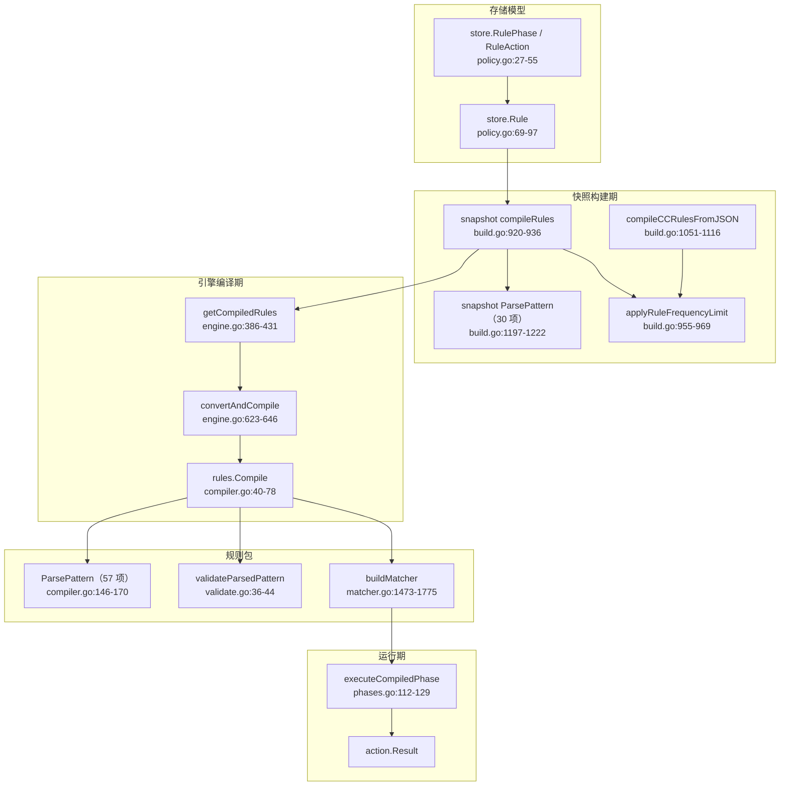
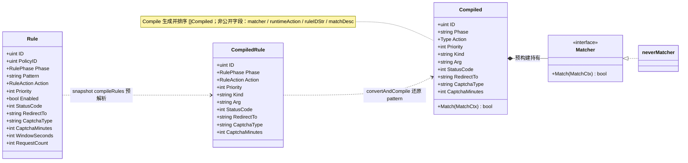
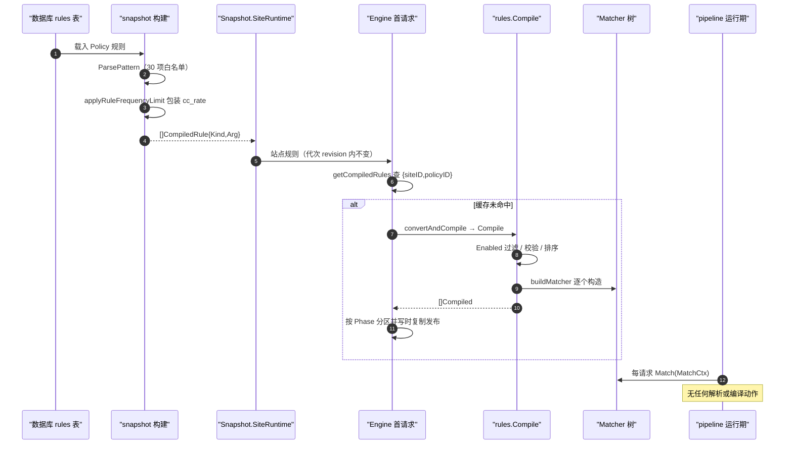
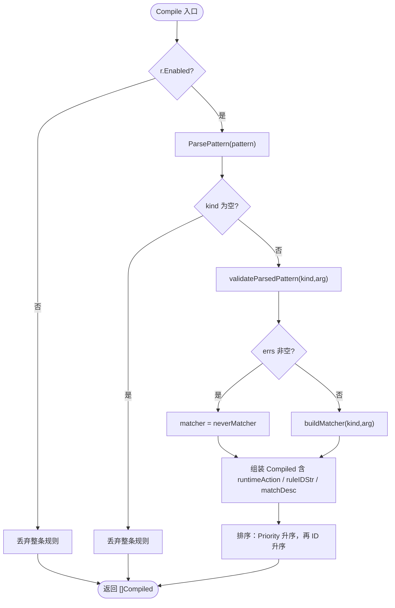
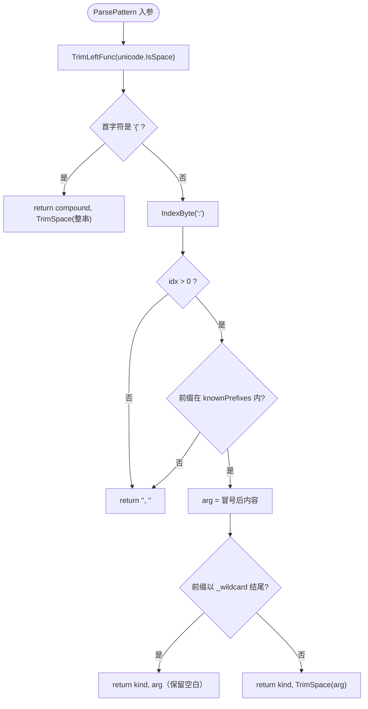
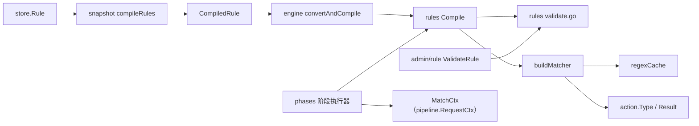

# 规则编译器

> [返回 WAF 引擎系统](WAF 引擎系统.md) · [规则匹配器](规则匹配器/规则匹配器.md)

<cite>
**本文档引用的文件**
- [compiler.go](file://internal/core/rules/compiler.go)
- [matcher.go](file://internal/core/rules/matcher.go)
- [validate.go](file://internal/core/rules/validate.go)
- [phases.go](file://internal/core/rules/phases.go)
- [engine.go](file://internal/core/engine/engine.go)
- [pipeline.go](file://internal/core/pipeline/pipeline.go)
- [action.go](file://internal/core/action/action.go)
- [policy.go](file://internal/store/policy.go)
- [build.go](file://internal/snapshot/build.go)
- [snapshot.go](file://internal/snapshot/snapshot.go)
- [validate.go](file://internal/admin/rule/validate.go)
</cite>

## 目录

1. [简介](#简介)
2. [项目结构](#项目结构)
3. [核心组件](#核心组件)
4. [架构总览](#架构总览)
5. [详细组件分析](#详细组件分析)
6. [依赖关系分析](#依赖关系分析)
7. [性能考虑](#性能考虑)
8. [故障排查指南](#故障排查指南)
9. [结论](#结论)
10. [附录](#附录)

## 简介
规则编译器负责把持久化的规则行变成"拿来即用"的匹配器对象。它的职责边界很窄但很关键：

- 解析 DSL 文本或 JSON 复合条件，得到 `(kind, arg)`
- 校验参数是否可用，不可用即降级为永不匹配的匹配器
- 构造具体 `Matcher` 实例并挂到 `Compiled` 上
- 按 `Priority` 升序、`ID` 升序排序，确定运行期遍历顺序

设计取向有三条必须在读代码前知道：

- **fail-closed**：语法错误的规则不生效，而不是拦下所有流量；因此本库不存在 `alwaysMatcher`，只有 `neverMatcher`（matcher.go:504-508）
- **成本前置**：正则/CIDR/glob 的解析全部发生在构造期，请求路径只调 `Match(MatchCtx)`（matcher.go:21-23）
- **两段白名单**：引擎侧 `knownPrefixes` 有 57 项（compiler.go:119-142），快照构建侧只有 30 项（build.go:1197-1222），差集 27 项的裸 DSL 规则进不了快照

阶段链的 11 阶段全序、匹配器逐 kind 参数、复合条件树语义分别由 [处理阶段详解](处理阶段详解/处理阶段详解.md)、[内置匹配器](内置匹配器/内置匹配器.md)、[复合匹配器](规则匹配器/复合匹配器.md) 承载，本篇不重复它们的表格。

## 项目结构
编译链路横跨存储模型、快照构建、引擎缓存与规则包四处。

**图表来源**
- [policy.go:27-97](file://internal/store/policy.go#L27-L97)
- [build.go:920-1116](file://internal/snapshot/build.go#L920-L1116)
- [engine.go:380-646](file://internal/core/engine/engine.go#L380-L646)
- [compiler.go:40-170](file://internal/core/rules/compiler.go#L40-L170)
- [validate.go:36-44](file://internal/core/rules/validate.go#L36-L44)
- [matcher.go:1473-1775](file://internal/core/rules/matcher.go#L1473-L1775)

| 符号 | 位置 | 职责 | 上游调用者 | 下游依赖 | 副作用 | 影响面 |
|---|---|---|---|---|---|---|
| `Compile` | [compiler.go:40](file://internal/core/rules/compiler.go#L40) | 规则行 → 排序后的 `Compiled` | `convertAndCompile`（engine.go:645） | `ParsePattern`、`validateParsedPattern`、`buildMatcher` | 无 | 高：所有自定义规则 |
| `ParsePattern` | [compiler.go:146](file://internal/core/rules/compiler.go#L146) | DSL/JSON 前缀解析 | `Compile`、`ValidatePattern` | `knownPrefixes` | 无 | 高 |
| `validateParsedPattern` | [validate.go:36](file://internal/core/rules/validate.go#L36) | 参数可用性判定 | `Compile`、`ValidatePattern` | `validateSimplePattern`、`validateCompoundPattern` | 无 | 高：降级分水岭 |
| `buildMatcher` | [matcher.go:1473](file://internal/core/rules/matcher.go#L1473) | kind → 匹配器实例 | `Compile`、`buildCompound` | `cachedCompile`、`compileWildcard`、`net.ParseCIDR` | 无 | 高 |
| `ensureCompiledMetadata` | [compiler.go:87](file://internal/core/rules/compiler.go#L87) | 空元数据补齐（必要时整体拷贝） | 快照签名相规则路径 | `compiledMatchDesc`、`normalizeConfiguredAction` | 可能拷贝切片 | 中 |
| `getCompiledRules` | [engine.go:386](file://internal/core/engine/engine.go#L386) | 代次内单次编译与分区缓存 | `processResolved` | `convertAndCompile`、`atomic.Pointer` | 写时复制发布新快照 | 高 |

**章节来源**
- [compiler.go:40-170](file://internal/core/rules/compiler.go#L40-L170)
- [validate.go:28-44](file://internal/core/rules/validate.go#L28-L44)
- [matcher.go:1473-1775](file://internal/core/rules/matcher.go#L1473-L1775)
- [engine.go:380-431](file://internal/core/engine/engine.go#L380-L431)
- [engine.go:623-646](file://internal/core/engine/engine.go#L623-L646)

## 核心组件
编译产物 `Compiled` 是运行时唯一被遍历的对象；它公开字段供归因与日志使用，非公开字段承载匹配器与归一后的动作。

**图表来源**
- [policy.go:69-97](file://internal/store/policy.go#L69-L97)
- [compiler.go:13-37](file://internal/core/rules/compiler.go#L13-L37)
- [matcher.go:21-23](file://internal/core/rules/matcher.go#L21-L23)
- [matcher.go:504-508](file://internal/core/rules/matcher.go#L504-L508)
- [snapshot.go:24](file://internal/snapshot/snapshot.go#L24)
- [engine.go:623-646](file://internal/core/engine/engine.go#L623-L646)

三个组件级要点：

- `Compiled.matcher` 为 nil 时 `Match` 直接返回 false（compiler.go:32-37），这是"缺匹配器"的第二重保险
- `runtimeAction` 在编译时就归一化完成（compiler.go:66），避免每请求重复解析动作串
- `Rule.Name` **不参与编译**：`Compiled` 没有名字字段，自定义规则的 `action.Result.RuleName` 为空，只有内置检测（OWASP/CVE 注册表）才填 `RuleName`/`RuleDesc`

**章节来源**
- [compiler.go:13-78](file://internal/core/rules/compiler.go#L13-L78)
- [policy.go:69-97](file://internal/store/policy.go#L69-L97)
- [action.go:127-165](file://internal/core/action/action.go#L127-L165)

## 架构总览
编译发生在两个不同时点：快照构建期做**文本预解析**，引擎首请求做**匹配器构造**。理解这一分工，才能解释为什么某些规则"库里可见、引擎无感"。

**图表来源**
- [build.go:275](file://internal/snapshot/build.go#L275)
- [build.go:920-969](file://internal/snapshot/build.go#L920-L969)
- [engine.go:380-431](file://internal/core/engine/engine.go#L380-L431)
- [compiler.go:40-78](file://internal/core/rules/compiler.go#L40-L78)
- [phases.go:112-129](file://internal/core/rules/phases.go#L112-L129)

## 详细组件分析

### 编译流程步骤表
`Compile` 的完整步骤，逐行对应代码：

| 步 | 动作 | 执行位置 | 输入 | 输出 | 失败分支 | 可观测点 |
|:--:|---|---|---|---|---|---|
| 1 | 启用过滤 | [compiler.go:43-45](file://internal/core/rules/compiler.go#L43-L45) | `store.Rule.Enabled` | 跳过禁用行 | 规则不出现在结果中 | 管理端"已禁用"状态 |
| 2 | 文本解析 | [compiler.go:46](file://internal/core/rules/compiler.go#L46) | `r.Pattern` | `(kind, arg)` | `kind == ""` → `continue`（整条丢弃） | `ValidateRule` 的"格式无效" |
| 3 | 参数校验 | [compiler.go:50-53](file://internal/core/rules/compiler.go#L50-L53) | `kind, arg` | `errs` 列表 | 非空 → `matcher = neverMatcher{}` | 规则保存成功但永不命中 |
| 4 | 匹配器构造 | [compiler.go:52](file://internal/core/rules/compiler.go#L52) | `kind, arg` | `Matcher` | 构造内部失败 → `neverMatcher` | 同上 |
| 5 | 字段搬运 | [compiler.go:54-65](file://internal/core/rules/compiler.go#L54-L65) | 规则行 | `Compiled` 公开字段 | 无 | 安全事件字段 |
| 6 | 动作归一 | [compiler.go:66](file://internal/core/rules/compiler.go#L66) | `string(r.Action)` | `runtimeAction` | 非法动作 → `intercept` | 事件 `action` 列 |
| 7 | 归因串生成 | [compiler.go:67-68](file://internal/core/rules/compiler.go#L67-L68) | `Phase`/`Kind`/`Arg` | `ruleIDStr`、`matchDesc` | `compound` 超 60 字符折叠 | `rule_id_str`、`match_desc` |
| 8 | 排序 | [compiler.go:71-76](file://internal/core/rules/compiler.go#L71-L76) | `[]Compiled` | `Priority` 升序、同值 `ID` 升序 | 无 | 命中先后 |

**图表来源**
- [compiler.go:40-78](file://internal/core/rules/compiler.go#L40-L78)
- [validate.go:36-44](file://internal/core/rules/validate.go#L36-L44)

两条"丢弃"与一条"降级"的区别值得强调：`Enabled=false` 与 `kind==""` 会让规则**从结果集中消失**；而校验失败仍保留该条目，只是匹配器恒假。前者影响条数统计，后者影响判定行为，排障时二者线索完全不同。

**章节来源**
- [compiler.go:40-78](file://internal/core/rules/compiler.go#L40-L78)
- [validate.go:36-44](file://internal/core/rules/validate.go#L36-L44)

### 规则 DSL 与字段映射表
`Pattern` 有两种合法形态，其余一律解析失败：

| 形态 | 文法 | 解析结果 | 关键规则 |
|---|---|---|---|
| 简单 DSL | `<kind>:<arg>` | `kind` = 前缀，`arg` = 冒号后内容 | 第一个冒号位置必须 `> 0`；前缀必须命中 `knownPrefixes` |
| 复合 JSON | `{...}` | `kind = "compound"`，`arg` = 整串 | 仅剥前导空白后判断首字符为 `{`；`arg` 做 `TrimSpace` |
| 通配符类 DSL | `<kind>_wildcard:<pattern>` | `arg` **保留首个冒号之后的空白** | compiler.go:164-167：通配符模式中空白是语义的一部分 |

规则行字段到运行时字段的完整映射：

| `store.Rule` 字段 | 类型 | 编译去向 | 结果字段（`action.Result`） | 语义与缺省 | 出处 |
|---|---|---|---|---|---|
| `ID` | `uint` | `Compiled.ID` | `RuleID` | 排序次键 | policy.go:71 / compiler.go:55 |
| `PolicyID` | `uint` | 不进 `Compiled` | — | 作为规则缓存键 `compiledRulesKey.policyID` | engine.go:34-37 |
| `Phase` | `RulePhase` | `Compiled.Phase` | `Phase` | 仅 `acl`/`signature`/`custom` 会被分区保留 | engine.go:401-410 |
| `Pattern` | `string` | 拆成 `Kind` + `Arg` | `Category = Kind`、`MatchDesc` | 非法即丢弃或降级 | compiler.go:46-68 |
| `Action` | `RuleAction` | `Action` + `runtimeAction` | `Type` | `log`→`observe`，非法回落 `intercept` | phases.go:1301-1310 |
| `Priority` | `int` | `Compiled.Priority` | — | 主排序键，默认 100 | policy.go:81 / compiler.go:71-76 |
| `Enabled` | `bool` | 过滤条件 | — | false 时整条不出现 | policy.go:82 / compiler.go:43 |
| `StatusCode` | `int` | `Compiled.StatusCode` | `StatusCode` | `0` 表示用动作规范默认码 | compiler.go:20 / action.go:276-312 |
| `RedirectTo` | `string` | `Compiled.RedirectTo` | `RedirectTo` | 仅 `redirect` 有意义 | compiler.go:21 |
| `CaptchaType` | `string` | `Compiled.CaptchaType` | `CaptchaType` | 空=继承站点/全局；仅 `captcha_challenge` 生效 | compiler.go:22 / policy.go:85-86 |
| `CaptchaMinutes` | `int` | `Compiled.CaptchaMinutes` | `CaptchaMinutes` | `0`=继承全局 `captcha_pass_ttl` | compiler.go:24 / policy.go:94-96 |
| `WindowSeconds` / `RequestCount` | `int` | 不进 `Compiled` | — | 在**快照层**包装成 `compound` 的 `cc_rate` 信封 | build.go:955-969 |
| `Name` | `string` | 不参与编译 | `RuleName` 为空 | 自定义规则无注册表条目 | policy.go:76 / action.go:131-133 |

动作取值集合与归一化：

| 动作 | `TerminalPriority` | 终端 | `DefaultStatusCode` | 内部码 | 备注 |
|---|:--:|:--:|:--:|:--:|---|
| `allow` | 0 | 否 | 0 | 0 | 非终端，后续阶段照常执行 |
| `observe` | 10 | 否 | 0 | 1008 | 仅记日志 |
| `redirect` | 50 | 是 | 302 | 1007 | 需 `RedirectTo` |
| `challenge` / `captcha_challenge` / `shield_challenge` / `chain_challenge` | 60（同档） | 是 | 403 | 1003-1006 | 同档取先出现者 |
| `rate_limit` | 70 | 是 | 429 | 1002 | 规则级频次或全局限流动作 |
| `intercept` | 80 | 是 | 403 | 1001 | 拦截页 |
| `drop` | 90 | 是 | 0（不发响应） | 1000 | 协议级关闭连接 |
| `tag` | 0 | 否 | 0 | 0 | 非终止打标 |
| `block` / `log_only` | 经 `Normalize` 映射为 `intercept` / `observe` | 随目标 | 随目标 | 随目标 | 兼容历史数据 |

`captcha_challenge` 渲染配置的验证码类型（`math`/`click`/`slide`/`rotate`），`shield_challenge` 走 5 秒盾流程，`chain_challenge` 展示链式步骤；三者不得退化为通用状态码页。渲染分支见 [动作与结果系统](动作与结果系统.md)。

**章节来源**
- [compiler.go:13-68](file://internal/core/rules/compiler.go#L13-L68)
- [compiler.go:146-170](file://internal/core/rules/compiler.go#L146-L170)
- [policy.go:69-97](file://internal/store/policy.go#L69-L97)
- [action.go:88-119](file://internal/core/action/action.go#L88-L119)
- [action.go:127-312](file://internal/core/action/action.go#L127-L312)
- [phases.go:1301-1339](file://internal/core/rules/phases.go#L1301-L1339)

### ParsePattern 与两段前缀白名单

**图表来源**
- [compiler.go:119-170](file://internal/core/rules/compiler.go#L119-L170)

| 白名单 | 位置 | 项数 | 作用范围 | 不一致的后果 |
|---|---|:--:|---|---|
| `rules.knownPrefixes` | [compiler.go:119-142](file://internal/core/rules/compiler.go#L119-L142) | 57 | 引擎侧解析、校验、构造 | 决定 kind 能否被真正编译成匹配器 |
| `snapshot.ParsePattern` 局部 `prefixes` | [build.go:1205-1215](file://internal/snapshot/build.go#L1205-L1215) | 30 | 快照构建期预解析 | 不在表内的 kind 连 `CompiledRule` 都不生成，静默丢弃 |

差集 27 项：`geo_block`、`block_header_exact`、`block_header_prefix`、`block_header_not_exact`、`path_contains`、`path_not_contains`、`path_not_exact`、`path_wildcard`、`host_full`、`host_regex`、`host_contains`、`host_not_contains`、`host_not_exact`、`host_wildcard`、`full_url_contains`、`full_url_regex`、`full_url_not_exact`、`full_url_wildcard`、`header_wildcard`、`query_param_regex`、`query_param_not_exact`、`body_not_exact`、`body_wildcard`、`block_body_contains`、`block_body_regex`、`block_body_json_path`、`block_multipart`。

绕开方式只有一种且已被代码支持：把该条件写成 `{"kind":"<kind>","arg":"<arg>"}` 的 `compound` JSON——快照侧对 `{` 前缀一律放行（build.go:1201-1203），叶子最终由引擎侧 `buildCompound` → `buildMatcher` 构造（matcher.go:1920-1923）。管理端 `ValidateRule` 走的是引擎侧 `ValidatePattern`，因此**校验通过不代表快照放行**，这是本篇最重要的排障提示。

**章节来源**
- [compiler.go:119-170](file://internal/core/rules/compiler.go#L119-L170)
- [build.go:1189-1222](file://internal/snapshot/build.go#L1189-L1222)
- [admin/rule/validate.go:34-81](file://internal/admin/rule/validate.go#L34-L81)
- [matcher.go:1920-1923](file://internal/core/rules/matcher.go#L1920-L1923)

### 匹配器构造与正则缓存
`buildMatcher` 是唯一的 kind 分派点，构造结果只有两类：具体匹配器或 `neverMatcher`。

| 构造类别 | 代表 kind | 使用的工具 | 缓存 |
|---|---|---|---|
| 网络类 | `allow_ip`、`block_ip` | `net.ParseCIDR` / `net.ParseIP`，单 IP 自动补 `/32`、`/128` | 无（构造期一次） |
| 字符串比较类 | `block_path`、`path_contains`、`block_header*`、`host*` | `strings` 与 `containsFoldASCII` | 无 |
| 正则类 | 全部 `*_regex`、`block_multipart`、`block_body_json_path` 的 pattern 段 | `cachedCompile`（matcher.go:1791-1808） | 进程级 `regexCache`，无淘汰 |
| 通配符类 | 全部 `*_wildcard` | `compileWildcard` → 形态选择，必要时回落 `cachedCompile` | 同上 |
| TLS 类 | `tls_*` | `tlsmeta.NormalizeRuntimeVersionToken`、套件 token 归一 | 无 |
| 组合类 | `compound` | `parseCompoundJSON` → `buildCompound` | 状态表 `ccRateStates` |

`regexCache` 是 `struct{ mu sync.RWMutex; cache map[string]*regexp.Regexp }`（matcher.go:1785-1788），非互斥锁；编译失败**不写缓存**，因此非法模式每次调用都会重走失败路径——这也是校验必须前置的原因。

`splitHeaderArg`（matcher.go:1778-1783）按**第一个**冒号切分，因此 `block_header_regex:User-Agent:a:b:c` 的 pattern 段是 `a:b:c`。`query_param_regex` 例外，用 `strings.Cut` 只切一次并在缺冒号时直接降级（matcher.go:1640-1649）。

**章节来源**
- [matcher.go:1473-1808](file://internal/core/rules/matcher.go#L1473-L1808)
- [matcher.go:1778-1808](file://internal/core/rules/matcher.go#L1778-L1808)

### 排序、元数据补齐与阶段分区
| 机制 | 位置 | 规则 | 为什么重要 |
|---|---|---|---|
| 排序 | [compiler.go:71-76](file://internal/core/rules/compiler.go#L71-L76) | `Priority` 升序，同值按 `ID` 升序 | 运行期命中首条即止，顺序即语义 |
| 元数据补齐 | [compiler.go:87-115](file://internal/core/rules/compiler.go#L87-L115) | 任一空字段则**整体拷贝**后补齐，避免改写共享底层数组 | 快照内切片可能被多站点复用 |
| 归因串 | [compiler.go:67](file://internal/core/rules/compiler.go#L67) | `rule:<phase>:<kind>` | 安全事件可按 kind 聚合 |
| 描述折叠 | [compiler.go:80-85](file://internal/core/rules/compiler.go#L80-L85) | `compound` 且 `arg` > 60 字符 → `compound:{...}` | 防长 JSON 灌进日志 |
| 阶段分区 | [engine.go:399-410](file://internal/core/engine/engine.go#L399-L410) | 只保留 `acl`/`signature`/`custom` 三类 | 其他 Phase 的规则不参与自定义规则执行 |
| 缓存发布 | [engine.go:413-428](file://internal/core/engine/engine.go#L413-L428) | `compiledWriteMu` 串行写 + 写时复制 + `atomic.Store` | 读路径完全无锁 |

`ensureCompiledMetadata` 的"必要时拷贝"不是防御性冗余：`Compile` 的入参可能来自共享底层数组的规则切片，就地写回会污染其他站点的视图。

**章节来源**
- [compiler.go:67-115](file://internal/core/rules/compiler.go#L67-L115)
- [engine.go:386-431](file://internal/core/engine/engine.go#L386-L431)

### 失败降级表
所有降级方向的汇总。**全库没有 `alwaysMatcher`**，不存在"恒真"降级。

| 失败条件 | 判定位置 | 降级结果 | 规则是否仍出现在结果集 | 可观测表现 |
|---|---|---|:--:|---|
| `Enabled = false` | [compiler.go:43-45](file://internal/core/rules/compiler.go#L43-L45) | 整条丢弃 | 否 | 管理端显示已禁用 |
| `kind == ""`（前缀不在 57 项内） | [compiler.go:46-49](file://internal/core/rules/compiler.go#L46-L49) | 整条丢弃 | 否 | 保存成功、引擎无该规则 |
| 快照侧 30 项白名单不含该 kind | [build.go:922-926](file://internal/snapshot/build.go#L922-L926) | `CompiledRule` 不生成 | 否 | `ValidateRule` 通过但运行期无效果 |
| `validateParsedPattern` 返回 errs | [compiler.go:50-53](file://internal/core/rules/compiler.go#L50-L53) | `neverMatcher` | **是** | 条目在，恒不命中 |
| `buildMatcher` 内解析失败（CIDR、正则、glob、TLS 令牌、缺冒号） | [matcher.go:1476-1755](file://internal/core/rules/matcher.go#L1476-L1755) | `neverMatcher` | 是 | 同上 |
| kind 落入 `default` | [matcher.go:1772-1773](file://internal/core/rules/matcher.go#L1772-L1773) | `neverMatcher` | 是 | 同上 |
| 复合 JSON 反序列化失败或校验报错 | [matcher.go:1825-1835](file://internal/core/rules/matcher.go#L1825-L1835) | `neverMatcher` | 是 | 同上 |
| `cc_rate` 参数越界 | [matcher.go:1908-1910](file://internal/core/rules/matcher.go#L1908-L1910) | `neverMatcher` | 是 | 频次限制静默失效 |
| 非法动作串 | [phases.go:1301-1310](file://internal/core/rules/phases.go#L1301-L1310) | 归一为 `intercept` | 是 | 事件 `action` 与配置不符 |
| `Compiled.matcher` 为 nil | [compiler.go:32-37](file://internal/core/rules/compiler.go#L32-L37) | `Match` 返回 false | 是 | 仅出现在手工构造路径 |

方向一致性是本系统的安全底座：任何"配错"都朝"不拦"退化，绝不朝"全拦"退化。

**章节来源**
- [compiler.go:32-53](file://internal/core/rules/compiler.go#L32-L53)
- [matcher.go:1473-1928](file://internal/core/rules/matcher.go#L1473-L1928)
- [phases.go:1301-1310](file://internal/core/rules/phases.go#L1301-L1310)
- [build.go:920-936](file://internal/snapshot/build.go#L920-L936)

## 依赖关系分析

**图表来源**
- [build.go:920-969](file://internal/snapshot/build.go#L920-L969)
- [engine.go:623-646](file://internal/core/engine/engine.go#L623-L646)
- [compiler.go:1-10](file://internal/core/rules/compiler.go#L1-L10)
- [validate.go:1-9](file://internal/core/rules/validate.go#L1-L9)
- [phases.go:1-31](file://internal/core/rules/phases.go#L1-L31)

| 依赖 | 用途 | 接入方式 | 超时 | 重试 | 降级 | 可用性影响 |
|---|---|---|:--:|:--:|---|---|
| `regexp`（RE2） | 正则类 kind 编译 | `cachedCompile` | 未设置（风险） | 无 | 编译失败 → `neverMatcher` | 单条规则失效 |
| `net` | CIDR/IP 解析 | 构造期直接调用 | - | 无 | 非法 → `neverMatcher` | 单条规则失效 |
| `tlsmeta` | `tls_version` 令牌归一 | 构造期直接调用 | - | 无 | 归一为空 → `neverMatcher` | 单条规则失效 |
| `encoding/json` | 复合条件解析与频次包装 | 构造期直接调用 | - | 无 | 失败 → `neverMatcher` | 单条规则失效 |
| `store` | 规则与动作常量 | 入参类型 | - | 无 | - | 编译入口契约 |
| `action` | 动作类型与归一 | 字段类型 | - | 无 | 非法动作回落 `intercept` | 判定动作变化 |

编译无超时与无容量上限是两项已登记的取舍：单条超大正则只会影响代次编译耗时，不会影响请求路径。

**章节来源**
- [compiler.go:1-10](file://internal/core/rules/compiler.go#L1-L10)
- [matcher.go:1-18](file://internal/core/rules/matcher.go#L1-L18)
- [validate.go:1-9](file://internal/core/rules/validate.go#L1-L9)

## 性能考虑
- 每代次每 `{siteID,policyID}` 只编译一次：缓存命中路径是单次 `atomic.Pointer.Load()`（engine.go:386-396），未命中才付出 `convertAndCompile` + `Compile` 成本
- 排序是 `sort.Slice` 一次成型（compiler.go:71-76），运行期遍历为线性且命中首条即止
- 归一化前置：`runtimeAction`、`ruleIDStr`、`matchDesc` 在构造期算好，避免每请求重复字符串操作
- 通配符形态快路径：`*foo*` / `foo*` / `*foo` / `foo` 四类不进 RE2，成本口径见 [正则表达式优化](规则匹配器/正则表达式优化.md)
- 建议
  - 把高命中率、低成本的规则放在较小 `Priority` 上
  - 用 `path_contains` / `path_wildcard` 替代等价的正则
  - 复合条件收敛在少数几条规则内，减少遍历条数而非增加嵌套深度
  - 避免同一模式因大小写或空白差异产生多个缓存键

**章节来源**
- [compiler.go:71-76](file://internal/core/rules/compiler.go#L71-L76)
- [engine.go:380-431](file://internal/core/engine/engine.go#L380-L431)
- [matcher.go:1301-1419](file://internal/core/rules/matcher.go#L1301-L1419)

## 故障排查指南
- 规则在管理端可见、事件里从不出现
  - 先分清是"丢弃"还是"降级"：前者条目数为 0，后者条目存在但恒不命中
  - 检查 kind 是否落在快照侧 30 项白名单内（build.go:1205-1215）；不在则改用 `compound` 叶子写法
  - 检查 `Phase` 是否为 `acl`/`signature`/`custom`（engine.go:401-410）
- 规则命中顺序与预期不符
  - 核对 `Priority` 是否相同（同值按 `ID` 升序，默认 `Priority` 为 100）
  - 注意跨阶段优先级由 `pipeline.Run` 与 `TerminalPriority` 决定，编译期排序只管阶段内部
- 正则类规则报"非法正则"
  - 校验期用 `cachedCompile` 试编译（validate.go:147-238），因此保存被拒就是模式本身有问题
  - 常见坑：`\d` 写成 `d`、字符类未闭合、把 `(?i)` 依赖给匹配器默认行为
- 通配符规则保存被拒
  - 空串、非法 UTF-8、未转义星号超过 8、悬空 `\`、空字符类都会失败（validate.go:212-238）
  - `*_wildcard` 的 `arg` 保留首个冒号之后的空白，尾部多余空格会改变语义
- 频次限制不生效
  - `WindowSeconds` 与 `RequestCount` 必须同时大于 0，且原 kind 不是 `compound`（build.go:956）
  - `cc_rate` 的 `duration` 不带单位时按**分钟**解释（matcher.go:1844-1856）
- 动作与配置不符
  - `log` 被归一为 `observe`；不在白名单的动作串一律回落 `intercept`（phases.go:1301-1310）
- 验证命令
  - `go test ./internal/core/rules/... -run Compile`：编译与排序断言
  - `go test ./internal/snapshot/... -run CompileRules`：快照侧预解析与频次包装断言
  - `POST` 规则校验接口：对 `pattern` 做保存期等价校验

**章节来源**
- [compiler.go:40-78](file://internal/core/rules/compiler.go#L40-L78)
- [validate.go:147-238](file://internal/core/rules/validate.go#L147-L238)
- [build.go:955-969](file://internal/snapshot/build.go#L955-L969)
- [engine.go:399-410](file://internal/core/engine/engine.go#L399-L410)
- [phases.go:1301-1310](file://internal/core/rules/phases.go#L1301-L1310)

## 结论
规则编译器的价值在于它把"规则文本"到"可调用对象"的转换收敛成一条严格单向、方向一致退化的流水线：解析、校验、构造、归因、排序五步各有明确的失败落点，且所有落点都朝"不拦"退化。真正需要读者记住的是两点：**丢弃与降级是两种不同故障**（前者条目消失、后者条目恒假），以及**引擎侧与快照侧各有一份 kind 白名单**（57 项对 30 项），后者是"保存成功却毫不生效"这类缺陷最常见的成因。编译成本全部落在代次内的一次性路径上，运行期只承担多态调用，这是当前规则规模下性能稳定的根本原因。

## 附录

### 自定义规则类型的扩展指南
新增一个 kind 需要同步四张表，缺一处即静默失效；完整步骤与示例见 [匹配器扩展开发](规则匹配器/匹配器扩展开发.md)。

| 步 | 改动点 | 位置 | 漏改后果 |
|:--:|---|---|---|
| 1 | `knownPrefixes` 加前缀 | [compiler.go:119-142](file://internal/core/rules/compiler.go#L119-L142) | 解析失败，整条规则被丢弃 |
| 2 | `buildMatcher` 加分派分支 | [matcher.go:1473-1775](file://internal/core/rules/matcher.go#L1473-L1775) | `default` 分支 → `neverMatcher` |
| 3 | `validateSimplePattern` 加校验 | [validate.go:123-257](file://internal/core/rules/validate.go#L123-L257) | 保存期与构造期判据不一致 |
| 4 | 快照侧 `prefixes` 加前缀 | [build.go:1205-1215](file://internal/snapshot/build.go#L1205-L1215) | 裸 DSL 规则进不了快照 |
| 5 | 依赖派生输入时更新清单 | [phases.go:236-248](file://internal/core/rules/phases.go#L236-L248) | 目标字段恒空，永不命中 |
| 6 | 前端映射与规则模板 | `rule-pattern-mapper.ts`、[admin/rule/validate.go:83-277](file://internal/admin/rule/validate.go#L83-L277) | 编辑器无法产出/回显该规则 |

**章节来源**
- [compiler.go:119-142](file://internal/core/rules/compiler.go#L119-L142)
- [matcher.go:1473-1775](file://internal/core/rules/matcher.go#L1473-L1775)
- [validate.go:123-257](file://internal/core/rules/validate.go#L123-L257)
- [build.go:1189-1222](file://internal/snapshot/build.go#L1189-L1222)

### 规则编译最佳实践
- 优先级设计：小 `Priority` 给高命中低成本规则，让"命中首条即止"尽早生效
- 形态选择：能用前缀/包含/通配符就不要用正则；确需正则时保持模式串逐字稳定以命中缓存
- 动作选择：`allow` 只表示"本阶段放行"，**不短路**；需要真正终止请用 `intercept`/`drop`/挑战类动作
- 频次设计：单条规则用 `WindowSeconds`+`RequestCount`；跨条件的组合频次用 CC 防护页的 `cc_rules`
- 可观测性：`Category` 等于 kind，`MatchDesc` 等于 `kind:arg`，二者是事件检索的主键；长复合条件会被折叠成 `compound:{...}`，需要精确定位时查规则原文

**章节来源**
- [compiler.go:54-85](file://internal/core/rules/compiler.go#L54-L85)
- [phases.go:1312-1339](file://internal/core/rules/phases.go#L1312-L1339)
- [action.go:168-179](file://internal/core/action/action.go#L168-L179)

### 调试方法与测试基准
- 单元测试：编译与排序看 `compiler_test.go`，各匹配器行为看 `matcher_test.go`，边界与降级看 `matcher_uncovered_test.go`
- 快照层测试：`snapshot_test.go` 覆盖 `compileRules` 的频次包装（`kind` 变为 `compound`、`window`/`threshold` 落进 JSON）与"已是 compound 不重复包装"
- 基准测试：`matcher_cache_bench_test.go` 对比共享 `RequestCtx` 与纯值 `MatchCtx` 的 `query_param` 路线，可用于验证懒缓存未被破坏
- 排查顺序建议：先看规则是否进入 `CompiledRule`，再看是否进入 `Compiled`，最后看匹配器是否为 `neverMatcher`

**章节来源**
- [build.go:920-969](file://internal/snapshot/build.go#L920-L969)
- [engine.go:623-646](file://internal/core/engine/engine.go#L623-L646)
