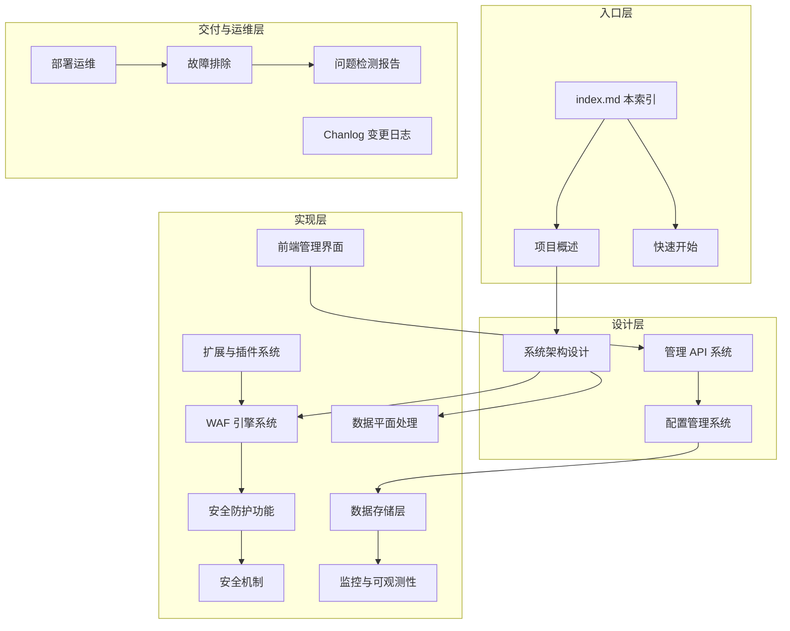
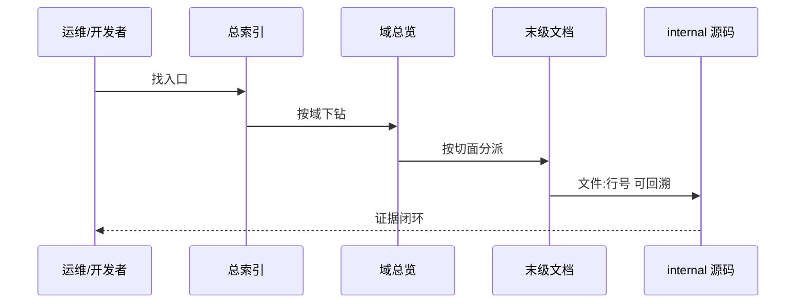
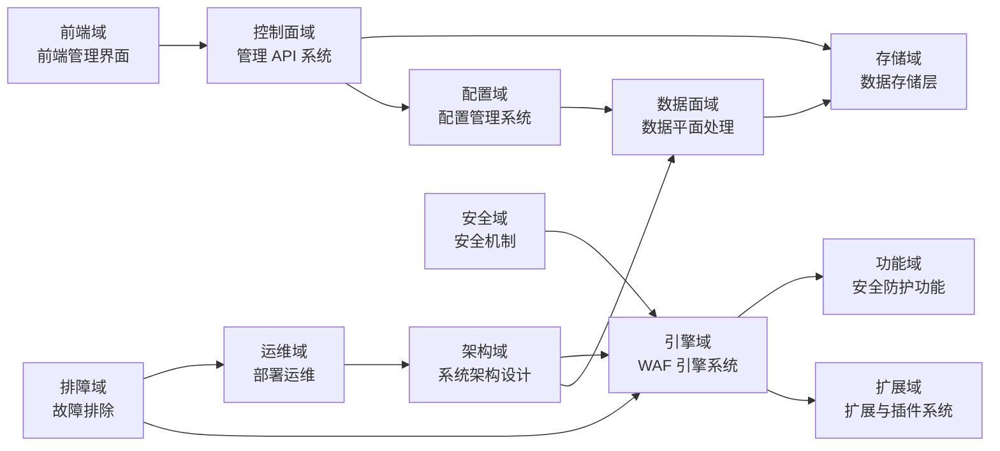
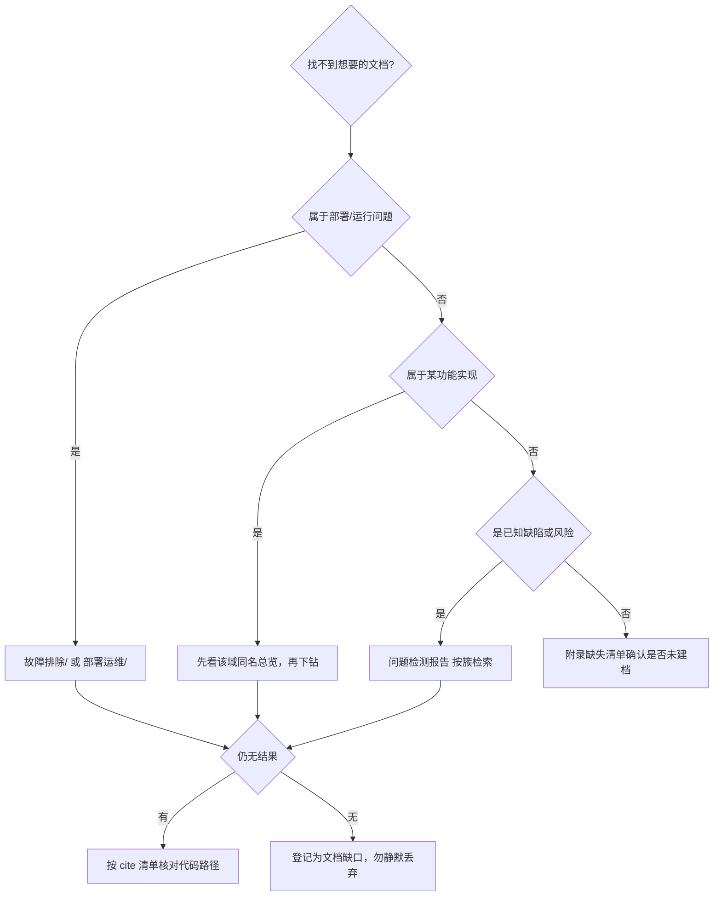

# My-OpenWaf 文档总索引

<cite>
**本文档引用的文件**
- README.md
- AGENTS.md
- go.mod
- Dockerfile
- docs/项目概述/项目概述.md
- docs/项目概述/核心特性.md
- docs/项目概述/快速开始.md
- docs/项目概述/技术架构.md
- docs/项目概述/开发者指南.md
- docs/Chanlog.md
- docs/问题检测报告.md
</cite>

## 目录

1. [简介](#简介)
2. [项目结构](#项目结构)
3. [核心组件](#核心组件)
4. [架构总览](#架构总览)
5. [详细组件分析](#详细组件分析)
6. [依赖关系分析](#依赖关系分析)
7. [性能考虑](#性能考虑)
8. [故障排查指南](#故障排查指南)
9. [结论](#结论)
10. [附录](#附录)

## 简介

本索引是 My-OpenWaf 技术文档库的唯一入口，覆盖 **14 个主题域、187 篇文档、约 11.3 万行正文**。所有文档遵循统一的 10 章节骨架、`<cite>` 引用块、`**章节来源**` / `**图表来源**` 双标记与表格图类型配额，引用路径均可回溯到仓库真实文件与行号。

三类读者入口：

- **首次接触项目**：从[快速开始](项目概述/快速开始.md)起步，再读[核心特性](项目概述/核心特性.md)建立能力全景。
- **改代码/加功能**：从[开发者指南](项目概述/开发者指南.md)与[扩展与插件系统](扩展与插件系统/扩展与插件系统.md)进入，按需下钻到具体域。
- **线上排障**：从[故障排除](故障排除/故障排除.md)的分流决策树进入，配合[问题检测报告](问题检测报告.md)了解已知缺陷与责任边界。

**章节来源**
- [README.md:409-413](file://README.md#L409-L413)
- [docs/项目概述/项目概述.md](file://docs/项目概述/项目概述.md)

## 项目结构

文档库按**主题域**组织，而非按技术栈分层。目录规则：域目录名用中文业务语义；每个目录都有与目录同名的总览文档；嵌套上限三级；一实现一篇。

**图表来源**
- [docs/项目概述/技术架构.md](file://docs/项目概述/技术架构.md)
- [docs/系统架构设计/组件关系图.md](file://docs/系统架构设计/组件关系图.md)

| 目录 | 篇数 | 定位 | 建议阅读顺序 |
|---|---:|---|---|
| `项目概述/` | 5 | 全局入口与操作入口 | 1 |
| `系统架构设计/` | 8 | 双平面结构、数据流、快照与缓存 | 2 |
| `WAF 引擎系统/` | 34 | 引擎核心、阶段、匹配器、挑战与处置 | 3 |
| `安全防护功能/` | 25 | OWASP、CVE、Bot、限流、IP 信誉、地理 | 4 |
| `数据平面处理/` | 11 | 请求处理、TLS、WebSocket/SSE、内部机制 | 5 |
| `管理 API 系统/` | 22 | REST 规范与 217 端点分域 | 6 |
| `配置管理系统/` | 6 | 快照、热重载、验证、迁移、分布式同步 | 7 |
| `数据存储层/` | 11 | 模型、多数据库、Redis、仓储层 | 8 |
| `安全机制/` | 6 | JWT、会话、密钥、客户端 IP、出站防护 | 9 |
| `监控与可观测性/` | 6 | 指标、日志、事件、归档、健康检查 | 10 |
| `扩展与插件系统/` | 17 | 规则引擎/存储/集成扩展与 Lua 插件 | 11 |
| `前端管理界面/` | 21 | Next.js 架构、组件模式、页面实现 | 12 |
| `部署运维/` | 6 | 容器、构建链、CI 发布、参数与备份 | 13 |
| `故障排除/` | 6 | 五类故障分流与处置 | 14 |
| 根级单文件 | 3 | `index.md`、`问题检测报告.md`、`Chanlog.md` | 交叉引用 |

**章节来源**
- [AGENTS.md](file://AGENTS.md)
- [docs/Chanlog.md](file://docs/Chanlog.md)

## 核心组件

各域的总览文档与下辖结构（下钻从这些入口进，不要在子页之间横向跳）：

| 域 | 同名总览 | 下辖子目录 | 覆盖的代码范围 |
|---|---|---|---|
| 项目概述 | [项目概述](项目概述/项目概述.md) | — | README、go.mod、frontend/package.json |
| 系统架构设计 | [系统架构设计](系统架构设计/系统架构设计.md) | 运行时与内置资源/ | `internal/app`、`internal/core/{lifecycle,health,adminweb}`、`appresource` |
| WAF 引擎系统 | [WAF 引擎系统](WAF%20引擎系统/WAF%20引擎系统.md) | 引擎核心架构/、处理阶段详解/、规则匹配器/、内置匹配器/、挑战与验证/、动态处置/ | `internal/core/{engine,rules,pipeline,action}`、`internal/waf/**` |
| 安全防护功能 | [安全防护功能](安全防护功能/安全防护功能.md) | OWASP 检测/、CVE 漏洞检测/、多语言检测器/、速率限制机制/、访客识别/ | `internal/waf/{owasp,cve,bot,ratelimit,iprep}`、`visitorfusion`、`imagery` |
| 数据平面处理 | [数据平面处理](数据平面处理/数据平面处理.md) | 内部机制/ | `internal/dataplane/**`、`internal/proxy/**`、`internal/upstream` |
| 管理 API 系统 | [管理 API 系统](管理%20API%20系统/管理%20API%20系统.md) | REST API 设计规范/、规则管理 API/ | `internal/admin/**` |
| 配置管理系统 | [配置管理系统](配置管理系统/配置管理系统.md) | — | `internal/core/{config,runtime,configoverride,redis}`、`internal/snapshot` |
| 数据存储层 | [数据存储层](数据存储层/数据存储层.md) | 仓储层/ | `internal/store/**`、`internal/core/database` |
| 安全机制 | [安全机制](安全机制/安全机制.md) | — | `internal/security`、`internal/admin/auth`、`internal/waf/{accessgate,antireplay}` |
| 监控与可观测性 | [监控与可观测性](监控与可观测性/监控与可观测性.md) | — | `internal/observability`、`internal/dataplane/metrics` |
| 扩展与插件系统 | [扩展与插件系统](扩展与插件系统/扩展与插件系统.md) | 规则引擎扩展/、存储后端扩展/、第三方集成/ | `internal/waf/{luaplugin,jsplugin}`、`internal/pkg/**` |
| 前端管理界面 | [前端管理界面](前端管理界面/前端管理界面.md) | Next.js 架构设计/、组件设计模式/、页面实现/ | `frontend/**` |
| 部署运维 | [部署运维](部署运维/部署运维.md) | — | Dockerfile、`scripts/`、`.github/workflows/` |
| 故障排除 | [故障排除](故障排除/故障排除.md) | — | 全域运行期行为 |

**章节来源**
- [docs/WAF 引擎系统/WAF 引擎系统.md](file://docs/WAF%20引擎系统/WAF%20引擎系统.md)
- [docs/系统架构设计/系统架构设计.md](file://docs/系统架构设计/系统架构设计.md)

## 架构总览

文档之间是「一份事实只有一个权威位置」的关系：同一张表只在一处出现，其他位置以链接引用。三条主要的横向关系如下。

**图表来源**
- [docs/系统架构设计/数据流分析.md](file://docs/系统架构设计/数据流分析.md)
- [docs/项目概述/开发者指南.md](file://docs/项目概述/开发者指南.md)

跨域主题的三个「唯一权威位置」约定（避免多写导致漂移）：

| 主题 | 权威位置 | 其他位置的处理方式 |
|---|---|---|
| 环境变量清单 | `README.md:311-340` | [环境变量与运行参数](部署运维/环境变量与运行参数.md) 只写映射与生效顺序 |
| 11 阶段全序 | `internal/core/engine/engine.go:465-548` | [处理阶段详解](WAF%20引擎系统/处理阶段详解/处理阶段详解.md) 给全序表，其余阶段页只写单阶段 |
| OWASP 规则内容与算法 | `安全防护功能/OWASP 检测/` | 引擎侧 `OWASP 默认检测阶段.md` 只写阶段注册与执行入口 |

**图表来源**
- [docs/系统架构设计/数据流分析.md](file://docs/系统架构设计/数据流分析.md)
- [docs/WAF 引擎系统/引擎核心架构/请求处理流程.md](file://docs/WAF%20引擎系统/引擎核心架构/请求处理流程.md)
- [docs/部署运维/环境变量与运行参数.md](file://docs/部署运维/环境变量与运行参数.md)

## 详细组件分析

### 想快速理解系统怎么跑起来

按 [快速开始](项目概述/快速开始.md) → [项目概述](项目概述/项目概述.md) → [系统架构设计](系统架构设计/系统架构设计.md) → [启动引导](系统架构设计/运行时与内置资源/运行时与内置资源.md) 顺序读。启动链路的 16 步装配（`cmd/main.go:13` → `internal/app/server.go:234`）在最后一篇逐行给出行号证据。

**章节来源**
- [docs/项目概述/快速开始.md](file://docs/项目概述/快速开始.md)
- [docs/系统架构设计/运行时与内置资源/运行时与内置资源.md](file://docs/系统架构设计/运行时与内置资源/运行时与内置资源.md)

### 想加一条检测规则或改判定逻辑

先看 [规则编译器](WAF%20引擎系统/规则编译器.md) 与 [规则匹配器](WAF%20引擎系统/规则匹配器/规则匹配器.md)，再看扩展视角的 [规则引擎扩展](扩展与插件系统/规则引擎扩展/规则引擎扩展.md)。**必读前置**：[配置验证系统](配置管理系统/配置验证系统.md) 中关于 kind 白名单三处（57/30/9）与静默丢弃的说明——这是新增规则「保存成功但不生效」的头号根因。

**章节来源**
- [docs/WAF 引擎系统/规则编译器.md](file://docs/WAF%20引擎系统/规则编译器.md)
- [docs/配置管理系统/配置验证系统.md](file://docs/配置管理系统/配置验证系统.md)

### 想加一个管理端点

按 [REST API 设计规范](管理%20API%20系统/REST%20API%20设计规范/REST%20API%20设计规范.md) → [API 端点参考](管理%20API%20系统/REST%20API%20设计规范/API%20端点参考.md) → 对应资源 API 页。注意本项目**写操作只有 POST**（`/{id}/update`、`/{id}/delete`、`/start`、`/stop`、`/toggle`），且字段命名为 snake_case。前端联动须遵循 AGENTS.md 的「模型—handler—前端类型—表单—验证命令」五同步规则。

**章节来源**
- [docs/管理 API 系统/REST API 设计规范/API 端点参考.md](file://docs/管理%20API%20系统/REST%20API%20设计规范/API%20端点参考.md)
- [AGENTS.md](file://AGENTS.md)

### 想调性能或查内存

[性能与内存排查](故障排除/性能与内存排查.md) 给出可执行的诊断命令与三套连接池真值；机制细节在 [缓存与性能优化](系统架构设计/缓存与性能优化.md) 与 [性能监控与调优](数据平面处理/性能监控与调优.md)。

**章节来源**
- [docs/故障排除/性能与内存排查.md](file://docs/故障排除/性能与内存排查.md)

### 想知道哪些是已知缺陷

[问题检测报告](问题检测报告.md) 按 C1–C10 十个问题簇登记 86 项代码侧待处理问题，含优先级 P1–P4 与最小修复建议；[Chanlog.md](Chanlog.md) 记录本次文档重构的删除、合并、新增与前后度量对比。

**章节来源**
- [docs/问题检测报告.md](file://docs/问题检测报告.md)
- [docs/Chanlog.md](file://docs/Chanlog.md)

## 依赖关系分析

文档对代码的依赖是单向可回溯关系；下表给出各域的主要证据源包：

| 域 | 主要包 | 规模（非测试） |
|---|---|---|
| WAF 引擎系统 | `internal/core/{engine,rules,pipeline,action}`、`internal/waf/owasp`、`internal/waf/cve` | 4048 / 646 / 678 / 393 / 10751 / 6117 行 |
| 数据平面处理 | `internal/dataplane`（+6 子包）、`internal/proxy`(+transport) | 8836 / 6009 / 1280 行 |
| 管理 API 系统 | `internal/admin/**` | 根 1589 + 各子域合计约 12k 行 |
| 数据存储层 | `internal/store/**`、`internal/core/database` | 2347 / 3206 / 1074 / 310 行 |
| 配置管理系统 | `internal/core/{config,runtime,configoverride,redis}`、`internal/snapshot` | 900 / 174 / 3071 行 |
| 前端管理界面 | `frontend/**` | 172 个 ts/tsx |
| 部署运维 | `Dockerfile`、`scripts/`、`.github/workflows/` | — |

外部依赖（`go.mod` 实测）：Hertz v0.10.6、quic-go v0.63.0、x01n/http2 v0.3.0、GORM v1.31.2 + 三驱动、rueidis v1.0.78、ristretto v0.2.0、gopher-lua v1.1.2、quickjs-go v0.7.7、gmsm v0.45.0、utls v1.8.2 + go-ja4、maxminddb、go-captcha v2、webp/freetype/x/image、tdewolff/parse、gorilla/websocket。

**章节来源**
- [go.mod](file://go.mod)
- [docs/项目概述/技术架构.md](file://docs/项目概述/技术架构.md)

## 性能考虑

文档自身的检索与维护成本由三项指标约束（数值由现场统计脚本产出，见[附录](#附录)）：

| 指标 | 当前值 | 判据 |
|---|---:|---|
| 单篇行数区间 | 全部落在 290–760 | 越界即并回上级或拆分 |
| 单篇表格块 | 最低 3（API 参考 4） | 短文档省图不省表 |
| 单篇图类型 | ≥300 行取 3 类，<300 行取 2 类 | 结构图 + 行为图为必备 |
| 同名总览覆盖 | 每个目录 1 篇 | 三级嵌套同样要求 |
| 内部与代码引用失效 | 0 处 | cite 与节级来源逐条校验 |

**章节来源**
- [docs/项目概述/开发者指南.md](file://docs/项目概述/开发者指南.md)

## 故障排查指南

找不到内容时的分流：

| 症状 | 定位 | 处理 |
|---|---|---|
| 文档里的代码路径打不开 | 该文 `<cite>` 与节级来源 | 代码近期重构过；先 `ls` 实际包路径再修正 |
| 阶段数量或顺序与其他篇不一致 | 权威在 `engine.go:465-548` | 统一到 11 阶段，改者以链接引用 |
| 同一张表出现在两处 | 两篇同名表 | 保留权威位置，另一处改链接 |
| 新增文档后索引找不到 | 本索引分域清单 | 补入对应域条目并核对同名总览 |

**图表来源**
- [docs/故障排除/故障排除.md](file://docs/故障排除/故障排除.md)

**章节来源**
- [docs/故障排除/故障排除.md](file://docs/故障排除/故障排除.md)

## 结论

本轮重构把文档库从「格式近乎全库失配、内容局部脱节」推进到「格式全量合规、事实与代码对齐、覆盖缺口显式登记」：删除 14 篇冗余与旧代产物，存量 146 篇完成表格化与事实订正，新增 39 篇补齐四类缺失文档类型与 66 个零覆盖代码包，并把核对过程中暴露的 86 项代码侧问题单独成报告。

三条后续建议：

1. **把 P1 五条缺陷独立成修复批次**（鉴权绕过、越权回落、明文管理面、迁移退出、SSRF 内网面），不要与文档变更混在一次提交里。
2. **把 kind 三处白名单一致性与前端契约脚本纳入 CI**，否则「保存成功但不生效」这类漂移还会再次进入文档与代码。
3. **文档维护改为增量约定**：新增字段/端点时按 AGENTS.md 的五同步规则一并更新对应域文档与本索引，避免再次积累全库级格式债务。

**章节来源**
- [docs/问题检测报告.md](file://docs/问题检测报告.md)
- [docs/Chanlog.md](file://docs/Chanlog.md)
- [AGENTS.md](file://AGENTS.md)

## 附录

### 分域度量表

| 域 | 篇数 | 行数 | 表格块 | mermaid 块 |
|---|---:|---:|---:|---:|
| WAF 引擎系统 | 34 | 18672 | 400 | 191 |
| 安全防护功能 | 25 | 13427 | 295 | 150 |
| 管理 API 系统 | 22 | 14792 | 331 | 138 |
| 前端管理界面 | 21 | 13900 | 268 | 134 |
| 扩展与插件系统 | 17 | 11115 | 221 | 92 |
| 数据存储层 | 11 | 7293 | 126 | 59 |
| 数据平面处理 | 11 | 7212 | 93 | 94 |
| 系统架构设计 | 8 | 4971 | 90 | 54 |
| 监控与可观测性 | 6 | 2704 | 40 | 35 |
| 安全机制 | 6 | 3473 | 55 | 47 |
| 配置管理系统 | 6 | 3953 | 74 | 38 |
| 故障排除 | 6 | 4227 | 56 | 35 |
| 部署运维 | 6 | 4208 | 84 | 27 |
| 项目概述 | 5 | 2588 | 47 | 24 |
| 根级单文件 | 3 | 1300 | 30 | 8 |

### 文档缺口与有意例外

| 项 | 状态 | 说明 |
|---|---|---|
| `docs/扩展与插件系统/lua-examples/` | 有意例外 | 6 个 `.lua` 可运行示例，属代码资产目录而非主题目录，不适用「同名总览」规则 |
| 前端 25 个页面 | 已覆盖 | 归并为 `页面实现/` 5 篇 + `认证与外壳页面.md`，总览含逐页定位索引 |
| `internal/pkg/vmpasm`（2588 行） | 已覆盖 | 并入 [动态混淆与VMP](WAF%20引擎系统/挑战与验证/动态混淆与VMP.md)，未单独建档 |
| `internal/store/migrations`（14 文件） | 已覆盖 | 并入 [数据迁移管理](数据存储层/数据迁移管理.md) 与 [存储迁移机制](扩展与插件系统/存储后端扩展/存储迁移机制.md)，按视角分写 |
| gRPC/gRPC-web/H3 兼容矩阵 | 待补缺口 | 现有覆盖散落于 [上游代理配置](数据平面处理/上游代理配置.md)，尚未独立成篇；如需专项文档可新开 `数据平面处理/RPC兼容/` |
| 86 项代码问题 | 见报告 | [问题检测报告](问题检测报告.md) 四表登记，含未确认事项与证据强度 |

### 术语速查

| 术语 | 含义 | 权威位置 |
|---|---|---|
| 双平面 | 控制面（`:9443` 管理 API 与内嵌前端）与数据面（站点监听）分离 | [控制面设计](系统架构设计/控制面设计.md) |
| 快照 | 不可变运行时配置视图，原子替换，跨实例只传事件 | [快照机制](系统架构设计/快照机制.md) |
| 三态覆盖 | 站点级 nullable 字段的「继承全局 / 覆盖启用 / 覆盖关闭」 | [配置覆盖相关章节](配置管理系统/配置快照机制.md) |
| kind | 规则匹配器类型标识，白名单在三处登记 | [配置验证系统](配置管理系统/配置验证系统.md) |
| `TerminalPriority` | 动作终止优先级 90/80/70/60/50 | [动作与结果系统](WAF%20引擎系统/动作与结果系统.md) |
| dry-run | Lua/JS 插件与规则的离线试跑 | [Lua 策略插件](扩展与插件系统/Lua%20策略插件.md) |
