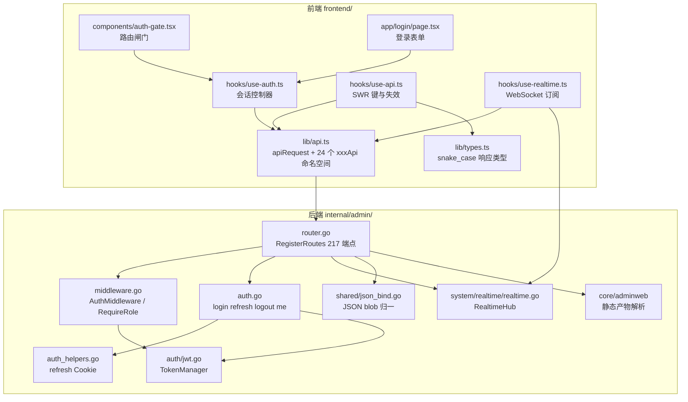
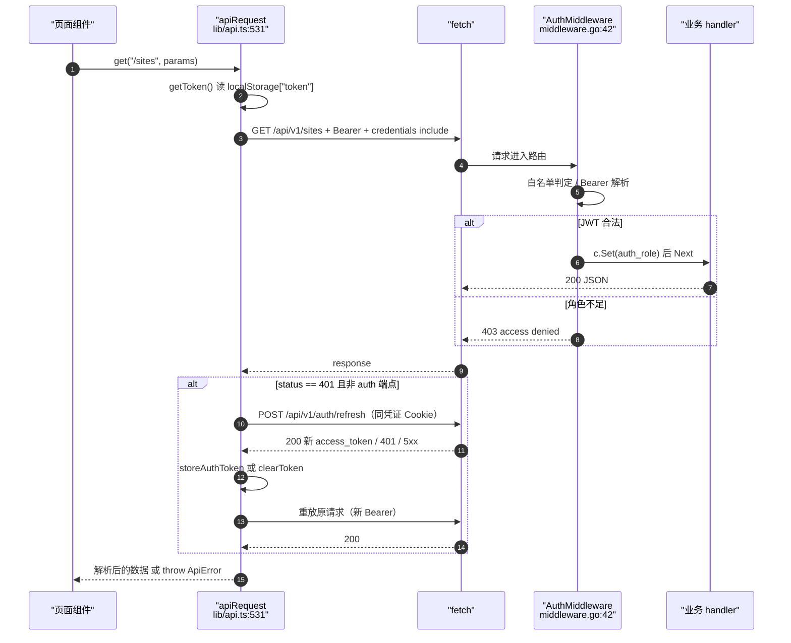
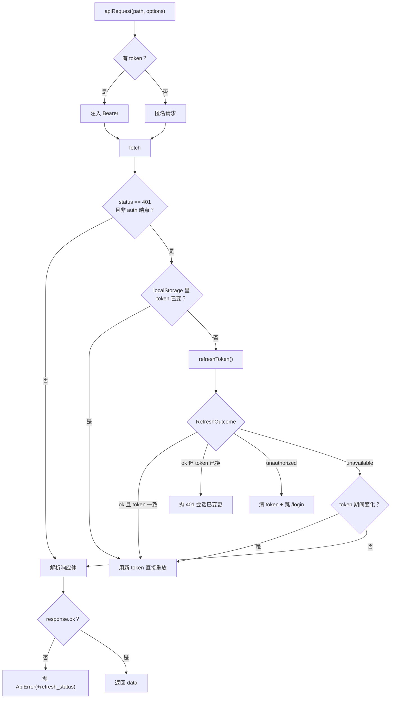
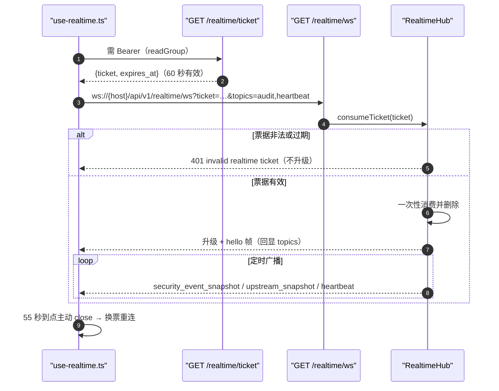
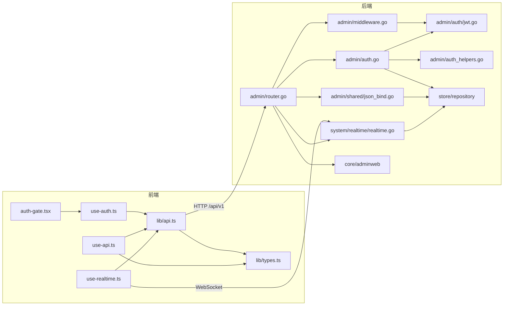
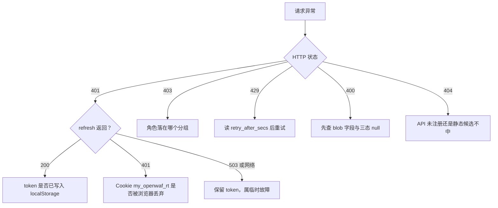

# API 集成

> [返回 前端管理界面](前端管理界面.md)

<cite>
**本文档引用的文件**
- [frontend/lib/api.ts](file://frontend/lib/api.ts)
- [frontend/lib/types.ts](file://frontend/lib/types.ts)
- [frontend/hooks/use-auth.ts](file://frontend/hooks/use-auth.ts)
- [frontend/hooks/use-api.ts](file://frontend/hooks/use-api.ts)
- [frontend/hooks/use-realtime.ts](file://frontend/hooks/use-realtime.ts)
- [frontend/components/auth-gate.tsx](file://frontend/components/auth-gate.tsx)
- [frontend/app/login/page.tsx](file://frontend/app/login/page.tsx)
- [frontend/app/(dashboard)/layout.tsx](file://frontend/app/(dashboard)/layout.tsx)
- [frontend/next.config.ts](file://frontend/next.config.ts)
- [frontend/package.json](file://frontend/package.json)
- [frontend/scripts/check-api-route-contract.ts](file://frontend/scripts/check-api-route-contract.ts)
- [internal/admin/router.go](file://internal/admin/router.go)
- [internal/admin/middleware.go](file://internal/admin/middleware.go)
- [internal/admin/auth.go](file://internal/admin/auth.go)
- [internal/admin/auth_helpers.go](file://internal/admin/auth_helpers.go)
- [internal/admin/auth/jwt.go](file://internal/admin/auth/jwt.go)
- [internal/admin/shared/json_bind.go](file://internal/admin/shared/json_bind.go)
- [internal/admin/system/realtime/realtime.go](file://internal/admin/system/realtime/realtime.go)
- [internal/core/adminweb/embed.go](file://internal/core/adminweb/embed.go)
- [internal/core/adminweb/static.go](file://internal/core/adminweb/static.go)
- [internal/store/site.go](file://internal/store/site.go)
</cite>

## 目录

1. [简介](#简介)
2. [项目结构](#项目结构)
3. [核心组件](#核心组件)
4. [架构总览](#架构总览)
5. [详细组件分析](#详细组件分析)
6. [依赖关系分析](#依赖关系分析)
7. [性能考虑](#性能考虑)
8. [故障排查指南](#故障排查指南)
9. [结论](#结论)
10. [附录](#附录)

## 简介

本篇面向开发者，梳理管理前端与 Go 控制面之间的 API 集成契约。渲染分层、路由与构建约定见
[Next.js 架构设计](Next.js%20架构设计/Next.js%20架构设计.md)，页面级组件组合见
[组件设计模式](组件设计模式/组件设计模式.md)，本篇只覆盖「请求怎么发、凭据怎么带、
错误怎么分、字段怎么对齐」这一条链路。

- 请求封装：`apiRequest` 单一入口、头注入、`credentials: "include"`、响应体分派
- 凭据模型：access JWT 存 `localStorage`，refresh 令牌存 HttpOnly Cookie；401 走刷新去重、
  跨标签页互斥锁、代次（epoch）隔离与原请求重放
- 端点契约：实测 217 个管理端点，GET 100 / POST 117，**无 PUT、无 DELETE**；字段命名统一
  snake_case，含三态与 JSON blob 口径
- 实时通道：`/api/v1/realtime/ws` 为 WebSocket，前端无 `EventSource`；静态产物内嵌进二进制，
  由 `adminweb` 经 `NoRoute` 提供

开发指南类的基本盘（技术栈与验证命令）如下；构建脚本细节见
[Next.js 架构设计/页面生命周期与渲染策略](Next.js%20架构设计/页面生命周期与渲染策略.md)。

| 项 | 取值 | 出处 |
|------|------|------|
| 前端框架 | next `16.2.6` | [frontend/package.json:37](file://frontend/package.json#L37) |
| 运行时 | react `19.2.4` / react-dom `19.2.7` / TS `^6` | [frontend/package.json:40-63](file://frontend/package.json#L40-L63) |
| 数据层 | swr `^2.4.2` | [frontend/package.json:48](file://frontend/package.json#L48) |
| 导出模式 | `output: "export"`、`distDir: "out"`、`trailingSlash: true` | [frontend/next.config.ts:4-6](file://frontend/next.config.ts#L4-L6) |
| API 前缀 | `/api/v1` | [frontend/lib/api.ts:27](file://frontend/lib/api.ts#L27) |
| 管理端点总数 | 217（GET 100 / POST 117 / PUT 0 / DELETE 0） | [internal/admin/router.go:94-437](file://internal/admin/router.go#L94-L437) |
| 后端框架 | cloudwego/hertz，产物经 `//go:embed all:dist` 内嵌 | [internal/admin/router.go:9-10](file://internal/admin/router.go#L9-L10)、[embed.go:12-13](file://internal/core/adminweb/embed.go#L12-L13) |
| 契约校验脚本 | `check:api-route-contract` 等 9 个 | [frontend/package.json:13-22](file://frontend/package.json#L13-L22) |

**章节来源**
- [frontend/package.json:6-64](file://frontend/package.json#L6-L64)
- [frontend/next.config.ts:3-14](file://frontend/next.config.ts#L3-L14)
- [internal/admin/router.go:89-440](file://internal/admin/router.go#L89-L440)
- [internal/core/adminweb/embed.go:10-18](file://internal/core/adminweb/embed.go#L10-L18)

## 项目结构

API 链路在两侧各有一处「单一收敛点」：前端是 `frontend/lib/api.ts`，后端是
`internal/admin/router.go`。中间没有第二套请求封装，也没有第二套路由注册入口。

**图表来源**
- [frontend/lib/api.ts:531-637](file://frontend/lib/api.ts#L531-L637)
- [frontend/hooks/use-auth.ts:87-295](file://frontend/hooks/use-auth.ts#L87-L295)
- [frontend/hooks/use-realtime.ts:32-134](file://frontend/hooks/use-realtime.ts#L32-L134)

模块与责任划分：

| 模块 | 责任 | 关键符号与行号 |
|------|------|----------------|
| `frontend/lib/api.ts` | 唯一 fetch 出口、凭据读写、刷新互斥 | `apiRequest`:531、`refreshToken`:439、`storeAuthToken`:201 |
| `frontend/hooks/use-auth.ts` | 会话状态机、提前刷新、跨标签同步 | `useAuthController`:87、`shouldRefresh`:79 |
| `internal/admin/router.go` | 端点注册与角色分组 | `RegisterRoutes`:89 |
| `internal/admin/middleware.go` | 鉴权、RBAC、访问日志、安全头 | `AuthMiddleware`:42、`RequireRole`:127 |
| `internal/admin/auth.go` | 登录/刷新/登出/me/改密 | `LoginHandler`:33、`RefreshHandler`:131 |
| `internal/admin/shared/json_bind.go` | 请求体 JSON blob 与三态字段归一 | `bindSiteFromRaw`:104 |
| `internal/admin/system/realtime/realtime.go` | 一次性票据与 WS 广播 | `TicketHandler`:187、`WebSocketHandler`:204 |

**章节来源**
- [frontend/lib/api.ts:27-723](file://frontend/lib/api.ts#L27-L723)
- [frontend/lib/types.ts:6-162](file://frontend/lib/types.ts#L6-L162)
- [frontend/hooks/use-auth.ts:79-295](file://frontend/hooks/use-auth.ts#L79-L295)
- [internal/admin/router.go:89-440](file://internal/admin/router.go#L89-L440)

## 核心组件

前端侧三个组件构成请求面：`apiRequest`（唯一出口）、`xxxApi` 命名空间（路径拼写）、
`useAuthController`（凭据生命周期）。后端侧四个组件构成契约面：路由分组、
鉴权中间件、认证处理器、JSON 绑定层。

| 组件 | 类型 | 输入 | 输出 | 失败语义 |
|------|------|------|------|----------|
| `apiRequest` | 请求封装 | path + `RequestInit` | 解析后的 JSON / `{ text }` / null | 抛 `ApiError` |
| `refreshToken` / `doRefreshToken` | 刷新调度与执行 | 无 / Cookie 凭据 | `RefreshOutcome` | `unauthorized` / `unavailable` |
| `AuthMiddleware` / `RequireRole` | 鉴权与 RBAC | `Authorization` 头 / 上下文角色 | 写入 `auth_role` 等上下文并放行 | 401 / 403 / 503 |
| `TokenManager` | JWT | 用户名/角色/IP/UA | 令牌串 + JTI + 过期 | `ErrTokenBlacklistUnavailable` |
| `bindSiteFromRaw` | 绑定 | 原始 JSON map | `store.Site` | 返回 error → 400 |
| `RealtimeHub` | 推送 | 一次性 ticket | WS 帧序列 | ticket 非法 → 401 |

组件清单的页面级消费关系见
[组件设计模式/CRUD 页面组件](组件设计模式/CRUD%20页面组件.md)。

**章节来源**
- [frontend/lib/api.ts:121-130](file://frontend/lib/api.ts#L121-L130)
- [frontend/lib/api.ts:439-518](file://frontend/lib/api.ts#L439-L518)
- [frontend/lib/api.ts:531-684](file://frontend/lib/api.ts#L531-L684)
- [internal/admin/middleware.go:42-147](file://internal/admin/middleware.go#L42-L147)

## 架构总览

一次受保护请求的完整闭环：闸门放行 → 携带 Bearer → 中间件鉴权 → 处理器读写 →
非 2xx 转 `ApiError`。401 时进入刷新分支，成功则**重放原请求**，不改变调用方签名。

**图表来源**
- [frontend/lib/api.ts:135-138](file://frontend/lib/api.ts#L135-L138)
- [frontend/lib/api.ts:531-637](file://frontend/lib/api.ts#L531-L637)
- [frontend/lib/api.ts:478-510](file://frontend/lib/api.ts#L478-L510)

链路上的关键常量（实测值，非配置项）：

| 常量 | 值 | 位置 | 作用 |
|------|:---:|------|------|
| `API_BASE` | `/api/v1` | [api.ts:27](file://frontend/lib/api.ts#L27) | 版本前缀 |
| `ACCESS_TOKEN_KEY` / `…EXPIRES_AT_KEY` | `token` / `token_expires_at` | [api.ts:28-29](file://frontend/lib/api.ts#L28-L29) | localStorage 键与到期毫秒 |
| `FRONTEND_PAGE_SIZE` / `MAX_SITE_RESOURCE_PAGES` | 200 / 10 | [api.ts:30-31](file://frontend/lib/api.ts#L30-L31) | 聚合分页边界 |
| `REFRESH_RESULT_CACHE_MS` | 500 | [api.ts:40](file://frontend/lib/api.ts#L40) | 刷新结果去重窗口 |
| `REFRESH_LOCK_TTL_MS` / `…RENEW_MS` / `…WAIT_MS` / `…POLL_MS` | 15000 / 5000 / 20000 / 50 | [api.ts:52-55](file://frontend/lib/api.ts#L52-L55) | 租约、续约、等待与轮询 |
| `REFRESH_LEAD_MS` / `REFRESH_RETRY_MS` | 60000 / 30000 | [use-auth.ts:69-70](file://frontend/hooks/use-auth.ts#L69-L70) | 提前刷新与重试 |
| `AccessTTL` / `RefreshTTL` | 15 分钟 / 7 天 | [jwt.go:37-38](file://internal/admin/auth/jwt.go#L37-L38) | 令牌寿命 |

**章节来源**
- [frontend/lib/api.ts:27-56](file://frontend/lib/api.ts#L27-L56)
- [frontend/hooks/use-auth.ts:69-81](file://frontend/hooks/use-auth.ts#L69-L81)
- [internal/admin/auth/jwt.go:36-42](file://internal/admin/auth/jwt.go#L36-L42)

## 详细组件分析

### 端点调用映射

前端以命名空间对象集中拼路径，`hooks/use-api.ts` 再包一层 SWR。下表为跨域抽样，
覆盖读、写、状态切换、批量与运维五类；全部 217 条端点的逐条清单见
[管理 API 系统/REST API 设计规范](../管理%20API%20系统/REST%20API%20设计规范/REST%20API%20设计规范.md)。

| 前端函数:行 | 方法 | 路径 | 后端处理:行 | 错误处理 |
|------|:----:|------|------|------|
| `authApi.login` [api.ts:729](file://frontend/lib/api.ts#L729) | POST | `/auth/login` | `LoginHandler` [auth.go:33](file://internal/admin/auth.go#L33) | 400 体格式、401 凭据、429 锁定 |
| `refreshAuthSession` [api.ts:516](file://frontend/lib/api.ts#L516) | POST | `/auth/refresh` | `RefreshHandler` [auth.go:131](file://internal/admin/auth.go#L131) | 401 → unauthorized、503 → unavailable |
| `authApi.logout` [api.ts:732](file://frontend/lib/api.ts#L732) | POST | `/auth/logout` | `LogoutHandler` [auth.go:243](file://internal/admin/auth.go#L243) | 500 撤销失败仍清 Cookie |
| `authApi.me` [api.ts:733](file://frontend/lib/api.ts#L733) | GET | `/auth/me` | `MeHandler` [auth.go:293](file://internal/admin/auth.go#L293) | 401 由中间件产生 |
| `siteApi.list` [api.ts:747](file://frontend/lib/api.ts#L747) | GET | `/sites` | [router.go:127](file://internal/admin/router.go#L127) | 401 / 403 |
| `siteApi.create` [api.ts:750](file://frontend/lib/api.ts#L750) | POST | `/sites` | [router.go:258](file://internal/admin/router.go#L258) | 400 绑定失败 |
| `siteApi.update` [api.ts:751](file://frontend/lib/api.ts#L751) | POST | `/sites/{id}/update` | [router.go:259](file://internal/admin/router.go#L259) | 400 / 409 路由冲突 |
| `siteApi.delete` [api.ts:753](file://frontend/lib/api.ts#L753) | POST | `/sites/{id}/delete` | [router.go:260](file://internal/admin/router.go#L260) | 401 / 403 |
| `siteApi.start` / `stop` [api.ts:754](file://frontend/lib/api.ts#L754) | POST | `/sites/{id}/start`、`/stop` | [router.go:261-262](file://internal/admin/router.go#L261-L262) | 重载失败 → 5xx |
| `certificateApi.parse` [api.ts:829](file://frontend/lib/api.ts#L829) | POST | `/certificates/parse` | [router.go:138](file://internal/admin/router.go#L138) | 只读语义却用 POST，见说明 |
| `settingsApi.set` [api.ts:1069](file://frontend/lib/api.ts#L1069) | POST | `/settings/{key}` | [router.go:376](file://internal/admin/router.go#L376) | 仅 admin → 否则 403 |
| `cveApi.toggle` [api.ts:1007](file://frontend/lib/api.ts#L1007) | POST | `/cve-rules/{id}/toggle` | [router.go:317](file://internal/admin/router.go#L317) | 400 目录规则不可切换 |
| `falsePositiveApi.updateStatus` [api.ts:1280](file://frontend/lib/api.ts#L1280) | POST | `/false-positives/{id}/status` | [router.go:366](file://internal/admin/router.go#L366) | readonly 写 → 403 |
| `backupApi.import` [api.ts:1292](file://frontend/lib/api.ts#L1292) | POST | `/backup/import` | [router.go:382](file://internal/admin/router.go#L382) | 成功后撤销全部访问会话 |
| `realtimeApi.ticket` [api.ts:690](file://frontend/lib/api.ts#L690) | GET | `/realtime/ticket` | [router.go:248](file://internal/admin/router.go#L248) | 失败 → 3 秒重连 |

三点必须澄清的口径：

1. **写操作只有 POST**。更新与删除一律走 `/{id}/update`、`/{id}/delete`，
   状态切换走 `/start`、`/stop`、`/toggle`；路由树中不存在 PUT/DELETE 注册
   （[router.go:124-416](file://internal/admin/router.go#L124-L416)）。
   `api.ts` 仍导出 `put()`:673 与 `del()`:682，全库无调用方，属遗留死代码。
2. **`/certificates/parse` 是 POST 但归入只读组**，因为它只解析用户粘贴的 PEM
   并读站点列表，无副作用（[router.go:136-138](file://internal/admin/router.go#L136-L138)）。
3. **分组权限不同**：`readGroup` 允许 admin/operator/readonly 三角色
   （[router.go:124-125](file://internal/admin/router.go#L124-L125)），
   `opsGroup` 去掉 readonly（[:255-256](file://internal/admin/router.go#L255-L256)），
   `adminGroup` 仅 admin（[:372-373](file://internal/admin/router.go#L372-L373)）。
   实测条数 readGroup 92 / opsGroup 87 / adminGroup 26 / `api` 4 / 顶层 `h` 8，合计 217。

**章节来源**
- [frontend/lib/api.ts:642-1365](file://frontend/lib/api.ts#L642-L1365)
- [internal/admin/router.go:94-437](file://internal/admin/router.go#L94-L437)
- [internal/admin/middleware.go:127-147](file://internal/admin/middleware.go#L127-L147)

### 请求封装与响应分派

`apiRequest` 做四件事：拼 `API_BASE`、注入 `Content-Type` 与 `Authorization`、
固定 `credentials: "include"`、按状态与 `content-type` 分派响应体。

- 头注入：`Content-Type: application/json` 为默认，调用方 `headers` 覆盖其后
  （[api.ts:538-541](file://frontend/lib/api.ts#L538-L541)）；存在 token 时写
  `Authorization: Bearer {token}`（[:543-545](file://frontend/lib/api.ts#L543-L545)）。
- 开发日志：`NODE_ENV === "development"` 时打印方法与实际 URL（[:554-556](file://frontend/lib/api.ts#L554-L556)）；
  生产构建由 `compiler.removeConsole` 移除（[next.config.ts:8-10](file://frontend/next.config.ts#L8-L10)）。
- 响应体分派（[:609-621](file://frontend/lib/api.ts#L609-L621)）：204/205 直接 `null`，
  不调 `json()`；`application/json` 先 `text()` 再判空串后 `JSON.parse`；
  其余折成 `{ text }`。页面模板预览在此边界再解回字符串（`unwrapTextResponse`:1165）。
- 错误分派（[:623-634](file://frontend/lib/api.ts#L623-L634)）：非 2xx 抛 `ApiError(status,
  data?.error ?? "请求失败: {status}", errorData)`；若刷新不可达，则向 `errorData`
  注入 `refresh_status: "unavailable"`，让路由守卫能与真凭据失效区分。
- `get()` 的查询串构造（[:642-657](file://frontend/lib/api.ts#L642-L657)）：过滤 `undefined`
  与空串后 `encodeURIComponent`，因此空筛选值不会污染 URL。
- 分页聚合：`getAllSitePages`（[:697-723](file://frontend/lib/api.ts#L697-L723)）以前 200 条 +
  `total` 推算页数，硬上限 10 页，并行拉取后截断，避免异常 `total` 造成无限请求。

**图表来源**
- [frontend/lib/api.ts:531-637](file://frontend/lib/api.ts#L531-L637)
- [frontend/lib/api.ts:439-510](file://frontend/lib/api.ts#L439-L510)

**章节来源**
- [frontend/lib/api.ts:531-723](file://frontend/lib/api.ts#L531-L723)
- [frontend/lib/api.ts:1160-1172](file://frontend/lib/api.ts#L1160-L1172)
- [frontend/next.config.ts:8-10](file://frontend/next.config.ts#L8-L10)

### 凭据存储与刷新互斥

凭据模型为「短时 JWT + 长效旋转 refresh Cookie」双轨：

- access JWT 存 `localStorage` 键 `token`，到期毫秒值存 `token_expires_at`
  （[api.ts:28-29](file://frontend/lib/api.ts#L28-L29)、[:189-198](file://frontend/lib/api.ts#L189-L198)）。
  **不是** sessionStorage，也没有 `owaf_access_token` 这类键名。登录页把凭据交给
  `useAuth().login()`，成功即 `router.push("/dashboard")`，失败只 toast 不吞错
  （[login/page.tsx:31-49](file://frontend/app/login/page.tsx#L31-L49)）。
- 到期时间解析 `parseExpiresAt`（[:145-156](file://frontend/lib/api.ts#L145-L156)）把后端的
  Unix 秒统一放大为毫秒；缺失时回落 `decodeTokenExpiry`（[:158-175](file://frontend/lib/api.ts#L158-L175)）
  从 JWT payload 的 `exp` 解出，跨单位边界不再靠猜。
- refresh 令牌由后端写入 Cookie `my_openwaf_rt`，`HttpOnly`、`SameSite=Lax`、`Path=/`，`Secure`
  跟随实际协议（[auth_helpers.go:15](file://internal/admin/auth_helpers.go#L15)、
  [:26-31](file://internal/admin/auth_helpers.go#L26-L31)）。Cookie 值用 `.` 连接 JTI 与原始令牌，改用
  `:` 会被 Hertz 的 `QueryEscape` 写成 `%3A` 且读回不解码（:17-21），旧格式仍有兼容分支（:49）。
- 代次隔离：`authEpoch` 在 `storeAuthToken`/`clearToken` 时自增（[:203](file://frontend/lib/api.ts#L203)、
  [:213](file://frontend/lib/api.ts#L213)），在途 refresh 返回后代次不一致即判为过期结果，不覆盖新凭据，
  也不触发旧会话登出（[:488-503](file://frontend/lib/api.ts#L488-L503)）。
- 并发去重：同一时刻多个 401 只共享一个 `refreshPromise`（[:440](file://frontend/lib/api.ts#L440)），结果
  额外缓存 500ms（[:443-454](file://frontend/lib/api.ts#L443-L454)），无 token 的失败也缓存以免首屏打空。
- 跨标签页互斥：优先 Web Locks `my-openwaf-refresh`（[:402-429](file://frontend/lib/api.ts#L402-L429)）；
  不可用时退到 localStorage 租约：先登记 `…intent.{owner}`，取有效意图中字典序最小 owner 为胜者
  （`isRefreshLockTurn`:276），租约 15 秒、续约 5 秒、等待 20 秒、轮询 50 毫秒（[:307-400](file://frontend/lib/api.ts#L307-L400)）。

主动刷新路径独立于 401：`useAuthController` 在到期前 60 秒排定时器（`scheduleRefresh`:101），刷新失败为
`unavailable` 时保留 token 并按 30 秒重试（[use-auth.ts:133-138](file://frontend/hooks/use-auth.ts#L133-L138)），
`focus` / `visibilitychange` 触发恢复检查并按 30 秒节流（[:159-201](file://frontend/hooks/use-auth.ts#L159-L201)）。
跨标签页靠 `storage` 事件同步，且只信当前共享存储值、不信 `event.newValue`
（[:243-273](file://frontend/hooks/use-auth.ts#L243-L273)）。

**章节来源**
- [frontend/lib/api.ts:135-216](file://frontend/lib/api.ts#L135-L216)
- [frontend/lib/api.ts:276-510](file://frontend/lib/api.ts#L276-L510)
- [frontend/hooks/use-auth.ts:69-295](file://frontend/hooks/use-auth.ts#L69-L295)
- [frontend/app/login/page.tsx:21-49](file://frontend/app/login/page.tsx#L21-L49)
- [internal/admin/auth_helpers.go:14-61](file://internal/admin/auth_helpers.go#L14-L61)

### 错误与重试策略

后端错误一律为 `{ "error": "…" }` 的 JSON 载荷（认证端点另附额外字段），前端统一收敛为
`ApiError`。是否重试取决于「这条 401 是不是凭据问题」，而不是状态码本身。

| 状态码 | 产生点:行 | 载荷特征 | 前端处理 | 是否重试 |
|:----:|------|------|------|:----:|
| 400 | [auth.go:42](file://internal/admin/auth.go#L42)、[auth.go:324](file://internal/admin/auth.go#L324) | `请求体格式无效` | 抛 `ApiError`，表单显示原文 | 否 |
| 401 缺头/格式错 | [middleware.go:57](file://internal/admin/middleware.go#L57)、[:64](file://internal/admin/middleware.go#L64) | `missing Authorization` / `invalid Authorization format` | 进入刷新分支 | 是（刷新后重放） |
| 401 令牌失效 / 归属缺失 | [middleware.go:99](file://internal/admin/middleware.go#L99)、[:112](file://internal/admin/middleware.go#L112) | `invalid or expired token` / `api key owner …` | 进入刷新分支；API Key 无法刷新则不重试 | 部分 |
| 401 登录凭据 | [auth.go:71-75](file://internal/admin/auth.go#L71-L75) | `invalid credentials`，可能带 `remaining_attempts` | 由登录页 toast 展示 | 否 |
| 401 refresh 终结 | [auth.go:140-219](file://internal/admin/auth.go#L140-L219) | 缺 Cookie / 畸形 / 已撤销 | `reason: unauthorized` → 清 token 跳登录 | 否 |
| 403 角色不足 / 原密码错 | [middleware.go:135-141](file://internal/admin/middleware.go#L135-L141)、[auth.go:337](file://internal/admin/auth.go#L337) | `access denied: …` / `current password is incorrect` | 抛错并在页面提示 | 否 |
| 429 登录锁定 | [auth.go:52-57](file://internal/admin/auth.go#L52-L57) | 带 `retry_after_secs` | 提示剩余秒数 | 否，由用户重提 |
| 500 签发/存储失败 | [auth.go:102-222](file://internal/admin/auth.go#L102-L222) | `token generation failed` 等 | 抛错，保留当前 token | 否 |
| 503 黑名单/仓储不可用 | [middleware.go:86](file://internal/admin/middleware.go#L86)、[auth.go:158](file://internal/admin/auth.go#L158) | `authentication service unavailable` | 视为临时故障，不清 token | 是（30 秒周期） |
| 网络异常 | `fetch` reject | 无响应 | `catch` → `unavailable`（[api.ts:507-509](file://frontend/lib/api.ts#L507-L509)） | 是 |
| 404 API 未注册 | [router.go:450-452](file://internal/admin/router.go#L450-L452) | `endpoint not found` | 抛 `ApiError`；非 `/api/` 走静态候选 | 否 |

配套约束：

- 认证端点自身不参与 401 刷新，`isAuthEndpoint` 只放行 `/auth/login`、`/auth/refresh`、
  `/auth/logout`（[api.ts:520-526](file://frontend/lib/api.ts#L520-L526)），避免刷新递归。
- 全部 `/api/v1/` 响应被强制 `Cache-Control: no-store`，在 `Next` 之后与 `c.Next` 之后
  各设一次，防止中间代理复用策略或凭据响应
  （[middleware.go:180-186](file://internal/admin/middleware.go#L180-L186)）；认证 handler
  另各自调用 `setAuthNoStore`（[auth_helpers.go:40-42](file://internal/admin/auth_helpers.go#L40-L42)）。
- 每次请求由 `AccessLog` 生成 UUID 并回写 `X-Request-ID`
  （[middleware.go:150-169](file://internal/admin/middleware.go#L150-L169)），排障以此串关联日志。
- 重试只有一层：SWR 侧仅规则类显式设 `errorRetryCount: 1`
  （[use-api.ts:141-151](file://frontend/hooks/use-api.ts#L141-L151)），其余依赖 401 重放，
  不做指数退避。

**章节来源**
- [frontend/lib/api.ts:439-637](file://frontend/lib/api.ts#L439-L637)
- [internal/admin/auth.go:33-352](file://internal/admin/auth.go#L33-L352)
- [internal/admin/middleware.go:42-192](file://internal/admin/middleware.go#L42-L192)
- [internal/admin/auth_helpers.go:40-42](file://internal/admin/auth_helpers.go#L40-L42)

### 字段与类型对照

命名口径全站为 **snake_case**，前端类型直接照抄后端 `json` 标签，不做驼峰转换：

| 前端类型:行 | 后端字段:行 | 命名口径 | 可选性 |
|------|------|------|------|
| `AuthTokenResponse.expires_at?: number` [api.ts:79](file://frontend/lib/api.ts#L79) | `expires_at` = `accessExp.Unix()` [auth.go:124](file://internal/admin/auth.go#L124) | snake_case；单位为**秒** | 可选；缺省回落解 JWT `exp` |
| `localStorage["token_expires_at"]` [api.ts:29](file://frontend/lib/api.ts#L29) | 无（前端派生） | 前端私有键 | 可缺省；单位为**毫秒** |
| `AuthRole = "admin"\|"operator"\|"readonly"` [api.ts:75](file://frontend/lib/api.ts#L75) | `RoleAdmin/Operator/Readonly` [jwt.go:21-25](file://internal/admin/auth/jwt.go#L21-L25) | 三值枚举 | 必填，`isAuthRole` 校验 |
| `Site.anti_replay_enabled: boolean \| null` [types.ts:84](file://frontend/lib/types.ts#L84) | `AntiReplayEnabled *bool` [store/site.go:64](file://internal/store/site.go#L64) | snake_case | `null` = 继承全局 |
| `Site.challenge_action: string \| null` [types.ts:91](file://frontend/lib/types.ts#L91) | `ChallengeAction *string` + `omitempty` [store/site.go:73](file://internal/store/site.go#L73) | snake_case | `null` 显式取消覆盖 |
| `Site.cache_rules?: string` [types.ts:123](file://frontend/lib/types.ts#L123) | blob 名单 [json_bind.go:80-91](file://internal/admin/shared/json_bind.go#L80-L91) | JSON **字符串**承载 | 可选 |
| `Site.skip_path_by_phase?: SkipPathByPhase \| string \| null` [types.ts:106](file://frontend/lib/types.ts#L106) | 校验 `ValidateSkipPathByPhase` [json_bind.go:44-63](file://internal/admin/shared/json_bind.go#L44-L63) | 对象或字符串双形态 | `null` = 继承 |
| `Site.client_ip_header_order?: string \| string[]` [types.ts:111](file://frontend/lib/types.ts#L111) | `ClientIPHeaderOrder string` [json_bind.go:138-140](file://internal/admin/shared/json_bind.go#L138-L140) | 后端恒为字符串 | 读为串、写可传数组 |
| `PaginationResponse {items,total,page?}` [types.ts:6-10](file://frontend/lib/types.ts#L6-L10) | 各 list handler | snake_case | `page` 可选 |
| `RealtimeTicketResponse {ticket, expires_at: string}` [types.ts:535-538](file://frontend/lib/types.ts#L535-L538) | `map{"ticket","expires_at"}` RFC3339 [realtime.go:195](file://internal/admin/system/realtime/realtime.go#L195) | snake_case；时间为**字符串** | 必填 |
| `RealtimeMessage {schema,type,seq,sent_at,payload}` [types.ts:524-530](file://frontend/lib/types.ts#L524-L530) | `realtimeMessage` [realtime.go:53-59](file://internal/admin/system/realtime/realtime.go#L53-L59) | snake_case + `omitempty` | 必填 |

三类易错口径：

- **时间单位不统一**：`/auth/login`、`/auth/refresh` 的 `expires_at` 是 Unix 秒
  （[auth.go:124](file://internal/admin/auth.go#L124)），realtime ticket 的 `expires_at`
  是 RFC3339 字符串（[realtime.go:195](file://internal/admin/system/realtime/realtime.go#L195)）。
  前者必须过 `parseExpiresAt` 归一为毫秒再入库（[api.ts:145-156](file://frontend/lib/api.ts#L145-L156)）。
- **JSON blob 字段**：`cc_rules`、`cache_rules`、`skip_path_by_phase` 等在 Go 侧是字符串列，
  前端可能提交数组，因此绑定层先 `PeelJSONStringBlobs` 摘出并字符串化，再解普通字段
  （[json_bind.go:31-41](file://internal/admin/shared/json_bind.go#L31-L41)、
  [:104-147](file://internal/admin/shared/json_bind.go#L104-L147)）。
- **三态不能简化为可选**：`site_id` 之类字段显式 `null` 才代表改回全站生效，省略是保持原值
  （[api.ts:1312-1317](file://frontend/lib/api.ts#L1312-L1317) 注释与
  [json_bind.go:148-172](file://internal/admin/shared/json_bind.go#L148-L172) 实现）。

**章节来源**
- [frontend/lib/api.ts:75-110](file://frontend/lib/api.ts#L75-L110)
- [frontend/lib/api.ts:145-198](file://frontend/lib/api.ts#L145-L198)
- [frontend/lib/types.ts:6-162](file://frontend/lib/types.ts#L6-L162)
- [frontend/lib/types.ts:520-560](file://frontend/lib/types.ts#L520-L560)

### 实时推送通道

控制面实时通道是 **WebSocket**，不是 SSE：路由注册为
`h.GET("/api/v1/realtime/ws", deps.Realtime.WebSocketHandler())`
（[router.go:424](file://internal/admin/router.go#L424)），前端只有
`new WebSocket(...)`（[use-realtime.ts:59](file://frontend/hooks/use-realtime.ts#L59)、
[:170](file://frontend/hooks/use-realtime.ts#L170)），全库无 `EventSource`。
数据面的 `internal/dataplane/sse.go` 是面向客户上游的事件流透传，与管理端实时通道无关。

握手为两段式：先取一次性票据，再带票据升级。

**图表来源**
- [frontend/hooks/use-realtime.ts:16-134](file://frontend/hooks/use-realtime.ts#L16-L134)
- [internal/admin/router.go:248](file://internal/admin/router.go#L248)
- [internal/admin/router.go:424](file://internal/admin/router.go#L424)

通道参数（实测）：

| 项 | 取值 | 出处 |
|------|------|------|
| 票据长度与有效期 | 32 随机字节 hex，60 秒一次性 | [realtime.go:190](file://internal/admin/system/realtime/realtime.go#L190)、[:588-616](file://internal/admin/system/realtime/realtime.go#L588-L616) |
| 前端换票周期 / 重连延迟 | 55 秒 / 3 秒 | [use-realtime.ts:11-12](file://frontend/hooks/use-realtime.ts#L11-L12) |
| Origin 校验 | 仅同 host 的 http/https | [realtime.go:174-180](file://internal/admin/system/realtime/realtime.go#L174-L180) |
| 客户端队列 / 写超时 | 8 条（满则丢最旧）/ 3 秒 | [realtime.go:27](file://internal/admin/system/realtime/realtime.go#L27)、[:539-577](file://internal/admin/system/realtime/realtime.go#L539-L577) |
| 消息信封 schema | `admin.realtime.v1` | [realtime.go:26](file://internal/admin/system/realtime/realtime.go#L26) |
| 默认订阅 / `all` | runtime、upstreams、heartbeat；`all` 解析为空集合即全订阅 | [realtime.go:491-511](file://internal/admin/system/realtime/realtime.go#L491-L511) |
| 广播周期 | dashboard 2s、runtime/upstreams/heartbeat 5s、audit 3s、fingerprints 15s | [realtime.go:236-239](file://internal/admin/system/realtime/realtime.go#L236-L239) |
| 快照页大小 | 20 | [realtime.go:290](file://internal/admin/system/realtime/realtime.go#L290)、[:306](file://internal/admin/system/realtime/realtime.go#L306) |

前端两个订阅者按载荷类型过滤：`useRealtimeEvents` 只认 `security_event_snapshot`，
并以条目 ID 串（截断 2000 字符）为签名，集合未变化就不重渲染
（[use-realtime.ts:64-83](file://frontend/hooks/use-realtime.ts#L64-L83)）；
`useRealtimeOverview` 只认 `upstream_snapshot`（[:174-189](file://frontend/hooks/use-realtime.ts#L174-L189)）。
无 access token 时两个 hook 都直接放弃，避免向控制面刷无效 ticket
（[:47-51](file://frontend/hooks/use-realtime.ts#L47-L51)、[:160-163](file://frontend/hooks/use-realtime.ts#L160-L163)）。

**章节来源**
- [frontend/hooks/use-realtime.ts:11-237](file://frontend/hooks/use-realtime.ts#L11-L237)
- [internal/admin/system/realtime/realtime.go:26-37](file://internal/admin/system/realtime/realtime.go#L26-L37)
- [internal/admin/system/realtime/realtime.go:187-306](file://internal/admin/system/realtime/realtime.go#L187-L306)
- [internal/admin/system/realtime/realtime.go:483-616](file://internal/admin/system/realtime/realtime.go#L483-L616)

### 静态产物与同源部署

前端以 `output: "export"` 产出纯静态树，`package.json` 的 build 脚本把 `out/`
复制到 `internal/core/adminweb/dist`（[package.json:8](file://frontend/package.json#L8)），
再由 `//go:embed all:dist` 打进二进制（[embed.go:12-13](file://internal/core/adminweb/embed.go#L12-L13)）。
因此前后端同源，请求走相对路径 `/api/v1`，不需要 CORS，也不需要 rewrite。

- `RegisterRoutes` 末尾 `mountStaticHandler(h, deps.StaticFS)`（[router.go:439](file://internal/admin/router.go#L439)）：
  `ResolveFS` 失败即**不注册 NoRoute**（[router.go:442-446](file://internal/admin/router.go#L442-L446)），
  纯 API 部署不会拿到 404 页面。
- `NoRoute` 内先分诊：`/api/` 前缀直接回 404 JSON，其余交 `serveStaticFile`
  （[router.go:448-455](file://internal/admin/router.go#L448-L455)）。
- `routeCandidates` 为同一 URL 生成候选序列：尾斜杠 `/index.html`、原路径、
  补 `/index.html` 与 `.html`，以及动态段占位 `_` 变体与 `__next.*.txt` RSC 变体
  （[static.go:54-120](file://internal/core/adminweb/static.go#L54-L120)）；
  无扩展名的路由最终回落 `index.html`（[:79-81](file://internal/core/adminweb/static.go#L79-L81)）。
- `ContentType` 只覆盖 html/js/css/json/svg/png/ico/woff2，其余 `application/octet-stream`
  （[static.go:31-52](file://internal/core/adminweb/static.go#L31-L52)）。
- `StaticFS` 非空时改读磁盘，便于开发期热替换（[static.go:11-17](file://internal/core/adminweb/static.go#L11-L17)）。

同源部署的直接后果是 Next.js 16 静态导出的能力边界必须被尊重：不支持
`redirects`/`rewrites`、不支持 `cookies()` 与 Server Actions、没有 ISR，
`next/image` 的默认 loader 也不可用。本仓库因此不使用 `next/image` 与 `next/font`，
重定向全部在客户端由 `AuthGate` 的 `router.replace("/login")` 完成
（[auth-gate.tsx:25-29](file://frontend/components/auth-gate.tsx#L25-L29)），
`useSearchParams()` 的消费者必须包 `Suspense`（[app/(dashboard)/layout.tsx:25](file://frontend/app/(dashboard)/layout.tsx#L25)）。
逐条差异核对见
[Next.js 架构设计/页面生命周期与渲染策略](Next.js%20架构设计/页面生命周期与渲染策略.md)。

**章节来源**
- [frontend/package.json:8](file://frontend/package.json#L8)
- [frontend/next.config.ts:3-14](file://frontend/next.config.ts#L3-L14)
- [internal/core/adminweb/embed.go:10-31](file://internal/core/adminweb/embed.go#L10-L31)
- [internal/core/adminweb/static.go:10-120](file://internal/core/adminweb/static.go#L10-L120)

## 依赖关系分析

**图表来源**
- [internal/admin/router.go:12-58](file://internal/admin/router.go#L12-L58)
- [internal/admin/router.go:89-440](file://internal/admin/router.go#L89-L440)
- [frontend/lib/api.ts:1-46](file://frontend/lib/api.ts#L1-L46)

依赖矩阵：

| 依赖方 | 被依赖方 | 形式 | 可否替换 | 备注 |
|------|------|------|:----:|------|
| 页面/组件 | `lib/api.ts` 命名空间 | 直接调用 | 是 | 统一走 `apiRequest` |
| `hooks/use-api.ts` | `lib/api.ts` | import 24 个命名空间 | 否 | 单一请求出口 |
| `hooks/use-auth.ts` | `lib/api.ts` 令牌读写 API | 具名 import | 否 | 键名由 api.ts 导出常量 |
| `components/auth-gate.tsx` | `useAuth` + `getAccessToken` | Context | 是 | 闸门可换实现 |
| `lib/api.ts` | Web Locks API | 特性检测 | 否（有降级） | 降级 localStorage 租约 |
| `middleware.go` | `TokenManager` | 组合 | 否 | 黑名单 fail closed |
| `auth.go` | `repository.RefreshTokenRepo` | 接口调用 | 是 | 仓储错误映射 503 |
| `adminweb` | `embed.FS` / `http.Dir` | `fs.FS` 抽象 | 是 | 磁盘与内嵌同接口 |

外部实体：`swr` ^2.4.2（读侧缓存，仅 `hooks/` 使用）、`next/navigation`（客户端跳转与
`useSearchParams`，无 Server Action）、`@tabler/icons-react` ^3.44.0（图标；未声明的
`lucide-react` 仍留在 `optimizePackageImports`）、Web Locks API（不可用时降级）、
`localStorage`（access token 与界面偏好）、HttpOnly Cookie（refresh 令牌，前端 JS 不可读）。

**章节来源**
- [frontend/lib/api.ts:7-46](file://frontend/lib/api.ts#L7-L46)
- [frontend/hooks/use-api.ts:1-80](file://frontend/hooks/use-api.ts#L1-L80)
- [frontend/hooks/use-auth.ts:11-22](file://frontend/hooks/use-auth.ts#L11-L22)
- [frontend/package.json:24-64](file://frontend/package.json#L24-L64)

## 性能考虑

- 问题：多标签页同时过期会成倍消费一次性 refresh 令牌。
  优化：`refreshPromise` 合并 + 500ms 结果缓存 + Web Locks/租约互斥
  （[api.ts:402-476](file://frontend/lib/api.ts#L402-L476)）。效果：同一轮换最多一次 `/auth/refresh`。
- 问题：站点资源单页 200 条不够，全量拉取又易失控。
  优化：`getAllSitePages` 并行取页且硬顶 10 页（[api.ts:697-723](file://frontend/lib/api.ts#L697-L723)）。
  效果：请求数与内存上界可算，异常 `total` 不致无限请求。
- 问题：认证初始化并发挂载多页面会重复打 `/auth/me`。
  优化：`authMeRequest` 模块级去重并绑定 token 值（[use-auth.ts:36-55](file://frontend/hooks/use-auth.ts#L36-L55)）。
- 问题：实时快照每 3 秒推送，原样渲染会持续抖动。
  优化：ID 串签名比对，集合未变不 setState（[use-realtime.ts:71-79](file://frontend/hooks/use-realtime.ts#L71-L79)）。
- 问题：读侧默认 `revalidateOnFocus` 使每次切回标签页触发全量重取。
  优化：`useApiQuery` 全局关闭，参考数据另设 5 分钟 `dedupingInterval`
  （[use-api.ts:89-165](file://frontend/hooks/use-api.ts#L89-L165)）。
- 安全与可靠性：黑名单不可用时 fail closed 回 503 而非放行
  （[middleware.go:85-89](file://internal/admin/middleware.go#L85-L89)、
  [jwt.go:61-69](file://internal/admin/auth/jwt.go#L61-L69)）；密钥轮换保留 secondary 过渡
  （[jwt.go:87-142](file://internal/admin/auth/jwt.go#L87-L142)）。

**章节来源**
- [frontend/lib/api.ts:402-476](file://frontend/lib/api.ts#L402-L476)
- [frontend/lib/api.ts:697-723](file://frontend/lib/api.ts#L697-L723)
- [frontend/hooks/use-auth.ts:36-55](file://frontend/hooks/use-auth.ts#L36-L55)
- [frontend/hooks/use-api.ts:89-165](file://frontend/hooks/use-api.ts#L89-L165)

## 故障排查指南

**图表来源**
- [frontend/lib/api.ts:562-634](file://frontend/lib/api.ts#L562-L634)
- [internal/admin/auth.go:131-241](file://internal/admin/auth.go#L131-L241)
- [internal/admin/middleware.go:127-147](file://internal/admin/middleware.go#L127-L147)

| 症状 | 原因 | 排查 | 方案 |
|------|------|------|------|
| 刷新后仍 401 并跳登录 | refresh 令牌被撤销或账号删除（[auth.go:153-181](file://internal/admin/auth.go#L153-L181)） | 看 refresh 响应 `error` 文案 | 重新登录 |
| 反复 401 → 刷新循环 | 误把 `unavailable` 当凭据失效 | 检查 `ApiError.data.refresh_status` | 保留 token，等定时器重试 |
| 登录返回 429 | 暴力破解锁定（[auth.go:50-58](file://internal/admin/auth.go#L50-L58)） | 读 `retry_after_secs` | 等冷却或清计数 |
| 改密码成功但仍被登出 | 改密后主动撤销全部凭据（[auth.go:345-349](file://internal/admin/auth.go#L345-L349)） | 属预期 | 重新登录 |
| 保存站点后 `skip_path_by_phase` 报 400 | phase 键不在白名单或含空路径（[json_bind.go:44-63](file://internal/admin/shared/json_bind.go#L44-L63)） | 打印提交体 | 用契约脚本校验 |
| 布尔字段被存成 false | 把「未填」当 `false` 提交，丢掉三态 | 对比是否显式 `null`（[json_bind.go:148-155](file://internal/admin/shared/json_bind.go#L148-L155)） | 继承传 `null`，覆盖传值 |
| 列表少数据 | 聚合页数被 10 页硬顶截断（[api.ts:705-722](file://frontend/lib/api.ts#L705-L722)） | 看 `total` 与实际条数 | 服务端筛选或调参 |
| 实时面板不更新 | 无 token 时 hook 直接放弃（[use-realtime.ts:47-51](file://frontend/hooks/use-realtime.ts#L47-L51)） | 看 WS 是否创建 | 先完成登录 |
| WS 立刻关闭 | 票据过期/已用（[realtime.go:207-211](file://internal/admin/system/realtime/realtime.go#L207-L211)） | 观察 401 JSON | 缩短换票间隔（已 55 秒） |
| 页面 404 但资源存在 | `routeCandidates` 未命中或 `StaticFS` 为空（[static.go:54-84](file://internal/core/adminweb/static.go#L54-L84)） | `ls internal/core/adminweb/dist` | 重跑前端 build |
| `/metrics` 打不开 | 该端点在管理端口，不在数据面 | 核对监听地址 | 走管理口 |

**章节来源**
- [frontend/lib/api.ts:562-637](file://frontend/lib/api.ts#L562-L637)
- [frontend/lib/api.ts:697-723](file://frontend/lib/api.ts#L697-L723)
- [frontend/hooks/use-realtime.ts:40-134](file://frontend/hooks/use-realtime.ts#L40-L134)
- [internal/admin/auth.go:33-352](file://internal/admin/auth.go#L33-L352)

## 结论

本次迭代成果：把 API 集成篇从「泛述」改造为可核对的契约文档，补齐端点映射、错误重试、字段对照
三张必备表，以及元数据、模块清单、组件清单、常量表、通道参数、依赖矩阵、术语表与故障排查表。

订正清单：`sessionStorage`/`owaf_access_token` → `localStorage` 的 `token` 与 `token_expires_at`；
「PUT/DELETE 语义」→ 全部写操作 POST；`handler_auth.go`、`handler_site.go`、`admin/site/site.go`
等已废弃扁平路径 → 现行子包路径；`auth-guard.tsx` → `auth-gate.tsx`；SSE 与 `/api/v1/realtime/ws`
的定位混淆 → 管理端只有 WebSocket。新增三处易错实现说明：204/205 不解析 JSON、`refresh_status`
区分凭据失效与临时故障、`expires_at` 秒/毫秒边界。

设计原则落点：KISS——单一 `apiRequest` 出口，不再叠加拦截层；YAGNI——不引入指数退避与请求队列，
只保留实测需要的 500ms 去重；SRP——令牌读写在 `lib/api.ts`、会话状态机在 `use-auth.ts`、SWR 键在
`use-api.ts`；DRY——24 个命名空间共用 `get`/`post`，后端 217 端点共用三档 `RequireRole`。

遇到的问题与解决方式：旧稿把数据面 SSE（`internal/dataplane/sse.go`，面向客户上游的事件流透传）
当成管理端实时通道，与 `use-realtime.ts` 的 `new WebSocket` 冲突。按「以运行时行为为准」重核路由
注册与前端实现后，管理端通道统一记为 WebSocket。核对中还发现 `api.ts` 导出的 `put()`/`del()`
无任何调用方，已如实登记，未擅自删除代码。

下一步：把端点映射表扩为全量 217 条并与 `check:api-route-contract` 联动，在 CI 中比对前端路径集合
与 `router.go` 注册集合，把手工抽样校验变成自动校验。

## 附录

### 术语与兼容矩阵

| 术语 / 能力 | 本仓库口径 | 易混说法 | 出处 |
|------|------|------|------|
| access token | 15 分钟 HS256 JWT，存 `localStorage["token"]` | 说成 sessionStorage | [jwt.go:37](file://internal/admin/auth/jwt.go#L37)、[api.ts:28](file://frontend/lib/api.ts#L28) |
| refresh token | 7 天，HttpOnly Cookie `my_openwaf_rt` | 说成 `owaf_access_token` | [jwt.go:38](file://internal/admin/auth/jwt.go#L38)、[auth_helpers.go:15](file://internal/admin/auth_helpers.go#L15) |
| 代次 epoch | 前端会话版本号，隔离在途刷新 | 与 JTI 混淆 | [api.ts:39](file://frontend/lib/api.ts#L39) |
| 重放 | 刷新成功后重发原请求一次 | 说成自动重试 | [api.ts:573-600](file://frontend/lib/api.ts#L573-L600) |
| 更新 / 删除端点 | `POST /{id}/update`、`POST /{id}/delete` | PUT / DELETE | [router.go:259-260](file://internal/admin/router.go#L259-L260) |
| 实时通道 | `GET /api/v1/realtime/ws`（WebSocket） | SSE / EventSource | [router.go:424](file://internal/admin/router.go#L424) |
| 三态字段 | `null` 继承 / `true` 覆盖开 / `false` 覆盖关；省略 = 保持原值 | 空值等同 false | [types.ts:84-106](file://frontend/lib/types.ts#L84-L106)、[json_bind.go:80-91](file://internal/admin/shared/json_bind.go#L80-L91) |
| `output: "export"` | 纯静态，无 redirects/rewrites/Server Actions | 当作有 Server 运行时 | [next.config.ts:4](file://frontend/next.config.ts#L4) |

能力支持矩阵：

| 能力 | 后端 | 前端 | 备注 |
|------|:----:|:----:|------|
| Bearer JWT 鉴权 | ✓ | ✓ | 中间件与刷新闭环 |
| API Key 鉴权 | ✓ | ✗ | 角色取归属账号，前端无调用 |
| 401 自动刷新 | ✓ | ✓ | 仅业务端点参与 |
| 跨标签页刷新互斥 | — | ✓ | 部分实现时降级租约 |
| RBAC 三档分组 | ✓ | 部分 | 前端仅按角色隐藏入口，服务端为准 |
| WebSocket 推送 | ✓ | ✓ | ticket 一次性 |
| SSE（管理端） | ✗ | ✗ | 仅数据面透传上游 |
| Server Actions / `next/image` loader | ✗ | ✗ | 静态导出不支持 |
| PUT / DELETE 路由 | ✗ | — | 0 条，写操作恒为 POST |

**章节来源**
- [frontend/lib/api.ts:27-39](file://frontend/lib/api.ts#L27-L39)
- [frontend/lib/api.ts:562-600](file://frontend/lib/api.ts#L562-L600)
- [frontend/lib/types.ts:84-106](file://frontend/lib/types.ts#L84-L106)
- [internal/admin/auth_helpers.go:14-38](file://internal/admin/auth_helpers.go#L14-L38)

### 流程步骤速查：新增一个受保护端点

1. 在对应处理器子包内实现 `app.HandlerFunc`，错误一律输出 `{"error": "…"}`。
2. 在 `internal/admin/router.go` 选组注册：只读进 `readGroup`，写进 `opsGroup`，
   高危进 `adminGroup`；需要重载时把 `reload` 传入构造函数
   （[router.go:118-119](file://internal/admin/router.go#L118-L119)）。
3. 更新类走 `/{id}/update`，删除类走 `/{id}/delete`，开关走 `/toggle`，保持 POST 一致。
4. 前端在 `lib/api.ts` 对应命名空间加一行，读用 `get<T>`、写用 `post<T>`，
   路径不写 `/api/v1` 前缀（由 `API_BASE` 拼接）。
5. 在 `lib/types.ts` 补 snake_case 响应类型，可空字段用 `| null` 表达三态。
6. 在 `hooks/use-api.ts` 加 `useXxx` 查询 hook 与写后失效键，规则见
   [状态管理策略](状态管理策略.md)。
7. 若新增字段为 JSON blob，需同步 `SiteJSONBlobKeys` 或 `ProtectionJSONBlobKeys`
   （[json_bind.go:66-91](file://internal/admin/shared/json_bind.go#L66-L91)）。
8. 跑 `bun run check:api-route-contract` 与相关 `check:*` 契约脚本
   （[package.json:13-22](file://frontend/package.json#L13-L22)），
   脚本断言 `lib/api.ts` 含指定路径片段、`lib/types.ts` 含指定字段声明
   （[check-api-route-contract.ts:9-36](file://frontend/scripts/check-api-route-contract.ts#L9-L36)）。

**章节来源**
- [internal/admin/router.go:112-437](file://internal/admin/router.go#L112-L437)
- [internal/admin/shared/json_bind.go:66-91](file://internal/admin/shared/json_bind.go#L66-L91)
- [frontend/lib/api.ts:642-1365](file://frontend/lib/api.ts#L642-L1365)
- [frontend/scripts/check-api-route-contract.ts:1-37](file://frontend/scripts/check-api-route-contract.ts#L1-L37)
