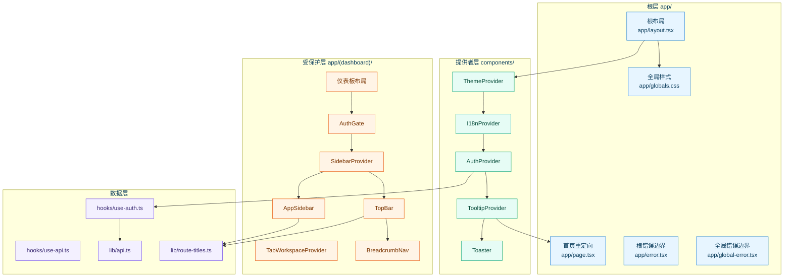
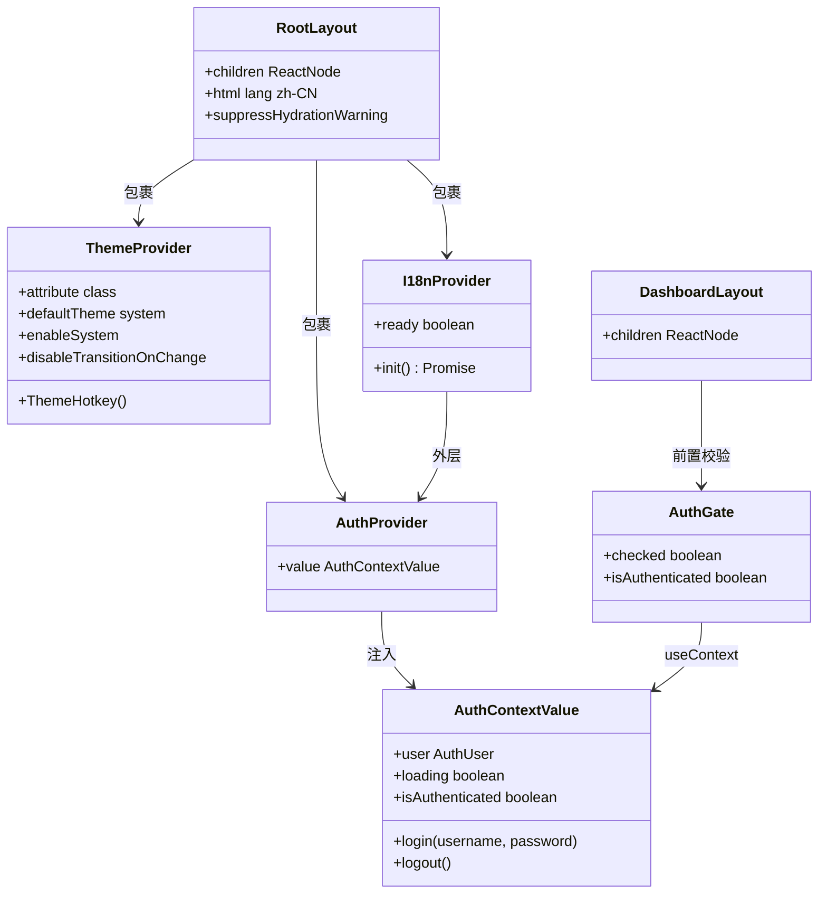
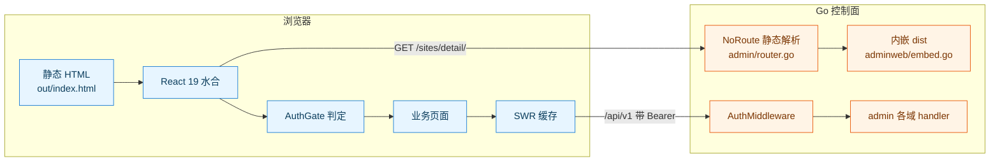
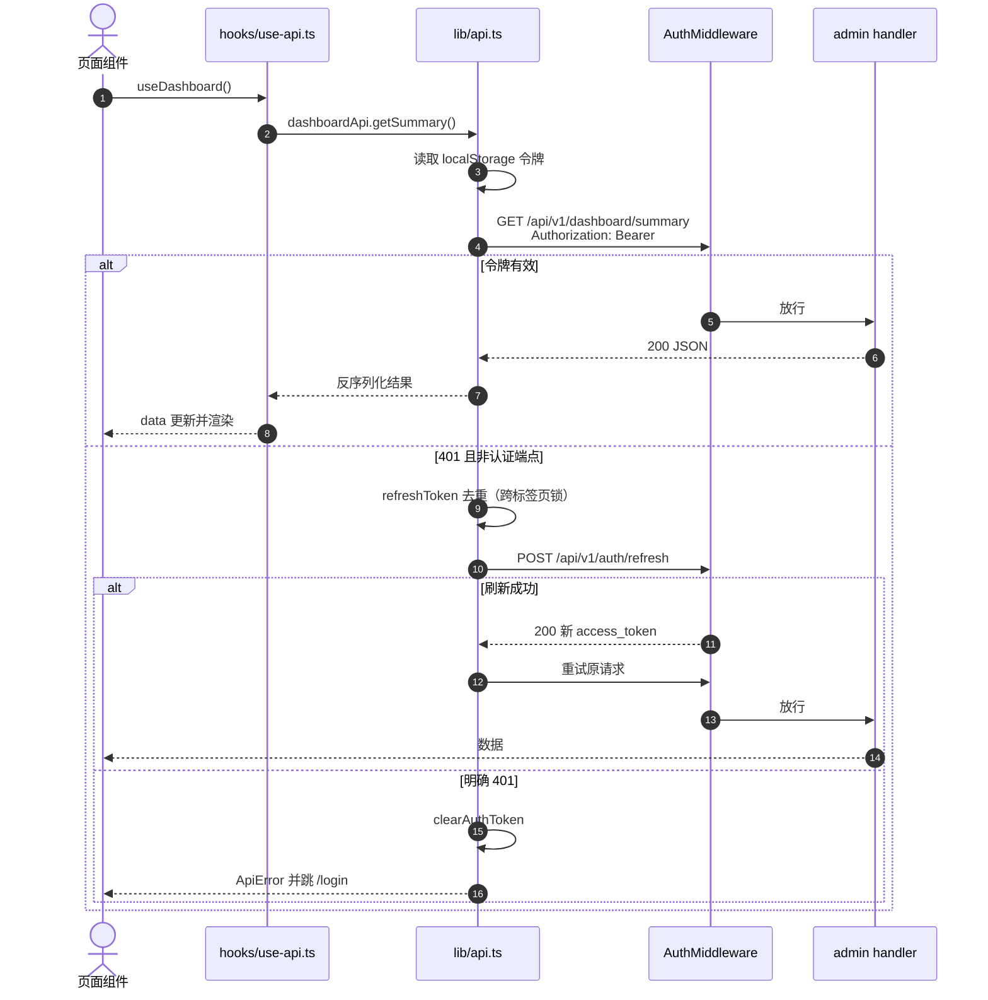
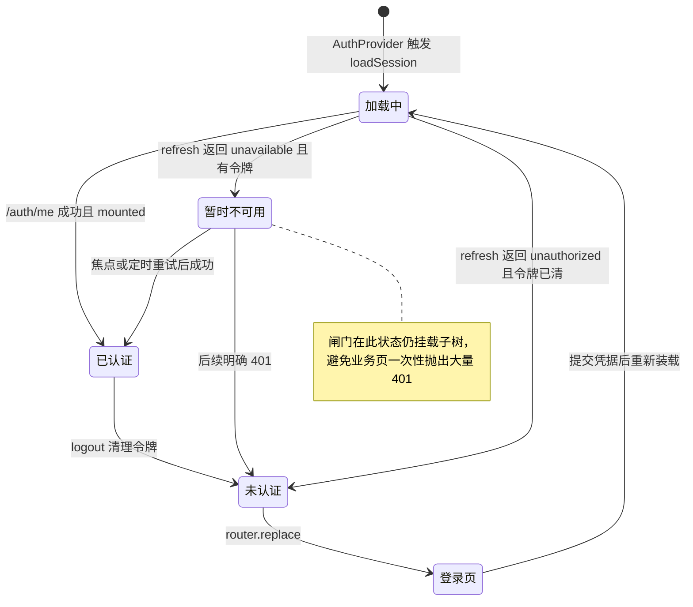
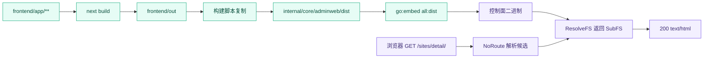
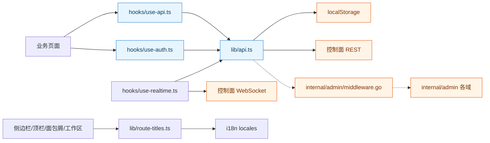
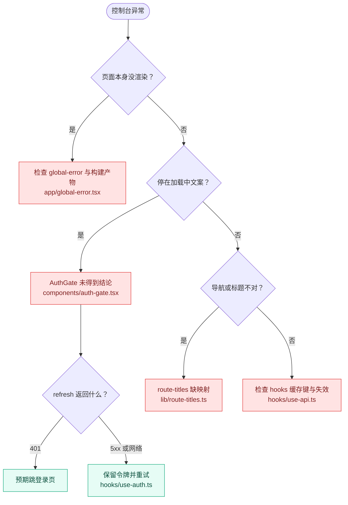

# Next.js 架构设计

> [返回 前端管理界面](../前端管理界面.md)

<cite>
**本文档引用的文件**
- [frontend/app/layout.tsx](file://frontend/app/layout.tsx)
- [frontend/app/page.tsx](file://frontend/app/page.tsx)
- [frontend/app/error.tsx](file://frontend/app/error.tsx)
- [frontend/app/global-error.tsx](file://frontend/app/global-error.tsx)
- [frontend/app/globals.css](file://frontend/app/globals.css)
- [frontend/app/(dashboard)/layout.tsx](file://frontend/app/(dashboard)/layout.tsx)
- [frontend/app/(dashboard)/error.tsx](file://frontend/app/(dashboard)/error.tsx)
- [frontend/app/(dashboard)/dashboard/page.tsx](file://frontend/app/(dashboard)/dashboard/page.tsx)
- [frontend/app/(dashboard)/sites/detail/page.tsx](file://frontend/app/(dashboard)/sites/detail/page.tsx)
- [frontend/app/login/page.tsx](file://frontend/app/login/page.tsx)
- [frontend/app/security-dashboard/layout.tsx](file://frontend/app/security-dashboard/layout.tsx)
- [frontend/components/auth-provider.tsx](file://frontend/components/auth-provider.tsx)
- [frontend/components/auth-gate.tsx](file://frontend/components/auth-gate.tsx)
- [frontend/components/theme-provider.tsx](file://frontend/components/theme-provider.tsx)
- [frontend/components/i18n-provider.tsx](file://frontend/components/i18n-provider.tsx)
- [frontend/components/sidebar-nav.tsx](file://frontend/components/sidebar-nav.tsx)
- [frontend/components/top-bar.tsx](file://frontend/components/top-bar.tsx)
- [frontend/components/breadcrumb-nav.tsx](file://frontend/components/breadcrumb-nav.tsx)
- [frontend/components/tab-workspace.tsx](file://frontend/components/tab-workspace.tsx)
- [frontend/hooks/use-auth.ts](file://frontend/hooks/use-auth.ts)
- [frontend/hooks/use-api.ts](file://frontend/hooks/use-api.ts)
- [frontend/hooks/use-realtime.ts](file://frontend/hooks/use-realtime.ts)
- [frontend/hooks/use-env-overrides.ts](file://frontend/hooks/use-env-overrides.ts)
- [frontend/hooks/use-debounced-value.ts](file://frontend/hooks/use-debounced-value.ts)
- [frontend/hooks/use-mobile.ts](file://frontend/hooks/use-mobile.ts)
- [frontend/lib/api.ts](file://frontend/lib/api.ts)
- [frontend/lib/route-titles.ts](file://frontend/lib/route-titles.ts)
- [frontend/lib/utils.ts](file://frontend/lib/utils.ts)
- [frontend/next.config.ts](file://frontend/next.config.ts)
- [frontend/package.json](file://frontend/package.json)
- [frontend/tsconfig.json](file://frontend/tsconfig.json)
- [frontend/components.json](file://frontend/components.json)
- [internal/core/adminweb/embed.go](file://internal/core/adminweb/embed.go)
- [internal/core/adminweb/static.go](file://internal/core/adminweb/static.go)
- [internal/admin/router.go](file://internal/admin/router.go)
- [internal/admin/auth.go](file://internal/admin/auth.go)
- [internal/admin/middleware.go](file://internal/admin/middleware.go)
</cite>

## 目录

1. [简介](#简介)
2. [项目结构](#项目结构)
3. [核心组件](#核心组件)
4. [架构总览](#架构总览)
5. [详细组件分析](#详细组件分析)
6. [依赖关系分析](#依赖关系分析)
7. [性能考虑](#性能考虑)
8. [故障排查指南](#故障排查指南)
9. [结论](#结论)
10. [附录](#附录)

## 简介

本文件梳理 My-OpenWaf 管理控制台的前端架构，覆盖 App Router 布局分层、提供者组合顺序、路由与页面映射、hooks 数据获取层，以及静态导出产物如何被 Go 控制面内嵌并提供服务。

架构上有三条不可动摇的约束，决定了全部设计取舍：

1. **无服务端运行时**。`next.config.ts` 设定 `output: "export"`，产物落在 `out/`，再由构建脚本复制到 `internal/core/adminweb/dist` 并 `//go:embed` 进二进制。因此不存在 Server Component 数据获取、不存在 middleware.ts、不存在动态 `[id]` 路由段的运行时解析。
2. **认证是纯客户端状态**。访问令牌存放在 `localStorage`，刷新令牌由服务端以 HttpOnly Cookie 下发；会话恢复、定时续期、跨标签页同步全部在 `AuthProvider` 内完成。
3. **路由语义靠查询参数承载**。站点详情使用 `/sites/detail/?id=<站点ID>&tab=<页签>`，而非 `/sites/[id]`，这是静态导出的必然结果。

## 项目结构

### 元数据与技术栈

项目元数据取自 `frontend/package.json` 实测值：

| 项 | 取值 | 出处 |
|------|------|------|
| 包名 / 版本 | `frontend` / `0.0.1` | `frontend/package.json` |
| 模块体系 | `type: "module"`、`private: true` | `frontend/package.json` |
| 开发命令 | `next dev` | `frontend/package.json` |
| 构建命令 | `next build` 后清空并复制 `out` 到 `../internal/core/adminweb/dist` | `frontend/package.json` |
| 类型检查 | `tsc --noEmit` | `frontend/package.json` |
| 契约校验脚本 | 10 个 `check:*`（auth-refresh、login-form、api-route、site-cache 等） | `frontend/package.json` |
| 源码规模 | `app`/`components`/`hooks`/`lib`/`scripts` 共 172 个 ts/tsx | 仓库统计 |
| 路径别名 | `@/*` → `./*` | `frontend/tsconfig.json` |

技术栈矩阵（版本号一律取自 `package.json`，不加臆测）：

| 分层 | 依赖 | 版本 | 在前端中的作用 |
|------|------|------|----------------|
| 框架 | `next` | `16.2.6`（精确锁定） | App Router、静态导出 |
| 视图 | `react` / `react-dom` | `19.2.4` / `19.2.7` | 客户端组件渲染 |
| 样式 | `tailwindcss` / `@tailwindcss/postcss` / `tw-animate-css` | `^4` / `^4` / `^1.4.0` | 原子化样式、CSS 变量与动画类 |
| 组件库 | `shadcn` / `radix-ui` | `^4.12.0` / `^1.6.0` | 无样式可访问组件基座 |
| 组件工具 | `class-variance-authority` / `clsx` / `tailwind-merge` | `^0.7.1` / `^2.1.1` / `^3.6.0` | 变体系统与类名合并 |
| 主题 | `next-themes` | `^0.4.6` | 明暗主题与系统偏好 |
| 国际化 | `i18next` / `react-i18next` / `i18next-browser-languagedetector` | `^26.3.3` / `^17.0.8` / `^8.2.1` | 中英文文案与语言探测 |
| 数据 | `swr` | `^2.4.2` | 只读查询缓存与再验证 |
| 表单 | `react-hook-form` / `zod` / `@hookform/resolvers` | `^7.80.0` / `^4.4.3` / `^5.4.0` | 受控表单与模式校验 |
| 可视化 | `recharts` | `^3.9.1` | 趋势图与占比图 |
| 图标 | `@tabler/icons-react` | `^3.44.0` | 全站图标 |
| 日期 | `date-fns` / `react-day-picker` | `^4.4.0` / `^10.0.1` | 日期区间选择 |
| 反馈与命令 | `sonner` / `cmdk` | `^2.0.7` / `^1.1.1` | Toast 与命令面板 |
| 工具 | `fast-uri` / `lodash-es` | `^4.2.1` / `^4.18.1` | URI 匹配与纯函数工具 |
| 质量 | `eslint` / `eslint-config-next` / `prettier` / `@next/bundle-analyzer` | `^9` / `16.2.10` / `^3.8.3` / `^16.3.5` | 静态检查、格式化与体积分析 |

> 注意 `next.config.ts` 的 `experimental.optimizePackageImports` 仍写着 `lucide-react`，但 `package.json` 未声明该依赖，全站源码中的图标导入全部来自 `@tabler/icons-react`。该配置项当前为空配置，属于历史遗留。

**章节来源**
- [frontend/package.json:1-65](file://frontend/package.json#L1-L65)
- [frontend/next.config.ts:1-16](file://frontend/next.config.ts#L1-L16)
- [frontend/tsconfig.json:21-23](file://frontend/tsconfig.json#L21-L23)
- [frontend/components.json:1-26](file://frontend/components.json#L1-L26)

### 目录结构

| 目录 | 职责 | 规模实测 |
|------|------|----------|
| `frontend/app/` | App Router 入口：根布局、根错误边界、非受保护页 | `layout.tsx`、`page.tsx`、`error.tsx`、`global-error.tsx`、`globals.css` |
| `frontend/app/(dashboard)/` | 受保护路由分组（URL 中无 `(dashboard)` 段） | 25 个页面目录 |
| `frontend/app/login/` | 登录页（不属于 `(dashboard)` 分组） | `page.tsx` |
| `frontend/app/block/`、`maintenance/` | 面向访客的拦截页与维护页 | `page.tsx`（注意扩展名是 `.tsx` 而非 `.ts`） |
| `frontend/app/security-dashboard/` | 监控大屏，独立布局，强制暗色 | `layout.tsx`、`page.tsx` |
| `frontend/app/error/` | 错误提示页 | `page.tsx` |
| `frontend/components/` | 业务组件 | 34 个顶层文件 |
| `frontend/components/ui/` | shadcn 生成的原子组件 | 35 个文件 |
| `frontend/hooks/` | 自定义 Hook | 6 个文件 |
| `frontend/lib/` | API 客户端、类型、纯函数工具、i18n 词表 | 13 个模块 + `i18n/locales` |
| `frontend/scripts/` | 契约校验脚本（不发布） | 9 个 `check-*.ts` |

**章节来源**
- [frontend/app/layout.tsx:1-29](file://frontend/app/layout.tsx#L1-L29)
- [frontend/app/(dashboard)/layout.tsx:1-37](file://frontend/app/(dashboard)/layout.tsx#L1-L37)

### 布局与模块拓扑

**图表来源**
- [frontend/app/layout.tsx:13-28](file://frontend/app/layout.tsx#L13-L28)
- [frontend/app/(dashboard)/layout.tsx:19-36](file://frontend/app/(dashboard)/layout.tsx#L19-L36)
- [frontend/components/top-bar.tsx:26-30](file://frontend/components/top-bar.tsx#L26-L30)
- [frontend/components/sidebar-nav.tsx:192-200](file://frontend/components/sidebar-nav.tsx#L192-L200)
- [frontend/components/auth-provider.tsx:5-9](file://frontend/components/auth-provider.tsx#L5-L9)

**章节来源**
- [frontend/app/layout.tsx:1-29](file://frontend/app/layout.tsx#L1-L29)
- [frontend/app/(dashboard)/layout.tsx:1-37](file://frontend/app/(dashboard)/layout.tsx#L1-L37)

## 核心组件

组件清单（职责按实际代码归纳，不含规划中的能力）：

| 组件 / 模块 | 文件 | 类型 | 单一职责 | 直接依赖 |
|-------------|------|------|----------|----------|
| `RootLayout` | `frontend/app/layout.tsx` | 服务端组件（无指令） | 组装四层 Provider 与 Toaster | theme/i18n/auth Provider |
| `Page` | `frontend/app/page.tsx` | 服务端组件 | 以 `<meta httpEquiv="refresh">` 跳转 `/dashboard/` | 无 |
| `Error` | `frontend/app/error.tsx` | 客户端 | 根级错误兜底与 `reset()` | `ui/button` |
| `GlobalError` | `frontend/app/global-error.tsx` | 客户端 | 根布局自身失败时的兜底，重渲 `<html>` | `ui/button` |
| `ThemeProvider` | `frontend/components/theme-provider.tsx` | 客户端 | 包一层 next-themes 并挂载主题热键 | `next-themes` |
| `I18nProvider` | `frontend/components/i18n-provider.tsx` | 客户端 | 仅在客户端 `useEffect` 内初始化 i18next | i18next 与两份 locale |
| `AuthProvider` | `frontend/components/auth-provider.tsx` | 客户端 | 全应用唯一认证控制器实例 | `hooks/use-auth` |
| `AuthGate` | `frontend/components/auth-gate.tsx` | 客户端 | 认证结论确定前不挂载业务子树 | `hooks/use-auth`、`lib/api` |
| `DashboardLayout` | `frontend/app/(dashboard)/layout.tsx` | 服务端组件 | 组合闸门、侧边栏、顶栏与工作区 | 上述组件 |
| `AppSidebar` | `frontend/components/sidebar-nav.tsx` | 客户端 | 导航分组渲染与路径最长匹配高亮 | `ui/sidebar`、i18n |
| `TopBar` | `frontend/components/top-bar.tsx` | 客户端 | 标题、系统重载、外观与语言切换、登出 | `lib/route-titles` |
| `BreadcrumbNav` | `frontend/components/breadcrumb-nav.tsx` | 客户端 | 按路径片段生成面包屑 | `lib/route-titles` |
| `TabWorkspaceProvider` | `frontend/components/tab-workspace.tsx` | 客户端 | 多标签工作区与 sessionStorage 持久化 | `lib/route-titles` |
| `apiRequest` | `frontend/lib/api.ts` | 客户端模块 | 统一 fetch、Bearer 头、401 刷新链路 | `localStorage` |

**章节来源**
- [frontend/app/layout.tsx:1-29](file://frontend/app/layout.tsx#L1-L29)
- [frontend/app/page.tsx:1-10](file://frontend/app/page.tsx#L1-L10)
- [frontend/app/error.tsx:6-32](file://frontend/app/error.tsx#L6-L32)
- [frontend/app/global-error.tsx:6-34](file://frontend/app/global-error.tsx#L6-L34)
- [frontend/components/auth-gate.tsx:15-44](file://frontend/components/auth-gate.tsx#L15-L44)
- [frontend/components/tab-workspace.tsx:104-142](file://frontend/components/tab-workspace.tsx#L104-L142)

### 提供者与闸门类型关系

**图表来源**
- [frontend/app/layout.tsx:16-25](file://frontend/app/layout.tsx#L16-L25)
- [frontend/components/theme-provider.tsx:10-21](file://frontend/components/theme-provider.tsx#L10-L21)
- [frontend/components/i18n-provider.tsx:15-44](file://frontend/components/i18n-provider.tsx#L15-L44)
- [frontend/components/auth-provider.tsx:6-9](file://frontend/components/auth-provider.tsx#L6-L9)
- [frontend/components/auth-gate.tsx:15-29](file://frontend/components/auth-gate.tsx#L15-L29)
- [frontend/hooks/use-auth.ts:288-309](file://frontend/hooks/use-auth.ts#L288-L309)

**章节来源**
- [frontend/hooks/use-auth.ts:87-100](file://frontend/hooks/use-auth.ts#L87-L100)

## 架构总览

双层布局体系是本架构的主干。根布局负责跨全站关注点（样式、主题、语言、认证、提示通道），仪表板分组布局负责控制台上下文（闸门、侧边栏、顶栏、标签工作区、面包屑），二者之间没有共享状态传递，只通过 React Context 向下广播。

**图表来源**
- [internal/admin/router.go:442-465](file://internal/admin/router.go#L442-L465)
- [internal/core/adminweb/embed.go:10-18](file://internal/core/adminweb/embed.go#L10-L18)
- [internal/core/adminweb/static.go:54-84](file://internal/core/adminweb/static.go#L54-L84)
- [internal/admin/middleware.go:42-90](file://internal/admin/middleware.go#L42-L90)
- [frontend/lib/api.ts:531-560](file://frontend/lib/api.ts#L531-L560)

**章节来源**
- [frontend/next.config.ts:3-14](file://frontend/next.config.ts#L3-L14)
- [frontend/app/(dashboard)/layout.tsx:19-36](file://frontend/app/(dashboard)/layout.tsx#L19-L36)

## 详细组件分析

### 提供者装配顺序与后果

Provider 的嵌套顺序不是风格选择，而是由依赖关系决定的：`ThemeProvider` 最外，避免语言未就绪时主题闪烁；`I18nProvider` 次之，因为它在未初始化时直接返回 `null`，会连带隐藏整棵子树；`AuthProvider` 再次，令所有文案已可用；`TooltipProvider` 与 `Toaster` 位于业务子树外围。

| 序 | 步骤 | 代码位置 | 可观测结果 |
|:--:|------|----------|------------|
| 1 | 注入 `globals.css` | `app/layout.tsx:3` | Tailwind 变量与 oklch 调色板就绪 |
| 2 | `html lang="zh-CN"` + `suppressHydrationWarning` | `app/layout.tsx:14` | 抑制 next-themes 写入 class 造成的水合差异 |
| 3 | `ThemeProvider` 挂载 | `components/theme-provider.tsx:11` | 主题属性写在 `<html>` 的 class 上 |
| 4 | `I18nProvider` 客户端初始化 | `components/i18n-provider.tsx:18` | 初始化完成前渲染 `null` |
| 5 | `AuthProvider` 创建控制器 | `components/auth-provider.tsx:7` | 建立唯一的续期定时器与事件监听 |
| 6 | `TooltipProvider` 包裹 | `app/layout.tsx:19` | 悬浮提示共享延迟策略 |
| 7 | `Toaster` 定位 `top-center` | `app/layout.tsx:21` | 全站通知通道 |

**章节来源**
- [frontend/app/layout.tsx:1-29](file://frontend/app/layout.tsx#L1-L29)
- [frontend/components/i18n-provider.tsx:15-45](file://frontend/components/i18n-provider.tsx#L15-L45)
- [frontend/components/theme-provider.tsx:6-22](file://frontend/components/theme-provider.tsx#L6-L22)
- [frontend/components/auth-provider.tsx:1-10](file://frontend/components/auth-provider.tsx#L1-L10)

### 路由与页面映射

`output: "export"` 与 `trailingSlash: true` 共同决定 URL 一律带尾斜杠。以下为实测的映射关系：

| URL | 源文件 | 受保护 | 标题 key | 备注 |
|-----|--------|:------:|----------|------|
| `/` | `frontend/app/page.tsx` | ✗ | — | `<meta httpEquiv="refresh">` 跳 `/dashboard/` |
| `/login/` | `frontend/app/login/page.tsx` | ✗ | — | 已登录时 `router.replace("/dashboard")` |
| `/block/` | `frontend/app/block/page.tsx` | ✗ | — | 含 `__WAF_STATUS_CODE__`、`__WAF_REQUEST_ID__` 占位符 |
| `/maintenance/` | `frontend/app/maintenance/page.tsx` | ✗ | — | 访客可见维护页 |
| `/error/` | `frontend/app/error/page.tsx` | ✗ | — | 独立错误提示页 |
| `/security-dashboard/` | `frontend/app/security-dashboard/page.tsx` | ✓ | — | 自带布局，不套侧边栏与顶栏 |
| `/dashboard/` | `frontend/app/(dashboard)/dashboard/page.tsx` | ✓ | `nav.dashboard` | 固定标签 |
| `/sites/` | `frontend/app/(dashboard)/sites/page.tsx` | ✓ | `nav.sites` | 卡片与表格双视图 |
| `/sites/detail/` | `frontend/app/(dashboard)/sites/detail/page.tsx` | ✓ | `common.detail` | 以 `?id=` 定位站点、`?tab=` 定位页签 |
| `/rules/`、`/rules/owasp/`、`/rules/cve/` | `frontend/app/(dashboard)/rules/**/page.tsx` | ✓ | `nav.rules` 等 | 三条独立路由 |
| `/attacks/`、`/security-events/`、`/access-logs/`、`/drop-events/` | 同名目录下 `page.tsx` | ✓ | `nav.*` | 审计与事件视图 |
| `/request-trace/`、`/upstream-status/`、`/tls-fingerprints/` | 同名目录下 `page.tsx` | ✓ | `nav.*` | 运行时观测 |
| `/policies/`、`/cc-protection/`、`/captcha/`、`/auth-config/` | 同名目录下 `page.tsx` | ✓ | `nav.*` | 防护配置 |
| `/certificates/`、`/ip-lists/`、`/threat-intel/` | 同名目录下 `page.tsx` | ✓ | `nav.*` | 网络与情报 |
| `/js-plugins/`、`/lua-plugins/`、`/page-templates/`、`/false-positives/` | 同名目录下 `page.tsx` | ✓ | `nav.*` | 扩展与反馈 |
| `/admin-users/`、`/api-keys/`、`/backup/`、`/settings/` | 同名目录下 `page.tsx` | ✓ | `nav.*` | 系统管理 |

`app/(dashboard)/` 共 25 个页面目录，加上顶层 `login`、`block`、`maintenance`、`error`、`security-dashboard` 与根 `page.tsx`。不存在 `protection`、`drop-policy`、`forwarding-profiles`、`bot-protection`、`fingerprints` 这些历史目录，也不存在 `sites/[id]` 动态段。

**章节来源**
- [frontend/lib/route-titles.ts:7-77](file://frontend/lib/route-titles.ts#L7-L77)
- [frontend/app/page.tsx:1-10](file://frontend/app/page.tsx#L1-L10)
- [frontend/app/(dashboard)/sites/detail/page.tsx:78-90](file://frontend/app/(dashboard)/sites/detail/page.tsx#L78-L90)
- [frontend/next.config.ts:6-6](file://frontend/next.config.ts#L6-L6)

### Hooks 与数据获取层

hooks 清单（hook | 文件 | 职责 | 使用方）：

| Hook | 文件 | 职责 | 使用方 |
|------|------|------|--------|
| `useAuthController` | `frontend/hooks/use-auth.ts` | 会话恢复、到期前 60 秒续期、焦点与 storage 事件 | `components/auth-provider.tsx` |
| `useAuth` | `frontend/hooks/use-auth.ts` | 读取共享认证状态 | `AuthGate`、`TopBar`、`login/page.tsx`、`sites/detail`、各权限判断页 |
| `useIsAuthenticated` | `frontend/hooks/use-auth.ts` | 独立登录态探测（自带节流与 storage 同步） | —（当前无调用方，见附录） |
| `useApiQuery`（内部） | `frontend/hooks/use-api.ts` | SWR 封装，默认 `revalidateOnFocus: false` | 全部只读 hook |
| `useMutation` | `frontend/hooks/use-api.ts` | 写操作、并发去重、按前缀失效缓存 | 表单与对话框组件 |
| `useDashboard` / `useDashboardStats` | `frontend/hooks/use-api.ts` | 摘要 10 秒轮询、统计 30 秒轮询 | `app/(dashboard)/dashboard/page.tsx` |
| `useSites` / `useSite` / `useSiteRules` | `frontend/hooks/use-api.ts` | 站点读视图，缓存键含站点 ID | `sites/page.tsx`、`sites/detail/page.tsx` |
| `invalidateSiteCaches` 等 | `frontend/hooks/use-api.ts` | 缓存失效编排 | 站点、策略、规则、备份页 |
| `useRealtimeEvents` | `frontend/hooks/use-realtime.ts` | ticket + WebSocket 事件快照订阅 | `app/security-dashboard/page.tsx` |
| `useRealtimeOverview` | `frontend/hooks/use-realtime.ts` | upstream 快照订阅 | `app/(dashboard)/upstream-status/page.tsx` |
| `useEnvOverrides` | `frontend/hooks/use-env-overrides.ts` | 环境变量覆盖读写与写后回读 | `components/env-override-card.tsx`、`settings/page.tsx` |
| `useDebouncedValue` | `frontend/hooks/use-debounced-value.ts` | 静默窗口内合并输入 | `rules/owasp/page.tsx`、`rules/cve/page.tsx` |
| `useIsMobile` | `frontend/hooks/use-mobile.ts` | 768px 断点检测 | `components/ui/sidebar.tsx` |
| `useTabWorkspace` | `frontend/components/tab-workspace.tsx` | 读取标签集合与激活路径 | —（当前无调用方，见附录） |

数据流层次单向：页面组件 → hooks → `lib/api.ts` 的领域对象（`siteApi`、`ruleApi`、`settingsApi` 等）→ `apiRequest` → `fetch`。页面不直接 `fetch`，`lib/api.ts` 不感知 React。

**图表来源**
- [frontend/lib/api.ts:531-607](file://frontend/lib/api.ts#L531-L607)
- [frontend/hooks/use-api.ts:156-165](file://frontend/hooks/use-api.ts#L156-L165)
- [frontend/hooks/use-api.ts:574-578](file://frontend/hooks/use-api.ts#L574-L578)
- [internal/admin/middleware.go:42-90](file://internal/admin/middleware.go#L42-L90)

**章节来源**
- [frontend/hooks/use-auth.ts:69-71](file://frontend/hooks/use-auth.ts#L69-L71)
- [frontend/hooks/use-realtime.ts:11-23](file://frontend/hooks/use-realtime.ts#L11-L23)
- [frontend/hooks/use-env-overrides.ts:78-126](file://frontend/hooks/use-env-overrides.ts#L78-L126)
- [frontend/hooks/use-debounced-value.ts:13-32](file://frontend/hooks/use-debounced-value.ts#L13-L32)
- [frontend/hooks/use-mobile.ts:3-19](file://frontend/hooks/use-mobile.ts#L3-L19)

### 认证闸门的状态迁移

`AuthGate` 的判定条件是 `isAuthenticated = !!user || (!!getAccessToken() && checked)`。这一形式的意义在于：`/auth/me` 遇网络故障或 5xx 时控制器保留现有令牌，此时不得把"暂时不可用"误判为"已登出"。

**图表来源**
- [frontend/components/auth-gate.tsx:19-29](file://frontend/components/auth-gate.tsx#L19-L29)
- [frontend/hooks/use-auth.ts:159-201](file://frontend/hooks/use-auth.ts#L159-L201)
- [frontend/hooks/use-auth.ts:120-148](file://frontend/hooks/use-auth.ts#L120-L148)

**章节来源**
- [frontend/components/auth-gate.tsx:9-44](file://frontend/components/auth-gate.tsx#L9-L44)
- [frontend/hooks/use-auth.ts:87-201](file://frontend/hooks/use-auth.ts#L87-L201)

### 静态导出与服务端内嵌

构建把 `out/` 复制进 `internal/core/adminweb/dist`，Go 侧通过 `//go:embed all:dist` 把整棵产物树编进二进制，运行时由 `NoRoute` 兜底解析。

| 阶段 | 动作 | 依据 |
|------|------|------|
| 1 | `next build` 产出 `frontend/out` | `package.json` 的 `build` |
| 2 | 删除并覆盖 `internal/core/adminweb/dist` | `package.json` 的 `build` |
| 3 | `ResolveFS("")` 返回 `SubFS()` | `adminweb/static.go:11-17` |
| 4 | `NoRoute` 忽略 `/api/` 前缀，其余走静态解析 | `admin/router.go:448-455` |
| 5 | `routeCandidates` 生成候选：原路径、`变体/index.html`、`变体.html` | `adminweb/static.go:54-84` |
| 6 | `ContentType` 按扩展名给响应类型 | `adminweb/static.go:31-52` |

`StaticFS`（`diskDir`）非空时改为读磁盘，便于本地调试不重新编译二进制。

**图表来源**
- [frontend/package.json:8-8](file://frontend/package.json#L8-L8)
- [internal/core/adminweb/embed.go:10-18](file://internal/core/adminweb/embed.go#L10-L18)
- [internal/core/adminweb/static.go:10-17](file://internal/core/adminweb/static.go#L10-L17)
- [internal/admin/router.go:442-465](file://internal/admin/router.go#L442-L465)

**章节来源**
- [frontend/next.config.ts:3-14](file://frontend/next.config.ts#L3-L14)
- [internal/core/adminweb/static.go:20-52](file://internal/core/adminweb/static.go#L20-L52)

## 依赖关系分析

内部依赖矩阵（行依赖列）：

| 依赖方 \ 被依赖 | `lib/api.ts` | `hooks/use-auth` | `hooks/use-api` | `lib/route-titles` | `components/ui/*` |
|-----------------|:------------:|:----------------:|:---------------:|:------------------:|:-----------------:|
| `app/layout.tsx` | — | 间接 | — | — | ✓ |
| `(dashboard)/layout.tsx` | 间接 | 间接 | — | — | ✓ |
| `components/auth-gate.tsx` | ✓ | ✓ | — | — | — |
| `components/top-bar.tsx` | 间接 | ✓ | ✓ | ✓ | ✓ |
| `components/sidebar-nav.tsx` | — | — | — | — | ✓ |
| `components/breadcrumb-nav.tsx` | — | — | — | ✓ | ✓ |
| `components/tab-workspace.tsx` | — | — | — | ✓ | — |
| 业务页面 | 间接 | ✓ | ✓ | — | ✓ |

外部实体清单：

| 外部实体 | 引入方式 | 边界 | 失败影响 |
|----------|----------|------|----------|
| 控制面 REST `/api/v1/*` | `lib/api.ts` 的 `fetch` | 同域、`credentials: "include"` | 401 触发刷新，网络错误保留令牌 |
| 控制面 WebSocket `/api/v1/realtime/ws` | `hooks/use-realtime.ts` | 一次性 ticket，60 秒有效期 | 55 秒换票重连；静默降级 |
| `localStorage` | 令牌、到期时间、刷新锁、强调色 | 浏览器同源 | 隐私模式写入失败被吞掉 |
| `sessionStorage` | 标签工作区 | 同源同标签页 | 丢失仅影响标签恢复 |
| `embed.FS` | Go 二进制内嵌产物 | 进程内只读 | 未构建前端则 404 |

**图表来源**
- [frontend/lib/api.ts:27-35](file://frontend/lib/api.ts#L27-L35)
- [frontend/lib/api.ts:728-741](file://frontend/lib/api.ts#L728-L741)
- [frontend/hooks/use-realtime.ts:16-23](file://frontend/hooks/use-realtime.ts#L16-L23)
- [frontend/components/breadcrumb-nav.tsx:14](file://frontend/components/breadcrumb-nav.tsx#L14)
- [internal/admin/middleware.go:47-53](file://internal/admin/middleware.go#L47-L53)

**章节来源**
- [frontend/lib/route-titles.ts:1-77](file://frontend/lib/route-titles.ts#L1-L77)
- [frontend/lib/utils.ts:1-8](file://frontend/lib/utils.ts#L1-L8)
- [frontend/tsconfig.json:21-23](file://frontend/tsconfig.json#L21-L23)

## 性能考虑

| 关注点 | 现状 | 影响 | 建议 |
|--------|------|------|------|
| 包体裁剪 | `optimizePackageImports` 仅对 `date-fns` 生效 | `lucide-react` 为空配置 | 从配置移除或改为 `@tabler/icons-react` |
| 生产日志 | `compiler.removeConsole` 在 production 生效 | 泄漏面收窄 | 保持 |
| 图标导入 | 全站按需具名导入 tabler 图标 | 摇树有效 | 勿改成 `import *` |
| SWR 焦点重验 | `useApiQuery` 默认关闭 `revalidateOnFocus` | 避免切窗风暴 | 保持 |
| 分页聚合 | 站点资源与选择器各自限 10 页 × 200 条 | 内存可控 | 变更需同步契约脚本 |
| 令牌探测去重 | 模块级 `authMeRequest` + 500 毫秒结果缓存 | 多组件挂载不放大请求 | 保持 |
| 错误边界层级 | `global-error.tsx` 重渲 `<html>` | 根布局崩溃可恢复 | 保持 |

**章节来源**
- [frontend/next.config.ts:8-13](file://frontend/next.config.ts#L8-L13)
- [frontend/hooks/use-api.ts:89-151](file://frontend/hooks/use-api.ts#L89-L151)
- [frontend/lib/api.ts:39-47](file://frontend/lib/api.ts#L39-L47)
- [frontend/hooks/use-auth.ts:36-55](file://frontend/hooks/use-auth.ts#L36-L55)

## 故障排查指南

### 症状定位流程

**图表来源**
- [frontend/components/auth-gate.tsx:19-41](file://frontend/components/auth-gate.tsx#L19-L41)
- [frontend/app/global-error.tsx:6-34](file://frontend/app/global-error.tsx#L6-L34)
- [frontend/lib/route-titles.ts:72-77](file://frontend/lib/route-titles.ts#L72-L77)
- [frontend/hooks/use-auth.ts:120-148](file://frontend/hooks/use-auth.ts#L120-L148)

**章节来源**
- [frontend/app/(dashboard)/error.tsx:1-30](file://frontend/app/(dashboard)/error.tsx#L1-L30)
- [frontend/app/error.tsx:1-32](file://frontend/app/error.tsx#L1-L32)

### 常见问题与处置

| 症状 | 根因 | 排查 | 处置 |
|------|------|------|------|
| 访问 `/` 停留在"Redirecting…" | `page.tsx` 只写 meta refresh，无 JS 跳转 | 确认 `/dashboard/` 返回 200 | 检查内嵌 dist 与 NoRoute 解析 |
| 刷新后掉回登录页 | 令牌存在但 `expires_at` 解析失败 | 看 `token_expires_at` 值 | 重新登录写入 `expires_at` |
| 多标签页同时 401 后重复刷新 | Web Locks 不可用时退化为 localStorage 租约 | 看 `my_openwaf_refresh_lock*` 键 | 属预期回退，TTL 15 秒 |
| 侧边栏出现两个同名标签 | `trailingSlash` 与历史存储尾斜杠不一致 | 检查 `owaf.workspace.tabs` | `normalizePath` 已去重 |
| 新增页面无标题 | `routeTitleKeyMap`/`segmentKeyMap` 缺项 | 打开 `lib/route-titles.ts` | 两张表同时补 |
| 中文文案显示为 key | `I18nProvider` 尚未初始化 | 控制台看是否直接返回 null | 属预期；初始化后恢复 |

**章节来源**
- [frontend/app/page.tsx:1-10](file://frontend/app/page.tsx#L1-L10)
- [frontend/lib/api.ts:145-198](file://frontend/lib/api.ts#L145-L198)
- [frontend/lib/api.ts:49-56](file://frontend/lib/api.ts#L49-L56)
- [frontend/components/tab-workspace.tsx:33-53](file://frontend/components/tab-workspace.tsx#L33-L53)

## 结论

本架构的最大特征是"以静态导出为硬约束"，所有看似间接的设计——查询参数式详情路由、客户端认证闸门、提供者顺序、标题映射单一数据源、跨标签页刷新锁——都是这一约束的推论，而非额外复杂度。分层上做到了：`lib/api.ts` 无 React 依赖、hooks 无 DOM 之外的 UI 知识、组件不做请求拼装，符合单一职责与依赖倒置。

值得记录的两处冗余：`useIsAuthenticated` 与 `useTabWorkspace` 目前无调用方，属可评估的 YAGNI 候选；`optimizePackageImports` 中的 `lucide-react` 与实际图标库不一致。

下一步建议：新增受保护页面时严格走"目录 + 两张标题表 + 契约校验"三件套；把上述两处冗余在确认无计划使用后移除。

**章节来源**
- [本节为总结，无需特定文件来源]

## 附录

### 术语表

| 术语 | 英文 | 含义 | 同义/易混 | 出处 |
|------|------|------|-----------|------|
| 受保护分组 | route group | `(dashboard)` 目录，仅用于布局复用，不进入 URL | 与"路由段"混用 | `frontend/app/(dashboard)/` |
| 认证闸门 | AuthGate | 认证结论确定前不挂载业务子树的守卫 | 与"中间件"混淆 | `frontend/components/auth-gate.tsx` |
| 访问令牌 | access token | JWT，存放于 `localStorage` 键 `token` | 与 refresh 令牌混淆 | `frontend/lib/api.ts:28-29` |
| 刷新令牌 | refresh token | HttpOnly Cookie `my_openwaf_rt`，前端不可读 | 与 access token 混淆 | `internal/admin/auth_helpers.go:15` |
| 认证代次 | auth epoch | 登录/登出递增的整数，用于丢弃过期刷新结果 | 与 JTI 混淆 | `frontend/lib/api.ts:39` |
| 标签工作区 | tab workspace | 多标签式导航条，sessionStorage 持久化 | 与浏览器标签页混淆 | `frontend/components/tab-workspace.tsx` |
| 标题映射 | route titles | 路径到 i18n key 的单一数据源 | 与面包屑组件混淆 | `frontend/lib/route-titles.ts` |
| 内嵌产物 | embedded dist | Go `embed.FS` 中的 Next 静态树 | 与 `frontend/out` 混淆 | `internal/core/adminweb/embed.go` |

### 配置项速查

| 配置 | 位置 | 取值 | 说明 |
|------|------|------|------|
| `output` | `next.config.ts` | `export` | 纯静态导出，无服务端运行时 |
| `distDir` | `next.config.ts` | `out` | 构建输出目录 |
| `trailingSlash` | `next.config.ts` | `true` | 所有 URL 带尾斜杠 |
| `poweredByHeader` | `next.config.ts` | `false` | 移除 `X-Powered-By` |
| `compiler.removeConsole` | `next.config.ts` | production 下 `true` | 剥离 `console` |
| `REFRESH_LEAD_MS` | `hooks/use-auth.ts` | `60000` | 到期前 60 秒提前续期 |
| `REFRESH_RETRY_MS` | `hooks/use-auth.ts` | `30000` | 续期失败重试间隔 |
| `RESUME_CHECK_INTERVAL_MS` | `hooks/use-auth.ts` | `30000` | 焦点恢复探测节流 |
| `REFRESH_LOCK_TTL_MS` | `lib/api.ts` | `15000` | localStorage 刷新租约时长 |
| `REFRESH_LOCK_WAIT_MS` | `lib/api.ts` | `20000` | 等待其他标签页完成刷新上限 |
| `REFRESH_RESULT_CACHE_MS` | `lib/api.ts` | `500` | 刷新结果短时复用窗口 |
| `FRONTEND_PAGE_SIZE` / `MAX_SITE_RESOURCE_PAGES` | `lib/api.ts` | `200` / `10` | 站点资源分页聚合上限 |
| `MOBILE_BREAKPOINT` | `hooks/use-mobile.ts` | `768` | 移动端断点 |
| `REALTIME_TICKET_TTL_MS` | `hooks/use-realtime.ts` | `55000` | ticket 到期前重连 |
| `AccessTTL` / `RefreshTTL` | `internal/admin/auth/jwt.go` | `15m` / `168h` | 令牌生命周期 |

### 验证命令

| 命令 | 用途 |
|------|------|
| `bun run typecheck` | `tsc --noEmit` 全量类型检查 |
| `bun run lint` | ESLint |
| `bun run build` | 构建并同步产物到 `internal/core/adminweb/dist` |
| `bun run check:auth-refresh-contract` | 令牌刷新链路契约 |
| `bun run check:login-form-contract` | 登录表单契约 |
| `bun run check:api-route-contract` | 前端路由与后端端点对齐 |
| `bun run check:site-cache-contract` | 站点缓存规则契约 |
| `bun run check:env-override-contract` | 环境变量覆盖契约 |

**章节来源**
- [frontend/package.json:6-23](file://frontend/package.json#L6-L23)
- [frontend/hooks/use-auth.ts:69-71](file://frontend/hooks/use-auth.ts#L69-L71)
- [frontend/lib/api.ts:27-56](file://frontend/lib/api.ts#L27-L56)
- [frontend/lib/api.ts:697-723](file://frontend/lib/api.ts#L697-L723)
- [frontend/hooks/use-realtime.ts:11-12](file://frontend/hooks/use-realtime.ts#L11-L12)
- [internal/admin/auth/jwt.go:36-42](file://internal/admin/auth/jwt.go#L36-L42)

### 冗余导出清单

| 导出 | 文件 | 状态 | 说明 |
|------|------|------|------|
| `useIsAuthenticated` | `frontend/hooks/use-auth.ts` | 无调用方 | 功能与 `AuthGate` + `useAuth` 重叠 |
| `useTabWorkspace` | `frontend/components/tab-workspace.tsx` | 无调用方 | 标签数据目前仅组件内部消费 |
| `lucide-react` | `frontend/next.config.ts` | 空配置 | 依赖未声明，实际用 tabler 图标 |

**章节来源**
- [frontend/hooks/use-auth.ts:311-409](file://frontend/hooks/use-auth.ts#L311-L409)
- [frontend/components/tab-workspace.tsx:278-284](file://frontend/components/tab-workspace.tsx#L278-L284)
- [frontend/next.config.ts:11-13](file://frontend/next.config.ts#L11-L13)
