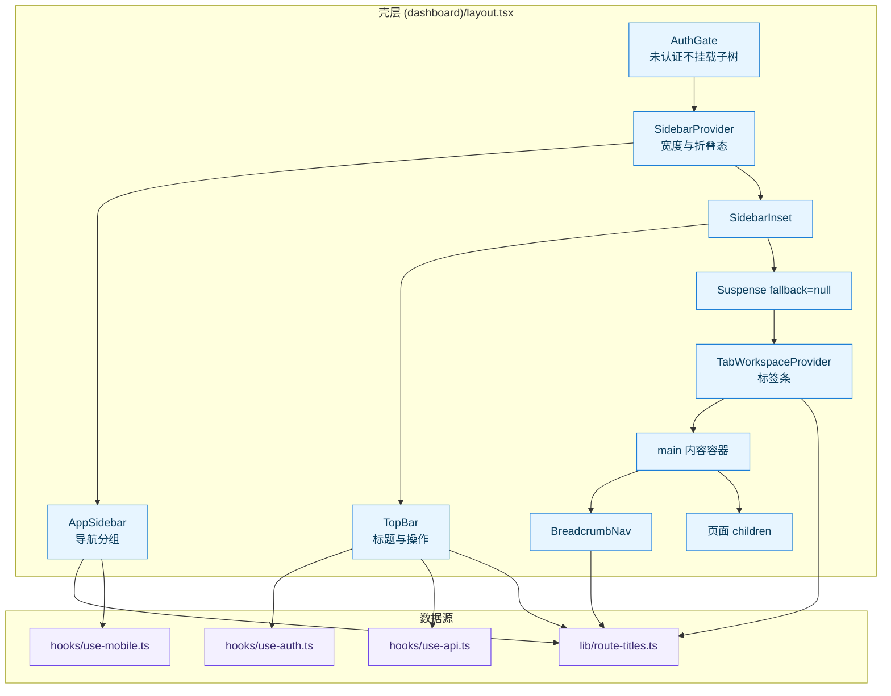
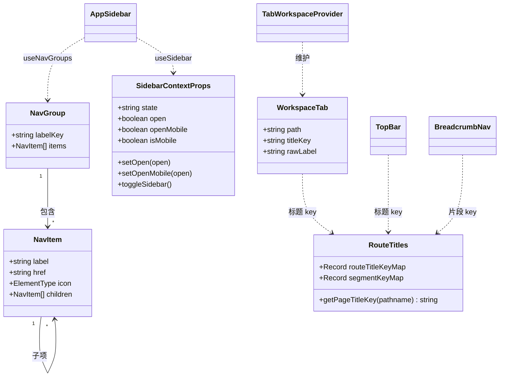
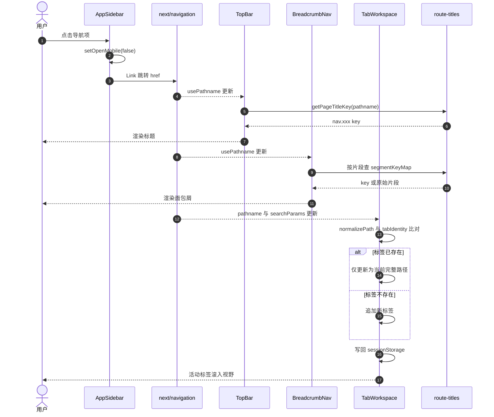
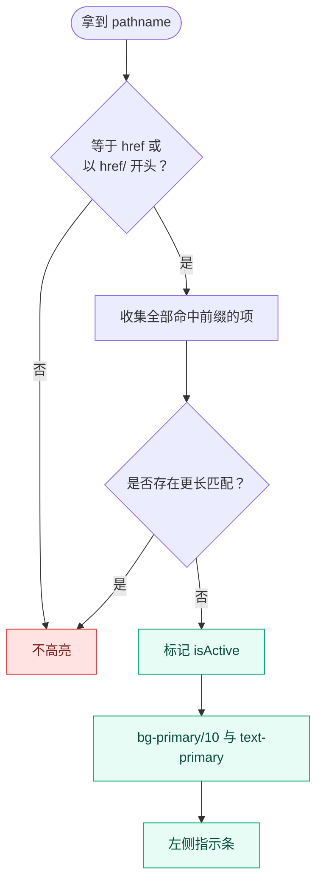
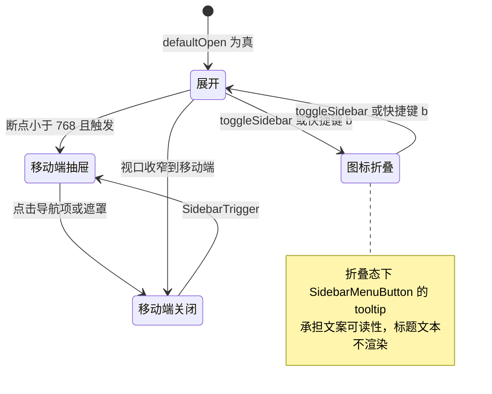
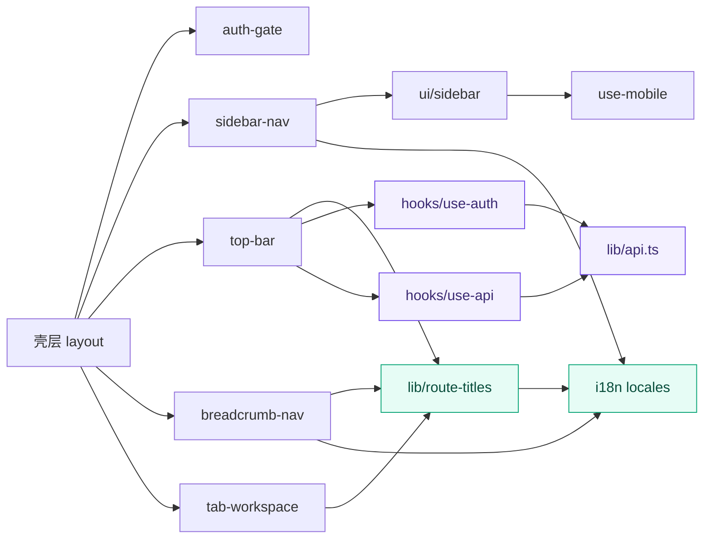

# 仪表板布局与导航

> [返回 前端管理界面](../前端管理界面.md)

<cite>
**本文档引用的文件**
- [frontend/app/(dashboard)/layout.tsx](file://frontend/app/(dashboard)/layout.tsx)
- [frontend/app/layout.tsx](file://frontend/app/layout.tsx)
- [frontend/components/sidebar-nav.tsx](file://frontend/components/sidebar-nav.tsx)
- [frontend/components/top-bar.tsx](file://frontend/components/top-bar.tsx)
- [frontend/components/breadcrumb-nav.tsx](file://frontend/components/breadcrumb-nav.tsx)
- [frontend/components/tab-workspace.tsx](file://frontend/components/tab-workspace.tsx)
- [frontend/components/auth-gate.tsx](file://frontend/components/auth-gate.tsx)
- [frontend/components/appearance-toggle.tsx](file://frontend/components/appearance-toggle.tsx)
- [frontend/components/language-switcher.tsx](file://frontend/components/language-switcher.tsx)
- [frontend/components/ui/sidebar.tsx](file://frontend/components/ui/sidebar.tsx)
- [frontend/hooks/use-mobile.ts](file://frontend/hooks/use-mobile.ts)
- [frontend/hooks/use-auth.ts](file://frontend/hooks/use-auth.ts)
- [frontend/hooks/use-api.ts](file://frontend/hooks/use-api.ts)
- [frontend/lib/route-titles.ts](file://frontend/lib/route-titles.ts)
- [frontend/lib/api.ts](file://frontend/lib/api.ts)
- [frontend/package.json](file://frontend/package.json)
- [frontend/next.config.ts](file://frontend/next.config.ts)
- [frontend/components.json](file://frontend/components.json)
</cite>

## 目录

1. [简介](#简介)
2. [项目结构](#项目结构)
3. [核心组件](#核心组件)
4. [架构总览](#架构总览)
5. [详细组件分析](#详细组件分析)
6. [依赖关系分析](#依赖关系分析)
7. [性能考虑](#性能考虑)
8. [故障排查指南](#故障排查指南)
9. [结论](#结论)
10. [附录](#附录)

## 简介

本文件描述仪表板壳层与导航系统的实现。壳层指 `frontend/app/(dashboard)/layout.tsx`，它在 URL 上不产生分段（路由组 `(dashboard)` 仅用于布局复用），负责把认证闸门、侧边栏、顶部栏、标签工作区与面包屑组合成一个稳定容器。

必须先纠正四处容易踩坑的事实：

1. **导航配置的单一来源是 `frontend/lib/route-titles.ts`**，不存在 `frontend/lib/console.ts`，也没有 `getNavMeta()` 这样的聚合查询函数。该文件导出三样东西：`routeTitleKeyMap`、`segmentKeyMap`、`getPageTitleKey()`。
2. **面包屑不在顶部栏里渲染**。`TopBar` 只渲染当前页标题；`BreadcrumbNav` 是独立组件，被布局放在 `<main>` 内、页面内容之上。
3. **图标库是 `@tabler/icons-react`**，不是 Lucide。
4. **侧边栏的折叠状态持久化在 Cookie**（`sidebar_state`，有效期 7 天），而标签工作区持久化在 `sessionStorage`，两者机制不同，排查时不要混。

## 项目结构

### 技术栈矩阵

| 领域 | 依赖 | 版本 | 在导航中的作用 |
|------|------|------|----------------|
| 框架 | `next` | `16.2.6` | 路由组与布局嵌套 |
| 视图 | `react` | `19.2.4` | 客户端组件 |
| 链接与路由 | `next/link`、`next/navigation` | 随 `next` | `Link` 跳转、`usePathname` 高亮、`useRouter` 替换 |
| 组件基座 | `radix-ui` / `shadcn` | `^1.6.0` / `^4.12.0` | `Collapsible`、`Sheet`、`Tooltip`、`DropdownMenu` |
| 图标 | `@tabler/icons-react` | `^3.44.0` | 导航项与操作图标 |
| 国际化 | `react-i18next` | `^17.0.8` | 导航标签取 i18n key |
| 样式 | `tailwindcss` / `tw-animate-css` | `^4` / `^1.4.0` | 活动态与折叠动画 |
| 类名 | `clsx` / `tailwind-merge` | `^2.1.1` / `^3.6.0` | `cn()` 组合活动样式 |
| 通知 | `sonner` | `^2.0.7` | 重载成功/失败提示 |
| 数据 | `swr` | `^2.4.2` | 顶栏重载按钮的 mutation |

### 导航相关文件

| 文件 | 角色 | 说明 |
|------|------|------|
| `frontend/app/(dashboard)/layout.tsx` | 壳层 | 闸门 + 侧边栏 + 顶栏 + 工作区 + 面包屑 |
| `frontend/components/sidebar-nav.tsx` | 导航数据与渲染 | 6 个分组、可折叠子项、最长匹配高亮 |
| `frontend/components/ui/sidebar.tsx` | 侧边栏基座 | 宽度、Cookie 持久化、`b` 快捷键、移动端 Sheet |
| `frontend/components/top-bar.tsx` | 顶部栏 | 标题、重载、外观、语言、用户菜单 |
| `frontend/components/breadcrumb-nav.tsx` | 面包屑 | 按路径片段逐项解析 |
| `frontend/components/tab-workspace.tsx` | 标签工作区 | 多标签与 `sessionStorage` 持久化 |
| `frontend/lib/route-titles.ts` | 标题单一数据源 | 两张映射表 + 前缀解析函数 |
| `frontend/hooks/use-mobile.ts` | 断点探测 | 768 像素以下视为移动端 |

**章节来源**
- [frontend/package.json:24-52](file://frontend/package.json#L24-L52)
- [frontend/app/(dashboard)/layout.tsx:1-37](file://frontend/app/(dashboard)/layout.tsx#L1-L37)
- [frontend/lib/route-titles.ts:1-77](file://frontend/lib/route-titles.ts#L1-L77)

### 壳层装配结构

**图表来源**
- [frontend/app/(dashboard)/layout.tsx:19-36](file://frontend/app/(dashboard)/layout.tsx#L19-L36)
- [frontend/components/sidebar-nav.tsx:339-381](file://frontend/components/sidebar-nav.tsx#L339-L381)
- [frontend/components/top-bar.tsx:49-99](file://frontend/components/top-bar.tsx#L49-L99)
- [frontend/components/breadcrumb-nav.tsx:16-55](file://frontend/components/breadcrumb-nav.tsx#L16-L55)
- [frontend/hooks/use-mobile.ts:3-19](file://frontend/hooks/use-mobile.ts#L3-L19)

**章节来源**
- [frontend/components/ui/sidebar.tsx:27-32](file://frontend/components/ui/sidebar.tsx#L27-L32)

## 核心组件

组件清单：

| 组件 | 文件 | 职责 | 关键输入 | 关键输出 |
|------|------|------|----------|----------|
| `DashboardLayout` | `frontend/app/(dashboard)/layout.tsx` | 组合壳层，不含业务判断 | `children` | 完整容器 |
| `AppSidebar` | `frontend/components/sidebar-nav.tsx` | 渲染分组与活动高亮 | `usePathname`、`useSidebar`、`useTranslation` | 侧边栏 |
| `CollapsibleNavItem` | 同上 | 带子项的可展开项 | `NavItem` | 折叠组 |
| `SimpleNavItem` | 同上 | 无子项的普通项 | `NavItem` | 单链接 |
| `TopBar` | `frontend/components/top-bar.tsx` | 标题、重载、外观、语言、账号 | `useAuth`、`useSystemReload` | 头部条 |
| `BreadcrumbNav` | `frontend/components/breadcrumb-nav.tsx` | 路径片段逐项链接 | `usePathname`、`segmentKeyMap` | 面包屑 |
| `TabWorkspaceProvider` | `frontend/components/tab-workspace.tsx` | 标签集合与激活同步 | `usePathname`、`useSearchParams` | 标签条 + 上下文 |
| `getPageTitleKey` | `frontend/lib/route-titles.ts` | 前缀解析标题 key | `pathname` | key 或 `undefined` |

**章节来源**
- [frontend/components/sidebar-nav.tsx:76-189](file://frontend/components/sidebar-nav.tsx#L76-L189)
- [frontend/components/top-bar.tsx:32-101](file://frontend/components/top-bar.tsx#L32-L101)
- [frontend/components/tab-workspace.tsx:104-284](file://frontend/components/tab-workspace.tsx#L104-L284)

### 导航数据结构类图

**图表来源**
- [frontend/components/sidebar-nav.tsx:76-88](file://frontend/components/sidebar-nav.tsx#L76-L88)
- [frontend/components/sidebar-nav.tsx:192-334](file://frontend/components/sidebar-nav.tsx#L192-L334)
- [frontend/components/ui/sidebar.tsx:34-42](file://frontend/components/ui/sidebar.tsx#L34-L42)
- [frontend/components/tab-workspace.tsx:55-62](file://frontend/components/tab-workspace.tsx#L55-L62)
- [frontend/lib/route-titles.ts:7-65](file://frontend/lib/route-titles.ts#L7-L65)

**章节来源**
- [frontend/components/sidebar-nav.tsx:113-165](file://frontend/components/sidebar-nav.tsx#L113-L165)

## 架构总览

导航交互的完整一次往返：用户点击 → `Link` 跳转 → `usePathname` 变化 → 三处（侧边栏高亮、顶栏标题、面包屑）各自重算 → 标签工作区追加或激活。

**图表来源**
- [frontend/components/sidebar-nav.tsx:147-186](file://frontend/components/sidebar-nav.tsx#L147-L186)
- [frontend/components/top-bar.tsx:28-54](file://frontend/components/top-bar.tsx#L28-L54)
- [frontend/components/breadcrumb-nav.tsx:20-52](file://frontend/components/breadcrumb-nav.tsx#L20-L52)
- [frontend/components/tab-workspace.tsx:144-192](file://frontend/components/tab-workspace.tsx#L144-L192)

**章节来源**
- [frontend/lib/route-titles.ts:67-77](file://frontend/lib/route-titles.ts#L67-L77)

## 详细组件分析

### 导航分组与路由映射

`useNavGroups()` 返回六个分组，前三组无标题，后三组有 `labelKey`：

| 分组 | `labelKey` | 顶级项 | 子项 |
|------|------------|--------|------|
| 1 | — | `/dashboard` | — |
| 2 | — | `/sites` | — |
| 3 | — | `/security-events`（组标题项） | `/security-events`、`/access-logs`、`/request-trace`、`/drop-events`、`/attacks`、`/false-positives`、`/upstream-status`、`/tls-fingerprints` |
| 4 | `nav.groupProtection` | `/policies`、`/rules`（组）、`/lua-plugins`（组）、`/cc-protection`、`/captcha`、`/auth-config` | `/rules`、`/rules/owasp`、`/rules/cve`；`/lua-plugins`、`/js-plugins` |
| 5 | `nav.groupNetwork` | `/certificates`、`/ip-lists`、`/threat-intel` | — |
| 6 | `nav.groupSystem` | `/api-keys`、`/admin-users`、`/page-templates`、`/backup`、`/settings` | — |

对应的页面目录实测为 25 个，URL 与目录一一对应，不存在 `protection`、`drop-policy`、`forwarding-profiles`、`bot-protection`、`fingerprints` 这些历史目录（指纹页现为 `tls-fingerprints`）。

`route-titles.ts` 的两张表覆盖度不同，这是刻意的：`routeTitleKeyMap` 有 25 项并包含 `/rules` 与其两个子路径，`segmentKeyMap` 额外包含 `detail → common.detail`，用于面包屑的中间片段。

**章节来源**
- [frontend/components/sidebar-nav.tsx:195-333](file://frontend/components/sidebar-nav.tsx#L195-L333)
- [frontend/lib/route-titles.ts:7-65](file://frontend/lib/route-titles.ts#L7-L65)

### 活动态判定算法

高亮由两个纯函数决定，都以前缀匹配为基础：

| 步骤 | 函数 | 逻辑 | 目的 |
|:--:|------|------|------|
| 1 | `isChildActive` | 等于 `href` 或以 `href + "/"` 开头，再递归子项 | 判定父组是否处于活动态 |
| 2 | `isExactOrLongestActive` | 收集全部候选（含子项）中命中前缀者，取最长 `href` | 避免父级与子级同时高亮 |
| 3 | 组内聚合 | `groupActive = children.some(isChildActive)` | 决定 `Collapsible defaultOpen` |
| 4 | 样式注入 | `isActive` 传给 `SidebarMenuButton` | 触发 `data-[active=true]` |

`ACTIVE_ITEM_CLASS` 的由来值得记录：shadcn 默认活动态是 `bg-sidebar-accent`，与 `hover:bg-sidebar-accent` 完全相同，鼠标划过便无法分辨当前页。因此本页叠加 `bg-primary/10`、`text-primary` 与左侧 `w-[3px]` 指示条；子项指示条为 `w-0.5`。

**图表来源**
- [frontend/components/sidebar-nav.tsx:89-111](file://frontend/components/sidebar-nav.tsx#L89-L111)
- [frontend/components/sidebar-nav.tsx:62-74](file://frontend/components/sidebar-nav.tsx#L62-L74)
- [frontend/components/sidebar-nav.tsx:114-165](file://frontend/components/sidebar-nav.tsx#L114-L165)

**章节来源**
- [frontend/components/sidebar-nav.tsx:167-189](file://frontend/components/sidebar-nav.tsx#L167-L189)

### 侧边栏开合状态机

开合状态由 `ui/sidebar.tsx` 的 `SidebarProvider` 管理，而非业务组件，业务侧只读 `state`：

**图表来源**
- [frontend/components/ui/sidebar.tsx:34-53](file://frontend/components/ui/sidebar.tsx#L34-L53)
- [frontend/components/ui/sidebar.tsx:55-85](file://frontend/components/ui/sidebar.tsx#L55-L85)
- [frontend/components/sidebar-nav.tsx:339-353](file://frontend/components/sidebar-nav.tsx#L339-L353)

**章节来源**
- [frontend/components/ui/sidebar.tsx:27-32](file://frontend/components/ui/sidebar.tsx#L27-L32)
- [frontend/hooks/use-mobile.ts:1-20](file://frontend/hooks/use-mobile.ts#L1-L20)

### 顶部栏的权限门控

`TopBar` 中唯一的写操作入口是"重载配置"按钮，其可用性由角色决定：

| 元素 | 数据源 | 禁用条件 | 说明 |
|------|--------|----------|------|
| 页面标题 | `getPageTitleKey(pathname)` | — | 未命中回落 `My OpenWAF` |
| 重载按钮 | `useSystemReload()` | `authLoading \|\| !canManage \|\| reload.loading` | `canManage` 为 `admin` 或 `operator` |
| 重载按钮提示 | `common.readOnlyHint` | — | 仅在非加载且无权限时给出 |
| 主题切换 | `useTheme()` | — | `ThemeToggle` |
| 强调色切换 | `localStorage` 的 `owaf.accent` | — | `AccentToggle` |
| 语言切换 | `i18n.changeLanguage` | — | 中文 / English |
| 用户菜单 | `useAuth().user` | — | 显示用户名与退出 |
| 侧边栏开关 | `SidebarTrigger` | — | 复用 `useSidebar` |

`useSystemReload` 是一个无失效键的 mutation，仅 `POST /api/v1/reload`，因此不会触发缓存重验，界面数据在下一轮轮询时自然更新。

**章节来源**
- [frontend/components/top-bar.tsx:32-70](file://frontend/components/top-bar.tsx#L32-L70)
- [frontend/hooks/use-api.ts:1334-1336](file://frontend/hooks/use-api.ts#L1334-L1336)
- [frontend/lib/api.ts:1177-1179](file://frontend/lib/api.ts#L1177-L1179)
- [frontend/hooks/use-auth.ts:288-294](file://frontend/hooks/use-auth.ts#L288-L294)

### 面包屑的生成规则

| 规则 | 实现 | 示例 |
|------|------|------|
| 首项固定为首页 | 指向 `/dashboard`，文案 `common.home` | 所有页面均以首页起头 |
| 片段切分 | `pathname.split("/").filter(Boolean)` | `/sites/detail/` → `sites`、`detail` |
| 片段标题 | 命中 `segmentKeyMap` 取翻译，否则 `decodeURIComponent(segment)` | 数字 ID 原样显示 |
| 末项不可点 | 渲染 `BreadcrumbPage` | 当前页 |
| 中间项可点 | `href` 为前缀累加 | `/sites` |
| 分隔符包裹 | `span.contents` 保持 DOM 扁平 | 不影响 ARIA 结构 |

由于 `trailingSlash: true`，`filter(Boolean)` 会丢弃空片段，因此尾斜杠不会生成多余一级。

**章节来源**
- [frontend/components/breadcrumb-nav.tsx:20-55](file://frontend/components/breadcrumb-nav.tsx#L20-L55)
- [frontend/lib/route-titles.ts:36-65](file://frontend/lib/route-titles.ts#L36-L65)
- [frontend/next.config.ts:6](file://frontend/next.config.ts#L6)

### 标签工作区与详情去重

`TabWorkspaceProvider` 渲染在 `Suspense` 内，因为需要 `useSearchParams()`。标题复用 `routeTitleKeyMap`，与顶栏、面包屑同一数据源。

| 机制 | 函数 | 行为 |
|------|------|------|
| 路径归一化 | `normalizePath` | 去尾斜杠、查询串按键排序 |
| 标签标识 | `tabIdentity` | 普通路径取 pathname；`/sites/detail` 额外保留 `id` |
| 固定标签 | `PINNED_PATH = /dashboard/` | 不可关闭，缺失时插到首位 |
| 关闭回落 | `closeTab` | 关闭当前激活标签时跳相邻项 |
| 可见性保持 | `ensureActiveTabVisible` + `ResizeObserver` | 只横向滚动，不改纵向位置 |

因此"同一站点切换页签"不会新增标签，而"切换到另一站点"会新增标签——这是 `tabIdentity` 的特例分支直接决定的。

**章节来源**
- [frontend/components/tab-workspace.tsx:25-53](file://frontend/components/tab-workspace.tsx#L25-L53)
- [frontend/components/tab-workspace.tsx:104-211](file://frontend/components/tab-workspace.tsx#L104-L211)

### 响应式与可访问性

| 维度 | 实测实现 | 位置 |
|------|----------|------|
| 断点 | `max-width: 767px` 判为移动端 | `hooks/use-mobile.ts` |
| 桌面宽度 | `16rem`；图标折叠态 `3rem` | `ui/sidebar.tsx:29-31` |
| 移动宽度 | `18rem`，以 Sheet 呈现 | `ui/sidebar.tsx:30`、`192` |
| 键盘快捷键 | `b` 切换侧边栏 | `ui/sidebar.tsx:32` |
| 折叠提示 | `SidebarMenuButton tooltip=` | `sidebar-nav.tsx:126-179` |
| 标签语义 | `role="tablist"`、`role="tab"`、`aria-selected`、`aria-current` | `tab-workspace.tsx:226-253` |
| 方向 | `components.json` 中 `rtl: true`，使用逻辑属性 | 活动条 `start-0`、图标 `ms-auto` |
| 语言标签 | `html lang="zh-CN"` | `app/layout.tsx:14` |
| 导航关闭 | 点击后 `setOpenMobile(false)` | `sidebar-nav.tsx:152-182` |

**章节来源**
- [frontend/hooks/use-mobile.ts:3-19](file://frontend/hooks/use-mobile.ts#L3-L19)
- [frontend/components/ui/sidebar.tsx:27-32](file://frontend/components/ui/sidebar.tsx#L27-L32)
- [frontend/components/tab-workspace.tsx:224-268](file://frontend/components/tab-workspace.tsx#L224-L268)
- [frontend/components.json:13-14](file://frontend/components.json#L13-L14)

## 依赖关系分析

| 依赖方 | 被依赖 | 类型 | 耦合强度 |
|--------|--------|------|:--------:|
| 壳层布局 | `AuthGate` | 组件包裹 | 强（不通过则不渲染） |
| 壳层布局 | `AppSidebar`、`TopBar`、`BreadcrumbNav`、`TabWorkspaceProvider` | 组件组合 | 中 |
| `AppSidebar` | `ui/sidebar.tsx`、`ui/collapsible.tsx` | 基座组件 | 中 |
| `AppSidebar` | `lib/route-titles` | **不直接依赖**（标签来自 i18n key） | 弱 |
| `TopBar` | `lib/route-titles` | 函数调用 | 强 |
| `BreadcrumbNav` | `lib/route-titles` | 常量表 | 强 |
| `TabWorkspaceProvider` | `lib/route-titles` | 函数调用 | 强 |
| `TopBar` | `hooks/use-auth`、`hooks/use-api` | 状态与 mutation | 中 |
| `ui/sidebar.tsx` | `hooks/use-mobile` | 断点 | 中 |

**图表来源**
- [frontend/components/top-bar.tsx:20-30](file://frontend/components/top-bar.tsx#L20-L30)
- [frontend/components/breadcrumb-nav.tsx:14](file://frontend/components/breadcrumb-nav.tsx#L14)
- [frontend/components/tab-workspace.tsx:22](file://frontend/components/tab-workspace.tsx#L22)
- [frontend/components/ui/sidebar.tsx:7](file://frontend/components/ui/sidebar.tsx#L7)

**章节来源**
- [frontend/app/(dashboard)/layout.tsx:6-12](file://frontend/app/(dashboard)/layout.tsx#L6-L12)

## 性能考虑

- **标题解析复杂度**：`getPageTitleKey` 对 25 项做线性前缀扫描，调用点在每次路由变化的顶栏渲染，成本可忽略；若映射表扩张到百项级别再考虑按段建索引。
- **高亮计算的重复**：每个导航项独立收集候选并取最长匹配，分组数量有限（6 组），无需缓存。
- **折叠态渲染**：折叠时标题文本不进入 DOM（`!collapsed && ...`），减少布局节点。
- **标签滚动**：用 `ResizeObserver` 而非窗口 `resize`，容器宽度变化即响应，避免整页监听。
- **Cookie 写入**：开合状态写 Cookie 是为了跨标签页与刷新保持，代价是每次切换产生一次 `document.cookie` 赋值，频率极低。

**章节来源**
- [frontend/lib/route-titles.ts:72-77](file://frontend/lib/route-titles.ts#L72-L77)
- [frontend/components/tab-workspace.tsx:184-192](file://frontend/components/tab-workspace.tsx#L184-L192)
- [frontend/components/ui/sidebar.tsx:85](file://frontend/components/ui/sidebar.tsx#L85-L85)

## 故障排查指南

| 症状 | 根因 | 排查 | 处置 |
|------|------|------|------|
| 父项与子项同时高亮 | 只用了前缀匹配 | 检查是否走 `isExactOrLongestActive` | 统一用最长匹配 |
| 悬停看不出当前页 | 使用默认 `bg-sidebar-accent` | 检查是否套用活动样式常量 | 保留 `ACTIVE_ITEM_CLASS` |
| 顶栏标题是 `My OpenWAF` | `routeTitleKeyMap` 缺项 | 打开映射表核对前缀 | 补 key，同步 `segmentKeyMap` |
| 面包屑出现原始片段 | `segmentKeyMap` 缺项 | 同上 | 两张表同时补 |
| 同一站点出现多个标签 | `tabIdentity` 未特判 `id` | 看标签 `key` | 依赖详情页只写 `id` 参数 |
| 移动端抽屉点了不关 | 未调 `setOpenMobile(false)` | 检查链接 `onClick` | 补齐 |
| 侧边栏宽度不对 | CSS 变量未注入 | 检查 `--sidebar-width` | 确认 `SidebarProvider` 在最外层 |
| 重载按钮一直禁用 | 角色为 `readonly` 或仍在加载 | 看 `user.role` | 属预期，`title` 已给出提示 |

**章节来源**
- [frontend/components/sidebar-nav.tsx:62-111](file://frontend/components/sidebar-nav.tsx#L62-L111)
- [frontend/components/tab-workspace.tsx:47-53](file://frontend/components/tab-workspace.tsx#L47-L53)
- [frontend/components/top-bar.tsx:35-63](file://frontend/components/top-bar.tsx#L35-L63)

## 结论

导航系统的一致性来自一个决定：**路径到文案的映射只有一份**。顶栏、面包屑、标签条三者各自取用同一模块，因此新增页面只需两处补表即可全线同步，符合 DRY 与开放封闭。

职责划分同样清晰：`ui/sidebar.tsx` 只管容器行为（宽度、折叠、断点、快捷键），`sidebar-nav.tsx` 只管导航语义（分组、图标、匹配），业务页面不参与导航渲染。

一处应记录的冗余：`AppSidebar` 页脚写死 `v1.0.0`，与 `package.json` 的 `0.0.1` 不一致，属需要统一版本的显示项。

**章节来源**
- [frontend/components/sidebar-nav.tsx:375-379](file://frontend/components/sidebar-nav.tsx#L375-L379)
- [frontend/package.json:3](file://frontend/package.json#L3)

## 附录

### 术语表

| 术语 | 英文 | 含义 | 同义/易混 | 出处 |
|------|------|------|-----------|------|
| 壳层 | dashboard shell | `(dashboard)/layout.tsx` 组合出的容器 | 与"根布局"混用 | `app/(dashboard)/layout.tsx` |
| 路由组 | route group | 括号目录，只复用布局，不进入 URL | 与"路由段"混淆 | `frontend/app/(dashboard)` |
| 最长匹配 | longest prefix match | 在所有命中前缀的项中取 `href` 最长者 | 与"精确匹配"混淆 | `sidebar-nav.tsx:101-111` |
| 图标折叠 | icon collapse | 侧边栏收成 3rem 仅显示图标 | 与"完全隐藏"混淆 | `ui/sidebar.tsx:31` |
| 抽屉 | mobile sheet | 移动端以覆盖式面板呈现导航 | 与桌面侧栏混淆 | `ui/sidebar.tsx` 的 Sheet 分支 |
| 固定标签 | pinned tab | `/dashboard/` 不可关闭 | 与"默认页签"混淆 | `tab-workspace.tsx:25` |
| 逻辑属性 | logical properties | `ms-*`/`start-0` 等随方向翻转的属性 | 与物理方向类混淆 | `components.json:14` |

### 导航项与页面清单

| 导航标签 key | href | 图标 | 页面目录 |
|--------------|------|------|----------|
| `nav.dashboard` | `/dashboard` | `IconChartBar` | `app/(dashboard)/dashboard` |
| `nav.sites` | `/sites` | `IconShield` | `app/(dashboard)/sites` |
| `nav.securityEvents` | `/security-events` | `IconAlertCircle` | `app/(dashboard)/security-events` |
| `nav.accessLogs` | `/access-logs` | `IconFileText` | `app/(dashboard)/access-logs` |
| `nav.requestTrace` | `/request-trace` | `IconRoute` | `app/(dashboard)/request-trace` |
| `nav.dropEvents` | `/drop-events` | `IconBan` | `app/(dashboard)/drop-events` |
| `nav.attacks` | `/attacks` | `IconFlame` | `app/(dashboard)/attacks` |
| `nav.falsePositives` | `/false-positives` | `IconAlertHexagon` | `app/(dashboard)/false-positives` |
| `nav.upstreamStatus` | `/upstream-status` | `IconServer` | `app/(dashboard)/upstream-status` |
| `nav.tlsFingerprints` | `/tls-fingerprints` | `IconFingerprint` | `app/(dashboard)/tls-fingerprints` |
| `nav.policies` | `/policies` | `IconShieldCheck` | `app/(dashboard)/policies` |
| `nav.rules` | `/rules` | `IconListCheck` | `app/(dashboard)/rules` |
| `nav.owaspRules` | `/rules/owasp` | `IconFlame` | `app/(dashboard)/rules/owasp` |
| `nav.cveRules` | `/rules/cve` | `IconAlertHexagon` | `app/(dashboard)/rules/cve` |
| `nav.luaPlugins` | `/lua-plugins` | `IconCode` | `app/(dashboard)/lua-plugins` |
| `nav.jsPlugins` | `/js-plugins` | `IconBraces` | `app/(dashboard)/js-plugins` |
| `nav.ccProtection` | `/cc-protection` | `IconGauge` | `app/(dashboard)/cc-protection` |
| `nav.captcha` | `/captcha` | `IconUserCheck` | `app/(dashboard)/captcha` |
| `nav.authConfig` | `/auth-config` | `IconKey` | `app/(dashboard)/auth-config` |
| `nav.certificates` | `/certificates` | `IconCertificate` | `app/(dashboard)/certificates` |
| `nav.ipLists` | `/ip-lists` | `IconNetwork` | `app/(dashboard)/ip-lists` |
| `nav.threatIntel` | `/threat-intel` | `IconWorldBolt` | `app/(dashboard)/threat-intel` |
| `nav.apiKeys` | `/api-keys` | `IconApi` | `app/(dashboard)/api-keys` |
| `nav.adminUsers` | `/admin-users` | `IconUsers` | `app/(dashboard)/admin-users` |
| `nav.pageTemplates` | `/page-templates` | `IconTemplate` | `app/(dashboard)/page-templates` |
| `nav.backup` | `/backup` | `IconDatabaseExport` | `app/(dashboard)/backup` |
| `nav.settings` | `/settings` | `IconSettings` | `app/(dashboard)/settings` |

**章节来源**
- [frontend/components/sidebar-nav.tsx:195-333](file://frontend/components/sidebar-nav.tsx#L195-L333)

### 新增导航项的流程

| 序 | 操作 | 文件 | 验证 |
|:--:|------|------|------|
| 1 | 建页面目录与 `page.tsx` | `frontend/app/(dashboard)/<name>/page.tsx` | `bun run typecheck` |
| 2 | 加入 `routeTitleKeyMap` | `frontend/lib/route-titles.ts` | 顶栏标题变化 |
| 3 | 加入 `segmentKeyMap` | `frontend/lib/route-titles.ts` | 面包屑文案变化 |
| 4 | 选定 tabler 图标 | `frontend/components/sidebar-nav.tsx` 导入区 | 无未使用导入 |
| 5 | 在合适分组的 `items` 加项 | `useNavGroups()` | 列表出现且高亮正确 |
| 6 | 补 `nav.<key>` 中英文案 | `frontend/lib/i18n/locales/zh.json`、`en.json` | 切换语言不出现裸 key |
| 7 | 若为多级，确认子项 `href` 更长 | `isExactOrLongestActive` | 父项高亮、子项可点 |

**章节来源**
- [frontend/components/sidebar-nav.tsx:192-334](file://frontend/components/sidebar-nav.tsx#L192-L334)
- [frontend/lib/route-titles.ts:7-65](file://frontend/lib/route-titles.ts#L7-L65)

### 配置常量速查

| 常量 | 值 | 文件 |
|------|----|------|
| `SIDEBAR_COOKIE_NAME` | `sidebar_state` | `frontend/components/ui/sidebar.tsx` |
| `SIDEBAR_COOKIE_MAX_AGE` | `60 * 60 * 24 * 7`（7 天） | 同上 |
| `SIDEBAR_WIDTH` | `16rem` | 同上 |
| `SIDEBAR_WIDTH_MOBILE` | `18rem` | 同上 |
| `SIDEBAR_WIDTH_ICON` | `3rem` | 同上 |
| `SIDEBAR_KEYBOARD_SHORTCUT` | `b` | 同上 |
| `MOBILE_BREAKPOINT` | `768` | `frontend/hooks/use-mobile.ts` |
| `PINNED_PATH` | `/dashboard/` | `frontend/components/tab-workspace.tsx` |
| `STORAGE_KEY` | `owaf.workspace.tabs` | 同上 |
| `ACCENT_STORAGE_KEY` | `owaf.accent` | `frontend/components/appearance-toggle.tsx` |

**章节来源**
- [frontend/components/ui/sidebar.tsx:27-32](file://frontend/components/ui/sidebar.tsx#L27-L32)
- [frontend/hooks/use-mobile.ts:3](file://frontend/hooks/use-mobile.ts#L3)
- [frontend/components/tab-workspace.tsx:25-26](file://frontend/components/tab-workspace.tsx#L25-L26)
- [frontend/components/appearance-toggle.tsx:16](file://frontend/components/appearance-toggle.tsx#L16)
