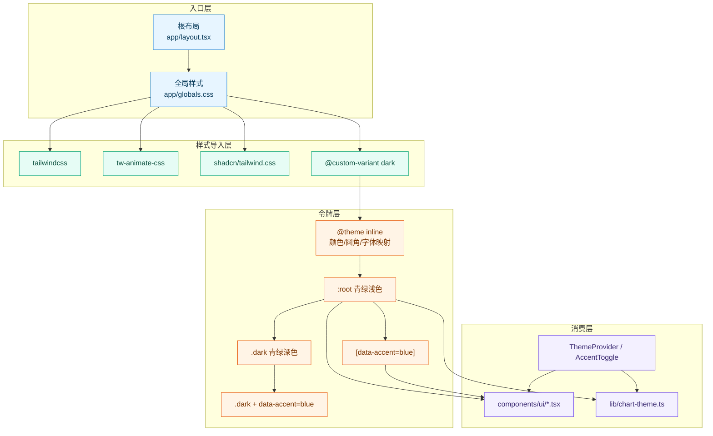
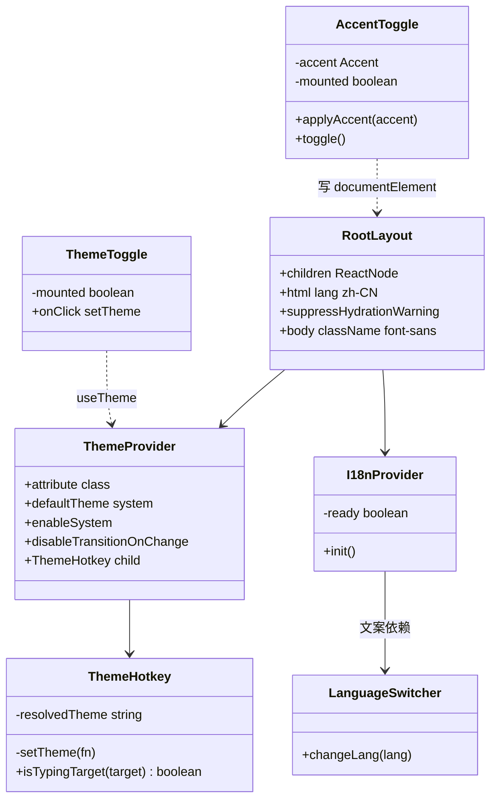
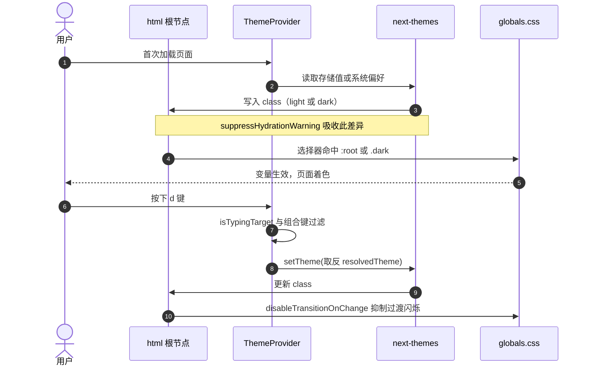
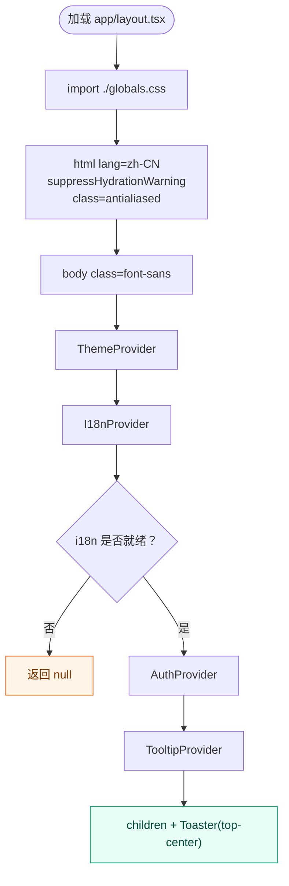
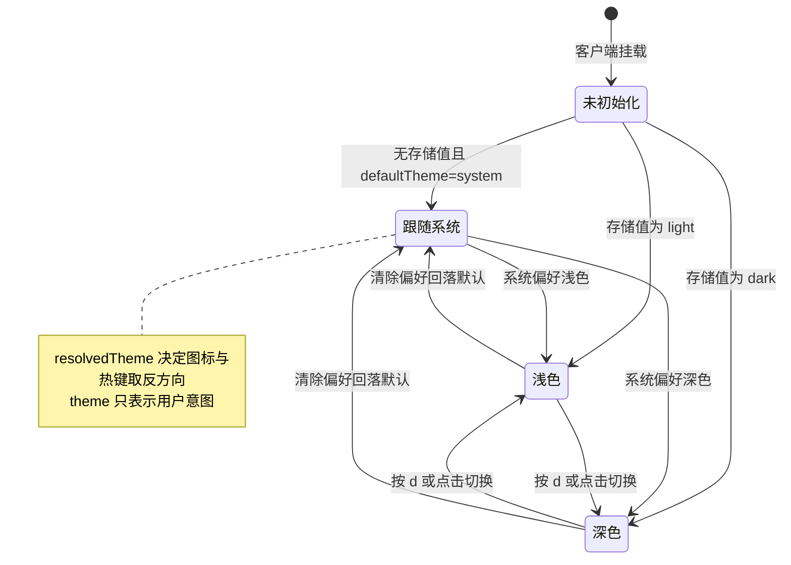
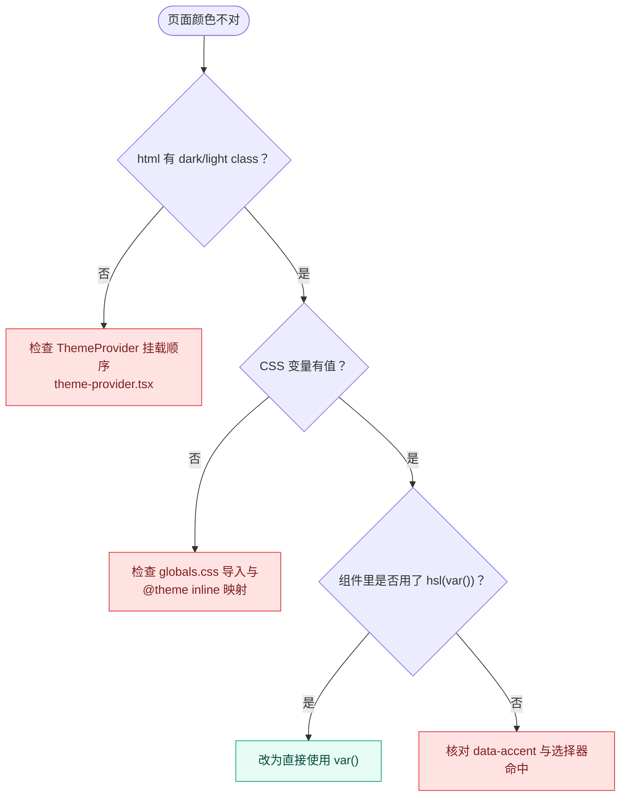

# 根布局与主题系统

> [返回 前端管理界面](../前端管理界面.md)

<cite>
**本文档引用的文件**
- [frontend/app/layout.tsx](file://frontend/app/layout.tsx)
- [frontend/app/globals.css](file://frontend/app/globals.css)
- [frontend/app/(dashboard)/layout.tsx](file://frontend/app/(dashboard)/layout.tsx)
- [frontend/components/theme-provider.tsx](file://frontend/components/theme-provider.tsx)
- [frontend/components/i18n-provider.tsx](file://frontend/components/i18n-provider.tsx)
- [frontend/components/appearance-toggle.tsx](file://frontend/components/appearance-toggle.tsx)
- [frontend/components/language-switcher.tsx](file://frontend/components/language-switcher.tsx)
- [frontend/components/auth-provider.tsx](file://frontend/components/auth-provider.tsx)
- [frontend/components/ui/button.tsx](file://frontend/components/ui/button.tsx)
- [frontend/lib/utils.ts](file://frontend/lib/utils.ts)
- [frontend/lib/chart-theme.ts](file://frontend/lib/chart-theme.ts)
- [frontend/next.config.ts](file://frontend/next.config.ts)
- [frontend/package.json](file://frontend/package.json)
- [frontend/tsconfig.json](file://frontend/tsconfig.json)
- [frontend/components.json](file://frontend/components.json)
- [frontend/postcss.config.mjs](file://frontend/postcss.config.mjs)
</cite>

## 目录

1. [简介](#简介)
2. [项目结构](#项目结构)
3. [核心组件](#核心组件)
4. [架构总览](#架构总览)
5. [详细组件分析](#详细组件分析)
6. [依赖关系分析](#依赖关系分析)
7. [性能考虑](#性能考虑)
8. [故障排查指南](#故障排查指南)
9. [结论](#结论)
10. [附录](#附录)

## 简介

本文件说明 My-OpenWaf 前端根布局与主题系统的真实实现。主题系统由两条**互相正交**的轴组成：

- **明暗轴**：由 `next-themes` 承载，写入 `<html>` 的 `class`（`light` / `dark`），来源可以是用户选择、系统偏好或默认值。
- **强调色轴**：由 `frontend/components/appearance-toggle.tsx` 的 `AccentToggle` 承载，写入 `<html>` 的 `data-accent`（缺省即青绿，`blue` 即蓝色），持久化在 `localStorage` 的 `owaf.accent`。

两轴在 CSS 中组合成四种取值空间，因此样式表用 `.dark[data-accent="blue"]` 这类复合选择器表达第四态，而不是把蓝色写死在 `.dark` 里。

需要澄清的两处常见误解（旧文档遗留）：

1. 根布局**没有** `metadata` 导出，也**没有**通过 `next/font` 加载任何 Web 字体。字体完全来自 CSS 中的系统字体栈。
2. 图标库是 `@tabler/icons-react`，`package.json` 中不存在 `lucide-react` 依赖。

## 项目结构

### 技术栈矩阵

版本取自 `frontend/package.json` 实测：

| 领域 | 依赖 | 版本 | 在主题系统中的角色 |
|------|------|------|--------------------|
| 框架 | `next` | `16.2.6` | App Router 根布局与静态导出 |
| 视图 | `react` / `react-dom` | `19.2.4` / `19.2.7` | 客户端 Provider |
| 主题 | `next-themes` | `^0.4.6` | 明暗轴与系统偏好 |
| 样式引擎 | `tailwindcss` / `@tailwindcss/postcss` | `^4` / `^4` | `@theme inline` 与 `@custom-variant` |
| 样式基座 | `shadcn` | `^4.12.0` | `shadcn/tailwind.css` 导入与组件生成 |
| 无障碍组件 | `radix-ui` | `^1.6.0` | `Slot`、菜单等无样式实现 |
| 变体 | `class-variance-authority` | `^0.7.1` | 组件 variant/size 系统 |
| 类名 | `clsx` / `tailwind-merge` | `^2.1.1` / `^3.6.0` | `cn()` 合并与冲突消解 |
| 动画 | `tw-animate-css` | `^1.4.0` | 开合与过渡动画类 |
| 国际化 | `i18next` / `react-i18next` / `i18next-browser-languagedetector` | `^26.3.3` / `^17.0.8` / `^8.2.1` | 文案与语言探测 |
| 图标 | `@tabler/icons-react` | `^3.44.0` | 主题与语言切换按钮图标 |
| 图表 | `recharts` | `^3.9.1` | 消费 `lib/chart-theme.ts` 令牌 |
| 语言 | `typescript` | `^6` | `strict` 模式 |

**章节来源**
- [frontend/package.json:24-64](file://frontend/package.json#L24-L64)

### 配置文件矩阵

| 配置文件 | 关键项 | 实测取值 | 影响 |
|----------|--------|----------|------|
| `frontend/next.config.ts` | `output` | `export` | 无服务端运行时，主题只能客户端应用 |
| `frontend/next.config.ts` | `distDir` / `trailingSlash` | `out` / `true` | 产物目录与 URL 形态 |
| `frontend/next.config.ts` | `poweredByHeader` | `false` | 响应头最小化 |
| `frontend/next.config.ts` | `compiler.removeConsole` | production 为 `true` | 生产剥离日志 |
| `frontend/postcss.config.mjs` | `plugins` | 仅 `@tailwindcss/postcss` | Tailwind v4 无独立 JS 配置文件 |
| `frontend/components.json` | `style` / `baseColor` | `radix-luma` / `taupe` | 生成组件的默认外观基线 |
| `frontend/components.json` | `tailwind.css` / `tailwind.config` | `app/globals.css` / 空串 | 样式单一来源 |
| `frontend/components.json` | `iconLibrary` / `rtl` | `tabler` / `true` | 图标与逻辑属性书写方向 |
| `frontend/components.json` | `menuColor` / `menuAccent` | `inverted-translucent` / `subtle` | 菜单类组件配色 |
| `frontend/tsconfig.json` | `target` / `strict` / `jsx` | `ES2020` / `true` / `react-jsx` | 类型与编译目标 |
| `frontend/tsconfig.json` | `paths` | `@/*` → `./*` | 模块解析别名 |

> `components.json` 中 `rtl: true` 意味着生成组件使用逻辑属性（`ms-*`/`ps-*`/`start-0`），侧边栏活动条等定位写法与此一致，不能改成物理方向类。

**章节来源**
- [frontend/next.config.ts:3-14](file://frontend/next.config.ts#L3-L14)
- [frontend/postcss.config.mjs:1-7](file://frontend/postcss.config.mjs#L1-L7)
- [frontend/components.json:1-26](file://frontend/components.json#L1-L26)
- [frontend/tsconfig.json:2-37](file://frontend/tsconfig.json#L2-L37)

### 样式装配链路

**图表来源**
- [frontend/app/globals.css:1-49](file://frontend/app/globals.css#L1-L49)
- [frontend/app/globals.css:51-172](file://frontend/app/globals.css#L51-L172)
- [frontend/app/layout.tsx:1-29](file://frontend/app/layout.tsx#L1-L29)
- [frontend/lib/chart-theme.ts:13-64](file://frontend/lib/chart-theme.ts#L13-L64)

**章节来源**
- [frontend/app/globals.css:1-188](file://frontend/app/globals.css#L1-L188)

## 核心组件

主题相关组件清单：

| 组件 / 模块 | 文件 | 类型 | 单一职责 | 持久化 |
|-------------|------|------|----------|--------|
| `RootLayout` | `frontend/app/layout.tsx` | 服务端组件 | 按固定顺序装配四层 Provider 与 Toaster | — |
| `ThemeProvider` | `frontend/components/theme-provider.tsx` | 客户端 | 收敛 next-themes 配置并挂载热键 | 由 next-themes 内部管理 |
| `ThemeHotkey` | `frontend/components/theme-provider.tsx` | 客户端（内部） | 监听 `d` 键切换明暗，过滤输入与组合键 | — |
| `ThemeToggle` | `frontend/components/appearance-toggle.tsx` | 客户端 | 明暗切换按钮与图标 | — |
| `AccentToggle` | `frontend/components/appearance-toggle.tsx` | 客户端 | 青绿/蓝色切换并写入 `dataset` | `localStorage` 的 `owaf.accent` |
| `I18nProvider` | `frontend/components/i18n-provider.tsx` | 客户端 | 仅在客户端初始化 i18next，未就绪渲染 `null` | `localStorage`（语言缓存） |
| `LanguageSwitcher` | `frontend/components/language-switcher.tsx` | 客户端 | 中/英文下拉切换 | 由 i18next 缓存 |
| `chart-theme` | `frontend/lib/chart-theme.ts` | 纯模块 | 导出图表颜色与文字令牌常量 | — |
| `cn` | `frontend/lib/utils.ts` | 纯函数 | `clsx` + `tailwind-merge` 类名合并 | — |

**章节来源**
- [frontend/app/layout.tsx:8-29](file://frontend/app/layout.tsx#L8-L29)
- [frontend/components/theme-provider.tsx:6-71](file://frontend/components/theme-provider.tsx#L6-L71)
- [frontend/components/appearance-toggle.tsx:16-104](file://frontend/components/appearance-toggle.tsx#L16-L104)
- [frontend/components/i18n-provider.tsx:15-45](file://frontend/components/i18n-provider.tsx#L15-L45)
- [frontend/lib/utils.ts:1-6](file://frontend/lib/utils.ts#L1-L6)

### 提供者与控件的类关系

**图表来源**
- [frontend/app/layout.tsx:13-28](file://frontend/app/layout.tsx#L13-L28)
- [frontend/components/theme-provider.tsx:24-68](file://frontend/components/theme-provider.tsx#L24-L68)
- [frontend/components/appearance-toggle.tsx:20-104](file://frontend/components/appearance-toggle.tsx#L20-L104)
- [frontend/components/i18n-provider.tsx:15-44](file://frontend/components/i18n-provider.tsx#L15-L44)

**章节来源**
- [frontend/components/language-switcher.tsx:16-40](file://frontend/components/language-switcher.tsx#L16-L40)

## 架构总览

根布局的实际 JSX 结构只有一层嵌套顺序值得记住：`ThemeProvider → I18nProvider → AuthProvider → TooltipProvider → {children, Toaster}`。`html` 标签带 `lang="zh-CN"` 与 `suppressHydrationWarning`，`body` 带 `font-sans`；`antialiased` 挂在 `html` 而非 `body`。

**图表来源**
- [frontend/app/layout.tsx:14-25](file://frontend/app/layout.tsx#L14-L25)
- [frontend/components/theme-provider.tsx:10-21](file://frontend/components/theme-provider.tsx#L10-L21)
- [frontend/components/theme-provider.tsx:40-66](file://frontend/components/theme-provider.tsx#L40-L66)
- [frontend/app/globals.css:51-136](file://frontend/app/globals.css#L51-L136)

**章节来源**
- [frontend/app/layout.tsx:1-29](file://frontend/app/layout.tsx#L1-L29)

## 详细组件分析

### 根布局的实际职责

`RootLayout` 是一个仅接收 `children` 的服务端组件（无 `"use client"` 指令），它做的事情恰好四件：导入全局样式、设置根节点属性、装配 Provider、挂载 Toaster。

**图表来源**
- [frontend/app/layout.tsx:1-28](file://frontend/app/layout.tsx#L1-L28)
- [frontend/components/i18n-provider.tsx:43-44](file://frontend/components/i18n-provider.tsx#L43-L44)

**章节来源**
- [frontend/app/layout.tsx:8-29](file://frontend/app/layout.tsx#L8-L29)
- [frontend/components/auth-provider.tsx:6-9](file://frontend/components/auth-provider.tsx#L6-L9)

### 明暗主题解析状态机

`defaultTheme="system"` 加上 `enableSystem`，使"解析后的主题"成为独立状态；`ThemeHotkey` 的判定基于 `resolvedTheme` 而非 `theme`，因此从 `system` 出发按一次 `d` 也能落到显式值。

**图表来源**
- [frontend/components/theme-provider.tsx:11-21](file://frontend/components/theme-provider.tsx#L11-L21)
- [frontend/components/theme-provider.tsx:38-58](file://frontend/components/theme-provider.tsx#L38-L58)
- [frontend/components/appearance-toggle.tsx:21-41](file://frontend/components/appearance-toggle.tsx#L21-L41)

**章节来源**
- [frontend/components/theme-provider.tsx:6-71](file://frontend/components/theme-provider.tsx#L6-L71)

### 主题兼容矩阵

两轴组合出四种合法状态，样式表必须四态齐全，否则会出现"深色下蓝色强调失效"这类局部破损：

| 明暗轴 | 强调色轴 | 命中选择器 | `--primary` | `--chart-accent` | 卡面 |
|:------:|:--------:|------------|-------------|------------------|------|
| 浅色 | 青绿（缺省） | `:root` | `oklch(0.527 0.154 178.0)` | `oklch(0.527 0.154 178.0)` | `#ffffff` |
| 深色 | 青绿 | `.dark` | `oklch(0.448 0.119 178.0)` | `var(--teal-600)` | `#1d1816` |
| 浅色 | 蓝色 | `[data-accent="blue"]` | `oklch(0.546 0.215 262.9)` | `oklch(0.546 0.215 262.9)` | `#ffffff` |
| 深色 | 蓝色 | `.dark[data-accent="blue"]` | `oklch(0.623 0.194 262.9)` | `oklch(0.623 0.194 262.9)` | `#1d1816` |

`--chart-danger` 在四态中固定为 `#ef4444`，理由是"红=风险"的语义不应随强调色偏好漂移。

| 能力 | 浅色 | 深色 | 青绿 | 蓝色 | 备注 |
|------|:----:|:----:|:----:|:----:|------|
| 基础着色变量 | ✓ | ✓ | ✓ | ✓ | 四态齐全 |
| 图表强调色对比度 ≥3:1 | ✓ | ✓ | ✓ | ✓ | 取值经卡面校验 |
| 侧边栏主色 | ✓ | ✓ | ✓ | ✓ | `--sidebar-primary` 单独定义 |
| 危险色语义恒定 | ✓ | ✓ | ✓ | ✓ | 不随 accent 变化 |
| 服务端首屏主题 | ✗ | ✗ | ✗ | ✗ | 静态导出无 SSR 注入，靠 `suppressHydrationWarning` |

**章节来源**
- [frontend/app/globals.css:51-172](file://frontend/app/globals.css#L51-L172)
- [frontend/lib/chart-theme.ts:30-48](file://frontend/lib/chart-theme.ts#L30-L48)

### 全局样式与设计令牌

`globals.css` 的组织是严格分层的，顺序即优先级：

| 序 | 步骤 | 内容 | 位置 |
|:--:|------|------|------|
| 1 | 导入三方样式层 | `tailwindcss`、`tw-animate-css`、`shadcn/tailwind.css` | `globals.css:1-3` |
| 2 | 定义 dark 变体 | `@custom-variant dark (&:is(.dark *))` | `globals.css:5` |
| 3 | 声明主题映射 | `@theme inline` 把 `--color-*` 指向运行时变量 | `globals.css:7-49` |
| 4 | 浅色基线 | `:root` 的 oklch 调色板与 teal 阶梯 | `globals.css:51-99` |
| 5 | 深色覆盖 | `.dark` 覆盖关键变量 | `globals.css:101-136` |
| 6 | 蓝色强调 | `[data-accent="blue"]` 与 `.dark[data-accent="blue"]` | `globals.css:143-172` |
| 7 | 基础层 | `@layer base` 设定边框、正文、按钮指针与等宽元素 | `globals.css:174-188` |

令牌清单（节选，均为实测存在项）：

| 令牌组 | 变量 | 说明 |
|--------|------|------|
| 字体 | `--font-heading`、`--font-sans`、`--font-mono` | 全部为系统字体栈，无 Web 字体下载 |
| 表面 | `--background`、`--foreground`、`--card`、`--popover` | 卡片与浮层底色 |
| 主色 | `--primary`、`--primary-foreground`、`--ring`、`--input` | 交互主色与焦点环 |
| 状态 | `--destructive`、`--muted`、`--accent`、`--secondary` | 破坏性/次要/悬停 |
| 图表 | `--chart-1` 至 `--chart-5`、`--chart-accent`、`--chart-danger` | 序列色与语义色 |
| 侧边栏 | `--sidebar`、`--sidebar-primary`、`--sidebar-accent`、`--sidebar-border`、`--sidebar-ring` | 导航专用配色 |
| 圆角 | `--radius` 及 `--radius-sm` 至 `--radius-4xl` | 以 `0.625rem` 为基数的乘算阶梯 |

**章节来源**
- [frontend/app/globals.css:1-188](file://frontend/app/globals.css#L1-L188)

### 图表令牌与对比度约束

图表色是主题系统最容易出错的地方，因为 recharts 需要**可直接解析的 CSS 值**。

| 导出常量 | 取值 | 约束来源 |
|----------|------|----------|
| `CHART_ACCENT` | `var(--chart-accent)` | 深色下 `--primary` 对卡面仅 2.64:1，不足 3:1 |
| `CHART_PRIMARY` | 同 `CHART_ACCENT` | 标记 `@deprecated`，仅为兼容旧引用 |
| `CHART_DANGER` | `var(--chart-danger)` | 固定红，语义恒定 |
| `CHART_DANGER_FILL` | `rgba(239, 68, 68, 0.12)` | 渐变不可用时的纯色兜底 |
| `CHART_GRID_STROKE` | `var(--border)` | 实心发丝线；虚线网格会被读作阈值线 |
| `CHART_AXIS_TICK` | `fill: var(--muted-foreground)`，`fontSize: 10` | 类型必须是 recharts `TextProps` |
| `chartTooltipStyle` | 背景 `var(--popover)`、边框 `var(--border)` | 跟随明暗与强调色 |
| `CHART_AREA_GRADIENT_STOPS` | `0.28 → 0.02` | 面积图渐变停靠点 |

关键禁令：变量**不能**写成 `hsl(var(--primary))`。本项目调色板本身是 `oklch()`，嵌套 `hsl()` 会得到无效颜色，浏览器直接丢弃，图表回落到 recharts 默认色。

**章节来源**
- [frontend/lib/chart-theme.ts:1-64](file://frontend/lib/chart-theme.ts#L1-L64)

### UI 组件的变体约定

`components/ui/button.tsx` 是理解整套组件写法的样本：

| 维度 | 实测取值 | 说明 |
|------|----------|------|
| 实现方式 | `cva()` + `cn()` + `Slot.Root` | `asChild` 语义由 radix `Slot` 承担 |
| `variant` | `default`、`outline`、`secondary`、`ghost`、`destructive`、`link` | 全部基于语义变量，无硬编码色值 |
| `size` | `default`、`xs`、`sm`、`lg`、`icon`、`icon-xs`、`icon-sm`、`icon-lg` | 图标尺寸用 `size-*` 而非宽高对 |
| 圆角 | `rounded-4xl` | 对应 `--radius` 乘 `2.6` |
| 焦点 | `focus-visible:border-ring` + `ring-3 ring-ring/30` | 依赖 `--ring` |
| 状态 | `aria-invalid`、`aria-expanded`、`disabled` | 用 ARIA 属性选择器而非自定义 data |
| 图标 | `[&_svg:not([class*='size-'])]:size-4` | 未显式给尺寸的子图标统一 4 |
| 交互反馈 | `active:not-aria-[haspopup]:translate-y-px` | 弹出类按钮不下压 |

**章节来源**
- [frontend/components/ui/button.tsx:1-40](file://frontend/components/ui/button.tsx#L1-L40)
- [frontend/lib/utils.ts:1-6](file://frontend/lib/utils.ts#L1-L6)

### 国际化与文案层

`I18nProvider` 刻意把初始化放在 `useEffect` 内，静态导出的预渲染阶段不触碰 i18next，从而绕开 `react-i18next` 在无 window 环境的兼容问题；代价是预渲染产物中的文案会先落到 key，客户端水合后被替换。

| 配置项 | 取值 | 后果 |
|--------|------|------|
| `resources` | `zh` / `en` 两份内联 JSON | 无运行时语言包请求 |
| `fallbackLng` | `zh` | 未匹配语言回落中文 |
| `interpolation.escapeValue` | `false` | React 已做转义，避免二次转义 |
| `detection.order` | `localStorage` → `navigator` | 用户显式选择优先于浏览器 |
| `detection.caches` | `localStorage` | 选择结果持久化 |
| `react.useSuspense` | `false` | 不使用 Suspense，配合 Provider 自管 ready 态 |
| 词表规模 | `zh.json` / `en.json` 各 2540 行 | 两份同构，键集合需保持一致 |

**章节来源**
- [frontend/components/i18n-provider.tsx:18-44](file://frontend/components/i18n-provider.tsx#L18-L44)
- [frontend/components/language-switcher.tsx:19-37](file://frontend/components/language-switcher.tsx#L19-L37)

## 依赖关系分析

| 依赖方 | 被依赖 | 形式 | 是否可替换 |
|--------|--------|------|:----------:|
| `app/layout.tsx` | `components/theme-provider.tsx` | 静态导入 | 是（改 Provider 顺序即可） |
| `app/layout.tsx` | `components/i18n-provider.tsx` | 静态导入 | 否（全站文案依赖） |
| `app/layout.tsx` | `components/auth-provider.tsx` | 静态导入 | 否 |
| `app/layout.tsx` | `components/ui/sonner.tsx`、`ui/tooltip.tsx` | 静态导入 | 是 |
| `components/theme-provider.tsx` | `next-themes` | 库依赖 | 否（明暗轴实现） |
| `components/appearance-toggle.tsx` | `next-themes`、`react-i18next` | 库依赖 | 部分 |
| `components/appearance-toggle.tsx` | `documentElement.dataset` | 浏览器 API | 否（静态导出下的唯一途径） |
| 全部 `components/ui/*.tsx` | `lib/utils.ts` 的 `cn` | 内部函数 | 否 |
| `components/ui/button.tsx` | `class-variance-authority`、`radix-ui` | 库依赖 | 否 |
| 图表页面 | `lib/chart-theme.ts` | 常量 | 是（可局部覆盖） |

外部实体：

| 实体 | 用途 | 失败降级 |
|------|------|----------|
| `localStorage` | 强调色与语言偏好 | 读写异常被吞掉，仅失去持久化 |
| `matchMedia`（系统偏好） | next-themes 判定 `system` | 不可用时按 `defaultTheme` 着色 |
| `@theme inline` 变量层 | 把 CSS 变量暴露为 Tailwind 工具类 | 缺失则 `bg-primary` 等类无效果 |

**章节来源**
- [frontend/components/appearance-toggle.tsx:60-88](file://frontend/components/appearance-toggle.tsx#L60-L88)
- [frontend/app/layout.tsx:1-6](file://frontend/app/layout.tsx#L1-L6)
- [frontend/app/globals.css:7-49](file://frontend/app/globals.css#L7-L49)

## 性能考虑

- **无字体下载**：三套字体栈全部为系统字体，首屏零字体请求，也不存在 FOIT/FOUT 窗口。
- **主题切换零过渡**：`disableTransitionOnChange` 避免全站同时过渡造成的长帧。
- **热键成本**：`ThemeHotkey` 只在 `window` 上挂一个 `keydown` 监听，并在回调最前判断 `defaultPrevented` 与 `repeat`，长按不会连续切换。
- **水合差异局部化**：`suppressHydrationWarning` 只加在 `<html>`，差异面限定在 next-themes 写入的 class。
- **强调色写入次数**：`AccentToggle` 在挂载 effect 中一次性读取并应用，切换时同步写 `dataset` 与 `localStorage`，无重复渲染。
- **变量而非计算色**：`@theme inline` 直接指向运行时变量，Tailwind 不需要为每个色值生成静态规则。

[本节为总结，无需特定文件来源]

## 故障排查指南

### 主题不生效

1. 确认 `<html>` 上是否出现 `dark` 或 `light` class；若两者都没有，说明 `ThemeProvider` 未挂载或被 `I18nProvider` 的 `null` 分支挡住。
2. 确认 `documentElement` 上 `data-accent` 的值；`AccentToggle` 在 `mounted` 之前不写入，SSR 产物没有该属性属正常。
3. 确认 `globals.css` 已被 `app/layout.tsx` 导入，且 `postcss.config.mjs` 仍只启用 `@tailwindcss/postcss`。

| 症状 | 根因 | 处置 |
|------|------|------|
| 图表颜色回落默认色 | 写成 `hsl(var(--primary))` | 改为直接 `var(--primary)` 或 `var(--chart-accent)` |
| 深色模式折线过暗 | 复用了 `--primary` | 使用 `--chart-accent` |
| 主题切换整页闪烁 | 过渡动画未禁用 | 保留 `disableTransitionOnChange` |
| 首屏文案显示为 i18n key | 客户端初始化延迟 | 属预期，水合后恢复 |
| 强调色刷新后丢失 | `localStorage` 不可用（隐私模式） | 写入异常被吞，无法持久化 |
| 按 `d` 无反应 | 焦点在输入区或带组合键 | 由 `isTypingTarget` 过滤，属预期 |

**图表来源**
- [frontend/components/theme-provider.tsx:10-21](file://frontend/components/theme-provider.tsx#L10-L21)
- [frontend/app/globals.css:7-49](file://frontend/app/globals.css#L7-L49)
- [frontend/lib/chart-theme.ts:3-7](file://frontend/lib/chart-theme.ts#L3-L7)

**章节来源**
- [frontend/components/appearance-toggle.tsx:64-75](file://frontend/components/appearance-toggle.tsx#L64-L75)
- [frontend/components/i18n-provider.tsx:10-14](file://frontend/components/i18n-provider.tsx#L10-L14)

## 结论

主题系统的实现规模很小但边界清晰：明暗交给 `next-themes`，强调色交给一个写 `dataset` 的按钮组件，颜色定义集中在单个 `globals.css`，图表色由单独模块收敛。三者之间没有交叉依赖，符合单一职责与开放封闭——新增强调色只需追加一组 `[data-accent=...]` 变量块，不必改动任何组件。

需要长期保持的三条纪律：不要用 `hsl(var(--x))` 包裹 oklch 变量；不要在 `package.json` 之外引入图标库；新增组件颜色一律取语义变量，不写死色值。

**章节来源**
- [本节为总结，无需特定文件来源]

## 附录

### 术语表

| 术语 | 含义 | 易混点 | 出处 |
|------|------|--------|------|
| 明暗轴 | `next-themes` 写入 `<html>` class 的 `light`/`dark` | 与强调色轴混为一谈 | `theme-provider.tsx:12` |
| 强调色轴 | `data-accent` 属性表达的 `teal`/`blue` | 与 `--accent` 变量（悬停底色）同名不同义 | `appearance-toggle.tsx:16-17` |
| `--accent` | Tailwind 语义变量，用于菜单/悬停底色 | 与强调色轴无关 | `globals.css:64` |
| `--chart-accent` | 图表专用主色，按卡面校验对比度 | 常被误当作 `--primary` 别名 | `globals.css:80` |
| `@theme inline` | Tailwind v4 把 CSS 变量登记为工具类来源 | 与 `@layer` 混淆 | `globals.css:7` |
| `@custom-variant dark` | 定义 `dark:` 前缀的命中规则 | 与 `.dark` 类名本身混淆 | `globals.css:5` |
| `cn()` | `clsx` 归类后 `tailwind-merge` 消歧 | 不等于简单字符串拼接 | `lib/utils.ts:4` |
| `rtl: true` | 生成组件使用逻辑方向属性 | 不代表界面是右到左语言 | `components.json:14` |

### 常用值速查

| 项 | 值 |
|----|----|
| `--radius` 基数 | `0.625rem` |
| 圆角阶梯 | `sm` 0.6× / `md` 0.8× / `lg` 1× / `xl` 1.4× / `2xl` 1.8× / `3xl` 2.2× / `4xl` 2.6× |
| 主题存储 key | `next-themes` 内部管理 |
| 强调色存储 key | `owaf.accent`，取值 `teal` \| `blue` |
| 强调色持久化目标 | `document.documentElement.dataset.accent` |
| 主题热键 | `d`（忽略组合键、重复按键与输入区焦点） |
| 输入区判定 | `isContentEditable` 或标签为 `INPUT`/`TEXTAREA`/`SELECT` |
| Toaster 位置 | `top-center` |
| 语言回落 | `zh` |
| 危险色 | `#ef4444`（四态一致） |

**章节来源**
- [frontend/app/globals.css:42-48](file://frontend/app/globals.css#L42-L48)
- [frontend/components/appearance-toggle.tsx:16-57](file://frontend/components/appearance-toggle.tsx#L16-L57)
- [frontend/components/theme-provider.tsx:24-58](file://frontend/components/theme-provider.tsx#L24-L58)
- [frontend/app/layout.tsx:21](file://frontend/app/layout.tsx#L21-L21)

### 新增一套强调色的步骤

| 序 | 操作 | 位置 |
|:--:|------|------|
| 1 | 确定属性值，如 `data-accent="violet"` | CSS 选择器约定 |
| 2 | 追加浅色块，覆盖 `--primary`、`--ring`、`--chart-1..5`、`--chart-accent`、`--sidebar-primary` | `app/globals.css` 末尾 |
| 3 | 追加深色块 `.dark[data-accent="violet"]`，避免被浅色块误伤 | `app/globals.css` 末尾 |
| 4 | 在卡面背景上校验 `--chart-accent` 对比度不低于 3:1 | 人工或工具校验 |
| 5 | 扩展 `Accent` 联合类型与 `applyAccent()` 分支 | `components/appearance-toggle.tsx` |
| 6 | 补充 `common.accent*` 文案键（中英文各一份） | `lib/i18n/locales/zh.json`、`en.json` |

**章节来源**
- [frontend/app/globals.css:143-172](file://frontend/app/globals.css#L143-L172)
- [frontend/components/appearance-toggle.tsx:50-88](file://frontend/components/appearance-toggle.tsx#L50-L88)
