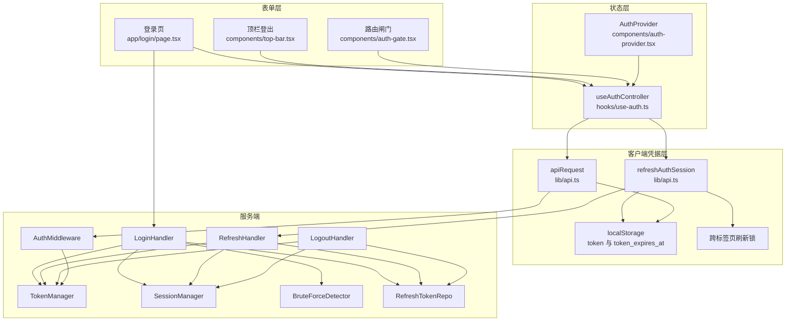
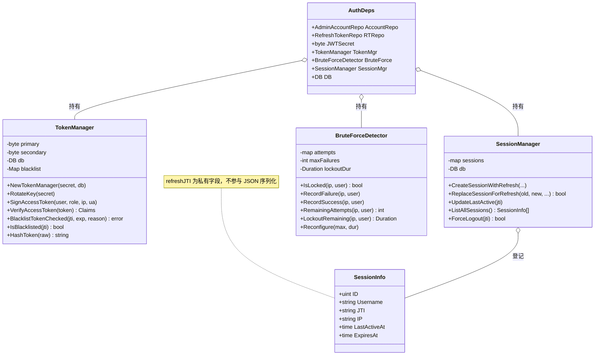
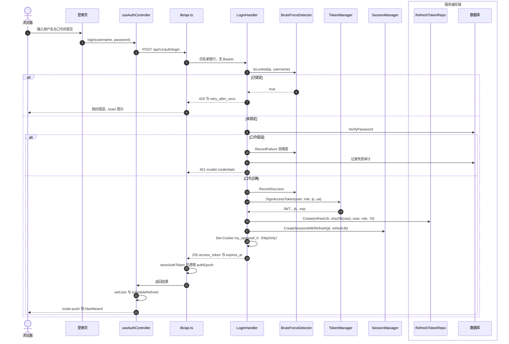
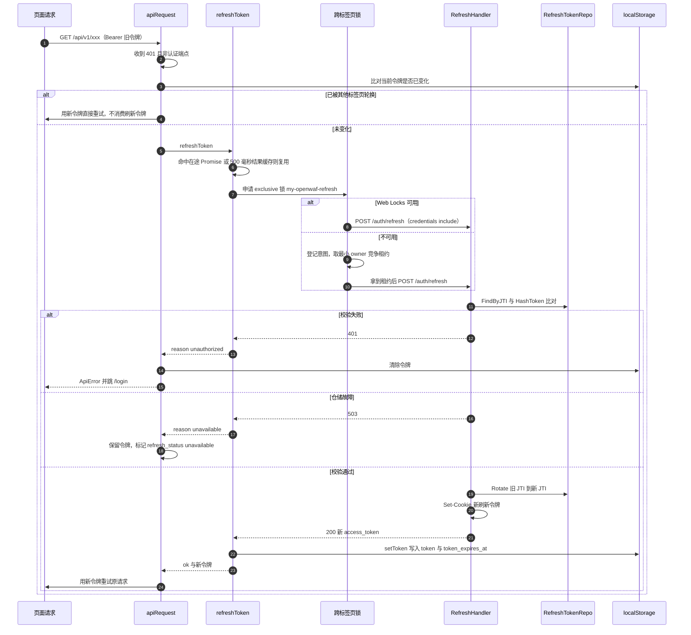
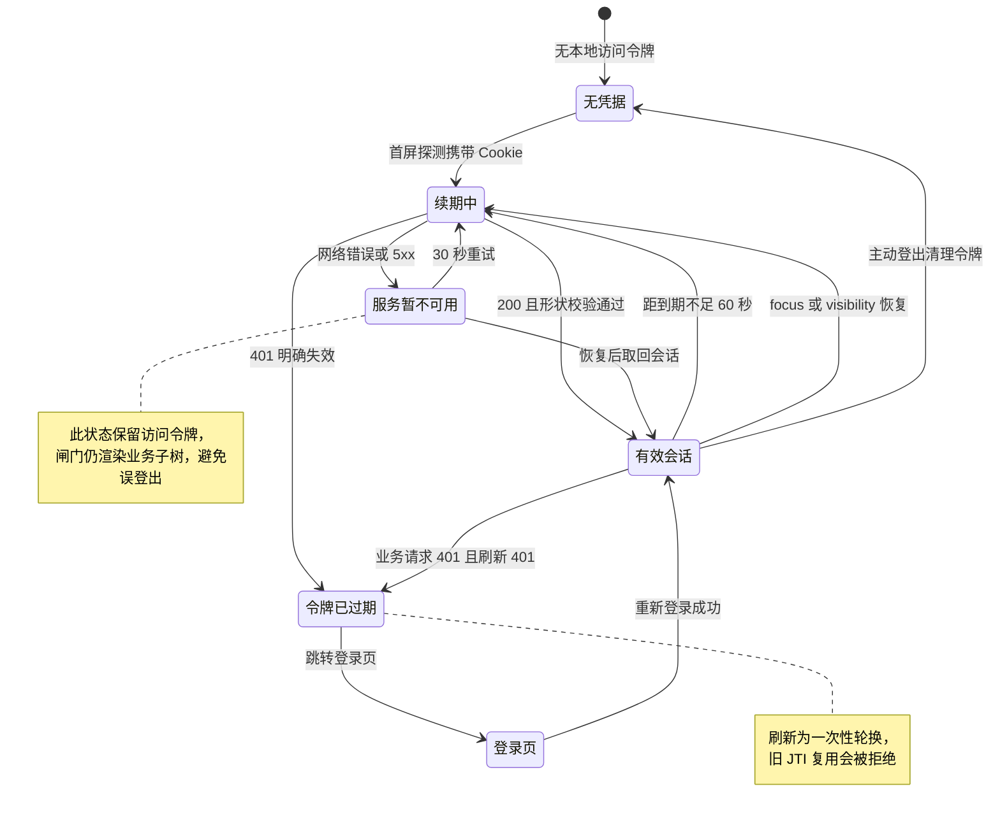
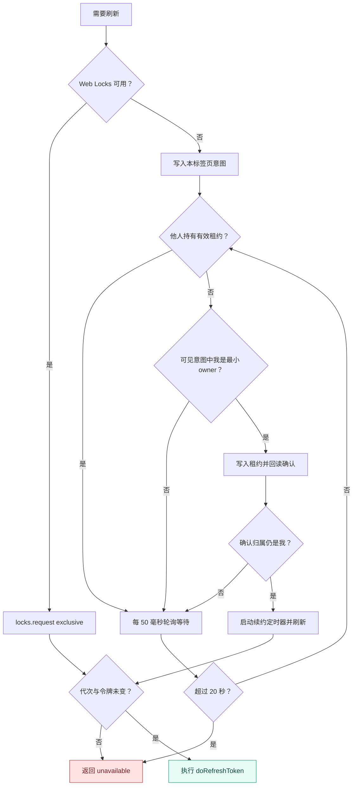
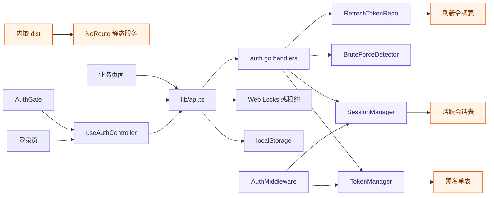
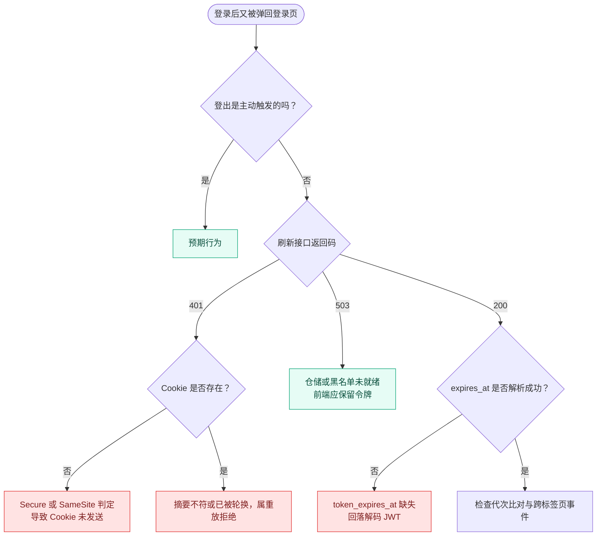

# 登录流程与鉴权机制

> [返回 前端管理界面](../前端管理界面.md)

<cite>
**本文档引用的文件**
- [frontend/app/login/page.tsx](file://frontend/app/login/page.tsx)
- [frontend/app/layout.tsx](file://frontend/app/layout.tsx)
- [frontend/app/(dashboard)/layout.tsx](file://frontend/app/(dashboard)/layout.tsx)
- [frontend/components/auth-gate.tsx](file://frontend/components/auth-gate.tsx)
- [frontend/components/auth-provider.tsx](file://frontend/components/auth-provider.tsx)
- [frontend/components/top-bar.tsx](file://frontend/components/top-bar.tsx)
- [frontend/hooks/use-auth.ts](file://frontend/hooks/use-auth.ts)
- [frontend/lib/api.ts](file://frontend/lib/api.ts)
- [frontend/package.json](file://frontend/package.json)
- [frontend/next.config.ts](file://frontend/next.config.ts)
- [internal/admin/auth.go](file://internal/admin/auth.go)
- [internal/admin/auth_helpers.go](file://internal/admin/auth_helpers.go)
- [internal/admin/middleware.go](file://internal/admin/middleware.go)
- [internal/admin/router.go](file://internal/admin/router.go)
- [internal/admin/auth/jwt.go](file://internal/admin/auth/jwt.go)
- [internal/admin/auth/session.go](file://internal/admin/auth/session.go)
- [internal/admin/auth/bruteforce.go](file://internal/admin/auth/bruteforce.go)
- [internal/core/adminweb/embed.go](file://internal/core/adminweb/embed.go)
</cite>

## 目录

1. [简介](#简介)
2. [项目结构](#项目结构)
3. [核心组件](#核心组件)
4. [架构总览](#架构总览)
5. [详细组件分析](#详细组件分析)
6. [依赖关系分析](#依赖关系分析)
7. [性能考虑](#性能考虑)
8. [故障排查指南](#故障排查指南)
9. [结论](#结论)
10. [附录](#附录)

## 简介

My-OpenWaf 管理端采用**双令牌**模型：短时 HS256 JWT 作为访问令牌，长期不透明刷新令牌以 HttpOnly Cookie 承载。前端只持有访问令牌，刷新令牌的原文只在 Cookie 中往返，脚本无法读取。

本文只描述代码中实际存在的行为。以下几处与常见假设不同，属本次核对的订正：

1. 访问令牌存放在 **`localStorage` 的 `token` 键**，不是 `sessionStorage`，也不是 `owaf_access_token` 之类前缀键；到期时间单独存于 `token_expires_at`。
2. 登录页与闸门**不处理 `?reason=` 参数**。会话过期时的跳转是 `window.location.href = "/login"`，不带原因码。
3. 刷新不是"等 401 再补"。`use-auth.ts` 会在到期前 60 秒主动续期，401 重试只是兜底路径。
4. 刷新请求跨标签页串行化：优先使用 Web Locks API，不可用时退化为基于 `localStorage` 的租约锁。

## 项目结构

### 元数据与关键参数

| 项 | 取值 | 出处 |
|----|------|------|
| 令牌有效期 | 访问 `15m`、刷新 `7d` | `internal/admin/auth/jwt.go:37-38` |
| 签发方与受众 | `iss=my-openwaf`、`aud=my-openwaf-admin` | `internal/admin/auth/jwt.go:40-41` |
| 签名算法 | `HS256` | `internal/admin/auth/jwt.go:124` |
| 刷新 Cookie | 名 `my_openwaf_rt`，值以 `.` 连接 JTI 与原文 | `internal/admin/auth_helpers.go:15-21` |
| Cookie 属性 | `Path=/`、`SameSite=Lax`、`HttpOnly=true` | `internal/admin/auth_helpers.go:29-30` |
| 令牌存储键 | `token`、`token_expires_at` | `frontend/lib/api.ts:28-29` |
| 续期时序 | 提前 60 秒续期、失败 30 秒重试、焦点恢复 30 秒节流 | `frontend/hooks/use-auth.ts:69-71` |
| 刷新去重窗口 | 结果缓存 500 毫秒；锁租约 15 秒、等待上限 20 秒 | `frontend/lib/api.ts:40`、`52-53` |
| 暴力破解默认 | 5 次失败锁定 15 分钟 | `internal/admin/auth/bruteforce.go:28-33` |
| 会话活跃落库间隔 | `30 * time.Second` | `internal/admin/auth/session.go:181` |
| 角色集合 | `admin`、`operator`、`readonly` | `frontend/lib/api.ts:75` |

**章节来源**
- [internal/admin/auth/jwt.go:36-42](file://internal/admin/auth/jwt.go#L36-L42)
- [internal/admin/auth_helpers.go:14-31](file://internal/admin/auth_helpers.go#L14-L31)
- [frontend/lib/api.ts:27-56](file://frontend/lib/api.ts#L27-L56)
- [frontend/hooks/use-auth.ts:69-71](file://frontend/hooks/use-auth.ts#L69-L71)
- [internal/admin/auth/bruteforce.go:25-42](file://internal/admin/auth/bruteforce.go#L25-L42)
- [internal/admin/auth/session.go:171-191](file://internal/admin/auth/session.go#L171-L191)

### 认证端点总表

路由注册见 `internal/admin/router.go:105-112`；白名单见 `internal/admin/middleware.go:47-53`。

| 方法与路径 | 需携带 | 中间件白名单 | 成功响应 | 主要失败码 |
|------------|--------|:------------:|----------|------------|
| `POST /api/v1/auth/login` | 用户名与口令 | ✓ | 200 + `access_token`、`expires_at`、`username`、`role`，并 Set-Cookie | 400 / 401 / 429 / 500 / 503 |
| `POST /api/v1/auth/refresh` | 刷新 Cookie | ✓ | 200 + 同上，并轮换 Set-Cookie | 401 / 500 / 503 |
| `POST /api/v1/auth/logout` | 刷新 Cookie（可选 Bearer） | ✓ | 200 `{status: ok}` | 500 |
| `GET /api/v1/auth/me` | Bearer | ✗ | 200 `{username, role}` | 401 / 503 |
| `POST /api/v1/auth/change-password` | Bearer + 新旧口令 | ✗ | 200 `{status: ok}` | 400 / 401 / 403 / 500 |
| `GET /api/v1/auth/sessions` | Bearer | ✗ | 200 `{sessions}` | 401（该路由未加角色门控） |
| `POST /api/v1/auth/sessions/force-logout` | Bearer + `jti` | ✗ | 2xx | 401 / 403（仅 `admin`） |

`/api/v1/health` 同样在白名单内，用于探针不携带凭据。

**章节来源**
- [internal/admin/router.go:105-116](file://internal/admin/router.go#L105-L116)
- [internal/admin/middleware.go:44-53](file://internal/admin/middleware.go#L44-L53)
- [internal/admin/auth.go:293-352](file://internal/admin/auth.go#L293-L352)
- [frontend/lib/api.ts:728-741](file://frontend/lib/api.ts#L728-L741)

### 分层拓扑

**图表来源**
- [frontend/app/login/page.tsx:18-48](file://frontend/app/login/page.tsx#L18-L48)
- [frontend/components/auth-gate.tsx:15-43](file://frontend/components/auth-gate.tsx#L15-L43)
- [frontend/hooks/use-auth.ts:87-295](file://frontend/hooks/use-auth.ts#L87-L295)
- [frontend/lib/api.ts:402-518](file://frontend/lib/api.ts#L402-L518)
- [internal/admin/auth.go:33-129](file://internal/admin/auth.go#L33-L129)
- [internal/admin/middleware.go:42-122](file://internal/admin/middleware.go#L42-L122)

**章节来源**
- [frontend/components/auth-provider.tsx:5-9](file://frontend/components/auth-provider.tsx#L5-L9)

## 核心组件

| 组件 | 文件 | 职责 | 关键约束 |
|------|------|------|----------|
| `LoginPage` | `frontend/app/login/page.tsx` | 收集凭据并提交 | 提交期间禁用输入与按钮 |
| `AuthProvider` | `frontend/components/auth-provider.tsx` | 全应用唯一控制器实例 | 挂在根布局，避免重复定时器 |
| `AuthGate` | `frontend/components/auth-gate.tsx` | 结论确定前不挂载业务子树 | 暂时不可用不误判为登出 |
| `useAuthController` | `frontend/hooks/use-auth.ts` | 会话装载、续期调度、跨标签页同步 | 仅浏览器环境调度 |
| `refreshAuthSession` | `frontend/lib/api.ts` | 刷新去重、结果短时缓存、锁编排 | 网络与 5xx 不清令牌 |
| `apiRequest` | `frontend/lib/api.ts` | 附加 Bearer、401 恢复、响应解包 | 认证端点不进入重试分支 |
| `LoginHandler` | `internal/admin/auth.go` | 校验口令、签发双令牌、登记会话 | 失败也写审计 |
| `RefreshHandler` | `internal/admin/auth.go` | 校验并轮换刷新令牌 | 仓储故障返 503 而非 401 |
| `LogoutHandler` | `internal/admin/auth.go` | 撤销整条轮换链并拉黑访问令牌 | 撤销失败返 500 |
| `TokenManager` | `internal/admin/auth/jwt.go` | 签名、验签、密钥轮换、黑名单 | 黑名单未就绪则 fail closed |
| `SessionManager` | `internal/admin/auth/session.go` | 会话跟踪与持久化 | refresh JTI 不外泄 |
| `BruteForceDetector` | `internal/admin/auth/bruteforce.go` | IP 与 IP+用户名双维计数 | 判定路径保持只读 |

**章节来源**
- [frontend/lib/api.ts:478-637](file://frontend/lib/api.ts#L478-L637)
- [internal/admin/auth/jwt.go:44-59](file://internal/admin/auth/jwt.go#L44-L59)
- [internal/admin/auth/session.go:27-50](file://internal/admin/auth/session.go#L27-L50)

### 服务端凭据管理器类关系

**图表来源**
- [internal/admin/auth/jwt.go:44-100](file://internal/admin/auth/jwt.go#L44-L100)
- [internal/admin/auth/jwt.go:246-286](file://internal/admin/auth/jwt.go#L246-L286)
- [internal/admin/auth/session.go:13-59](file://internal/admin/auth/session.go#L13-L59)
- [internal/admin/auth/session.go:104-156](file://internal/admin/auth/session.go#L104-L156)
- [internal/admin/auth/bruteforce.go:9-42](file://internal/admin/auth/bruteforce.go#L9-L42)
- [internal/admin/auth.go:17-26](file://internal/admin/auth.go#L17-L26)

**章节来源**
- [internal/admin/auth/jwt.go:129-201](file://internal/admin/auth/jwt.go#L129-L201)

## 架构总览

一次完整登录到首个业务请求的链路：

**图表来源**
- [frontend/app/login/page.tsx:32-48](file://frontend/app/login/page.tsx#L32-L48)
- [frontend/hooks/use-auth.ts:203-212](file://frontend/hooks/use-auth.ts#L203-L212)
- [internal/admin/auth.go:33-128](file://internal/admin/auth.go#L33-L128)
- [internal/admin/auth/bruteforce.go:67-132](file://internal/admin/auth/bruteforce.go#L67-L132)
- [internal/admin/auth_helpers.go:23-31](file://internal/admin/auth_helpers.go#L23-L31)

**章节来源**
- [internal/admin/router.go:105-112](file://internal/admin/router.go#L105-L112)

## 详细组件分析

### 登录流程步骤表

| 序 | 位置 | 动作 | 失败分支 |
|:--:|------|------|----------|
| 1 | 登录页 | 阻止默认提交，非空校验 | 空值 toast `login.emptyCredentials` |
| 2 | `authApi.login` | `POST /auth/login` | `ApiError` 抛出 |
| 3 | 服务端 | `setAuthNoStore` 禁缓存 | — |
| 4 | 服务端 | 依赖为空返 503 | 前端保留状态并安排重试 |
| 5 | 服务端 | `BindJSON` 解析 | 400 "请求体格式无效" |
| 6 | 服务端 | 锁定判定（IP → IP+用户） | 429 + `retry_after_secs`，并记审计 |
| 7 | 服务端 | 校验口令 | 401，剩余次数 ≤3 时附 `remaining_attempts` |
| 8 | 服务端 | 成功清计数并记审计 | — |
| 9 | 服务端 | 签发访问令牌（role 空则 admin） | 500 "token generation failed" |
| 10 | 服务端 | 生成刷新令牌并落库 | 500 "token storage failed" |
| 11 | 服务端 | 登记会话（关联 refresh JTI） | — |
| 12 | 服务端 | Set-Cookie 并返回 200 | — |
| 13 | 前端 | `storeAuthToken` 递增代次，随后 `setUser` 与 `scheduleRefresh` | — |
| 14 | 前端 | `router.push("/dashboard")` | — |

表单使用 `autoComplete="username"` 与 `autoComplete="current-password"`，`name` 属性齐备，保证密码管理器可填充；提交期间 `disabled={loading || authLoading}`，避免认证态与提交态竞态。

**章节来源**
- [frontend/app/login/page.tsx:32-97](file://frontend/app/login/page.tsx#L32-L97)
- [internal/admin/auth.go:33-128](file://internal/admin/auth.go#L33-L128)
- [internal/admin/auth/bruteforce.go:96-154](file://internal/admin/auth/bruteforce.go#L96-L154)

### 令牌刷新链路

刷新是这套鉴权里最复杂的一条链路，因为要同时满足：一次性刷新令牌不可重复消费、多标签页不可并发刷新、旧响应不可覆盖新会话。

**图表来源**
- [frontend/lib/api.ts:558-607](file://frontend/lib/api.ts#L558-L607)
- [frontend/lib/api.ts:439-476](file://frontend/lib/api.ts#L439-L476)
- [frontend/lib/api.ts:402-429](file://frontend/lib/api.ts#L402-L429)
- [frontend/lib/api.ts:307-400](file://frontend/lib/api.ts#L307-L400)
- [internal/admin/auth.go:131-240](file://internal/admin/auth.go#L131-L240)

**章节来源**
- [frontend/hooks/use-auth.ts:101-158](file://frontend/hooks/use-auth.ts#L101-L158)

### 鉴权状态机

把"前端可观察的会话状态"独立建模，是理解 `AuthGate` 与错误处理的关键：

**图表来源**
- [frontend/hooks/use-auth.ts:120-201](file://frontend/hooks/use-auth.ts#L120-L201)
- [frontend/components/auth-gate.tsx:19-29](file://frontend/components/auth-gate.tsx#L19-L29)
- [frontend/lib/api.ts:478-510](file://frontend/lib/api.ts#L478-L510)
- [internal/admin/auth.go:213-224](file://internal/admin/auth.go#L213-L224)

**章节来源**
- [frontend/hooks/use-auth.ts:79-81](file://frontend/hooks/use-auth.ts#L79-L81)

### 凭据载体与可见性矩阵

| 凭据 | 载体 | JS 可读 | 传输时机 | 轮换 | 服务端留存 |
|------|------|:-------:|----------|:----:|------------|
| 访问令牌（JWT） | `localStorage` 的 `token` | ✓ | 每次 API 请求的 `Authorization` | 刷新时整体替换 | 仅 JTI 进入会话与黑名单 |
| 到期时间 | `localStorage` 的 `token_expires_at` | ✓ | 不发往服务端 | 随令牌更新 | — |
| 刷新令牌原文 | Cookie `my_openwaf_rt` 的前半段之外部分 | ✗（HttpOnly） | 仅 `/auth/refresh`、`/auth/logout` | 每次刷新重生成 | 只存 SHA-256 摘要 |
| 刷新令牌 JTI | Cookie 值点号前段 | ✗ | 同上 | 轮换 | 数据库行主键之一 |
| 会话 JTI 与指纹 | JWT `jti`、`ip_hash`、`device_hash` | ✓（均为摘要或标识） | 随令牌 | 刷新时重算 | 会话表与黑名单 |

Cookie 值形如 `{jti}.{raw}`，分隔符必须是点号：Hertz 写 Cookie 走 `url.QueryEscape` 而读回不解码，冒号会被转义成 `%3A` 导致往返失败。代码同时保留 `%3A` 旧格式兼容分支，避免分隔符变更前登录的会话被强制重登。

**章节来源**
- [internal/admin/auth_helpers.go:14-61](file://internal/admin/auth_helpers.go#L14-L61)
- [internal/admin/auth/jwt.go:103-127](file://internal/admin/auth/jwt.go#L103-L127)
- [internal/admin/auth/jwt.go:337-372](file://internal/admin/auth/jwt.go#L337-L372)
- [frontend/lib/api.ts:28-35](file://frontend/lib/api.ts#L28-L35)

### 跨标签页刷新的锁与竞态防护

| 机制 | 实现 | 解决的具体竞态 |
|------|------|----------------|
| `authEpoch` 代次与令牌比对 | 登录/清除时递增，返回后比对当前令牌 | 旧响应复活会话或重复写入 |
| 在途 Promise 复用 | `refreshPromise` 单例 | 同页多个 401 并发刷新 |
| 500 毫秒结果缓存 | 按代次与令牌命中 | 首屏无令牌时反复打同一 401 |
| Web Locks | `locks.request("my-openwaf-refresh", exclusive)` | 跨标签页串行刷新 |
| 意图登记 + 最小 owner | `localStorage` 前缀键与确定性比较 | 无 CAS 时的双写抢锁 |
| 租约续约 | 每 `TTL/3` 重写租约与意图 | 长请求期间租约被抢 |
| 等待上限 20 秒 | 超时返 `unavailable` | 死锁导致页面卡住 |
| 忽略 `StorageEvent.newValue` | 一律重读共享存储 | 滞后事件覆盖新会话 |

`isRefreshLockTurn` 用代码单元顺序而非 `localeCompare` 比较 owner，避免浏览器语言环境改变仲裁结果。

**图表来源**
- [frontend/lib/api.ts:402-429](file://frontend/lib/api.ts#L402-L429)
- [frontend/lib/api.ts:307-400](file://frontend/lib/api.ts#L307-L400)
- [frontend/lib/api.ts:276-285](file://frontend/lib/api.ts#L276-L285)

**章节来源**
- [frontend/lib/api.ts:37-73](file://frontend/lib/api.ts#L37-L73)
- [frontend/hooks/use-auth.ts:243-273](file://frontend/hooks/use-auth.ts#L243-L273)

### 服务端令牌校验与吊销

`AuthMiddleware` 的判定顺序不可调换：

| 序 | 步骤 | 结果 |
|:--:|------|------|
| 1 | 白名单路径直接放行 | 健康检查与三个认证端点 |
| 2 | `Authorization` 缺失 | 401 `missing Authorization header` |
| 3 | 无 `Bearer ` 前缀 | 401 `invalid Authorization format, use Bearer <token>` |
| 4 | `VerifyAccessToken` 主密钥失败回退备用密钥 | 支持密钥轮换过渡期 |
| 5 | 黑名单未就绪则重试加载，仍失败返 503（fail closed） | 未就绪时拒绝认证 |
| 6 | JTI 命中黑名单 | 视为已吊销，落到回退分支 |
| 7 | 写入 `auth_user`、`auth_username`、`auth_method`、`auth_role`、`auth_jti` | 下游 handler 取用 |
| 8 | `SessionManager.UpdateLastActive` | 30 秒内只落库一次 |
| 9 | JWT 失败回退 API Key；归属账号已删除则 401 | 身份与角色取所属账号 |

吊销路径有三条：登出拉黑访问令牌 JTI（有效期取 `AccessTTL` 余量，原因 `logout`）、强制注销删除会话、改密后撤销该用户全部凭据（原因 `password_changed`）。登出会撤销**整条刷新令牌轮换链**，而不是仅撤销 Cookie 中的那个 JTI，否则重载页面仍可能被后继令牌恢复会话。

**章节来源**
- [internal/admin/middleware.go:44-122](file://internal/admin/middleware.go#L44-L122)
- [internal/admin/auth/jwt.go:129-182](file://internal/admin/auth/jwt.go#L129-L182)
- [internal/admin/auth/jwt.go:246-272](file://internal/admin/auth/jwt.go#L246-L272)
- [internal/admin/auth.go:243-291](file://internal/admin/auth.go#L243-L291)
- [internal/admin/auth.go:305-352](file://internal/admin/auth.go#L305-L352)

### 错误码与前端处置矩阵

| HTTP | 触发条件 | 前端处置 | 用户可感知 |
|:----:|----------|----------|:----------:|
| 400 | 登录请求体格式无效 | `ApiError` 抛出，toast 服务端文案 | ✓ |
| 401（登录） | 口令错误 | toast 文案；附 `remaining_attempts` 时提示剩余次数 | ✓ |
| 401（刷新） | Cookie 缺失、格式错误、摘要不符、已被撤销 | 清令牌并跳 `/login`；**该路径会丢弃会话** | ✓ |
| 401（业务） | 无头、格式错、验签失败、命中黑名单 | 进入刷新链路 | 视恢复结果 |
| 403 | 角色不允许（`RequireRole`）或旧口令不符 | 抛出并提示权限不足 | ✓ |
| 429 | 暴力破解锁定 | 抛出并给出锁定信息 | ✓ |
| 500 / 503 | 令牌生成或落库失败；认证依赖未就绪、黑名单不可用、仓储暂不可用 | 抛出；503 判定为 `unavailable`，**保留令牌**并 30 秒重试 | ✓ / 可能无感 |

`refresh_status` 是前端注入到错误数据里的区分字段，取值 `unauthorized` 与 `unavailable`。`useIsAuthenticated` 与 `AuthGate` 都依赖它来避免把一次服务抖动当成凭据失效。

**章节来源**
- [internal/admin/auth.go:36-115](file://internal/admin/auth.go#L36-L115)
- [internal/admin/auth.go:134-224](file://internal/admin/auth.go#L134-L224)
- [internal/admin/middleware.go:56-101](file://internal/admin/middleware.go#L56-L101)
- [frontend/lib/api.ts:576-634](file://frontend/lib/api.ts#L576-L634)
- [frontend/hooks/use-auth.ts:340-351](file://frontend/hooks/use-auth.ts#L340-L351)

## 依赖关系分析

| 依赖方 | 被依赖 | 形式 | 说明 |
|--------|--------|:----:|------|
| 登录页 | `useAuth().login` | 调用 | 不直接调 `authApi` |
| `AuthGate` | `useAuth`、`getAccessToken` | 读取 | 双条件判定 |
| `AuthProvider` / `useAuthController` | `useAuthController`、`lib/api.ts` 凭据与刷新函数 | 提供与调用 | 单实例，定时器归控制器 |
| `apiRequest` | `refreshToken` | 调用 | 401 兜底 |
| `lib/api.ts` | `localStorage`、`crypto.randomUUID`、`navigator.locks` | 浏览器 API | 不可用均有退化 |
| `LoginHandler` | `TokenManager`、`RefreshTokenRepo`、`SessionManager`、`BruteForceDetector` | 进程内 | 经 `AuthDeps` 注入 |
| `AuthMiddleware` | `TokenManager`、`AdminAPIKeyRepo`、`SessionManager` | 进程内 | JWT 优先、API Key 回退 |
| `TokenManager` | 令牌黑名单表 | 持久化 | 未加载则 fail closed |
| `SessionManager` | 活跃会话表 | 持久化 | 启动时回填内存 |

静态资源不经 `AuthMiddleware`：`mountStaticHandler` 注册 `NoRoute`，对 `/api/` 前缀返回 404 JSON，其余按候选解析内嵌产物。因此登录页 HTML 本身可在无凭据状态下取得，鉴权边界在 API 层而非页面层。

**图表来源**
- [internal/admin/auth.go:17-26](file://internal/admin/auth.go#L17-L26)
- [internal/admin/middleware.go:42-122](file://internal/admin/middleware.go#L42-L122)
- [internal/admin/router.go:442-465](file://internal/admin/router.go#L442-L465)
- [internal/core/adminweb/embed.go:10-18](file://internal/core/adminweb/embed.go#L10-L18)

**章节来源**
- [frontend/lib/api.ts:135-143](file://frontend/lib/api.ts#L135-L143)
- [internal/admin/middleware.go:44-53](file://internal/admin/middleware.go#L44-L53)
- [internal/admin/router.go:442-465](file://internal/admin/router.go#L442-L465)

## 性能考虑

- **提前续期而非事后补救**：到期前 60 秒触发，避免业务请求集中撞 401 再排队刷新。
- **单点续期**：控制器在根布局，定时器与焦点监听全站共一份，不随页面数量线性增长。
- **请求合并**：同一令牌的 `/auth/me` 只保留一个在途 Promise；刷新结果 500 毫秒内复用。
- **锁等待有界**：租约等待 20 秒上限、50 毫秒轮询、`TTL/3` 续约，不会因某标签页崩溃而无限期阻塞。
- **会话活跃写库节流**：30 秒窗口内合并 `UPDATE`，避免每个管理请求一次写库。
- **黑名单内存化与周期回收**：`sync.Map` 查找加 10 分钟清理；会话与暴力破解各 5 分钟一轮（后者空闲超两倍锁定时长即删），`Close` 幂等。

**章节来源**
- [frontend/hooks/use-auth.ts:79-158](file://frontend/hooks/use-auth.ts#L79-L158)
- [internal/admin/auth/session.go:171-191](file://internal/admin/auth/session.go#L171-L191)
- [internal/admin/auth/jwt.go:274-323](file://internal/admin/auth/jwt.go#L274-L323)
- [internal/admin/auth/bruteforce.go:185-204](file://internal/admin/auth/bruteforce.go#L185-L204)

## 故障排查指南

### 定位决策树

**图表来源**
- [internal/admin/auth.go:138-168](file://internal/admin/auth.go#L138-L168)
- [internal/admin/auth_helpers.go:23-38](file://internal/admin/auth_helpers.go#L23-L38)
- [frontend/lib/api.ts:145-184](file://frontend/lib/api.ts#L145-L184)
- [frontend/lib/api.ts:478-510](file://frontend/lib/api.ts#L478-L510)

**章节来源**
- [frontend/components/auth-gate.tsx:20-29](file://frontend/components/auth-gate.tsx#L20-L29)

### 常见问题与处置

| 症状 | 根因 | 处置 |
|------|------|------|
| 登录后立即掉线 | Cookie 被判为 `Secure` 但浏览器实为 HTTP 访问 | 核对 `X-Forwarded-Proto` 透传与协议判定分支 |
| 反复提示"会话已变更，请重试" | 刷新期间发生登出或另一轮登录 | 属预期防护，重新登录即可 |
| 锁定后 `retry_after_secs` 为 0 | 429 由纯 IP 维度触发，而余量只按 IP+用户维度计算 | 属两维度设计的结果，非缺陷 |
| 多标签页重复刷新 | Web Locks 不可用且租约退化 | 观察 `my_openwaf_refresh_lock*` 键 |
| 改密后所有设备掉线 | 主动撤销该用户全部凭据 | 属预期行为 |
| 401 但令牌未被清除 | `refresh_status` 为 `unavailable` | 属预期，避免抖动误登出 |
| 旧浏览器刷新报 malformed | 分隔符变更前的 `%3A` 形态 | 兼容分支已覆盖，验证版本号 |

**章节来源**
- [internal/admin/auth.go:198-240](file://internal/admin/auth.go#L198-L240)
- [internal/admin/auth.go:305-352](file://internal/admin/auth.go#L305-L352)
- [internal/admin/middleware.go:92-121](file://internal/admin/middleware.go#L92-L121)
- [internal/admin/auth/bruteforce.go:96-125](file://internal/admin/auth/bruteforce.go#L96-L125)

## 结论

这套鉴权机制的工程价值集中在**失败语义的区分**上：`unauthorized` 与 `unavailable` 的分离让"凭据失效"与"服务抖动"不再共用一条登出路径，`authEpoch` 与令牌一致性比对让异步响应不会污染新会话，一次性轮换与整链撤销让刷新令牌被重放时立即失效。

前端侧符合单一职责：表单只提交、控制器只调度、`lib/api.ts` 只处理凭据与请求。服务端侧 `AuthDeps` 依赖注入使处理器可脱离 HTTP 上下文单测。

可改进项：`frontend/hooks/use-auth.ts` 中的 `useIsAuthenticated` 与 `AuthGate` + `useAuth` 职责重叠且无调用方，属可清理的冗余；`internal/admin/auth.go` 中 `username` 为空时回落到硬编码 `admin` 的兼容分支，值得在确认无历史数据后移除。

**章节来源**
- [frontend/hooks/use-auth.ts:311-409](file://frontend/hooks/use-auth.ts#L311-L409)
- [internal/admin/auth.go:170-173](file://internal/admin/auth.go#L170-L173)

## 附录

### 术语表

| 术语 | 英文 | 含义 | 同义/易混 | 出处 |
|------|------|------|-----------|------|
| 访问令牌 | access token | HS256 JWT，15 分钟 | 与刷新令牌混用 | `auth/jwt.go:103` |
| 刷新令牌 | refresh token | 不透明随机串，7 天 | 与 JTI 混用 | `auth/jwt.go:338-352` |
| JTI | JWT ID | 令牌唯一标识，吊销依据 | 与会话 ID 混淆 | `auth/jwt.go:360-364` |
| 代次 | auth epoch | 前端凭据变更计数器 | 与令牌版本号混淆 | `frontend/lib/api.ts:39` |
| 一次性轮换 | one-time rotate | 旧刷新令牌用后即废 | 与"滑动过期"混淆 | `internal/admin/auth.go:213` |
| 失败关闭 | fail closed | 黑名单不可用时拒绝认证 | 与"降级放行"相反 | `internal/admin/auth/jwt.go:61-69` |
| 暴力破解锁定 | lockout | 达阈值后定时拒绝登录 | 与账号禁用混淆 | `internal/admin/auth/bruteforce.go:85-94` |

### 浏览器能力兼容矩阵

| 能力 | 要求 | 不可用时的退化 | 备注 |
|------|------|----------------|------|
| `localStorage` | 令牌持久化 | 无法跨刷新保持会话 | 隐私模式下读写异常被吞 |
| `atob` | 解码 JWT `exp` | 回落 `token_expires_at` | 两者皆缺则不主动续期 |
| `crypto.randomUUID` | 锁 owner 标识 | 时间戳加随机串 | 语义等价 |
| `navigator.locks` | 跨标签页串行刷新 | `localStorage` 租约锁 | 等待上限 20 秒 |
| `StorageEvent` | 跨标签页会话同步 | 依赖焦点与定时探测 | 延迟不改变最终一致 |
| Cookie `SameSite=Lax` | 刷新请求携带 | 无法刷新 | 顶层导航仍发送 |
| HTTPS | `Secure` Cookie | 明文传输风险 | 由协议判定自动启用 |

**章节来源**
- [frontend/lib/api.ts:70-73](file://frontend/lib/api.ts#L70-L73)
- [frontend/lib/api.ts:158-184](file://frontend/lib/api.ts#L158-L184)
- [frontend/lib/api.ts:402-429](file://frontend/lib/api.ts#L402-L429)
- [internal/admin/auth_helpers.go:23-31](file://internal/admin/auth_helpers.go#L23-L31)

### 暴力破解防护参数

| 参数 | 默认 | 说明 |
|------|:----:|------|
| `maxFailures` | 5 | 非正值回落默认 |
| `lockoutDur` | 15 分钟 | 非正值回落默认 |
| 计数维度 | 2 | 纯 IP 与 `IP\|username` |
| 判定顺序 | IP 优先 | 先 IP 级，再 IP+用户 |
| 剩余提示阈值 | ≤3 | 仅小值时返回 `remaining_attempts` |
| 成功后清理 | 是 | 只清 IP+用户维度记录 |
| 锁定过期 | 自动重置 | 下次失败重新给满额机会 |
| 记录回收 | 5 分钟一轮 | 空闲超两倍锁定时长即删 |
| 动态重配 | `Reconfigure` | 阈值下调时补打锁定时间戳 |

**章节来源**
- [internal/admin/auth/bruteforce.go:25-61](file://internal/admin/auth/bruteforce.go#L25-L61)
- [internal/admin/auth/bruteforce.go:67-154](file://internal/admin/auth/bruteforce.go#L67-L154)
- [internal/admin/auth.go:49-76](file://internal/admin/auth.go#L49-L76)

### 验证命令

| 命令 | 用途 |
|------|------|
| `bun run check:auth-refresh-contract` | 令牌刷新链路契约回归 |
| `bun run check:login-form-contract` | 登录表单字段与提示契约 |
| `bun run check:api-route-contract` | 前端调用与后端路由对齐 |

后端对应测试位于 `internal/admin/auth_login_test.go`、`internal/admin/auth_helpers_test.go`、`internal/admin/auth/*_test.go`，覆盖 malformed Cookie、重放拒绝与锁定行为。

**章节来源**
- [frontend/package.json:12-22](file://frontend/package.json#L12-L22)
