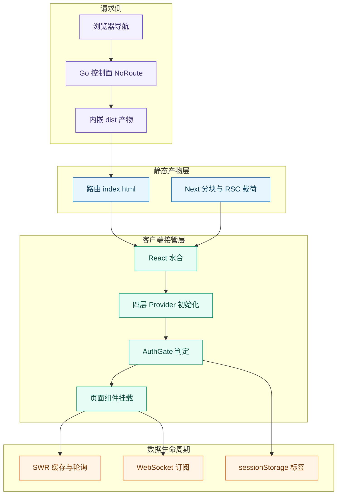
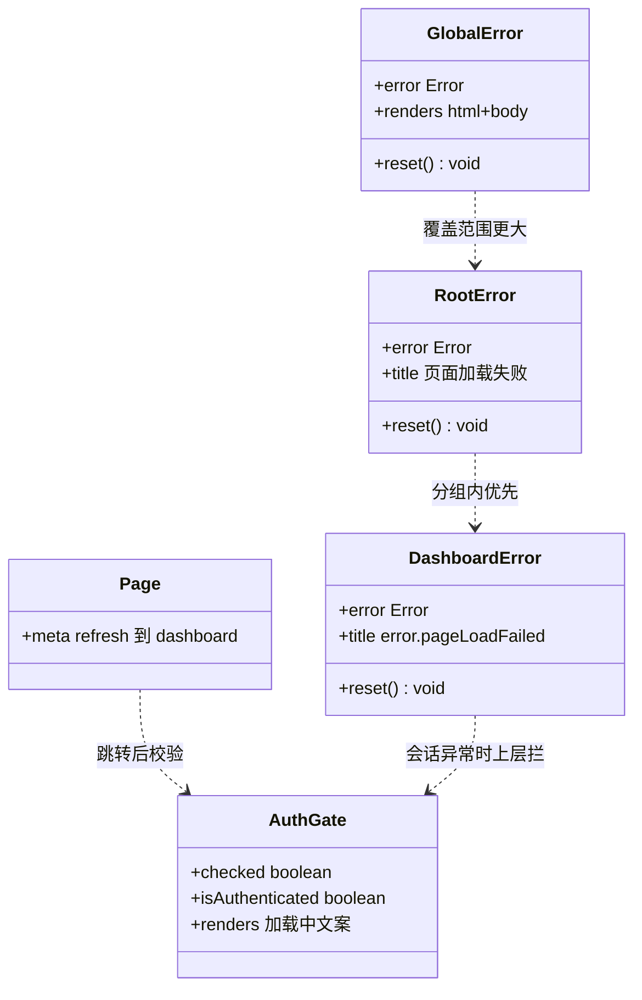
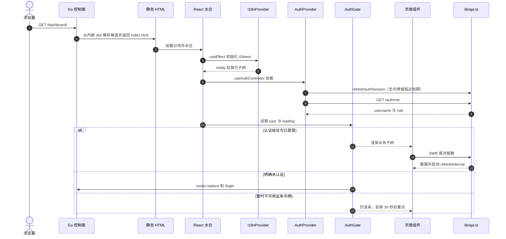
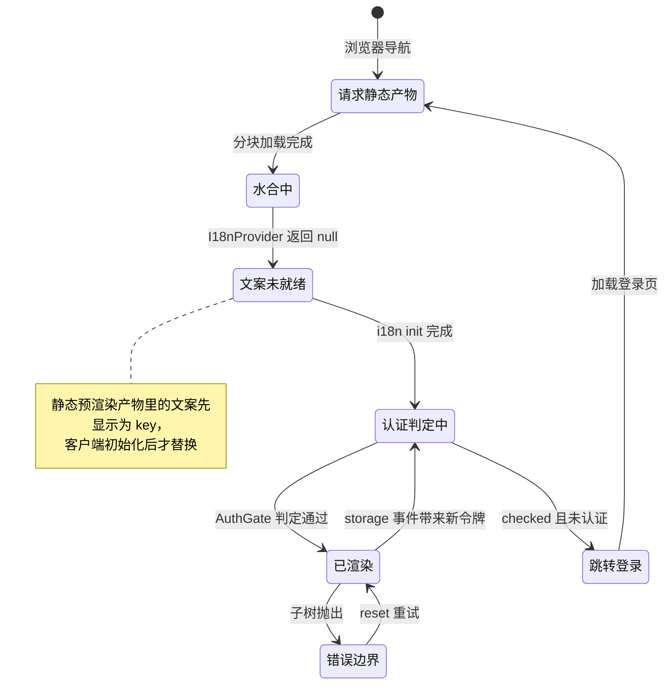
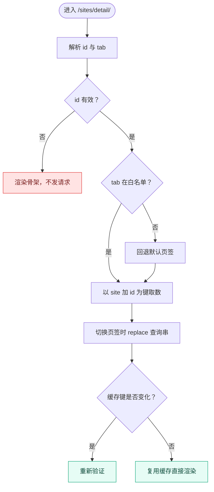
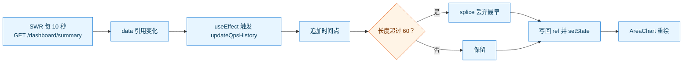
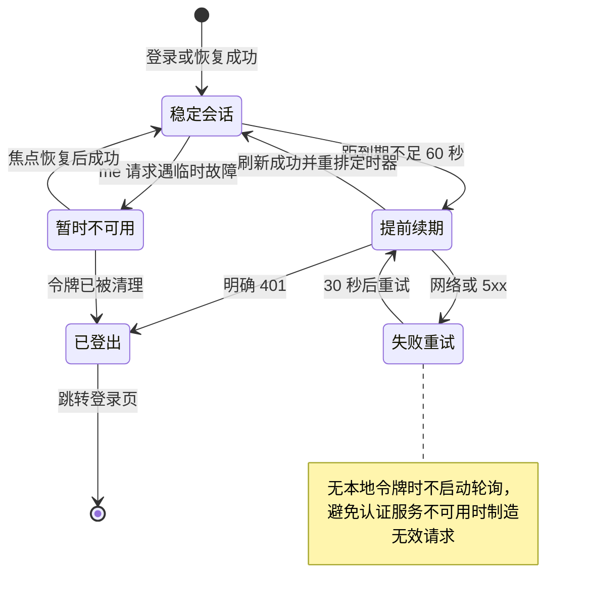
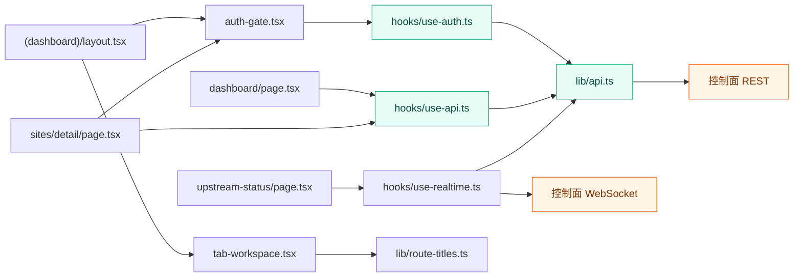
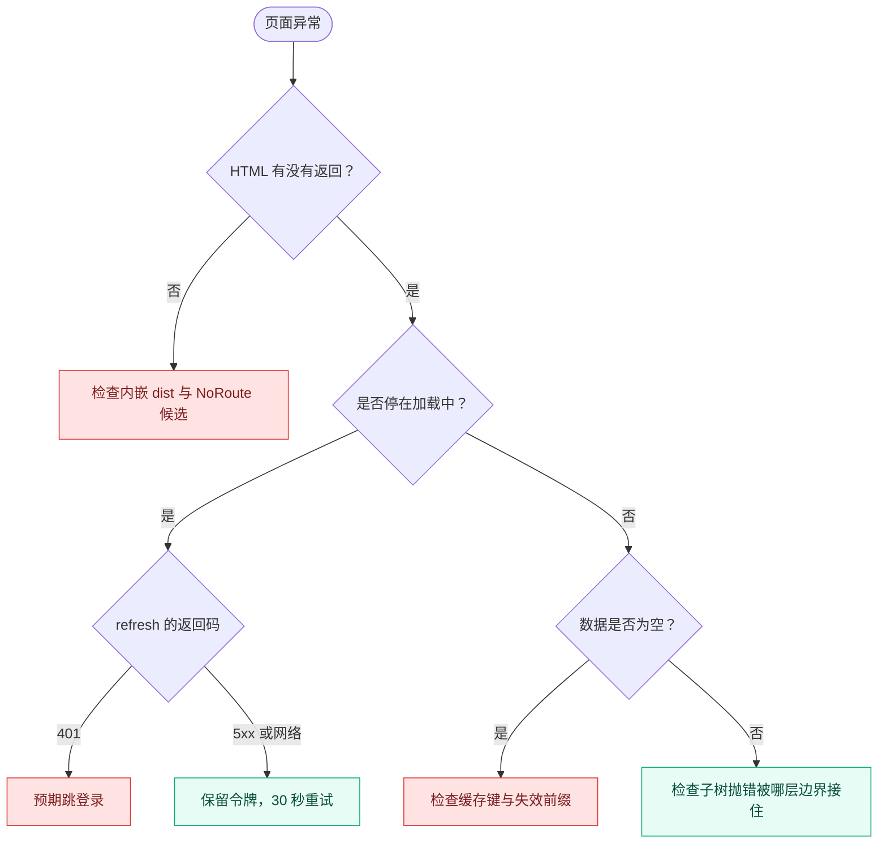

# 页面生命周期与渲染策略

> [返回 前端管理界面](../前端管理界面.md)

<cite>
**本文档引用的文件**
- [frontend/app/layout.tsx](file://frontend/app/layout.tsx)
- [frontend/app/page.tsx](file://frontend/app/page.tsx)
- [frontend/app/error.tsx](file://frontend/app/error.tsx)
- [frontend/app/global-error.tsx](file://frontend/app/global-error.tsx)
- [frontend/app/globals.css](file://frontend/app/globals.css)
- [frontend/app/(dashboard)/layout.tsx](file://frontend/app/(dashboard)/layout.tsx)
- [frontend/app/(dashboard)/error.tsx](file://frontend/app/(dashboard)/error.tsx)
- [frontend/app/(dashboard)/dashboard/page.tsx](file://frontend/app/(dashboard)/dashboard/page.tsx)
- [frontend/app/(dashboard)/sites/detail/page.tsx](file://frontend/app/(dashboard)/sites/detail/page.tsx)
- [frontend/app/login/page.tsx](file://frontend/app/login/page.tsx)
- [frontend/app/block/page.tsx](file://frontend/app/block/page.tsx)
- [frontend/app/maintenance/page.tsx](file://frontend/app/maintenance/page.tsx)
- [frontend/app/security-dashboard/layout.tsx](file://frontend/app/security-dashboard/layout.tsx)
- [frontend/components/auth-gate.tsx](file://frontend/components/auth-gate.tsx)
- [frontend/components/tab-workspace.tsx](file://frontend/components/tab-workspace.tsx)
- [frontend/hooks/use-auth.ts](file://frontend/hooks/use-auth.ts)
- [frontend/hooks/use-api.ts](file://frontend/hooks/use-api.ts)
- [frontend/hooks/use-realtime.ts](file://frontend/hooks/use-realtime.ts)
- [frontend/lib/api.ts](file://frontend/lib/api.ts)
- [frontend/lib/route-titles.ts](file://frontend/lib/route-titles.ts)
- [frontend/next.config.ts](file://frontend/next.config.ts)
- [frontend/package.json](file://frontend/package.json)
</cite>

## 目录

1. [简介](#简介)
2. [项目结构](#项目结构)
3. [核心组件](#核心组件)
4. [架构总览](#架构总览)
5. [详细组件分析](#详细组件分析)
6. [依赖关系分析](#依赖关系分析)
7. [性能考虑](#性能考虑)
8. [故障排查指南](#故障排查指南)
9. [结论](#结论)
10. [附录](#附录)

## 简介

本文件说明 My-OpenWaf 前端页面从被请求到完成渲染的实际生命周期。因为 `next.config.ts` 设定 `output: "export"`，本项目不存在服务端渲染与流式组件，"渲染策略"这个词在本仓库里的真实含义是：**静态 HTML 何时产生、客户端何时接管、状态何时确定**。

三条与直觉相反的实测结论必须先讲清楚：

1. **首页不做登录判断**。`frontend/app/page.tsx` 只输出一条 `<meta httpEquiv="refresh" content="0; url=/dashboard/">` 与一个降级链接，无条件跳转；是否未登录由 `AuthGate` 在 `/dashboard/` 一侧决定。
2. **站点详情不是动态段路由**。实际路径是 `/sites/detail/?id=<站点ID>&tab=<页签>`，`id` 与 `tab` 都由 `useSearchParams()` 读取，并带白名单校验。不存在 `sites/[id]/client.tsx`。
3. **仪表板不用 `setInterval`**。数据刷新由 SWR 的 `refreshInterval` 驱动（摘要 10 秒、统计 30 秒），页面里的 `useEffect` 只负责把新到的数据追加进 QPS 环形缓冲。

## 项目结构

### 构建与元数据

| 项 | 取值 | 对生命周期的影响 |
|----|------|------------------|
| `output` | `export` | 每个路由在构建期产出一个 `index.html` |
| `distDir` | `out` | 产物树被复制进 Go 二进制内嵌目录 |
| `trailingSlash` | `true` | `usePathname()` 返回带尾斜杠路径，需归一化 |
| `poweredByHeader` | `false` | 响应头不含框架指纹 |
| `compiler.removeConsole` | production 为 `true` | 错误边界的生产日志被剥离 |
| 路由框架 | `next` `16.2.6` | App Router 客户端组件模型 |
| 视图 | `react` `19.2.4` / `react-dom` `19.2.7` | 水合与 `Suspense` 语义 |
| 数据 | `swr` `^2.4.2` | 请求去重、缓存键、定时再验证 |
| 通知 | `sonner` `^2.0.7` | 生命周期事件的可见反馈 |

**章节来源**
- [frontend/next.config.ts:3-14](file://frontend/next.config.ts#L3-L14)
- [frontend/package.json:24-52](file://frontend/package.json#L24-L52)

### 页面与渲染形态

| 路由 | 源文件 | 组件形态 | 取数方式 | 刷新节奏 |
|------|--------|----------|----------|----------|
| `/` | `frontend/app/page.tsx` | 服务端组件（无指令） | 无 | 一次性 meta refresh |
| `/login/` | `frontend/app/login/page.tsx` | `"use client"` | `useAuth().login` | 用户触发 |
| `/dashboard/` | `frontend/app/(dashboard)/dashboard/page.tsx` | `"use client"` | `useDashboard`、`useDashboardStats`、`useSecurityEventTimeline` | 10 秒 / 30 秒 |
| `/sites/` | `frontend/app/(dashboard)/sites/page.tsx` | `"use client"` | `useSites`、`useAllSites` | 手动与失效驱动 |
| `/sites/detail/` | `frontend/app/(dashboard)/sites/detail/page.tsx` | `"use client"` + `Suspense` | `useSite`、`useSiteRules`，键含站点 ID | 写后失效 |
| `/security-dashboard/` | `frontend/app/security-dashboard/page.tsx` | `"use client"` | `useRealtimeEvents` | WebSocket 推送 + 55 秒换票 |
| `/upstream-status/` | `frontend/app/(dashboard)/upstream-status/page.tsx` | `"use client"` | `useRealtimeOverview` + `useUpstreamStatus` | 推送 + 10 秒兜底 |
| `/block/` | `frontend/app/block/page.tsx` | 服务端组件 | 无（占位符由数据面替换） | 无 |
| `/maintenance/` | `frontend/app/maintenance/page.tsx` | 服务端组件 | 无 | 无 |
| `/error/` | `frontend/app/error/page.tsx` | 服务端组件 | 无 | 无 |

### 目录拓扑

**图表来源**
- [frontend/app/layout.tsx:16-25](file://frontend/app/layout.tsx#L16-L25)
- [frontend/app/(dashboard)/layout.tsx:20-35](file://frontend/app/(dashboard)/layout.tsx#L20-L35)
- [frontend/components/auth-gate.tsx:15-43](file://frontend/components/auth-gate.tsx#L15-L43)
- [frontend/hooks/use-realtime.ts:39-52](file://frontend/hooks/use-realtime.ts#L39-L52)

**章节来源**
- [frontend/app/page.tsx:1-10](file://frontend/app/page.tsx#L1-L10)
- [frontend/lib/route-titles.ts:7-34](file://frontend/lib/route-titles.ts#L7-L34)

## 核心组件

### 错误边界体系

三层边界按覆盖范围递进，实测存在：

| 边界 | 文件 | 覆盖范围 | 是否自带布局 | 生产日志 |
|------|------|----------|:------------:|:--------:|
| `GlobalError` | `frontend/app/global-error.tsx` | 根布局自身抛错 | 是，重渲 `<html>` 与 `<body>` | `console.error("[GlobalError]")` |
| `Error` | `frontend/app/error.tsx` | 根布局以下任意子树 | 否，沿用现有布局 | `console.error("[Error Boundary]")` |
| `DashboardError` | `frontend/app/(dashboard)/error.tsx` | `(dashboard)` 分组内 | 否 | `console.error("[Dashboard Error]")` |

三者签名一致，都是 `({ error, reset })`，`error` 类型为 `Error & { digest?: string }`；`useEffect` 里以 `process.env.NODE_ENV === "development"` 守卫，生产构建再叠加 `compiler.removeConsole`，因此不会外泄堆栈。

**图表来源**
- [frontend/app/global-error.tsx:6-34](file://frontend/app/global-error.tsx#L6-L34)
- [frontend/app/error.tsx:6-32](file://frontend/app/error.tsx#L6-L32)
- [frontend/app/(dashboard)/error.tsx:8-30](file://frontend/app/(dashboard)/error.tsx#L8-L30)
- [frontend/app/page.tsx:3-8](file://frontend/app/page.tsx#L3-L8)

**章节来源**
- [frontend/next.config.ts:8-10](file://frontend/next.config.ts#L8-L10)

## 架构总览

**图表来源**
- [frontend/app/(dashboard)/layout.tsx:20-35](file://frontend/app/(dashboard)/layout.tsx#L20-L35)
- [frontend/components/i18n-provider.tsx:18-44](file://frontend/components/i18n-provider.tsx#L18-L44)
- [frontend/hooks/use-auth.ts:159-201](file://frontend/hooks/use-auth.ts#L159-L201)
- [frontend/components/auth-gate.tsx:19-43](file://frontend/components/auth-gate.tsx#L19-L43)
- [frontend/lib/api.ts:531-562](file://frontend/lib/api.ts#L531-L562)

**章节来源**
- [frontend/app/layout.tsx:13-28](file://frontend/app/layout.tsx#L13-L28)

## 详细组件分析

### 页面渲染状态机

单个受保护页面的生命周期可枚举为六个状态，转移条件全部能在代码中定位：

**图表来源**
- [frontend/components/i18n-provider.tsx:16-44](file://frontend/components/i18n-provider.tsx#L16-L44)
- [frontend/components/auth-gate.tsx:19-43](file://frontend/components/auth-gate.tsx#L19-L43)
- [frontend/hooks/use-auth.ts:243-273](file://frontend/hooks/use-auth.ts#L243-L273)
- [frontend/app/error.tsx:6-31](file://frontend/app/error.tsx#L6-L31)

**章节来源**
- [frontend/components/auth-gate.tsx:9-44](file://frontend/components/auth-gate.tsx#L9-L44)

### 渲染策略兼容矩阵

`output: "export"` 直接决定哪些 Next 能力可用：

| 能力 | 本项目 | 替代做法 | 备注 |
|------|:------:|----------|------|
| Server Component 取数 | ✗ | 客户端 SWR | 无服务端运行时 |
| `generateStaticParams` | ✗ | 查询参数路由 | 详情数据在运行时才知 |
| 动态段 `[id]` | ✗ | `?id=` 读取 | 静态产物无法为未知 ID 生成页面 |
| `middleware.ts` 重写 | ✗ | 服务端 Go 侧解析候选 | 无 Node 运行时 |
| `next/image` 优化服务 | 部分 | 产物为原始资源 | 无 image loader 服务 |
| `route handlers` | ✗ | Go `admin` 各域 handler | API 全部由后端提供 |
| `cookies()` 服务端读取 | ✗ | 客户端 `localStorage`/`sessionStorage` | 刷新令牌 Cookie 前端不可读 |
| `Suspense` 流式 | 部分 | 仅用于 `useSearchParams` 的客户端边界 | 见下节 |

`部分` 项的含义：`next/image` 与 `Suspense` 语法可用，但语义受限——前者没有优化服务后端，后者不会跨网络流式推送，只是客户端的等待边界。

**章节来源**
- [frontend/next.config.ts:3-6](file://frontend/next.config.ts#L3-L6)
- [frontend/app/(dashboard)/sites/detail/page.tsx:314-316](file://frontend/app/(dashboard)/sites/detail/page.tsx#L314-L316)

### Suspense 边界的两处必要用法

仪表板布局把 `TabWorkspaceProvider` 包在 `<Suspense fallback={null}>` 内，站点详情页把主体包在 `<Suspense fallback={<SiteDetailSkeleton />}>` 内。两处原因相同：组件树调用了 `useSearchParams()`。

| 位置 | 包裹对象 | fallback | 触发原因 |
|------|----------|----------|----------|
| `app/(dashboard)/layout.tsx:25-32` | `TabWorkspaceProvider` | `null` | 内部使用 `usePathname` + `useSearchParams` |
| `app/(dashboard)/sites/detail/page.tsx:314-316` | 详情主体 | 骨架屏 | 内部使用 `useSearchParams` 读取 `id` 与 `tab` |

`fallback={null}` 的选择是有意的：标签条出现与否不该影响首屏可读性，用 `null` 可避免布局跳动。

**章节来源**
- [frontend/app/(dashboard)/layout.tsx:6-36](file://frontend/app/(dashboard)/layout.tsx#L6-L36)
- [frontend/components/tab-workspace.tsx:109-117](file://frontend/components/tab-workspace.tsx#L109-L117)

### 参数化详情路由的处理流程

| 序 | 步骤 | 实现 | 校验 |
|:--:|------|------|------|
| 1 | 读取查询串 | `useSearchParams()` | 缺失时 `siteId` 为空串 |
| 2 | 取站点标识 | `searchParams.get("id")` | 空则不发起请求 |
| 3 | 取页签 | `searchParams.get("tab")` | 必须在 `ALLOWED_TABS` 白名单内 |
| 4 | 回退页签 | 白名单不命中取默认值 | 避免任意字符串渲染未知页签 |
| 5 | 写回 URL | `router.replace(pathname?params)` | 用 `replace` 不污染历史栈 |
| 6 | 数据请求 | `useSite(id)`，缓存键 `["site", id]` | `cacheId()` 归一化空值与空白 |

**图表来源**
- [frontend/app/(dashboard)/sites/detail/page.tsx:78-90](file://frontend/app/(dashboard)/sites/detail/page.tsx#L78-L90)
- [frontend/app/(dashboard)/sites/detail/page.tsx:58-82](file://frontend/app/(dashboard)/sites/detail/page.tsx#L58-L82)
- [frontend/hooks/use-api.ts:167-171](file://frontend/hooks/use-api.ts#L167-L171)
- [frontend/hooks/use-api.ts:314-319](file://frontend/hooks/use-api.ts#L314-L319)

**章节来源**
- [frontend/hooks/use-api.ts:196-237](file://frontend/hooks/use-api.ts#L196-L237)

### 仪表板的数据刷新与 QPS 环形缓冲

仪表板的刷新全部由 SWR 声明式驱动：

| Hook | 缓存键 | `refreshInterval` | 其他选项 |
|------|--------|:-----------------:|----------|
| `useDashboard` | `["dashboard"]` | `10000` | 摘要与 QPS |
| `useDashboardStats` | `["dashboard-stats", {hours}]` | `30000` | 统计聚合 |
| `useSecurityEventTimeline` | `["security-event-timeline", {hours}]` | 无 | 随 `hours` 变化重验 |

组件内的 `useEffect` 只做一件事：`data` 更新时向 `qpsHistoryRef` 追加一个采样点，超过 `MAX_QPS_POINTS`（60）从头部截断，再 `setQpsHistory([...history])` 触发渲染。参考时间是 `HH:mm:ss` 本地串，不做时区换算。

**图表来源**
- [frontend/hooks/use-api.ts:534-578](file://frontend/hooks/use-api.ts#L534-L578)
- [frontend/app/(dashboard)/dashboard/page.tsx:185-214](file://frontend/app/(dashboard)/dashboard/page.tsx#L185-L214)
- [frontend/app/(dashboard)/dashboard/page.tsx:64-64](file://frontend/app/(dashboard)/dashboard/page.tsx#L64-L64)

**章节来源**
- [frontend/app/(dashboard)/dashboard/page.tsx:185-231](file://frontend/app/(dashboard)/dashboard/page.tsx#L185-L231)
- [frontend/hooks/use-api.ts:89-93](file://frontend/hooks/use-api.ts#L89-L93)

### 认证与会话的生命周期事件

控制器在挂载时注册三类浏览器事件，卸载时全部注销，并清理续期定时器：

| 事件 | 回调 | 节流 | 处理 |
|------|------|:----:|------|
| `window` `focus` | `onResume` | 30 秒（`RESUME_CHECK_INTERVAL_MS`） | `loadSession(true)` |
| `document` `visibilitychange` | `onResume` | 同上 | 隐藏态直接返回 |
| `window` `storage` | `onStorage` | 无 | 令牌键变化立即重载；到期键变化忽略 |
| 定时器 | `scheduleRefresh` | 到期前 60 秒 | 失败按 30 秒重试 |

跨标签页时不信任 `StorageEvent.newValue`：事件可能滞后于共享存储的真实状态，因此一律重新 `getAccessToken()`；令牌与到期时间是两次独立写入，所以从令牌自身解析 `exp`。

**图表来源**
- [frontend/hooks/use-auth.ts:69-71](file://frontend/hooks/use-auth.ts#L69-L71)
- [frontend/hooks/use-auth.ts:101-148](file://frontend/hooks/use-auth.ts#L101-L148)
- [frontend/hooks/use-auth.ts:159-201](file://frontend/hooks/use-auth.ts#L159-L201)
- [frontend/hooks/use-auth.ts:239-285](file://frontend/hooks/use-auth.ts#L239-L285)

**章节来源**
- [frontend/hooks/use-auth.ts:87-295](file://frontend/hooks/use-auth.ts#L87-L295)

### 实时订阅的生命周期

`use-realtime.ts` 的两个 hook 结构对称，都遵循同一套建连—换票—退避循环：

| 阶段 | 条件 | 参数 | 退出判据 |
|------|------|------|----------|
| 建连前置 | 无 `window` 直接返回 | — | 静态预渲染阶段跳过 |
| 令牌检查 | 无访问令牌则放弃 | — | 避免向控制面刷无效 ticket |
| 取票 | `GET /realtime/ticket` | — | 失败进入退避 |
| 建连 | `WebSocket` 带 `ticket` 与 `topics` | `audit,heartbeat` 或 `upstreams` | — |
| 换票 | 55 秒主动关闭重连 | `REALTIME_TICKET_TTL_MS = 55000` | 服务端票期 60 秒 |
| 退避 | 异常断开后 3 秒重连 | `REALTIME_RECONNECT_DELAY_MS = 3000` | — |
| 卸载 | `closedRef` 置真并清定时器 | — | 抑制后续重连 |

订阅侧还有一层渲染抑制：`useRealtimeEvents` 用条目 ID 拼接的 `sign`（截断到 2000 字符）与上一次比较，相同则不 `setState`，因此"条目数不变"的重量快照不打断页面。

**章节来源**
- [frontend/hooks/use-realtime.ts:11-23](file://frontend/hooks/use-realtime.ts#L11-L23)
- [frontend/hooks/use-realtime.ts:39-131](file://frontend/hooks/use-realtime.ts#L39-L131)
- [frontend/hooks/use-realtime.ts:154-235](file://frontend/hooks/use-realtime.ts#L154-L235)

### 面向访客的无状态页面

`/block/`、`/maintenance/`、`/error/` 三个页面不导入任何 hook、不发起请求、不含 `"use client"`，是纯静态产物。拦截页保留 `__WAF_STATUS_CODE__` 与 `__WAF_REQUEST_ID__` 两个占位符，由数据面在响应时替换，因此构建期内容不完整属正常状态。

`/security-dashboard/` 则相反：它有自己的 `layout.tsx`，仅套一层 `dark` 类容器，不引入侧边栏与顶栏，用于全屏投屏；其布局注释明确说明根布局已提供 `ThemeProvider`、`I18nProvider` 与 `TooltipProvider`。

**章节来源**
- [frontend/app/block/page.tsx:1-56](file://frontend/app/block/page.tsx#L1-L56)
- [frontend/app/maintenance/page.tsx:1-20](file://frontend/app/maintenance/page.tsx#L1-L20)
- [frontend/app/security-dashboard/layout.tsx:1-21](file://frontend/app/security-dashboard/layout.tsx#L1-L21)

### 标签工作区的持久化周期

`TabWorkspaceProvider` 的三段 `useEffect` 构成一条完整周期，顺序不可调换：

| 序 | 步骤 | 说明 |
|:--:|------|------|
| 1 | 恢复 | 从 `sessionStorage` 读取 `owaf.workspace.tabs` |
| 2 | 归一化去重 | `normalizePath` 消除尾斜杠与查询串顺序差异 |
| 3 | 补齐固定标签 | `PINNED_PATH` 为 `/dashboard/`，缺失则插到首位 |
| 4 | 置 `hydrated` | 后续路由效应以此为闸门 |
| 5 | 路由增标签 | `tabIdentity` 命中则更新，否则追加 |
| 6 | 持久化 | `hydrated` 为真才写回 |
| 7 | 保持可见 | `ResizeObserver` 加手动滚动，把活动标签滚入视野 |

`tabIdentity` 对 `/sites/detail` 特殊处理：只保留 `id` 参数参与标识，因此切换页签不会新开标签，而切换站点会。

**章节来源**
- [frontend/components/tab-workspace.tsx:25-53](file://frontend/components/tab-workspace.tsx#L25-L53)
- [frontend/components/tab-workspace.tsx:86-192](file://frontend/components/tab-workspace.tsx#L86-L192)

## 依赖关系分析

| 依赖方 | 被依赖 | 方向 | 说明 |
|--------|--------|:----:|------|
| `app/page.tsx` | `/dashboard/` 路由 | 跳转 | meta refresh，无代码依赖 |
| `(dashboard)/layout.tsx` | `AuthGate`、`AppSidebar`、`TopBar`、`TabWorkspaceProvider`、`BreadcrumbNav` | 组合 | 全部经 `@/components` 别名 |
| `AuthGate` | `hooks/use-auth`、`lib/api` | 读取 | 需要令牌与用户态 |
| 页面组件 | `hooks/use-api` | 取数 | 不直接 `fetch` |
| `hooks/use-api` | `lib/api.ts` | 转发 | 领域 API 对象 |
| `hooks/use-realtime` | `lib/api`（ticket 与令牌） | 读取 | 未登录时静默放弃 |
| 错误边界 | `components/ui/button` | 渲染 | 只提供 `reset` 入口 |

**图表来源**
- [frontend/hooks/use-api.ts:13-46](file://frontend/hooks/use-api.ts#L13-L46)
- [frontend/hooks/use-realtime.ts:3-6](file://frontend/hooks/use-realtime.ts#L3-L6)
- [frontend/components/tab-workspace.tsx:22](file://frontend/components/tab-workspace.tsx#L22)

**章节来源**
- [frontend/app/(dashboard)/layout.tsx:6-12](file://frontend/app/(dashboard)/layout.tsx#L6-L12)
- [frontend/lib/api.ts:531-560](file://frontend/lib/api.ts#L531-L560)

## 性能考虑

| 关注点 | 现状 | 收益 |
|--------|------|------|
| 焦点重验 | `useApiQuery` 默认 `revalidateOnFocus: false` | 切窗不产生请求风暴 |
| 认证探测合并 | 同一令牌只保留一个在途 `/auth/me` | 多组件挂载不放大请求 |
| 参考数据复用 | `dedupingInterval` 5 分钟、`keepPreviousData` | 选择器类数据不重复拉取 |
| 分页上限 | 站点资源与选择器各限 10 页 × 200 条 | 异常 `total` 不会无限请求 |
| 后台节流 | 实时 hook 在无令牌或页面隐藏时不发请求 | 标签页不占用连接 |
| 缓冲定长 | QPS 历史固定 60 点 | 图表数据规模恒定 |
| 卸载清理 | 定时器、事件监听、WebSocket 全部释放 | 无悬挂回调 |

**章节来源**
- [frontend/hooks/use-api.ts:89-165](file://frontend/hooks/use-api.ts#L89-L165)
- [frontend/hooks/use-auth.ts:36-55](file://frontend/hooks/use-auth.ts#L36-L55)
- [frontend/hooks/use-realtime.ts:117-131](file://frontend/hooks/use-realtime.ts#L117-L131)

## 故障排查指南

| 症状 | 根因 | 排查 | 处置 |
|------|------|------|------|
| 停在 `Redirecting to admin console...` | 浏览器禁用 meta refresh | 直接访问 `/dashboard/` | 由 `AuthGate` 继续判定 |
| 首屏文案显示为 i18n key | 客户端初始化尚未完成 | 观察是否随后替换 | 属预期，勿加服务端注入 |
| 一直显示"加载中" | `loading` 未落定 | 看 `/auth/me` 与 `/auth/refresh` 状态 | 网络或 5xx 会安排 30 秒重试 |
| 反复跳回登录页 | refresh 明确 401 | 检查 `my_openwaf_rt` Cookie 是否在 | 检查协议与 `Secure` 判定 |
| 切换站点仍复用旧数据 | 缓存键未含 ID | 确认 `["site", id]` 形态 | 勿把 ID 塞进 URL 之外的全局键 |
| 标签页刷新后全丢 | `sessionStorage` 不可用 | 看 `owaf.workspace.tabs` | 隐私模式下属预期降级 |
| 实时大屏无数据但无报错 | 未登录或票取失败 | 看 WebSocket 关闭码 | 3 秒退避重连 |
| 详情页白屏 | `useSearchParams` 未在 `Suspense` 内 | 检查包裹层级 | 补 `Suspense` 边界 |

**图表来源**
- [frontend/app/page.tsx:3-8](file://frontend/app/page.tsx#L3-L8)
- [frontend/hooks/use-auth.ts:120-148](file://frontend/hooks/use-auth.ts#L120-L148)
- [frontend/hooks/use-api.ts:196-237](file://frontend/hooks/use-api.ts#L196-L237)
- [frontend/app/(dashboard)/layout.tsx:25-32](file://frontend/app/(dashboard)/layout.tsx#L25-L32)

**章节来源**
- [frontend/lib/api.ts:562-607](file://frontend/lib/api.ts#L562-L607)

## 结论

本项目的页面生命周期可以压缩成一句：**构建期定形态，水合期定语言，闸门期定可见性，缓存期定新鲜度**。四层各自独立，没有跨层耦合，这使每一层都可单独测试与替换。

与常见 Next.js 实践的主要差异来自静态导出约束：不要为首页补客户端跳转逻辑（`AuthGate` 已覆盖），不要引入 `[id]` 动态段（详情用查询参数），不要用 `setInterval` 自建轮询（交给 SWR 声明）。

**章节来源**
- [本节为总结，无需特定文件来源]

## 附录

### 术语表

| 术语 | 含义 | 同义/易混 | 出处 |
|------|------|-----------|------|
| 水合 | 客户端为静态 HTML 绑定交互 | 与服务端渲染混淆 | React 19 语义 |
| 静态导出 | 构建期产出 HTML 与资源 | 与 SSR 相对 | `next.config.ts:4` |
| 闸门 | 认证结论确定前不挂载子树 | 与"中间件"混淆 | `components/auth-gate.tsx` |
| 缓存键 | SWR 用于唯一标识一次查询的数组或字符串 | 与 URL 混淆 | `hooks/use-api.ts` |
| 前缀失效 | 按 `key[0]` 匹配批量重验 | 与逐键失效混淆 | `hooks/use-api.ts:180-188` |
| 环形缓冲 | 定长追加并从头丢弃的历史序列 | 与队列混淆 | `dashboard/page.tsx:196-210` |
| 换票 | 主动关闭连接以重新获取 ticket | 与令牌刷新混淆 | `hooks/use-realtime.ts:99-107` |
| 页签白名单 | `ALLOWED_TABS` 枚举合法 `tab` 值 | 与路由段混淆 | `sites/detail/page.tsx:58` |

### 常量速查

| 常量 | 文件 | 值 |
|------|------|----|
| `MAX_QPS_POINTS` | `frontend/app/(dashboard)/dashboard/page.tsx` | `60` |
| `REFRESH_LEAD_MS` | `frontend/hooks/use-auth.ts` | `60000` |
| `REFRESH_RETRY_MS` | `frontend/hooks/use-auth.ts` | `30000` |
| `RESUME_CHECK_INTERVAL_MS` | `frontend/hooks/use-auth.ts` | `30000` |
| `REALTIME_TICKET_TTL_MS` | `frontend/hooks/use-realtime.ts` | `55000` |
| `REALTIME_RECONNECT_DELAY_MS` | `frontend/hooks/use-realtime.ts` | `3000` |
| `REFERENCE_PAGE_SIZE` / `MAX_REFERENCE_PAGES` | `frontend/hooks/use-api.ts` | `200` / `10` |
| `PINNED_PATH` | `frontend/components/tab-workspace.tsx` | `/dashboard/` |
| `STORAGE_KEY` | `frontend/components/tab-workspace.tsx` | `owaf.workspace.tabs` |
| `API_BASE` | `frontend/lib/api.ts` | `/api/v1` |

**章节来源**
- [frontend/app/(dashboard)/dashboard/page.tsx:64](file://frontend/app/(dashboard)/dashboard/page.tsx#L64)
- [frontend/hooks/use-auth.ts:69-71](file://frontend/hooks/use-auth.ts#L69-L71)
- [frontend/hooks/use-realtime.ts:11-12](file://frontend/hooks/use-realtime.ts#L11-L12)
- [frontend/hooks/use-api.ts:95-96](file://frontend/hooks/use-api.ts#L95-L96)
- [frontend/components/tab-workspace.tsx:25-26](file://frontend/components/tab-workspace.tsx#L25-L26)
- [frontend/lib/api.ts:27](file://frontend/lib/api.ts#L27)

### 新增受保护页面的流程

| 序 | 操作 | 必要性 |
|:--:|------|--------|
| 1 | 在 `frontend/app/(dashboard)/<name>/page.tsx` 建页面 | 自动继承布局与闸门 |
| 2 | 页面标记 `"use client"` | 数据获取依赖浏览器环境 |
| 3 | 取数走 `hooks/use-api.ts` 新增 hook | 保持缓存键与失效策略统一 |
| 4 | 在 `lib/route-titles.ts` 两张表同时补映射 | 标题、面包屑、标签共用 |
| 5 | 在 `components/sidebar-nav.tsx` 的对应分组加项 | 导航入口 |
| 6 | 若使用 `useSearchParams`，外层加 `Suspense` | 静态导出要求 |
| 7 | 跑 `bun run typecheck` 与相关 `check:*` | 契约回归 |

**章节来源**
- [frontend/lib/route-titles.ts:7-65](file://frontend/lib/route-titles.ts#L7-L65)
- [frontend/components/sidebar-nav.tsx:192-334](file://frontend/components/sidebar-nav.tsx#L192-L334)
- [frontend/package.json:12-22](file://frontend/package.json#L12-L22)
