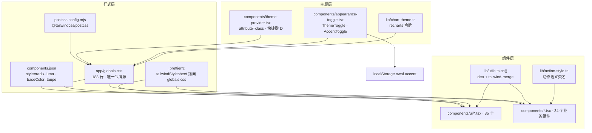
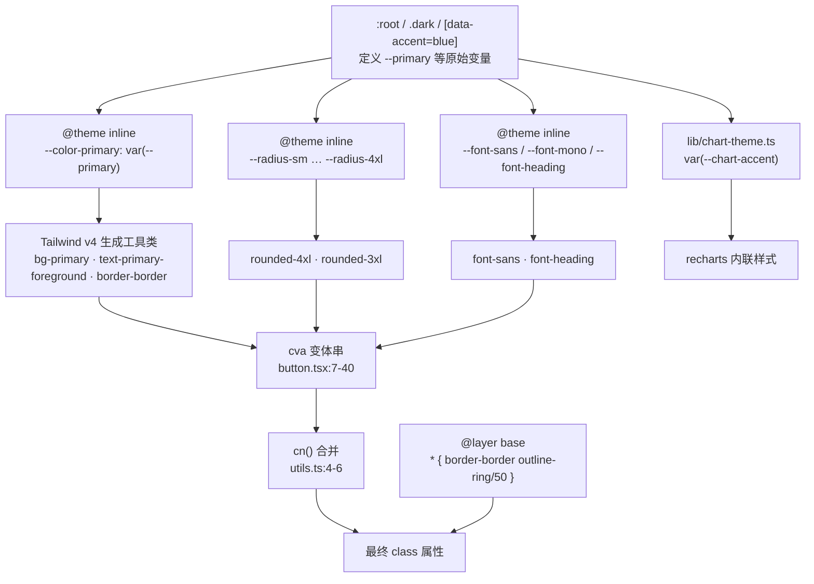
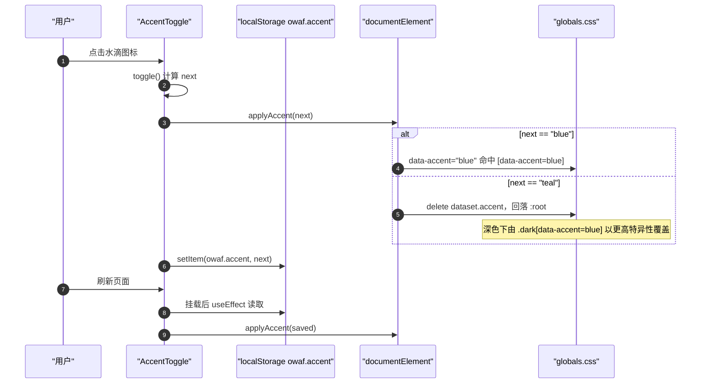
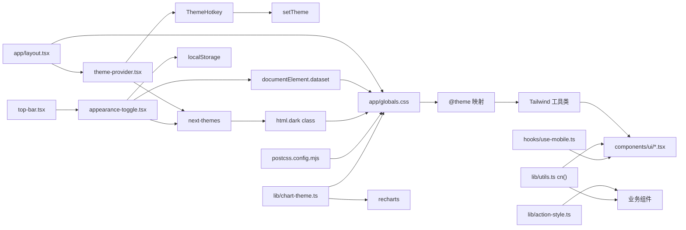

# 主题系统与样式

> [返回 前端管理界面](前端管理界面.md)

<cite>
**本文档引用的文件**
- [frontend/app/globals.css](file://frontend/app/globals.css)
- [frontend/app/layout.tsx](file://frontend/app/layout.tsx)
- [frontend/app/(dashboard)/layout.tsx](file://frontend/app/(dashboard)/layout.tsx)
- [frontend/app/(dashboard)/dashboard/page.tsx](file://frontend/app/(dashboard)/dashboard/page.tsx)
- [frontend/components/theme-provider.tsx](file://frontend/components/theme-provider.tsx)
- [frontend/components/appearance-toggle.tsx](file://frontend/components/appearance-toggle.tsx)
- [frontend/components/top-bar.tsx](file://frontend/components/top-bar.tsx)
- [frontend/components/ui/button.tsx](file://frontend/components/ui/button.tsx)
- [frontend/components/ui/input.tsx](file://frontend/components/ui/input.tsx)
- [frontend/components/ui/card.tsx](file://frontend/components/ui/card.tsx)
- [frontend/components/ui/dialog.tsx](file://frontend/components/ui/dialog.tsx)
- [frontend/components/ui/sidebar.tsx](file://frontend/components/ui/sidebar.tsx)
- [frontend/lib/utils.ts](file://frontend/lib/utils.ts)
- [frontend/lib/action-style.ts](file://frontend/lib/action-style.ts)
- [frontend/lib/chart-theme.ts](file://frontend/lib/chart-theme.ts)
- [frontend/hooks/use-mobile.ts](file://frontend/hooks/use-mobile.ts)
- [frontend/postcss.config.mjs](file://frontend/postcss.config.mjs)
- [frontend/components.json](file://frontend/components.json)
- [frontend/package.json](file://frontend/package.json)
- [frontend/next.config.ts](file://frontend/next.config.ts)
- [frontend/.prettierrc](file://frontend/.prettierrc)
- [frontend/eslint.config.mjs](file://frontend/eslint.config.mjs)
</cite>

## 目录

1. [简介](#简介)
2. [项目结构](#项目结构)
3. [核心组件](#核心组件)
4. [架构总览](#架构总览)
5. [详细组件分析](#详细组件分析)
6. [依赖关系分析](#依赖关系分析)
7. [性能考虑](#性能考虑)
8. [故障排查指南](#故障排查指南)
9. [结论](#结论)
10. [附录](#附录)

## 简介

本篇聚焦**样式系统本身**：设计令牌取值、令牌到 Tailwind 工具类的映射路径、组件层的书写约定、
以及断点与浏览器兼容边界。

与已完成文档的分工如下，本篇不重复其表格：

| 议题 | 归属文档 | 本篇处理 |
|------|------|------|
| Provider 装配顺序与根布局职责 | [根布局与主题系统](Next.js%20架构设计/根布局与主题系统.md) | 只引用，不重述 |
| 明暗主题解析状态机 | [根布局与主题系统](Next.js%20架构设计/根布局与主题系统.md) | 改为切换时序视角 |
| 强调色四态兼容矩阵 | [根布局与主题系统](Next.js%20架构设计/根布局与主题系统.md) | 改为断点/暗色/浏览器矩阵 |
| 图表令牌常量表 | [根布局与主题系统](Next.js%20架构设计/根布局与主题系统.md) | 只保留约束结论 |
| `Button` 变体维度表 | [根布局与主题系统](Next.js%20架构设计/根布局与主题系统.md) | 改为跨组件约定汇总 |
| 原子组件实现细节 | [UI 原子组件模式](组件设计模式/UI%20原子组件模式.md) | 只谈样式，不谈 API |
| 对话框结构与动画 | [对话框组件](组件设计模式/对话框组件.md) | 只谈样式令牌 |

本篇的可核对产出是三张表：**逐变量设计令牌表**（26 行，含亮/暗取值与消费行号）、
**组件样式约定表**（17 项，跨 35 个 `components/ui/` 文件与 34 个业务组件的实测写法）、
**断点/暗色/浏览器兼容矩阵**；全篇共 11 张表。

**章节来源**
- [frontend/app/globals.css:1-188](file://frontend/app/globals.css#L1-L188)
- [frontend/components.json:1-25](file://frontend/components.json#L1-L25)

## 项目结构

样式相关的物理文件只有三类：一个全局样式表、四个主题相关文件、以及组件内联的 Tailwind 类串。
**没有 `tailwind.config.*`**——Tailwind v4 以 CSS 为唯一配置入口
（[postcss.config.mjs:1-7](file://frontend/postcss.config.mjs#L1-L7) 只挂 `@tailwindcss/postcss`；
[components.json:7](file://frontend/components.json#L7) 的 `tailwind.config` 为空串）。

**图表来源**
- [frontend/app/globals.css:1-188](file://frontend/app/globals.css#L1-L188)
- [frontend/components/theme-provider.tsx:1-71](file://frontend/components/theme-provider.tsx#L1-L71)
- [frontend/components/appearance-toggle.tsx:16-104](file://frontend/components/appearance-toggle.tsx#L16-L104)
- [frontend/postcss.config.mjs:1-7](file://frontend/postcss.config.mjs#L1-L7)
- [frontend/components.json:1-25](file://frontend/components.json#L1-L25)
- [frontend/.prettierrc:1-11](file://frontend/.prettierrc#L1-L11)

文件清单与规模（实测行数）：

| 文件 | 行数 | 职责 | 关键区段 |
|------|:----:|------|------|
| [frontend/app/globals.css](file://frontend/app/globals.css) | 188 | 令牌、变体、基础层 | 导入:1-3、变体:5、`@theme inline`:7-49、`:root`:51-99、`.dark`:101-136、蓝色强调:143-172、`@layer base`:174-188 |
| [frontend/components/theme-provider.tsx](file://frontend/components/theme-provider.tsx) | 71 | next-themes 装配 + 快捷键 | Provider:6-22、输入过滤:24-35、快捷键:37-69 |
| [frontend/components/appearance-toggle.tsx](file://frontend/components/appearance-toggle.tsx) | 104 | 明暗/强调色两个控件 | 键名:16、ThemeToggle:20-48、applyAccent:51-57、AccentToggle:60-104 |
| [frontend/lib/chart-theme.ts](file://frontend/lib/chart-theme.ts) | 64 | recharts 主题常量 | 约束注释:1-8、Tooltip:13-28、序列色:36-48、轴与渐变:55-64 |
| [frontend/lib/action-style.ts](file://frontend/lib/action-style.ts) | 133 | 动作 → 语义色单一来源 | 类别:11-19、映射:22-37、类名:40-54、分值:57-66 |
| [frontend/lib/utils.ts](file://frontend/lib/utils.ts) | 50 | `cn()` 与格式化 | `cn`:4-6 |
| [frontend/hooks/use-mobile.ts](file://frontend/hooks/use-mobile.ts) | 20 | 768px 断点判定 | 常量:3、hook:5-20 |

**章节来源**
- [frontend/app/globals.css:1-188](file://frontend/app/globals.css#L1-L188)
- [frontend/components/theme-provider.tsx:1-71](file://frontend/components/theme-provider.tsx#L1-L71)
- [frontend/components/appearance-toggle.tsx:1-104](file://frontend/components/appearance-toggle.tsx#L1-L104)
- [frontend/lib/chart-theme.ts:1-64](file://frontend/lib/chart-theme.ts#L1-L64)
- [frontend/lib/action-style.ts:1-133](file://frontend/lib/action-style.ts#L1-L133)
- [frontend/lib/utils.ts:1-50](file://frontend/lib/utils.ts#L1-L50)
- [frontend/hooks/use-mobile.ts:1-20](file://frontend/hooks/use-mobile.ts#L1-L20)

## 核心组件

主题系统由四个可独立替换的部件构成，各自职责不重叠：

| 组件 | 类型 | 输入 | 输出 | 失败语义 |
|------|------|------|------|----------|
| `ThemeProvider` | next-themes 包装 | `ComponentProps` | `<html>` 上的 `dark` class | 未挂载则 `.dark` 变量永不生效 |
| `ThemeHotkey` | 副作用组件（返回 `null`） | `keydown` 事件 | `setTheme(light\|dark)` | 输入态直接忽略 |
| `ThemeToggle` | 受控按钮 | `resolvedTheme` | 图标 + `setTheme` | 挂载前不渲染图标 |
| `AccentToggle` | 受控按钮 | `localStorage["owaf.accent"]` | `documentElement.dataset.accent` | 写失败静默忽略 |
| `globals.css` | 令牌源 | CSS 自定义属性 | `--color-*` → 工具类 | 变量缺失回落默认色 |
| `cn()` | 类名合并 | `ClassValue[]` | 去冲突字符串 | 不校验类名合法性 |
| `actionBadgeClass()` | 语义映射 | 后端动作串 | Tailwind 类串 | 未知动作归 `unknown` |

`ThemeHotkey` 挂在 Provider 内部、`children` 之前（[theme-provider.tsx:18-19](file://frontend/components/theme-provider.tsx#L18-L19)），
因此它自身不渲染任何 DOM，只是快捷键的宿主。

**章节来源**
- [frontend/components/theme-provider.tsx:6-69](file://frontend/components/theme-provider.tsx#L6-L69)
- [frontend/components/appearance-toggle.tsx:20-104](file://frontend/components/appearance-toggle.tsx#L20-L104)
- [frontend/lib/utils.ts:4-6](file://frontend/lib/utils.ts#L4-L6)
- [frontend/lib/action-style.ts:113-115](file://frontend/lib/action-style.ts#L113-L115)

## 架构总览

令牌到像素只有一跳半：CSS 自定义属性 → `@theme inline` 映射 → Tailwind 生成工具类 → 组件类串。
`inline` 关键字是关键：它让 `--color-primary` 直接**引用** `var(--primary)`，而不是在构建期把值
固化下来，因此运行时改 `--primary` 即可级联生效。

**图表来源**
- [frontend/app/globals.css:7-49](file://frontend/app/globals.css#L7-L49)
- [frontend/app/globals.css:174-188](file://frontend/app/globals.css#L174-L188)
- [frontend/components/ui/button.tsx:7-40](file://frontend/components/ui/button.tsx#L7-L40)
- [frontend/lib/utils.ts:4-6](file://frontend/lib/utils.ts#L4-L6)
- [frontend/lib/chart-theme.ts:36-48](file://frontend/lib/chart-theme.ts#L36-L48)

装配入口极简：`globals.css` 在根布局作为唯一样式导入
（[layout.tsx:3](file://frontend/app/layout.tsx#L3)），`<html>` 带
`suppressHydrationWarning`（[:14](file://frontend/app/layout.tsx#L14)）以容忍
next-themes 在客户端改写 class，`<body>` 带 `font-sans`（[:15](file://frontend/app/layout.tsx#L15)）。
**根布局没有 `metadata` 导出，也没有 `next/font`**——这与旧稿「通过 next/font/google 注入 Geist」
的说法相反，实测字体全部是系统栈（[globals.css:8-10](file://frontend/app/globals.css#L8-L10)）。

**章节来源**
- [frontend/app/globals.css:7-49](file://frontend/app/globals.css#L7-L49)
- [frontend/app/layout.tsx:1-29](file://frontend/app/layout.tsx#L1-L29)

## 详细组件分析

### 设计令牌与明暗取值

逐变量清单。浅色取 `:root`（[globals.css:51-99](file://frontend/app/globals.css#L51-L99)），
深色取 `.dark`（[:101-136](file://frontend/app/globals.css#L101-L136)）。用途行号指该变量在样式表或
组件中的首个消费点。

| 变量 | 用途:行 | 亮色取值 | 暗色取值 |
|------|------|------|------|
| `--background` | 页面底 [globals.css:52](file://frontend/app/globals.css#L52)、正文层 :179 | `oklch(1 0 0)` | `oklch(0.147 0.004 49.3)` |
| `--foreground` | 正文 [globals.css:53](file://frontend/app/globals.css#L53)、:179 | `oklch(0.147 0.004 49.3)` | `oklch(0.986 0.002 67.8)` |
| `--card` | 卡片底 [card.tsx:15](file://frontend/components/ui/card.tsx#L15) | `oklch(1 0 0)` | `oklch(0.214 0.009 43.1)` |
| `--card-foreground` | 卡片文字 [card.tsx:15](file://frontend/components/ui/card.tsx#L15) | `oklch(0.147 0.004 49.3)` | `oklch(0.986 0.002 67.8)` |
| `--popover` | 浮层底 / Tooltip [chart-theme.ts:14](file://frontend/lib/chart-theme.ts#L14) | `oklch(1 0 0)` | `oklch(0.214 0.009 43.1)` |
| `--primary` | 交互主色 [button.tsx:12](file://frontend/components/ui/button.tsx#L12) | `oklch(0.527 0.154 178.0)` | `oklch(0.448 0.119 178.0)` |
| `--primary-foreground` | 主色上文字 [button.tsx:12](file://frontend/components/ui/button.tsx#L12) | `oklch(0.982 0.018 178.0)` | 同亮色 |
| `--secondary` | 次级底 [button.tsx:16](file://frontend/components/ui/button.tsx#L16) | `oklch(0.967 0.001 286.375)` | `oklch(0.274 0.006 286.033)` |
| `--muted` | 悬停底 [button.tsx:18](file://frontend/components/ui/button.tsx#L18) | `oklch(0.96 0.002 17.2)` | `oklch(0.268 0.011 36.5)` |
| `--muted-foreground` | 辅助文字 [chart-theme.ts:25](file://frontend/lib/chart-theme.ts#L25) | `oklch(0.547 0.021 43.1)` | `oklch(0.714 0.014 41.2)` |
| `--accent` | 强调底 [button.tsx:18](file://frontend/components/ui/button.tsx#L18) | `oklch(0.96 0.002 17.2)` | `oklch(0.268 0.011 36.5)` |
| `--destructive` | 危险色 [button.tsx:20](file://frontend/components/ui/button.tsx#L20) | `oklch(0.577 0.245 27.325)` | `oklch(0.704 0.191 22.216)` |
| `--border` | 描边 + 网格线 [globals.css:176](file://frontend/app/globals.css#L176) | `oklch(0.922 0.005 34.3)` | `oklch(1 0 0 / 10%)` |
| `--input` | 输入底 [input.tsx:11](file://frontend/components/ui/input.tsx#L11) | `oklch(0.922 0.005 34.3)` | `oklch(1 0 0 / 15%)` |
| `--ring` | 焦点环 [button.tsx:8](file://frontend/components/ui/button.tsx#L8) | `oklch(0.714 0.014 41.2)` | `oklch(0.547 0.021 43.1)` |
| `--chart-1` | 序列 1 [globals.css:70](file://frontend/app/globals.css#L70) | `oklch(0.527 0.154 178.0)` | `oklch(0.905 0.182 98.111)` |
| `--chart-2` … `--chart-5` | 序列 2-5 [globals.css:71-74](file://frontend/app/globals.css#L71-L74) | `0.795/0.184/86.047` 起四值 | 仅 `--chart-1` 被覆盖 |
| `--chart-accent` | 图表主色 [chart-theme.ts:36](file://frontend/lib/chart-theme.ts#L36) | `oklch(0.527 0.154 178.0)` | `var(--teal-600)` |
| `--chart-danger` | 图表危险色 [chart-theme.ts:42](file://frontend/lib/chart-theme.ts#L42) | `#ef4444` | `#ef4444`（恒定） |
| `--radius` | 圆角基数 [globals.css:82](file://frontend/app/globals.css#L82) | `0.625rem` | 未覆盖 |
| `--sidebar` | 侧栏底 [sidebar.tsx:171](file://frontend/components/ui/sidebar.tsx#L171) | `oklch(0.986 0.002 67.8)` | `oklch(0.214 0.009 43.1)` |
| `--sidebar-primary` | 侧栏主色 [globals.css:85](file://frontend/app/globals.css#L85) | `oklch(0.527 0.154 178.0)` | `oklch(0.723 0.219 178.0)` |
| `--teal-50` … `--teal-700` | 青绿色阶 [globals.css:91-98](file://frontend/app/globals.css#L91-L98) | `#f0fdfa` … `#0f766e` | 未覆盖，供暗色 `--chart-accent` 取 `--teal-600` |
| `--font-sans` | 正文栈 [globals.css:9](file://frontend/app/globals.css#L9)、:180 | 系统栈 | 同值 |
| `--font-mono` | 代码栈 [globals.css:10](file://frontend/app/globals.css#L10)、:186 | 等宽系统栈 | 同值 |
| `--font-heading` | 标题栈 [card.tsx:40](file://frontend/components/ui/card.tsx#L40) | 等宽系统栈 | 同值 |

三条取值规律：

1. **深色不是简单反相**。`--border` / `--input` 在暗色下改用带透明度的 `oklch(1 0 0 / 10%)` 与
   `/ 15%`（[globals.css:117-118](file://frontend/app/globals.css#L117-L118)），使描边在任何卡面上都只提亮
   一档，而不是画出硬边。
2. **`--chart-2` 至 `--chart-5` 在暗色下被原样重写**（[:121-124](file://frontend/app/globals.css#L121-L124)），
   仅 `--chart-1` 从青绿跳到黄绿 `oklch(0.905 0.182 98.111)`，用来在深卡面上保住首条序列的辨识度。
3. **`--chart-danger` 四态恒为 `#ef4444`**（[:81](file://frontend/app/globals.css#L81)、
   [:127](file://frontend/app/globals.css#L127)），注释写明「红=风险」不应随强调色偏好漂移。

**章节来源**
- [frontend/app/globals.css:51-136](file://frontend/app/globals.css#L51-L136)
- [frontend/app/globals.css:143-172](file://frontend/app/globals.css#L143-L172)
- [frontend/lib/chart-theme.ts:13-48](file://frontend/lib/chart-theme.ts#L13-L48)
- [frontend/components/ui/card.tsx:15-40](file://frontend/components/ui/card.tsx#L15-L40)
- [frontend/components/ui/input.tsx:11](file://frontend/components/ui/input.tsx#L11)
- [frontend/components/ui/sidebar.tsx:171](file://frontend/components/ui/sidebar.tsx#L171)

### 圆角、字体与间距阶梯

`@theme inline` 把单一 `--radius` 展开为六级乘算阶梯
（[globals.css:42-48](file://frontend/app/globals.css#L42-L48)）：

| 令牌 | 表达式 | 实际值（基数 `0.625rem`） | 组件实测用法 |
|------|------|:----:|------|
| `--radius-sm` | `radius * 0.6` | `0.375rem` | 内联小组件 |
| `--radius-md` | `radius * 0.8` | `0.5rem` | - |
| `--radius-lg` | `radius` | `0.625rem` | - |
| `--radius-xl` | `radius * 1.4` | `0.875rem` | - |
| `--radius-2xl` | `radius * 1.8` | `1.125rem` | - |
| `--radius-3xl` | `radius * 2.2` | `1.375rem` | `rounded-3xl` 输入框 [input.tsx:11](file://frontend/components/ui/input.tsx#L11) |
| `--radius-4xl` | `radius * 2.6` | `1.625rem` | `rounded-4xl` 按钮/卡片 [button.tsx:8](file://frontend/components/ui/button.tsx#L8)、[card.tsx:15](file://frontend/components/ui/card.tsx#L15) |

字体侧没有 Web 字体下载：`--font-heading` 直接复用等宽栈（[globals.css:8](file://frontend/app/globals.css#L8)），
`--font-sans` 是 `-apple-system … Noto Sans` 系统栈（[:9](file://frontend/app/globals.css#L9)）。
标题用等宽、正文用系统无衬线是本项目的刻意选择，`CardTitle` 即 `font-heading`
（[card.tsx:40](file://frontend/components/ui/card.tsx#L40)）。

间距用 Tailwind v4 的 `--spacing()` 函数在组件内部定义局部变量，再由 `data-*` 覆盖：
`[--card-spacing:--spacing(6)]` + `data-[size=sm]:[--card-spacing:--spacing(4)]`
（[card.tsx:15](file://frontend/components/ui/card.tsx#L15)），子元素统一用
`gap-(--card-spacing)` / `px-(--card-spacing)`（[:28](file://frontend/components/ui/card.tsx#L28)、
[:73](file://frontend/components/ui/card.tsx#L73)、[:84](file://frontend/components/ui/card.tsx#L84)）。
这样「一张卡的密度」只由一个变量决定，不靠散落各处的 `gap-4`。

**章节来源**
- [frontend/app/globals.css:8-10](file://frontend/app/globals.css#L8-L10)
- [frontend/app/globals.css:42-48](file://frontend/app/globals.css#L42-L48)
- [frontend/components/ui/card.tsx:15-84](file://frontend/components/ui/card.tsx#L15-L84)
- [frontend/components/ui/input.tsx:11](file://frontend/components/ui/input.tsx#L11)

### 暗色模式与强调色的落地位置

暗色的开关是 `<html>` 上的 `class`：Provider 显式设 `attribute="class"`、`defaultTheme="system"`、
`enableSystem`、`disableTransitionOnChange`（[theme-provider.tsx:11-16](file://frontend/components/theme-provider.tsx#L11-L16)）；
Tailwind 侧用 `@custom-variant dark (&:is(.dark *))` 把 `dark:` 前缀绑定到同一个 class
（[globals.css:5](file://frontend/app/globals.css#L5)）。两者必须一致，否则 `dark:` 类与 `.dark` 变量块
会各自失效。

强调色是**与明暗正交的第二轴**，不走 next-themes，而走 `documentElement.dataset.accent`：

**图表来源**
- [frontend/components/appearance-toggle.tsx:51-104](file://frontend/components/appearance-toggle.tsx#L51-L104)
- [frontend/app/globals.css:143-172](file://frontend/app/globals.css#L143-L172)
- [frontend/app/globals.css:101-136](file://frontend/app/globals.css#L101-L136)

三个实现细节解释了「为什么这样写」：

- **挂载后才读 `localStorage`**。`AccentToggle` 的初值是 `teal`，真实偏好只在 `useEffect` 里读并应用
  （[appearance-toggle.tsx:66-75](file://frontend/components/appearance-toggle.tsx#L66-L75)），注释直说是为了避开
  静态导出的 hydration 不一致。文件头注释同此（:1-7）。
- **深色蓝用 `.dark[data-accent="blue"]`**（[globals.css:159-172](file://frontend/app/globals.css#L159-L172)），
  比 `[data-accent="blue"]`（[:143-156](file://frontend/app/globals.css#L143-L156)）多一个类选择器，注释写明是
  「以更高特异性覆盖 `.dark`，避免被浅色蓝规则误伤」。
- **切换不带动画**（`disableTransitionOnChange`，[theme-provider.tsx:15](file://frontend/components/theme-provider.tsx#L15)），
  避免整屏颜色补间造成的闪。

明暗切换另有键盘入口：`ThemeHotkey` 监听 `keydown`，先排除
`defaultPrevented` / `repeat` / `meta|ctrl|alt` 组合键，再要求键名为 `d`，最后用 `isTypingTarget`
过滤 `isContentEditable`、`INPUT`、`TEXTAREA`、`SELECT`（[theme-provider.tsx:40-59](file://frontend/components/theme-provider.tsx#L40-L59)），
命中才 `setTheme(resolvedTheme === "dark" ? "light" : "dark")`（[:58](file://frontend/components/theme-provider.tsx#L58)）。
`isTypingTarget` 是独立函数（[:24-35](file://frontend/components/theme-provider.tsx#L24-L35)），因此该过滤可被其它快捷键复用。

**章节来源**
- [frontend/components/theme-provider.tsx:10-69](file://frontend/components/theme-provider.tsx#L10-L69)
- [frontend/components/appearance-toggle.tsx:16-104](file://frontend/components/appearance-toggle.tsx#L16-L104)
- [frontend/app/globals.css:5](file://frontend/app/globals.css#L5)
- [frontend/app/globals.css:143-172](file://frontend/app/globals.css#L143-L172)

### 组件样式约定

跨 `components/ui/`（35 个文件）与业务组件（34 个文件）实测的写法约定：

| 约定 | 具体写法 | 实测位置:行 | 目的 |
|------|------|------|------|
| 数据槽标记 | `data-slot="button"` | [button.tsx:56](file://frontend/components/ui/button.tsx#L56) | 调试定位 + 外部选择器覆盖；`ui/` 下 32 个文件共 178 处 |
| 变体/尺寸入 DOM | `data-variant` `data-size` | [button.tsx:57-58](file://frontend/components/ui/button.tsx#L57-L58) | 无需 React DevTools 即可读出当前变体 |
| 变体集中声明 | `cva(base, {variants, defaultVariants})` | [button.tsx:7-40](file://frontend/components/ui/button.tsx#L7-L40) | 样式表化，避免 if 分支拼类名 |
| 类名合并 | `cn(base, className)` | [utils.ts:4-6](file://frontend/lib/utils.ts#L4-L6) | `tailwind-merge` 消解冲突，调用方可覆写 |
| 焦点可见环 | `focus-visible:ring-3 ring-ring/30` + `outline-none` | [button.tsx:8](file://frontend/components/ui/button.tsx#L8)、[input.tsx:11](file://frontend/components/ui/input.tsx#L11) | 只用环不用边框，避免布局跳动 |
| 无效态 | `aria-invalid:border-destructive ring-destructive/20` | [button.tsx:8](file://frontend/components/ui/button.tsx#L8)、[input.tsx:11](file://frontend/components/ui/input.tsx#L11) | 无障碍属性驱动样式，不另加 state class |
| 全局默认描边 | `* { @apply border-border outline-ring/50 }` | [globals.css:175-177](file://frontend/app/globals.css#L175-L177) | 任何边框默认可主题化 |
| 指针形态兜底 | `button:not(:disabled), [role="button"]:not(:disabled) { cursor: pointer }` | [globals.css:182-184](file://frontend/app/globals.css#L182-L184) | 修正 v4 预设 `cursor: default` |
| 暗色分支最小化 | `dark:` 前缀仅用于透明度过渡 | 实测 `components/` 29 个文件 73 处，如 [button.tsx:14](file://frontend/components/ui/button.tsx#L14)、[card.tsx:15](file://frontend/components/ui/card.tsx#L15) | 主体颜色走变量，`dark:` 只补差异 |
| 容器查询 | `@container/card-header` | [card.tsx:28](file://frontend/components/ui/card.tsx#L28) | 卡头按容器宽而非视口宽换行 |
| 兄弟槽感知 | `has-data-[slot=card-action]:grid-cols-[1fr_auto]` | [card.tsx:28](file://frontend/components/ui/card.tsx#L28) | 有操作区才两列，无需传参 |
| 图标尺寸兜底 | `[&_svg:not([class*='size-'])]:size-4` | [button.tsx:8](file://frontend/components/ui/button.tsx#L8) | 调用方未显式定尺寸时统一 |
| 内联间距覆盖 | `has-data-[icon=inline-end]:pe-2.5` | [button.tsx:25](file://frontend/components/ui/button.tsx#L25) | 图标在内/外末尾用逻辑属性收放 |
| 开合动画声明式 | `data-open:animate-in data-closed:animate-out` | [dialog.tsx:45](file://frontend/components/ui/dialog.tsx#L45) | 由 `tw-animate-css` 提供类，不写 keyframes |
| RTL 逻辑属性 | `ps-*`/`pe-*`、`border-e`/`border-s`、`ms-*`、`end-4` | [button.tsx:25](file://frontend/components/ui/button.tsx#L25)、[sidebar.tsx:236](file://frontend/components/ui/sidebar.tsx#L236)、[dialog.tsx:80](file://frontend/components/ui/dialog.tsx#L80) | `components.json` 设 `"rtl": true`（[:14](file://frontend/components.json#L14)） |
| 宽度以变量注入 | `style={{"--sidebar-width": SIDEBAR_WIDTH}}` | [sidebar.tsx:134-135](file://frontend/components/ui/sidebar.tsx#L134-L135) | 组件参数透给 CSS，再由 `w-(--sidebar-width)` 消费（:171） |
| 局部语义色板 | `TONE_CLASS` 常量表 | [action-style.ts:40-54](file://frontend/lib/action-style.ts#L40-L54) | 动作色只此一份，禁止各页自写 map |

反例基线：`action-style.ts` 的头部注释明确写出动机——「避免各页面各写一份 actionColorMap
导致同一动作显示不同颜色」（[action-style.ts:1-8](file://frontend/lib/action-style.ts#L1-L8)）。
它的映射严格对齐后端 `TerminalPriority`：`drop 90 / intercept 80 / rateLimit 70 / challenge 60 /
redirect 50 / observe 10`（[:57-66](file://frontend/lib/action-style.ts#L57-L66)），并把历史值
`block` 归一到 `intercept`、`log_only` 与 `tag` 归一到 `observe`
（[:22-37](file://frontend/lib/action-style.ts#L22-L37)、
`normalizeActionValue`:101-106）。四类挑战动作共用一档 60 与一档天蓝
（`captcha_challenge` / `shield_challenge` / `chain_challenge` → `challenge`，
[:28-30](file://frontend/lib/action-style.ts#L28-L30)）。

**章节来源**
- [frontend/components/ui/button.tsx:7-62](file://frontend/components/ui/button.tsx#L7-L62)
- [frontend/components/ui/card.tsx:15-84](file://frontend/components/ui/card.tsx#L15-L84)
- [frontend/components/ui/input.tsx:5-17](file://frontend/components/ui/input.tsx#L5-L17)
- [frontend/components/ui/dialog.tsx:43-80](file://frontend/components/ui/dialog.tsx#L43-L80)
- [frontend/components/ui/sidebar.tsx:134-236](file://frontend/components/ui/sidebar.tsx#L134-L236)
- [frontend/app/globals.css:174-188](file://frontend/app/globals.css#L174-L188)
- [frontend/lib/action-style.ts:1-106](file://frontend/lib/action-style.ts#L1-L106)
- [frontend/lib/utils.ts:4-6](file://frontend/lib/utils.ts#L4-L6)
- [frontend/components.json:18](file://frontend/components.json#L18)

### 响应式与兼容矩阵

断点体系完全沿用 Tailwind v4 默认阈值，未自定义；移动端判定另有一条 JS 通道，
因为侧栏需要在 `md` 以下切换为 Sheet 形态。

| 维度 | 取值 | 实现位置:行 | 备注 |
|------|:----:|------|------|
| 移动端阈值 | 768px | [use-mobile.ts:3](file://frontend/hooks/use-mobile.ts#L3) | `matchMedia("(max-width: 767px)")`（:9） |
| 侧栏显隐 | `hidden md:block` / `md:flex` | [sidebar.tsx:209](file://frontend/components/ui/sidebar.tsx#L209)、[:232](file://frontend/components/ui/sidebar.tsx#L232) | 桌面常驻，移动走 Sheet |
| 侧栏宽度 | 16rem / 移动 18rem / 图标 3rem | [sidebar.tsx:29-31](file://frontend/components/ui/sidebar.tsx#L29-L31) | 三档常量 |
| 输入字号 | `text-base md:text-sm` | [input.tsx:11](file://frontend/components/ui/input.tsx#L11) | 移动端保持 16px，避开 iOS 聚焦缩放 |
| 卡片网格 | `grid-cols-2 md:grid-cols-4` | [dashboard/page.tsx:163](file://frontend/app/(dashboard)/dashboard/page.tsx#L163) | 指标条 2/4 列 |
| 双列布局 | `grid gap-3 lg:grid-cols-2` | [dashboard/page.tsx:168](file://frontend/app/(dashboard)/dashboard/page.tsx#L168) | 图表区两列 |
| 四列统计 | `grid-cols-2 gap-2.5 lg:grid-cols-4` | [dashboard/page.tsx:421](file://frontend/app/(dashboard)/dashboard/page.tsx#L421)、[:1044](file://frontend/app/(dashboard)/dashboard/page.tsx#L1044) | 与 `md:grid-cols-4` 并存，非统一档位 |
| 三列区块 | `grid gap-3 lg:grid-cols-3` | [dashboard/page.tsx:754](file://frontend/app/(dashboard)/dashboard/page.tsx#L754) | - |
| 主从布局 | `md:grid-cols-[140px_1fr]` | [dashboard/page.tsx:642](file://frontend/app/(dashboard)/dashboard/page.tsx#L642) | 定宽标签列 + 自适应 |
| 内容区内边距 | `p-4 lg:p-6` | [app/(dashboard)/layout.tsx:27](file://frontend/app/(dashboard)/layout.tsx#L27) | 单一入口设定 |
| 暗色开关 | `.dark` class | [globals.css:5](file://frontend/app/globals.css#L5)、[theme-provider.tsx:12](file://frontend/components/theme-provider.tsx#L12) | 与 `dark:` 变体同源 |
| 强调色开关 | `data-accent` 属性 | [appearance-toggle.tsx:51-57](file://frontend/components/appearance-toggle.tsx#L51-L57) | 独立于明暗轴 |

现代 CSS 特性的实际依赖面（静态导出对浏览器是「全有或全无」，无服务端回退）：

| 特性 | 使用位置 | 不满足时表现 |
|------|------|------|
| `oklch()` 颜色 | [globals.css:52-135](file://frontend/app/globals.css#L52-L135) 全站 | 变量非法 → 回落继承色，整站失配 |
| `:is()` 选择器 | `@custom-variant` [:5](file://frontend/app/globals.css#L5) | `dark:` 前缀失效 |
| `color-mix(in oklch, …)` | [button.tsx:16](file://frontend/components/ui/button.tsx#L16) secondary 悬停 | 该悬停态失色 |
| 容器查询 `@container` | [card.tsx:28](file://frontend/components/ui/card.tsx#L28) | 卡头按视口而非容器排版 |
| 属性级联变量 `--spacing()` | [card.tsx:15](file://frontend/components/ui/card.tsx#L15) | 卡内间距回落 |
| `localStorage` / `matchMedia` | [appearance-toggle.tsx:68](file://frontend/components/appearance-toggle.tsx#L68)、[use-mobile.ts:9](file://frontend/hooks/use-mobile.ts#L9) | 偏好丢失 / 恒为桌面 |

**章节来源**
- [frontend/hooks/use-mobile.ts:3-20](file://frontend/hooks/use-mobile.ts#L3-L20)
- [frontend/components/ui/sidebar.tsx:29-236](file://frontend/components/ui/sidebar.tsx#L29-L236)
- [frontend/components/ui/input.tsx:11](file://frontend/components/ui/input.tsx#L11)
- [frontend/app/(dashboard)/dashboard/page.tsx:163-1044](file://frontend/app/(dashboard)/dashboard/page.tsx#L163-L1044)
- [frontend/app/(dashboard)/layout.tsx:27](file://frontend/app/(dashboard)/layout.tsx#L27)
- [frontend/app/globals.css:5-135](file://frontend/app/globals.css#L5-L135)
- [frontend/components/appearance-toggle.tsx:51-75](file://frontend/components/appearance-toggle.tsx#L51-L75)

### 工具链约束

样式相关的外部约束有四处，全部是配置事实而非约定俗成：

- **PostCSS 只挂 Tailwind v4 插件**，没有 `autoprefixer`、没有 `tailwindcss` 顶层插件
  （[postcss.config.mjs:1-7](file://frontend/postcss.config.mjs#L1-L7)）。
- **shadcn CLI 配置**：`style: "radix-luma"`、`baseColor: "taupe"`、`cssVariables: true`、
  `iconLibrary: "tabler"`、`tailwind.config: ""`（空即无配置文件）、`tailwind.css: "app/globals.css"`
  （[components.json:3-13](file://frontend/components.json#L3-L13)）。
- **格式化会重排类名**：`prettier-plugin-tailwindcss` 启用，且把样式表入口显式告诉插件
  `tailwindStylesheet: "app/globals.css"`、`tailwindFunctions: ["cn","cva"]`
  （[.prettierrc:1-11](file://frontend/.prettierrc#L1-L11)）。因此类串的顺序是工具产物，
  不代表优先级——优先级由 `tailwind-merge` 决定。
- **Lint 走 ESLint flat config**，脚本为 `eslint` 而非 `next lint`
  （[eslint.config.mjs:1-19](file://frontend/eslint.config.mjs#L1-L19)、
  [package.json:10](file://frontend/package.json#L10)）；`typecheck` 为 `tsc --noEmit`
  （[:12](file://frontend/package.json#L12)）。
- **构建产物落点固定**：`build` 脚本在 `next build` 后把 `out/` 同步到
  `internal/core/adminweb/dist`（[package.json:8](file://frontend/package.json#L8)），
  因此样式改动必须重新构建前端才会进二进制。

依赖版本（样式相关）：`tailwindcss ^4` 与 `@tailwindcss/postcss ^4`（devDependencies）、
`tw-animate-css ^1.4.0`、`shadcn ^4.12.0`、`class-variance-authority ^0.7.1`、`clsx ^2.1.1`、
`tailwind-merge ^3.6.0`、`radix-ui ^1.6.0`、`next-themes ^0.4.6`、`recharts ^3.9.1`
（[package.json:24-64](file://frontend/package.json#L24-L64)）。

**章节来源**
- [frontend/postcss.config.mjs:1-7](file://frontend/postcss.config.mjs#L1-L7)
- [frontend/components.json:1-25](file://frontend/components.json#L1-L25)
- [frontend/.prettierrc:1-11](file://frontend/.prettierrc#L1-L11)
- [frontend/eslint.config.mjs:1-19](file://frontend/eslint.config.mjs#L1-L19)
- [frontend/package.json:6-64](file://frontend/package.json#L6-L64)

## 依赖关系分析

**图表来源**
- [frontend/app/layout.tsx:1-29](file://frontend/app/layout.tsx#L1-L29)
- [frontend/components/theme-provider.tsx:1-71](file://frontend/components/theme-provider.tsx#L1-L71)
- [frontend/components/appearance-toggle.tsx:1-104](file://frontend/components/appearance-toggle.tsx#L1-L104)
- [frontend/app/globals.css:1-49](file://frontend/app/globals.css#L1-L49)
- [frontend/lib/action-style.ts:1-54](file://frontend/lib/action-style.ts#L1-L54)
- [frontend/components/top-bar.tsx:23-26](file://frontend/components/top-bar.tsx#L23-L26)

依赖边界（谁可以改谁不可以）：

| 模块 | 依赖 | 可替换性 | 约束 |
|------|------|:----:|------|
| `components/ui/*` | `cn()` + 令牌类名 | 高 | 不得硬编码色值，只用语义类 |
| `lib/chart-theme.ts` | 令牌变量名 | 中 | 只能 `var(--x)`，不可包 `hsl()` |
| `lib/action-style.ts` | 后端动作串 | 中 | 新增动作须同步分值与映射 |
| `theme-provider.tsx` | next-themes | 低 | `attribute="class"` 与 `@custom-variant` 必须同改 |
| `appearance-toggle.tsx` | `data-accent` 选择器块 | 低 | 新增强调色需补 `.dark[...]` 分支 |
| `globals.css` | Tailwind v4 编译 | 低 | 唯一令牌源，无第二份 |
| `use-mobile.ts` | 768 常量 | 高 | 与 `md:` 阈值必须一致 |

**章节来源**
- [frontend/lib/chart-theme.ts:1-8](file://frontend/lib/chart-theme.ts#L1-L8)
- [frontend/lib/action-style.ts:1-8](file://frontend/lib/action-style.ts#L1-L8)
- [frontend/components/theme-provider.tsx:10-16](file://frontend/components/theme-provider.tsx#L10-L16)
- [frontend/app/globals.css:5-5](file://frontend/app/globals.css#L5-L5)
- [frontend/hooks/use-mobile.ts:3](file://frontend/hooks/use-mobile.ts#L3)

## 性能考虑

- **无字体下载**：三档字体全为系统栈（[globals.css:8-10](file://frontend/app/globals.css#L8-L10)），
  因此没有 FOUT/FOIT，也不产生额外请求。代价是跨平台字形不完全一致。
- **切主题不补间**：`disableTransitionOnChange`（[theme-provider.tsx:15](file://frontend/components/theme-provider.tsx#L15)）
  避免整屏颜色过渡触发的重排与合成层放大。
- **变量级联替代类名切换**：强调色只改一个 `data-accent` 属性
  （[appearance-toggle.tsx:51-57](file://frontend/components/appearance-toggle.tsx#L51-L57)），浏览器按选择器重算
  自定义属性，无需遍历组件树。
- **动画类按需**：只有开合类元素引入 `tw-animate-css`（[dialog.tsx:45](file://frontend/components/ui/dialog.tsx#L45)），
  列表与表格不参与入场动画。
- **静态导出没有运行时样式注入**：`output: "export"` 意味着首屏 CSS 即最终 CSS
  （[next.config.ts:4](file://frontend/next.config.ts#L4)），没有 Server Components 的样式流。
- **`cn()` 的成本**：`twMerge(clsx(...))` 每次渲染都会解析类串（[utils.ts:4-6](file://frontend/lib/utils.ts#L4-L6)），
  因此类串应尽量留在 `cva` 常量里，而不是在渲染函数中临时拼接。
- **图标体积**：`optimizePackageImports` 列了 `lucide-react`，但项目实际只用
  `@tabler/icons-react`（[next.config.ts:11-13](file://frontend/next.config.ts#L11-L13)、
  [package.json:27](file://frontend/package.json#L27)）；该冗余项已登记，不影响样式，但会误导摇树配置。

**章节来源**
- [frontend/app/globals.css:8-10](file://frontend/app/globals.css#L8-L10)
- [frontend/components/theme-provider.tsx:15](file://frontend/components/theme-provider.tsx#L15)
- [frontend/components/appearance-toggle.tsx:51-57](file://frontend/components/appearance-toggle.tsx#L51-L57)
- [frontend/lib/utils.ts:4-6](file://frontend/lib/utils.ts#L4-L6)
- [frontend/next.config.ts:3-14](file://frontend/next.config.ts#L3-L14)
- [frontend/package.json:11-13](file://frontend/package.json#L11-L13)

## 故障排查指南

| 症状 | 成因 | 排查 | 方案 |
|------|------|------|------|
| 图表颜色回落默认色 | 写成 `hsl(var(--primary))`，而调色板本身是 `oklch()` | 全局搜 `hsl(var(--` | 直接用 `var(--primary)`（[chart-theme.ts:1-8](file://frontend/lib/chart-theme.ts#L1-L8)） |
| 深色下折线看不清 | 复用了 `--primary`，对暗卡面仅 2.64:1 | 比对 `--chart-accent` 取值 | 图表一律走 `CHART_ACCENT`（[chart-theme.ts:30-36](file://frontend/lib/chart-theme.ts#L30-L36)） |
| `dark:` 类完全不生效 | `@custom-variant` 与 next-themes `attribute` 不一致 | 看 `<html>` 上是否有 `dark` | 两处同改（[globals.css:5](file://frontend/app/globals.css#L5)、[theme-provider.tsx:12](file://frontend/components/theme-provider.tsx#L12)） |
| 刷新后强调色闪一下 | 首屏固定 `teal`，挂载后才读存储 | 属预期，非缺陷 | 不要改成效应内 `setState` 初值 |
| 深色 + 蓝强调失效 | 只补了 `[data-accent="blue"]`，未补 `.dark[data-accent="blue"]` | 检查特异性 | 两态必须成对（[globals.css:143-172](file://frontend/app/globals.css#L143-L172)） |
| 快捷键 D 在输入框里也切主题 | `isTypingTarget` 未覆盖新编辑控件 | 看 `contenteditable` 与标签名 | 扩过滤函数（[theme-provider.tsx:24-35](file://frontend/components/theme-provider.tsx#L24-L35)） |
| 按钮被 `className` 覆写无效 | 绕过 `cn()` 直接字符串拼接 | 确认最终 class 属性 | 变体经 `cn(buttonVariants({...className}))`（[button.tsx:59](file://frontend/components/ui/button.tsx#L59)） |
| 圆角与预期不符 | `rounded-3xl/4xl` 是乘算派生值 | 换算基数 `--radius` | 调基数而非调单个工具类（[globals.css:42-48](file://frontend/app/globals.css#L42-L48)） |
| 移动端输入聚焦时页面放大 | 字号小于 16px | 看 `text-base md:text-sm` | 保留 `text-base` 作基线（[input.tsx:11](file://frontend/components/ui/input.tsx#L11)） |
| 侧栏与 `md:` 断点错位 | JS 阈值 768 与 `md` 不一致 | 比对 `MOBILE_BREAKPOINT` | 改一处必须同步另一处（[use-mobile.ts:3](file://frontend/hooks/use-mobile.ts#L3)） |
| 改样式但界面不变 | 产物未同步到内嵌目录 | 查 `internal/core/adminweb/dist` 时间戳 | 重跑前端 `build`（[package.json:8](file://frontend/package.json#L8)） |
| 同一动作在不同页颜色不同 | 有人另写了一份 actionColorMap | 搜 `actionColorMap` | 统一用 `actionBadgeClass()`（[action-style.ts:1-8](file://frontend/lib/action-style.ts#L1-L8)） |

**章节来源**
- [frontend/lib/chart-theme.ts:1-48](file://frontend/lib/chart-theme.ts#L1-L48)
- [frontend/app/globals.css:5](file://frontend/app/globals.css#L5)
- [frontend/app/globals.css:42-48](file://frontend/app/globals.css#L42-L48)
- [frontend/app/globals.css:143-172](file://frontend/app/globals.css#L143-L172)
- [frontend/components/theme-provider.tsx:12-35](file://frontend/components/theme-provider.tsx#L12-L35)
- [frontend/components/ui/button.tsx:59](file://frontend/components/ui/button.tsx#L59)
- [frontend/components/ui/input.tsx:11](file://frontend/components/ui/input.tsx#L11)
- [frontend/hooks/use-mobile.ts:3](file://frontend/hooks/use-mobile.ts#L3)
- [frontend/lib/action-style.ts:1-115](file://frontend/lib/action-style.ts#L1-L115)
- [frontend/package.json:8](file://frontend/package.json#L8)

## 结论

本次迭代成果：

- 主题篇从 2 类图补到 3 类（`graph` + `flowchart` + `sequenceDiagram`），并交付任务要求的三张
  必备表：逐变量**设计令牌表**（26 行，含亮/暗取值与消费行号）、17 行**组件样式约定表**、
  以及**断点/暗色/浏览器兼容矩阵**（12 项断点与开关 + 6 项现代 CSS 特性依赖）；全篇共 11 张表
- 订正旧稿的三处硬错：其一「通过 `next/font/google` 注入 Geist Sans / Geist Mono」——实测根布局
  **不导入 `next/font`、也没有 `metadata` 导出**，字体是 `@theme inline` 里的系统栈；
  其二把主题切换描述成 `class` 上的单一开关——实际是**明暗轴（`.dark`）与强调色轴
  （`data-accent`）两轴正交**；其三旧稿引用了不存在的 `tailwind.config`——Tailwind v4 无此文件
- 补齐旧稿完全缺失的三块：`@theme inline` 的 `inline` 语义（运行时引用而非构建期固化）、
  `--radius` 乘算阶梯、以及 `lib/action-style.ts` 这层「业务语义样式」
- 与已完成文档划清边界：技术栈矩阵、配置矩阵、样式装配链路、主题解析状态机、四态兼容矩阵、
  图表令牌常量表、Button 变体表均改为链接引用，不再复制

设计原则落点：**DRY**——颜色只存于 `globals.css`，动作色只存于 `action-style.ts`，标题文本只存于
`route-titles.ts`；**KISS**——不引入 CSS-in-JS、不引入主题对象运行时，靠 CSS 自定义属性一层解决；
**SRP**——`theme-provider` 只管解析与快捷键、`appearance-toggle` 只管控件、`chart-theme` 只管 recharts
边界；**OCP**——新增强调色只需追加一对选择器块，不动任何组件。

遇到的问题与解决方式：`appearance-toggle.tsx` 的强调色应用时机与静态导出水合规则相互制约——若在
初值读取 `localStorage` 会水合不一致，若在 effect 里 `setState` 会级联渲染。核对代码后确认现方案
（初值固定 `teal` + 挂载后读并直接写 DOM dataset）是有意为之，本篇按现状记录并注明动机，
不做「改进」建议。另发现 `optimizePackageImports` 中 `lucide-react` 未声明却残留，已如实登记。

下一步：把设计令牌表纳入 `check:*` 脚本的比对范围，确保新增 `--*` 变量在 `.dark` 与
`[data-accent="blue"]` 两处的覆盖完整性可自动校验。

## 附录

### 新增一个令牌的标准动作

1. 在 `:root` 定义亮值（[globals.css:51-99](file://frontend/app/globals.css#L51-L99)）。
2. 在 `.dark` 定义暗值；若两值同则**不要**重复写，避免噪音
   （[:101-136](file://frontend/app/globals.css#L101-L136)）。
3. 若该令牌受强调色影响，同步 `[data-accent="blue"]` 与 `.dark[data-accent="blue"]` 成对补写
   （[:143-172](file://frontend/app/globals.css#L143-L172)）。
4. 若需要暴露成工具类，在 `@theme inline` 加一行 `--color-x: var(--x)`
   （[:7-49](file://frontend/app/globals.css#L7-L49)）；只给图表用时**不要**加工具类，直接 `var(--x)`。
5. `@layer base` 只在「所有元素默认」时才动（[:174-188](file://frontend/app/globals.css#L174-L188)）。
6. 组件侧用 `cn()` + `data-slot`，禁止硬编码色值
   （[utils.ts:4-6](file://frontend/lib/utils.ts#L4-L6)）。
7. 跑 `prettier`（会按 `tailwindStylesheet` 重排类串）与 `tsc --noEmit`
   （[.prettierrc:1-11](file://frontend/.prettierrc#L1-L11)、[package.json:11-12](file://frontend/package.json#L11-L12)），
   再重新 `build` 让产物同步到 `internal/core/adminweb/dist`
   （[package.json:8](file://frontend/package.json#L8)）。

**章节来源**
- [frontend/app/globals.css:7-188](file://frontend/app/globals.css#L7-L188)
- [frontend/lib/utils.ts:4-6](file://frontend/lib/utils.ts#L4-L6)
- [frontend/.prettierrc:1-11](file://frontend/.prettierrc#L1-L11)
- [frontend/package.json:6-12](file://frontend/package.json#L6-L12)

### 样式反模式清单

| 反模式 | 后果 | 正确做法 |
|------|------|------|
| `hsl(var(--primary))` | 无效颜色，浏览器丢弃 | `var(--primary)` |
| 在组件里写 `bg-[#00856b]` | 不随明暗/强调色变化 | 用 `bg-primary` 或新增令牌 |
| 只补 `[data-accent]` 不补 `.dark[data-accent]` | 深色蓝失效 | 成对补写 |
| 页面自建 `actionColorMap` | 同一动作多页异色 | `actionBadgeClass()` |
| 散落 `gap-4` 表达卡片密度 | 无法整体调密度 | 组件内 `--card-spacing` + `data-size` |
| 在渲染函数里临时拼类串再 `cn` | 每次渲染重复解析且冲突难测 | 常量表 / `cva` 变体 |
| 用 `dark:` 承载全部配色分支 | 类串膨胀且与变量层打架 | 主体走变量，`dark:` 只补差异 |
| 靠 `!important` 覆写组件样式 | 优先级链断裂 | 走 `cn()` 的后者覆盖前者 |

**章节来源**
- [frontend/lib/chart-theme.ts:1-8](file://frontend/lib/chart-theme.ts#L1-L8)
- [frontend/lib/action-style.ts:1-8](file://frontend/lib/action-style.ts#L1-L8)
- [frontend/components/ui/card.tsx:15](file://frontend/components/ui/card.tsx#L15)
- [frontend/lib/utils.ts:4-6](file://frontend/lib/utils.ts#L4-L6)
