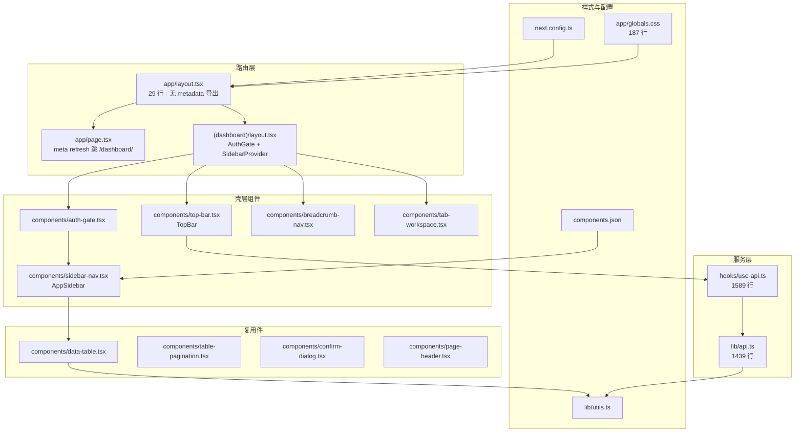
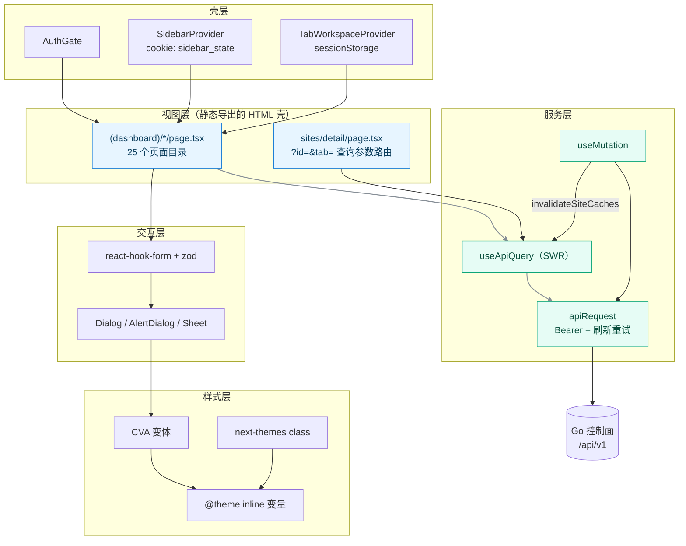
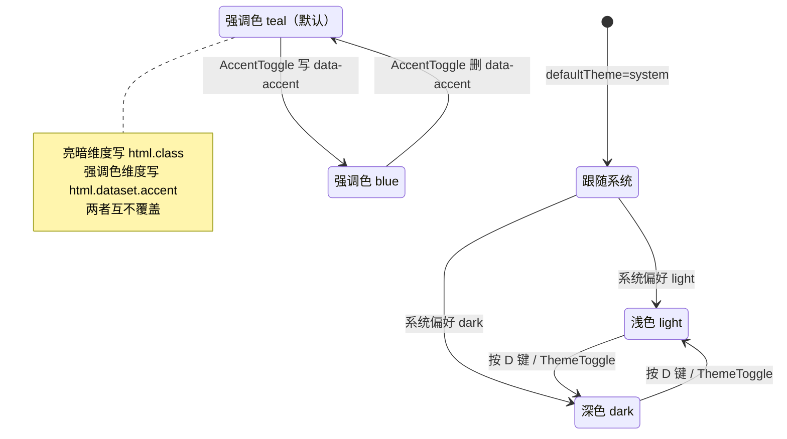
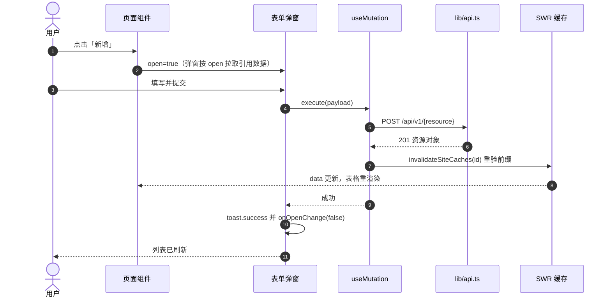
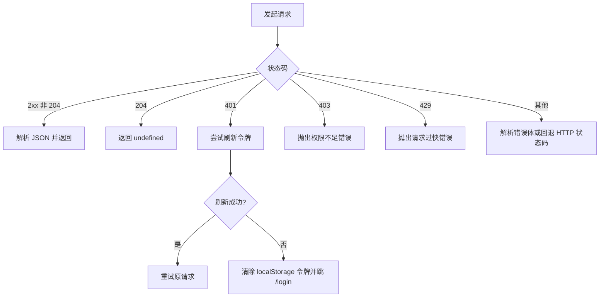
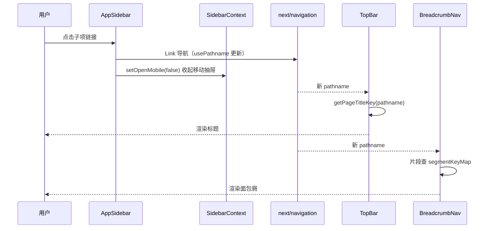
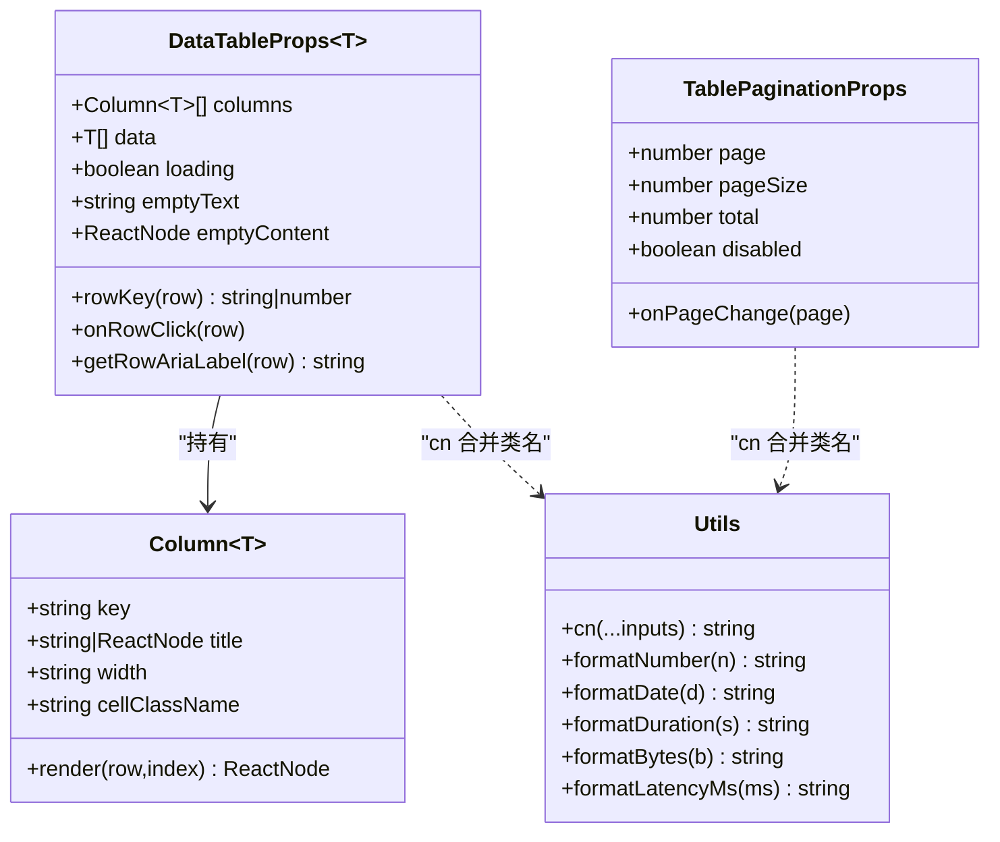
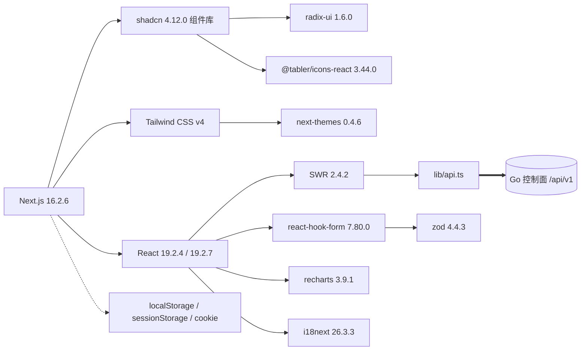
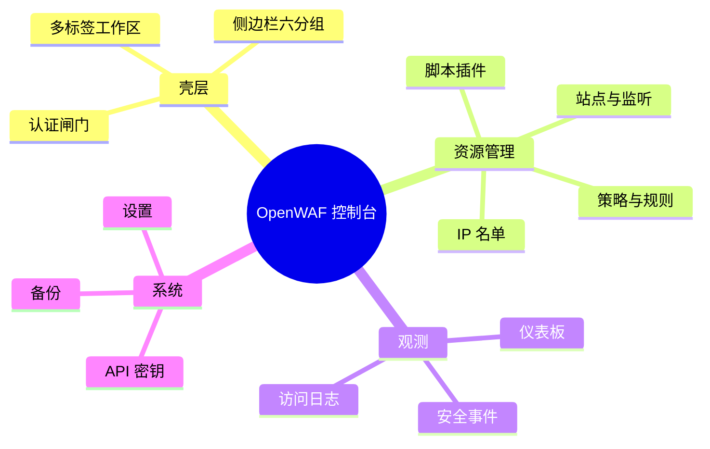

# 前端管理界面

<cite>
**本文档引用的文件**
- [frontend/package.json](file://frontend/package.json)
- [frontend/next.config.ts](file://frontend/next.config.ts)
- [frontend/components.json](file://frontend/components.json)
- [frontend/tsconfig.json](file://frontend/tsconfig.json)
- [frontend/postcss.config.mjs](file://frontend/postcss.config.mjs)
- [frontend/eslint.config.mjs](file://frontend/eslint.config.mjs)
- [frontend/app/layout.tsx](file://frontend/app/layout.tsx)
- [frontend/app/page.tsx](file://frontend/app/page.tsx)
- [frontend/app/globals.css](file://frontend/app/globals.css)
- [frontend/app/(dashboard)/layout.tsx](file://frontend/app/(dashboard)/layout.tsx)
- [frontend/components/sidebar-nav.tsx](file://frontend/components/sidebar-nav.tsx)
- [frontend/components/top-bar.tsx](file://frontend/components/top-bar.tsx)
- [frontend/components/breadcrumb-nav.tsx](file://frontend/components/breadcrumb-nav.tsx)
- [frontend/components/tab-workspace.tsx](file://frontend/components/tab-workspace.tsx)
- [frontend/components/auth-gate.tsx](file://frontend/components/auth-gate.tsx)
- [frontend/components/theme-provider.tsx](file://frontend/components/theme-provider.tsx)
- [frontend/components/i18n-provider.tsx](file://frontend/components/i18n-provider.tsx)
- [frontend/components/appearance-toggle.tsx](file://frontend/components/appearance-toggle.tsx)
- [frontend/components/data-table.tsx](file://frontend/components/data-table.tsx)
- [frontend/components/table-pagination.tsx](file://frontend/components/table-pagination.tsx)
- [frontend/components/confirm-dialog.tsx](file://frontend/components/confirm-dialog.tsx)
- [frontend/components/page-header.tsx](file://frontend/components/page-header.tsx)
- [frontend/components/empty-state.tsx](file://frontend/components/empty-state.tsx)
- [frontend/lib/utils.ts](file://frontend/lib/utils.ts)
- [frontend/lib/api.ts](file://frontend/lib/api.ts)
- [frontend/lib/route-titles.ts](file://frontend/lib/route-titles.ts)
- [frontend/hooks/use-mobile.ts](file://frontend/hooks/use-mobile.ts)
- [frontend/hooks/use-debounced-value.ts](file://frontend/hooks/use-debounced-value.ts)
- [frontend/hooks/use-api.ts](file://frontend/hooks/use-api.ts)
- [frontend/hooks/use-auth.ts](file://frontend/hooks/use-auth.ts)
- [frontend/components/lua-code-editor.tsx](file://frontend/components/lua-code-editor.tsx)
- [frontend/app/(dashboard)/sites/page.tsx](file://frontend/app/(dashboard)/sites/page.tsx)
- [frontend/app/(dashboard)/sites/detail/page.tsx](file://frontend/app/(dashboard)/sites/detail/page.tsx)
- [frontend/app/(dashboard)/sites/components/site-form-dialog.tsx](file://frontend/app/(dashboard)/sites/components/site-form-dialog.tsx)
- [frontend/app/(dashboard)/policies/page.tsx](file://frontend/app/(dashboard)/policies/page.tsx)
- [frontend/app/(dashboard)/rules/page.tsx](file://frontend/app/(dashboard)/rules/page.tsx)
- [frontend/app/(dashboard)/access-logs/page.tsx](file://frontend/app/(dashboard)/access-logs/page.tsx)
- [frontend/app/(dashboard)/security-events/page.tsx](file://frontend/app/(dashboard)/security-events/page.tsx)
- [frontend/app/(dashboard)/request-trace/page.tsx](file://frontend/app/(dashboard)/request-trace/page.tsx)
- [frontend/scripts/check-site-protection-contract.ts](file://frontend/scripts/check-site-protection-contract.ts)
- [frontend/AGENTS.md](file://frontend/AGENTS.md)
- [frontend/node_modules/next/dist/docs/01-app/02-guides/static-exports.md](file://frontend/node_modules/next/dist/docs/01-app/02-guides/static-exports.md)
- [frontend/node_modules/next/dist/docs/01-app/02-guides/upgrading/version-16.md](file://frontend/node_modules/next/dist/docs/01-app/02-guides/upgrading/version-16.md)
</cite>

> **模块概述**
> 前端管理界面位于 `frontend/`，基于 **Next.js 16.2.6 + React 19.2 + Tailwind CSS v4 + shadcn/ui（`radix-luma` 风格）** 构建，采用分层结构：视图层（App Router 页面与 69 个组件文件）、交互层（表单/对话框/确认弹窗）、服务层（`lib/api.ts` 统一封装 + SWR 快照缓存）、样式层（`app/globals.css` 的 oklch 变量与 next-themes 主题）。
> 关键前提（来自 `frontend/AGENTS.md`）：本仓库的 Next.js 版本「不是你所熟知的 Next.js」，涉及路由、渲染、缓存、metadata、字体、构建配置的表述均以 `frontend/node_modules/next/dist/docs/` 与实测配置文件为准，不采用训练记忆中的通用说法。最直接的体现是 `next.config.ts:4` 的 `output: "export"` —— 全站为静态导出，不支持 `redirects`/`rewrites`/`cookies()`/Server Actions/ISR，因此根路径跳转用 `<meta httpEquiv="refresh">`（`app/page.tsx:4`）实现，凭据用 `localStorage`（`lib/api.ts:137`、`:191`）承载。

> **子页面分类索引**

### 一、Next.js 架构设计
涵盖前端整体架构、布局体系、认证流程与页面生命周期。

- [Next.js 架构设计](./Next.js%20架构设计/Next.js%20架构设计.md) — App Router 分层架构、根布局与仪表板布局、主题与权限体系概述。
- [登录流程与鉴权机制](./Next.js%20架构设计/登录流程与鉴权机制.md) — JWT 认证体系、短期访问令牌与长期刷新令牌、RBAC 权限控制、暴力破解防护与会话管理。
- [根布局与主题系统](./Next.js%20架构设计/根布局与主题系统.md) — 根布局实现、next-themes 主题切换、Tailwind CSS v4 变量系统、字体与 shadcn/ui 组件库。
- [页面生命周期与渲染策略](./Next.js%20架构设计/页面生命周期与渲染策略.md) — 首页重定向、仪表板数据刷新、站点详情的查询参数路由、认证守卫与客户端状态管理。
- [仪表板布局与导航](./Next.js%20架构设计/仪表板布局与导航.md) — 仪表板壳层、侧边栏导航高亮、顶部栏与独立面包屑、响应式布局与权限守卫集成。

### 二、组件设计模式
聚焦 UI 组件体系、CRUD 页面组合模式与对话框/导航组件设计。

- [组件设计模式](组件设计模式/组件设计模式.md) — 原子化组件理念、CRUD 页面组合、对话框与导航组件的体系化设计指南。
- [UI 原子组件模式](./组件设计模式/UI%20原子组件模式.md) — `components/ui/` 35 个 shadcn 原子组件的变体系统与 CVA 样式继承。
- [CRUD 页面组件](./组件设计模式/CRUD%20页面组件.md) — `PageHeader` + `DataTable` + `TablePagination` + `ConfirmDialog` + 业务表单弹窗 + SWR 失效重验的组合式增删改查流程。
- [对话框组件](./组件设计模式/对话框组件.md) — `Dialog`/`AlertDialog`/`Sheet` 原语与 12 个业务对话框的 open/close 语义。
- [导航组件](组件设计模式/导航组件.md) — 侧边栏（`sidebar-nav.tsx`）、顶部栏（`top-bar.tsx`）、面包屑（`breadcrumb-nav.tsx`）与集中式路由元数据（`lib/route-titles.ts`）。

### 三、主题与样式
- [主题系统与样式](主题系统与样式.md) — next-themes 主题提供者、oklch 调色板、`@theme inline` 变量、强调色维度与响应式断点。

### 四、状态与数据管理
- [状态管理策略](状态管理策略.md) — 全局状态（主题/认证/语言）、本地状态（表单/对话框）、SWR 快照缓存与失效前缀。
- [API 集成](./API%20集成.md) — 统一 API 封装（401 自动刷新/重试）、JWT 鉴权、分页与缓存、WebSocket 实时通信。

### 五、用户体验设计
- [用户交互设计](用户交互设计.md) — 表单验证与实时反馈、错误处理策略、加载/空状态/成功反馈、交互模式与无障碍访问支持。

## 目录

1. [简介](#简介)
2. [项目结构](#项目结构)
3. [核心组件](#核心组件)
4. [架构总览](#架构总览)
5. [详细组件分析](#详细组件分析)
6. [依赖关系分析](#依赖关系分析)
7. [性能考虑](#性能考虑)
8. [故障排查指南](#故障排查指南)
9. [结论](#结论)
10. [附录](#附录)

## 简介
本文件面向 My-OpenWaf 前端管理界面的开发者，系统化梳理基于 Next.js 16.2.6 + React 19.2 的前端架构与组件组织，重点覆盖以下方面：
- 基于 shadcn/ui 的组件库使用方式与自定义主题系统
- 状态管理策略（本地状态、对话框与确认弹窗、SWR 快照）
- API 集成模式（统一请求封装、鉴权与错误处理）
- 用户交互设计原则（导航、表单、表格、提示）、组件开发约定与性能优化建议

阅读顺序建议：先读本篇的「页面目录索引」建立整体地图，再按「Next.js 架构设计」→「组件设计模式」→ 其余四篇二级文档逐层深入。

## 项目结构
前端位于 `frontend/`，采用 App Router 结构，按功能域划分页面与组件，配合 shadcn/ui 与 Tailwind CSS v4 实现一致的视觉与交互体验。

| 路径 | 职责 | 文件数 | 代表文件 | 对外暴露 |
|------|------|:------:|----------|----------|
| `frontend/app/` | 路由与布局根 | 6 + 25 页面目录 | `app/layout.tsx`、`app/page.tsx` | `RootLayout`、根重定向页 |
| `frontend/app/(dashboard)/` | 登录后控制台，25 个页面目录 | 25 `page.tsx` + 子组件 | `(dashboard)/layout.tsx` | `DashboardLayout` |
| `frontend/app/(dashboard)/sites/` | 站点列表 + 12 页签详情 | 21 | `sites/detail/page.tsx` | `SitesPage`、`SiteDetailPage` |
| `frontend/app/(dashboard)/rules/` | 自定义规则 + OWASP + CVE | 7 | `rules/page.tsx` | `RulesPage` |
| `frontend/app/(dashboard)/captcha/` | 验证码与 5 秒盾配置 | 3 | `captcha/page.tsx` | `CaptchaPage` |
| `frontend/app/(dashboard)/lua-plugins/` | Lua 脚本插件管理 | 6 | `lua-plugins/page.tsx` | `LuaPluginsPage` |
| `frontend/components/` | 34 个业务组件 | 34 | `sidebar-nav.tsx` | `AppSidebar`、`TopBar`、`DataTable` |
| `frontend/components/ui/` | 35 个 shadcn 原子组件 | 35 | `ui/sidebar.tsx` | `Sidebar*`、`Dialog*`、`Button` |
| `frontend/hooks/` | 数据与响应式 Hook | 6 | `use-api.ts` | 各资源查询/变更 Hook |
| `frontend/lib/` | API 客户端、类型、工具、路由元数据 | 15 + `i18n/` | `lib/api.ts` | `apiRequest`、`cn`、`routeTitleKeyMap` |
| `frontend/scripts/` | 契约校验脚本（`check:*`） | 9 | `check-site-protection-contract.ts` | 由 `package.json` 脚本调用 |

统计口径：`components/` 共 69 个 `.tsx`（34 业务 + 35 原子），`app/(dashboard)/` 下 25 个页面目录。

**图表来源**
- [frontend/app/layout.tsx:1-29](file://frontend/app/layout.tsx#L1-L29)
- [frontend/app/page.tsx:1-10](file://frontend/app/page.tsx#L1-L10)
- [frontend/app/(dashboard)/layout.tsx:1-37](file://frontend/app/(dashboard)/layout.tsx#L1-L37)
- [frontend/components/auth-gate.tsx:16-44](file://frontend/components/auth-gate.tsx#L16-L44)
- [frontend/components/sidebar-nav.tsx:339-382](file://frontend/components/sidebar-nav.tsx#L339-L382)
- [frontend/components/top-bar.tsx:32-101](file://frontend/components/top-bar.tsx#L32-L101)
- [frontend/components/data-table.tsx:44-169](file://frontend/components/data-table.tsx#L44-L169)
- [frontend/hooks/use-api.ts:156-165](file://frontend/hooks/use-api.ts#L156-L165)
- [frontend/lib/api.ts:27-35](file://frontend/lib/api.ts#L27-L35)
- [frontend/next.config.ts:1-15](file://frontend/next.config.ts#L1-L15)
- [frontend/app/globals.css:1-49](file://frontend/app/globals.css#L1-L49)
- [frontend/lib/utils.ts:4-6](file://frontend/lib/utils.ts#L4-L6)

技术栈按「层 × 选型 × 版本」实测如下，版本取自 `frontend/package.json:24-64`：

| 层次 | 选型 | 版本 | 所在位置 | 承担职责 | 备注 |
|------|------|------|----------|----------|------|
| 应用框架 | Next.js | `16.2.6` | `package.json:37` | 路由与构建 | `output: "export"` 静态导出 |
| 视图库 | React / React DOM | `19.2.4` / `19.2.7` | `package.json:40`、`:42` | 组件运行时 | 两版本号不一致，实测确认 |
| 类型系统 | TypeScript | `^6` | `package.json:63` | 类型约束 | `strict: true`，`moduleResolution: bundler` |
| 样式引擎 | Tailwind CSS | `^4` | `package.json:62`、`postcss.config.mjs` | 原子类与变量 | 无 `tailwind.config.*`，走 `@theme inline` |
| 组件基座 | shadcn（CLI 依赖） | `^4.12.0` | `package.json:46`、`components.json` | 组件生成与注册 | `style: radix-luma`、`baseColor: taupe` |
| 交互原语 | radix-ui | `^1.6.0` | `package.json:39` | 无障碍行为 | 单包聚合导入 |
| 图标库 | `@tabler/icons-react` | `^3.44.0` | `package.json:27` | 全站图标 | `components.json:13` 的 `iconLibrary: "tabler"` |
| 变体引擎 | class-variance-authority | `^0.7.1` | `package.json:29` | 组件变体定义 | 6 个原子组件使用 |
| 数据获取 | SWR | `^2.4.2` | `package.json:48` | 列表快照与重验 | `revalidateOnFocus: false` |
| 表单 | react-hook-form + zod | `^7.80.0` / `^4.4.3` | `package.json:43`、`:51` | 受控表单与校验 | `@hookform/resolvers: ^5.4.0` |
| 国际化 | i18next + react-i18next | `^26.3.3` / `^17.0.8` | `package.json:34`、`:44` | 中英双语文案 | 语言包各 2540 行 |
| 主题 | next-themes | `^0.4.6` | `package.json:38` | 亮/暗/跟随系统 | `attribute="class"` |
| 通知 | sonner | `^2.0.7` | `package.json:47` | Toast 反馈 | `Toaster position="top-center"` |
| 图表 | recharts | `^3.9.1` | `package.json:45` | 仪表板与趋势图 | 配色读 `--chart-*` |
| 命令面板 | cmdk | `^1.1.1` | `package.json:31` | 快速检索 | — |
| 代码质量 | ESLint 9 flat config | `^9`、`eslint-config-next 16.2.10` | `eslint.config.mjs`、`package.json:58-59` | 静态检查 | Next 16 已移除 `next lint`，脚本为 `eslint` |

**章节来源**
- [frontend/package.json:1-65](file://frontend/package.json#L1-L65)
- [frontend/components.json:1-25](file://frontend/components.json#L1-L25)
- [frontend/tsconfig.json:1-38](file://frontend/tsconfig.json#L1-L38)
- [frontend/eslint.config.mjs:1-20](file://frontend/eslint.config.mjs#L1-L20)
- [frontend/app/globals.css:1-187](file://frontend/app/globals.css#L1-L187)
- [frontend/lib/api.ts:1-1439](file://frontend/lib/api.ts#L1-L1439)

## 核心组件
前端管理界面由「壳层 + 复用件 + 服务层 + 样式层」四类核心组件构成，实测清单如下：

| 组件 | 类型 | 所在文件 | 核心职责 | 主要依赖 |
|------|------|----------|----------|----------|
| `RootLayout` | 布局 | `app/layout.tsx:9` | 串联 Theme/I18n/Auth/Tooltip Provider 与 Toaster | `next-themes`、`sonner` |
| `DashboardLayout` | 布局 | `app/(dashboard)/layout.tsx:16` | AuthGate 守卫 + 侧边栏壳 + 面包屑 + 多标签工作区 | `ui/sidebar.tsx` |
| `AuthGate` | 守卫 | `components/auth-gate.tsx:19` | 认证未确定前不挂载业务子树，明确失效时跳 `/login` | `useAuth`、`getAccessToken` |
| `AppSidebar` | 导航 | `components/sidebar-nav.tsx:339` | 6 个分组、可折叠 icon 栏、移动端 Sheet | `ui/sidebar.tsx`、`@tabler/icons-react` |
| `TopBar` | 导航 | `components/top-bar.tsx:32` | 页面标题、热重载按钮、主题/强调色/语言切换、用户菜单 | `lib/route-titles.ts` |
| `BreadcrumbNav` | 导航 | `components/breadcrumb-nav.tsx:16` | 按路径片段独立渲染面包屑 | `segmentKeyMap` |
| `TabWorkspaceProvider` | 导航 | `components/tab-workspace.tsx:104` | 文档式多标签，`sessionStorage` 持久化 | `usePathname`、`useSearchParams` |
| `DataTable` | 复用 | `components/data-table.tsx:44` | 列驱动表格 + 骨架屏 + 空状态 + 行键盘可达 | `ui/table.tsx`、`EmptyState` |
| `TablePagination` | 复用 | `components/table-pagination.tsx:57` | 服务端 `total` 分页条，首尾页 + 邻居 + 省略号 | `ui/pagination.tsx` |
| `ConfirmDialog` | 复用 | `components/confirm-dialog.tsx:26` | 危险操作二次确认，`loading` 期间禁用双按钮 | `ui/alert-dialog.tsx` |
| `PageHeader` | 复用 | `components/page-header.tsx:34` | 标题 + 描述 + 右侧操作区 | `cn` |
| `ThemeProvider` | 主题 | `components/theme-provider.tsx:6` | next-themes 配置 + `D` 键热切 | `next-themes` |
| `I18nProvider` | 国际化 | `components/i18n-provider.tsx:15` | 仅客户端 `useEffect` 初始化 i18next | `i18next-browser-languagedetector` |
| `apiRequest` | 服务 | `lib/api.ts:531` | 统一请求头、401 刷新重试、错误码映射 | `localStorage` |
| `useApiQuery` | 服务 | `hooks/use-api.ts:156` | SWR 查询工厂，关闭 focus 重验 | `swr` |
| `cn` 等工具 | 工具 | `lib/utils.ts:4-50` | 类名合并与 5 个格式化函数 | `clsx`、`tailwind-merge` |

**章节来源**
- [frontend/app/layout.tsx:1-29](file://frontend/app/layout.tsx#L1-L29)
- [frontend/app/(dashboard)/layout.tsx:1-37](file://frontend/app/(dashboard)/layout.tsx#L1-L37)
- [frontend/components/auth-gate.tsx:16-44](file://frontend/components/auth-gate.tsx#L16-L44)
- [frontend/components/sidebar-nav.tsx:339-382](file://frontend/components/sidebar-nav.tsx#L339-L382)
- [frontend/components/top-bar.tsx:32-101](file://frontend/components/top-bar.tsx#L32-L101)
- [frontend/components/breadcrumb-nav.tsx:16-56](file://frontend/components/breadcrumb-nav.tsx#L16-L56)
- [frontend/components/tab-workspace.tsx:104-278](file://frontend/components/tab-workspace.tsx#L104-L278)
- [frontend/components/data-table.tsx:24-54](file://frontend/components/data-table.tsx#L24-L54)
- [frontend/components/confirm-dialog.tsx:15-68](file://frontend/components/confirm-dialog.tsx#L15-L68)
- [frontend/components/page-header.tsx:20-34](file://frontend/components/page-header.tsx#L20-L34)
- [frontend/components/theme-provider.tsx:6-69](file://frontend/components/theme-provider.tsx#L6-L69)
- [frontend/components/i18n-provider.tsx:15-45](file://frontend/components/i18n-provider.tsx#L15-L45)
- [frontend/hooks/use-api.ts:156-165](file://frontend/hooks/use-api.ts#L156-L165)
- [frontend/lib/utils.ts:1-50](file://frontend/lib/utils.ts#L1-L50)

## 架构总览
前端采用分层架构，并因 `output: "export"` 而呈现「静态壳 + 全客户端数据」的特征：

- 视图层：App Router 页面与组件（`(dashboard)/*/page.tsx`、`components/*`）。除 `app/layout.tsx`、`app/page.tsx`、`app/(dashboard)/layout.tsx` 外，页面文件首行均为 `"use client"`。
- 交互层：表单（react-hook-form + zod）、对话框（`Dialog`/`AlertDialog`/`Sheet`）、确认弹窗（`ConfirmDialog`）
- 服务层：`lib/api.ts` 请求封装与令牌刷新，`hooks/use-api.ts` 的 SWR 查询与失效重验
- 样式层：`app/globals.css` 的 `@theme inline` 变量、`components/ui/*` 原子组件、CVA 变体

**图表来源**
- [frontend/next.config.ts:3-14](file://frontend/next.config.ts#L3-L14)
- [frontend/app/(dashboard)/sites/detail/page.tsx:79-91](file://frontend/app/(dashboard)/sites/detail/page.tsx#L79-L91)
- [frontend/components/ui/sidebar.tsx:27-32](file://frontend/components/ui/sidebar.tsx#L27-L32)
- [frontend/components/tab-workspace.tsx:25-26](file://frontend/components/tab-workspace.tsx#L25-L26)
- [frontend/hooks/use-api.ts:156-165](file://frontend/hooks/use-api.ts#L156-L165)
- [frontend/hooks/use-api.ts:200-237](file://frontend/hooks/use-api.ts#L200-L237)
- [frontend/lib/api.ts:531-531](file://frontend/lib/api.ts#L531-L531)
- [frontend/app/globals.css:7-49](file://frontend/app/globals.css#L7-L49)
- [frontend/node_modules/next/dist/docs/01-app/02-guides/static-exports.md:1-50](file://frontend/node_modules/next/dist/docs/01-app/02-guides/static-exports.md#L1-L50)

## 详细组件分析

### 页面目录索引（25 个页面目录）
`app/(dashboard)/` 下实测 25 个页面目录，`page.tsx` 行数为现场 `wc -l` 结果。导航分组取自 `components/sidebar-nav.tsx:192-334` 的 `useNavGroups()`，分组标题为空表示无 `SidebarGroupLabel`。页面级实现细节由后续代理在「页面实现/」子目录建档，本批仅建立映射。

| 页面目录 | 路由 | `page.tsx` 行数 | 导航分组 | 文档落位 |
|----------|------|:---:|----------|----------|
| `dashboard` | `/dashboard/` | 1200 | 无标题组 | 页面实现/（待建） |
| `sites` | `/sites/` | 431 | 无标题组 | 页面实现/（待建） |
| `security-events` | `/security-events/` | 769 | 安全（父项 + 子项） | 页面实现/（待建） |
| `access-logs` | `/access-logs/` | 679 | 安全（子项） | 页面实现/（待建） |
| `request-trace` | `/request-trace/` | 828 | 安全（子项） | 页面实现/（待建） |
| `drop-events` | `/drop-events/` | 183 | 安全（子项） | 页面实现/（待建） |
| `attacks` | `/attacks/` | 1525 | 安全（子项） | 页面实现/（待建） |
| `false-positives` | `/false-positives/` | 399 | 安全（子项） | 页面实现/（待建） |
| `upstream-status` | `/upstream-status/` | 331 | 安全（子项） | 页面实现/（待建） |
| `tls-fingerprints` | `/tls-fingerprints/` | 261 | 安全（子项） | 页面实现/（待建） |
| `policies` | `/policies/` | 228 | `nav.groupProtection` | 页面实现/（待建） |
| `rules` | `/rules/`（含 `owasp`、`cve` 子路由） | 528 | `nav.groupProtection`（父项 + 子项） | 页面实现/（待建） |
| `lua-plugins` | `/lua-plugins/` | 362 | `nav.groupProtection`（父项 + 子项） | 页面实现/（待建） |
| `js-plugins` | `/js-plugins/` | 483 | `nav.groupProtection`（子项） | 页面实现/（待建） |
| `cc-protection` | `/cc-protection/` | 509 | `nav.groupProtection` | 页面实现/（待建） |
| `captcha` | `/captcha/` | 1916 | `nav.groupProtection` | 页面实现/（待建） |
| `auth-config` | `/auth-config/` | 304 | `nav.groupProtection` | 页面实现/（待建） |
| `certificates` | `/certificates/` | 1001 | `nav.groupNetwork` | 页面实现/（待建） |
| `ip-lists` | `/ip-lists/` | 723 | `nav.groupNetwork` | 页面实现/（待建） |
| `threat-intel` | `/threat-intel/` | 910 | `nav.groupNetwork` | 页面实现/（待建） |
| `api-keys` | `/api-keys/` | 276 | `nav.groupSystem` | 页面实现/（待建） |
| `admin-users` | `/admin-users/` | 427 | `nav.groupSystem` | 页面实现/（待建） |
| `page-templates` | `/page-templates/` | 350 | `nav.groupSystem` | 页面实现/（待建） |
| `backup` | `/backup/` | 276 | `nav.groupSystem` | 页面实现/（待建） |
| `settings` | `/settings/` | 918 | `nav.groupSystem` | 页面实现/（待建） |

补充实测要点：
- 路由形态为查询参数而非动态段。站点详情链接形如 `/sites/detail/?id=1&tab=listeners`（`sites/components/site-form-dialog.tsx:291`），页签白名单为 12 项（`sites/detail/page.tsx:58-71`）。
- `trailingSlash: true`（`next.config.ts:6`）使 `usePathname()` 返回带尾斜杠路径，`tab-workspace.tsx:33-45` 的 `normalizePath()` 为此专门做去重归一化。
- 顶层非控制台路由另有 5 个：`/login/`、`/block/`、`/error/`、`/maintenance/`、`/security-dashboard/`，不在侧边栏导航内。

**章节来源**
- [frontend/app/(dashboard)/sites/detail/page.tsx:58-91](file://frontend/app/(dashboard)/sites/detail/page.tsx#L58-L91)
- [frontend/app/(dashboard)/sites/components/site-form-dialog.tsx:289-297](file://frontend/app/(dashboard)/sites/components/site-form-dialog.tsx#L289-L297)
- [frontend/components/sidebar-nav.tsx:192-334](file://frontend/components/sidebar-nav.tsx#L192-L334)
- [frontend/components/tab-workspace.tsx:25-53](file://frontend/components/tab-workspace.tsx#L25-L53)
- [frontend/lib/route-titles.ts:7-34](file://frontend/lib/route-titles.ts#L7-L34)

### 主题系统与样式定制
- 主题提供者：`components/theme-provider.tsx:10-21` 使用 next-themes，`attribute="class"`、`defaultTheme="system"`、`enableSystem`、`disableTransitionOnChange`，并在内部挂载 `ThemeHotkey`（`:37-69`）以 `D` 键切换；`isTypingTarget()`（`:24-35`）排除 `INPUT`/`TEXTAREA`/`SELECT`/`contentEditable`。
- 全局样式：`app/globals.css` 先 `@import "tailwindcss"`、`tw-animate-css`、`shadcn/tailwind.css`（`:1-3`），再用 `@custom-variant dark (&:is(.dark *))`（`:5`）与 `@theme inline`（`:7-49`）把 CSS 变量映射为 Tailwind token；色板为 oklch，`:root`（`:51`）与 `.dark`（`:101`）两套。
- 强调色维度：`[data-accent="blue"]`（`:143`）与 `.dark[data-accent="blue"]`（`:159`）与亮暗正交，由 `components/appearance-toggle.tsx:51-57` 写 `documentElement.dataset.accent`，持久化键 `owaf.accent`（`:16`）。
- 字体：不使用 `next/font`。`@theme inline` 直接把 `--font-sans`/`--font-heading`/`--font-mono` 指向系统字体栈（`:8-10`），`@layer base` 在 `:177` 与 `:181` 应用。
- 根布局无 `metadata` 导出（`app/layout.tsx` 全文 29 行），符合静态导出场景。
- shadcn 配置：`components.json` 的 `style: "radix-luma"`、`rsc: true`、`baseColor: "taupe"`、`iconLibrary: "tabler"`、`rtl: true`、`menuColor: "inverted-translucent"`、`menuAccent: "subtle"`，别名 `@/components`、`@/lib`、`@/hooks`。

**图表来源**
- [frontend/components/theme-provider.tsx:6-69](file://frontend/components/theme-provider.tsx#L6-L69)
- [frontend/components/appearance-toggle.tsx:16-88](file://frontend/components/appearance-toggle.tsx#L16-L88)
- [frontend/app/globals.css:5-5](file://frontend/app/globals.css#L5-L5)
- [frontend/app/globals.css:101-173](file://frontend/app/globals.css#L101-L173)

**章节来源**
- [frontend/components/theme-provider.tsx:1-71](file://frontend/components/theme-provider.tsx#L1-L71)
- [frontend/components/appearance-toggle.tsx:1-104](file://frontend/components/appearance-toggle.tsx#L1-L104)
- [frontend/app/globals.css:1-187](file://frontend/app/globals.css#L1-L187)
- [frontend/components.json:1-25](file://frontend/components.json#L1-L25)

### CRUD 页面的组合式实现
本项目**没有**名为 `CrudPage`/`FieldDef` 的通用增删改查组件（`components/` 下 34 个文件逐一核对，无此二者）。CRUD 能力由一组复用件在页面内组合而成，页面自行决定表单载体：

| 区块 | 实现文件 | 数据来源端点 | 交互 |
|------|----------|--------------|------|
| 页头与主操作 | `components/page-header.tsx:34` | — | 标题、描述、`titleExtra` Badge、新增按钮 |
| 统计卡 | `components/metric-tile.tsx` | 列表响应当前页聚合 | 总数取后端 `total`，其余标注当前页口径 |
| 列表 | `components/data-table.tsx:44` | `GET /api/v1/{resource}` | 列驱动渲染、骨架屏、空状态、行点击 |
| 分页 | `components/table-pagination.tsx:57` | 同一 `GET` 的 `page`/`page_size` | 页码切换，`totalPages<=1` 时不渲染 |
| 新建/编辑 | 各业务的 `*-dialog.tsx`，或页内 Card 表单 | `POST /api/v1/{resource}`、`POST /{id}/update` | react-hook-form + zod 校验 |
| 删除 | `components/confirm-dialog.tsx:26` | `POST /api/v1/{resource}/{id}/delete` | 二次确认，`loading` 期禁用 |
| 缓存失效 | `hooks/use-api.ts:200-247` | — | 写成功后重验相关 SWR 前缀 |

**图表来源**
- [frontend/app/(dashboard)/sites/components/site-form-dialog.tsx:137-245](file://frontend/app/(dashboard)/sites/components/site-form-dialog.tsx#L137-L245)
- [frontend/hooks/use-api.ts:252-297](file://frontend/hooks/use-api.ts#L252-L297)
- [frontend/hooks/use-api.ts:200-237](file://frontend/hooks/use-api.ts#L200-L237)
- [frontend/lib/api.ts:746-812](file://frontend/lib/api.ts#L746-L812)
- [frontend/components/data-table.tsx:44-169](file://frontend/components/data-table.tsx#L44-L169)

**章节来源**
- [frontend/components/data-table.tsx:24-169](file://frontend/components/data-table.tsx#L24-L169)
- [frontend/components/table-pagination.tsx:17-125](file://frontend/components/table-pagination.tsx#L17-L125)
- [frontend/components/confirm-dialog.tsx:15-68](file://frontend/components/confirm-dialog.tsx#L15-L68)
- [frontend/app/(dashboard)/policies/page.tsx:30-228](file://frontend/app/(dashboard)/policies/page.tsx#L30-L228)
- [frontend/app/(dashboard)/sites/page.tsx:97-431](file://frontend/app/(dashboard)/sites/page.tsx#L97-L431)
- [frontend/hooks/use-api.ts:200-297](file://frontend/hooks/use-api.ts#L200-L297)

### API 集成与鉴权
- 统一请求封装：`apiRequest`（`lib/api.ts:531`）负责拼装 `API_BASE = "/api/v1"`（`:27`）、`Content-Type`、`Authorization: Bearer`，并区分 204 与错误体。
- 令牌存放：访问令牌与过期时间写 `localStorage`，键为 `token` 与 `token_expires_at`（`:28-29`、`:137`、`:191-196`、`:214-215`）；两者通过 `AUTH_TOKEN_STORAGE_KEY`（`:34-35`）导出供跨标签页同步使用。
- 并发与刷新：`authEpoch`（`:39`）隔离登出/重登与在途 refresh；刷新结果缓存 `REFRESH_RESULT_CACHE_MS = 500`（`:40-41`）；跨标签互斥用 Web Locks，锁名 `my-openwaf-refresh`、TTL 15 秒、等待 20 秒、轮询 50 毫秒（`:49-55`）。
- 动词约定：写操作一律 POST，更新为 `/{id}/update`，删除为 `/{id}/delete`，启停为 `/{id}/start`、`/{id}/stop`、`/{id}/toggle`（`siteApi:746-812`、`policyApi:862-873`、`luaPluginApi:1318-1336`），与后端无 PUT/DELETE 端点的事实一致。
- 分页聚合：引用型列表用 `FRONTEND_PAGE_SIZE = 200` 与 `MAX_SITE_RESOURCE_PAGES = 10`（`:30-31`）在客户端翻页取全。

**图表来源**
- [frontend/lib/api.ts:27-55](file://frontend/lib/api.ts#L27-L55)
- [frontend/lib/api.ts:137-215](file://frontend/lib/api.ts#L137-L215)
- [frontend/lib/api.ts:531-531](file://frontend/lib/api.ts#L531-L531)
- [frontend/lib/api.ts:746-812](file://frontend/lib/api.ts#L746-L812)

**章节来源**
- [frontend/lib/api.ts:1-1439](file://frontend/lib/api.ts#L1-L1439)
- [frontend/hooks/use-api.ts:150-297](file://frontend/hooks/use-api.ts#L150-L297)

### 导航与布局
- 侧边栏：`AppSidebar`（`components/sidebar-nav.tsx:339`）渲染 6 个分组，`collapsible="icon"`；带子项的条目走 `CollapsibleNavItem`（`:114`），其余走 `SimpleNavItem`（`:168`）。活动态由 `isExactOrLongestActive`（`:101-111`）取最长匹配，避免父级与子级同时高亮。
- 顶部栏：`TopBar`（`components/top-bar.tsx:32`）用 `getPageTitleKey(pathname)` 解析标题（`:28-30`），并集成 `ThemeToggle`、`AccentToggle`、`LanguageSwitcher` 与用户下拉菜单；热重载按钮仅 `admin`/`operator` 可用（`:35`、`:56-70`）。
- 面包屑：由独立的 `BreadcrumbNav`（`components/breadcrumb-nav.tsx:16`）按 `/` 片段查 `segmentKeyMap` 渲染，末级用 `BreadcrumbPage`，其余为 `Link`。
- 折叠持久化：`ui/sidebar.tsx` 以 `document.cookie` 写 `sidebar_state`（`:85`），键名与 7 天有效期定义在 `:27-28`，快捷键 `b`（`:32`），宽度 `16rem`/移动 `18rem`/icon `3rem`（`:29-31`）。

**图表来源**
- [frontend/components/sidebar-nav.tsx:114-189](file://frontend/components/sidebar-nav.tsx#L114-L189)
- [frontend/components/top-bar.tsx:28-54](file://frontend/components/top-bar.tsx#L28-L54)
- [frontend/components/breadcrumb-nav.tsx:16-56](file://frontend/components/breadcrumb-nav.tsx#L16-L56)
- [frontend/lib/route-titles.ts:7-77](file://frontend/lib/route-titles.ts#L7-L77)
- [frontend/components/ui/sidebar.tsx:27-85](file://frontend/components/ui/sidebar.tsx#L27-L85)

**章节来源**
- [frontend/components/sidebar-nav.tsx:1-382](file://frontend/components/sidebar-nav.tsx#L1-L382)
- [frontend/components/top-bar.tsx:1-101](file://frontend/components/top-bar.tsx#L1-L101)
- [frontend/components/breadcrumb-nav.tsx:1-56](file://frontend/components/breadcrumb-nav.tsx#L1-L56)
- [frontend/components/tab-workspace.tsx:1-284](file://frontend/components/tab-workspace.tsx#L1-L284)
- [frontend/lib/route-titles.ts:1-77](file://frontend/lib/route-titles.ts#L1-L77)
- [frontend/app/(dashboard)/layout.tsx:1-37](file://frontend/app/(dashboard)/layout.tsx#L1-L37)

### UI 组件与样式工具
- `Button`（`components/ui/button.tsx:42`）：6 个 `variant` × 8 个 `size`，`asChild` 走 `Slot.Root`（`:52`），并以 `data-slot`/`data-variant`/`data-size` 标注（`:56-58`）。
- `DataTable`：`Column<T>` 定义 `key`/`title`/`width`/`cellClassName`/`render`（`components/data-table.tsx:24-30`），加载态固定 6 行骨架并用 5 种宽度制造参差（`:19-22`、`:77-92`），可点击行补 `tabIndex` 与 Enter/Space 键盘激活（`:137-150`）。
- `lib/utils.ts` 实测导出 6 个函数：`cn`（`:4`）、`formatNumber`（`:8`）、`formatDate`（`:19`，固定 `zh-CN`）、`formatDuration`（`:31`）、`formatBytes`（`:38`）、`formatLatencyMs`（`:46`）。
- 响应式：`hooks/use-mobile.ts` 的 `MOBILE_BREAKPOINT = 768`（`:3`）配合 `matchMedia`（`:9`）驱动 `Sidebar` 在移动端切 `Sheet`；`ui/sidebar.tsx:232` 用 `hidden md:flex` 控制桌面侧栏。
- 防抖：`hooks/use-debounced-value.ts:13-32` 以 `Object.is` 比对已提交值，避免重复 setState。

**图表来源**
- [frontend/components/data-table.tsx:24-54](file://frontend/components/data-table.tsx#L24-L54)
- [frontend/components/table-pagination.tsx:17-23](file://frontend/components/table-pagination.tsx#L17-L23)
- [frontend/lib/utils.ts:1-50](file://frontend/lib/utils.ts#L1-L50)
- [frontend/components/ui/button.tsx:7-65](file://frontend/components/ui/button.tsx#L7-L65)
- [frontend/hooks/use-mobile.ts:1-20](file://frontend/hooks/use-mobile.ts#L1-L20)

**章节来源**
- [frontend/components/ui/button.tsx:1-66](file://frontend/components/ui/button.tsx#L1-L66)
- [frontend/components/data-table.tsx:1-169](file://frontend/components/data-table.tsx#L1-L169)
- [frontend/components/table-pagination.tsx:1-125](file://frontend/components/table-pagination.tsx#L1-L125)
- [frontend/lib/utils.ts:1-50](file://frontend/lib/utils.ts#L1-L50)
- [frontend/hooks/use-mobile.ts:1-20](file://frontend/hooks/use-mobile.ts#L1-L20)
- [frontend/hooks/use-debounced-value.ts:1-33](file://frontend/hooks/use-debounced-value.ts#L1-L33)

## 依赖关系分析
- 运行时框架：Next.js 16.2.6 + React 19.2，页面为客户端组件
- UI 基座：shadcn/ui（`radix-luma` 风格）、radix-ui 聚合包、`@tabler/icons-react`
- 样式与主题：Tailwind CSS v4（PostCSS `@tailwindcss/postcss`）、next-themes、`tw-animate-css`、CSS 变量
- 数据与交互：SWR、react-hook-form + zod + `@hookform/resolvers`、recharts、sonner、cmdk、date-fns、react-day-picker、lodash-es、fast-uri
- 国际化：i18next、react-i18next、i18next-browser-languagedetector
- 外部依赖关系：浏览器 `localStorage`/`sessionStorage`/`document.cookie`/Web Locks，以及 Go 控制面 `/api/v1`

| 外部依赖 | 类型 | 交互方式 | 触发时机 | 失败影响 | 容错处理 |
|----------|------|----------|----------|----------|----------|
| Go 控制面 `/api/v1` | 同源 HTTP | `fetch` + Bearer | 页面挂载、写操作后重验 | 列表显示错误 Alert | 401 刷新重试；失败跳 `/login` |
| `localStorage` | 浏览器存储 | `getItem`/`setItem` | 令牌、视图偏好、强调色、语言 | 退化为未登录/默认偏好 | 读取失败回落默认值 |
| `sessionStorage` | 浏览器存储 | 多标签快照 | 工作区标签持久化 | 刷新后标签丢失 | `loadTabs()` try/catch 返回空数组 |
| `document.cookie` | 浏览器存储 | 客户端字符串写入 | 侧边栏折叠状态 | 折叠偏好丢失 | 非服务端 cookie，不受静态导出限制 |
| Web Locks API | 浏览器能力 | `navigator.locks.request` | 跨标签令牌刷新互斥 | 可能重复刷新 | 500 毫秒结果缓存 + 意图键回退 |
| `matchMedia` | 浏览器能力 | 断点监听 | 移动端侧栏切换 | 首帧判定延后 | effect 内同步一次初值 |
| recharts | npm 包 | SVG 渲染 | 仪表板与趋势图 | 图表区空白 | 读 `--chart-*` 变量，空数据不抛错 |

**图表来源**
- [frontend/package.json:24-64](file://frontend/package.json#L24-L64)
- [frontend/lib/api.ts:27-55](file://frontend/lib/api.ts#L27-L55)
- [frontend/components/ui/sidebar.tsx:27-85](file://frontend/components/ui/sidebar.tsx#L27-L85)
- [frontend/components/tab-workspace.tsx:86-102](file://frontend/components/tab-workspace.tsx#L86-L102)
- [frontend/hooks/use-mobile.ts:3-20](file://frontend/hooks/use-mobile.ts#L3-L20)
- [frontend/next.config.ts:11-13](file://frontend/next.config.ts#L11-L13)

**章节来源**
- [frontend/package.json:1-65](file://frontend/package.json#L1-L65)
- [frontend/components.json:1-25](file://frontend/components.json#L1-L25)
- [frontend/next.config.ts:1-15](file://frontend/next.config.ts#L1-L15)
- [frontend/lib/api.ts:1-1439](file://frontend/lib/api.ts#L1-L1439)

## 性能考虑
- 构建输出：`output: "export"` + `distDir: "out"` + `trailingSlash: true`（`next.config.ts:4-6`）产出纯静态目录，由 Go 控制面内嵌分发；`poweredByHeader: false`（`:7`）、生产构建 `removeConsole`（`:8-10`）。
- 打包器：Next 16 起 `next dev`/`next build` 默认 Turbopack，`package.json:7-8` 的脚本已不再需要 `--turbopack` 标志。
- 代码分割：重型弹窗用 `next/dynamic` 懒加载，实测 5 处——`rules/page.tsx:49`、`access-logs/page.tsx:34`、`security-events/page.tsx:55`、`request-trace/page.tsx:48`、`request-trace/page.tsx:53`。
- 请求合并：`optimizePackageImports`（`next.config.ts:12`）配置了 `["lucide-react", "date-fns"]`，但 `lucide-react` 未在 `package.json` 声明，属残留项；真实图标库是 `@tabler/icons-react`（见问题清单）。
- 引用数据按需加载：弹窗按 `open` 才拉低频数据，如 `useCertificates(open)`、`usePolicies(open)`（`site-form-dialog.tsx:145-146`）；站点详情仅在 `overview`/`rules` 页签拉规则列表（`sites/detail/page.tsx:95-96`）。
- 轮询节流：`useDashboard` 每 10 秒、`useDashboardStats` 每 30 秒、`useUpstreamStatus` 每 10 秒（`hooks/use-api.ts:538`、`:576`、`:637`），其余查询关闭 focus 重验（`:162`）。
- 水合安全：静态预渲染下用 `useSyncExternalStore` 隔离 `localStorage` 读取（`sites/page.tsx:103-107`，注释见 `:52-58`），避免在 state 初值读浏览器 API。
- 主题切换：`disableTransitionOnChange`（`theme-provider.tsx:15`）避免切换时大范围过渡重绘。

**章节来源**
- [frontend/next.config.ts:1-15](file://frontend/next.config.ts#L1-L15)
- [frontend/package.json:6-22](file://frontend/package.json#L6-L22)
- [frontend/app/(dashboard)/sites/page.tsx:50-107](file://frontend/app/(dashboard)/sites/page.tsx#L50-L107)
- [frontend/app/(dashboard)/sites/detail/page.tsx:93-96](file://frontend/app/(dashboard)/sites/detail/page.tsx#L93-L96)
- [frontend/app/(dashboard)/sites/components/site-form-dialog.tsx:144-146](file://frontend/app/(dashboard)/sites/components/site-form-dialog.tsx#L144-L146)
- [frontend/hooks/use-api.ts:150-165](file://frontend/hooks/use-api.ts#L150-L165)
- [frontend/hooks/use-api.ts:534-639](file://frontend/hooks/use-api.ts#L534-L639)
- [frontend/components/lua-code-editor.tsx:40-45](file://frontend/components/lua-code-editor.tsx#L40-L45)

## 故障排查指南
| 症状 | 判定依据 | 排查与处置 |
|------|----------|------------|
| 401 未授权 | `lib/api.ts:531` 之后的 401 分支 | 自动刷新令牌并重试；刷新失败清 `localStorage` 的 `token`/`token_expires_at`，由 `auth-gate.tsx:31-35` 跳 `/login` |
| 403 权限不足 | 响应状态 403 | 检查角色是否为 `admin`/`operator`；只读角色页面会显示 `common.readOnlyHint`（`sites/page.tsx:218-222`） |
| 429 请求过快 | 响应状态 429 | 降低轮询频率；列表操作复用 `TablePagination` 而非并发翻页 |
| 其他非 2xx | 错误体或状态码 | `apiRequest` 统一抛错，页面用 `Alert variant="destructive"` 呈现（`policies/page.tsx:177-184`） |
| 主题切换无效 | 按 `D` 无反应 | 焦点是否在输入类元素：`isTypingTarget()`（`theme-provider.tsx:24-35`）会主动忽略 |
| 侧边栏不折叠 | 无 `sidebar_state` cookie | 确认 `ui/sidebar.tsx:85` 的写入执行；快捷键为 `b`（`:32`） |
| 页面标题为 `My OpenWAF` | 未命中 i18n key | `getPageTitle()` 回落常量（`top-bar.tsx:28-30`）；实测 `/tls-fingerprints` 未收录在 `routeTitleKeyMap`（`lib/route-titles.ts:7-34`） |
| 站点详情空白 | `siteId` 为空 | 链接必须带 `?id=`，页签白名单外的 `tab` 回落 `overview`（`sites/detail/page.tsx:80-84`） |
| 构建报 webpack 配置错误 | Turbopack 默认构建失败 | 排查依赖是否偷偷注入 webpack 配置，必要时 `--webpack` 回退 |
| 表格空但接口有数据 | 列 `key` 与字段名不符 | 后端字段为 snake_case，`render` 需按实际字段读取（`data-table.tsx:160`） |

**章节来源**
- [frontend/lib/api.ts:137-215](file://frontend/lib/api.ts#L137-L215)
- [frontend/lib/api.ts:531-531](file://frontend/lib/api.ts#L531-L531)
- [frontend/components/auth-gate.tsx:19-44](file://frontend/components/auth-gate.tsx#L19-L44)
- [frontend/components/theme-provider.tsx:24-69](file://frontend/components/theme-provider.tsx#L24-L69)
- [frontend/components/ui/sidebar.tsx:27-85](file://frontend/components/ui/sidebar.tsx#L27-L85)
- [frontend/components/data-table.tsx:134-166](file://frontend/components/data-table.tsx#L134-L166)
- [frontend/lib/route-titles.ts:7-34](file://frontend/lib/route-titles.ts#L7-L34)
- [frontend/app/(dashboard)/sites/detail/page.tsx:80-84](file://frontend/app/(dashboard)/sites/detail/page.tsx#L80-L84)
- [frontend/app/(dashboard)/policies/page.tsx:177-184](file://frontend/app/(dashboard)/policies/page.tsx#L177-L184)
- [frontend/node_modules/next/dist/docs/01-app/02-guides/upgrading/version-16.md:30-80](file://frontend/node_modules/next/dist/docs/01-app/02-guides/upgrading/version-16.md#L30-L80)

## 结论
该前端管理界面以 Next.js 16.2.6 + React 19.2 为基础，结合 shadcn/ui（`radix-luma`）与 Tailwind CSS v4 实现了统一主题与组件风格；通过 `lib/api.ts` 与 `hooks/use-api.ts` 的两段式封装保障了鉴权、错误处理与缓存一致性；导航、面包屑与多标签工作区由 `lib/route-titles.ts` 单一数据源驱动，避免多处配置漂移。CRUD 采用「复用件 + 页面级表单载体」的组合模式而非巨型通用组件，符合 KISS 与 YAGNI。

优势：
- 69 个组件文件按「原子 → 业务 → 页面」分层，边界清晰
- 路由元数据、写操作失效前缀、错误处理三处均有单一真源
- 静态导出与浏览器存储配合，摆脱服务端依赖

已知不一致（如实记录，未擅自改代码）：
- `next.config.ts:12` 的 `optimizePackageImports` 仍含未声明的 `lucide-react`
- `sidebar-nav.tsx:377` 页脚硬编码 `v1.0.0`，与 `package.json:3` 的 `0.0.1` 不符
- `lib/route-titles.ts` 缺 `/tls-fingerprints` 条目，导致该页标题回落
- `hooks/use-api.ts` 的 `useIsAuthenticated`、`components/tab-workspace.tsx` 的 `useTabWorkspace` 未见调用方

## 附录

### 功能全景速览

**图表来源**
- [frontend/components/sidebar-nav.tsx:192-334](file://frontend/components/sidebar-nav.tsx#L192-L334)
- [frontend/lib/route-titles.ts:7-34](file://frontend/lib/route-titles.ts#L7-L34)

**章节来源**
- [frontend/components/sidebar-nav.tsx:192-334](file://frontend/components/sidebar-nav.tsx#L192-L334)
- [frontend/lib/route-titles.ts:7-34](file://frontend/lib/route-titles.ts#L7-L34)

### 验证命令速查
命令取自 `frontend/package.json:6-22`，执行前需 `cd frontend`。

| 命令 | 实际执行 | 校验对象 |
|------|----------|----------|
| `bun run typecheck` | `tsc --noEmit` | 全量 TS 类型 |
| `bun run lint` | `eslint` | flat config 静态检查 |
| `bun run format` | `prettier --write "**/*.{ts,tsx}"` | 代码格式 |
| `bun run build` | `next build` 后同步 `out/` 到 `../internal/core/adminweb/dist` | 产物构建与控制面内嵌 |
| `bun run check:site-protection-contract` | `scripts/check-site-protection-contract.ts` | 站点保护字段契约 |
| `bun run check:site-challenge-contract` | `scripts/check-site-challenge-contract.ts` | 挑战配置契约 |
| `bun run check:site-cache-contract` | `scripts/check-site-cache-contract.ts` | 缓存规则契约 |
| `bun run check:auth-refresh-contract` | `scripts/check-auth-refresh-contract.ts` | 令牌刷新链路 |
| `bun run check:login-form-contract` | `scripts/check-login-form-contract.ts` | 登录表单 |
| `bun run check:api-route-contract` | `scripts/check-api-route-contract.ts` | 前端端点与后端路由对齐 |
| `bun run check:rule-pattern-roundtrip` | `scripts/check-rule-pattern-roundtrip.ts` | 规则模式编解码往返 |
| `bun run check:env-override-contract` | `scripts/check-env-override-contract.ts` | 环境变量覆盖 |
| `bun run check:skip-path-contract` | `scripts/check-skip-path-by-phase.ts` | 按阶段跳过路径 |
| `bun run check:i18n` | `scripts/check-skip-path-by-phase.ts` | 与上一行同脚本（脚本名与用途不一致） |

`scripts/` 下另有 9 个校验脚本文件；`check:i18n` 与 `check:skip-path-contract` 指向同一文件，属命名与用途不一致项。

**章节来源**
- [frontend/package.json:6-22](file://frontend/package.json#L6-L22)
- [frontend/scripts/check-site-protection-contract.ts:1-40](file://frontend/scripts/check-site-protection-contract.ts#L1-L40)

### 组件开发约定
- 新增保护配置字段时同步 store 模型、Admin handler、前端类型、页面表单与验证命令，不制造第二配置源。
- 组件一律用 `cn()` 合并类名，并以 `data-slot`/`data-variant`/`data-size` 暴露状态钩子。
- 写操作后必须调用对应的 `invalidate*` 前缀重验，不手动拼 `mutate()`。
- 图标统一从 `@tabler/icons-react` 引入 `Icon*`，不引入 `lucide-react`。
- 涉及浏览器 API 的初值不得写在 `useState` 初值里，改用 `useEffect` 或 `useSyncExternalStore`。
- 文案必须走 i18n key，同时补齐 `lib/i18n/locales/zh.json` 与 `en.json`（各 2540 行）。

[本节为总结，无需特定文件来源]
