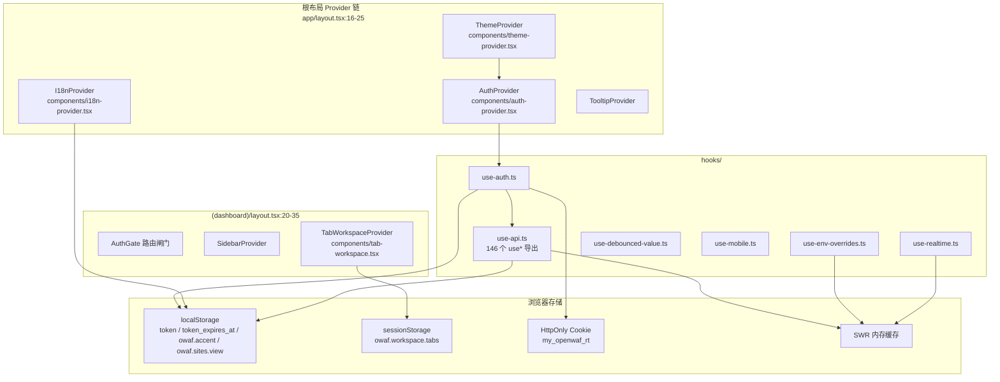
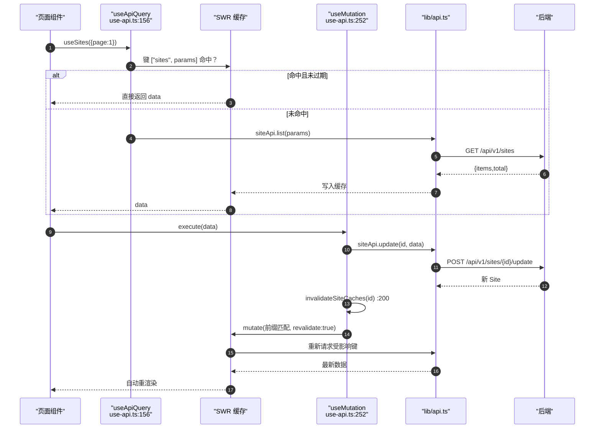
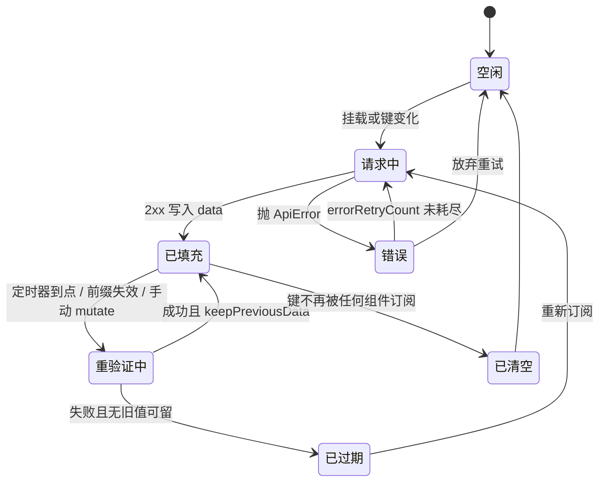
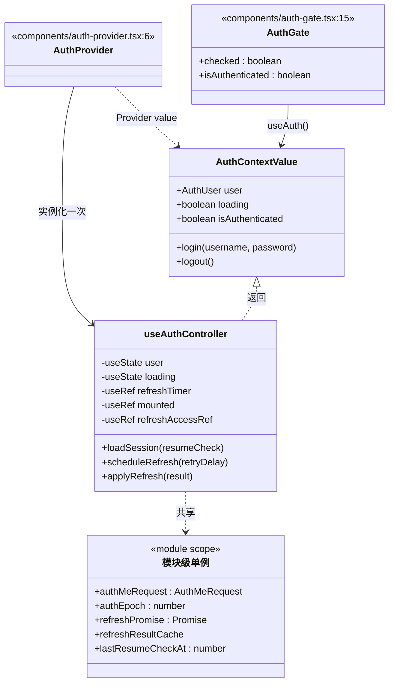
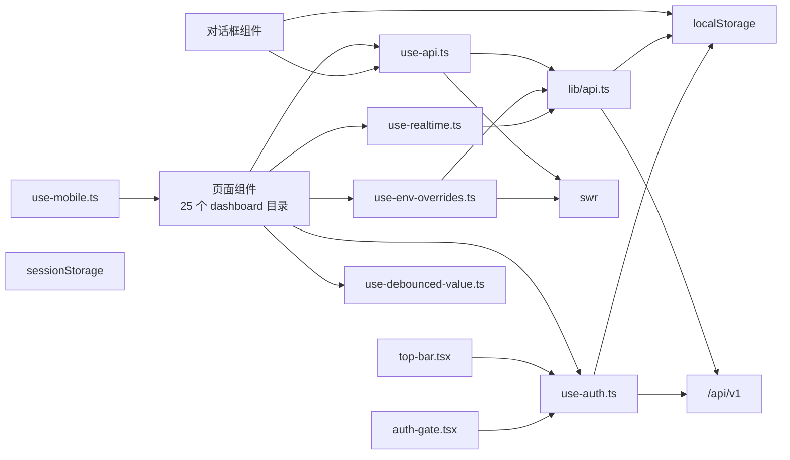

# 状态管理策略

> [返回 前端管理界面](前端管理界面.md)

<cite>
**本文档引用的文件**
- [frontend/hooks/use-api.ts](file://frontend/hooks/use-api.ts)
- [frontend/hooks/use-auth.ts](file://frontend/hooks/use-auth.ts)
- [frontend/hooks/use-debounced-value.ts](file://frontend/hooks/use-debounced-value.ts)
- [frontend/hooks/use-env-overrides.ts](file://frontend/hooks/use-env-overrides.ts)
- [frontend/hooks/use-mobile.ts](file://frontend/hooks/use-mobile.ts)
- [frontend/hooks/use-realtime.ts](file://frontend/hooks/use-realtime.ts)
- [frontend/lib/api.ts](file://frontend/lib/api.ts)
- [frontend/lib/env-override.ts](file://frontend/lib/env-override.ts)
- [frontend/lib/route-titles.ts](file://frontend/lib/route-titles.ts)
- [frontend/components/auth-provider.tsx](file://frontend/components/auth-provider.tsx)
- [frontend/components/auth-gate.tsx](file://frontend/components/auth-gate.tsx)
- [frontend/components/tab-workspace.tsx](file://frontend/components/tab-workspace.tsx)
- [frontend/components/theme-provider.tsx](file://frontend/components/theme-provider.tsx)
- [frontend/components/i18n-provider.tsx](file://frontend/components/i18n-provider.tsx)
- [frontend/components/top-bar.tsx](file://frontend/components/top-bar.tsx)
- [frontend/components/ui/sidebar.tsx](file://frontend/components/ui/sidebar.tsx)
- [frontend/app/layout.tsx](file://frontend/app/layout.tsx)
- [frontend/app/(dashboard)/layout.tsx](file://frontend/app/(dashboard)/layout.tsx)
- [frontend/app/security-dashboard/page.tsx](file://frontend/app/security-dashboard/page.tsx)
- [frontend/app/(dashboard)/dashboard/page.tsx](file://frontend/app/(dashboard)/dashboard/page.tsx)
- [frontend/app/(dashboard)/request-trace/page.tsx](file://frontend/app/(dashboard)/request-trace/page.tsx)
- [frontend/app/(dashboard)/settings/page.tsx](file://frontend/app/(dashboard)/settings/page.tsx)
- [frontend/app/(dashboard)/upstream-status/page.tsx](file://frontend/app/(dashboard)/upstream-status/page.tsx)
- [frontend/app/(dashboard)/sites/page.tsx](file://frontend/app/(dashboard)/sites/page.tsx)
- [frontend/app/(dashboard)/sites/detail/page.tsx](file://frontend/app/(dashboard)/sites/detail/page.tsx)
- [frontend/app/(dashboard)/sites/detail/components/protection-tab.tsx](file://frontend/app/(dashboard)/sites/detail/components/protection-tab.tsx)
- [frontend/app/(dashboard)/backup/page.tsx](file://frontend/app/(dashboard)/backup/page.tsx)
- [frontend/app/(dashboard)/rules/cve/page.tsx](file://frontend/app/(dashboard)/rules/cve/page.tsx)
- [frontend/app/(dashboard)/rules/owasp/page.tsx](file://frontend/app/(dashboard)/rules/owasp/page.tsx)
- [frontend/app/(dashboard)/rules/page.tsx](file://frontend/app/(dashboard)/rules/page.tsx)
- [frontend/app/(dashboard)/security-events/page.tsx](file://frontend/app/(dashboard)/security-events/page.tsx)
- [frontend/app/(dashboard)/sites/components/site-form-dialog.tsx](file://frontend/app/(dashboard)/sites/components/site-form-dialog.tsx)
- [frontend/next.config.ts](file://frontend/next.config.ts)
- [internal/admin/middleware.go](file://internal/admin/middleware.go)
- [internal/cache/response_cache.go](file://internal/cache/response_cache.go)
- [internal/cache/layer.go](file://internal/cache/layer.go)
</cite>

## 目录

1. [简介](#简介)
2. [项目结构](#项目结构)
3. [核心组件](#核心组件)
4. [架构总览](#架构总览)
5. [详细组件分析](#详细组件分析)
6. [依赖关系分析](#依赖关系分析)
7. [性能考虑](#性能考虑)
8. [故障排查指南](#故障排查指南)
9. [结论](#结论)
10. [附录](#附录)

## 简介

本篇描述管理前端的**状态分层、缓存键空间与失效机制**，以及六个 `hooks/` 模块各自承载的
职责。页面渲染策略与服务端契约分别见
[Next.js 架构设计](Next.js%20架构设计/Next.js%20架构设计.md) 与
[API 集成](API%20集成.md)，组件如何消费这些状态见
[组件设计模式](组件设计模式/组件设计模式.md)，本篇不重复其结构。

四条基本结论先行：

- **没有全局状态库**。未引入 Redux / Zustand / MobX / Recoil / Context 大杂烩；跨页面共享的
  只有认证会话与多标签工作区两个 React Context
- **服务端状态与客户端状态严格分离**。所有远端数据经 SWR 缓存在 `hooks/use-api.ts` 一处管理，
  组件不自行 `fetch`
- **失效靠具名函数 + 键前缀匹配**，不是「调用 `load()` 重新拉取」。实测 5 个具名失效函数
  （`invalidateAllAPICaches`、`invalidateIPListCaches`、`invalidateSiteCaches`、
  `invalidateCVERuleCaches`、`invalidateOWASPRuleCaches`）加上 `useMutation` 的
  `invalidateKeys` 声明式参数
- **持久化只有浏览器存储与 HttpOnly Cookie 两类**，前端不落 IndexedDB，也没有离线队列

**章节来源**
- [frontend/hooks/use-api.ts:82-297](file://frontend/hooks/use-api.ts#L82-L297)
- [frontend/hooks/use-auth.ts:87-309](file://frontend/hooks/use-auth.ts#L87-L309)

## 项目结构

`hooks/` 恰好 6 个文件，`lib/` 承载无状态工具与类型，`components/` 里的 Provider 只有 4 个
（主题、i18n、认证、多标签工作区），加上 shadcn 的 `SidebarProvider` 与 `TooltipProvider`。

**图表来源**
- [frontend/app/layout.tsx:8-29](file://frontend/app/layout.tsx#L8-L29)
- [frontend/app/(dashboard)/layout.tsx:14-37](file://frontend/app/(dashboard)/layout.tsx#L14-L37)
- [frontend/components/auth-provider.tsx:1-9](file://frontend/components/auth-provider.tsx#L1-L9)
- [frontend/components/tab-workspace.tsx:24-166](file://frontend/components/tab-workspace.tsx#L24-L166)
- [frontend/hooks/use-api.ts:191-297](file://frontend/hooks/use-api.ts#L191-L297)
- [frontend/hooks/use-auth.ts:87-295](file://frontend/hooks/use-auth.ts#L87-L295)

状态分层总表——「哪层状态、由谁承载、作用域、是否持久化、如何失效」：

| 层 | 载体:行 | 范围 | 持久化 | 失效方式 |
|------|------|------|------|------|
| URL 状态 | `useSearchParams()` [detail/page.tsx:79-84](file://frontend/app/(dashboard)/sites/detail/page.tsx#L79-L84) | 可分享、可回退 | 地址栏 | `router.replace()` 改写查询串 |
| 组件局部状态 | `useState` / `useRef` [sites/page.tsx:101-110](file://frontend/app/(dashboard)/sites/page.tsx#L101-L110) | 单组件 | 否 | 卸载即丢 |
| 外部存储状态 | `useSyncExternalStore` [sites/page.tsx:103-107](file://frontend/app/(dashboard)/sites/page.tsx#L103-L107) | 跨组件、需水合一致 | `localStorage["owaf.sites.view"]` | `setStoredView` 广播订阅者 |
| 全局 Context | `AuthContext` [use-auth.ts:300](file://frontend/hooks/use-auth.ts#L300) | 全应用单例 | 否（内存） | `setUser(null)` |
| 主题 Context | `ThemeProvider` [theme-provider.tsx:6-22](file://frontend/components/theme-provider.tsx#L6-L22) | 全应用单例 | next-themes 默认 `localStorage`（未显式设 `storageKey`） | `setTheme()` 或快捷键 D（[:37-69](file://frontend/components/theme-provider.tsx#L37-L69)） |
| 工作区 Context | `TabWorkspaceContext` [tab-workspace.tsx:69](file://frontend/components/tab-workspace.tsx#L69) | dashboard 布局子树 | `sessionStorage["owaf.workspace.tabs"]` | `closeTab` 与去重 |
| 服务端状态 | SWR 缓存 [use-api.ts:156-165](file://frontend/hooks/use-api.ts#L156-L165) | 进程内全局 | 否 | 5 个具名失效函数 + `invalidateKeys` |
| 认证模块态 | 模块级 `authMeRequest` [use-auth.ts:37](file://frontend/hooks/use-auth.ts#L37)、`authEpoch` [api.ts:39](file://frontend/lib/api.ts#L39) | 跨组件共享，不受 React 生命周期约束 | 否 | 代次自增 |
| 凭据 | `localStorage` + Cookie [api.ts:28-29](file://frontend/lib/api.ts#L28-L29)、[middleware.go:47-53](file://internal/admin/middleware.go#L47-L53) | 跨标签页 | 是 | `clearAuthToken` |
| 服务端快照 | `internal/cache/layer.go` | 进程内 | 数据库 | 修订号 + Redis 广播 |

**章节来源**
- [frontend/app/layout.tsx:8-29](file://frontend/app/layout.tsx#L8-L29)
- [frontend/app/(dashboard)/layout.tsx:14-37](file://frontend/app/(dashboard)/layout.tsx#L14-L37)
- [frontend/app/(dashboard)/sites/page.tsx:44-139](file://frontend/app/(dashboard)/sites/page.tsx#L44-L139)
- [frontend/app/(dashboard)/sites/detail/page.tsx:73-99](file://frontend/app/(dashboard)/sites/detail/page.tsx#L73-L99)
- [frontend/hooks/use-api.ts:156-297](file://frontend/hooks/use-api.ts#L156-L297)
- [frontend/hooks/use-auth.ts:31-300](file://frontend/hooks/use-auth.ts#L31-L300)

## 核心组件

六个 hooks 的职责边界（实测导出面与调用方数量）：

| hooks 文件 | 行数 | 导出 | 状态职责 | 持久化 | 调用方 |
|------|:----:|------|------|------|------|
| `use-api.ts` | 1589 | 146 个 `use*` + 5 个 `invalidate*` | SWR 读、`useMutation` 写、键失效 | 无（内存） | 全部 dashboard 页面 |
| `use-auth.ts` | 409 | `useAuthController`、`AuthContext`、`useAuth`、`useIsAuthenticated` | 会话态、刷新定时器、跨标签同步 | `localStorage` + Cookie | `AuthProvider`、`AuthGate`、`top-bar`、登录页 |
| `use-env-overrides.ts` | 135 | `ENV_OVERRIDES_KEY`、`useEnvOverrides`、`envOverride*` | 环境变量覆盖视图 | 后端持久化 | `settings/page.tsx:730` |
| `use-realtime.ts` | 237 | `useRealtimeEvents`、`useRealtimeOverview` | WS 快照态、签名去抖 | 无 | `security-dashboard:165`、`upstream-status:236` |
| `use-debounced-value.ts` | 32 | `useDebouncedValue` | 输入静默窗口后提交 | 无 | `rules/cve`、`rules/owasp` |
| `use-mobile.ts` | 20 | `useIsMobile` | 768px 断点布尔 | 无 | `ui/sidebar.tsx:68` |

两点必须点明的现状：`useIsAuthenticated`（[use-auth.ts:315](file://frontend/hooks/use-auth.ts#L315)）
与 `useTabWorkspace`（[tab-workspace.tsx:278](file://frontend/components/tab-workspace.tsx#L278)）
**均无外部调用方**——前者被 `AuthGate` 的 `!!user || (token && checked)` 判定取代
（[auth-gate.tsx:23](file://frontend/components/auth-gate.tsx#L23)），后者被 Provider 自身内联渲染
取代（[tab-workspace.tsx:274](file://frontend/components/tab-workspace.tsx#L274)）。两者已登记为
文档外不一致，本篇只记录不改码。

**章节来源**
- [frontend/hooks/use-api.ts:191-297](file://frontend/hooks/use-api.ts#L191-L297)
- [frontend/hooks/use-auth.ts:87-409](file://frontend/hooks/use-auth.ts#L87-L409)
- [frontend/hooks/use-env-overrides.ts:14-136](file://frontend/hooks/use-env-overrides.ts#L14-L136)
- [frontend/hooks/use-realtime.ts:32-238](file://frontend/hooks/use-realtime.ts#L32-L238)
- [frontend/hooks/use-debounced-value.ts:13-32](file://frontend/hooks/use-debounced-value.ts#L13-L32)
- [frontend/hooks/use-mobile.ts:3-20](file://frontend/hooks/use-mobile.ts#L3-L20)
- [frontend/components/auth-gate.tsx:15-44](file://frontend/components/auth-gate.tsx#L15-L44)
- [frontend/components/tab-workspace.tsx:278-284](file://frontend/components/tab-workspace.tsx#L278-L284)

## 架构总览

读写两条路径在 SWR 层汇合：读侧由键决定缓存粒度，写侧成功后按前缀触发重验证，
浏览器存储只在认证与工作区两处参与。

**图表来源**
- [frontend/hooks/use-api.ts:156-297](file://frontend/hooks/use-api.ts#L156-L297)
- [frontend/hooks/use-api.ts:666-706](file://frontend/hooks/use-api.ts#L666-L706)
- [frontend/lib/api.ts:531-657](file://frontend/lib/api.ts#L531-L657)

缓存条目的生命周期状态机：

**图表来源**
- [frontend/hooks/use-api.ts:89-165](file://frontend/hooks/use-api.ts#L89-L165)
- [frontend/hooks/use-api.ts:180-247](file://frontend/hooks/use-api.ts#L180-L247)

**章节来源**
- [frontend/hooks/use-api.ts:89-297](file://frontend/hooks/use-api.ts#L89-L297)
- [frontend/lib/api.ts:531-657](file://frontend/lib/api.ts#L531-L657)

## 详细组件分析

### SWR 键空间与失效函数

键一律写成数组形式 `[前缀, ...作用域]`，前缀决定归属哪一类失效。实测 `use-api.ts` 内出现
**74 个不同字符串键前缀**（读侧与失效侧并集），另有 `use-env-overrides.ts` 的 `env-overrides`。
前缀匹配由 `matchesPrefix` 完成：字符串键等值，或数组键首元素等值
（[use-api.ts:173-178](file://frontend/hooks/use-api.ts#L173-L178)）；
`revalidatePrefixes` 对每个前缀并行发起一次 `mutate(..., { revalidate: true })`
（[:180-188](file://frontend/hooks/use-api.ts#L180-L188)）。

| 键 | 定义:行 | 失效触发点 | 消费者 |
|------|------|------|------|
| `["sites", params]` | [use-api.ts:300](file://frontend/hooks/use-api.ts#L300) | `invalidateSiteCaches` 前缀 `sites` 恒真（[:206](file://frontend/hooks/use-api.ts#L206)） | [sites/page.tsx:112](file://frontend/app/(dashboard)/sites/page.tsx#L112) |
| `["sites-all"]` | [use-api.ts:305](file://frontend/hooks/use-api.ts#L305) | 仅长度 1 时命中（[:207](file://frontend/hooks/use-api.ts#L207)） | 站点选择器 |
| `["site", id]` | [use-api.ts:316](file://frontend/hooks/use-api.ts#L316) | `invalidateSiteCaches(id)`（[:220-232](file://frontend/hooks/use-api.ts#L220-L232)） | [detail/page.tsx:93](file://frontend/app/(dashboard)/sites/detail/page.tsx#L93)、[request-trace/page.tsx:140](file://frontend/app/(dashboard)/request-trace/page.tsx#L140) |
| `["site-listeners", id]` | [use-api.ts:323](file://frontend/hooks/use-api.ts#L323) | 同上，含监听器增删改（[:387](file://frontend/hooks/use-api.ts#L387)、[:405](file://frontend/hooks/use-api.ts#L405)、[:421](file://frontend/hooks/use-api.ts#L421)） | 站点详情监听器页签 |
| `["site-rules", id]` | [use-api.ts:330](file://frontend/hooks/use-api.ts#L330) | 站点失效 + 规则写侧 `invalidateKeys: ["rules","site-rules"]`（[:717](file://frontend/hooks/use-api.ts#L717)） | [protection-tab.tsx:318](file://frontend/app/(dashboard)/sites/detail/components/protection-tab.tsx#L318) |
| `["site-recorded-resources", id]` | [use-api.ts:338](file://frontend/hooks/use-api.ts#L338) | 站点失效白名单成员（[:213](file://frontend/hooks/use-api.ts#L213)） | 资源记录页签 |
| `["site-stats", id, params]` / `["site-timeline", id, params]` | [use-api.ts:350](file://frontend/hooks/use-api.ts#L350)、[:363](file://frontend/hooks/use-api.ts#L363) | 站点失效；轮询由调用方传 `refreshInterval`（[:346](file://frontend/hooks/use-api.ts#L346)） | 站点概览 |
| `["site-access-stats", id]` | [use-api.ts:372](file://frontend/hooks/use-api.ts#L372) | 站点失效 | 站点概览 |
| `["site-error-pages", id]` | [use-api.ts:657](file://frontend/hooks/use-api.ts#L657) | 站点失效 + 写侧 `["site-error-pages"]` 并显式再失效一次（[:1283](file://frontend/hooks/use-api.ts#L1283)、[:1286](file://frontend/hooks/use-api.ts#L1286)） | 错误页页签 |
| `["certificates"]` | [use-api.ts:429](file://frontend/hooks/use-api.ts#L429) | 写侧 `invalidateKeys: ["certificates"]`（[:735](file://frontend/hooks/use-api.ts#L735)、[:741](file://frontend/hooks/use-api.ts#L741)） | 证书页、站点表单 |
| `["rules", params]` | [use-api.ts:443](file://frontend/hooks/use-api.ts#L443) | 规则增删改写侧（[:717](file://frontend/hooks/use-api.ts#L717)、[:723](file://frontend/hooks/use-api.ts#L723)） | [rules/page.tsx:45-54](file://frontend/app/(dashboard)/rules/page.tsx#L45-L54) |
| `["cve-rules", params]` / `["cve-stats", params]` | [use-api.ts:582](file://frontend/hooks/use-api.ts#L582)、[:1521](file://frontend/hooks/use-api.ts#L1521) | `invalidateCVERuleCaches`（[:240-242](file://frontend/hooks/use-api.ts#L240-L242)） | [rules/cve/page.tsx:270](file://frontend/app/(dashboard)/rules/cve/page.tsx#L270)、[:298](file://frontend/app/(dashboard)/rules/cve/page.tsx#L298)、[:317](file://frontend/app/(dashboard)/rules/cve/page.tsx#L317)、[:344](file://frontend/app/(dashboard)/rules/cve/page.tsx#L344)、[:363](file://frontend/app/(dashboard)/rules/cve/page.tsx#L363) |
| `["owasp-rules", params]` / `["owasp-stats", params]` | [use-api.ts:590](file://frontend/hooks/use-api.ts#L590)、[:1533](file://frontend/hooks/use-api.ts#L1533) | `invalidateOWASPRuleCaches`（[:245-247](file://frontend/hooks/use-api.ts#L245-L247)） | [rules/owasp/page.tsx:287](file://frontend/app/(dashboard)/rules/owasp/page.tsx#L287)、[:307](file://frontend/app/(dashboard)/rules/owasp/page.tsx#L307)、[:329](file://frontend/app/(dashboard)/rules/owasp/page.tsx#L329)、[:350](file://frontend/app/(dashboard)/rules/owasp/page.tsx#L350)、[:385](file://frontend/app/(dashboard)/rules/owasp/page.tsx#L385)、[:409](file://frontend/app/(dashboard)/rules/owasp/page.tsx#L409) |
| `["ip-lists", params]` | [use-api.ts:517](file://frontend/hooks/use-api.ts#L517) | `invalidateIPListCaches`（[:196-198](file://frontend/hooks/use-api.ts#L196-L198)）+ 写侧（[:907](file://frontend/hooks/use-api.ts#L907)、[:913](file://frontend/hooks/use-api.ts#L913)、[:931](file://frontend/hooks/use-api.ts#L931)） | [security-events/page.tsx:362](file://frontend/app/(dashboard)/security-events/page.tsx#L362) |
| `["lua-plugins"]` / `["lua-plugin-stats"]` | [use-api.ts:995](file://frontend/hooks/use-api.ts#L995)、[:1006](file://frontend/hooks/use-api.ts#L1006) | 常量组 `LUA_MUTATION_KEYS`（[:1015](file://frontend/hooks/use-api.ts#L1015)） | Lua 插件页 |
| `["js-plugins"]` / `["js-plugin-stats"]` / `["js-plugin-runtime"]` | [use-api.ts:1072](file://frontend/hooks/use-api.ts#L1072)、[:1079](file://frontend/hooks/use-api.ts#L1079)、[:1086](file://frontend/hooks/use-api.ts#L1086) | 常量组 `JS_MUTATION_KEYS`（[:1091](file://frontend/hooks/use-api.ts#L1091)） | JS 插件页 |
| `["dashboard"]` | [use-api.ts:575](file://frontend/hooks/use-api.ts#L575) | 无写侧；靠 `refreshInterval: 10000` 轮询 | [dashboard/page.tsx:189](file://frontend/app/(dashboard)/dashboard/page.tsx#L189)、[security-dashboard/page.tsx:154](file://frontend/app/security-dashboard/page.tsx#L154) |
| `["upstream-status"]` | [use-api.ts:635](file://frontend/hooks/use-api.ts#L635) | `refreshInterval: 10000` + WS `upstream_snapshot` 双轨 | [upstream-status/page.tsx:235-236](file://frontend/app/(dashboard)/upstream-status/page.tsx#L235-L236) |
| `["env-overrides"]` | [use-env-overrides.ts:14](file://frontend/hooks/use-env-overrides.ts#L14)、[:80](file://frontend/hooks/use-env-overrides.ts#L80) | 写后用响应直接 `mutate(key, next, {revalidate:false})`，并连带重验 `runtime-config`（[:102-104](file://frontend/hooks/use-env-overrides.ts#L102-L104)） | [settings/page.tsx:730](file://frontend/app/(dashboard)/settings/page.tsx#L730) |
5 个具名失效函数的语义差异：

| 函数:行 | 匹配规则 | 是否带作用域 | 备注 |
|------|------|:----:|------|
| `invalidateAllAPICaches` [use-api.ts:191](file://frontend/hooks/use-api.ts#L191) | `mutate(() => true)` 全量 | 否 | 备份恢复替换多类配置，唯一全清场景 |
| `invalidateIPListCaches` [:196](file://frontend/hooks/use-api.ts#L196) | 前缀 `ip-lists` | 否 | 批量写入应在整批结束后调用一次 |
| `invalidateSiteCaches` [:200](file://frontend/hooks/use-api.ts#L200) | `sites` 恒真；`sites-all` 需长度为 1；其余 8 个前缀按 `cacheId` 逐位比对 | 是 | 不传 id 时清全部站点作用域 |
| `invalidateCVERuleCaches` [:240](file://frontend/hooks/use-api.ts#L240) | 前缀 `cve-rules`、`cve-stats` | 否 | 全局覆盖会影响策略与站点有效配置 |
| `invalidateOWASPRuleCaches` [:245](file://frontend/hooks/use-api.ts#L245) | 前缀 `owasp-rules`、`owasp-stats` | 否 | 未挂载的分页/筛选缓存同时置空 |

`cacheId`（[:167-171](file://frontend/hooks/use-api.ts#L167-L171)）把 `undefined`、`null`、
空串统一归一为 `undefined`，避免 `"0"` 与 `""` 混用造成作用域漂移。写侧 hook 内部会直接
`await invalidateSiteCaches(...)` 再返回结果，页面因此无需记得手动刷新
（[:387](file://frontend/hooks/use-api.ts#L387)、[:672](file://frontend/hooks/use-api.ts#L672)、
[:680](file://frontend/hooks/use-api.ts#L680)）；只有站点表单在保存后额外调用一次
（[site-form-dialog.tsx:238](file://frontend/app/(dashboard)/sites/components/site-form-dialog.tsx#L238)）。

**章节来源**
- [frontend/hooks/use-api.ts:167-297](file://frontend/hooks/use-api.ts#L167-L297)
- [frontend/hooks/use-api.ts:299-443](file://frontend/hooks/use-api.ts#L299-L443)
- [frontend/hooks/use-api.ts:575-663](file://frontend/hooks/use-api.ts#L575-L663)
- [frontend/hooks/use-api.ts:666-741](file://frontend/hooks/use-api.ts#L666-L741)
- [frontend/hooks/use-api.ts:995-1134](file://frontend/hooks/use-api.ts#L995-L1134)
- [frontend/hooks/use-api.ts:1283-1286](file://frontend/hooks/use-api.ts#L1283-L1286)
- [frontend/hooks/use-api.ts:1521-1533](file://frontend/hooks/use-api.ts#L1521-L1533)
- [frontend/hooks/use-env-overrides.ts:14-114](file://frontend/hooks/use-env-overrides.ts#L14-L114)

### 查询选项与轮询分层

`useApiQuery` 是唯一的读侧工厂，默认关闭 `revalidateOnFocus`，其余选项由调用方覆盖
（[use-api.ts:156-165](file://frontend/hooks/use-api.ts#L156-L156)）。三档预置选项表达三类数据时效性：

| 选项组:行 | `dedupingInterval` | `keepPreviousData` | `errorRetryCount` | 适用数据 |
|------|:----:|:----:|:----:|------|
| `REFERENCE_QUERY_OPTIONS` [:90-93](file://frontend/hooks/use-api.ts#L90-L93) | 5 分钟 | ✓ | - | 站点/证书等低频选择器 |
| `RULE_QUERY_OPTIONS` [:141-145](file://frontend/hooks/use-api.ts#L141-L145) | 30 秒 | ✓ | 1 | 可写规则列表 |
| `STRICT_RULE_QUERY_OPTIONS` [:148-151](file://frontend/hooks/use-api.ts#L148-L151) | 30 秒 | ✗ | 1 | 无作用域标识、不可展示上一作用域的视图 |

带轮询的键（`refreshInterval` 实测值）：

| 键 | 周期 | 定义:行 | 说明 |
|------|:----:|------|------|
| `dashboard` | 10 秒 | [use-api.ts:575-577](file://frontend/hooks/use-api.ts#L575-L577) | 仪表板汇总卡 |
| `upstream-status` | 10 秒 | [:633-638](file://frontend/hooks/use-api.ts#L633-L638) | 与 WS 快照并存，取先到者 |
| `dashboard-stats` | 30 秒 | [:534-539](file://frontend/hooks/use-api.ts#L534-L539) | 安全事件统计 |
| `threat-intel-sync-logs` | 30 秒 | [:985-987](file://frontend/hooks/use-api.ts#L985-L987) | 同步日志 |
| `bot-stats` / `bot-scores` | 30 秒 | [:1500-1501](file://frontend/hooks/use-api.ts#L1500-L1501)、[:1513-1515](file://frontend/hooks/use-api.ts#L1513-L1515) | Bot 行为分 |
| `lua-plugin-stats` | 15 秒 | [:1006-1007](file://frontend/hooks/use-api.ts#L1006-L1007) | 运行时统计，按脚本名聚合 |
| `js-plugin-stats` / `js-plugin-runtime` | 15 秒 | [:1079-1080](file://frontend/hooks/use-api.ts#L1079-L1080)、[:1086-1087](file://frontend/hooks/use-api.ts#L1086-L1087) | 引擎态 |
| `chain-sessions` | 20 秒 | [:1540-1541](file://frontend/hooks/use-api.ts#L1540-L1541) | 链式验证会话 |

仪表板轮询是 **SWR `refreshInterval`**（10 秒 / 30 秒两档），不是 `setInterval(15 秒)`；
旧稿的 15 秒 setInterval 说法与代码不符，已订正。

聚合型选择器另有页数闸门：`getReferencePages` 单页 200、最多 10 页，短页即视为末页并停止
（[use-api.ts:104-138](file://frontend/hooks/use-api.ts#L104-L138)），与 `api.ts` 的
`getAllSitePages` 是同构逻辑的两处实现（前者在 hooks 层、后者在请求层）。

**章节来源**
- [frontend/hooks/use-api.ts:89-165](file://frontend/hooks/use-api.ts#L89-L165)
- [frontend/hooks/use-api.ts:534-638](file://frontend/hooks/use-api.ts#L534-L638)
- [frontend/hooks/use-api.ts:985-1007](file://frontend/hooks/use-api.ts#L985-L1007)
- [frontend/hooks/use-api.ts:1079-1087](file://frontend/hooks/use-api.ts#L1079-L1087)
- [frontend/hooks/use-api.ts:1500-1541](file://frontend/hooks/use-api.ts#L1500-L1541)
- [frontend/lib/api.ts:697-723](file://frontend/lib/api.ts#L697-L723)

### 写侧事务与乐观更新

`useMutation` 不返回 SWR 的 `mutate`，而是自制的 `{ execute, loading, error }`
（[use-api.ts:252-297](file://frontend/hooks/use-api.ts#L252-L297)）：

- 竞态防护：`latestRequestId` 自增后仅在「仍是最新」时写 `error`，避免旧请求的错误覆盖新状态
  （[:262](file://frontend/hooks/use-api.ts#L262)、[:267](file://frontend/hooks/use-api.ts#L267)、
  [:281-283](file://frontend/hooks/use-api.ts#L281-L283)）。
- 并发计数：`inFlightCount` 引用计数归零才置 `loading = false`，并行提交不会提前解锁按钮
  （[:263](file://frontend/hooks/use-api.ts#L263)、[:286-291](file://frontend/hooks/use-api.ts#L286-L291)）。
- 声明式失效：`options.invalidateKeys` 在成功后统一 `revalidatePrefixes`，失败被 `catch` 吞掉，
  不让缓存失效影响主流程结果（[:273-277](file://frontend/hooks/use-api.ts#L273-L277)）。
- **无乐观更新**。全库未见 `mutate(key, optimistic, { populateCache })` 形态的乐观写入；
  写侧一律「等后端返回 → 重验证 → 再渲染」。这与 WAF 配置必须反映真实生效值的产品语义一致。

保护类配置的失效是**交叉**的：改保护设置会连带重验验证码与 Bot 配置
（`["protection-settings","captcha-config","bot-settings"]`，
[use-api.ts:863](file://frontend/hooks/use-api.ts#L863)、[:878](file://frontend/hooks/use-api.ts#L878)、
[:887](file://frontend/hooks/use-api.ts#L887)），改 Bot 也回带保护与验证码
（[:848](file://frontend/hooks/use-api.ts#L848)、[:895](file://frontend/hooks/use-api.ts#L895)）。
这正是快捷配置页「读-合并-写」而不是「整体覆盖」的原因，见
[组件设计模式/CRUD 页面组件](组件设计模式/CRUD%20页面组件.md)。

**章节来源**
- [frontend/hooks/use-api.ts:252-297](file://frontend/hooks/use-api.ts#L252-L297)
- [frontend/hooks/use-api.ts:840-900](file://frontend/hooks/use-api.ts#L840-L900)

### 认证会话状态

认证是全应用唯一真正的「全局客户端状态」，其特殊性来自三个约束：跨标签页共享、
一次性 refresh 令牌、以及静态导出没有服务端路由守卫。

**图表来源**
- [frontend/hooks/use-auth.ts:31-55](file://frontend/hooks/use-auth.ts#L31-L55)
- [frontend/hooks/use-auth.ts:87-297](file://frontend/hooks/use-auth.ts#L87-L297)
- [frontend/components/auth-provider.tsx:5-9](file://frontend/components/auth-provider.tsx#L5-L9)
- [frontend/components/auth-gate.tsx:15-44](file://frontend/components/auth-gate.tsx#L15-L44)
- [frontend/lib/api.ts:39-47](file://frontend/lib/api.ts#L39-L47)

关键行为：

- **单例化**：`AuthProvider` 在根布局只创建一个控制器（[auth-provider.tsx:6-9](file://frontend/components/auth-provider.tsx#L6-L9)、
  [layout.tsx:18](file://frontend/app/layout.tsx#L18)），页面通过 `useAuth()` 读取，未挂 Provider 直接抛错
  （[use-auth.ts:303-309](file://frontend/hooks/use-auth.ts#L303-L309)）。这样刷新定时器与焦点监听全站各一份。
- **`/auth/me` 去重**：模块级 `authMeRequest` 绑定 token 值，同 token 只保留一个在途 Promise；
  旧 token 的请求结束时不得清除新 token 的请求（[:37-55](file://frontend/hooks/use-auth.ts#L37-L55)）。
- **挂载守卫**：所有 `setUser` / `setLoading` 前判 `mounted.current`，避免卸载后写状态
  （[:92](file://frontend/hooks/use-auth.ts#L92)、[:132-144](file://frontend/hooks/use-auth.ts#L132-L144)）。
- **不因为「存储为空」递增代次**：首屏无 token 的探测若也走 `clearAuthToken`，会让并发的第二个
  消费者重复打一次 401（[:129-131](file://frontend/hooks/use-auth.ts#L129-L131)）。
- **临时故障不等于登出**：`unavailable` 保留 token 并排 30 秒重试；无 token 时不启动永久轮询
  （[:133-138](file://frontend/hooks/use-auth.ts#L133-L138)）。
- **闸门语义**：`AuthGate` 的已认证判定为 `!!user || (!!getAccessToken() && checked)`，即在检查完成后
  「有 token」就算通过，把 401 的处置权交给 `apiRequest`（[auth-gate.tsx:19-29](file://frontend/components/auth-gate.tsx#L19-L29)）。

**章节来源**
- [frontend/hooks/use-auth.ts:31-295](file://frontend/hooks/use-auth.ts#L31-L295)
- [frontend/components/auth-provider.tsx:1-9](file://frontend/components/auth-provider.tsx#L1-L9)
- [frontend/components/auth-gate.tsx:15-44](file://frontend/components/auth-gate.tsx#L15-L44)
- [frontend/app/layout.tsx:14-26](file://frontend/app/layout.tsx#L14-L26)
- [frontend/lib/api.ts:33-56](file://frontend/lib/api.ts#L33-L56)

### 本地与 URL 状态

三种「不用 Context」的本地状态写法，各有明确适用场景：

1. **`useState` 表单与对话框开关**。站点页把 `showForm`、`editingSite`、`deletingSite` 三个
   `useState` 作为对话框的唯一真相源（[sites/page.tsx:108-110](file://frontend/app/(dashboard)/sites/page.tsx#L108-L110)），
   派生数据一律 `useMemo`（[:122](file://frontend/app/(dashboard)/sites/page.tsx#L122)、
   [:131-137](file://frontend/app/(dashboard)/sites/page.tsx#L131-L137)）。
2. **`useSyncExternalStore` 承接外部存储**。视图偏好 `owaf.sites.view` 若写在 `useState` 初值里
   会造成静态导出水合不一致，写在 effect 里又引发级联渲染；模块用订阅集合 + 缓存快照 +
   服务端固定快照三件套解决（[sites/page.tsx:52-95](file://frontend/app/(dashboard)/sites/page.tsx#L52-L95)，
   注释即此意）。这是本仓库处理「持久化偏好」的标准写法。
3. **URL 查询串承载可分享状态**。站点详情不用动态段，而是 `?id=&tab=`；`activeTab` 由白名单
   `ALLOWED_TABS` 过滤后回落 `overview`，切换页签用 `router.replace` 保持历史干净
   （[detail/page.tsx:80-91](file://frontend/app/(dashboard)/sites/detail/page.tsx#L80-L91)）。
   页签还能反向裁剪请求：仅 `overview`/`rules` 才加载规则列表
   （[:94-96](file://frontend/app/(dashboard)/sites/detail/page.tsx#L94-L96)）。

`useSearchParams()` 的消费者必须包 `Suspense`——`output: "export"` 下这是硬性要求，
dashboard 布局已在 `TabWorkspaceProvider` 外层给出边界
（[app/(dashboard)/layout.tsx:25](file://frontend/app/(dashboard)/layout.tsx#L25)），OWASP 与 CVE 页面
也各自在外层组件包一次（[rules/owasp/page.tsx:123](file://frontend/app/(dashboard)/rules/owasp/page.tsx#L123)、
[rules/cve/page.tsx:79](file://frontend/app/(dashboard)/rules/cve/page.tsx#L79)）。

4. **`dynamic()` 延迟挂载重型组件**。规则表单对话框依赖 `react-hook-form` 与 `zod`，规则页用
   `dynamic()` 把它从首屏状态树里摘出去，并在加载期渲染骨架占位
   （[rules/page.tsx:48-54](file://frontend/app/(dashboard)/rules/page.tsx#L48-L54)）。
   这是「组件级代码分割」而非状态管理手段，但它决定了对话框内部 `useState` 的挂载时机。

**章节来源**
- [frontend/app/(dashboard)/sites/page.tsx:44-139](file://frontend/app/(dashboard)/sites/page.tsx#L44-L139)
- [frontend/app/(dashboard)/sites/detail/page.tsx:73-99](file://frontend/app/(dashboard)/sites/detail/page.tsx#L73-L99)
- [frontend/app/(dashboard)/layout.tsx:19-36](file://frontend/app/(dashboard)/layout.tsx#L19-L36)
- [frontend/next.config.ts:3-7](file://frontend/next.config.ts#L3-L7)

### 工作区与偏好持久化

多标签工作区是第二个 Context。它同时监听 `usePathname()` 与 `useSearchParams()`，合成
`currentPath` 后做「不存在则追加、存在则替换」的幂等更新
（[tab-workspace.tsx:113-156](file://frontend/components/tab-workspace.tsx#L113-L156)），并在
`hydrated` 之前不写存储（[:159-166](file://frontend/components/tab-workspace.tsx#L159-L166)）。

两个易错细节：

- `normalizePath` 同时处理尾斜杠与查询串排序。`trailingSlash: true` 使 `usePathname()` 返回
  `/dashboard/`，而历史 `sessionStorage` 里可能存着无尾斜杠的旧值，不归一就会给同一路由开两个标签
  （[tab-workspace.tsx:28-45](file://frontend/components/tab-workspace.tsx#L28-L45)）。
- `tabIdentity` 对 `/sites/detail` 特殊处理，只保留 `id` 参数作为身份，避免同一站点的不同页签
  被当成不同标签（[:47-53](file://frontend/components/tab-workspace.tsx#L47-L53)）；
  固定标签 `PINNED_PATH = "/dashboard/"` 不可关闭且缺失时补到首位
  （[:25](file://frontend/components/tab-workspace.tsx#L25)、[:136-141](file://frontend/components/tab-workspace.tsx#L136-L141)）。

浏览器存储键实测清单（前端可见部分，不含 HttpOnly Cookie）：

| 键 | 载体 | 写入点:行 | 作用 |
|------|------|------|------|
| `token` | localStorage | [api.ts:191](file://frontend/lib/api.ts#L191) | access JWT |
| `token_expires_at` | localStorage | [api.ts:194](file://frontend/lib/api.ts#L194) | 到期毫秒值 |
| `my_openwaf_refresh_lock` | localStorage | [api.ts:347](file://frontend/lib/api.ts#L347) | 刷新租约 |
| `my_openwaf_refresh_lock.intent.{owner}` | localStorage | [api.ts:318](file://frontend/lib/api.ts#L318) | 刷新意图登记 |
| `owaf.workspace.tabs` | sessionStorage | [tab-workspace.tsx:162](file://frontend/components/tab-workspace.tsx#L162) | 已开标签 |
| `owaf.sites.view` | localStorage | [sites/page.tsx:93](file://frontend/app/(dashboard)/sites/page.tsx#L93) | 列表/卡片偏好 |
| `owaf.accent` | localStorage | 见[主题系统与样式](主题系统与样式.md) | 强调色 |
| i18next 语言缓存 | localStorage | [i18n-provider.tsx:30-33](file://frontend/components/i18n-provider.tsx#L30-L33) | 语言偏好 |

**章节来源**
- [frontend/components/tab-workspace.tsx:24-166](file://frontend/components/tab-workspace.tsx#L24-L166)
- [frontend/app/(dashboard)/sites/page.tsx:52-95](file://frontend/app/(dashboard)/sites/page.tsx#L52-L95)
- [frontend/components/i18n-provider.tsx:15-45](file://frontend/components/i18n-provider.tsx#L15-L45)
- [frontend/lib/api.ts:189-198](file://frontend/lib/api.ts#L189-L198)
- [frontend/lib/api.ts:307-400](file://frontend/lib/api.ts#L307-L400)

### 服务端缓存与状态一致性

前端缓存不是唯一一层。后端另有两处，语义不同，排查时必须分开：

| 层 | 位置:行 | 键 | 淘汰 | 与前端的关系 |
|------|------|------|------|------|
| 响应缓存 | [response_cache.go:13-35](file://internal/cache/response_cache.go#L13-L35) | 条目含 `StatusCode`/`ContentType`/`Body`/`TTL`/`SiteID` | TTL + 分片互斥（64 分片，[:48-56](file://internal/cache/response_cache.go#L48-L56)） | 数据面缓存上游 GET 响应，与管理端 API 无交集 |
| 快照缓存层 | [layer.go:19-35](file://internal/cache/layer.go#L19-L35) | `snapshot:{revision}`（[:41-56](file://internal/cache/layer.go#L41-L56)） | ristretto，`MaxCost 1<<20`；跨节点走 Redis pub/sub 重载 | 决定 `/runtime-config` 读到的生效值 |
| SWR 内存缓存 | [use-api.ts:156](file://frontend/hooks/use-api.ts#L156) | 数组键 | 显式失效 + 轮询 | 前端唯一远端态 |
| 管理端 `no-store` | [middleware.go:180-186](file://internal/admin/middleware.go#L180-L186) | - | - | 禁止浏览器/代理缓存 `/api/v1/` |

一致性链路：管理员保存 → POST 成功 → 后端触发 reload → 前端 `revalidatePrefixes` 重取
→ 新快照经 `["runtime-config"]` 等键回流。备份导入是例外，走
`invalidateAllAPICaches()` 全量清空（[backup/page.tsx:123](file://frontend/app/(dashboard)/backup/page.tsx#L123)）。
环境变量覆盖写入后，除了回写自身键，还会显式重验 `runtime-config`
（[use-env-overrides.ts:102-104](file://frontend/hooks/use-env-overrides.ts#L102-L104)）。

环境变量覆盖视图是唯一的「写后不回读」例外：`useEnvOverrides` 用后端返回的完整快照直接
灌入 SWR 缓存（`revalidate: false`），因为该响应本身就是写后回读结果（[use-env-overrides.ts:96-114](file://frontend/hooks/use-env-overrides.ts#L96-L114)）。
前端的键注册表 `ENV_OVERRIDE_KEYS` 是 9 个域共 45 键的镜像
（[env-override.ts:22-45](file://frontend/lib/env-override.ts#L22-L45)），仅决定「哪个键渲染在哪张卡」，
每个键的生效值、来源（`env` / `db` / `default`）与只读性一律取自后端 items
（[use-env-overrides.ts:16-47](file://frontend/hooks/use-env-overrides.ts#L16-L47)），因此不构成第二配置源。

**章节来源**
- [frontend/hooks/use-api.ts:156-192](file://frontend/hooks/use-api.ts#L156-L192)
- [frontend/hooks/use-env-overrides.ts:16-114](file://frontend/hooks/use-env-overrides.ts#L16-L114)
- [frontend/lib/env-override.ts:22-45](file://frontend/lib/env-override.ts#L22-L45)
- [frontend/app/(dashboard)/backup/page.tsx:123](file://frontend/app/(dashboard)/backup/page.tsx#L123)
- [internal/admin/middleware.go:180-186](file://internal/admin/middleware.go#L180-L186)
- [internal/cache/layer.go:19-56](file://internal/cache/layer.go#L19-L56)

## 依赖关系分析

**图表来源**
- [frontend/hooks/use-api.ts:1-80](file://frontend/hooks/use-api.ts#L1-L80)
- [frontend/hooks/use-env-overrides.ts:1-16](file://frontend/hooks/use-env-overrides.ts#L1-L16)
- [frontend/hooks/use-realtime.ts:1-12](file://frontend/hooks/use-realtime.ts#L1-L12)
- [frontend/hooks/use-auth.ts:1-22](file://frontend/hooks/use-auth.ts#L1-L22)
- [frontend/components/top-bar.tsx:8-26](file://frontend/components/top-bar.tsx#L8-L26)

依赖约束（谁被谁持有、能否替换）：

| 依赖方 | 被依赖方 | 形式 | 可否替换 | 备注 |
|------|------|------|:----:|------|
| 页面 | `use-api.ts` 的 `useXxx` | 具名 import | 是 | 页面不直接 import `lib/api.ts` 取数，失效函数除外 |
| 页面 | `invalidate*` 具名函数 | 直接调用 | 是 | 仅批量/跨作用域场景需要 |
| `use-api.ts` | `swr` 的 `useSWR` + 全局 `mutate` | 直接 import | 部分 | 全局 `mutate` 是前缀失效的唯一手段 |
| `use-auth.ts` | `lib/api.ts` 令牌 API | 具名 import | 否 | 键名常量由 `api.ts` 导出 |
| `AuthGate` | `AuthContext` | Context | 是 | 闸门可替换为中间件式守卫 |
| `tab-workspace.tsx` | `lib/route-titles.ts` 的 `getPageTitleKey` | 纯函数 | 否 | 标题单一数据源 |
| `ui/sidebar.tsx` | `use-mobile.ts` | Hook | 是 | 断点常量 768 |
| `rules/cve`、`rules/owasp` | `use-debounced-value.ts` | Hook | 是 | 搜索框静默窗口 |

标题单一数据源见 [仪表板布局与导航](Next.js%20架构设计/仪表板布局与导航.md)；实测
`routeTitleKeyMap` 与 `segmentKeyMap` 都缺 `/tls-fingerprints` 条目
（[route-titles.ts:7-65](file://frontend/lib/route-titles.ts#L7-L65)），该页会回落到路径片段作标签文本，
已登记为文档外不一致。

**章节来源**
- [frontend/hooks/use-api.ts:1-80](file://frontend/hooks/use-api.ts#L1-L80)
- [frontend/hooks/use-auth.ts:11-22](file://frontend/hooks/use-auth.ts#L11-L22)
- [frontend/components/tab-workspace.tsx:18-22](file://frontend/components/tab-workspace.tsx#L18-L22)
- [frontend/lib/route-titles.ts:7-77](file://frontend/lib/route-titles.ts#L7-L77)
- [frontend/components/ui/sidebar.tsx:7](file://frontend/components/ui/sidebar.tsx#L7)
- [frontend/hooks/use-debounced-value.ts:13-32](file://frontend/hooks/use-debounced-value.ts#L13-L32)

## 性能考虑

- 问题：每次切回标签页就全量重取。优化：`useApiQuery` 默认 `revalidateOnFocus: false`
  （[use-api.ts:161-164](file://frontend/hooks/use-api.ts#L161-L164)）。
- 问题：选择器数据低频但被多页复用。优化：5 分钟 `dedupingInterval` + `keepPreviousData`
  （[:89-93](file://frontend/hooks/use-api.ts#L89-L93)）加 200×10 页聚合上限
  （[:104-138](file://frontend/hooks/use-api.ts#L104-L138)）。
- 问题：作用域切换时会短暂展示上一作用域数据。优化：无作用域标识的视图改用
  `STRICT_RULE_QUERY_OPTIONS`（`keepPreviousData: false`，[:148-151](file://frontend/hooks/use-api.ts#L148-L151)）。
- 问题：输入框每敲一个字符就改键、触发一次远端查询。优化：`useDebouncedValue` 静默窗口后
  才提交（[use-debounced-value.ts:13-32](file://frontend/hooks/use-debounced-value.ts#L13-L32)）。
- 问题：实时快照每秒推送造成抖动。优化：WS 载荷签名比对 + `refreshInterval` 而非高频轮询
  （[use-realtime.ts:71-79](file://frontend/hooks/use-realtime.ts#L71-L79)）。
- 问题：并行提交时按钮提前解锁。优化：`useMutation` 的 `inFlightCount` 引用计数
  （[use-api.ts:286-291](file://frontend/hooks/use-api.ts#L286-L291)）。
- 问题：站点保存后其它页签仍是旧值。优化：写侧内部直接 `invalidateSiteCaches`，
  不依赖调用方记得刷新（[:672](file://frontend/hooks/use-api.ts#L672)）。

**章节来源**
- [frontend/hooks/use-api.ts:89-165](file://frontend/hooks/use-api.ts#L89-L165)
- [frontend/hooks/use-api.ts:252-297](file://frontend/hooks/use-api.ts#L252-L297)
- [frontend/hooks/use-debounced-value.ts:13-32](file://frontend/hooks/use-debounced-value.ts#L13-L32)
- [frontend/hooks/use-realtime.ts:64-83](file://frontend/hooks/use-realtime.ts#L64-L83)

## 故障排查指南

| 症状 | 原因 | 排查 | 方案 |
|------|------|------|------|
| 保存成功但列表还是旧值 | 失效前缀与查询键首元素不一致 | 打印 SWR 键，比对 `matchesPrefix`（[use-api.ts:173-178](file://frontend/hooks/use-api.ts#L173-L178)） | 用数组键并把前缀放首位 |
| 切换站点看到上一站点数据 | `keepPreviousData: true` 的作用 | 检查是否应改用 `STRICT_RULE_QUERY_OPTIONS`（[:148-151](file://frontend/hooks/use-api.ts#L148-L151)） | 显式关闭保留旧值 |
| 同一路由开了两个标签 | 尾斜杠未归一 | 看 `sessionStorage["owaf.workspace.tabs"]` 原值 | 经 `normalizePath` 去重 |
| 刷新后标签丢失 | 工作区用 sessionStorage，非持久存储 | 确认是否新开标签页而非刷新 | 属预期语义 |
| 视图偏好首屏闪烁后被改 | 正确行为：服务端快照恒为 `table` | 见 `getViewServerSnapshot`（[sites/page.tsx:72-74](file://frontend/app/(dashboard)/sites/page.tsx#L72-L74)） | 不要改成 effect 里 setState |
| 登录后另一标签页未同步 | 只监听 `token` 键，不监听到期时间键 | 检查 `onStorage` 分支（[use-auth.ts:243-273](file://frontend/hooks/use-auth.ts#L243-L273)） | token 事件即全量同步 |
| 反复 401 → 登出 | 把 refresh 的 `unavailable` 当凭据失效 | 看 `ApiError.data.refresh_status` | 保留 token，等定时器 |
| 仪表板长时间不更新 | 组件卸载后定时器随 SWR 键失效 | 确认页面挂载与 `refreshInterval`（[use-api.ts:575-577](file://frontend/hooks/use-api.ts#L575-L577)） | 回页或走 WS 通道 |
| 保存站点后 OWASP 页仍旧 | 站点失效不含规则视图，需写侧交叉失效 | 查 `invalidateKeys`（[:848](file://frontend/hooks/use-api.ts#L848)、[:863](file://frontend/hooks/use-api.ts#L863)） | 补齐交叉前缀 |
| 备份导入后满屏旧数据 | 未走全量清空 | 确认调用 `invalidateAllAPICaches`（[backup/page.tsx:123](file://frontend/app/(dashboard)/backup/page.tsx#L123)） | 保留该调用 |

**章节来源**
- [frontend/hooks/use-api.ts:148-192](file://frontend/hooks/use-api.ts#L148-L192)
- [frontend/hooks/use-auth.ts:243-273](file://frontend/hooks/use-auth.ts#L243-L273)
- [frontend/components/tab-workspace.tsx:28-53](file://frontend/components/tab-workspace.tsx#L28-L53)
- [frontend/app/(dashboard)/sites/page.tsx:52-95](file://frontend/app/(dashboard)/sites/page.tsx#L52-L95)
- [frontend/app/(dashboard)/backup/page.tsx:123](file://frontend/app/(dashboard)/backup/page.tsx#L123)
- [frontend/lib/api.ts:592-634](file://frontend/lib/api.ts#L592-L634)

## 结论

本次迭代成果：把状态管理篇从「主题 + 缓存的泛谈」重构为可核对的分层契约，交付状态分层表、
SWR 键与失效函数表、具名失效函数差异表、hooks 清单表、查询选项档位表、轮询表、浏览器存储键清单、
服务端缓存对照表、依赖约束表、故障排查表与反模式清单，共 11 张。

订正清单：

- 访问令牌「存储于模块闭包」→ 实为 `localStorage` 的 `token` 与 `token_expires_at`，
  刷新令牌为 HttpOnly Cookie `my_openwaf_rt`
- 「列表刷新调用 `load()`」→ 实为 5 个具名失效函数 + `useMutation` 的 `invalidateKeys`
- 仪表板「`setInterval` 15 秒」→ 实为 SWR `refreshInterval`（10/15/20/30 秒分档）
- CRUD 模板 / `ConsoleShell` / `CrudPage` 等不存在的组件叙述 → 改为 `PageHeader` + `DataTable`
  + `TablePagination` + `ConfirmDialog` 的组合式，见
  [组件设计模式/CRUD 页面组件](组件设计模式/CRUD%20页面组件.md)
- 认证「密钥轮换」等旧路径已对齐到 `internal/admin/middleware.go` 与
  `internal/admin/auth/jwt.go` 的现行实现
- 新增 `use-env-overrides.ts` 的 `env-overrides` 键与写后直读快照模式，旧稿完全缺失
- 如实登记 `useIsAuthenticated`、`useTabWorkspace` 无调用方与 `routeTitleKeyMap` 缺
  `/tls-fingerprints` 三处不一致

设计原则落点：SRP——六个 hooks 各管一类状态，互不重叠；OCP——新增远端数据只需在 `use-api.ts`
加键与失效前缀，不改组件；I——页面依赖 `useXxx` 抽象而非 `lib/api.ts` 具体函数；
KISS——不引入状态库，Context 只留两个真正全局的；YAGNI——不做乐观更新、不做离线队列、
不做 IndexedDB。

下一步：把 SWR 键与失效前缀的对应关系做成静态校验脚本（类似
`check:api-route-contract`），在 CI 中捕获「新增了键但没有失效入口」的漂移。

## 附录

### 新增一份远端数据的标准流程

1. 在 `lib/api.ts` 对应命名空间补请求方法（读 `get<T>`、写 `post<T>`）。
2. 在 `lib/types.ts` 补 snake_case 类型，可空字段用 `| null`。
3. 在 `hooks/use-api.ts` 加 `useXxx`，键写成 `[前缀, 作用域...]`；作用域 ID 必须过 `cacheId` 归一。
4. 选定查询选项：低频选择器用 `REFERENCE_QUERY_OPTIONS`，可写列表用 `RULE_QUERY_OPTIONS`，
   无作用域标识用 `STRICT_RULE_QUERY_OPTIONS`。
5. 加写侧 `useMutation`，在 `invalidateKeys` 里列出全部受影响前缀；若需要跨作用域连带，
   复用既有 5 个具名失效函数而不是新造。
6. 页面只消费 `{ data, isLoading, error }`，不自行 `fetch`，也不在 `useEffect` 里 setState 同步。
7. 需要持久化 UI 偏好时，用 `useSyncExternalStore` 三件套，参照 `owaf.sites.view` 的实现。

**章节来源**
- [frontend/hooks/use-api.ts:89-297](file://frontend/hooks/use-api.ts#L89-L297)
- [frontend/app/(dashboard)/sites/page.tsx:52-95](file://frontend/app/(dashboard)/sites/page.tsx#L52-L95)

### 反模式清单

| 反模式 | 后果 | 正确做法 |
|------|------|------|
| 页面直接 `import { get } from "@/lib/api"` 取列表数据 | 绕过 SWR，无缓存与失效 | 走 `hooks/use-api.ts` |
| 用 `useState` 初值读 `localStorage` | 静态导出水合不一致 | `useSyncExternalStore` + 服务端快照 |
| 写成功后调 `load()` 重取整页 | 第二配置源与重复请求 | `invalidateKeys` / 具名失效函数 |
| 把 nullable 字段的空值存成 `false` | 丢掉「继承全局」语义 | 显式 `null` |
| 依赖 `keepPreviousData` 展示跨作用域数据 | 显示错误站点/策略的值 | 用 `STRICT_RULE_QUERY_OPTIONS` |
| 在 effect 里为每个页面各建 `setInterval` | 与全局轮询重复 | 交给 SWR `refreshInterval` |
| 乐观更新后再回滚 | 与真实生效值不一致 | 等后端返回再重验 |

**章节来源**
- [frontend/hooks/use-api.ts:141-151](file://frontend/hooks/use-api.ts#L141-L151)
- [frontend/hooks/use-api.ts:191-247](file://frontend/hooks/use-api.ts#L191-L247)
- [frontend/app/(dashboard)/sites/page.tsx:52-74](file://frontend/app/(dashboard)/sites/page.tsx#L52-L74)
- [frontend/lib/api.ts:531-657](file://frontend/lib/api.ts#L531-L657)
