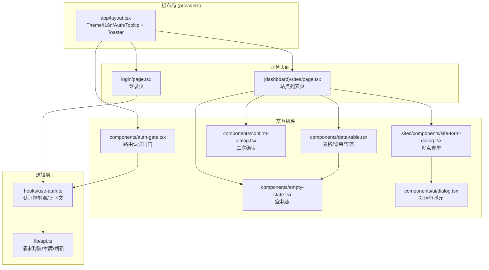
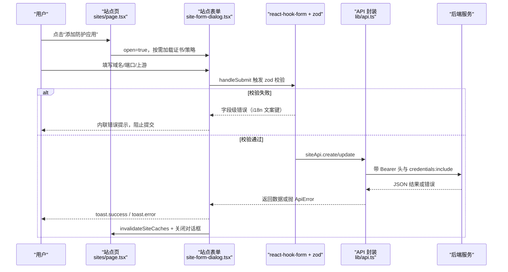
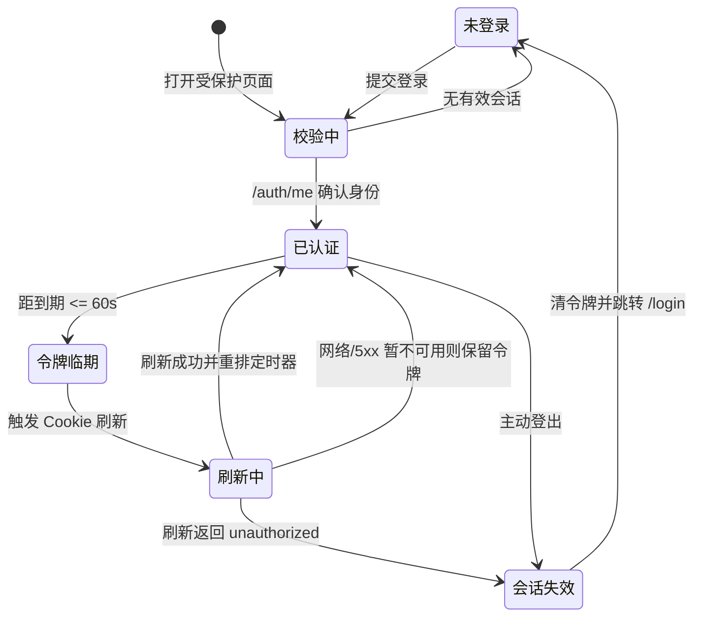
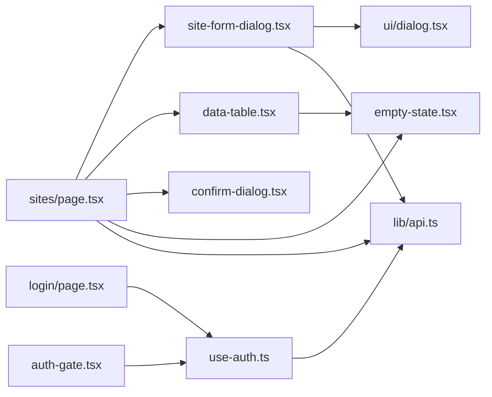

# 用户交互设计

> [返回 前端管理界面](前端管理界面.md)

<cite>
**本文档引用的文件**
- [frontend/app/layout.tsx](file://frontend/app/layout.tsx)
- [frontend/app/login/page.tsx](file://frontend/app/login/page.tsx)
- [frontend/lib/api.ts](file://frontend/lib/api.ts)
- [frontend/hooks/use-auth.ts](file://frontend/hooks/use-auth.ts)
- [frontend/components/auth-gate.tsx](file://frontend/components/auth-gate.tsx)
- [frontend/components/empty-state.tsx](file://frontend/components/empty-state.tsx)
- [frontend/components/confirm-dialog.tsx](file://frontend/components/confirm-dialog.tsx)
- [frontend/components/data-table.tsx](file://frontend/components/data-table.tsx)
- [frontend/components/ui/dialog.tsx](file://frontend/components/ui/dialog.tsx)
- [frontend/app/(dashboard)/sites/components/site-form-dialog.tsx](file://frontend/app/(dashboard)/sites/components/site-form-dialog.tsx)
- [frontend/app/(dashboard)/sites/page.tsx](file://frontend/app/(dashboard)/sites/page.tsx)
</cite>

## 目录

1. [简介](#简介)
2. [项目结构](#项目结构)
3. [核心组件](#核心组件)
4. [架构总览](#架构总览)
5. [详细组件分析](#详细组件分析)
6. [依赖关系分析](#依赖关系分析)
7. [性能考虑](#性能考虑)
8. [故障排查指南](#故障排查指南)
9. [结论](#结论)
10. [附录](#附录)

## 简介
本文件聚焦 My-OpenWaf 管理面板的用户交互设计，系统梳理前端在表单验证、错误处理、加载与空状态、成功反馈、认证会话生命周期、无障碍支持等方面的实现。分析基于站点管理页、登录页、通用交互组件与 API 客户端封装的真实代码，为开发者与产品人员理解现有交互体系、并在后续迭代中保持一致性提供参考。

交互能力遵循四条主线：客户端以 `react-hook-form` + `zod` 做即时校验，服务端错误由统一的 `ApiError` 承载并转成通知提示，加载与空态由 `DataTable` / `EmptyState` 统一呈现，会话状态由 `useAuth` 控制器与 `AuthGate` 路由闸门协同维护。

## 项目结构
前端采用 Next.js App Router 结构，且以静态导出（`output: "export"`）方式嵌入后端二进制。根布局 `app/layout.tsx` 不做字体注入，仅按 `ThemeProvider → I18nProvider → AuthProvider → TooltipProvider` 顺序包裹子树，并在末尾挂载 `Toaster`（位置 `top-center`）。业务页面位于 `app/(dashboard)` 下，通用交互组件位于 `components`，原子 UI 组件位于 `components/ui`，认证与请求逻辑封装在 `hooks` 与 `lib`。

**图表来源**
- [frontend/app/layout.tsx:14-27](file://frontend/app/layout.tsx#L14-L27)
- [frontend/app/(dashboard)/sites/page.tsx:1-43](file://frontend/app/(dashboard)/sites/page.tsx#L1-L43)
- [frontend/app/login/page.tsx:10-21](file://frontend/app/login/page.tsx#L10-L21)
- [frontend/components/auth-gate.tsx:15-44](file://frontend/components/auth-gate.tsx#L15-L44)
- [frontend/components/data-table.tsx:44-54](file://frontend/components/data-table.tsx#L44-L54)
- [frontend/components/empty-state.tsx:28-35](file://frontend/components/empty-state.tsx#L28-L35)
- [frontend/components/confirm-dialog.tsx:26-44](file://frontend/components/confirm-dialog.tsx#L26-L44)
- [frontend/components/ui/dialog.tsx:54-68](file://frontend/components/ui/dialog.tsx#L54-L68)
- [frontend/app/(dashboard)/sites/components/site-form-dialog.tsx:137-151](file://frontend/app/(dashboard)/sites/components/site-form-dialog.tsx#L137-L151)
- [frontend/hooks/use-auth.ts:87-295](file://frontend/hooks/use-auth.ts#L87-L295)
- [frontend/lib/api.ts:531-537](file://frontend/lib/api.ts#L531-L537)

**章节来源**
- [frontend/app/layout.tsx:1-29](file://frontend/app/layout.tsx#L1-L29)
- [frontend/app/(dashboard)/sites/page.tsx:1-43](file://frontend/app/(dashboard)/sites/page.tsx#L1-L43)

## 核心组件
下表按职责归类当前交互体系的核心组件，均为实读文件。需要说明的是：本仓库不存在 `CrudPage` / `crud-page.tsx` 一类的“万能 CRUD 抽象”，列表页由 `PageHeader` + `DataTable` + `TablePagination` + `ConfirmDialog` + `EmptyState` + `MetricTile` 组合式拼装而成。

| 组件 | 文件 | 职责 | 关键交互能力 |
|------|------|------|--------------|
| 根布局 | `app/layout.tsx` | Provider 编排与全局挂载 | Theme/I18n/Auth/Tooltip 嵌套、`Toaster` 通知出口 |
| 认证闸门 | `components/auth-gate.tsx` | 未确认会话前不渲染业务页 | 加载态占位、失效时 `router.replace("/login")` |
| 认证控制器 | `hooks/use-auth.ts` | 会话与令牌生命周期 | 定时预刷新、焦点/可见性/跨标签页事件同步 |
| 请求封装 | `lib/api.ts` | 统一 fetch 与错误模型 | Bearer 注入、401 自动刷新重试、`ApiError` 抛出 |
| 数据表格 | `components/data-table.tsx` | 列表三态渲染 | 骨架行、空态回落 `EmptyState`、行键盘激活 |
| 空状态 | `components/empty-state.tsx` | 无数据占位 | 图标 + 标题 + 描述 + 主/次操作位 |
| 二次确认 | `components/confirm-dialog.tsx` | 破坏性操作确认 | 封装 `AlertDialog`、`loading` 禁用双按钮 |
| 站点表单 | `sites/components/site-form-dialog.tsx` | 新增/编辑防护应用 | `react-hook-form` + `zod` 校验、提交反馈 |
| 对话框基元 | `components/ui/dialog.tsx` | Radix Dialog 封装 | 焦点管理、遮罩、`data-slot` 可访问性标记 |

**章节来源**
- [frontend/app/(dashboard)/sites/page.tsx:5-42](file://frontend/app/(dashboard)/sites/page.tsx#L5-L42)
- [frontend/components/data-table.tsx:44-110](file://frontend/components/data-table.tsx#L44-L110)
- [frontend/components/empty-state.tsx:15-35](file://frontend/components/empty-state.tsx#L15-L35)
- [frontend/components/confirm-dialog.tsx:15-68](file://frontend/components/confirm-dialog.tsx#L15-L68)
- [frontend/app/(dashboard)/sites/components/site-form-dialog.tsx:137-245](file://frontend/app/(dashboard)/sites/components/site-form-dialog.tsx#L137-L245)

## 架构总览
下图展示一次“打开表单 → 校验 → 提交 → 反馈 → 刷新”的端到端交互路径，覆盖客户端校验、统一请求封装与服务端结果回流。提交成功后的列表刷新并非重新拉取整表，而是通过 `invalidateSiteCaches` 触发 SWR 缓存失效。

**图表来源**
- [frontend/app/(dashboard)/sites/page.tsx:108-115](file://frontend/app/(dashboard)/sites/page.tsx#L108-L115)
- [frontend/app/(dashboard)/sites/components/site-form-dialog.tsx:148-245](file://frontend/app/(dashboard)/sites/components/site-form-dialog.tsx#L148-L245)
- [frontend/lib/api.ts:531-558](file://frontend/lib/api.ts#L531-L558)

## 详细组件分析

### 表单验证与实时反馈
- 客户端校验：站点表单以 `useForm({ resolver: zodResolver(siteFormSchema) })` 驱动。`siteFormSchema` 用 `zod` 声明必填与格式：域名解析后非空、端口必须是 1–65535 的数字串、上游列表至少一项且 scheme 必须命中允许集合，并用跨字段 `refine` 表达“启用 TLS 的监听必须绑定证书”。校验失败信息以 i18n 文案键（如 `sites.form.hostRequired`、`sites.form.portRange`）呈现，绑定到对应字段实现内联提示。
- 登录校验：登录页在提交前对用户名/密码做非空判断，任一为空即 `toast.error` 提示并 `return`，不发起请求。
- 提交态：`formState.isSubmitting` / `loading` 期间禁用提交按钮并切换文案，防止重复提交。
- 成功反馈：创建/更新成功后调用 `toast.success`，随后 `invalidateSiteCaches(savedSiteId)` 并 `onOpenChange(false)` 关闭对话框。

流程步骤如下表：

| 步序 | 交互动作 | 触发实现 | 反馈 |
|:----:|----------|----------|------|
| 1 | 打开表单对话框 | `setShowForm(true)`，`useCertificates(open)` 懒加载引用 | 对话框弹出 |
| 2 | 填写并失焦校验 | `react-hook-form` `register` + `zod` | 字段级内联错误 |
| 3 | 提交前拦截 | `handleSubmit(onSubmit)` | 校验不过则不发起请求 |
| 4 | 发起写请求 | `siteApi.create` / `.update`（POST） | 按钮禁用 + `isSubmitting` |
| 5 | 成功回流 | `toast.success` → `invalidateSiteCaches` → 关闭 | 列表缓存失效自动刷新 |
| 6 | 失败回流 | `catch` 中 `toast.error(err.message)` | 保留输入便于重试 |

**章节来源**
- [frontend/app/(dashboard)/sites/components/site-form-dialog.tsx:64-245](file://frontend/app/(dashboard)/sites/components/site-form-dialog.tsx#L64-L245)
- [frontend/app/login/page.tsx:32-48](file://frontend/app/login/page.tsx#L32-L48)

### 错误处理策略
`lib/api.ts` 的 `apiRequest` 是唯一错误出口：当 `!response.ok` 时抛出 `ApiError(status, data?.error ?? "请求失败: {status}", data)`。需要订正的是——它并未对 403/429/4xx 做前端硬编码分类映射，而是统一透传后端 `error` 文案，由调用方（`toast.error(err.message)`）呈现；唯一被特殊处理的是 401（见下节刷新流程）。空态兜底同样在组件层落实：`DataTable` 在 `data` 为空时回落 `EmptyState`，避免“空列表即崩溃”。破坏性操作通过 `ConfirmDialog` 二次确认，其“确认”按钮采用 `bg-destructive` 警示配色，`loading` 时同时禁用取消与确认并显示“处理中”。

**章节来源**
- [frontend/lib/api.ts:609-637](file://frontend/lib/api.ts#L609-L637)
- [frontend/components/data-table.tsx:99-110](file://frontend/components/data-table.tsx#L99-L110)
- [frontend/components/confirm-dialog.tsx:50-64](file://frontend/components/confirm-dialog.tsx#L50-L64)

### 认证会话与令牌刷新
会话生命周期由 `useAuthController` 管理：access token 存于 `localStorage`（键 `token` / `token_expires_at`），refresh token 为 HttpOnly Cookie（请求带 `credentials: "include"`）。控制器在到期前 60 秒（`REFRESH_LEAD_MS`）预约刷新，失败原因区分 `unauthorized`（清令牌、置空用户）与 `unavailable`（网络/5xx，保留令牌并 30 秒后重试），避免把一次故障误判为登出。`apiRequest` 在 401 时先比对跨标签页是否已轮换令牌再决定是否刷新；仅当刷新明确 `unauthorized` 才 `clearToken()` 并 `window.location.href = "/login"`。`AuthGate` 在确认前不挂载业务子树，渲染 `role="status" aria-live="polite"` 的加载态。

**图表来源**
- [frontend/lib/api.ts:562-607](file://frontend/lib/api.ts#L562-L607)
- [frontend/hooks/use-auth.ts:87-201](file://frontend/hooks/use-auth.ts#L87-L201)
- [frontend/hooks/use-auth.ts:225-286](file://frontend/hooks/use-auth.ts#L225-L286)
- [frontend/components/auth-gate.tsx:19-43](file://frontend/components/auth-gate.tsx#L19-L43)

**章节来源**
- [frontend/lib/api.ts:27-216](file://frontend/lib/api.ts#L27-L216)
- [frontend/hooks/use-auth.ts:203-223](file://frontend/hooks/use-auth.ts#L203-L223)
- [frontend/components/auth-gate.tsx:15-44](file://frontend/components/auth-gate.tsx#L15-L44)

### 加载与空状态体验
`DataTable` 将“加载中/空/有数据”收敛为单一组件三态：加载时保留真实表头并以 6 行 `Skeleton`（宽度循环 `w-4/5/w-3/5/...`）占位，避免数据到达时的列宽抖动；空数据回落 `EmptyState`（默认 `IconInbox` 图标），并允许调用方传入自定义 `emptyContent`。站点列表页额外用 `useSites` 的 `isLoading` / `error` 驱动骨架与 `Alert` 错误条，`MetricTile` 承载统计指标；视图偏好（表格/网格）通过 `useSyncExternalStore` + `localStorage` 键 `owaf.sites.view` 持久化，以规避静态导出的水合不一致。

**章节来源**
- [frontend/components/data-table.tsx:18-110](file://frontend/components/data-table.tsx#L18-L110)
- [frontend/components/empty-state.tsx:28-66](file://frontend/components/empty-state.tsx#L28-L66)
- [frontend/app/(dashboard)/sites/page.tsx:59-115](file://frontend/app/(dashboard)/sites/page.tsx#L59-L115)

### 交互模式设计
- 行级操作与键盘激活：`DataTable` 在传入 `onRowClick` 时给行设置 `tabIndex=0`、`aria-label`，并响应 `Enter`/`Space` 触发，使纯鼠标操作同时可键盘可达。
- 批量选择：列表通过 `Checkbox` 等原子控件提供行选择能力，批量动作可在页面工具栏扩展；当前站点页以行内启停（`useSiteStart` / `useSiteStop`）为主，未内置全局多选工具条。
- 拖拽排序：当前未见拖拽实现；若后续需要，建议引入受控列表与可回退的可视化拖拽，避免破坏既有键盘可达性。
- 角色可见性：`canManage = role === "admin" || role === "operator"` 作为交互门禁，只读角色不渲染写操作入口。

**章节来源**
- [frontend/components/data-table.tsx:133-166](file://frontend/components/data-table.tsx#L133-L166)
- [frontend/app/(dashboard)/sites/page.tsx:99-115](file://frontend/app/(dashboard)/sites/page.tsx#L99-L115)

### 无障碍访问支持
根布局与组件在可访问性上有明确落点：`AuthGate` 的占位区用 `role="status"` + `aria-live="polite"` 播报加载状态；`Dialog` 系列基元统一携带 `data-slot`（如 `dialog-content`、`dialog-overlay`）供辅助技术识别，并内置关闭按钮与焦点管理；`DataTable` 的行通过 `tabIndex` / `aria-label` 支持键盘聚焦。登录页字段使用 `<Label htmlFor>` 与 `autoComplete="username" / "current-password"`，提升读屏与密码管理器兼容。

**章节来源**
- [frontend/components/auth-gate.tsx:31-41](file://frontend/components/auth-gate.tsx#L31-L41)
- [frontend/components/ui/dialog.tsx:10-68](file://frontend/components/ui/dialog.tsx#L10-L68)
- [frontend/components/data-table.tsx:135-155](file://frontend/components/data-table.tsx#L135-L155)
- [frontend/app/login/page.tsx:64-88](file://frontend/app/login/page.tsx#L64-L88)

## 依赖关系分析
依赖自上而下分层：视图层（`sites/page.tsx`、`login/page.tsx`）→ 交互组件层（`site-form-dialog`、`DataTable`、`ConfirmDialog`、`EmptyState`、`ui/dialog`）→ 逻辑层（`use-auth`、`api.ts`）。`AuthGate` 依赖 `use-auth` 暴露的共享上下文，避免每个页面各建刷新定时器。`api.ts` 集中处理令牌存取、刷新与错误模型，页面与组件不直接触碰 `localStorage`。

**图表来源**
- [frontend/app/(dashboard)/sites/page.tsx:5-42](file://frontend/app/(dashboard)/sites/page.tsx#L5-L42)
- [frontend/app/(dashboard)/sites/components/site-form-dialog.tsx:15-42](file://frontend/app/(dashboard)/sites/components/site-form-dialog.tsx#L15-L42)
- [frontend/components/data-table.tsx:1-16](file://frontend/components/data-table.tsx#L1-L16)
- [frontend/components/auth-gate.tsx:5-7](file://frontend/components/auth-gate.tsx#L5-L7)
- [frontend/hooks/use-auth.ts:11-22](file://frontend/hooks/use-auth.ts#L11-L22)

**章节来源**
- [frontend/app/layout.tsx:1-7](file://frontend/app/layout.tsx#L1-L7)
- [frontend/lib/api.ts:27-35](file://frontend/lib/api.ts#L27-L35)

## 性能考虑
- 懒加载引用数据：证书/策略下拉仅在对话框 `open` 时请求，减少页面初始网络量。
- 缓存失效优于整表重拉：写操作后按 `invalidateSiteCaches` 精确失效相关 SWR 键。
- 认证请求去重：同一 access token 的 `/auth/me` 只保留一个在途 Promise，多页面共享。
- 骨架代替空白：`DataTable` 加载态保留真实表头，降低布局抖动与感知延迟。

[本节为总结，无需特定文件来源]

## 故障排查指南
| 症状 | 可能成因 | 排查方向 |
|------|----------|----------|
| 登录后立刻被弹回 /login | `AuthGate` 判定会话未确认 | 看 `/auth/me` 是否 401；区分 `unauthorized` 与 `unavailable` |
| 提交按钮点击无反应 | `zod` 校验未通过被拦截 | 检查字段级错误文案键与 `errors` 渲染 |
| 保存成功但列表未刷新 | 未触发缓存失效 | 确认 `invalidateSiteCaches` 是否执行 |
| 列表长期停在骨架 | `useSites` 处于 `isLoading`/`error` | 看网络请求状态码与后端返回 `error` |
| 删除无二次确认 | 未走 `ConfirmDialog` | 核对 `loading` 态是否禁用导致误以为无效 |

**章节来源**
- [frontend/components/auth-gate.tsx:19-29](file://frontend/components/auth-gate.tsx#L19-L29)
- [frontend/lib/api.ts:562-607](file://frontend/lib/api.ts#L562-L607)
- [frontend/app/(dashboard)/sites/page.tsx:112-130](file://frontend/app/(dashboard)/sites/page.tsx#L112-L130)
- [frontend/components/confirm-dialog.tsx:26-64](file://frontend/components/confirm-dialog.tsx#L26-L64)

## 结论
该交互体系以 `react-hook-form` + `zod` 的客户端校验、`api.ts` 的统一 `ApiError` 模型、`DataTable`/`EmptyState`/`ConfirmDialog` 的组合式反馈，以及 `useAuth`/`AuthGate` 的会话生命周期协同为核心，覆盖了验证、错误、加载、空态、成功提示与无障碍等关键面。相比引入通用 CRUD 巨石抽象，本仓库坚持“按场景组合原子组件”的路线，更易维护也更贴合静态导出约束。后续可在全局批量选择与拖拽排序上增强，同时保持既有的键盘可达性不回退。

## 附录

### 交互术语表
| 术语 | 含义 | 出处 |
|------|------|------|
| 内联错误 | 字段级校验失败提示（非全局 toast） | `site-form-dialog.tsx` zod + `errors` |
| toast 反馈 | `sonner` 全局通知（成功/失败） | `login/page.tsx`、`site-form-dialog.tsx` |
| 缓存失效 | SWR 键失效触发列表刷新 | `invalidateSiteCaches` |
| 预刷新 | 到期前 60s 主动换发 access token | `use-auth.ts` `REFRESH_LEAD_MS` |
| 暂时不可用 | 网络/5xx 不判定为登出的刷新结果 | `api.ts` `refresh_status: unavailable` |
| 路由闸门 | 会话确认前不渲染业务页 | `auth-gate.tsx` |

**章节来源**
- [frontend/hooks/use-auth.ts:69-148](file://frontend/hooks/use-auth.ts#L69-L148)
- [frontend/lib/api.ts:577-604](file://frontend/lib/api.ts#L577-L604)

### 最佳实践清单
- 表单：必填项即时校验，错误文案走 i18n 键；提交期禁用按钮并显示加载态。
- 错误：统一由 `ApiError` 承载后端 `error`，`toast` 呈现，避免页面各自映射状态码。
- 反馈：成功与失败均给明确提示；写操作后用缓存失效而非全量重拉。
- 可访问性：交互元素提供键盘可达与读屏标签；破坏性操作二次确认。
- 性能：引用数据按需加载、骨架屏降抖、认证请求去重。

[本节为总结，无需特定文件来源]
