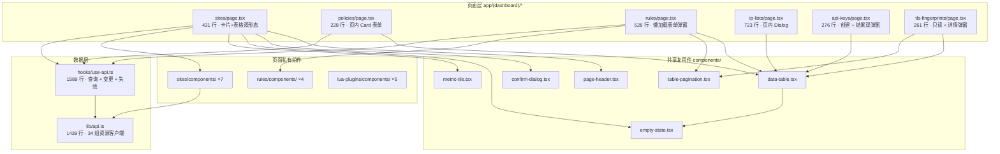
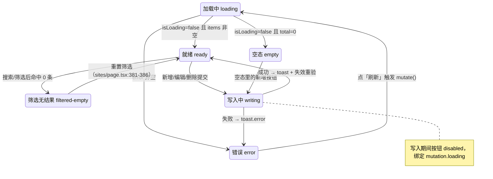
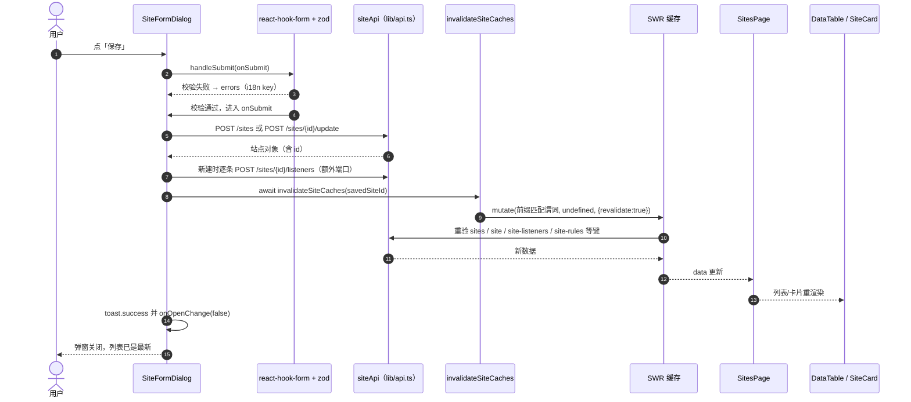
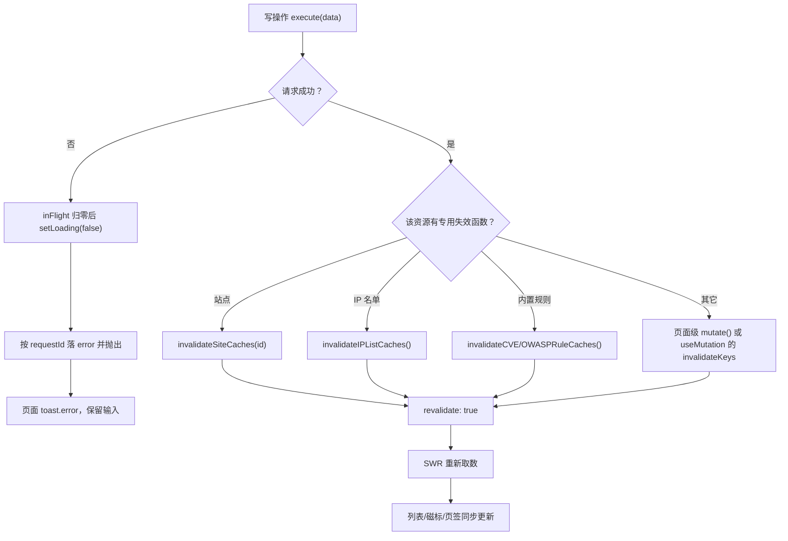
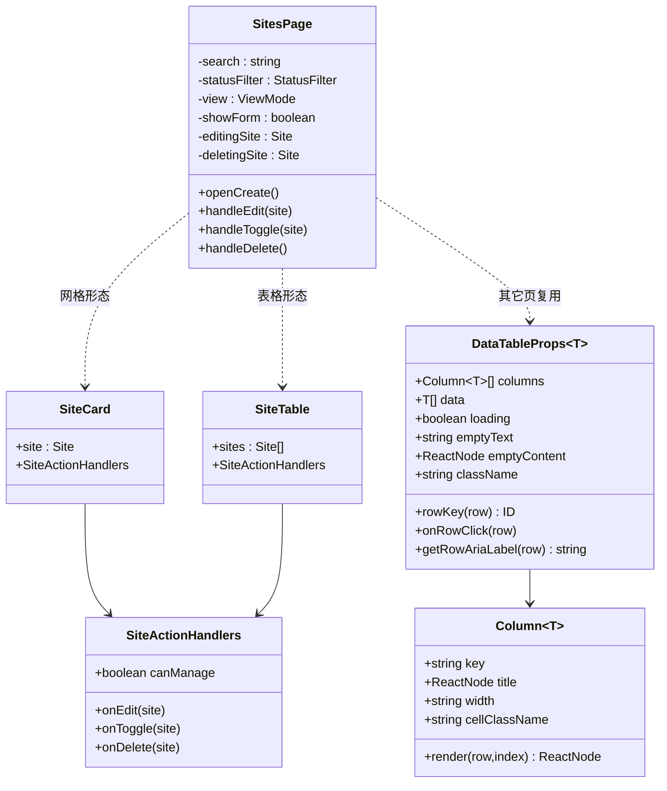
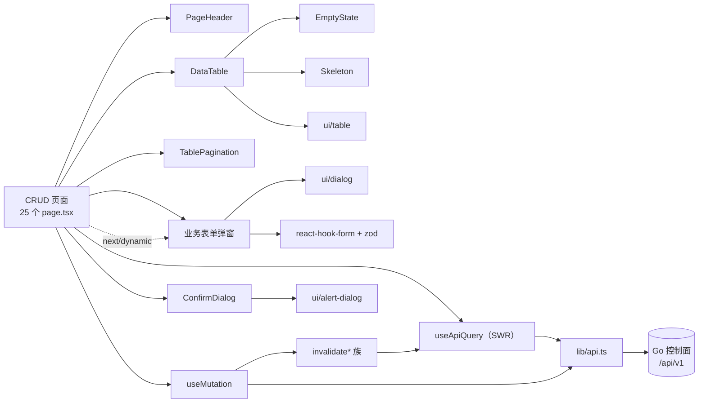

# CRUD 页面组件

> [返回 前端管理界面](../前端管理界面.md)

<cite>
**本文档引用的文件**
- [frontend/app/(dashboard)/sites/page.tsx](file://frontend/app/(dashboard)/sites/page.tsx)
- [frontend/app/(dashboard)/sites/detail/page.tsx](file://frontend/app/(dashboard)/sites/detail/page.tsx)
- [frontend/app/(dashboard)/sites/components/site-form-dialog.tsx](file://frontend/app/(dashboard)/sites/components/site-form-dialog.tsx)
- [frontend/app/(dashboard)/sites/components/site-card.tsx](file://frontend/app/(dashboard)/sites/components/site-card.tsx)
- [frontend/app/(dashboard)/sites/components/site-table.tsx](file://frontend/app/(dashboard)/sites/components/site-table.tsx)
- [frontend/app/(dashboard)/sites/components/site-presentation.tsx](file://frontend/app/(dashboard)/sites/components/site-presentation.tsx)
- [frontend/app/(dashboard)/sites/detail/components/listeners-tab.tsx](file://frontend/app/(dashboard)/sites/detail/components/listeners-tab.tsx)
- [frontend/app/(dashboard)/sites/detail/components/access-control-tab.tsx](file://frontend/app/(dashboard)/sites/detail/components/access-control-tab.tsx)
- [frontend/app/(dashboard)/policies/page.tsx](file://frontend/app/(dashboard)/policies/page.tsx)
- [frontend/app/(dashboard)/rules/page.tsx](file://frontend/app/(dashboard)/rules/page.tsx)
- [frontend/app/(dashboard)/rules/cve/page.tsx](file://frontend/app/(dashboard)/rules/cve/page.tsx)
- [frontend/app/(dashboard)/rules/owasp/page.tsx](file://frontend/app/(dashboard)/rules/owasp/page.tsx)
- [frontend/app/(dashboard)/rules/components/rule-form-dialog.tsx](file://frontend/app/(dashboard)/rules/components/rule-form-dialog.tsx)
- [frontend/app/(dashboard)/ip-lists/page.tsx](file://frontend/app/(dashboard)/ip-lists/page.tsx)
- [frontend/app/(dashboard)/api-keys/page.tsx](file://frontend/app/(dashboard)/api-keys/page.tsx)
- [frontend/app/(dashboard)/admin-users/page.tsx](file://frontend/app/(dashboard)/admin-users/page.tsx)
- [frontend/app/(dashboard)/certificates/page.tsx](file://frontend/app/(dashboard)/certificates/page.tsx)
- [frontend/app/(dashboard)/threat-intel/page.tsx](file://frontend/app/(dashboard)/threat-intel/page.tsx)
- [frontend/app/(dashboard)/tls-fingerprints/page.tsx](file://frontend/app/(dashboard)/tls-fingerprints/page.tsx)
- [frontend/app/(dashboard)/lua-plugins/page.tsx](file://frontend/app/(dashboard)/lua-plugins/page.tsx)
- [frontend/app/(dashboard)/lua-plugins/components/plugin-editor-dialog.tsx](file://frontend/app/(dashboard)/lua-plugins/components/plugin-editor-dialog.tsx)
- [frontend/app/(dashboard)/js-plugins/page.tsx](file://frontend/app/(dashboard)/js-plugins/page.tsx)
- [frontend/components/data-table.tsx](file://frontend/components/data-table.tsx)
- [frontend/components/table-pagination.tsx](file://frontend/components/table-pagination.tsx)
- [frontend/components/page-header.tsx](file://frontend/components/page-header.tsx)
- [frontend/components/empty-state.tsx](file://frontend/components/empty-state.tsx)
- [frontend/components/confirm-dialog.tsx](file://frontend/components/confirm-dialog.tsx)
- [frontend/components/metric-tile.tsx](file://frontend/components/metric-tile.tsx)
- [frontend/lib/api.ts](file://frontend/lib/api.ts)
- [frontend/lib/utils.ts](file://frontend/lib/utils.ts)
- [frontend/hooks/use-api.ts](file://frontend/hooks/use-api.ts)
- [frontend/hooks/use-auth.ts](file://frontend/hooks/use-auth.ts)
- [frontend/components/certificate-parse-panel.tsx](file://frontend/components/certificate-parse-panel.tsx)
- [frontend/components/appearance-toggle.tsx](file://frontend/components/appearance-toggle.tsx)
- [frontend/app/(dashboard)/layout.tsx](file://frontend/app/(dashboard)/layout.tsx)
- [frontend/next.config.ts](file://frontend/next.config.ts)
</cite>

## 目录

1. [简介](#简介)
2. [项目结构](#项目结构)
3. [核心组件](#核心组件)
4. [架构总览](#架构总览)
5. [详细组件分析](#详细组件分析)
6. [依赖关系分析](#依赖关系分析)
7. [性能考虑](#性能考虑)
8. [故障排查指南](#故障排查指南)
9. [结论](#结论)
10. [附录](#附录)

## 简介
本指南讲解 My-OpenWaf 前端如何组织「增删改查」页面。

首先必须纠正旧稿的两处失真，否则会按不存在的 API 去写代码：

| 旧稿说法 | 实测事实 |
|----------|----------|
| 存在通用组件 `CrudPage`，位于 `frontend/components/crud-page.tsx`，由 `FieldDef[]` 驱动渲染 | **该文件与该组件不存在**。`components/` 下 34 个业务组件中无 `crud-page.tsx`，全库无 `FieldDef` 符号 |
| 存在 `ConsoleShell` 组件（提供 `PageIntro`/`Surface`/`EmptyState`），位于 `frontend/components/console-shell.tsx` | **不存在**。`EmptyState` 是独立文件 `components/empty-state.tsx`；页头是 `components/page-header.tsx` 的 `PageHeader` |

真实做法是**组合式 CRUD**：一组职责单一的复用件（`PageHeader` + `DataTable` + `TablePagination` + `ConfirmDialog` + `EmptyState` + `MetricTile`）在页面内拼装，表单载体由业务复杂度决定（页内 Card 表单、页内 `Dialog`、或独立的 `*-dialog.tsx`），写链路统一由 `hooks/use-api.ts` 的 mutation Hook + 前缀失效函数承担。本文件描述的就是这套组合模式，并给出 5 种页面形态的实测对照。

## 项目结构
CRUD 相关代码分布在三层：页面目录、共享复用件、数据层。

**图表来源**
- [frontend/app/(dashboard)/sites/page.tsx:1-60](file://frontend/app/(dashboard)/sites/page.tsx#L1-L60)
- [frontend/app/(dashboard)/policies/page.tsx:12-28](file://frontend/app/(dashboard)/policies/page.tsx#L12-L28)
- [frontend/app/(dashboard)/rules/page.tsx:6-36](file://frontend/app/(dashboard)/rules/page.tsx#L6-L36)
- [frontend/app/(dashboard)/ip-lists/page.tsx:6-33](file://frontend/app/(dashboard)/ip-lists/page.tsx#L6-L33)
- [frontend/app/(dashboard)/api-keys/page.tsx:6-24](file://frontend/app/(dashboard)/api-keys/page.tsx#L6-L24)
- [frontend/app/(dashboard)/tls-fingerprints/page.tsx:1-22](file://frontend/app/(dashboard)/tls-fingerprints/page.tsx#L1-L22)
- [frontend/hooks/use-api.ts:156-165](file://frontend/hooks/use-api.ts#L156-L165)
- [frontend/lib/api.ts:746-812](file://frontend/lib/api.ts#L746-L812)

### CRUD 页面结构表
一个标准 CRUD 页面的六个区块及其实现归属，取 `sites/page.tsx` 与 `rules/page.tsx` 为参照：

| 区块 | 实现文件 | 数据来源端点 | 交互 |
|------|----------|--------------|------|
| 页头 | `components/page-header.tsx:34` | — | 标题、描述、`titleExtra` 总数 Badge、右侧「新增」按钮 |
| 指标区 | `components/metric-tile.tsx` | `GET /api/v1/{resource}` 的当前页聚合 | 只读；`isPartialScope` 时切换口径文案（`sites/page.tsx:130`） |
| 工具栏 | 页面内联（`sites/page.tsx:282-345`） | — | 搜索（`Input`）、状态筛选（`ToggleGroup`）、视图切换、策略过滤（`rules/page.tsx`） |
| 列表 | `components/data-table.tsx:44` 或域内私有件（`SiteTable`/`SiteCard`） | `GET /api/v1/{resource}?page=&page_size=` | 列渲染、行点击、骨架屏、空状态 |
| 分页 | `components/table-pagination.tsx:57` | 同一 `GET` 的 `total` | 页码切换；`totalPages<=1` 时整体不渲染（`:71`） |
| 写操作 | 页内 Card / 页内 `Dialog` / 独立 `*-dialog.tsx` | `POST /{resource}`、`POST /{id}/update`、`POST /{id}/delete` | 校验 → 提交 → `toast` → 失效重验 |

**章节来源**
- [frontend/app/(dashboard)/sites/page.tsx:198-429](file://frontend/app/(dashboard)/sites/page.tsx#L198-L429)
- [frontend/app/(dashboard)/rules/page.tsx:1-60](file://frontend/app/(dashboard)/rules/page.tsx#L1-L60)
- [frontend/components/page-header.tsx:20-60](file://frontend/components/page-header.tsx#L20-L60)
- [frontend/components/data-table.tsx:24-54](file://frontend/components/data-table.tsx#L24-L54)
- [frontend/components/table-pagination.tsx:57-125](file://frontend/components/table-pagination.tsx#L57-L125)

## 核心组件
被页面复用的 6 个件，引用面为全库实测统计（含 `app/(dashboard)` 下的页面与页签组件）。

| 件 | 文件:行 | 职责 | 引用处数 | 关键 props |
|----|---------|------|:---:|------------|
| `PageHeader` | `page-header.tsx:34` | 页头与主操作位 | 26 | `title`、`description?`、`icon?`、`titleExtra?`、`actions?` |
| `DataTable` | `data-table.tsx:44` | 列驱动表格 + 骨架 + 空态 | 20 | `columns`、`data`、`loading?`、`rowKey?`、`emptyText?`、`onRowClick?` |
| `TablePagination` | `table-pagination.tsx:57` | 服务端分页条 | 10 | `page`、`pageSize`、`total`、`disabled?`、`onPageChange` |
| `ConfirmDialog` | `confirm-dialog.tsx:26` | 危险动作二次确认 | 14 | `open`、`onOpenChange`、`onConfirm`、`loading?`、文案四项 |
| `EmptyState` | `empty-state.tsx:27` | 无数据占位 | 7（含 `DataTable` 内部） | `icon?`、`title`、`description?`、`action?`、`secondaryAction?` |
| `MetricTile` | `metric-tile.tsx` | 指标磁贴 | 站点/仪表板等 | `title`、`value`、`rawValue?`、`icon?`、`tone?`、`description?` |

`DataTable` 的列契约是最小充分设计：`Column<T>` 只有 `key`、`title`、`width`、`cellClassName`、`render` 五个字段（`data-table.tsx:24-30`），`render` 缺省时按 `row[col.key]` 直接取值（`:160`）。这意味着**表格不关心后端字段形态**，页面只需给出正确的 `key` 或 `render`。

**章节来源**
- [frontend/components/page-header.tsx:20-60](file://frontend/components/page-header.tsx#L20-L60)
- [frontend/components/data-table.tsx:24-169](file://frontend/components/data-table.tsx#L24-L169)
- [frontend/components/table-pagination.tsx:17-125](file://frontend/components/table-pagination.tsx#L17-L125)
- [frontend/components/confirm-dialog.tsx:15-68](file://frontend/components/confirm-dialog.tsx#L15-L68)
- [frontend/components/empty-state.tsx:14-40](file://frontend/components/empty-state.tsx#L14-L40)
- [frontend/components/metric-tile.tsx:13-45](file://frontend/components/metric-tile.tsx#L13-L45)

## 架构总览
页面生命周期可建模为 5 个状态，所有 CRUD 页都走这条链：

**图表来源**
- [frontend/app/(dashboard)/sites/page.tsx:348-408](file://frontend/app/(dashboard)/sites/page.tsx#L348-L408)
- [frontend/components/data-table.tsx:57-110](file://frontend/components/data-table.tsx#L57-L110)
- [frontend/app/(dashboard)/policies/page.tsx:154-184](file://frontend/app/(dashboard)/policies/page.tsx#L154-L184)

`loading`/`empty`/`error` 三态在各页面的落地位置：

| 态 | 渲染件 | 实例位置 |
|----|--------|----------|
| 表格骨架 | `DataTable` 内部（`SKELETON_ROWS = 6`、5 种宽度循环） | `data-table.tsx:19-22`、`:57-97` |
| 卡片骨架 | 页面手写 `Skeleton` 网格 | `sites/page.tsx:349-357` |
| 真骨架（保留表头） | `DataTable` 加载态仍渲染真实 `TableHead` | `data-table.tsx:66-75` |
| 全局空态 | `EmptyState` | `sites/page.tsx:358-372`、`certificates/page.tsx` |
| 筛选空态 | `EmptyState` + 重置按钮 | `sites/page.tsx:373-390` |
| 错误 | `Alert variant="destructive"` + `error.pageLoadFailed` | `sites/page.tsx:224-231`、`policies/page.tsx:177-184` |
| 只读提示 | `Alert` + `common.readOnlyHint` | `sites/page.tsx:218-222`、`policies/page.tsx:171-175` |

**章节来源**
- [frontend/components/data-table.tsx:19-110](file://frontend/components/data-table.tsx#L19-L110)
- [frontend/app/(dashboard)/sites/page.tsx:218-231](file://frontend/app/(dashboard)/sites/page.tsx#L218-L231)
- [frontend/app/(dashboard)/sites/page.tsx:348-408](file://frontend/app/(dashboard)/sites/page.tsx#L348-L408)
- [frontend/app/(dashboard)/policies/page.tsx:171-184](file://frontend/app/(dashboard)/policies/page.tsx#L171-L184)

## 详细组件分析

### 五种页面形态（实测对照）
本仓库不存在单一 CRUD 模板，而是按「资源字段多少 + 是否需要详情」分化为 5 种形态：

| 形态 | 代表页 | 新建载体 | 编辑载体 | 删除确认 | 分页 | 详情 |
|------|--------|----------|----------|:---:|:---:|------|
| A 极简：页内表单 | `policies/page.tsx`（228 行） | `Card` 内 `Input`+`Textarea`（`:186-217`） | 无（仅改名/描述，走内联） | 无（`is_default` 拦截） | 无 | 无 |
| B 页内弹窗 | `ip-lists/page.tsx`（723 行）、`admin-users/page.tsx`（427 行）、`api-keys/page.tsx`（276 行）、`tls-fingerprints/page.tsx`（261 行）、`threat-intel/page.tsx`（910 行） | 页面内 `Dialog` | 同一 `Dialog` 复用 | `ConfirmDialog` | 部分（`tls-fingerprints`、`threat-intel` 有） | 详情弹窗 |
| C 独立表单弹窗 | `sites/page.tsx`（431 行）、`rules/page.tsx`（528 行）、`lua-plugins/page.tsx`（362 行）、`js-plugins/page.tsx`（483 行） | 专属 `*-dialog.tsx` | 同弹窗带 `site`/`rule`/`editing` | `ConfirmDialog` | `rules` 有，`sites` 无（固定 50） | `sites` 有详情页 |
| D 双视图列表 | `sites/page.tsx` | 同上 | 同上 | 同上 | 无 | `SiteCard` / `SiteTable` 由 `ToggleGroup` 切换并持久化 |
| E 页签内 CRUD | `sites/detail/components/listeners-tab.tsx`（310 行）、`access-control-tab.tsx`（590 行） | 页内 `ListenerDialog` 或按需挂载的专属弹窗 | 同上 | `ConfirmDialog` | 无（域内小表） | 无 |

判定标准很直接：字段 ≤3 个用 A；字段 4–8 且无跨字段校验用 B；有 zod schema、字段数组（`useFieldArray`）或需拉引用数据用 C；同批数据需要两种呈现密度用 D；子资源（监听器、ACL 用户）用 E。

**章节来源**
- [frontend/app/(dashboard)/policies/page.tsx:30-228](file://frontend/app/(dashboard)/policies/page.tsx#L30-L228)
- [frontend/app/(dashboard)/ip-lists/page.tsx:1-40](file://frontend/app/(dashboard)/ip-lists/page.tsx#L1-L40)
- [frontend/app/(dashboard)/admin-users/page.tsx:1-34](file://frontend/app/(dashboard)/admin-users/page.tsx#L1-L34)
- [frontend/app/(dashboard)/api-keys/page.tsx:27-60](file://frontend/app/(dashboard)/api-keys/page.tsx#L27-L60)
- [frontend/app/(dashboard)/tls-fingerprints/page.tsx:50-80](file://frontend/app/(dashboard)/tls-fingerprints/page.tsx#L50-L80)
- [frontend/app/(dashboard)/threat-intel/page.tsx:99-140](file://frontend/app/(dashboard)/threat-intel/page.tsx#L99-L140)
- [frontend/app/(dashboard)/sites/page.tsx:97-431](file://frontend/app/(dashboard)/sites/page.tsx#L97-L431)
- [frontend/app/(dashboard)/rules/page.tsx:1-40](file://frontend/app/(dashboard)/rules/page.tsx#L1-L40)
- [frontend/app/(dashboard)/lua-plugins/page.tsx:1-60](file://frontend/app/(dashboard)/lua-plugins/page.tsx#L1-L60)
- [frontend/app/(dashboard)/sites/detail/components/listeners-tab.tsx:35-110](file://frontend/app/(dashboard)/sites/detail/components/listeners-tab.tsx#L35-L110)
- [frontend/app/(dashboard)/sites/detail/components/access-control-tab.tsx:74-76](file://frontend/app/(dashboard)/sites/detail/components/access-control-tab.tsx#L74-L76)

### 写链路：表单 → API → 缓存失效 → 列表更新
这是本套模式最关键的一条链，也是旧稿唯一方向正确但细节全错的部分（旧稿写的是 `POST`/`PUT` 并假设存在 `load()` 方法）。真实链路如下，以 `SiteFormDialog` 为准：

**图表来源**
- [frontend/app/(dashboard)/sites/components/site-form-dialog.tsx:148-245](file://frontend/app/(dashboard)/sites/components/site-form-dialog.tsx#L148-L245)
- [frontend/hooks/use-api.ts:200-237](file://frontend/hooks/use-api.ts#L200-L237)
- [frontend/lib/api.ts:746-812](file://frontend/lib/api.ts#L746-L812)
- [frontend/app/(dashboard)/sites/page.tsx:112-120](file://frontend/app/(dashboard)/sites/page.tsx#L112-L120)
- [frontend/components/data-table.tsx:112-166](file://frontend/components/data-table.tsx#L112-L166)

**章节来源**
- [frontend/app/(dashboard)/sites/components/site-form-dialog.tsx:148-245](file://frontend/app/(dashboard)/sites/components/site-form-dialog.tsx#L148-L245)
- [frontend/hooks/use-api.ts:200-237](file://frontend/hooks/use-api.ts#L200-L237)
- [frontend/lib/api.ts:746-812](file://frontend/lib/api.ts#L746-L812)

### 失效函数与命中前缀
`hooks/use-api.ts` 提供 5 个具名失效函数，全部通过 SWR 的 `mutate(谓词, undefined, { revalidate: true })` 实现（`revalidatePrefixes:180-188`）。

| 函数 | 位置 | 命中前缀 | 触发时机 |
|------|------|----------|----------|
| `invalidateSiteCaches(id?)` | `:200-237` | `sites`、`sites-all`、`site`、`site-listeners`、`site-rules`、`site-recorded-resources`、`site-stats`、`site-timeline`、`site-access-stats`、`site-error-pages` | 站点/监听器任意写操作后；带 `id` 时按第二段精确匹配 |
| `invalidateIPListCaches()` | `:196-198` | `ip-lists` | 批量写入完成后整批调用一次 |
| `invalidateCVERuleCaches()` | `:240-242` | `cve-rules`、`cve-stats` | CVE 规则写后 |
| `invalidateOWASPRuleCaches()` | `:245-247` | `owasp-rules`、`owasp-stats` | OWASP 规则覆盖写后 |
| `invalidateAllAPICaches()` | `:191-193` | 全部（`mutate(() => true)`） | 备份恢复替换多类配置时 |

另有通用出口：`useMutation(fn, { invalidateKeys })`（`:252-297`）在成功后对 `invalidateKeys` 逐个前缀重验，失败不影响主流程（`.catch(() => undefined)`）。

**图表来源**
- [frontend/hooks/use-api.ts:180-247](file://frontend/hooks/use-api.ts#L180-L247)
- [frontend/hooks/use-api.ts:252-297](file://frontend/hooks/use-api.ts#L252-L297)
- [frontend/app/(dashboard)/policies/page.tsx:41-91](file://frontend/app/(dashboard)/policies/page.tsx#L41-L91)
- [frontend/app/(dashboard)/sites/detail/components/listeners-tab.tsx:29-45](file://frontend/app/(dashboard)/sites/detail/components/listeners-tab.tsx#L29-L45)

**章节来源**
- [frontend/hooks/use-api.ts:150-297](file://frontend/hooks/use-api.ts#L150-L297)
- [frontend/app/(dashboard)/sites/components/site-form-dialog.tsx:203-245](file://frontend/app/(dashboard)/sites/components/site-form-dialog.tsx#L203-L245)
- [frontend/app/(dashboard)/sites/detail/components/listeners-tab.tsx:60-64](file://frontend/app/(dashboard)/sites/detail/components/listeners-tab.tsx#L60-L64)
- [frontend/app/(dashboard)/policies/page.tsx:41-91](file://frontend/app/(dashboard)/policies/page.tsx#L41-L91)

### 端点动词表：写操作只有 POST
后端控制面没有 `PUT`/`DELETE` 端点，前端资源客户端因此一律用 POST 表达写语义，动词放在路径段里。实测 8 组资源的对照：

| 资源 | list | get | create | update | delete | 其他动词 |
|------|------|-----|--------|--------|--------|----------|
| 站点 `siteApi:746` | `GET /sites` | `GET /sites/{id}` | `POST /sites` | `POST /sites/{id}/update` | `POST /sites/{id}/delete` | `/start`、`/stop`、`/status` |
| 监听器（嵌在 `siteApi`） | `GET /sites/{id}/listeners` | — | `POST /sites/{id}/listeners` | `POST /sites/{id}/listeners/{lid}/update` | `POST /sites/{id}/listeners/{lid}/delete` | — |
| 证书 `certificateApi:817` | `GET /certificates` | `GET /certificates/{id}` | `POST /certificates` | `POST /certificates/{id}/update` | `POST /certificates/{id}/delete` | `/parse`、`/apply-to-sites`、`/acme/*` |
| 规则 `ruleApi:843` | `GET /rules` | `GET /rules/{id}` | `POST /rules` | `POST /rules/{id}/update` | `POST /rules/{id}/delete` | `/test`、`/validate`、`/import`、`/export`、`/templates` |
| 策略 `policyApi:862` | `GET /policies` | `GET /policies/{id}` | `POST /policies` | `POST /policies/{id}/update` | `POST /policies/{id}/delete` | `/default`、`/{id}/set-default` |
| IP 名单 `ipListApi:897` | `GET /ip-lists` | `GET /ip-lists/{id}` | `POST /ip-lists` | `POST /ip-lists/{id}/update` | `POST /ip-lists/{id}/delete` | — |
| API 密钥 `apiKeyApi:1111` | `GET /api-keys` | — | `POST /api-keys` | — | `POST /api-keys/{id}/delete` | 无更新（密钥不可改） |
| 管理员 `adminUserApi:1122` | `GET /admin-users` | — | `POST /admin-users` | `POST /{id}/update-role`、`/update-password` | `POST /{id}/delete` | 拆成两个专用更新端点 |
| Lua 插件 `luaPluginApi:1318` | `GET /lua-plugins` | `GET /lua-plugins/{id}` | `POST /lua-plugins` | `POST /lua-plugins/{id}/update` | `POST /lua-plugins/{id}/delete` | `/toggle`、`/validate`、`/dry-run`、`/stats` |

两点必须注意：
1. 请求体字段一律 **snake_case**（如 `upstream_urls`、`tls_enabled`、`cert_id`、`page_size`），见 `site-form-dialog.tsx:206-217` 与 `api.ts` 各签名。
2. 分页参数为 `page` + `page_size`；引用型列表在客户端用 `REFERENCE_PAGE_SIZE = 200`、`MAX_REFERENCE_PAGES = 10` 翻页取全（`use-api.ts:95-96`、`getReferencePages:118-138`）。

**章节来源**
- [frontend/lib/api.ts:746-812](file://frontend/lib/api.ts#L746-L812)
- [frontend/lib/api.ts:817-838](file://frontend/lib/api.ts#L817-L838)
- [frontend/lib/api.ts:843-873](file://frontend/lib/api.ts#L843-L873)
- [frontend/lib/api.ts:897-908](file://frontend/lib/api.ts#L897-L908)
- [frontend/lib/api.ts:1111-1132](file://frontend/lib/api.ts#L1111-L1132)
- [frontend/lib/api.ts:1318-1336](file://frontend/lib/api.ts#L1318-L1336)
- [frontend/hooks/use-api.ts:90-151](file://frontend/hooks/use-api.ts#L90-L151)
- [frontend/app/(dashboard)/sites/components/site-form-dialog.tsx:203-220](file://frontend/app/(dashboard)/sites/components/site-form-dialog.tsx#L203-L220)

### 权限与只读：双层拦截
`canManage` 是每个 CRUD 页的第一道闸，但它**只隐藏入口不够**，处理器里还会再判一次：

| 层 | 做法 | 实例 |
|----|------|------|
| 渲染层 | 新增按钮与弹窗整体包在 `canManage ? … : undefined` | `sites/page.tsx:209-215`、`:410-428` |
| 处理器层 | 函数首行 `if (!canManage) return` | `sites/page.tsx:153`、`:165`、`:180`；`policies/page.tsx:42`、`:64`、`:77` |
| 控件层 | `disabled={!canManage}` | `policies/page.tsx:196`、`:205`、`:211`；`cc-rules-editor.tsx:144-148` 的 `disabled` prop |
| 提示层 | `!authLoading && !canManage` 时显示只读 `Alert` | `sites/page.tsx:218-222`、`policies/page.tsx:171-175` |
| 角色门槛 | `api-keys` 与 `admin-users` 仅 `admin` | `api-keys/page.tsx:34` 与 `admin-users/page.tsx:59`（`user?.role === "admin"`），比 `canManage` 更严 |

`canManage` 的定义在 4 个页面完全一致：`user?.role === "admin" || user?.role === "operator"`（`sites/page.tsx:100`、`sites/detail/page.tsx:76`、`rules/page.tsx:82`、`policies/page.tsx:33`），角色来自 `useAuth()`（`hooks/use-auth.ts:303-309`），由 `AuthProvider` 在根布局一次性提供（`app/layout.tsx`）。

**章节来源**
- [frontend/app/(dashboard)/sites/page.tsx:99-100](file://frontend/app/(dashboard)/sites/page.tsx#L99-L100)
- [frontend/app/(dashboard)/sites/page.tsx:152-196](file://frontend/app/(dashboard)/sites/page.tsx#L152-L196)
- [frontend/app/(dashboard)/sites/page.tsx:209-222](file://frontend/app/(dashboard)/sites/page.tsx#L209-L222)
- [frontend/app/(dashboard)/policies/page.tsx:32-33](file://frontend/app/(dashboard)/policies/page.tsx#L32-L33)
- [frontend/app/(dashboard)/policies/page.tsx:41-91](file://frontend/app/(dashboard)/policies/page.tsx#L41-L91)
- [frontend/app/(dashboard)/api-keys/page.tsx:31-37](file://frontend/app/(dashboard)/api-keys/page.tsx#L31-L37)
- [frontend/hooks/use-auth.ts:300-309](file://frontend/hooks/use-auth.ts#L300-L309)
- [frontend/components/cc-rules-editor.tsx:144-161](file://frontend/components/cc-rules-editor.tsx#L144-L161)

### 列表双形态与偏好持久化
`sites/page.tsx` 是唯一实现「表格 / 卡片」双形态的页面，值得作为模式单独拆出：

| 要素 | 实现 | 位置 |
|------|------|------|
| 偏好类型 | `type ViewMode = "table" \| "grid"` | `sites/page.tsx:45` |
| 存储键 | `owaf.sites.view`（`localStorage`） | `:50` |
| 订阅模型 | `useSyncExternalStore(subscribeView, getViewSnapshot, getViewServerSnapshot)` | `:103-107` |
| 服务端快照 | 固定返回 `"table"` | `:71-74` |
| 客户端快照 | 读 `localStorage` 并缓存引用（避免每次渲染新对象） | `:62-70` |
| 广播 | `setStoredView()` 写存储并遍历 `viewListeners` | `:91-95` |
| 切换控件 | `ToggleGroup` + 两个带 `Tooltip` 的 `ToggleGroupItem` | `:316-343` |
| 展示件 | `SiteCard`（网格）与 `SiteTable`（表格），共享 `SiteActionHandlers` | `:391-399`、`site-presentation.tsx:50-55` |

这里的设计动机写在源码注释里（`:52-58`）：静态导出会预渲染该页，若在 `useState` 初值直接读 `localStorage` 会水合不一致，而在 `effect` 里 `setState` 会引发级联渲染，故采用标准外部订阅方案。同理，`appearance-toggle.tsx` 的强调色在 `useEffect` 内应用（`:66-75`），`CertificateParsePanel` 用惰性 `useState(() => Date.now())` 把「现在」固定为挂载时刻（`certificate-parse-panel.tsx:25-29`），都是为了绕开静态预渲染带来的水合差异。

**图表来源**
- [frontend/components/data-table.tsx:24-54](file://frontend/components/data-table.tsx#L24-L54)
- [frontend/app/(dashboard)/sites/components/site-presentation.tsx:47-55](file://frontend/app/(dashboard)/sites/components/site-presentation.tsx#L47-L55)
- [frontend/app/(dashboard)/sites/components/site-card.tsx:20-30](file://frontend/app/(dashboard)/sites/components/site-card.tsx#L20-L30)
- [frontend/app/(dashboard)/sites/components/site-table.tsx:27-36](file://frontend/app/(dashboard)/sites/components/site-table.tsx#L27-L36)
- [frontend/app/(dashboard)/sites/page.tsx:44-120](file://frontend/app/(dashboard)/sites/page.tsx#L44-L120)

**章节来源**
- [frontend/app/(dashboard)/sites/page.tsx:44-120](file://frontend/app/(dashboard)/sites/page.tsx#L44-L120)
- [frontend/app/(dashboard)/sites/page.tsx:282-399](file://frontend/app/(dashboard)/sites/page.tsx#L282-L399)
- [frontend/app/(dashboard)/sites/components/site-presentation.tsx:47-60](file://frontend/app/(dashboard)/sites/components/site-presentation.tsx#L47-L60)
- [frontend/app/(dashboard)/sites/components/site-card.tsx:20-30](file://frontend/app/(dashboard)/sites/components/site-card.tsx#L20-L30)
- [frontend/app/(dashboard)/sites/components/site-table.tsx:27-40](file://frontend/app/(dashboard)/sites/components/site-table.tsx#L27-L40)
- [frontend/components/appearance-toggle.tsx:60-88](file://frontend/components/appearance-toggle.tsx#L60-L88)
- [frontend/components/certificate-parse-panel.tsx:25-29](file://frontend/components/certificate-parse-panel.tsx#L25-L29)

### 分页与统计口径
分页有两种：服务端分页（`threat-intel`、`tls-fingerprints`、`rules`）与「一次取 50 条 + 客户端筛选」（`sites`）。两者都不允许把当前页统计当全量指标汇报：

| 场景 | 实现 | 口径处理 |
|------|------|----------|
| 服务端分页 | `TablePagination` 用 `total` 算 `totalPages`（`:65`），`totalPages<=1` 直接返回 `null`（`:71`） | 页码汇总文本 `common.pageSummary` |
| 页码序列 | `buildPageTokens()`（`:32-52`）：≤7 页全列，否则取首/尾/邻居 + 省略号 | — |
| 指标磁贴 | `sites/page.tsx:129-138` | `total` 用后端值；`running`/`stopped`/`maintenance` 基于当前页，超页时文案换成 `sites.stats.currentPageScope` |
| 客户端筛选 | `sites/page.tsx:140-148` 的 `useMemo` 过滤 | 匹配数显示 `sites.filter.matched`，并在筛选态末尾加提示行（`:401-408`） |
| 引用型全量 | `getReferencePages()`（`use-api.ts:118-138`）最多 10 页 × 200 条 | 结果按 `Math.min(total, 2000)` 截断 |

`TablePagination` 的 `disabled` prop 会把上一页/下一页/页码三类按钮全部禁用（`:91`、`:100`、`:116`），配合 mutation 的 `loading` 使用，避免翻页与写入并发。

**章节来源**
- [frontend/components/table-pagination.tsx:17-124](file://frontend/components/table-pagination.tsx#L17-L124)
- [frontend/app/(dashboard)/sites/page.tsx:122-150](file://frontend/app/(dashboard)/sites/page.tsx#L122-L150)
- [frontend/app/(dashboard)/sites/page.tsx:401-408](file://frontend/app/(dashboard)/sites/page.tsx#L401-L408)
- [frontend/hooks/use-api.ts:90-151](file://frontend/hooks/use-api.ts#L90-L151)
- [frontend/app/(dashboard)/tls-fingerprints/page.tsx:23-56](file://frontend/app/(dashboard)/tls-fingerprints/page.tsx#L23-L56)

## 依赖关系分析
CRUD 页面的依赖是双向可预测的：渲染依赖向下收敛到 `DataTable`，数据依赖向下收敛到 `lib/api.ts`。

| 页面 | 依赖的查询 Hook | 依赖的变更 Hook | 依赖的失效函数 | 私有组件 |
|------|-----------------|-----------------|----------------|----------|
| `sites` | `useSites`（`use-api.ts:299`） | `useSiteDelete`、`useSiteStart`、`useSiteStop` | `invalidateSiteCaches` | 7 个 |
| `sites/detail` | `useSite`、`useSiteRules` | `useSiteMutation` | `invalidateSiteCaches` | 12 个页签 |
| `policies` | `usePolicies`（`:457`） | `usePolicyMutation`、`usePolicySetDefault`、`usePolicyDelete` | 靠 `mutate()` | 无 |
| `rules` | `useRules`（`:441`）、`usePolicies` | `useRuleMutation`、`useRuleDelete` | 靠 `mutate()` | 4 个 |
| `ip-lists` | `useIPLists`（`:513`）、`useAllSites` | `useIPListMutation`、`useIPListDelete` | `invalidateIPListCaches` | 无 |
| `api-keys` | `useApiKeys`（`:641`） | `useApiKeyCreate`、`useApiKeyDelete` | 靠 `mutate()` | 无 |
| `admin-users` | `useAdminUsers`（`:1240`） | 角色/密码/删除三个 | 靠 `mutate()` | 无 |
| `certificates` | `useCertificates`（`:427`）、`useRuntimeConfig`、`useACMEStatus` | `useCertificateMutation`、`useCertificateDelete` | 靠 `mutate()` + `certificateApi` | 无（用 `CertificateParsePanel`） |
| `lua-plugins` | `useLuaPlugins`（`:995`）、`useLuaPluginStats`、`useAllSites` | `useLuaPluginDelete`、`useLuaPluginToggle` | 靠 `mutate()` | 5 个 |
| `tls-fingerprints` | `useFingerprints`（`:1487`） | 无（只读） | — | 无 |

**图表来源**
- [frontend/components/data-table.tsx:1-22](file://frontend/components/data-table.tsx#L1-L22)
- [frontend/components/table-pagination.tsx:1-14](file://frontend/components/table-pagination.tsx#L1-L14)
- [frontend/hooks/use-api.ts:156-297](file://frontend/hooks/use-api.ts#L156-L297)
- [frontend/lib/api.ts:27-35](file://frontend/lib/api.ts#L27-L35)
- [frontend/app/(dashboard)/rules/page.tsx:49-53](file://frontend/app/(dashboard)/rules/page.tsx#L49-L53)

**章节来源**
- [frontend/hooks/use-api.ts:90-300](file://frontend/hooks/use-api.ts#L90-L300)
- [frontend/hooks/use-api.ts:427-520](file://frontend/hooks/use-api.ts#L427-L520)
- [frontend/hooks/use-api.ts:641-645](file://frontend/hooks/use-api.ts#L641-L645)
- [frontend/hooks/use-api.ts:995-1006](file://frontend/hooks/use-api.ts#L995-L1006)
- [frontend/hooks/use-api.ts:1240-1240](file://frontend/hooks/use-api.ts#L1240-L1240)
- [frontend/hooks/use-api.ts:1487-1487](file://frontend/hooks/use-api.ts#L1487-L1487)
- [frontend/lib/api.ts:746-1132](file://frontend/lib/api.ts#L746-L1132)
- [frontend/components/data-table.tsx:1-22](file://frontend/components/data-table.tsx#L1-L22)

## 性能考虑
- 关掉抢回式重验：`useApiQuery` 统一 `revalidateOnFocus: false`（`use-api.ts:162`），避免切回标签时整页请求风暴。
- 短时去重：规则类查询用 `dedupingInterval: 30 * 1000`、`errorRetryCount: 1`（`:141-145`）；无作用域标识的响应关闭 `keepPreviousData`（`:147-151`），防止展示上一作用域数据。
- 引用数据按需加载：弹窗按 `open` 才拉证书与策略列表（`site-form-dialog.tsx:145-146`）；详情页按 `["certificates"]`、`["policies"]` 键缓存复用（`use-api.ts:429`、`:459`）。
- 弹窗懒加载：`rules/page.tsx:49` 用 `next/dynamic` 引入 915 行的 `RuleFormDialog`，避免拖大列表页首屏。
- 重挂载代替脏态清理：详情页签统一 `key={`${site.id}-${site.updated_at}`}`（`sites/detail/page.tsx:266` 等 5 处），写入后自动重建局部态。
- 骨架不抢布局：`DataTable` 加载态渲染真实表头与固定列宽（`data-table.tsx:66-92`），减少数据到达后的重排。
- 轮询克制：只有仪表板类接口设 `refreshInterval`（10 秒 / 30 秒，`use-api.ts:538`、`:576`、`:637`），CRUD 列表一律手动刷新 + 写后失效。
- 静态导出适配：`output: "export"`（`next.config.ts:4`）下无服务端缓存层，全部缓存策略都在客户端 SWR 完成。

**章节来源**
- [frontend/hooks/use-api.ts:140-165](file://frontend/hooks/use-api.ts#L140-L165)
- [frontend/hooks/use-api.ts:427-467](file://frontend/hooks/use-api.ts#L427-L467)
- [frontend/hooks/use-api.ts:534-639](file://frontend/hooks/use-api.ts#L534-L639)
- [frontend/app/(dashboard)/sites/components/site-form-dialog.tsx:144-146](file://frontend/app/(dashboard)/sites/components/site-form-dialog.tsx#L144-L146)
- [frontend/app/(dashboard)/rules/page.tsx:49-53](file://frontend/app/(dashboard)/rules/page.tsx#L49-L53)
- [frontend/app/(dashboard)/sites/detail/page.tsx:260-298](file://frontend/app/(dashboard)/sites/detail/page.tsx#L260-L298)
- [frontend/components/data-table.tsx:57-110](file://frontend/components/data-table.tsx#L57-L110)
- [frontend/next.config.ts:3-14](file://frontend/next.config.ts#L3-L14)

## 故障排查指南
| 症状 | 成因 | 处置 |
|------|------|------|
| 保存成功但列表不变 | 未触发失效，或前缀拼错 | 站点类必须调 `invalidateSiteCaches(id)`（`use-api.ts:200`）；其它页可 `await mutate()` |
| 列表列全空 | `Column.key` 与后端 snake_case 字段不一致 | 无 `render` 时按 `row[col.key]` 取值（`data-table.tsx:160`） |
| 布尔列显示 `true/false` | 未写 `render` | 在列定义里给 `render`，用 i18n 文案 |
| 分页条不出现 | `totalPages <= 1` 时组件返回 `null` | 属设计，见 `table-pagination.tsx:71` |
| 翻页时数据闪烁 | 关闭/开启 `keepPreviousData` 与场景不匹配 | 作用域可辨识时才可开启，见 `use-api.ts:147-151` |
| 删除默认可行 | 默认策略/默认资源有硬拦截 | `policies/page.tsx:78-81` 的 `is_default` 拦截，或后端拒绝 |
| 弹窗保存后不关 | `onOpenChange(false)` 写在失败分支或未 `await` | 参照 `site-form-dialog.tsx:238-239` 的顺序 |
| 打开弹窗是上次输入 | 常驻挂载且未 `reset` | 加 `open` 驱动的 `reset`（`:171-195`）或父级换 `key` |
| 编辑页保存后另一页签仍是旧值 | 只重验了单一前缀 | 用 `invalidateSiteCaches(id)` 覆盖 10 个前缀 |
| 首屏读到旧偏好并闪烁 | 初值直接读 `localStorage` | 用 `useSyncExternalStore`，见 `sites/page.tsx:103-107` |
| 指标数字与列表条数不符 | `total` 是全局，其余是当前页 | 检查 `isPartialScope` 文案分支（`sites/page.tsx:130`） |
| 只读角色点按钮无反应 | 处理器首行 `if (!canManage) return` 静默返回 | 属设计；应同时看到只读 `Alert`，否则补提示 |
| 密钥/密码类字段显示为空 | 后端只返回一次明文 | `apiKeyApi.create` 返回值仅在新建弹窗展示（`api-keys/page.tsx`） |

**章节来源**
- [frontend/hooks/use-api.ts:140-247](file://frontend/hooks/use-api.ts#L140-L247)
- [frontend/components/data-table.tsx:157-165](file://frontend/components/data-table.tsx#L157-L165)
- [frontend/components/table-pagination.tsx:65-71](file://frontend/components/table-pagination.tsx#L65-L71)
- [frontend/app/(dashboard)/policies/page.tsx:76-91](file://frontend/app/(dashboard)/policies/page.tsx#L76-L91)
- [frontend/app/(dashboard)/sites/components/site-form-dialog.tsx:171-245](file://frontend/app/(dashboard)/sites/components/site-form-dialog.tsx#L171-L245)
- [frontend/app/(dashboard)/sites/page.tsx:103-138](file://frontend/app/(dashboard)/sites/page.tsx#L103-L138)
- [frontend/app/(dashboard)/api-keys/page.tsx:31-40](file://frontend/app/(dashboard)/api-keys/page.tsx#L31-L40)

## 结论
本仓库的 CRUD 页面用「小组合件 + 显式装配」替代通用大组件，取舍结果清晰可见：

- **KISS**：`Column<T>` 五字段即够用，页面用 `render` 表达全部业务差异，不需要为类型系统再造一层元数据。
- **YAGNI**：没有 `CrudPage`，因此也不需要一个能覆盖 5 种形态的万能字段 DSL；新增资源页照抄最接近的形态即可。
- **SRP**：`DataTable` 只渲染、`TablePagination` 只翻页、`ConfirmDialog` 只确认、`useMutation` 只发起写、`invalidate*` 只重验，各件互不越界。
- **OCP**：新增写操作只需在 `lib/api.ts` 的资源对象上加一个 POST 方法，并在 `use-api.ts` 里包一层 mutation；页面不感知请求细节。
- **DRY**：失效前缀集中定义（`use-api.ts:200-237`），避免每页自拼 `mutate`；`canManage` 判定式在页面层重复但语义单一，未形成配置双源。

已知偏差：`sites` 页固定 `page: 1, page_size: 50`（`sites/page.tsx:112`），站点数超过 50 时指标区只能按当前页统计（已用文案显式声明）；`tls-fingerprints` 未收录进 `lib/route-titles.ts`，页头标题回落为默认值。

## 附录

### 新增一个 CRUD 页的最小步骤
| 步 | 操作 | 参照 |
|:--:|------|------|
| 1 | 在 `lib/types.ts` 定义资源类型，字段名与后端 snake_case 一致 | `lib/api.ts` 各签名的泛型参数 |
| 2 | 在 `lib/api.ts` 资源对象补 `list`/`create`/`update`/`delete`（写一律 POST） | `ipListApi:897-908` |
| 3 | 在 `hooks/use-api.ts` 加查询 Hook（`useApiQuery` + 数组键）与变更 Hook（`useMutation`） | `:299-301`、`:666-707` |
| 4 | 若资源有派生视图，新增/扩展 `invalidate*` 前缀集合 | `:200-237` |
| 5 | 建 `app/(dashboard)/{name}/page.tsx`，首行 `"use client"`，按形态 A/B/C 装配 | `policies/page.tsx`、`api-keys/page.tsx` |
| 6 | 处理器首行 `if (!canManage) return`，控件加 `disabled={!canManage}` | `policies/page.tsx:41-42` |
| 7 | 在 `lib/route-titles.ts` 两张映射里补 key | `:7-65` |
| 8 | 在 `components/sidebar-nav.tsx` 对应分组加条目 | `:192-334` |
| 9 | 补 `zh.json`/`en.json` 文案，跑 `bun run typecheck` 与相关 `check:*` 脚本 | `package.json:12-22` |

第 2、3 步不可省略：跳过第 2 步会让页面自己拼 fetch 而绕开令牌刷新与错误映射；跳过第 4 步会造成「保存成功但列表不变」，因为 `revalidateOnFocus` 已被统一关闭（`use-api.ts:162`）。

**章节来源**
- [frontend/lib/api.ts:746-908](file://frontend/lib/api.ts#L746-L908)
- [frontend/hooks/use-api.ts:150-300](file://frontend/hooks/use-api.ts#L150-L300)
- [frontend/lib/route-titles.ts:7-65](file://frontend/lib/route-titles.ts#L7-L65)
- [frontend/components/sidebar-nav.tsx:192-334](file://frontend/components/sidebar-nav.tsx#L192-L334)
- [frontend/app/(dashboard)/policies/page.tsx:1-40](file://frontend/app/(dashboard)/policies/page.tsx#L1-L40)
- [frontend/package.json:6-22](file://frontend/package.json#L6-L22)

### 术语表
| 术语 | 含义 | 易混点 | 出处 |
|------|------|--------|------|
| 前缀失效 | 用数组键第一段匹配并重验缓存 | 不是清空缓存，会立刻重新取数 | `use-api.ts:180-237` |
| 查询键 | `[prefix, params]` 形式的 SWR 键 | 与接口路径同名但不等价 | `use-api.ts:300` |
| 引用型列表 | 需要全量下拉的列表，客户端翻多页取全 | 与分页展示列表相对 | `use-api.ts:95-96`、`:118-138` |
| 双形态列表 | 同一数据可切表格/卡片 | 视图偏好单独持久化 | `sites/page.tsx:44-50` |
| 只读角色 | `viewer`（既非 admin 也非 operator） | 不是未登录 | `sites/page.tsx:100` |
| 页签内 CRUD | 子资源在自己的 Tab 内完成增删改 | 与独立资源页相对 | `listeners-tab.tsx` |

[本节为总结，无需特定文件来源]
