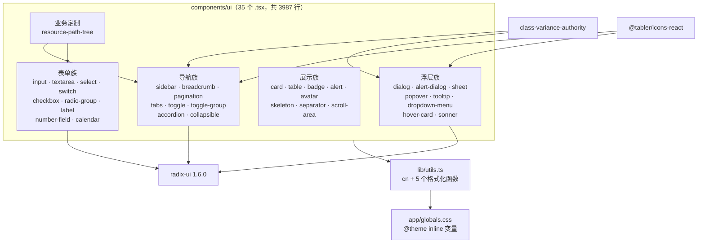
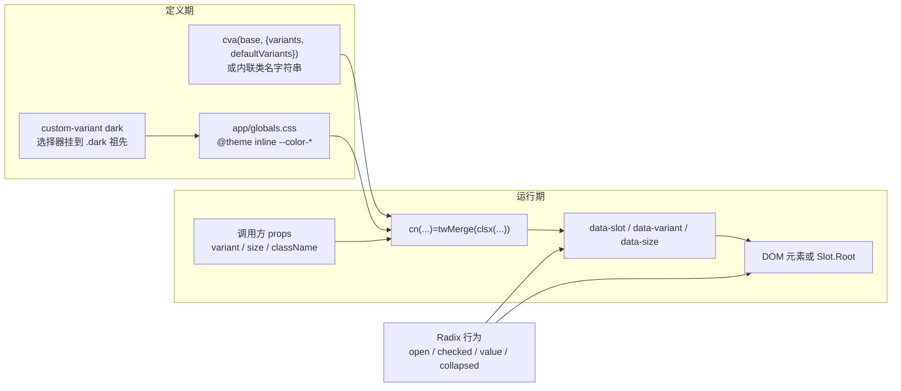
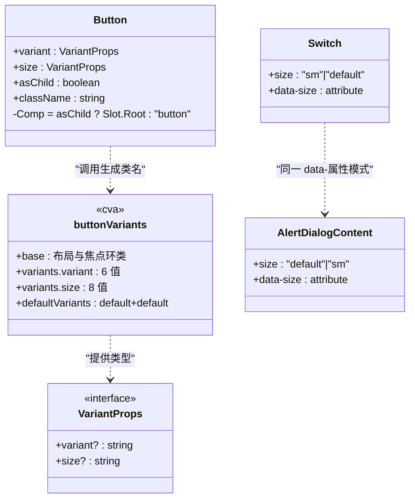
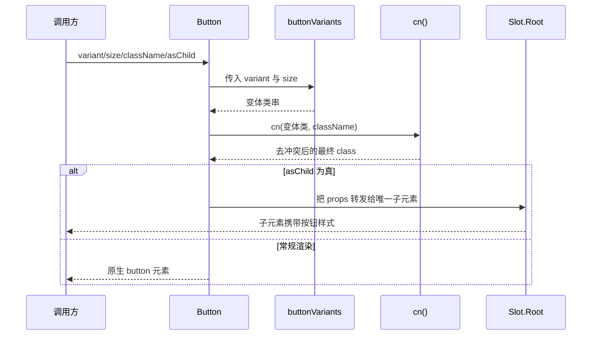
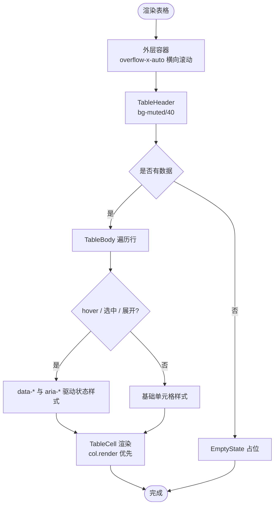
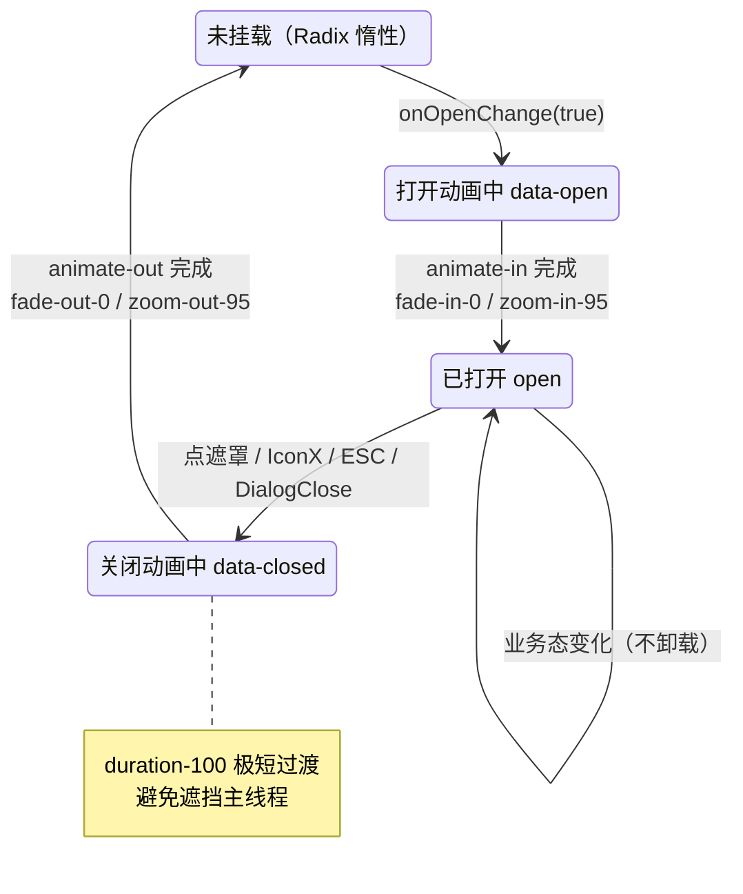
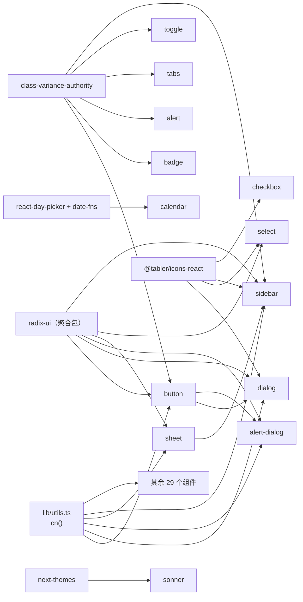

# UI 原子组件模式

> [返回 前端管理界面](../前端管理界面.md)

<cite>
**本文档引用的文件**
- [frontend/components/ui/accordion.tsx](file://frontend/components/ui/accordion.tsx)
- [frontend/components/ui/alert-dialog.tsx](file://frontend/components/ui/alert-dialog.tsx)
- [frontend/components/ui/alert.tsx](file://frontend/components/ui/alert.tsx)
- [frontend/components/ui/avatar.tsx](file://frontend/components/ui/avatar.tsx)
- [frontend/components/ui/badge.tsx](file://frontend/components/ui/badge.tsx)
- [frontend/components/ui/breadcrumb.tsx](file://frontend/components/ui/breadcrumb.tsx)
- [frontend/components/ui/button.tsx](file://frontend/components/ui/button.tsx)
- [frontend/components/ui/calendar.tsx](file://frontend/components/ui/calendar.tsx)
- [frontend/components/ui/card.tsx](file://frontend/components/ui/card.tsx)
- [frontend/components/ui/checkbox.tsx](file://frontend/components/ui/checkbox.tsx)
- [frontend/components/ui/collapsible.tsx](file://frontend/components/ui/collapsible.tsx)
- [frontend/components/ui/dialog.tsx](file://frontend/components/ui/dialog.tsx)
- [frontend/components/ui/dropdown-menu.tsx](file://frontend/components/ui/dropdown-menu.tsx)
- [frontend/components/ui/hover-card.tsx](file://frontend/components/ui/hover-card.tsx)
- [frontend/components/ui/input.tsx](file://frontend/components/ui/input.tsx)
- [frontend/components/ui/label.tsx](file://frontend/components/ui/label.tsx)
- [frontend/components/ui/number-field.tsx](file://frontend/components/ui/number-field.tsx)
- [frontend/components/ui/pagination.tsx](file://frontend/components/ui/pagination.tsx)
- [frontend/components/ui/popover.tsx](file://frontend/components/ui/popover.tsx)
- [frontend/components/ui/radio-group.tsx](file://frontend/components/ui/radio-group.tsx)
- [frontend/components/ui/resource-path-tree.tsx](file://frontend/components/ui/resource-path-tree.tsx)
- [frontend/components/ui/scroll-area.tsx](file://frontend/components/ui/scroll-area.tsx)
- [frontend/components/ui/select.tsx](file://frontend/components/ui/select.tsx)
- [frontend/components/ui/separator.tsx](file://frontend/components/ui/separator.tsx)
- [frontend/components/ui/sheet.tsx](file://frontend/components/ui/sheet.tsx)
- [frontend/components/ui/sidebar.tsx](file://frontend/components/ui/sidebar.tsx)
- [frontend/components/ui/skeleton.tsx](file://frontend/components/ui/skeleton.tsx)
- [frontend/components/ui/sonner.tsx](file://frontend/components/ui/sonner.tsx)
- [frontend/components/ui/switch.tsx](file://frontend/components/ui/switch.tsx)
- [frontend/components/ui/table.tsx](file://frontend/components/ui/table.tsx)
- [frontend/components/ui/tabs.tsx](file://frontend/components/ui/tabs.tsx)
- [frontend/components/ui/textarea.tsx](file://frontend/components/ui/textarea.tsx)
- [frontend/components/ui/toggle-group.tsx](file://frontend/components/ui/toggle-group.tsx)
- [frontend/components/ui/toggle.tsx](file://frontend/components/ui/toggle.tsx)
- [frontend/components/ui/tooltip.tsx](file://frontend/components/ui/tooltip.tsx)
- [frontend/lib/utils.ts](file://frontend/lib/utils.ts)
- [frontend/hooks/use-mobile.ts](file://frontend/hooks/use-mobile.ts)
- [frontend/components.json](file://frontend/components.json)
- [frontend/app/globals.css](file://frontend/app/globals.css)
- [frontend/package.json](file://frontend/package.json)
</cite>

## 目录

1. [简介](#简介)
2. [项目结构](#项目结构)
3. [核心组件](#核心组件)
4. [架构总览](#架构总览)
5. [详细组件分析](#详细组件分析)
6. [依赖关系分析](#依赖关系分析)
7. [性能考虑](#性能考虑)
8. [故障排查指南](#故障排查指南)
9. [结论](#结论)
10. [附录](#附录)

## 简介
本设计指南围绕基于 shadcn/ui 的「原子化组件」理念，系统阐述组件变体系统与样式继承机制，聚焦 `frontend/components/ui/` 下 **35 个原子组件**的实现原理与使用方法。

三条与旧文档不同的实测结论，请先建立正确预期：

1. 图标库是 **`@tabler/icons-react`**（`package.json:27`，`components.json:13` 声明 `iconLibrary: "tabler"`），不是 `lucide-react`。`next.config.ts:12` 的 `optimizePackageImports` 里仍残留 `"lucide-react"`，但该包并未在依赖中声明，属遗留项。
2. Radix 以**聚合包**方式引入：所有原语来自单包 `radix-ui`（`package.json:39`）的具名导入，而非 `@radix-ui/react-*` 分包。
3. 样式不是靠 `tailwind.config.*`，而是 `app/globals.css` 的 `@theme inline`（`:7-49`）把 CSS 变量映射为 Tailwind v4 token，组件类名直接引用这些语义色。

文档同时讲解 `class-variance-authority`（CVA）的变体定义模式，展示如何以配置驱动样式组合，并给出扩展与定制的最佳实践，包括主题适配、尺寸变体与状态标记。

## 项目结构
UI 组件集中于 `frontend/components/ui/`，采用「按组件拆分」的组织方式：一个组件一个文件，公共工具在 `frontend/lib/utils.ts`。

**图表来源**
- [frontend/lib/utils.ts:1-50](file://frontend/lib/utils.ts#L1-L50)
- [frontend/components/ui/dialog.tsx:1-9](file://frontend/components/ui/dialog.tsx#L1-L9)
- [frontend/components/ui/sidebar.tsx:1-25](file://frontend/components/ui/sidebar.tsx#L1-L25)
- [frontend/components/ui/resource-path-tree.tsx:1-20](file://frontend/components/ui/resource-path-tree.tsx#L1-L20)
- [frontend/app/globals.css:7-49](file://frontend/app/globals.css#L7-L49)
- [frontend/package.json:27-51](file://frontend/package.json#L27-L51)

### 目录清点表
行数、导出数、Radix 原语、是否使用 CVA、`@tabler` 图标引用数，全部由脚本逐个读取 35 个文件实测得出。

| 组件文件 | 行数 | 导出数 | 依赖的 Radix 原语 | CVA | 图标数 | 职责 |
|----------|:---:|:---:|-------------------|:---:|:---:|------|
| `accordion.tsx` | 91 | 4 | `Accordion` | N | 2 | 手风琴展开组 |
| `alert.tsx` | 77 | 4 | — | **Y** | 0 | 提示容器，2 变体 |
| `alert-dialog.tsx` | 200 | 12 | `AlertDialog` | N | 0 | 阻断式确认弹窗 |
| `avatar.tsx` | 113 | 6 | `Avatar` | N | 0 | 头像与回落文字 |
| `badge.tsx` | 50 | 2 | `Slot` | **Y** | 0 | 标签，6 变体，支持 `asChild` |
| `breadcrumb.tsx` | 120 | 7 | `Slot` | N | 2 | 面包屑基元 |
| `button.tsx` | 66 | 2 | `Slot` | **Y** | 0 | 按钮，6 变体 × 8 尺寸 |
| `calendar.tsx` | 235 | 2 | — | N | 3 | 日历（基于 `react-day-picker`） |
| `card.tsx` | 101 | 7 | — | N | 0 | 卡片与 6 个组合部件 |
| `checkbox.tsx` | 33 | 1 | `Checkbox` | N | 1 | 复选框 |
| `collapsible.tsx` | 34 | 3 | `Collapsible` | N | 0 | 单区展开（侧栏子菜单用） |
| `dialog.tsx` | 174 | 10 | `Dialog` | N | 1 | 通用模态对话框 |
| `dropdown-menu.tsx` | 274 | 15 | `DropdownMenu` | N | 2 | 下拉菜单 |
| `hover-card.tsx` | 45 | 3 | `HoverCard` | N | 0 | 悬停卡片 |
| `input.tsx` | 20 | 1 | — | N | 0 | 单行输入 |
| `label.tsx` | 25 | 1 | `Label` | N | 0 | 表单标签 |
| `number-field.tsx` | 144 | 6 | — | N | 2 | 数字步进输入 |
| `pagination.tsx` | 157 | 7 | — | N | 3 | 分页基元（含省略号） |
| `popover.tsx` | 90 | 7 | `Popover` | N | 0 | 气泡浮层 |
| `radio-group.tsx` | 45 | 2 | `RadioGroup` | N | 1 | 单选组 |
| `resource-path-tree.tsx` | 269 | 4 | — | N | 2 | 路径树（业务定制件） |
| `scroll-area.tsx` | 56 | 2 | `ScrollArea` | N | 0 | 自定义滚动区 |
| `select.tsx` | 204 | 10 | `Select` | N | 4 | 下拉选择 |
| `separator.tsx` | 29 | 1 | `Separator` | N | 0 | 分隔线 |
| `sheet.tsx` | 147 | 8 | `Dialog`（复用） | N | 1 | 侧滑面板 |
| `sidebar.tsx` | 706 | 24 | `Slot` | **Y** | 1 | 应用侧栏骨架（最大文件） |
| `skeleton.tsx` | 14 | 1 | — | N | 0 | 骨架占位 |
| `sonner.tsx` | 46 | 1 | — | N | 5 | Toast 容器与主题适配 |
| `switch.tsx` | 34 | 1 | `Switch` | N | 0 | 开关，2 尺寸 |
| `table.tsx` | 117 | 8 | — | N | 0 | 表格与 7 个组合部件 |
| `tabs.tsx` | 91 | 5 | `Tabs` | **Y** | 0 | 页签，`TabsList` 2 变体 |
| `textarea.tsx` | 19 | 1 | — | N | 0 | 多行输入 |
| `toggle-group.tsx` | 90 | 2 | `ToggleGroup` | N | 0 | 成组切换 |
| `toggle.tsx` | 48 | 2 | `Toggle` | **Y** | 0 | 单个切换，2 变体 × 3 尺寸 |
| `tooltip.tsx` | 58 | 4 | `Tooltip` | N | 0 | 文字提示 |

合计 3987 行；使用 CVA 的仅 6 个（`alert`、`badge`、`button`、`sidebar`、`tabs`、`toggle`），其余靠内联类名与 `data-*` 属性驱动。

**章节来源**
- [frontend/components/ui/accordion.tsx:1-91](file://frontend/components/ui/accordion.tsx#L1-L91)
- [frontend/components/ui/alert.tsx:6-25](file://frontend/components/ui/alert.tsx#L6-L25)
- [frontend/components/ui/badge.tsx:7-30](file://frontend/components/ui/badge.tsx#L7-L30)
- [frontend/components/ui/button.tsx:7-65](file://frontend/components/ui/button.tsx#L7-L65)
- [frontend/components/ui/sidebar.tsx:471-489](file://frontend/components/ui/sidebar.tsx#L471-L489)
- [frontend/components/ui/sheet.tsx:1-30](file://frontend/components/ui/sheet.tsx#L1-L30)
- [frontend/components/ui/tabs.tsx:27-45](file://frontend/components/ui/tabs.tsx#L27-L45)
- [frontend/components/ui/toggle.tsx:9-27](file://frontend/components/ui/toggle.tsx#L9-L27)
- [frontend/components/ui/resource-path-tree.tsx:1-20](file://frontend/components/ui/resource-path-tree.tsx#L1-L20)
- [frontend/components/ui/calendar.tsx:1-20](file://frontend/components/ui/calendar.tsx#L1-L20)

## 核心组件
按「是否使用 CVA」「是否需要 Radix 行为」「是否有客户端边界」三个维度归类，是选择扩展方式的前提。

| 分类 | 数量 | 成员 | 扩展方式 |
|------|:---:|------|----------|
| CVA 变体族 | 6 | `button`、`badge`、`alert`、`tabs`（仅 `TabsList`）、`toggle`、`sidebar`（仅 `SidebarMenuButton`） | 增改变体映射对象即可，调用方零改动 |
| 尺寸属性族 | 3 | `switch`（`sm`/`default`）、`card`（`default`/`sm`）、`alert-dialog`（`default`/`sm`） | 手写 `data-size` + 变体类串，无 CVA |
| Radix 行为族 | 24 | `dialog`、`alert-dialog`、`sheet`、`select`、`switch`、`checkbox`、`radio-group`、`popover`、`tooltip`、`dropdown-menu`、`hover-card`、`accordion`、`collapsible`、`tabs`、`toggle`、`toggle-group`、`avatar`、`label`、`separator`、`scroll-area`、`breadcrumb`、`sidebar`、`button`、`badge` | 只包装不重写行为，属性透传 `React.ComponentProps<typeof X.Root>` |
| 纯展示族 | 9 | `card`、`table`、`input`、`textarea`、`skeleton`、`alert`、`badge`、`button`、`pagination`、`breadcrumb` 中的无 hook 者 | 无状态、无副作用，可进服务端组件树 |
| 业务定制族 | 3 | `resource-path-tree`（依赖 `checkbox`/`label`）、`number-field`（依赖 `input`/`button` + 自建 Context）、`calendar`（依赖 `react-day-picker`） | 命名脱离 shadcn 约定，为本项目专用 |
| 未带 `"use client"` | 9 | `alert`、`badge`、`breadcrumb`、`button`、`card`、`input`、`pagination`、`skeleton`、`textarea` | 可安全被服务端组件导入 |
| 带 `"use client"` | 26 | 其余全部 | 依赖 hook、事件或 Radix 交互 |

补充说明：`sheet.tsx` 复用 Radix 的 `Dialog` 原语而非独立原语，因此「侧滑面板」与「模态对话框」共享同一套焦点陷阱与 `open`/`onOpenChange` 语义。`number-field.tsx` 与 `resource-path-tree.tsx` 完全不依赖 Radix，前者用自建 `NumberFieldContext`（`number-field.tsx:9-29`）在 `Input`/`Button` 之上拼装步进行为，后者用 `useState` + 递归树构建（`resource-path-tree.tsx:17-34`）实现路径勾选。

**章节来源**
- [frontend/components/ui/button.tsx:1-66](file://frontend/components/ui/button.tsx#L1-L66)
- [frontend/components/ui/card.tsx:1-101](file://frontend/components/ui/card.tsx#L1-L101)
- [frontend/components/ui/input.tsx:1-20](file://frontend/components/ui/input.tsx#L1-L20)
- [frontend/components/ui/textarea.tsx:1-19](file://frontend/components/ui/textarea.tsx#L1-L19)
- [frontend/components/ui/skeleton.tsx:1-14](file://frontend/components/ui/skeleton.tsx#L1-L14)
- [frontend/components/ui/table.tsx:1-117](file://frontend/components/ui/table.tsx#L1-L117)
- [frontend/components/ui/sheet.tsx:1-147](file://frontend/components/ui/sheet.tsx#L1-L147)
- [frontend/components.json:1-25](file://frontend/components.json#L1-L25)

## 架构总览
原子组件的通用架构是「CVA 或内联类名 → `cn()` 合并 → 写 `data-*` 标记 → 交由 `@theme inline` 变量着色」。

**图表来源**
- [frontend/lib/utils.ts:4-6](file://frontend/lib/utils.ts#L4-L6)
- [frontend/components/ui/button.tsx:7-62](file://frontend/components/ui/button.tsx#L7-L62)
- [frontend/app/globals.css:1-5](file://frontend/app/globals.css#L1-L5)
- [frontend/app/globals.css:7-49](file://frontend/app/globals.css#L7-L49)
- [frontend/components/ui/dialog.tsx:42-51](file://frontend/components/ui/dialog.tsx#L42-L51)
- [frontend/components/ui/switch.tsx:13-27](file://frontend/components/ui/switch.tsx#L13-L27)

样式变量与组件属性的对应关系如下，这是「改一处即全站联动」的根据：

| 组件用到的类 | 解析到的 CSS 变量 | 定义位置 | 亮/暗是否分别定义 |
|------------|------------------|----------|:---:|
| `bg-background` | `--background` | `globals.css:52`、`:102` | 是 |
| `bg-card` | `--card` | `:54`、`:104` | 是 |
| `bg-popover` | `--popover` | `:56`、`:106` | 是 |
| `text-primary` / `bg-primary` | `--primary` | `:58`、`:108` | 是 |
| `bg-input/50` | `--input` | `:68`、`:118` | 是 |
| `ring-ring/30` | `--ring` | `:69`、`:119` | 是 |
| `text-muted-foreground` | `--muted-foreground` | `:63`、`:113` | 是 |
| `bg-destructive/10` | `--destructive` | `:66`、`:121` | 是 |
| `border-sidebar-border` | `--sidebar-border` | `@theme inline:12` 间接 | 是 |
| `bg-primary`（强调色切换后） | `--primary` 被 `[data-accent="blue"]` 覆盖 | `:143`、`:159` | 是 |

**章节来源**
- [frontend/app/globals.css:7-173](file://frontend/app/globals.css#L7-L173)
- [frontend/lib/utils.ts:1-50](file://frontend/lib/utils.ts#L1-L50)
- [frontend/components/ui/button.tsx:1-66](file://frontend/components/ui/button.tsx#L1-L66)

## 详细组件分析

### 变体系统：CVA 的两种落地形态
本项目 CVA 只用在 6 个组件上，且分两种形态：

| 组件 | CVA 变量 | 维度 | 取值 | 默认 | 定义位置 |
|------|----------|------|------|------|----------|
| `Button` | `buttonVariants` | `variant` | `default`/`outline`/`secondary`/`ghost`/`destructive`/`link` | `default` | `button.tsx:10-22` |
| `Button` | `buttonVariants` | `size` | `default`/`xs`/`sm`/`lg`/`icon`/`icon-xs`/`icon-sm`/`icon-lg` | `default` | `button.tsx:23-33` |
| `Badge` | `badgeVariants` | `variant` | `default`/`secondary`/`destructive`/`outline`/`ghost`/`link` | `default` | `badge.tsx:11-22` |
| `Alert` | `alertVariants` | `variant` | `default`/`destructive` | `default` | `alert.tsx:10-14` |
| `TabsList` | `tabsListVariants` | `variant` | `default`/`line` | `default` | `tabs.tsx:31-34` |
| `Toggle` | `toggleVariants` | `variant` | `default`/`outline` | `default` | `toggle.tsx:13-16` |
| `Toggle` | `toggleVariants` | `size` | `default`/`sm`/`lg` | `default` | `toggle.tsx:17-22` |
| `SidebarMenuButton` | `sidebarMenuButtonVariants` | `variant` | `default`/`outline` | `default` | `sidebar.tsx:475-479` |
| `SidebarMenuButton` | `sidebarMenuButtonVariants` | `size` | `default`/`sm`/`lg` | `default` | `sidebar.tsx:480-484` |

另一种形态是**手写 data 属性变体**，用于只有 2 个取值的场景，避免引入 CVA 开销：`Switch` 用 `size?: "sm" | "default"` 声明并写入 `data-size`（`switch.tsx:13`、`:18`），再用 `data-[size=default]:h-5` 一类选择器分派尺寸类（`:20`）；`AlertDialogContent` 同构（`alert-dialog.tsx:50-61`）。

**图表来源**
- [frontend/components/ui/button.tsx:7-62](file://frontend/components/ui/button.tsx#L7-L62)
- [frontend/components/ui/switch.tsx:8-27](file://frontend/components/ui/switch.tsx#L8-L27)
- [frontend/components/ui/alert-dialog.tsx:47-65](file://frontend/components/ui/alert-dialog.tsx#L47-L65)
- [frontend/components/ui/badge.tsx:7-30](file://frontend/components/ui/badge.tsx#L7-L30)
- [frontend/components/ui/tabs.tsx:27-45](file://frontend/components/ui/tabs.tsx#L27-L45)
- [frontend/components/ui/toggle.tsx:9-27](file://frontend/components/ui/toggle.tsx#L9-L27)
- [frontend/components/ui/sidebar.tsx:471-489](file://frontend/components/ui/sidebar.tsx#L471-L489)

**章节来源**
- [frontend/components/ui/button.tsx:1-66](file://frontend/components/ui/button.tsx#L1-L66)
- [frontend/components/ui/badge.tsx:1-50](file://frontend/components/ui/badge.tsx#L1-L50)
- [frontend/components/ui/alert.tsx:1-77](file://frontend/components/ui/alert.tsx#L1-L77)
- [frontend/components/ui/tabs.tsx:27-90](file://frontend/components/ui/tabs.tsx#L27-L90)
- [frontend/components/ui/toggle.tsx:1-48](file://frontend/components/ui/toggle.tsx#L1-L48)
- [frontend/components/ui/switch.tsx:1-34](file://frontend/components/ui/switch.tsx#L1-L34)
- [frontend/components/ui/sidebar.tsx:471-489](file://frontend/components/ui/sidebar.tsx#L471-L489)

### 按钮 Button：`asChild` 与图标间距约定
- `asChild` 走 `Slot.Root`（`button.tsx:52`），把按钮类名直接附加到子元素（如 `Link`），不产生额外 DOM——`SidebarMenuButton asChild` 包裹 `Link` 的用法即基于此（`sidebar-nav.tsx:176-182`）。
- 变体语义：`destructive` 是低饱和危险态（`bg-destructive/10 text-destructive`，`:19-20`），而非实心红，与 `ConfirmDialog` 里显式加重的确认按钮形成对比（`confirm-dialog.tsx:60`）。
- 图标尺寸由基础类统一控制：`[&_svg:not([class*='size-'])]:size-4`（`:8`），`xs`/`icon-xs` 覆写为 `size-3`（`:26`、`:30`）。
- 前后缀图标内边距用逻辑属性：`has-data-[icon=inline-end]:pe-2.5` 与 `has-data-[icon=inline-start]:ps-2.5`（`:25-32`），配合 `components.json:14` 的 `rtl: true`，在 RTL 下自动镜像。
- 交互细节：`active:not-aria-[haspopup]:translate-y-px`（`:8`）让非弹出按钮有按下位移，弹出类按钮不做位移。

**图表来源**
- [frontend/components/ui/button.tsx:42-63](file://frontend/components/ui/button.tsx#L42-L63)
- [frontend/lib/utils.ts:4-6](file://frontend/lib/utils.ts#L4-L6)
- [frontend/components/sidebar-nav.tsx:174-189](file://frontend/components/sidebar-nav.tsx#L174-L189)

**章节来源**
- [frontend/components/ui/button.tsx:1-66](file://frontend/components/ui/button.tsx#L1-L66)
- [frontend/components.json:1-25](file://frontend/components.json#L1-L25)
- [frontend/components/sidebar-nav.tsx:168-189](file://frontend/components/sidebar-nav.tsx#L168-L189)
- [frontend/components/confirm-dialog.tsx:54-63](file://frontend/components/confirm-dialog.tsx#L54-L63)

### 卡片 Card 与表格 Table：容器型组合部件
- `Card` 导出 7 个部件：`Card`、`CardHeader`、`CardTitle`、`CardDescription`、`CardAction`、`CardContent`、`CardFooter`（`card.tsx`，101 行）；`size` 支持 `default`/`sm` 两档密度。内部用 `data-slot` 与容器查询（`@container`）实现布局协同，图片首尾元素自动调整圆角与内边距。
- `Table` 导出 8 个部件：`Table`、`TableHeader`、`TableBody`、`TableFooter`、`TableRow`、`TableHead`、`TableCell`、`TableCaption`（`table.tsx`，117 行）。外层 `overflow-x-auto` 提供横向滚动，行级 hover/选中由 `data-*` 与 `aria-*` 驱动。
- 二者都不依赖 Radix，属于纯展示族，因此 `card.tsx`、`table.tsx` 的表格基元可被上层业务组件自由组合——`DataTable` 正是在 `Table` 之上加骨架屏与空状态（`data-table.tsx:65-96`）。

**图表来源**
- [frontend/components/ui/table.tsx:1-117](file://frontend/components/ui/table.tsx#L1-L117)
- [frontend/components/ui/card.tsx:1-101](file://frontend/components/ui/card.tsx#L1-L101)
- [frontend/components/data-table.tsx:112-166](file://frontend/components/data-table.tsx#L112-L166)

**章节来源**
- [frontend/components/ui/card.tsx:1-101](file://frontend/components/ui/card.tsx#L1-L101)
- [frontend/components/ui/table.tsx:1-117](file://frontend/components/ui/table.tsx#L1-L117)
- [frontend/components/data-table.tsx:1-170](file://frontend/components/data-table.tsx#L1-L170)

### 输入控件族：焦点、无效态与逻辑属性
`Input`、`Textarea`、`NumberField`、`Select`、`Switch`、`Checkbox`、`RadioGroup`、`Label` 共享同一套状态语义：

| 控件 | 导出 | Radix | 高度/密度 | 焦点与无效态 | 可空约定 |
|------|------|-------|-----------|--------------|----------|
| `Input` | 1 | — | `h-9` | `focus-visible:ring-3 ring-ring/30`、`aria-invalid` 双档 | 空串 |
| `Textarea` | 1 | — | `min-h-16`、`field-sizing-content` 自动增高 | 同上 | 空串 |
| `NumberField` | 6 | — | 步进按钮 | 同上 | `—` |
| `Select` | 10 | `Select` | `Trigger` 两档尺寸 | 同上 | 不接受空串 value |
| `Switch` | 1 | `Switch` | `sm`(h-4) / `default`(h-5) | `after:-inset-x-3` 扩大命中区 | `checked` 布尔 |
| `Checkbox` | 1 | `Checkbox` | 固定 | `focus-visible` | `checked` 三态 |
| `RadioGroup` | 2 | `RadioGroup` | 固定 | `focus-visible` | 必有一项 |
| `Label` | 1 | `Label` | — | — | — |

两个非显然的设计点：
- `Input` 与 `Textarea` 的圆角与背景走 `rounded-3xl bg-input/50`（`input.tsx:11`、`textarea.tsx:10`），与 `Button` 的 `rounded-4xl` 同源于 `--radius` 派生体系（`globals.css:42-48`），因此调 `--radius` 一处即可整体联动。
- Radix `Select` 的 `SelectItem` 不接受空字符串 value，故业务侧统一使用哨兵值（`site-form-dialog.tsx:48-49` 的 `none` 与 `inherit-default`），并在保存前转回 `undefined`/`null`。

**章节来源**
- [frontend/components/ui/input.tsx:1-20](file://frontend/components/ui/input.tsx#L1-L20)
- [frontend/components/ui/textarea.tsx:1-19](file://frontend/components/ui/textarea.tsx#L1-L19)
- [frontend/components/ui/switch.tsx:1-34](file://frontend/components/ui/switch.tsx#L1-L34)
- [frontend/components/ui/select.tsx:1-204](file://frontend/components/ui/select.tsx#L1-L204)
- [frontend/components/ui/number-field.tsx:1-144](file://frontend/components/ui/number-field.tsx#L1-L144)
- [frontend/components/ui/checkbox.tsx:1-33](file://frontend/components/ui/checkbox.tsx#L1-L33)
- [frontend/components/ui/radio-group.tsx:1-45](file://frontend/components/ui/radio-group.tsx#L1-L45)
- [frontend/components/ui/label.tsx:1-25](file://frontend/components/ui/label.tsx#L1-L25)
- [frontend/app/globals.css:42-48](file://frontend/app/globals.css#L42-L48)
- [frontend/app/(dashboard)/sites/components/site-form-dialog.tsx:44-49](file://frontend/app/(dashboard)/sites/components/site-form-dialog.tsx#L44-L49)

### 浮层族：Dialog、AlertDialog、Sheet 的同源关系
三个浮层组件的行为内核相同——`sheet.tsx` 复用 Radix `Dialog` 原语，仅把内容容器换成带方向的贴边面板；`dialog.tsx` 与 `alert-dialog.tsx` 各自使用对应原语。共同点：

| 维度 | `Dialog` | `AlertDialog` | `Sheet` |
|------|----------|---------------|---------|
| Radix 原语 | `Dialog` | `AlertDialog` | `Dialog` |
| 导出数 | 10 | 12 | 8 |
| 遮罩 | `bg-black/30` + 可选 `backdrop-blur-sm` | `bg-black/30` + 固定模糊 | 复用 Dialog 遮罩 |
| 尺寸控制 | `max-w-md` + `max-h-[calc(100dvh-1rem)]` | `size`：`default`/`sm`，`max-w-xs`→`sm:max-w-md` | 宽度变量 |
| 关闭按钮 | `showCloseButton`（默认开）+ `IconX` | 无（由 `Action`/`Cancel` 承担） | `SheetContent` 内置 |
| 焦点语义 | 可外部关闭、允许焦点逃逸 | 必须显式响应，拦截逃逸 | 同 Dialog |
| 自定义 prop | `disableBackdropBlur`、`showCloseButton` | `size`、`Action`/`Cancel` 的 `variant`/`size` | `side` |

`DialogOverlay` 的 `disableBackdropBlur`（`dialog.tsx:36-48`）是为「需要精确读表格文本」的场景留的口子：默认加 `supports-backdrop-filter:backdrop-blur-sm`，传入 true 即取消模糊。`DialogFooter` 默认 `showCloseButton = false`（`:105`），需要时显式打开——这与 `ConfirmDialog` 自己提供 `Cancel`/`Action` 双按钮的写法一致（`confirm-dialog.tsx:50-63`）。

**图表来源**
- [frontend/components/ui/dialog.tsx:34-91](file://frontend/components/ui/dialog.tsx#L34-L91)
- [frontend/components/ui/alert-dialog.tsx:31-68](file://frontend/components/ui/alert-dialog.tsx#L31-L68)
- [frontend/components/ui/sheet.tsx:1-147](file://frontend/components/ui/sheet.tsx#L1-L147)
- [frontend/components/confirm-dialog.tsx:44-67](file://frontend/components/confirm-dialog.tsx#L44-L67)

**章节来源**
- [frontend/components/ui/dialog.tsx:1-174](file://frontend/components/ui/dialog.tsx#L1-L174)
- [frontend/components/ui/alert-dialog.tsx:1-200](file://frontend/components/ui/alert-dialog.tsx#L1-L200)
- [frontend/components/ui/sheet.tsx:1-147](file://frontend/components/ui/sheet.tsx#L1-L147)
- [frontend/components/confirm-dialog.tsx:1-69](file://frontend/components/confirm-dialog.tsx#L1-L69)

### `sidebar.tsx`：原子层里的「复合骨架」
`ui/sidebar.tsx` 是原子目录中最大的文件（706 行、24 个导出），它把响应式、持久化与键盘快捷键都收在原子层：

| 能力 | 实现 | 位置 |
|------|------|------|
| 尺寸变量 | `--sidebar-width` 16rem、移动 18rem、icon 折叠 3rem | `sidebar.tsx:29-31` |
| 折叠状态持久化 | `document.cookie` 写 `sidebar_state`，`max-age` 7 天 | `:27-28`、`:85` |
| 键盘快捷键 | `SIDEBAR_KEYBOARD_SHORTCUT = "b"` | `:32` |
| 断点判定 | `useIsMobile()`，阈值 768 | `:7`、`hooks/use-mobile.ts:3-20` |
| 移动端载体 | 切换为 `Sheet` + `SheetContent` | `:14-19`、`:184-202` |
| 桌面显隐 | `hidden md:flex` | `:232` |
| 上下文 | `SidebarContext` + `useSidebar()`，未包裹时抛错 | `:34-53` |
| 菜单按钮变体 | `sidebarMenuButtonVariants`（2 变体 × 3 尺寸） | `:471-489` |

`components/sidebar-nav.tsx` 在此基础上只补一件事：活动态可辨识度。shadcn 默认活动态与 hover 同色，故 `ACTIVE_ITEM_CLASS`（`:69-70`）与 `ACTIVE_SUB_ITEM_CLASS`（`:73-74`）叠加主色文字与左侧 3px/0.5px 指示条（注释见 `:62-68`）。

**章节来源**
- [frontend/components/ui/sidebar.tsx:27-53](file://frontend/components/ui/sidebar.tsx#L27-L53)
- [frontend/components/ui/sidebar.tsx:85-85](file://frontend/components/ui/sidebar.tsx#L85-L85)
- [frontend/components/ui/sidebar.tsx:184-232](file://frontend/components/ui/sidebar.tsx#L184-L232)
- [frontend/components/ui/sidebar.tsx:471-489](file://frontend/components/ui/sidebar.tsx#L471-L489)
- [frontend/hooks/use-mobile.ts:1-20](file://frontend/hooks/use-mobile.ts#L1-L20)
- [frontend/components/sidebar-nav.tsx:62-74](file://frontend/components/sidebar-nav.tsx#L62-L74)

## 依赖关系分析
- 工具函数：`lib/utils.ts` 导出 6 个函数——`cn`（`:4`）、`formatNumber`（`:8`）、`formatDate`（`:19`）、`formatDuration`（`:31`）、`formatBytes`（`:38`）、`formatLatencyMs`（`:46`）。原子组件只用 `cn`，格式化函数由业务组件消费。
- 组件间耦合：原子组件之间互不引用，唯一的层内依赖是 `sidebar.tsx` → `sheet.tsx`/`button`/`input`/`separator`/`skeleton`/`tooltip`（`:8-24`），以及 `dialog.tsx`/`alert-dialog.tsx` → `button.tsx`（`dialog.tsx:7`、`alert-dialog.tsx:7`）。
- 外部依赖：`class-variance-authority ^0.7.1`、`radix-ui ^1.6.0`、`clsx ^2.1.1`、`tailwind-merge ^3.6.0`、`@tabler/icons-react ^3.44.0`、`sonner ^2.0.7`、`react-day-picker ^10.0.1`、`date-fns ^4.4.0`、`next-themes ^0.4.6`（版本取自 `package.json:24-52`）。

| 组件 | 依赖 Radix | 依赖 CVA | 依赖 `cn` | 依赖 `@tabler` | 依赖同目录组件 |
|------|:---:|:---:|:---:|:---:|----------------|
| `button.tsx` | 是（`Slot`） | 是 | 是 | 否 | 否 |
| `dialog.tsx` | 是（`Dialog`） | 否 | 是 | 是（`IconX`） | `button.tsx` |
| `alert-dialog.tsx` | 是（`AlertDialog`） | 否 | 是 | 否 | `button.tsx` |
| `sheet.tsx` | 是（`Dialog`） | 否 | 是 | 是 | 否 |
| `sidebar.tsx` | 是（`Slot`） | 是 | 是 | 是 | `sheet`、`button`、`input`、`separator`、`skeleton`、`tooltip` |
| `select.tsx` | 是（`Select`） | 否 | 是 | 是（4 个图标） | 否 |
| `table.tsx` | 否 | 否 | 是 | 否 | 否 |
| `card.tsx` | 否 | 否 | 是 | 否 | 否 |
| `input.tsx` | 否 | 否 | 是 | 否 | 否 |
| `calendar.tsx` | 否 | 否 | 是 | 是 | 否（依赖 `react-day-picker`） |
| `resource-path-tree.tsx` | 否 | 否 | 是 | 是 | 否 |
| `sonner.tsx` | 否 | 否 | 是 | 是（5 个图标） | 否（依赖 `next-themes`） |

**图表来源**
- [frontend/lib/utils.ts:1-6](file://frontend/lib/utils.ts#L1-L6)
- [frontend/components/ui/dialog.tsx:4-8](file://frontend/components/ui/dialog.tsx#L4-L8)
- [frontend/components/ui/alert-dialog.tsx:4-7](file://frontend/components/ui/alert-dialog.tsx#L4-L7)
- [frontend/components/ui/sidebar.tsx:3-25](file://frontend/components/ui/sidebar.tsx#L3-L25)
- [frontend/components/ui/sonner.tsx:1-12](file://frontend/components/ui/sonner.tsx#L1-L12)
- [frontend/components/ui/calendar.tsx:1-12](file://frontend/components/ui/calendar.tsx#L1-L12)
- [frontend/package.json:24-52](file://frontend/package.json#L24-L52)

**章节来源**
- [frontend/lib/utils.ts:1-50](file://frontend/lib/utils.ts#L1-L50)
- [frontend/package.json:1-65](file://frontend/package.json#L1-L65)
- [frontend/components/ui/sidebar.tsx:1-25](file://frontend/components/ui/sidebar.tsx#L1-L25)
- [frontend/components/ui/dialog.tsx:1-9](file://frontend/components/ui/dialog.tsx#L1-L9)

## 性能考虑
- 类名合并：`cn = twMerge(clsx(inputs))`（`utils.ts:4-6`）。`twMerge` 会在重复语义类之间保留最后一者，避免同一元素出现两个背景色导致的样式抖动与体积膨胀。
- 变体求值成本：CVA 只在 6 个组件使用，其余走常量类名字符串拼接，省去 variant 映射查表。
- 动画时长：浮层统一 `duration-100`（`dialog.tsx:45`、`:70`、`alert-dialog.tsx:39`、`:61`），远短于默认过渡，降低遮罩层的主线程占用。
- 惰性挂载：Radix 的 `Portal`/`Content` 在未打开时不渲染（`dialog.tsx:65-89`），关闭后由 `data-closed` 走 `animate-out` 再卸载。
- 命中区扩展：`Switch` 用 `after:absolute after:-inset-x-3 after:-inset-y-2`（`switch.tsx:20`）在视觉上不变的前提下扩大点击区，比监听 document 层级事件更省。
- 布局稳定：`Textarea` 用 `field-sizing-content`（`textarea.tsx:10`）让原生按内容撑高，替代 JS 测高；`Table` 外层滚动而非重排。
- 体积克制：不引入 CSS-in-JS 与组件级样式文件，全部依赖 Tailwind 原子类与 CSS 变量；`components.json:7` 的 `tailwind.config` 为空串，确认无独立配置文件参与构建。

**章节来源**
- [frontend/lib/utils.ts:1-6](file://frontend/lib/utils.ts#L1-L6)
- [frontend/components/ui/dialog.tsx:44-72](file://frontend/components/ui/dialog.tsx#L44-L72)
- [frontend/components/ui/alert-dialog.tsx:38-62](file://frontend/components/ui/alert-dialog.tsx#L38-L62)
- [frontend/components/ui/switch.tsx:20-26](file://frontend/components/ui/switch.tsx#L20-L26)
- [frontend/components/ui/textarea.tsx:9-15](file://frontend/components/ui/textarea.tsx#L9-L15)
- [frontend/components.json:1-25](file://frontend/components.json#L1-L25)

## 故障排查指南
| 症状 | 判定 | 处置 |
|------|------|------|
| 传入 `className` 不生效 | 未走 `cn()`，或变体类被后续同类覆盖 | 组件内统一 `cn(base, className)`（`utils.ts:4`），自定义类放最后 |
| 焦点环缺失 | 未使用 `focus-visible:` 前缀 | 参照 `button.tsx:8`、`input.tsx:12` 的 `focus-visible:ring-3 ring-ring/30` |
| 无效态不变红 | 只写了 `:invalid` 而没写 `aria-invalid` | Radix 与非原生表单都应设 `aria-invalid`，样式挂 `aria-invalid:border-destructive` |
| 暗色下对比度不足 | 直接用了固定色 | 改用 `--primary` 等变量类（`dark` 在 `globals.css:101` 另有一套值） |
| RTL 下图标方向错位 | 用了 `left/right` 而非逻辑属性 | 改用 `start-*`/`end-*`、`ps-*`/`pe-*`（见 `button.tsx:25-32`、`dialog.tsx:70`、`:80`） |
| Select 空选项消失 | `SelectItem value=""` 被 Radix 拒收 | 使用哨兵值，见 `site-form-dialog.tsx:48-49` |
| 对话框关不掉 | 未传 `onOpenChange`，或 `showCloseButton` 被关 | 检查 `dialog.tsx:57`、`:76-87` 的关闭按钮渲染条件 |
| 表格横向滚动失效 | 外层没给 `overflow-x-auto` 容器 | 参照 `table.tsx` 的容器结构与 `data-table.tsx:112-118` |
| 下拉定位偏 | `SelectContent` 的 `position`/`align` 与触发器尺寸不匹配 | 核对 `select.tsx` 中 `SelectContent` 与 `SelectViewport` 的滚动按钮设置 |
| 图标找不到 | 从 `lucide-react` 导入（该包未安装） | 统一 `@tabler/icons-react`；`components.json:13` 为 `tabler` |
| 服务端组件报 client 边界错 | 导入了带 `"use client"` 的组件 | 无交互需求时优先用 9 个纯展示组件（`button`、`card`、`table` 等） |

**章节来源**
- [frontend/components/ui/button.tsx:8-32](file://frontend/components/ui/button.tsx#L8-L32)
- [frontend/components/ui/input.tsx:12-16](file://frontend/components/ui/input.tsx#L12-L16)
- [frontend/components/ui/dialog.tsx:54-91](file://frontend/components/ui/dialog.tsx#L54-L91)
- [frontend/components/ui/select.tsx:1-204](file://frontend/components/ui/select.tsx#L1-L204)
- [frontend/components/ui/table.tsx:1-117](file://frontend/components/ui/table.tsx#L1-L117)
- [frontend/app/globals.css:101-173](file://frontend/app/globals.css#L101-L173)
- [frontend/components.json:1-25](file://frontend/components.json#L1-L25)
- [frontend/app/(dashboard)/sites/components/site-form-dialog.tsx:44-49](file://frontend/app/(dashboard)/sites/components/site-form-dialog.tsx#L44-L49)

## 结论
本原子组件体系以 shadcn/ui（`radix-luma` 风格）为模板基础，用 35 个文件承载「行为交给 Radix、外观交给 CSS 变量、密度交给 `data-*`」的分工。

- **单一职责**：每个文件只负责一个组件族；除 `sidebar.tsx` 外没有跨文件的组件相互依赖。
- **开闭原则**：新增变体只需扩展 CVA 的 `variants` 对象（6 处）或补一组 `data-[size=...]` 类串（2 处），调用方代码不变。
- **杜绝重复**：颜色、圆角、字体全部经 `@theme inline` 间接引用 CSS 变量（`globals.css:7-49`），组件类名不硬编码具体色值。
- **简洁优先**：只给 6 个真正多变体的组件引入 CVA，避免为 2 档尺寸引入额外抽象层。

已知不一致：`next.config.ts:12` 的 `optimizePackageImports` 仍列未安装的 `lucide-react`；`resource-path-tree.tsx` 与 `number-field.tsx` 属业务定制件，与 shadcn 命名约定不同源，后续可考虑下沉到 `components/`。建议在新增原子组件时沿用 `data-slot` + `cn()` + 语义色类三件套，并保持「无交互不加 `"use client"`」的边界纪律。

## 附录

### 尺寸与圆角派生体系
| token | 定义 | 值 | 消费方 |
|-------|------|----|--------|
| `--radius` | 基础半径 | 由 `:root` 提供 | 全部圆角类 |
| `--radius-sm` | `calc(var(--radius) * 0.6)` | `globals.css:42` | 小徽章、输入 |
| `--radius-md` | `* 0.8` | `:43` | 表格容器 |
| `--radius-lg` | `var(--radius)` | `:44` | 卡片 |
| `--radius-xl` | `* 1.4` | `:45` | 弹层 |
| `--radius-2xl` | `* 1.8` | `:46` | 代码块 |
| `--radius-3xl` | `* 2.2` | `:47` | `Input`、`Textarea` |
| `--radius-4xl` | `* 2.6` | `:48` | `Button`、`DialogContent` |

**章节来源**
- [frontend/app/globals.css:42-48](file://frontend/app/globals.css#L42-L48)
- [frontend/components/ui/input.tsx:11](file://frontend/components/ui/input.tsx#L11-L11)
- [frontend/components/ui/button.tsx:8](file://frontend/components/ui/button.tsx#L8-L8)
- [frontend/components/ui/dialog.tsx:70](file://frontend/components/ui/dialog.tsx#L70-L70)

### 工具函数速查
| 函数 | 签名 | 行为 | 位置 |
|------|------|------|------|
| `cn` | `(...inputs: ClassValue[]) => string` | `twMerge(clsx(inputs))` | `utils.ts:4` |
| `formatNumber` | `(num?: number \| null) => string` | 1e6→`M`、1e3→`k`，空值 `-` | `:8` |
| `formatDate` | `(date?: string \| Date) => string` | `zh-CN` 本地化，固定两位月日时分 | `:19` |
| `formatDuration` | `(seconds: number) => string` | 秒/分钟/小时/天四档中文 | `:31` |
| `formatBytes` | `(bytes?: number \| null) => string` | 1024 进制，非正值 `-` | `:38` |
| `formatLatencyMs` | `(ms?: number \| null) => string` | ≥1000 转秒保留 2 位 | `:46` |

**章节来源**
- [frontend/lib/utils.ts:1-50](file://frontend/lib/utils.ts#L1-L50)

### 兼容与响应式矩阵
| 能力 | 桌面（≥768px） | 移动（<768px） | 暗色模式 | 备注 |
|------|:---:|:---:|:---:|------|
| `Sidebar` 常驻 | ✓ | ✗ | ✓ | 移动改走 `Sheet`（`sidebar.tsx:184-202`） |
| `Sidebar` icon 折叠 | ✓ | 部分 | ✓ | 移动端折叠无意义，由抽屉取代 |
| `Dialog` 滚动内容 | ✓ | ✓ | ✓ | `max-h-[calc(100dvh-1rem)]`，`sm:` 档放宽（`dialog.tsx:70`） |
| `AlertDialog` 双列按钮 | 部分 | ✓ | ✓ | `size=sm` 时为 `grid-cols-2`（`alert-dialog.tsx:94`） |
| 表格横向滚动 | ✓ | ✓ | ✓ | 外层 `overflow-x-auto` |
| `Backdrop blur` | ✓ | ✓ | ✓ | 可用 `disableBackdropBlur` 关闭（`dialog.tsx:46`） |
| RTL 逻辑属性 | ✓ | ✓ | ✓ | `components.json:14` 的 `rtl: true` |
| `prefers-reduced-motion` | ✓ | ✓ | — | 由 `StatCard` 消费，原子层未直接处理 |

**章节来源**
- [frontend/app/globals.css:42-48](file://frontend/app/globals.css#L42-L48)
- [frontend/lib/utils.ts:1-50](file://frontend/lib/utils.ts#L1-L50)
- [frontend/components/ui/sidebar.tsx:184-232](file://frontend/components/ui/sidebar.tsx#L184-L232)
- [frontend/components/ui/alert-dialog.tsx:86-100](file://frontend/components/ui/alert-dialog.tsx#L86-L100)
- [frontend/components/stat-card.tsx:13-17](file://frontend/components/stat-card.tsx#L13-L17)
- [frontend/components.json:1-25](file://frontend/components.json#L1-L25)
