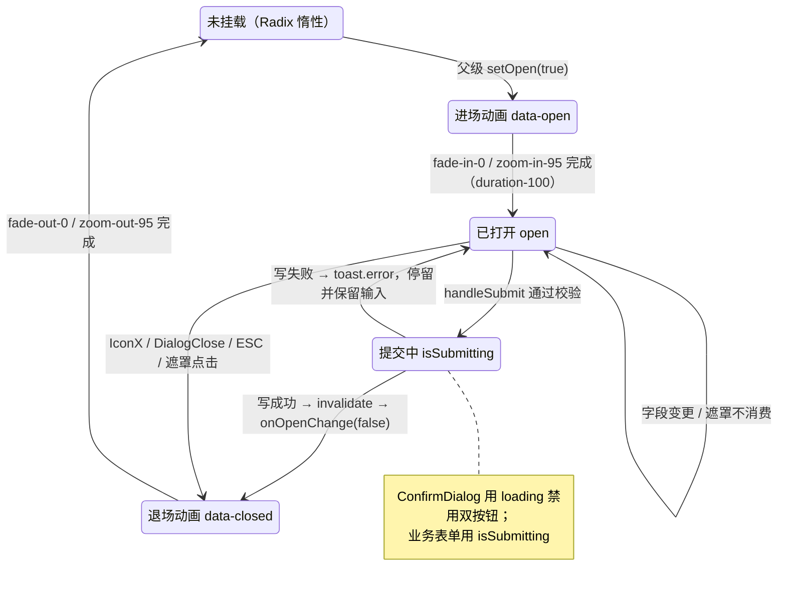
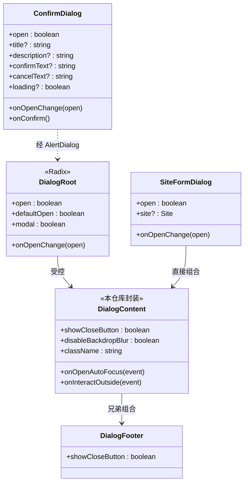
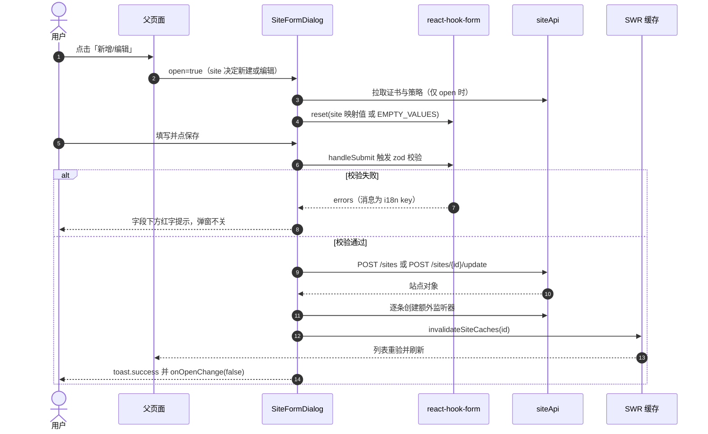
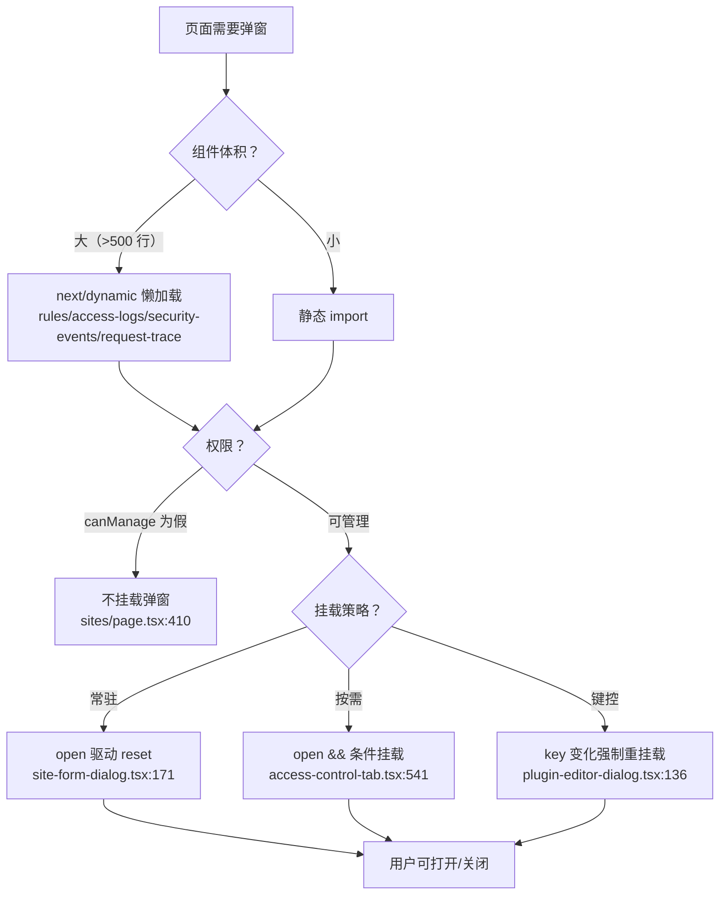
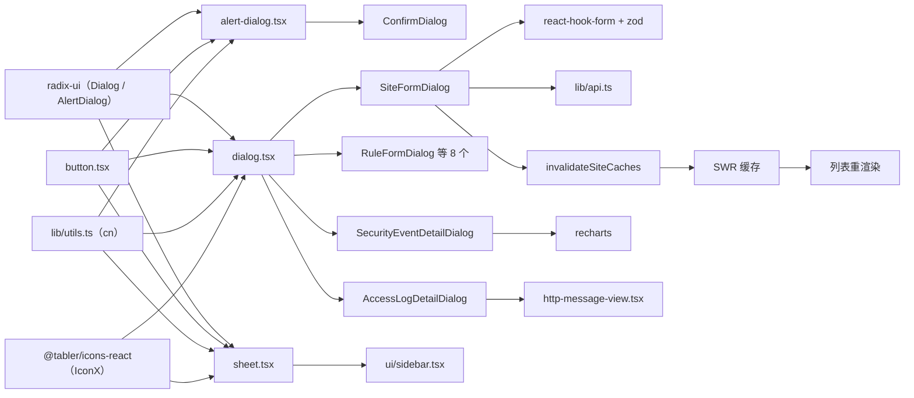

# 对话框组件

> [返回 前端管理界面](../前端管理界面.md)

<cite>
**本文档引用的文件**
- [frontend/components/ui/dialog.tsx](file://frontend/components/ui/dialog.tsx)
- [frontend/components/ui/alert-dialog.tsx](file://frontend/components/ui/alert-dialog.tsx)
- [frontend/components/ui/sheet.tsx](file://frontend/components/ui/sheet.tsx)
- [frontend/components/ui/button.tsx](file://frontend/components/ui/button.tsx)
- [frontend/components/ui/tabs.tsx](file://frontend/components/ui/tabs.tsx)
- [frontend/components/ui/input.tsx](file://frontend/components/ui/input.tsx)
- [frontend/components/ui/select.tsx](file://frontend/components/ui/select.tsx)
- [frontend/components/confirm-dialog.tsx](file://frontend/components/confirm-dialog.tsx)
- [frontend/components/access-log-detail-dialog.tsx](file://frontend/components/access-log-detail-dialog.tsx)
- [frontend/components/security-event-detail-dialog.tsx](file://frontend/components/security-event-detail-dialog.tsx)
- [frontend/app/(dashboard)/sites/components/site-form-dialog.tsx](file://frontend/app/(dashboard)/sites/components/site-form-dialog.tsx)
- [frontend/app/(dashboard)/sites/components/access-user-dialog.tsx](file://frontend/app/(dashboard)/sites/components/access-user-dialog.tsx)
- [frontend/app/(dashboard)/sites/components/access-provider-dialog.tsx](file://frontend/app/(dashboard)/sites/components/access-provider-dialog.tsx)
- [frontend/app/(dashboard)/sites/components/access-path-rule-dialog.tsx](file://frontend/app/(dashboard)/sites/components/access-path-rule-dialog.tsx)
- [frontend/app/(dashboard)/sites/detail/components/listeners-tab.tsx](file://frontend/app/(dashboard)/sites/detail/components/listeners-tab.tsx)
- [frontend/app/(dashboard)/sites/detail/components/access-control-tab.tsx](file://frontend/app/(dashboard)/sites/detail/components/access-control-tab.tsx)
- [frontend/app/(dashboard)/rules/components/rule-form-dialog.tsx](file://frontend/app/(dashboard)/rules/components/rule-form-dialog.tsx)
- [frontend/app/(dashboard)/rules/components/cve-rule-form-dialog.tsx](file://frontend/app/(dashboard)/rules/components/cve-rule-form-dialog.tsx)
- [frontend/app/(dashboard)/rules/components/builtin-rule-edit-dialog.tsx](file://frontend/app/(dashboard)/rules/components/builtin-rule-edit-dialog.tsx)
- [frontend/app/(dashboard)/rules/owasp/page.tsx](file://frontend/app/(dashboard)/rules/owasp/page.tsx)
- [frontend/app/(dashboard)/lua-plugins/components/plugin-editor-dialog.tsx](file://frontend/app/(dashboard)/lua-plugins/components/plugin-editor-dialog.tsx)
- [frontend/app/(dashboard)/js-plugins/components/plugin-editor-dialog.tsx](file://frontend/app/(dashboard)/js-plugins/components/plugin-editor-dialog.tsx)
- [frontend/app/(dashboard)/ip-lists/page.tsx](file://frontend/app/(dashboard)/ip-lists/page.tsx)
- [frontend/app/(dashboard)/api-keys/page.tsx](file://frontend/app/(dashboard)/api-keys/page.tsx)
- [frontend/app/(dashboard)/admin-users/page.tsx](file://frontend/app/(dashboard)/admin-users/page.tsx)
- [frontend/app/(dashboard)/tls-fingerprints/page.tsx](file://frontend/app/(dashboard)/tls-fingerprints/page.tsx)
- [frontend/app/(dashboard)/threat-intel/page.tsx](file://frontend/app/(dashboard)/threat-intel/page.tsx)
- [frontend/app/(dashboard)/rules/page.tsx](file://frontend/app/(dashboard)/rules/page.tsx)
- [frontend/app/(dashboard)/access-logs/page.tsx](file://frontend/app/(dashboard)/access-logs/page.tsx)
- [frontend/app/(dashboard)/security-events/page.tsx](file://frontend/app/(dashboard)/security-events/page.tsx)
- [frontend/app/(dashboard)/request-trace/page.tsx](file://frontend/app/(dashboard)/request-trace/page.tsx)
- [frontend/app/(dashboard)/sites/page.tsx](file://frontend/app/(dashboard)/sites/page.tsx)
- [frontend/lib/utils.ts](file://frontend/lib/utils.ts)
- [frontend/lib/site-display.ts](file://frontend/lib/site-display.ts)
- [frontend/hooks/use-api.ts](file://frontend/hooks/use-api.ts)
- [frontend/next.config.ts](file://frontend/next.config.ts)
</cite>

## 目录

1. [简介](#简介)
2. [项目结构](#项目结构)
3. [核心组件](#核心组件)
4. [架构总览](#架构总览)
5. [详细组件分析](#详细组件分析)
6. [依赖关系分析](#依赖关系分析)
7. [性能考虑](#性能考虑)
8. [故障排查指南](#故障排查指南)
9. [结论](#结论)
10. [附录](#附录)

## 简介
本文件系统梳理 My-OpenWaf 的对话框组件体系，涵盖模态对话框的设计模式与生命周期管理、打开/关闭状态控制、背景遮罩处理；对话框通用结构（标题、内容区、操作按钮、关闭机制）；表单校验在对话框中的实现方式；尺寸控制与响应式策略；以及组件复用模式与参数传递。

需要先纠正旧文档的两处失真：

1. 不存在名为 `AddSiteDialog` 或 `ProtectionModeDialog` 的组件。站点表单弹窗的真名是 **`SiteFormDialog`**（`sites/components/site-form-dialog.tsx:137`）；「防护模式」不是一个独立对话框，而是站点详情页 `protection-tab.tsx` 内联的表单区，模式选择通过 `RadioGroup` 与徽章呈现。
2. 遮罩不是「透明黑」而是 `bg-black/30` 且在支持时叠加 `backdrop-blur-sm`，并可通过 `disableBackdropBlur` 关闭（`dialog.tsx:45-46`）。

体系分三层：UI 原语（`Dialog`、`AlertDialog`、`Sheet`）→ 通用封装（`ConfirmDialog`）→ 业务对话框（12 个具名导出 + 6 个页面内联）。

## 项目结构
对话框组件的分布与依赖如下。

```mermaid
graph TB
  subgraph PRIMITIVE["UI 原语层 components/ui"]
    D["dialog.tsx<br/>173 行 · 10 导出<br/>Radix Dialog"]
    AD["alert-dialog.tsx<br/>199 行 · 12 导出<br/>Radix AlertDialog"]
    SH["sheet.tsx<br/>146 行 · 8 导出<br/>复用 Radix Dialog"]
  end
  subgraph WRAPPER["通用封装层 components"]
    CD["confirm-dialog.tsx<br/>68 行 · ConfirmDialog"]
    ACD["access-log-detail-dialog.tsx<br/>547 行"]
    SED["security-event-detail-dialog.tsx<br/>1095 行"]
  end
  subgraph BIZ["业务对话框层 页面私有 components"]
    SFD["site-form-dialog.tsx<br/>552 行"]
    AUD["access-user-dialog.tsx · 164 行"]
    APD["access-provider-dialog.tsx · 357 行"]
    APtD["access-path-rule-dialog.tsx · 196 行"]
    RFD["rule-form-dialog.tsx<br/>915 行"]
    CRF["cve-rule-form-dialog.tsx<br/>334 行"]
    BRE["builtin-rule-edit-dialog.tsx<br/>407 行"]
    PED["lua/js plugin-editor-dialog.tsx<br/>506 / 807 行"]
    LTD["listeners-tab.tsx 内联<br/>ListenerDialog"]
  end
  subgraph PAGE["页面装配"]
    PG1["sites/page.tsx"]
    PG2["rules/page.tsx"]
    PG3["ip-lists · api-keys · admin-users<br/>tls-fingerprints · threat-intel"]
    PG4["access-control-tab.tsx"]
  end
  D --> CD
  AD --> CD
  D --> ACD
  D --> SED
  D --> SFD
  D --> AUD
  D --> APD
  D --> APtD
  D --> RFD
  D --> CRF
  D --> BRE
  D --> PED
  D --> LTD
  SH --> SBX["ui/sidebar.tsx<br/>移动端抽屉"]
  PG1 --> SFD
  PG1 --> CD
  PG2 --> RFD
  PG4 --> AUD
  PG4 --> APD
  PG4 --> APtD
  PG3 --> CD
```

**图表来源**
- [frontend/components/ui/dialog.tsx:1-173](file://frontend/components/ui/dialog.tsx#L1-L173)
- [frontend/components/ui/alert-dialog.tsx:1-199](file://frontend/components/ui/alert-dialog.tsx#L1-L199)
- [frontend/components/ui/sheet.tsx:1-57](file://frontend/components/ui/sheet.tsx#L1-L57)
- [frontend/components/confirm-dialog.tsx:1-68](file://frontend/components/confirm-dialog.tsx#L1-L68)
- [frontend/app/(dashboard)/sites/detail/components/access-control-tab.tsx:541-576](file://frontend/app/(dashboard)/sites/detail/components/access-control-tab.tsx#L541-L576)
- [frontend/app/(dashboard)/sites/page.tsx:410-428](file://frontend/app/(dashboard)/sites/page.tsx#L410-L428)
- [frontend/components/ui/sidebar.tsx:184-202](file://frontend/components/ui/sidebar.tsx#L184-L202)

### 清单与规模表
| 层级 | 文件 | 行数 | 导出/实例 | 载体原语 | 说明 |
|------|------|:---:|-----------|----------|------|
| 原语 | `ui/dialog.tsx` | 173 | 10 个子组件 | `Dialog` | 通用模态，可外部关闭 |
| 原语 | `ui/alert-dialog.tsx` | 199 | 12 个子组件 | `AlertDialog` | 阻断式确认，必选一个动作 |
| 原语 | `ui/sheet.tsx` | 146 | 8 个子组件 | `Dialog`（复用） | 四向贴边面板 |
| 封装 | `confirm-dialog.tsx` | 68 | 1 | `AlertDialog` | 文案默认走 i18n |
| 业务 | `security-event-detail-dialog.tsx` | 1095 | 1 | `Dialog` | 最大对话框，含 3 个 `DialogContent` |
| 业务 | `rule-form-dialog.tsx` | 915 | 1 | `Dialog` | 条件组编辑器 |
| 业务 | `js-plugins/…/plugin-editor-dialog.tsx` | 807 | 1 | `Dialog` | 三行网格布局 |
| 业务 | `site-form-dialog.tsx` | 552 | 1 | `Dialog` | zod + react-hook-form |
| 业务 | `access-log-detail-dialog.tsx` | 547 | 1 | `Dialog` | 含内嵌二级 `DialogContent` |
| 业务 | `lua-plugins/…/plugin-editor-dialog.tsx` | 506 | 1 | `Dialog` | 挂载期初始化表单 |
| 业务 | `builtin-rule-edit-dialog.tsx` | 407 | 1 | `Dialog` | 覆盖补丁编辑器 |
| 业务 | `access-provider-dialog.tsx` | 357 | 1 | `Dialog` | OAuth/OIDC 配置 |
| 业务 | `cve-rule-form-dialog.tsx` | 334 | 1 | `Dialog` | CVE 规则表单 |
| 业务 | `access-path-rule-dialog.tsx` | 196 | 1 | `Dialog` | 路径规则表单 |
| 业务 | `access-user-dialog.tsx` | 164 | 1 | `Dialog` | 本地用户表单 |
| 内联 | `listeners-tab.tsx` 的 `ListenerDialog` | — | 页内私有 | `Dialog` | 未导出，仅本文件使用 |
| 内联 | `ip-lists`、`api-keys`、`admin-users`、`tls-fingerprints`、`threat-intel` | — | 各 1–2 个 | `Dialog` | 简单字段直接在页面内声明 |

**章节来源**
- [frontend/components/ui/dialog.tsx:1-173](file://frontend/components/ui/dialog.tsx#L1-L173)
- [frontend/components/ui/alert-dialog.tsx:1-199](file://frontend/components/ui/alert-dialog.tsx#L1-L199)
- [frontend/components/ui/sheet.tsx:1-146](file://frontend/components/ui/sheet.tsx#L1-L146)
- [frontend/components/confirm-dialog.tsx:1-68](file://frontend/components/confirm-dialog.tsx#L1-L68)
- [frontend/components/access-log-detail-dialog.tsx:57-63](file://frontend/components/access-log-detail-dialog.tsx#L57-L63)
- [frontend/components/security-event-detail-dialog.tsx:59-63](file://frontend/components/security-event-detail-dialog.tsx#L59-L63)
- [frontend/app/(dashboard)/sites/components/site-form-dialog.tsx:1-552](file://frontend/app/(dashboard)/sites/components/site-form-dialog.tsx#L1-L552)
- [frontend/app/(dashboard)/sites/components/access-user-dialog.tsx:22-34](file://frontend/app/(dashboard)/sites/components/access-user-dialog.tsx#L22-L34)
- [frontend/app/(dashboard)/sites/components/access-provider-dialog.tsx:35-61](file://frontend/app/(dashboard)/sites/components/access-provider-dialog.tsx#L35-L61)
- [frontend/app/(dashboard)/sites/components/access-path-rule-dialog.tsx:33-45](file://frontend/app/(dashboard)/sites/components/access-path-rule-dialog.tsx#L33-L45)
- [frontend/app/(dashboard)/sites/detail/components/listeners-tab.tsx:50-110](file://frontend/app/(dashboard)/sites/detail/components/listeners-tab.tsx#L50-L110)
- [frontend/app/(dashboard)/rules/components/rule-form-dialog.tsx:187-201](file://frontend/app/(dashboard)/rules/components/rule-form-dialog.tsx#L187-L201)
- [frontend/app/(dashboard)/rules/components/cve-rule-form-dialog.tsx:43-70](file://frontend/app/(dashboard)/rules/components/cve-rule-form-dialog.tsx#L43-L70)
- [frontend/app/(dashboard)/rules/components/builtin-rule-edit-dialog.tsx:74-90](file://frontend/app/(dashboard)/rules/components/builtin-rule-edit-dialog.tsx#L74-L90)
- [frontend/app/(dashboard)/lua-plugins/components/plugin-editor-dialog.tsx:126-143](file://frontend/app/(dashboard)/lua-plugins/components/plugin-editor-dialog.tsx#L126-L143)
- [frontend/app/(dashboard)/js-plugins/components/plugin-editor-dialog.tsx:205-219](file://frontend/app/(dashboard)/js-plugins/components/plugin-editor-dialog.tsx#L205-L219)
- [frontend/app/(dashboard)/ip-lists/page.tsx:24-33](file://frontend/app/(dashboard)/ip-lists/page.tsx#L24-L33)
- [frontend/app/(dashboard)/api-keys/page.tsx:15-24](file://frontend/app/(dashboard)/api-keys/page.tsx#L15-L24)

## 核心组件
三个原语的语义分工是明确的，混用会导致交互契约不一致：

| 组件 | 适用场景 | 关闭语义 | 焦点契约 | 典型调用方 |
|------|----------|----------|----------|------------|
| `Dialog` | 表单编辑、详情浏览 | 遮罩点击 / `IconX` / `ESC` / `DialogClose` 均可 | 可逃逸，允许外部按钮接管 | `SiteFormDialog`、`RuleFormDialog` |
| `AlertDialog` | 危险动作二次确认 | 必须显式选 `Action` 或 `Cancel` | 拦截逃逸，不点不关 | `ConfirmDialog`、`rules/owasp/page.tsx` |
| `Sheet` | 移动端抽屉、贴边面板 | `side` 决定动画方向，默认 `right` | 复用 `Dialog` 的焦点陷阱 | 仅 `ui/sidebar.tsx` |

`ConfirmDialog` 的完整属性表：

| prop | 类型 | 默认值 | 说明 | 位置 |
|------|------|--------|------|------|
| `open` | `boolean` | 必填 | 受控开关，父组件持有 | `confirm-dialog.tsx:16` |
| `onOpenChange` | `(open: boolean) => void` | 必填 | Radix 回调，遮罩/`ESC` 也走它 | `:17` |
| `title` | `string?` | `t("common.confirmTitle")` | 缺省时回落 i18n | `:18`、`:38` |
| `description` | `string?` | `t("common.confirmDescription")` | 同上 | `:19`、`:39` |
| `confirmText` | `string?` | `t("common.confirm")` | 按钮文案 | `:20`、`:40` |
| `cancelText` | `string?` | `t("common.cancel")` | 按钮文案 | `:21`、`:41` |
| `onConfirm` | `() => void` | 必填 | 内部先 `e.preventDefault()` 再执行，防止 Radix 自动关闭与异步写竞态 | `:22`、`:55-58` |
| `loading` | `boolean?` | `undefined`（视为假） | 同时禁用两个按钮，并把确认文案换成 `t("common.processing")` | `:23`、`:51`、`:59`、`:62` |

**章节来源**
- [frontend/components/confirm-dialog.tsx:1-68](file://frontend/components/confirm-dialog.tsx#L1-68)
- [frontend/components/ui/dialog.tsx:10-32](file://frontend/components/ui/dialog.tsx#L10-L32)
- [frontend/components/ui/alert-dialog.tsx:9-29](file://frontend/components/ui/alert-dialog.tsx#L9-L29)
- [frontend/components/ui/sheet.tsx:10-57](file://frontend/components/ui/sheet.tsx#L10-L57)
- [frontend/app/(dashboard)/rules/owasp/page.tsx:1-40](file://frontend/app/(dashboard)/rules/owasp/page.tsx#L1-L40)

## 架构总览
对话框的行为内核全部来自 Radix；本仓库这一层只做三件事：加 `data-slot` 标记、加样式与动画、加两个自定义 prop。

**图表来源**
- [frontend/components/ui/dialog.tsx:44-91](file://frontend/components/ui/dialog.tsx#L44-L91)
- [frontend/components/confirm-dialog.tsx:44-67](file://frontend/components/confirm-dialog.tsx#L44-L67)
- [frontend/app/(dashboard)/sites/components/site-form-dialog.tsx:148-245](file://frontend/app/(dashboard)/sites/components/site-form-dialog.tsx#L148-L245)

### 尺寸与响应式兼容矩阵
| 断点 | `Dialog` 默认（`dialog.tsx:70`） | `AlertDialog`（`alert-dialog.tsx:61`） | `Sheet`（`sheet.tsx:64`） |
|------|--------------------------------|--------------------------------------|--------------------------|
| `< 640px` | `w-[calc(100%-2rem)]`、`max-w-md`、`max-h-[calc(100dvh-1rem)]` | `w-full`、`max-w-xs`、同上限 | 按 `side` 贴边，`bg-popover` |
| `≥ 640px`（`sm:`） | `sm:max-h-[calc(100dvh-2rem)]` | `data-[size=default]:sm:max-w-md` | 同左 |
| `size="sm"` | — | `max-w-xs`（不放大） | — |
| 高度溢出 | `overflow-y-auto` + `overflow-x-hidden` | 同左 | `flex flex-col` |
| 圆角 | `rounded-4xl` | `rounded-4xl` | 由 `data-side` 决定 |
| 遮罩模糊 | 可关（`disableBackdropBlur`） | 固定 `backdrop-blur-sm` | 固定 |

业务侧覆写宽度的实测取值分布（18 个 `DialogContent`/`AlertDialogContent` 实例、19 个宽度声明，`certificates` 的一个实例同时写了 `max-w-3xl` 与 `sm:max-w-2xl`）：`max-w-md` 4 处、`max-w-lg` 2 处、`max-w-xl` 2 处、`max-w-2xl` 3 处、`max-w-3xl` 3 处、`max-w-4xl` 2 处、`max-w-5xl` 3 处。其中 `max-w-5xl` 全部来自两个详情对话框的报文全屏视图与 JS 插件编辑器（`sm:max-w-5xl`）。

值得注意的反例：`site-form-dialog.tsx:251` 用的是 `max-h-[85vh]` 而非原语默认的 `calc(100dvh-…)` 表达，`listeners-tab.tsx:101` 用 `max-h-[90vh]`，两个插件编辑器用 `max-h-[90dvh]`。三种写法语义接近但基准不同（`vh` 含移动端地址栏，`dvh` 随视口动态变化），在移动端浏览器上会出现高度抖动。

**章节来源**
- [frontend/components/ui/dialog.tsx:69-91](file://frontend/components/ui/dialog.tsx#L69-L91)
- [frontend/components/ui/alert-dialog.tsx:57-100](file://frontend/components/ui/alert-dialog.tsx#L57-L100)
- [frontend/components/ui/sheet.tsx:58-70](file://frontend/components/ui/sheet.tsx#L58-L70)
- [frontend/components/access-log-detail-dialog.tsx:1-60](file://frontend/components/access-log-detail-dialog.tsx#L1-L60)
- [frontend/components/security-event-detail-dialog.tsx:1-60](file://frontend/components/security-event-detail-dialog.tsx#L1-L60)
- [frontend/app/(dashboard)/js-plugins/components/plugin-editor-dialog.tsx:1-40](file://frontend/app/(dashboard)/js-plugins/components/plugin-editor-dialog.tsx#L1-L40)

## 详细组件分析

### `Dialog` 原语的子组件契约
`dialog.tsx` 导出 10 个子组件，其中只有两个带自定义 prop：

| 子组件 | 对应 Radix 节点 | `data-slot` | 自定义 prop（默认值） | 位置 |
|--------|-----------------|-------------|------------------------|------|
| `Dialog` | `Dialog.Root` | `dialog` | — | `:10-14` |
| `DialogTrigger` | `Dialog.Trigger` | `dialog-trigger` | — | `:16-20` |
| `DialogPortal` | `Dialog.Portal` | `dialog-portal` | — | `:22-26` |
| `DialogClose` | `Dialog.Close` | `dialog-close` | — | `:28-32` |
| `DialogOverlay` | `Dialog.Overlay` | `dialog-overlay` | `disableBackdropBlur`（`false`） | `:34-52` |
| `DialogContent` | `Dialog.Content` | `dialog-content` | `showCloseButton`（`true`）、`disableBackdropBlur`（`false`） | `:54-91` |
| `DialogHeader` | `div` | `dialog-header` | — | `:93-101` |
| `DialogFooter` | `div` | `dialog-footer` | `showCloseButton`（`false`） | `:103-128` |
| `DialogTitle` | `Dialog.Title` | `dialog-title` | — | `:130-144` |
| `DialogDescription` | `Dialog.Description` | `dialog-description` | — | `:146-160` |

三点值得注意：
- `DialogContent` **内部自行渲染 `DialogPortal` 与 `DialogOverlay`**（`:65-67`），因此业务代码只需写 `Dialog > DialogContent`，不必手工组合 Portal——实测 12 个业务对话框全部按此简化形式书写。
- `disableBackdropBlur` 会从 `DialogContent` 透传给内部 `DialogOverlay`（`:66`），一处开关同时控制两层。
- 关闭按钮是一个 `Button variant="ghost" size="icon-sm"` + `IconX` + `sr-only` 文本的组合（`:77-86`），满足屏幕阅读器要求。

**图表来源**
- [frontend/components/ui/dialog.tsx:10-160](file://frontend/components/ui/dialog.tsx#L10-L160)
- [frontend/components/confirm-dialog.tsx:15-24](file://frontend/components/confirm-dialog.tsx#L15-L24)
- [frontend/app/(dashboard)/sites/components/site-form-dialog.tsx:112-116](file://frontend/app/(dashboard)/sites/components/site-form-dialog.tsx#L112-L116)

**章节来源**
- [frontend/components/ui/dialog.tsx:1-173](file://frontend/components/ui/dialog.tsx#L1-L173)
- [frontend/lib/utils.ts:4-6](file://frontend/lib/utils.ts#L4-L6)

### `AlertDialog` 原语的确认契约
`alert-dialog.tsx` 导出 12 个子组件，比 `Dialog` 多出 `AlertDialogMedia`、`AlertDialogAction`、`AlertDialogCancel`。

| 子组件 | 关键点 | 位置 |
|--------|--------|------|
| `AlertDialogContent` | `size?: "default" \| "sm"`（默认 `default`），写 `data-size` | `:47-68` |
| `AlertDialogHeader` | 默认居中对齐；`sm` 尺寸保持居中，`default` 在 `sm:` 断点改左对齐；有 `Media` 时切三行网格 | `:70-84` |
| `AlertDialogFooter` | `sm` 尺寸下变 `grid grid-cols-2` 并排 | `:86-100` |
| `AlertDialogMedia` | 64px 圆形底，用于放告警图标 | `:102-116` |
| `AlertDialogAction` | 内部用 `Button asChild` 包裹，可传 `variant`/`size`，默认 `default` | `:150-166` |
| `AlertDialogCancel` | 同上，默认 `variant="outline"`、`size="default"` | `:168-184` |

`ConfirmDialog` 在这层做了两个关键决定：
- 确认按钮显式加危险色：`className="text-destructive-foreground bg-destructive hover:bg-destructive/90"`（`confirm-dialog.tsx:60`）。这与 `Button` 的 `destructive` 变体（`bg-destructive/10 text-destructive`，`button.tsx:19-20`）刻意不同——确认执行删除时用实心危险底，避免误按。
- `onConfirm` 前拦截默认行为：`e.preventDefault()` 后再调 `onConfirm()`（`:55-58`）。因为业务侧多为异步写，若让 Radix 立刻关闭，`loading` 态就没有落点。

**章节来源**
- [frontend/components/ui/alert-dialog.tsx:47-184](file://frontend/components/ui/alert-dialog.tsx#L47-L184)
- [frontend/components/confirm-dialog.tsx:38-67](file://frontend/components/confirm-dialog.tsx#L38-L67)
- [frontend/components/ui/button.tsx:7-62](file://frontend/components/ui/button.tsx#L7-L62)

### 表单校验在对话框中的实现
以 `SiteFormDialog` 为范式，五步固定流程：

1. **schema 定义在组件外**：`siteFormSchema`（`site-form-dialog.tsx:64-108`），错误消息写 i18n key（如 `sites.form.portRange`），不写死中文。
2. **哨兵值处理「无选择」**：Radix `Select` 拒收空串 value，故定义 `CERT_NONE = "none"` 与 `POLICY_INHERIT = "inherit-default"`（`:48-49`），提交前转回 `undefined`/`null`（`:211`）。
3. **打开时才拉引用数据**：`useCertificates(open)`、`usePolicies(open)`（`:145-146`），低频数据不常驻请求。
4. **以 open 驱动 reset，而非受控 value**：`useEffect` 仅在 `open` 为真时把 `site` 映射进表单或回落 `EMPTY_VALUES`（`:171-195`）。
5. **提交后先失效再关闭**：`await invalidateSiteCaches(savedSiteId)` 然后 `onOpenChange(false)`（`:238-239`），保证关闭瞬间列表已是新值。

跨字段校验也有实例：任一监听启用 TLS 则必须绑定证书，用 `z.refine` 挂在 `cert_id` 路径上（`:105-108`），与后端 `shared.ValidateSiteTLSCertificate` 对齐。

另一种做法是**不用 effect**：`lua-plugins/components/plugin-editor-dialog.tsx:133-138` 的注释说明表单态只在挂载时由 `editing` 初始化，父级每次打开换 `key` 强制重挂载，从而避开在 effect 里 `setState` 触发级联渲染。

**图表来源**
- [frontend/app/(dashboard)/sites/components/site-form-dialog.tsx:64-245](file://frontend/app/(dashboard)/sites/components/site-form-dialog.tsx#L64-L245)
- [frontend/hooks/use-api.ts:200-237](file://frontend/hooks/use-api.ts#L200-L237)
- [frontend/app/(dashboard)/lua-plugins/components/plugin-editor-dialog.tsx:133-143](file://frontend/app/(dashboard)/lua-plugins/components/plugin-editor-dialog.tsx#L133-L143)

**章节来源**
- [frontend/app/(dashboard)/sites/components/site-form-dialog.tsx:44-245](file://frontend/app/(dashboard)/sites/components/site-form-dialog.tsx#L44-L245)
- [frontend/lib/site-display.ts:1-30](file://frontend/lib/site-display.ts#L1-L30)
- [frontend/hooks/use-api.ts:200-237](file://frontend/hooks/use-api.ts#L200-L237)

### 业务对话框的属性契约对比
12 个具名业务对话框的 props 高度同构，差异只在「编辑目标如何传入」与「结果如何交回」。

| 组件 | props | 编辑目标 | 结果交回 | 挂载方 |
|------|-------|----------|----------|--------|
| `SiteFormDialog` | `open`、`onOpenChange`、`site?` | `site` 为 `null` 即新建 | 内部自绘 toast + 自行失效 | `sites/page.tsx:410-416`、`sites/detail/page.tsx:301-307` |
| `AccessUserDialog` | `open`、`onOpenChange`、`siteId`、`user?` | 同上 | 内部处理 | `access-control-tab.tsx:553-563` |
| `AccessProviderDialog` | `open`、`onOpenChange`、`siteId`、`provider?` | 同上 | 内部处理 | `:541-551` |
| `AccessPathRuleDialog` | `open`、`onOpenChange`、`siteId`、`rule?` | 同上 | 内部处理 | `:565-576` |
| `RuleFormDialog` | `open`、`onOpenChange`、`rule?`、`policyId?` | 同上 | 内部处理 | `rules/page.tsx`（`dynamic`） |
| `CVERuleFormDialog` | `open`、`onOpenChange`、`rule?`、`onSubmit` | 同上 | **回调上抛**，由页面负责写 | `rules/cve/page.tsx`（具名导入，JSX 换行书写） |
| `BuiltinRuleEditDialog` | `open`、`onOpenChange`、`ruleID`、`name`、`description?`、`initial`、`allowWhitelist?`、`allowNote?`、`onSubmit` | 用 `ruleID` + `initial` | 回调上抛 `patch` | `rules/owasp/page.tsx:978`、`rules/cve/page.tsx:786` |
| `PluginEditorDialog`（Lua） | `open`、`onOpenChange`、`editing`、`onSaved` | `editing: LuaPlugin \| null` | `onSaved()` 通知刷新 | `lua-plugins/page.tsx` |
| `JSPluginEditorDialog` | `open`、`onOpenChange`、`editing`、`sites`、`onSaved` | 同上 | `onSaved()` | `js-plugins/page.tsx` |
| `AccessLogDetailDialog` | `log`、`open`、`onOpenChange`、`loading?`、`error?` | 只读，`log: AccessLog \| null` | 无写操作 | `access-logs`、`request-trace`（`dynamic`） |
| `SecurityEventDetailDialog` | `event`、`open`、`onOpenChange` | 只读 | 无写操作 | `security-events`、`request-trace`（`dynamic`） |
| `ConfirmDialog` | 见核心组件属性表 | — | `onConfirm()` | 14 个页面 |

两条设计约定值得沿用：
- **只读详情类**把数据整体作为 prop 传入（`log`/`event`），组件内不发主请求；`AccessLogDetailDialog` 额外接收 `loading`/`error` 以配合父页面的按需取数（`access-log-detail-dialog.tsx:57-63`）。
- **写操作归属**要么全在弹窗内（`SiteFormDialog`），要么全在页面（`CVERuleFormDialog` 的 `onSubmit`）。不存在「弹窗写一半、页面写一半」的中间态。

**章节来源**
- [frontend/app/(dashboard)/sites/components/site-form-dialog.tsx:112-116](file://frontend/app/(dashboard)/sites/components/site-form-dialog.tsx#L112-L116)
- [frontend/app/(dashboard)/sites/components/access-user-dialog.tsx:22-28](file://frontend/app/(dashboard)/sites/components/access-user-dialog.tsx#L22-L28)
- [frontend/app/(dashboard)/sites/components/access-provider-dialog.tsx:35-41](file://frontend/app/(dashboard)/sites/components/access-provider-dialog.tsx#L35-L41)
- [frontend/app/(dashboard)/sites/components/access-path-rule-dialog.tsx:33-39](file://frontend/app/(dashboard)/sites/components/access-path-rule-dialog.tsx#L33-L39)
- [frontend/app/(dashboard)/rules/components/rule-form-dialog.tsx:187-192](file://frontend/app/(dashboard)/rules/components/rule-form-dialog.tsx#L187-L192)
- [frontend/app/(dashboard)/rules/components/cve-rule-form-dialog.tsx:43-48](file://frontend/app/(dashboard)/rules/components/cve-rule-form-dialog.tsx#L43-L48)
- [frontend/app/(dashboard)/rules/components/builtin-rule-edit-dialog.tsx:74-84](file://frontend/app/(dashboard)/rules/components/builtin-rule-edit-dialog.tsx#L74-L84)
- [frontend/app/(dashboard)/lua-plugins/components/plugin-editor-dialog.tsx:126-131](file://frontend/app/(dashboard)/lua-plugins/components/plugin-editor-dialog.tsx#L126-L131)
- [frontend/app/(dashboard)/js-plugins/components/plugin-editor-dialog.tsx:205-211](file://frontend/app/(dashboard)/js-plugins/components/plugin-editor-dialog.tsx#L205-L211)
- [frontend/components/access-log-detail-dialog.tsx:57-63](file://frontend/components/access-log-detail-dialog.tsx#L57-L63)
- [frontend/components/security-event-detail-dialog.tsx:59-63](file://frontend/components/security-event-detail-dialog.tsx#L59-L63)
- [frontend/app/(dashboard)/sites/detail/components/access-control-tab.tsx:541-576](file://frontend/app/(dashboard)/sites/detail/components/access-control-tab.tsx#L541-L576)

### 两种挂载策略与懒加载
实测存在两种挂载写法，取舍点是「重挂载成本」与「残留状态风险」。

| 策略 | 写法 | 使用方 | 影响 |
|------|------|--------|------|
| 常驻挂载 | `{canManage && <XxxDialog open={...} />}` | `sites/page.tsx:410-416`、`sites/detail/page.tsx:301-307` | DOM 常驻；靠 `open` 驱动的 `reset` 清态 |
| 按需挂载 | `{xxxOpen && <XxxDialog open={xxxOpen} />}` | `access-control-tab.tsx:541`、`:553`、`:565` | 关闭即卸载，状态天然归零 |
| 键控重挂载 | 父级每次打开换 `key` | `lua-plugins`、`js-plugins` 编辑器 | 避开 effect 内 `setState` |

懒加载（`next/dynamic`）共 5 处，全部作用于体积最大的对话框：

| 页面 | 位置 | 目标模块 | 理由 |
|------|------|----------|------|
| `rules/page.tsx` | `:49` | `./components/rule-form-dialog` | 915 行的条件组编辑器 |
| `access-logs/page.tsx` | `:34` | `@/components/access-log-detail-dialog` | 547 行，含报文视图 |
| `security-events/page.tsx` | `:55` | `@/components/security-event-detail-dialog` | 1095 行，最大对话框 |
| `request-trace/page.tsx` | `:48` | 同上 | 复用同一重组件 |
| `request-trace/page.tsx` | `:53` | `@/components/access-log-detail-dialog` | 复用同一重组件 |

**图表来源**
- [frontend/app/(dashboard)/rules/page.tsx:49-53](file://frontend/app/(dashboard)/rules/page.tsx#L49-L53)
- [frontend/app/(dashboard)/access-logs/page.tsx:34-38](file://frontend/app/(dashboard)/access-logs/page.tsx#L34-L38)
- [frontend/app/(dashboard)/security-events/page.tsx:55-59](file://frontend/app/(dashboard)/security-events/page.tsx#L55-L59)
- [frontend/app/(dashboard)/request-trace/page.tsx:48-57](file://frontend/app/(dashboard)/request-trace/page.tsx#L48-L57)
- [frontend/app/(dashboard)/sites/page.tsx:410-416](file://frontend/app/(dashboard)/sites/page.tsx#L410-L416)
- [frontend/app/(dashboard)/sites/detail/components/access-control-tab.tsx:541-576](file://frontend/app/(dashboard)/sites/detail/components/access-control-tab.tsx#L541-L576)
- [frontend/app/(dashboard)/lua-plugins/components/plugin-editor-dialog.tsx:133-143](file://frontend/app/(dashboard)/lua-plugins/components/plugin-editor-dialog.tsx#L133-L143)

**章节来源**
- [frontend/app/(dashboard)/rules/page.tsx:49-53](file://frontend/app/(dashboard)/rules/page.tsx#L49-L53)
- [frontend/app/(dashboard)/access-logs/page.tsx:34-38](file://frontend/app/(dashboard)/access-logs/page.tsx#L34-L38)
- [frontend/app/(dashboard)/security-events/page.tsx:55-59](file://frontend/app/(dashboard)/security-events/page.tsx#L55-L59)
- [frontend/app/(dashboard)/request-trace/page.tsx:48-57](file://frontend/app/(dashboard)/request-trace/page.tsx#L48-L57)
- [frontend/app/(dashboard)/sites/page.tsx:410-428](file://frontend/app/(dashboard)/sites/page.tsx#L410-L428)
- [frontend/app/(dashboard)/sites/detail/components/access-control-tab.tsx:74-76](file://frontend/app/(dashboard)/sites/detail/components/access-control-tab.tsx#L74-L76)
- [frontend/next.config.ts:11-13](file://frontend/next.config.ts#L11-L13)

## 依赖关系分析
- 原语依赖：`Dialog`/`AlertDialog`/`Sheet` 三个原语文件各自只依赖 `radix-ui`、`cn`、`Button`；`Sheet` 与 `Dialog` 共享 `Dialog` 原语（`sheet.tsx:4`）。
- 业务依赖：表单类对话框依赖 `react-hook-form` + `zod` + `@hookform/resolvers`（`site-form-dialog.tsx:6-8`）；详情类依赖 `Tabs`、`recharts`、`http-message-view`。
- 数据依赖：写成功后统一走 `hooks/use-api.ts` 的失效函数；`invalidateSiteCaches` 命中 `sites`、`sites-all`、`site`、`site-listeners`、`site-rules`、`site-recorded-resources`、`site-stats`、`site-timeline`、`site-access-stats`、`site-error-pages` 十个前缀（`use-api.ts:200-237`）。
- 外部实体：后端只暴露 POST 语义的写端点，因此对话框提交的动词是 `POST /{id}/update`、`POST /{id}/delete`，而非 `PUT`/`DELETE`（`lib/api.ts:750-755`、`:869-872`）。

**图表来源**
- [frontend/components/ui/dialog.tsx:4-8](file://frontend/components/ui/dialog.tsx#L4-L8)
- [frontend/components/ui/alert-dialog.tsx:4-7](file://frontend/components/ui/alert-dialog.tsx#L4-L7)
- [frontend/components/ui/sheet.tsx:4-8](file://frontend/components/ui/sheet.tsx#L4-L8)
- [frontend/app/(dashboard)/sites/components/site-form-dialog.tsx:6-14](file://frontend/app/(dashboard)/sites/components/site-form-dialog.tsx#L6-L14)
- [frontend/components/access-log-detail-dialog.tsx:1-30](file://frontend/components/access-log-detail-dialog.tsx#L1-L30)
- [frontend/components/security-event-detail-dialog.tsx:1-30](file://frontend/components/security-event-detail-dialog.tsx#L1-L30)
- [frontend/hooks/use-api.ts:200-237](file://frontend/hooks/use-api.ts#L200-L237)
- [frontend/lib/api.ts:746-812](file://frontend/lib/api.ts#L746-L812)

**章节来源**
- [frontend/components/ui/dialog.tsx:1-173](file://frontend/components/ui/dialog.tsx#L1-L173)
- [frontend/components/ui/sheet.tsx:1-146](file://frontend/components/ui/sheet.tsx#L1-L146)
- [frontend/lib/api.ts:1-1439](file://frontend/lib/api.ts#L1-L1439)
- [frontend/hooks/use-api.ts:150-247](file://frontend/hooks/use-api.ts#L150-L247)
- [frontend/components/security-event-detail-dialog.tsx:1-60](file://frontend/components/security-event-detail-dialog.tsx#L1-L60)
- [frontend/components/access-log-detail-dialog.tsx:1-60](file://frontend/components/access-log-detail-dialog.tsx#L1-L60)

## 性能考虑
- 动画时长统一 `duration-100`（`dialog.tsx:45`、`:70`，`alert-dialog.tsx:39`、`:61`），遮罩与面板同拍，避免两层过渡叠加导致的视觉拖影。
- 惰性挂载：Radix 在 `open` 为假时不渲染 Portal 内容，`animate-out` 结束后卸载，关闭即释放 DOM。
- 滚动隔离：内容区 `overflow-x-hidden overflow-y-auto` 并限定 `max-h`（`dialog.tsx:70`），长表单不会撑破视口，也避免 body 滚动联动。
- 大对话框拆格：`PluginEditorDialog` 用 `grid grid-rows-[auto_minmax(0,1fr)_auto] gap-0 p-0` + `max-h-[90dvh]`（`plugin-editor-dialog.tsx`），把滚动限制在中间行，头尾固定。
- 按需取数：低频引用数据只在 `open` 为真时请求（`site-form-dialog.tsx:145-146`），避免每个列表页常驻两份额外请求。
- 懒加载：5 处 `next/dynamic` 把大对话框从首屏 chunk 移出，配合 `output: "export"` 的静态产物减小初始体积。
- 内嵌二级弹窗：`AccessLogDetailDialog` 与 `SecurityEventDetailDialog` 各自包含额外的 `DialogContent`（报文全屏视图），外层用 `p-0`/`sm:p-5` 让内层自管内边距，避免双层 padding 叠加。

**章节来源**
- [frontend/components/ui/dialog.tsx:44-72](file://frontend/components/ui/dialog.tsx#L44-L72)
- [frontend/components/ui/alert-dialog.tsx:38-62](file://frontend/components/ui/alert-dialog.tsx#L38-L62)
- [frontend/app/(dashboard)/js-plugins/components/plugin-editor-dialog.tsx:1-40](file://frontend/app/(dashboard)/js-plugins/components/plugin-editor-dialog.tsx#L1-L40)
- [frontend/app/(dashboard)/lua-plugins/components/plugin-editor-dialog.tsx:1-40](file://frontend/app/(dashboard)/lua-plugins/components/plugin-editor-dialog.tsx#L1-L40)
- [frontend/app/(dashboard)/sites/components/site-form-dialog.tsx:144-146](file://frontend/app/(dashboard)/sites/components/site-form-dialog.tsx#L144-L146)
- [frontend/components/access-log-detail-dialog.tsx:1-60](file://frontend/components/access-log-detail-dialog.tsx#L1-L60)
- [frontend/next.config.ts:3-14](file://frontend/next.config.ts#L3-L14)

## 故障排查指南
| 症状 | 成因 | 处置 |
|------|------|------|
| 弹窗关不掉 | 异步写未完成，`loading`/`isSubmitting` 仍为真 | 确认 `onOpenChange(false)` 在 `finally` 或成功分支调用；`ConfirmDialog` 靠 `loading` 解除（`confirm-dialog.tsx:51`、`:59`） |
| 点确认后弹窗立即关闭但请求失败 | 未拦截 Radix 默认关闭 | 参照 `confirm-dialog.tsx:55-58` 的 `e.preventDefault()` |
| 下拉「无选项」项消失 | `SelectItem value=""` 被 Radix 拒收 | 用哨兵值 `none`/`inherit-default`，提交前转换（`site-form-dialog.tsx:48-49`、`:211`） |
| 打开时表单是上次的值 | 常驻挂载但没有 open 驱动的 reset | 加 `useEffect(..., [open, site, reset])`（`site-form-dialog.tsx:171-195`）或父级换 `key` |
| 长表单被截断 | 未设 `max-h` 与 `overflow-y-auto` | 参照 `site-form-dialog.tsx:251` 的 `max-h-[85vh] overflow-y-auto` |
| 遮罩模糊影响读表 | 默认 `backdrop-blur-sm` | 传 `disableBackdropBlur`（`dialog.tsx:36`、`:46`） |
| 屏幕阅读器读不到对话框 | 缺 `DialogTitle` | Radix 要求 `Content` 内有 Title，`dialog.tsx:130-144` |
| 关闭按钮遮挡内容 | `end-4 top-4` 绝对定位与头部重叠 | `DialogHeader` 用 `gap-1.5` 且业务侧留出行高（`dialog.tsx:97`、`:80`） |
| 二级弹窗内边距翻倍 | 外层未 `p-0` | 参照 `access-log-detail-dialog.tsx` 的 `max-w-5xl ... p-0` 写法 |
| 无权限角色仍看到弹窗 | 挂载条件漏了 `canManage` | `sites/page.tsx:410`、`:418` 用 `canManage &&` 包裹两个弹窗 |
| 首屏 chunk 过大 | 大对话框被静态 import | 改 `next/dynamic`，参照 `security-events/page.tsx:55` |

**章节来源**
- [frontend/components/confirm-dialog.tsx:44-67](file://frontend/components/confirm-dialog.tsx#L44-L67)
- [frontend/app/(dashboard)/sites/components/site-form-dialog.tsx:44-49](file://frontend/app/(dashboard)/sites/components/site-form-dialog.tsx#L44-L49)
- [frontend/app/(dashboard)/sites/components/site-form-dialog.tsx:171-195](file://frontend/app/(dashboard)/sites/components/site-form-dialog.tsx#L171-L195)
- [frontend/components/ui/dialog.tsx:34-101](file://frontend/components/ui/dialog.tsx#L34-L101)
- [frontend/app/(dashboard)/sites/page.tsx:410-428](file://frontend/app/(dashboard)/sites/page.tsx#L410-L428)
- [frontend/app/(dashboard)/security-events/page.tsx:55-59](file://frontend/app/(dashboard)/security-events/page.tsx#L55-L59)

## 结论
本项目的对话框体系以「Radix 行为 + 极薄封装 + 明确契约」为骨架：

- **单一职责**：原语只管容器与无障碍，不管业务；`ConfirmDialog` 只管确认，不管写；业务对话框只管自己的表单与提交。
- **开闭原则**：新增对话框只需组合 `Dialog` + `DialogHeader/Title/Description/Footer`，或包一层 `ConfirmDialog`；需要新尺寸时改 `className` 的 `max-w-*`，实测 7 档宽度就是这样演化的。
- **杜绝重复**：`open`/`onOpenChange` 双 prop 契约在 12 个业务对话框中完全一致；写后失效统一走 `invalidate*` 函数族而非各页自拼 `mutate`。
- **简洁优先**：Portal 与 Overlay 被内联进 `DialogContent`，业务代码不必记忆 Radix 的组合顺序。

已知偏差：`AlertDialog` 的 `Media` 槽位（`alert-dialog.tsx:102-116`）在本仓库尚无使用者，`ConfirmDialog` 未开放该槽位，属于预留而非在用能力。

## 附录

### 子组件清单（速查）
`Dialog` 导出：`Dialog`、`DialogTrigger`、`DialogPortal`、`DialogOverlay`、`DialogContent`、`DialogHeader`、`DialogFooter`、`DialogTitle`、`DialogDescription`、`DialogClose`（`dialog.tsx:162-173`）。

`AlertDialog` 导出：`AlertDialog`、`AlertDialogTrigger`、`AlertDialogPortal`、`AlertDialogOverlay`、`AlertDialogContent`、`AlertDialogHeader`、`AlertDialogFooter`、`AlertDialogMedia`、`AlertDialogTitle`、`AlertDialogDescription`、`AlertDialogAction`、`AlertDialogCancel`（`alert-dialog.tsx:186-199`）。

`Sheet` 导出 8 个：`Sheet`、`SheetTrigger`、`SheetClose`、`SheetContent`、`SheetHeader`、`SheetFooter`、`SheetTitle`、`SheetDescription`。注意 `SheetPortal` 与 `SheetOverlay` 虽在文件内定义（`sheet.tsx:26-46`），但**未**出现在导出清单里，由 `SheetContent` 内部渲染（`:59-60`），因此业务侧无法单独覆写抽屉遮罩。

**章节来源**
- [frontend/components/ui/dialog.tsx:162-173](file://frontend/components/ui/dialog.tsx#L162-L173)
- [frontend/components/ui/alert-dialog.tsx:186-199](file://frontend/components/ui/alert-dialog.tsx#L186-L199)
- [frontend/components/ui/sheet.tsx:1-46](file://frontend/components/ui/sheet.tsx#L1-L46)
- [frontend/components/ui/sidebar.tsx:14-19](file://frontend/components/ui/sidebar.tsx#L14-L19)

### 术语表
| 术语 | 含义 | 易混点 | 出处 |
|------|------|--------|------|
| 受控开关 | 由父组件持有 `open` 并经 `onOpenChange` 回传 | 与 Radix `defaultOpen` 非受控模式相对 | `dialog.tsx:10-14` |
| 遮罩逃逸 | 点遮罩/`ESC` 触发关闭 | `AlertDialog` 不允许逃逸 | `alert-dialog.tsx:9-13` |
| 拦截默认关闭 | 阻止 Radix 在动作后立即卸载 | 为异步写争取 `loading` 窗口 | `confirm-dialog.tsx:55-58` |
| 哨兵值 | 代替空串的合法 value | 与后端 `null` 语义需显式转换 | `site-form-dialog.tsx:48-49` |
| 按需挂载 | `{open && <Dialog/>}` | 与常驻挂载相对 | `access-control-tab.tsx:541` |
| 失效前缀 | SWR 缓存键的第一元素 | 不是接口路径，但两者同名 | `use-api.ts:200-237` |

[本节为总结，无需特定文件来源]
