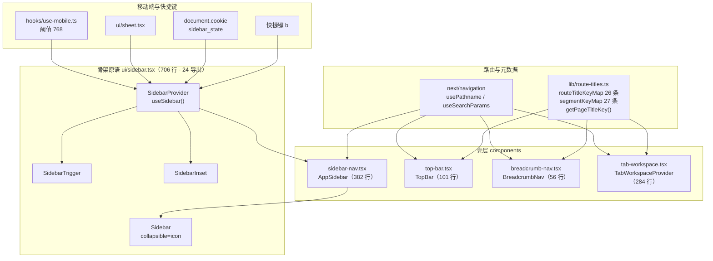
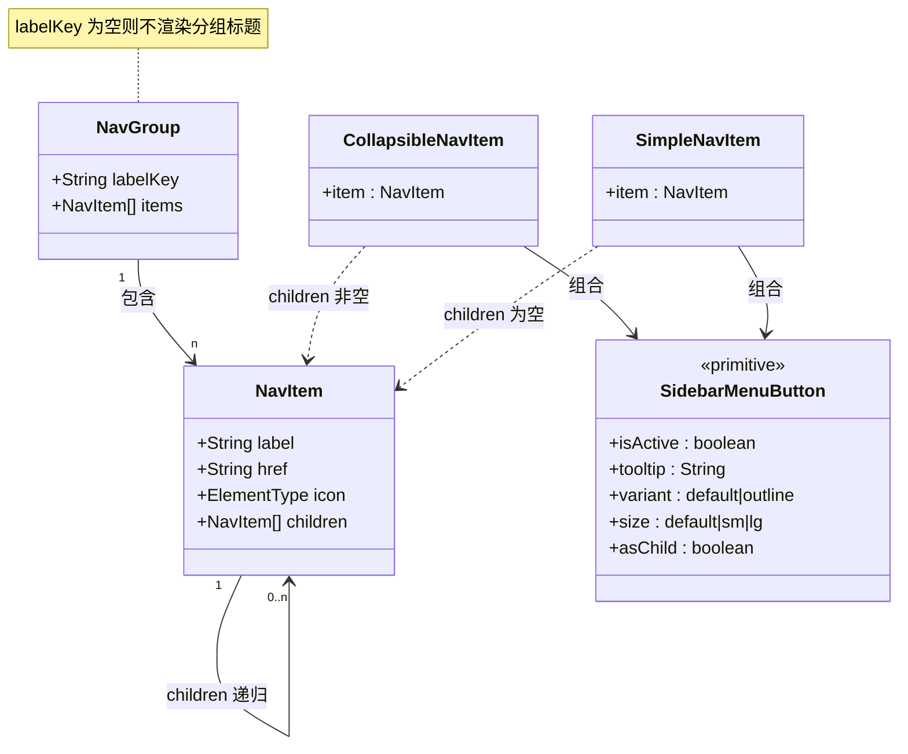
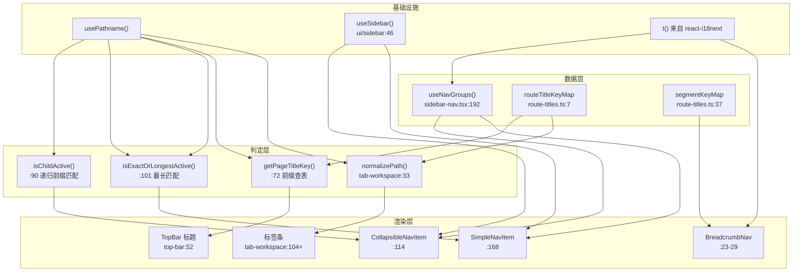
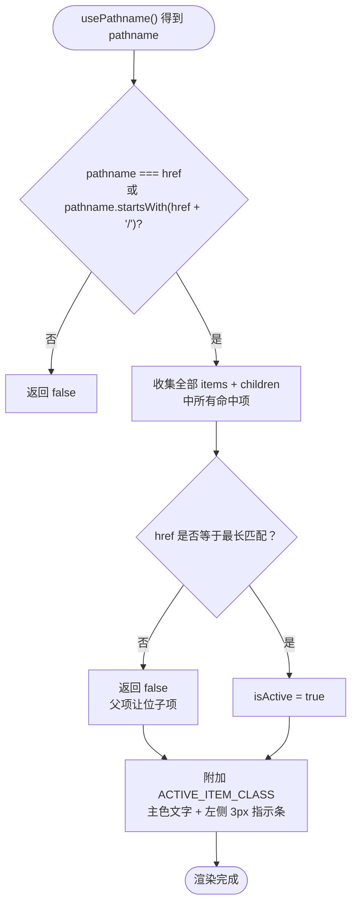
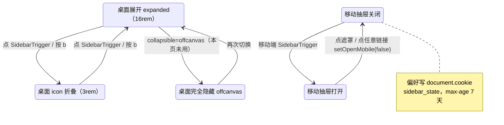
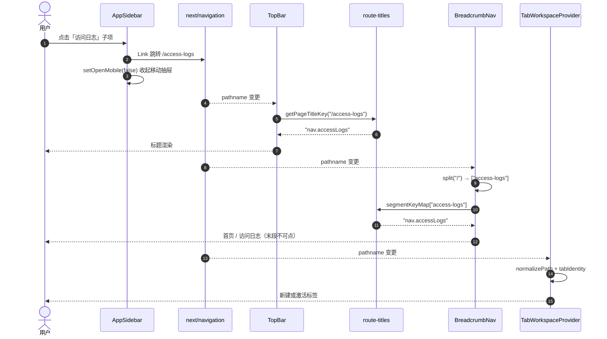
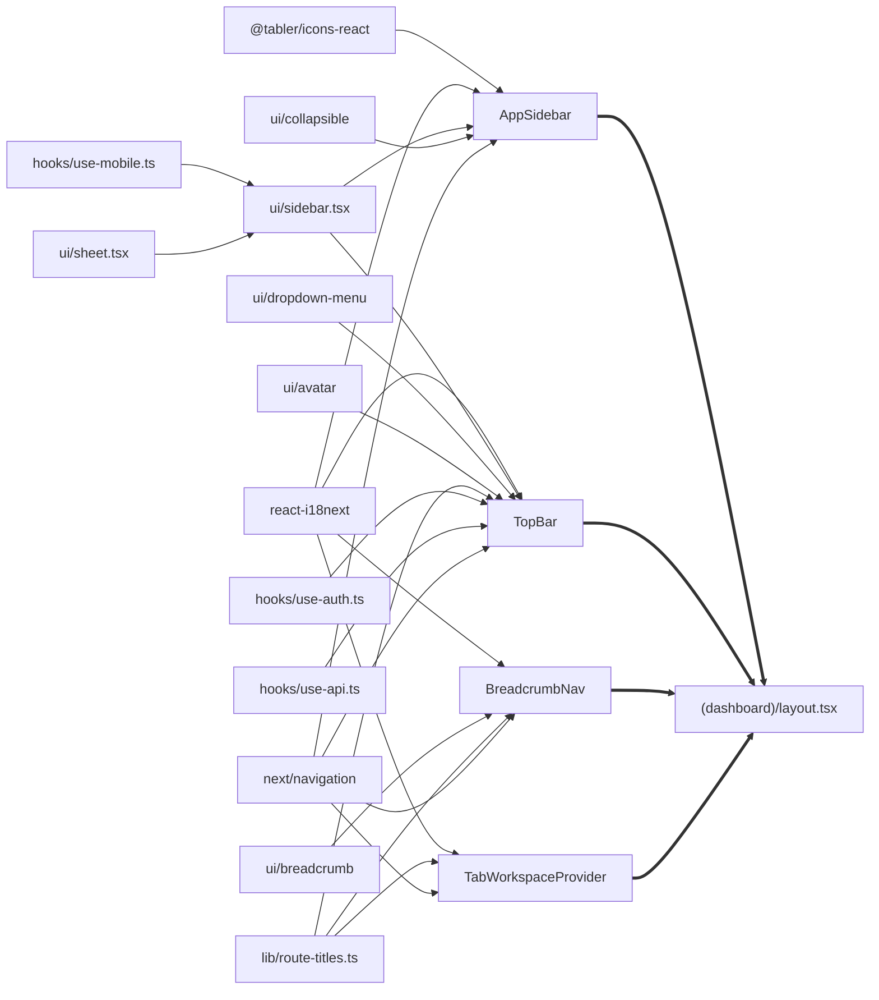

# 导航组件

> [返回 前端管理界面](../前端管理界面.md)

<cite>
**本文档引用的文件**
- [frontend/components/sidebar-nav.tsx](file://frontend/components/sidebar-nav.tsx)
- [frontend/components/top-bar.tsx](file://frontend/components/top-bar.tsx)
- [frontend/components/breadcrumb-nav.tsx](file://frontend/components/breadcrumb-nav.tsx)
- [frontend/components/tab-workspace.tsx](file://frontend/components/tab-workspace.tsx)
- [frontend/components/auth-gate.tsx](file://frontend/components/auth-gate.tsx)
- [frontend/components/appearance-toggle.tsx](file://frontend/components/appearance-toggle.tsx)
- [frontend/components/language-switcher.tsx](file://frontend/components/language-switcher.tsx)
- [frontend/components/theme-provider.tsx](file://frontend/components/theme-provider.tsx)
- [frontend/components/ui/sidebar.tsx](file://frontend/components/ui/sidebar.tsx)
- [frontend/components/ui/collapsible.tsx](file://frontend/components/ui/collapsible.tsx)
- [frontend/components/ui/breadcrumb.tsx](file://frontend/components/ui/breadcrumb.tsx)
- [frontend/components/ui/dropdown-menu.tsx](file://frontend/components/ui/dropdown-menu.tsx)
- [frontend/components/ui/avatar.tsx](file://frontend/components/ui/avatar.tsx)
- [frontend/components/ui/button.tsx](file://frontend/components/ui/button.tsx)
- [frontend/components/ui/sheet.tsx](file://frontend/components/ui/sheet.tsx)
- [frontend/components/ui/tooltip.tsx](file://frontend/components/ui/tooltip.tsx)
- [frontend/lib/route-titles.ts](file://frontend/lib/route-titles.ts)
- [frontend/lib/api.ts](file://frontend/lib/api.ts)
- [frontend/hooks/use-api.ts](file://frontend/hooks/use-api.ts)
- [frontend/hooks/use-auth.ts](file://frontend/hooks/use-auth.ts)
- [frontend/hooks/use-mobile.ts](file://frontend/hooks/use-mobile.ts)
- [frontend/app/layout.tsx](file://frontend/app/layout.tsx)
- [frontend/app/(dashboard)/layout.tsx](file://frontend/app/(dashboard)/layout.tsx)
- [frontend/app/(dashboard)/sites/detail/page.tsx](file://frontend/app/(dashboard)/sites/detail/page.tsx)
- [frontend/app/(dashboard)/sites/page.tsx](file://frontend/app/(dashboard)/sites/page.tsx)
- [frontend/next.config.ts](file://frontend/next.config.ts)
- [frontend/components.json](file://frontend/components.json)
- [frontend/app/globals.css](file://frontend/app/globals.css)
</cite>

## 目录

1. [简介](#简介)
2. [项目结构](#项目结构)
3. [核心组件](#核心组件)
4. [架构总览](#架构总览)
5. [详细组件分析](#详细组件分析)
6. [依赖关系分析](#依赖关系分析)
7. [性能考虑](#性能考虑)
8. [故障排查指南](#故障排查指南)
9. [结论](#结论)
10. [附录](#附录)

## 简介

My-OpenWaf 前端导航由 **4 个协作组件 + 1 个路由元数据源** 构成：`AppSidebar`（菜单）、`TopBar`（标题与全局动作）、`BreadcrumbNav`（路径）、`TabWorkspaceProvider`（多标签工作区），元数据集中在 `lib/route-titles.ts`。

本篇同时订正旧稿中一批**并不存在**的名字。下列符号经对 `frontend/components/`、`frontend/lib/`、`frontend/app/` 全量核对，均无对应实现，凡引用它们的描述都已改写为实测实现：

| 旧稿说法 | 实测事实 |
|----------|----------|
| `lib/console.ts` 为导航配置中心 | 不存在。导航数据在 `components/sidebar-nav.tsx:192-334` 的 `useNavGroups()`，标题映射在 `lib/route-titles.ts` |
| `layout/sidebar.tsx`、`layout/topbar.tsx` | 不存在。`components/` 为扁平结构，无 `layout/` 子目录 |
| `components/dashboard-topbar.tsx` | 不存在。顶部栏是 `components/top-bar.tsx` 的 `TopBar` |
| `ConsoleNavItem` / `ConsoleNavGroup` / `consoleNavGroups` | 实际类型名为 `NavItem`（`:76-81`）与 `NavGroup`（`:83-87`） |
| `getNavMeta(pathname)` | 实际函数是 `getPageTitleKey(pathname)`（`lib/route-titles.ts:72-77`） |
| 面包屑由 `TopBar` 内部生成 | 面包屑由独立的 `BreadcrumbNav` 渲染，挂在 `main` 内（`(dashboard)/layout.tsx:28`） |
| 图标来自 Lucide | 图标全部来自 `@tabler/icons-react`（`sidebar-nav.tsx:10-38` 导入 27 个） |
| 导航项含 `enabled`、`exact` 字段 | 实际字段只有 `label`、`href`、`icon`、`children?`；分组有 `labelKey?` |

## 项目结构

导航相关的实现文件与职责：

| 组件/文件 | 位置:行 | 职责 | 关键依赖 | 导出 |
|-----------|---------|------|----------|------|
| `AppSidebar` | `components/sidebar-nav.tsx:339-382` | 渲染 6 个分组的菜单树与页脚 | `ui/sidebar`、`ui/collapsible`、`@tabler/icons-react` | `AppSidebar` |
| `CollapsibleNavItem` | `components/sidebar-nav.tsx:114-165` | 带子项的可展开条目 | `Collapsible`、`SidebarMenuSub` | 文件私有 |
| `SimpleNavItem` | `components/sidebar-nav.tsx:168-189` | 无子项的普通条目 | `SidebarMenuButton asChild` | 文件私有 |
| `useNavGroups` | `components/sidebar-nav.tsx:192-334` | 构造导航数据（含 i18n 标签） | `react-i18next` | 文件私有 |
| `isChildActive` | `components/sidebar-nav.tsx:90-98` | 递归判断分组是否命中当前路径 | — | 文件私有 |
| `isExactOrLongestActive` | `components/sidebar-nav.tsx:101-111` | 最长匹配，避免父子同高亮 | — | 文件私有 |
| `TopBar` | `components/top-bar.tsx:32-101` | 标题、热重载、外观/语言、用户菜单 | `useAuth`、`useSystemReload`、`getPageTitleKey` | `TopBar` |
| `BreadcrumbNav` | `components/breadcrumb-nav.tsx:16-56` | 按路径片段生成面包屑 | `ui/breadcrumb`、`segmentKeyMap` | `BreadcrumbNav` |
| `TabWorkspaceProvider` | `components/tab-workspace.tsx:104-277` | 多标签打开/激活/关闭与持久化 | `useSearchParams`、`sessionStorage` | `TabWorkspaceProvider`、`useTabWorkspace` |
| 骨架原语 | `components/ui/sidebar.tsx`（706 行） | 折叠、断点、快捷键、cookie 持久化 | `useIsMobile`、`ui/sheet`、`ui/tooltip` | 24 个 `Sidebar*` + `useSidebar` |
| 元数据源 | `lib/route-titles.ts:7-77` | 路由 → i18n key 的单一真源 | — | `routeTitleKeyMap`、`segmentKeyMap`、`getPageTitleKey` |

**图表来源**
- [frontend/components/sidebar-nav.tsx:76-111](file://frontend/components/sidebar-nav.tsx#L76-L111)
- [frontend/components/sidebar-nav.tsx:192-334](file://frontend/components/sidebar-nav.tsx#L192-L334)
- [frontend/components/top-bar.tsx:26-54](file://frontend/components/top-bar.tsx#L26-L54)
- [frontend/components/breadcrumb-nav.tsx:14-29](file://frontend/components/breadcrumb-nav.tsx#L14-L29)
- [frontend/components/tab-workspace.tsx:18-83](file://frontend/components/tab-workspace.tsx#L18-L83)
- [frontend/components/ui/sidebar.tsx:27-53](file://frontend/components/ui/sidebar.tsx#L27-L53)
- [frontend/components/ui/sidebar.tsx:85-85](file://frontend/components/ui/sidebar.tsx#L85-L85)
- [frontend/hooks/use-mobile.ts:3-20](file://frontend/hooks/use-mobile.ts#L3-L20)
- [frontend/lib/route-titles.ts:7-77](file://frontend/lib/route-titles.ts#L7-L77)

**章节来源**
- [frontend/components/sidebar-nav.tsx:1-382](file://frontend/components/sidebar-nav.tsx#L1-L382)
- [frontend/components/top-bar.tsx:1-101](file://frontend/components/top-bar.tsx#L1-L101)
- [frontend/components/breadcrumb-nav.tsx:1-56](file://frontend/components/breadcrumb-nav.tsx#L1-L56)
- [frontend/components/tab-workspace.tsx:1-284](file://frontend/components/tab-workspace.tsx#L1-L284)
- [frontend/components/ui/sidebar.tsx:1-80](file://frontend/components/ui/sidebar.tsx#L1-L80)
- [frontend/lib/route-titles.ts:1-77](file://frontend/lib/route-titles.ts#L1-L77)
- [frontend/app/(dashboard)/layout.tsx:1-37](file://frontend/app/(dashboard)/layout.tsx#L1-L37)

## 核心组件

### 导航数据模型
`NavItem` 与 `NavGroup` 是本系统唯一的导航数据结构。二者都是文件内私有接口（未导出），字段极简：

**图表来源**
- [frontend/components/sidebar-nav.tsx:76-87](file://frontend/components/sidebar-nav.tsx#L76-L87)
- [frontend/components/sidebar-nav.tsx:114-189](file://frontend/components/sidebar-nav.tsx#L114-L189)
- [frontend/components/ui/sidebar.tsx:471-489](file://frontend/components/ui/sidebar.tsx#L471-L489)

字段取值口径：

| 字段 | 类型 | 必填 | 说明 | 位置 |
|------|------|:---:|------|------|
| `label` | `string` | 是 | 已翻译好的显示文本，由 `useNavGroups` 内 `t(...)` 产生 | `sidebar-nav.tsx:77` |
| `href` | `string` | 是 | 路由路径，无尾斜杠（与 `trailingSlash: true` 的 `usePathname()` 结果不同，见活动态判定） | `:78` |
| `icon` | `React.ElementType` | 是 | Tabler 图标组件本身，非组件名 | `:79` |
| `children` | `NavItem[]?` | 否 | 子项数组；非空即走可展开分支 | `:80` |
| `NavGroup.labelKey` | `string?` | 否 | 分组标题的 i18n key；为空则不渲染 `SidebarGroupLabel` | `:85-86` |
| `NavGroup.items` | `NavItem[]` | 是 | 分组内条目 | `:87` |

**章节来源**
- [frontend/components/sidebar-nav.tsx:76-87](file://frontend/components/sidebar-nav.tsx#L76-L87)
- [frontend/components/ui/sidebar.tsx:471-489](file://frontend/components/ui/sidebar.tsx#L471-L489)

### 六个分组与条目数
`useNavGroups()` 每次调用重新构造（因为要读 `t`），返回值结构固定为 6 组：

| 序 | 分组标题 key | 顶级条目 | 其中含子菜单 | 子项数 |
|:--:|--------------|:---:|:---:|:---:|
| 1 | — | `dashboard` | 0 | 0 |
| 2 | — | `sites` | 0 | 0 |
| 3 | — | `security`（父项本身即 `/security-events`） | 1 | 8 |
| 4 | `nav.groupProtection` | `policies`、`rules`、`plugins`、`cc-protection`、`captcha`、`auth-config` | 2 | 3（rules）+ 2（plugins） |
| 5 | `nav.groupNetwork` | `certificates`、`ip-lists`、`threat-intel` | 0 | 0 |
| 6 | `nav.groupSystem` | `api-keys`、`admin-users`、`page-templates`、`backup`、`settings` | 0 | 0 |

合计 17 个顶级条目、13 个子项，去重后覆盖 27 个不同 `href`。

**章节来源**
- [frontend/components/sidebar-nav.tsx:76-87](file://frontend/components/sidebar-nav.tsx#L76-L87)
- [frontend/components/sidebar-nav.tsx:192-334](file://frontend/components/sidebar-nav.tsx#L192-L334)

## 架构总览

导航系统的分层从「路由状态」到「渲染」是单向的，且所有文案都经过 i18n key 中转。

**图表来源**
- [frontend/components/sidebar-nav.tsx:90-189](file://frontend/components/sidebar-nav.tsx#L90-L189)
- [frontend/components/sidebar-nav.tsx:192-334](file://frontend/components/sidebar-nav.tsx#L192-L334)
- [frontend/lib/route-titles.ts:7-77](file://frontend/lib/route-titles.ts#L7-L77)
- [frontend/components/top-bar.tsx:28-54](file://frontend/components/top-bar.tsx#L28-L54)
- [frontend/components/breadcrumb-nav.tsx:20-29](file://frontend/components/breadcrumb-nav.tsx#L20-L29)
- [frontend/components/tab-workspace.tsx:33-83](file://frontend/components/tab-workspace.tsx#L33-L83)
- [frontend/components/ui/sidebar.tsx:46-53](file://frontend/components/ui/sidebar.tsx#L46-L53)

## 详细组件分析

### 路由映射表
下表把侧栏条目、标题 key、面包屑 key 与页面文件三方对齐，全部取自实测源码。`—` 表示该表未收录该项。

| 路由 | 页面文件 | 标题 i18n key | 面包屑片段 key | 分组 |
|------|----------|---------------|----------------|------|
| `/dashboard` | `app/(dashboard)/dashboard/page.tsx` | `nav.dashboard` | `nav.dashboard` | 组 1 |
| `/sites` | `app/(dashboard)/sites/page.tsx` | `nav.sites` | `nav.sites` | 组 2 |
| `/sites/detail` | `app/(dashboard)/sites/detail/page.tsx` | `nav.sites`（前缀命中） | `common.detail` | 组 2 派生 |
| `/security-events` | `security-events/page.tsx` | `nav.securityEvents` | `nav.securityEvents` | 组 3（父项 + 子项） |
| `/access-logs` | `access-logs/page.tsx` | `nav.accessLogs` | `nav.accessLogs` | 组 3 子项 |
| `/request-trace` | `request-trace/page.tsx` | `nav.requestTrace` | `nav.requestTrace` | 组 3 子项 |
| `/drop-events` | `drop-events/page.tsx` | `nav.dropEvents` | `nav.dropEvents` | 组 3 子项 |
| `/attacks` | `attacks/page.tsx` | `nav.attacks` | `nav.attacks` | 组 3 子项 |
| `/false-positives` | `false-positives/page.tsx` | `nav.falsePositives` | `nav.falsePositives` | 组 3 子项 |
| `/upstream-status` | `upstream-status/page.tsx` | `nav.upstreamStatus` | `nav.upstreamStatus` | 组 3 子项 |
| `/tls-fingerprints` | `tls-fingerprints/page.tsx` | **未收录** → 回落 `My OpenWAF` | **未收录** → 显示原始片段 | 组 3 子项 |
| `/policies` | `policies/page.tsx` | `nav.policies` | `nav.policies` | 组 4 |
| `/rules` | `rules/page.tsx` | `nav.rules` | `nav.rules` | 组 4（父项 + 子项） |
| `/rules/owasp` | `rules/owasp/page.tsx` | `nav.owaspRules` | `nav.owaspRules` | 组 4 子项 |
| `/rules/cve` | `rules/cve/page.tsx` | `nav.cveRules` | `nav.cveRules` | 组 4 子项 |
| `/lua-plugins` | `lua-plugins/page.tsx` | `nav.luaPlugins` | `nav.luaPlugins` | 组 4（父项 + 子项） |
| `/js-plugins` | `js-plugins/page.tsx` | `nav.jsPlugins` | `nav.jsPlugins` | 组 4 子项 |
| `/cc-protection` | `cc-protection/page.tsx` | `nav.ccProtection` | `nav.ccProtection` | 组 4 |
| `/captcha` | `captcha/page.tsx` | `nav.captcha` | `nav.captcha` | 组 4 |
| `/auth-config` | `auth-config/page.tsx` | `nav.authConfig` | `nav.authConfig` | 组 4 |
| `/certificates` | `certificates/page.tsx` | `nav.certificates` | `nav.certificates` | 组 5 |
| `/ip-lists` | `ip-lists/page.tsx` | `nav.ipLists` | `nav.ipLists` | 组 5 |
| `/threat-intel` | `threat-intel/page.tsx` | `nav.threatIntel` | `nav.threatIntel` | 组 5 |
| `/api-keys` | `api-keys/page.tsx` | `nav.apiKeys` | `nav.apiKeys` | 组 6 |
| `/admin-users` | `admin-users/page.tsx` | `nav.adminUsers` | `nav.adminUsers` | 组 6 |
| `/page-templates` | `page-templates/page.tsx` | `nav.pageTemplates` | `nav.pageTemplates` | 组 6 |
| `/backup` | `backup/page.tsx` | `nav.backup` | `nav.backup` | 组 6 |
| `/settings` | `settings/page.tsx` | `nav.settings` | `nav.settings` | 组 6 |

非控制台路由（不在侧栏，也不在标题映射内）：`/login/`、`/block/`、`/error/`、`/maintenance/`、`/security-dashboard/`。

**章节来源**
- [frontend/lib/route-titles.ts:7-65](file://frontend/lib/route-titles.ts#L7-L65)
- [frontend/components/sidebar-nav.tsx:192-334](file://frontend/components/sidebar-nav.tsx#L192-L334)
- [frontend/components/top-bar.tsx:28-30](file://frontend/components/top-bar.tsx#L28-L30)

### 侧边栏：折叠、展开与活动态

`AppSidebar`（`sidebar-nav.tsx:339-382`）的结构是固定的三段式：`SidebarHeader`（`IconShieldCheck` + `OpenWAF` 字样，折叠时只留图标）、`SidebarContent`（6 个 `SidebarGroup`）、`SidebarFooter`（版本号文本，折叠时不渲染）。骨架由 `<Sidebar collapsible="icon">`（`:346`）提供整栏 icon 折叠能力。

活动态判定分两步，且两处都做了前缀匹配修正：

**图表来源**
- [frontend/components/sidebar-nav.tsx:90-111](file://frontend/components/sidebar-nav.tsx#L90-L111)
- [frontend/components/sidebar-nav.tsx:69-74](file://frontend/components/sidebar-nav.tsx#L69-L74)

三个必须知道的实现细节：

1. **为什么需要「最长匹配」**：`/security-events` 既是父项 `href` 又是第一个子项 `href`，若只做前缀匹配，父项与子项会同时高亮。`isExactOrLongestActive()`（`:101-111`）把所有命中项按 `href.length` 取最长者，只有它标活。
2. **活动态样式是覆写的**：shadcn 默认 `SidebarMenuButton` 的活动底色与 hover 底色相同（都是 `bg-sidebar-accent`），鼠标划过时分不清哪个是当前页。`ACTIVE_ITEM_CLASS`（`:69-70`）与 `ACTIVE_SUB_ITEM_CLASS`（`:73-74`）叠加 `data-[active=true]:text-primary` 与 `before:` 伪元素指示条（父项 3px、子项 0.5px），注释见 `:62-68`。
3. **展开态由命中情况决定**：`CollapsibleNavItem` 用 `defaultOpen={groupActive}`（`:123`）让当前命中的分组默认展开；`groupActive` 来自对子项的递归判定（`:118-120`）。

分组标题只在 `labelKey` 非空时渲染（`:358-360`），因此前 3 组在视觉上是无标题块。

**章节来源**
- [frontend/components/sidebar-nav.tsx:62-111](file://frontend/components/sidebar-nav.tsx#L62-L111)
- [frontend/components/sidebar-nav.tsx:114-189](file://frontend/components/sidebar-nav.tsx#L114-L189)
- [frontend/components/sidebar-nav.tsx:339-382](file://frontend/components/sidebar-nav.tsx#L339-L382)
- [frontend/components/ui/collapsible.tsx:1-33](file://frontend/components/ui/collapsible.tsx#L1-L33)

### 侧栏骨架：状态、断点与持久化

`ui/sidebar.tsx` 用 `SidebarContext` 把折叠状态、移动端抽屉状态与切换函数集中暴露（`SidebarContextProps:34-42`），`useSidebar()`（`:46-53`）在脱离 `SidebarProvider` 时直接抛错。

| 常量/能力 | 取值或实现 | 位置 |
|-----------|------------|------|
| `SIDEBAR_COOKIE_NAME` | `sidebar_state` | `ui/sidebar.tsx:27` |
| `SIDEBAR_COOKIE_MAX_AGE` | `60 * 60 * 24 * 7`（7 天） | `:28` |
| `SIDEBAR_WIDTH` | `16rem` | `:29` |
| `SIDEBAR_WIDTH_MOBILE` | `18rem` | `:30` |
| `SIDEBAR_WIDTH_ICON` | `3rem`（icon 折叠后的宽度） | `:31` |
| `SIDEBAR_KEYBOARD_SHORTCUT` | `"b"` | `:32` |
| 状态持久化 | `document.cookie = "sidebar_state=…; path=/; max-age=…"` | `:85` |
| 断点判定 | `useIsMobile()`，阈值 768 | `:7`、`hooks/use-mobile.ts:3` |
| 移动端载体 | `Sheet` + `SheetContent` | `:184-202` |
| 桌面显隐 | `hidden md:flex` + `w-(--sidebar-width)` | `:232` |
| 菜单按钮变体 | `sidebarMenuButtonVariants`（2 变体 × 3 尺寸） | `:471-489` |

这里的 cookie 是**浏览器端** `document.cookie` 写入，不是 Next.js 的 `cookies()` API——后者在 `output: "export"` 下不受支持（静态导出明确排除 `Cookies` 特性），因此这是静态导出场景下的唯一可行写法。

**图表来源**
- [frontend/components/ui/sidebar.tsx:27-32](file://frontend/components/ui/sidebar.tsx#L27-L32)
- [frontend/components/ui/sidebar.tsx:85-85](file://frontend/components/ui/sidebar.tsx#L85-L85)
- [frontend/components/ui/sidebar.tsx:184-232](file://frontend/components/ui/sidebar.tsx#L184-L232)
- [frontend/components/sidebar-nav.tsx:152-152](file://frontend/components/sidebar-nav.tsx#L152-L152)
- [frontend/components/sidebar-nav.tsx:182-182](file://frontend/components/sidebar-nav.tsx#L182-L182)

**章节来源**
- [frontend/components/ui/sidebar.tsx:27-53](file://frontend/components/ui/sidebar.tsx#L27-L53)
- [frontend/components/ui/sidebar.tsx:85-85](file://frontend/components/ui/sidebar.tsx#L85-L85)
- [frontend/components/ui/sidebar.tsx:184-232](file://frontend/components/ui/sidebar.tsx#L184-L232)
- [frontend/components/ui/sidebar.tsx:471-489](file://frontend/components/ui/sidebar.tsx#L471-L489)
- [frontend/hooks/use-mobile.ts:1-20](file://frontend/hooks/use-mobile.ts#L1-L20)
- [frontend/next.config.ts:3-14](file://frontend/next.config.ts#L3-L14)

### 顶部栏与面包屑的分工

`TopBar` 只做「当前页是什么 + 全局动作」，不做路径展示：

| 元素 | 行为 | 位置 |
|------|------|------|
| `SidebarTrigger` | `h-8 w-8`，唯一折叠入口 | `top-bar.tsx:51` |
| 标题 `<h1>` | `t(getPageTitle(pathname))`，`text-sm` 在 `lg` 升为 `text-base` | `:52-54` |
| 热重载按钮 | `useSystemReload()`，非 `admin`/`operator` 禁用并提示 `common.readOnlyHint`；`reload.loading` 时图标 `animate-spin`；`hidden sm:flex` | `:56-70` |
| 外观/语言 | `ThemeToggle`、`AccentToggle`、`LanguageSwitcher` | `:71-73` |
| 用户菜单 | `DropdownMenu`，头像回落取用户名前 2 字符大写，否则 `U` | `:74-97` |
| 退出登录 | `DropdownMenuItem` + `IconLogout`，直接调 `useAuth().logout`（端点 `authApi.logout`，`lib/api.ts:732`） | `:89-95` |

`BreadcrumbNav` 与 `TopBar` 完全解耦，各自独立调用 `usePathname()`：把路径按 `/` 切片（`:20`），逐段构造 `href` 前缀（`:24`），有 key 就翻译、无 key 就 `decodeURIComponent(segment)` 原样显示（`:25-27`），末段用 `BreadcrumbPage`（不可点），其余用 `Link`；首项恒为指向 `/dashboard` 的 `common.home`（`:34-38`）。根路径（切片为空）直接返回 `null`（`:21`）。

**图表来源**
- [frontend/components/sidebar-nav.tsx:146-158](file://frontend/components/sidebar-nav.tsx#L146-L158)
- [frontend/components/top-bar.tsx:28-54](file://frontend/components/top-bar.tsx#L28-L54)
- [frontend/lib/route-titles.ts:72-77](file://frontend/lib/route-titles.ts#L72-L77)
- [frontend/components/breadcrumb-nav.tsx:20-52](file://frontend/components/breadcrumb-nav.tsx#L20-L52)
- [frontend/components/tab-workspace.tsx:33-53](file://frontend/components/tab-workspace.tsx#L33-L53)

**章节来源**
- [frontend/components/top-bar.tsx:1-101](file://frontend/components/top-bar.tsx#L1-L101)
- [frontend/components/breadcrumb-nav.tsx:1-56](file://frontend/components/breadcrumb-nav.tsx#L1-L56)
- [frontend/lib/route-titles.ts:1-77](file://frontend/lib/route-titles.ts#L1-L77)
- [frontend/components/appearance-toggle.tsx:20-104](file://frontend/components/appearance-toggle.tsx#L20-L104)
- [frontend/components/language-switcher.tsx:1-41](file://frontend/components/language-switcher.tsx#L1-L41)
- [frontend/hooks/use-auth.ts:300-309](file://frontend/hooks/use-auth.ts#L300-L309)
- [frontend/hooks/use-api.ts:1-40](file://frontend/hooks/use-api.ts#L1-L40)

### 多标签工作区与尾斜杠适配

`TabWorkspaceProvider` 是「文档式」导航的载体：顶部标签条随路由自动新增/激活，关闭后回到相邻标签。它与 `trailingSlash: true`（`next.config.ts:6`）之间有硬耦合：

- 固定标签 `PINNED_PATH = "/dashboard/"` 显式带尾斜杠，注释写明原因（`tab-workspace.tsx:24-25`）。
- `normalizePath()`（`:33-45`）同时做两件事：去掉非根路径的尾斜杠、把查询参数排序后重组。前者防止「`/dashboard` 与 `/dashboard/` 生成两个标签」，后者保证参数顺序不影响身份。
- `tabIdentity()`（`:47-53`）为站点详情开了特例：只有 `/sites/detail` 会把 `?id=` 纳入身份，其余路径一律以 pathname 为身份——这意味着同一页面的不同页签（`?tab=`）不会各自占用一个标签。
- 持久化键 `owaf.workspace.tabs` 写在 `sessionStorage`（`:26`），`loadTabs()`（`:86-102`）用 try/catch 包裹 JSON 解析，坏数据回落为空数组。
- 标题复用同一份映射：`resolveTab()`（`:72-83`）用 `getPageTitleKey(pathname)` 取 `titleKey`，无映射时回落到路径最后一段的解码文本（`:76-77`）。
- 由于内部使用 `useSearchParams()`，`(dashboard)/layout.tsx:25` 必须把它包在 `<Suspense>` 里——这在静态导出预渲染时是强制要求。

**章节来源**
- [frontend/components/tab-workspace.tsx:18-102](file://frontend/components/tab-workspace.tsx#L18-L102)
- [frontend/components/tab-workspace.tsx:104-284](file://frontend/components/tab-workspace.tsx#L104-L284)
- [frontend/lib/route-titles.ts:72-77](file://frontend/lib/route-titles.ts#L72-L77)
- [frontend/next.config.ts:3-14](file://frontend/next.config.ts#L3-L14)
- [frontend/app/(dashboard)/layout.tsx:20-35](file://frontend/app/(dashboard)/layout.tsx#L20-L35)
- [frontend/app/(dashboard)/sites/detail/page.tsx:77-91](file://frontend/app/(dashboard)/sites/detail/page.tsx#L77-L91)

## 依赖关系分析

| 依赖方 | 被依赖方 | 形式 | 位置 |
|--------|----------|------|------|
| `AppSidebar` | `ui/sidebar`（13 个子组件） | 组合 | `sidebar-nav.tsx:40-60` |
| `AppSidebar` | `ui/collapsible` | 组合 | `:40-44` |
| `AppSidebar` | `@tabler/icons-react` | 27 个图标 | `:10-38` |
| `AppSidebar` | `react-i18next` | `useTranslation` | `:39`、`:193` |
| `TopBar` | `lib/route-titles` | `getPageTitleKey` | `top-bar.tsx:26` |
| `TopBar` | `hooks/use-auth`、`hooks/use-api` | 用户态与热重载 | `:10`、`:21` |
| `TopBar` | `ui/dropdown-menu`、`ui/avatar`、`ui/sidebar` | 菜单、头像、触发器 | `:12-18`、`:24` |
| `TopBar` | `appearance-toggle`、`language-switcher` | 外观与语言 | `:23`、`:25` |
| `BreadcrumbNav` | `lib/route-titles` | `segmentKeyMap` | `breadcrumb-nav.tsx:14` |
| `BreadcrumbNav` | `ui/breadcrumb` | 7 个子组件 | `:6-13` |
| `TabWorkspaceProvider` | `lib/route-titles` | `getPageTitleKey` | `tab-workspace.tsx:22` |
| `ui/sidebar` | `hooks/use-mobile`、`ui/sheet`、`ui/tooltip`、`ui/button`、`ui/input`、`ui/separator`、`ui/skeleton` | 骨架内部组合 | `ui/sidebar.tsx:7-24` |
| `(dashboard)/layout.tsx` | 上述全部壳层组件 | 装配 | `layout.tsx:14-35` |

外部实体边界：`usePathname`/`useSearchParams`/`useRouter` 来自 `next/navigation`；`document.cookie`、`sessionStorage`、`window.matchMedia` 来自浏览器；`logout` 经 `lib/api.ts` 调 `POST /api/v1/auth/logout`（`lib/api.ts:732`）。

**图表来源**
- [frontend/components/sidebar-nav.tsx:8-60](file://frontend/components/sidebar-nav.tsx#L8-L60)
- [frontend/components/top-bar.tsx:8-26](file://frontend/components/top-bar.tsx#L8-L26)
- [frontend/components/breadcrumb-nav.tsx:3-14](file://frontend/components/breadcrumb-nav.tsx#L3-L14)
- [frontend/components/tab-workspace.tsx:18-22](file://frontend/components/tab-workspace.tsx#L18-L22)
- [frontend/components/ui/sidebar.tsx:3-25](file://frontend/components/ui/sidebar.tsx#L3-L25)
- [frontend/app/(dashboard)/layout.tsx:6-12](file://frontend/app/(dashboard)/layout.tsx#L6-L12)

**章节来源**
- [frontend/components/sidebar-nav.tsx:1-60](file://frontend/components/sidebar-nav.tsx#L1-L60)
- [frontend/components/top-bar.tsx:1-27](file://frontend/components/top-bar.tsx#L1-L27)
- [frontend/components/breadcrumb-nav.tsx:1-15](file://frontend/components/breadcrumb-nav.tsx#L1-L15)
- [frontend/components/tab-workspace.tsx:1-23](file://frontend/components/tab-workspace.tsx#L1-L23)
- [frontend/components/ui/sidebar.tsx:1-32](file://frontend/components/ui/sidebar.tsx#L1-L32)
- [frontend/app/(dashboard)/layout.tsx:1-37](file://frontend/app/(dashboard)/layout.tsx#L1-L37)

## 性能考虑

- 文案解析零成本：`getPageTitleKey()` 是对 26 条记录的线性前缀扫描（`route-titles.ts:72-77`），不在渲染热路径上引入查表结构是合理的规模判断。
- 最长匹配只遍历一次：`isExactOrLongestActive()`（`sidebar-nav.tsx:101-111`）用 `flatMap` + `reduce` 在单个条目渲染内完成，代价是每项一次小数组构造——由于导航总量固定在 30 项以内，实测不构成瓶颈。
- 子菜单不预渲染内容：`CollapsibleContent` 折叠时不展开子树（`:136-161`），移动端未打开抽屉时也不渲染。
- 状态集中在 Context：`SidebarContext`（`ui/sidebar.tsx:44`）避免逐层透传 `collapsed`，`useSidebar()` 只在需要的三个组件里订阅（`sidebar-nav.tsx:116`、`:170`、`:341`）。
- 标签持久化用 `sessionStorage` 而非 `localStorage`（`tab-workspace.tsx:26`），会话结束即释放，避免长期累积。
- 图标按需引用：27 个图标全部具名导入（`sidebar-nav.tsx:10-38`），配合 Tailwind v4 + Turbopack 的 tree-shaking 不引入整包。
- 断点监听单点：`useIsMobile()` 只在 `SidebarProvider` 内调用一次（`ui/sidebar.tsx:68`），子组件通过 Context 读 `isMobile`，不各自 `matchMedia`。

**章节来源**
- [frontend/lib/route-titles.ts:72-77](file://frontend/lib/route-titles.ts#L72-L77)
- [frontend/components/sidebar-nav.tsx:101-111](file://frontend/components/sidebar-nav.tsx#L101-L111)
- [frontend/components/sidebar-nav.tsx:136-161](file://frontend/components/sidebar-nav.tsx#L136-L161)
- [frontend/components/ui/sidebar.tsx:44-53](file://frontend/components/ui/sidebar.tsx#L44-L53)
- [frontend/components/tab-workspace.tsx:26-26](file://frontend/components/tab-workspace.tsx#L26-L26)
- [frontend/hooks/use-mobile.ts:5-20](file://frontend/hooks/use-mobile.ts#L5-L20)

## 故障排查指南

| 症状 | 成因 | 处置 |
|------|------|------|
| 父项与子项同时高亮 | 只做了前缀匹配 | 用 `isExactOrLongestActive()`（`sidebar-nav.tsx:101`）而非直接前缀判断 |
| 某页标题显示 `My OpenWAF` | `routeTitleKeyMap` 未收录该前缀 | 在 `lib/route-titles.ts:7-34` 补条目；`getPageTitle()` 回落逻辑见 `top-bar.tsx:28-30` |
| 面包屑出现英文原始片段 | `segmentKeyMap` 未收录该片段 | 在 `:37-65` 补片段 key；无映射时按 `breadcrumb-nav.tsx:25-27` 原样显示 |
| 同一页面出现两个标签 | 尾斜杠或参数顺序不一致 | 检查 `normalizePath()`（`tab-workspace.tsx:33`）是否覆盖新路径形态 |
| 不同站点详情页互相覆盖 | `/sites/detail` 的身份特例失效 | 确认链接带 `?id=`，见 `tabIdentity()`（`:47-53`） |
| 移动端点菜单后抽屉不关 | 漏调 `setOpenMobile(false)` | 参照 `sidebar-nav.tsx:152`、`:182` 的 `Link onClick` |
| 折叠偏好刷新后丢失 | cookie 未写成功（如隐私模式） | 写入点 `ui/sidebar.tsx:85`；键 `sidebar_state`，`max-age` 7 天 |
| 折叠按钮无效 | 组件在 `SidebarProvider` 之外 | `useSidebar()` 会抛 `useSidebar must be used within a SidebarProvider.`（`:46-52`） |
| 布局整体不渲染 | 认证未通过 | `AuthGate` 在 `checked && !isAuthenticated` 时 `router.replace("/login")`（`auth-gate.tsx:31-35`），未通过前只渲染加载态 |
| 构建期报 `useSearchParams` 相关错误 | 静态导出下缺少 Suspense 边界 | `useSearchParams()` 的消费者必须在 `<Suspense>` 内，见 `(dashboard)/layout.tsx:25` |
| 页脚版本号与包版本不符 | 版本字符串硬编码 | `sidebar-nav.tsx:377` 写死 `v1.0.0`，`package.json:3` 是 `0.0.1` |

**章节来源**
- [frontend/components/sidebar-nav.tsx:101-111](file://frontend/components/sidebar-nav.tsx#L101-L111)
- [frontend/components/sidebar-nav.tsx:152-182](file://frontend/components/sidebar-nav.tsx#L152-L182)
- [frontend/components/sidebar-nav.tsx:375-379](file://frontend/components/sidebar-nav.tsx#L375-L379)
- [frontend/lib/route-titles.ts:7-65](file://frontend/lib/route-titles.ts#L7-L65)
- [frontend/components/top-bar.tsx:28-30](file://frontend/components/top-bar.tsx#L28-L30)
- [frontend/components/breadcrumb-nav.tsx:25-27](file://frontend/components/breadcrumb-nav.tsx#L25-L27)
- [frontend/components/tab-workspace.tsx:33-53](file://frontend/components/tab-workspace.tsx#L33-L53)
- [frontend/components/ui/sidebar.tsx:46-52](file://frontend/components/ui/sidebar.tsx#L46-L52)
- [frontend/components/ui/sidebar.tsx:85-85](file://frontend/components/ui/sidebar.tsx#L85-L85)
- [frontend/components/auth-gate.tsx:31-44](file://frontend/components/auth-gate.tsx#L31-L44)
- [frontend/app/(dashboard)/layout.tsx:20-35](file://frontend/app/(dashboard)/layout.tsx#L20-L35)

## 结论

My-OpenWaf 的导航系统由四个职责互不重叠的组件构成，靠一份路由元数据保持一致性：

1. **单一数据源**：标题与面包屑都从 `lib/route-titles.ts` 派生，不存在第二处路径—文案映射，符合 DRY。
2. **职责分离**：`AppSidebar` 只管「去哪」，`TopBar` 只管「在哪 + 全局动作」，`BreadcrumbNav` 只管「路径链」，`TabWorkspaceProvider` 只管「开过哪些页」，四者互不引用，可独立替换，符合 SRP。
3. **响应式内聚**：断点、抽屉、快捷键、偏好持久化全部收在 `ui/sidebar.tsx` 原语层，业务侧只需 `<Sidebar collapsible="icon">`，符合 KISS。
4. **与静态导出对齐**：用 `document.cookie` 与 `sessionStorage` 替代服务端 cookie 与路由级缓存能力，`useSearchParams` 的消费者显式包 `Suspense`，不依赖任何需要 Node 运行时的 Next 特性。

待改进项（如实记录，未擅自改代码）：`routeTitleKeyMap` 与 `segmentKeyMap` 均缺 `/tls-fingerprints`，导致该页标题回落、面包屑显示原始片段；`sidebar-nav.tsx:377` 的页脚版本号为硬编码；`tab-workspace.tsx:278` 的 `useTabWorkspace` 目前无调用方。

## 附录

### 新增菜单项的正确步骤
| 步 | 操作 | 文件 |
|:--:|------|------|
| 1 | 建页面目录与 `page.tsx`（首行 `"use client"`） | `app/(dashboard)/{name}/page.tsx` |
| 2 | 在 `routeTitleKeyMap` 增加 `/{name}` → `nav.{name}` | `lib/route-titles.ts:7-34` |
| 3 | 在 `segmentKeyMap` 增加 `{name}` → `nav.{name}` | `:37-65` |
| 4 | 在对应分组的 `items` 里加 `{ label: t("nav.{name}"), href: "/{name}", icon: IconXxx }` | `components/sidebar-nav.tsx:192-334` |
| 5 | 从 `@tabler/icons-react` 具名导入图标 | `components/sidebar-nav.tsx:10-38` |
| 6 | 在 `zh.json` 与 `en.json` 的 `nav` 段补同一 key（两份语言包各 2540 行） | `lib/i18n/locales/` |

漏做第 2、3 步不会报错，只会静默回落成默认标题与原始路径片段——这是最常被遗漏的两步。

**章节来源**
- [frontend/lib/route-titles.ts:7-65](file://frontend/lib/route-titles.ts#L7-L65)
- [frontend/components/sidebar-nav.tsx:10-38](file://frontend/components/sidebar-nav.tsx#L10-L38)
- [frontend/package.json:12-22](file://frontend/package.json#L12-L22)
- [frontend/app/(dashboard)/policies/page.tsx:1-33](file://frontend/app/(dashboard)/policies/page.tsx#L1-L33)

### 键盘与偏好速查
| 项 | 值 | 位置 |
|----|----|------|
| 侧栏折叠快捷键 | `b` | `ui/sidebar.tsx:32` |
| 主题切换快捷键 | `d`（输入控件聚焦时忽略） | `theme-provider.tsx:50-56`、`:24-35` |
| 折叠偏好存储 | cookie `sidebar_state`，7 天 | `ui/sidebar.tsx:27-28`、`:85` |
| 多标签存储 | `sessionStorage` 键 `owaf.workspace.tabs` | `tab-workspace.tsx:26` |
| 强调色存储 | `localStorage` 键 `owaf.accent` | `appearance-toggle.tsx:16` |
| 站点视图偏好 | `localStorage` 键 `owaf.sites.view` | `sites/page.tsx:50` |

**章节来源**
- [frontend/components/ui/sidebar.tsx:27-32](file://frontend/components/ui/sidebar.tsx#L27-L32)
- [frontend/components/ui/sidebar.tsx:85-85](file://frontend/components/ui/sidebar.tsx#L85-L85)
- [frontend/components/theme-provider.tsx:24-56](file://frontend/components/theme-provider.tsx#L24-L56)
- [frontend/components/appearance-toggle.tsx:16-16](file://frontend/components/appearance-toggle.tsx#L16-L16)
- [frontend/components/tab-workspace.tsx:26-26](file://frontend/components/tab-workspace.tsx#L26-L26)
- [frontend/app/(dashboard)/sites/page.tsx:50-50](file://frontend/app/(dashboard)/sites/page.tsx#L50-L50)

### 兼容矩阵
| 能力 | 桌面 ≥768px | 移动 <768px | 说明 |
|------|:---:|:---:|------|
| 侧栏常驻 | ✓ | ✗ | `hidden md:flex`（`ui/sidebar.tsx:232`） |
| 侧栏 icon 折叠 | ✓ | — | 移动端由抽屉取代，折叠无意义 |
| 抽屉导航 | ✗ | ✓ | `Sheet`，宽 18rem（`:30`、`:184-202`） |
| 子菜单展开 | ✓ | ✓ | `Collapsible`，命中分组默认展开（`sidebar-nav.tsx:123`） |
| 热重载按钮 | ✓ | ✗（<640px 隐藏） | `hidden sm:flex`（`top-bar.tsx:64`） |
| 面包屑 | ✓ | ✓ | 根路径不渲染（`breadcrumb-nav.tsx:21`） |
| RTL 起始边指示条 | ✓ | ✓ | `before:start-0`，随 `rtl: true` 镜像（`sidebar-nav.tsx:69-74`） |
| 暗色模式活动态 | ✓ | ✓ | `bg-primary/10` + `text-primary`，两套变量均有定义 |

**章节来源**
- [frontend/lib/route-titles.ts:7-65](file://frontend/lib/route-titles.ts#L7-L65)
- [frontend/components/sidebar-nav.tsx:10-38](file://frontend/components/sidebar-nav.tsx#L10-L38)
- [frontend/components/ui/sidebar.tsx:27-32](file://frontend/components/ui/sidebar.tsx#L27-L32)
- [frontend/components/theme-provider.tsx:24-56](file://frontend/components/theme-provider.tsx#L24-L56)
- [frontend/components/appearance-toggle.tsx:16-16](file://frontend/components/appearance-toggle.tsx#L16-L16)
- [frontend/components/tab-workspace.tsx:26-26](file://frontend/components/tab-workspace.tsx#L26-L26)
- [frontend/app/(dashboard)/sites/page.tsx:50-50](file://frontend/app/(dashboard)/sites/page.tsx#L50-L50)
- [frontend/components/top-bar.tsx:56-70](file://frontend/components/top-bar.tsx#L56-L70)
- [frontend/components.json:1-25](file://frontend/components.json#L1-L25)
