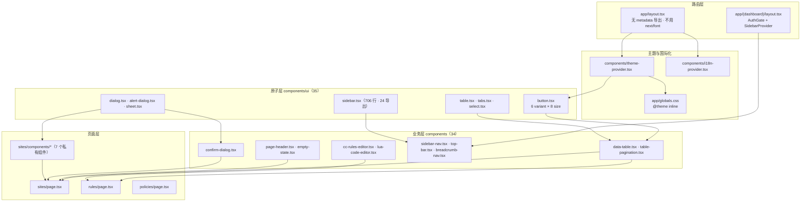
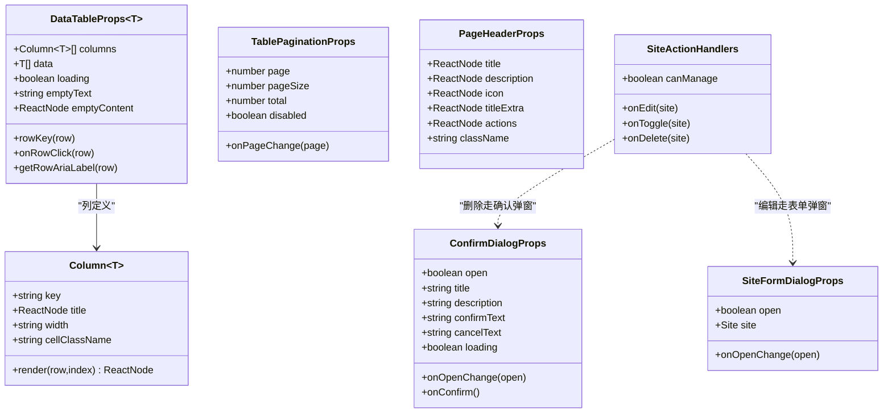
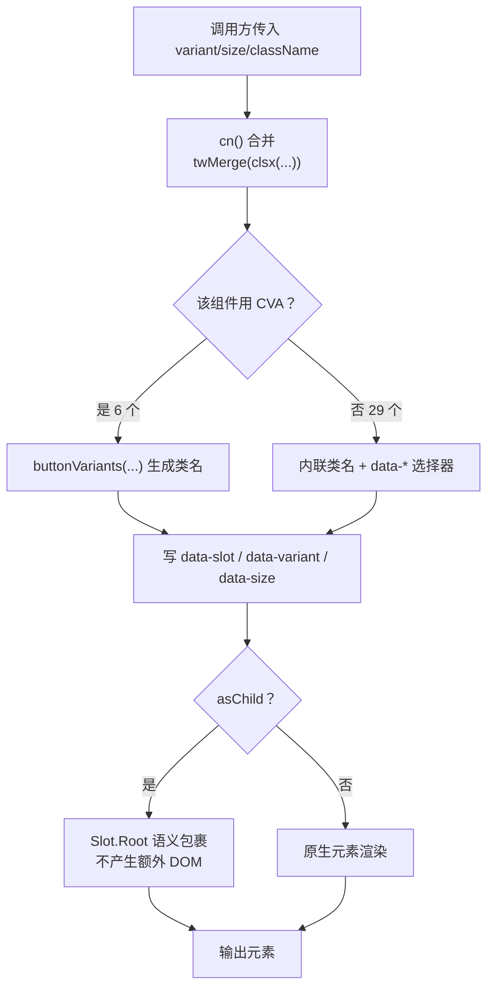
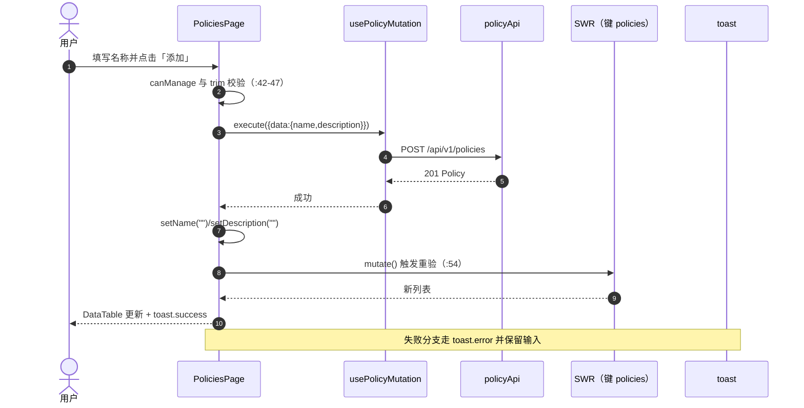
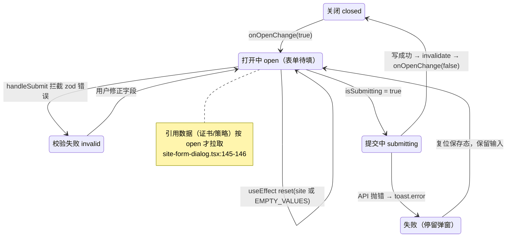
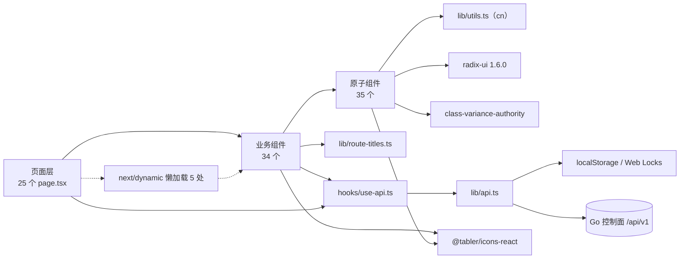

# 组件设计模式

> [返回 前端管理界面](../前端管理界面.md)

<cite>
**本文档引用的文件**
- [frontend/components/ui/button.tsx](file://frontend/components/ui/button.tsx)
- [frontend/components/ui/card.tsx](file://frontend/components/ui/card.tsx)
- [frontend/components/ui/input.tsx](file://frontend/components/ui/input.tsx)
- [frontend/components/ui/textarea.tsx](file://frontend/components/ui/textarea.tsx)
- [frontend/components/ui/table.tsx](file://frontend/components/ui/table.tsx)
- [frontend/components/ui/dialog.tsx](file://frontend/components/ui/dialog.tsx)
- [frontend/components/ui/alert-dialog.tsx](file://frontend/components/ui/alert-dialog.tsx)
- [frontend/components/ui/sheet.tsx](file://frontend/components/ui/sheet.tsx)
- [frontend/components/ui/select.tsx](file://frontend/components/ui/select.tsx)
- [frontend/components/ui/switch.tsx](file://frontend/components/ui/switch.tsx)
- [frontend/components/ui/tabs.tsx](file://frontend/components/ui/tabs.tsx)
- [frontend/components/ui/sidebar.tsx](file://frontend/components/ui/sidebar.tsx)
- [frontend/components/data-table.tsx](file://frontend/components/data-table.tsx)
- [frontend/components/table-pagination.tsx](file://frontend/components/table-pagination.tsx)
- [frontend/components/confirm-dialog.tsx](file://frontend/components/confirm-dialog.tsx)
- [frontend/components/page-header.tsx](file://frontend/components/page-header.tsx)
- [frontend/components/empty-state.tsx](file://frontend/components/empty-state.tsx)
- [frontend/components/stat-card.tsx](file://frontend/components/stat-card.tsx)
- [frontend/components/metric-tile.tsx](file://frontend/components/metric-tile.tsx)
- [frontend/components/metric-strip.tsx](file://frontend/components/metric-strip.tsx)
- [frontend/components/ranked-bar-list.tsx](file://frontend/components/ranked-bar-list.tsx)
- [frontend/components/cc-rules-editor.tsx](file://frontend/components/cc-rules-editor.tsx)
- [frontend/components/skip-path-by-phase-editor.tsx](file://frontend/components/skip-path-by-phase-editor.tsx)
- [frontend/components/lua-code-editor.tsx](file://frontend/components/lua-code-editor.tsx)
- [frontend/components/http-message-view.tsx](file://frontend/components/http-message-view.tsx)
- [frontend/components/certificate-parse-panel.tsx](file://frontend/components/certificate-parse-panel.tsx)
- [frontend/components/access-log-detail-dialog.tsx](file://frontend/components/access-log-detail-dialog.tsx)
- [frontend/components/security-event-detail-dialog.tsx](file://frontend/components/security-event-detail-dialog.tsx)
- [frontend/components/access-log-origin-badge.tsx](file://frontend/components/access-log-origin-badge.tsx)
- [frontend/components/action-badge.tsx](file://frontend/components/action-badge.tsx)
- [frontend/components/ip-hover-preview.tsx](file://frontend/components/ip-hover-preview.tsx)
- [frontend/components/site-hover-preview.tsx](file://frontend/components/site-hover-preview.tsx)
- [frontend/components/geo-attack-distribution.tsx](file://frontend/components/geo-attack-distribution.tsx)
- [frontend/components/date-range-picker.tsx](file://frontend/components/date-range-picker.tsx)
- [frontend/components/env-override-card.tsx](file://frontend/components/env-override-card.tsx)
- [frontend/components/env-override-field.tsx](file://frontend/components/env-override-field.tsx)
- [frontend/components/sidebar-nav.tsx](file://frontend/components/sidebar-nav.tsx)
- [frontend/components/top-bar.tsx](file://frontend/components/top-bar.tsx)
- [frontend/components/breadcrumb-nav.tsx](file://frontend/components/breadcrumb-nav.tsx)
- [frontend/components/tab-workspace.tsx](file://frontend/components/tab-workspace.tsx)
- [frontend/components/auth-gate.tsx](file://frontend/components/auth-gate.tsx)
- [frontend/components/auth-provider.tsx](file://frontend/components/auth-provider.tsx)
- [frontend/components/theme-provider.tsx](file://frontend/components/theme-provider.tsx)
- [frontend/components/i18n-provider.tsx](file://frontend/components/i18n-provider.tsx)
- [frontend/components/appearance-toggle.tsx](file://frontend/components/appearance-toggle.tsx)
- [frontend/components/language-switcher.tsx](file://frontend/components/language-switcher.tsx)
- [frontend/app/(dashboard)/sites/components/site-form-dialog.tsx](file://frontend/app/(dashboard)/sites/components/site-form-dialog.tsx)
- [frontend/app/(dashboard)/sites/components/site-card.tsx](file://frontend/app/(dashboard)/sites/components/site-card.tsx)
- [frontend/app/(dashboard)/sites/components/site-table.tsx](file://frontend/app/(dashboard)/sites/components/site-table.tsx)
- [frontend/app/(dashboard)/sites/components/site-presentation.tsx](file://frontend/app/(dashboard)/sites/components/site-presentation.tsx)
- [frontend/app/(dashboard)/sites/components/access-user-dialog.tsx](file://frontend/app/(dashboard)/sites/components/access-user-dialog.tsx)
- [frontend/app/(dashboard)/sites/components/access-provider-dialog.tsx](file://frontend/app/(dashboard)/sites/components/access-provider-dialog.tsx)
- [frontend/app/(dashboard)/sites/components/access-path-rule-dialog.tsx](file://frontend/app/(dashboard)/sites/components/access-path-rule-dialog.tsx)
- [frontend/app/(dashboard)/sites/detail/components/listeners-tab.tsx](file://frontend/app/(dashboard)/sites/detail/components/listeners-tab.tsx)
- [frontend/app/(dashboard)/sites/detail/components/protection-tab.tsx](file://frontend/app/(dashboard)/sites/detail/components/protection-tab.tsx)
- [frontend/app/(dashboard)/rules/components/rule-form-dialog.tsx](file://frontend/app/(dashboard)/rules/components/rule-form-dialog.tsx)
- [frontend/app/(dashboard)/rules/components/cve-rule-form-dialog.tsx](file://frontend/app/(dashboard)/rules/components/cve-rule-form-dialog.tsx)
- [frontend/app/(dashboard)/rules/components/builtin-rule-edit-dialog.tsx](file://frontend/app/(dashboard)/rules/components/builtin-rule-edit-dialog.tsx)
- [frontend/app/(dashboard)/rules/components/rule-pattern-mapper.ts](file://frontend/app/(dashboard)/rules/components/rule-pattern-mapper.ts)
- [frontend/app/(dashboard)/lua-plugins/components/plugin-editor-dialog.tsx](file://frontend/app/(dashboard)/lua-plugins/components/plugin-editor-dialog.tsx)
- [frontend/app/(dashboard)/js-plugins/components/plugin-editor-dialog.tsx](file://frontend/app/(dashboard)/js-plugins/components/plugin-editor-dialog.tsx)
- [frontend/app/(dashboard)/policies/page.tsx](file://frontend/app/(dashboard)/policies/page.tsx)
- [frontend/app/(dashboard)/sites/page.tsx](file://frontend/app/(dashboard)/sites/page.tsx)
- [frontend/app/(dashboard)/rules/page.tsx](file://frontend/app/(dashboard)/rules/page.tsx)
- [frontend/lib/utils.ts](file://frontend/lib/utils.ts)
- [frontend/lib/action-style.ts](file://frontend/lib/action-style.ts)
- [frontend/lib/country-names.ts](file://frontend/lib/country-names.ts)
- [frontend/lib/route-titles.ts](file://frontend/lib/route-titles.ts)
- [frontend/lib/site-display.ts](file://frontend/lib/site-display.ts)
- [frontend/hooks/use-mobile.ts](file://frontend/hooks/use-mobile.ts)
- [frontend/hooks/use-debounced-value.ts](file://frontend/hooks/use-debounced-value.ts)
- [frontend/hooks/use-api.ts](file://frontend/hooks/use-api.ts)
- [frontend/package.json](file://frontend/package.json)
- [frontend/components.json](file://frontend/components.json)
</cite>

## 目录

1. [简介](#简介)
2. [项目结构](#项目结构)
3. [核心组件](#核心组件)
4. [架构总览](#架构总览)
5. [详细组件分析](#详细组件分析)
6. [依赖关系分析](#依赖关系分析)
7. [性能考虑](#性能考虑)
8. [故障排查指南](#故障排查指南)
9. [结论](#结论)
10. [附录](#附录)

## 简介
本文件系统性地解析 My-OpenWaf 前端的组件设计模式，重点围绕基于 shadcn/ui 的原子化组件理念、CRUD 页面的组合式实现、对话框组件与导航组件的业务实践展开。

需要先澄清一个与旧文档不一致的事实：**本仓库不存在名为 `CrudPage` 的通用增删改查组件，也不存在 `FieldDef` 字段定义接口**（对 `frontend/components/` 的 34 个业务组件与 `components/ui/` 的 35 个原子组件逐个核对，均无此符号）。实际的复用单元是一组粒度明确的小组件——`PageHeader`、`DataTable`、`TablePagination`、`ConfirmDialog`、`EmptyState`、`MetricTile`——由页面按业务需要组合，表单载体则视复杂度选择「页内 Card 表单」或「专属 `*-dialog.tsx`」。本篇描述的即是这一组合式模式。

文档覆盖 Props 设计原则、状态边界、组件复用策略与性能取舍，并以图示帮助开发者快速理解与落地。

## 项目结构
组件层按「原子 → 业务 → 页面」三级组织，层与层之间单向依赖。

| 层 | 目录 | 文件数 | 代表文件 | 对外暴露 |
|----|------|:------:|----------|----------|
| 原子层 | `frontend/components/ui/` | 35 | `button.tsx`、`sidebar.tsx`、`dialog.tsx` | 无状态 UI 原语与 CVA 变体 |
| 业务层 | `frontend/components/` | 34 | `data-table.tsx`、`sidebar-nav.tsx`、`cc-rules-editor.tsx` | `DataTable`、`AppSidebar`、`CCRulesEditor` 等 |
| 页面层 | `frontend/app/(dashboard)/*/` | 25 个页面目录 + 子组件 | `sites/page.tsx`、`rules/page.tsx` | 各 `*Page` 默认导出 |
| 页面私有组件 | `app/(dashboard)/*/components/` | 站点 7、规则 4、验证码 2、Lua 5、JS 2 | `sites/components/site-form-dialog.tsx` | 仅被本域页面引用 |
| 数据与工具 | `frontend/lib/`、`frontend/hooks/` | 15 + 6 | `lib/api.ts`、`hooks/use-api.ts` | 请求封装与 SWR Hook |

**图表来源**
- [frontend/app/layout.tsx:1-29](file://frontend/app/layout.tsx#L1-L29)
- [frontend/app/(dashboard)/layout.tsx:16-37](file://frontend/app/(dashboard)/layout.tsx#L16-L37)
- [frontend/components/ui/button.tsx:7-65](file://frontend/components/ui/button.tsx#L7-L65)
- [frontend/components/ui/sidebar.tsx:1-50](file://frontend/components/ui/sidebar.tsx#L1-L50)
- [frontend/components/data-table.tsx:44-54](file://frontend/components/data-table.tsx#L44-L54)
- [frontend/components/confirm-dialog.tsx:26-44](file://frontend/components/confirm-dialog.tsx#L26-L44)
- [frontend/components/sidebar-nav.tsx:339-346](file://frontend/components/sidebar-nav.tsx#L339-L346)
- [frontend/app/(dashboard)/sites/page.tsx:198-216](file://frontend/app/(dashboard)/sites/page.tsx#L198-L216)
- [frontend/app/(dashboard)/policies/page.tsx:154-226](file://frontend/app/(dashboard)/policies/page.tsx#L154-L226)
- [frontend/app/globals.css:7-49](file://frontend/app/globals.css#L7-L49)

**章节来源**
- [frontend/components.json:1-25](file://frontend/components.json#L1-L25)
- [frontend/package.json:24-52](file://frontend/package.json#L24-L52)
- [frontend/app/layout.tsx:1-29](file://frontend/app/layout.tsx#L1-L29)
- [frontend/app/(dashboard)/layout.tsx:1-37](file://frontend/app/(dashboard)/layout.tsx#L1-L37)
- [frontend/components/data-table.tsx:1-170](file://frontend/components/data-table.tsx#L1-L170)
- [frontend/components/ui/sidebar.tsx:1-50](file://frontend/components/ui/sidebar.tsx#L1-L50)

## 核心组件
`components/` 下 34 个业务组件的实测清单（行数为 `wc -l` 现场统计；依赖列只写关键项）。

| 组件 | 文件:行 | 职责 | 主要依赖 | 导出符号 |
|------|---------|------|----------|----------|
| `DataTable` | `data-table.tsx:44` | 列驱动表格 + 6 行骨架 + 空状态 + 行键盘激活 | `ui/table`、`Skeleton`、`EmptyState` | `DataTable` |
| `TablePagination` | `table-pagination.tsx:57` | 服务端 `total` 分页条，首尾页 + 邻居 + 省略号 | `ui/pagination` | `TablePagination` |
| `PageHeader` | `page-header.tsx:34` | 标题 + 描述 + 右侧操作区 | `cn` | `PageHeader`、`PageHeaderProps` |
| `EmptyState` | `empty-state.tsx:27` | 统一「暂无数据」占位 | `cn`、`Button` | `EmptyState`、`EmptyStateProps` |
| `ConfirmDialog` | `confirm-dialog.tsx:26` | 危险操作二次确认 | `ui/alert-dialog` | `ConfirmDialog` |
| `AppSidebar` | `sidebar-nav.tsx:339` | 6 分组可折叠侧栏 | `ui/sidebar`、`@tabler/icons-react` | `AppSidebar` |
| `TopBar` | `top-bar.tsx:32` | 页面标题 + 热重载 + 外观/语言 + 用户菜单 | `lib/route-titles`、`use-api` | `TopBar` |
| `BreadcrumbNav` | `breadcrumb-nav.tsx:16` | 路径片段面包屑 | `ui/breadcrumb`、`segmentKeyMap` | `BreadcrumbNav` |
| `TabWorkspaceProvider` | `tab-workspace.tsx:104` | 文档式多标签工作区 | `useSearchParams`、`sessionStorage` | `TabWorkspaceProvider`、`useTabWorkspace` |
| `AuthGate` | `auth-gate.tsx:19` | 认证未定前不挂载业务子树 | `useAuth`、`getAccessToken` | `AuthGate` |
| `AuthProvider` | `auth-provider.tsx:9` | 薄封装，转发 `use-auth` 的 Provider | `hooks/use-auth` | `AuthProvider` |
| `ThemeProvider` | `theme-provider.tsx:6` | next-themes 配置 + `D` 键热切 | `next-themes` | `ThemeProvider` |
| `I18nProvider` | `i18n-provider.tsx:15` | 仅客户端初始化的 i18next 提供者 | `i18next`、语言包 | `I18nProvider` |
| `ThemeToggle`/`AccentToggle` | `appearance-toggle.tsx:20`、`:60` | 亮暗切换、蓝/青强调色切换 | `next-themes`、`localStorage` | `ThemeToggle`、`AccentToggle` |
| `LanguageSwitcher` | `language-switcher.tsx` | 中英语言切换 | `react-i18next` | `LanguageSwitcher` |
| `StatCard` | `stat-card.tsx` | 带平滑数值过渡的统计卡 | `recharts` 无关，纯 CSS | `StatCard` |
| `MetricTile` | `metric-tile.tsx` | 指标磁贴，支持语义色调 | `cn` | `MetricTile` |
| `MetricStrip` | `metric-strip.tsx` | 横向指标条，零值降级 | `formatNumber` | `MetricStrip` |
| `RankedBarList` | `ranked-bar-list.tsx` | 排行条形列表 | `cn` | `RankedBarList` |
| `GeoAttackDistribution` | `geo-attack-distribution.tsx:22` | 地理攻击分布卡片（横向进度条） | `Card`、`Badge`、`lib/country-names` | `GeoAttackDistribution` |
| `CCRulesEditor` | `cc-rules-editor.tsx:157` | CC 规则受控编辑器 | `ui/*`、`useTranslation` | `CCRulesEditor` 及选项常量 |
| `SkipPathByPhaseEditor` | `skip-path-by-phase-editor.tsx:29` | 按阶段编辑跳过路径 | `lib/skip-path-by-phase` | `SkipPathByPhaseEditor` |
| `LuaCodeEditor` | `lua-code-editor.tsx` | 轻量 Lua 源码编辑区（不引 Monaco） | `cn` | `LuaCodeEditor` |
| `HttpMessageView` | `http-message-view.tsx` | 报文展示与脱敏常量 | `ui/scroll-area` | `MessageView`、`REDACTED` 等 |
| `AccessLogDetailDialog` | `access-log-detail-dialog.tsx:195` | 访问日志详情弹窗 | `ui/dialog`、`Tabs` | `AccessLogDetailDialog` |
| `SecurityEventDetailDialog` | `security-event-detail-dialog.tsx:341` | 安全事件详情弹窗（1096 行） | `ui/dialog`、`recharts` | `SecurityEventDetailDialog` |
| `AccessLogOriginBadge` | `access-log-origin-badge.tsx:19` | 429 来源徽标 | `Badge` | `AccessLogOriginBadge`、`getAccessLog429Origin` |
| `ActionBadge` | `action-badge.tsx:24` | WAF 动作徽标 | `lib/action-style`、`Badge` | `ActionBadge` |
| `IpHoverPreview` | `ip-hover-preview.tsx:24` | IP 最近 5 次事件悬停预览 | `ui/hover-card`、SWR、`securityEventApi` | `IpHoverPreview` |
| `SiteHoverPreview` | `site-hover-preview.tsx` | 站点信息悬停预览 | `ui/hover-card` | `SiteHoverPreview` |
| `CertificateParsePanel` | `certificate-parse-panel.tsx:19` | 证书解析信息面板 | `Badge`、`formatDate` | `CertificateParsePanel` |
| `DateRangePicker` | `date-range-picker.tsx` | 时间范围选择 | `ui/calendar`、`ui/popover`、`date-fns` | `DateRangePicker`、`TimeRangeValue` |
| `EnvOverrideCard` | `env-override-card.tsx` | 环境变量覆盖卡片（域级） | `lib/env-override` | `EnvOverrideCard`、`EnvOverrideDomainCard`、`EnvOverrideSection` |
| `EnvOverrideField` | `env-override-field.tsx` | 逐键三态字段控件 | `lib/env-override` | `EnvOverrideField` |

**章节来源**
- [frontend/components/data-table.tsx:1-170](file://frontend/components/data-table.tsx#L1-L170)
- [frontend/components/table-pagination.tsx:1-126](file://frontend/components/table-pagination.tsx#L1-L126)
- [frontend/components/page-header.tsx:1-61](file://frontend/components/page-header.tsx#L1-L61)
- [frontend/components/empty-state.tsx:1-67](file://frontend/components/empty-state.tsx#L1-L67)
- [frontend/components/confirm-dialog.tsx:1-69](file://frontend/components/confirm-dialog.tsx#L1-L69)
- [frontend/components/sidebar-nav.tsx:1-383](file://frontend/components/sidebar-nav.tsx#L1-L383)
- [frontend/components/top-bar.tsx:1-102](file://frontend/components/top-bar.tsx#L1-L102)
- [frontend/components/breadcrumb-nav.tsx:1-57](file://frontend/components/breadcrumb-nav.tsx#L1-L57)
- [frontend/components/tab-workspace.tsx:1-285](file://frontend/components/tab-workspace.tsx#L1-L285)
- [frontend/components/auth-gate.tsx:1-45](file://frontend/components/auth-gate.tsx#L1-L45)
- [frontend/components/auth-provider.tsx:1-10](file://frontend/components/auth-provider.tsx#L1-L10)
- [frontend/components/theme-provider.tsx:1-72](file://frontend/components/theme-provider.tsx#L1-L72)
- [frontend/components/i18n-provider.tsx:1-46](file://frontend/components/i18n-provider.tsx#L1-L46)
- [frontend/components/appearance-toggle.tsx:1-105](file://frontend/components/appearance-toggle.tsx#L1-L105)
- [frontend/components/cc-rules-editor.tsx:144-158](file://frontend/components/cc-rules-editor.tsx#L144-L158)
- [frontend/components/lua-code-editor.tsx:30-48](file://frontend/components/lua-code-editor.tsx#L30-L48)
- [frontend/components/access-log-detail-dialog.tsx:57-63](file://frontend/components/access-log-detail-dialog.tsx#L57-L63)
- [frontend/components/security-event-detail-dialog.tsx:59-63](file://frontend/components/security-event-detail-dialog.tsx#L59-L63)
- [frontend/components/env-override-card.tsx:1-30](file://frontend/components/env-override-card.tsx#L1-L30)
- [frontend/components/env-override-field.tsx:1-30](file://frontend/components/env-override-field.tsx#L1-L30)

## 架构总览
组件体系遵循「主题/样式 → 原子组件 → 业务组件 → 页面组合」单向依赖，数据侧另有一条独立链路：SWR 查询 Hook 负责读、`useMutation` 负责写、写成功后按前缀失效重验。

页面状态可归为三类，边界划分是本套模式的核心约定：

| 状态类别 | 归属 | 典型实现 | 生命周期 | 持久化 |
|----------|------|----------|----------|--------|
| 视图偏好 | 页面/组件本地 | `sites/page.tsx` 的 `view`、`search`、`statusFilter` | 页面存在期间 | `localStorage` 键 `owaf.sites.view`（`sites/page.tsx:50`） |
| 编辑态 | 弹窗内部 | `useForm` + `useFieldArray`（`site-form-dialog.tsx:148-163`） | 弹窗打开到关闭 | 无；关闭即 `reset` |
| 服务端快照 | SWR 缓存 | `useApiQuery`（`hooks/use-api.ts:156`） | 跨组件共享 | 内存缓存，键为 `[prefix, params]` |

**图表来源**
- [frontend/components/data-table.tsx:24-42](file://frontend/components/data-table.tsx#L24-L42)
- [frontend/components/table-pagination.tsx:17-23](file://frontend/components/table-pagination.tsx#L17-L23)
- [frontend/components/confirm-dialog.tsx:15-24](file://frontend/components/confirm-dialog.tsx#L15-L24)
- [frontend/components/page-header.tsx:20-27](file://frontend/components/page-header.tsx#L20-L27)
- [frontend/app/(dashboard)/sites/components/site-form-dialog.tsx:112-116](file://frontend/app/(dashboard)/sites/components/site-form-dialog.tsx#L112-L116)
- [frontend/app/(dashboard)/sites/components/site-presentation.tsx:50-60](file://frontend/app/(dashboard)/sites/components/site-presentation.tsx#L50-L60)

## 详细组件分析

### 原子化组件设计模式（基于 shadcn/ui）
- 类名合并：全部组件走 `cn()`（`lib/utils.ts:4-6`），即 `twMerge(clsx(inputs))`，保证变体类与调用方 `className` 不互相覆盖。
- 变体与尺寸：`class-variance-authority` 定义，实测使用 CVA 的原子组件为 6 个——`button.tsx:7`、`alert.tsx:6`、`badge.tsx:7`、`tabs.tsx:27`、`toggle.tsx:9`、`sidebar.tsx:471`；其余组件用内联类名或 `data-*` 选择器。
- 状态标记：统一 `data-slot`（如 `dialog.tsx:43`、`:68`）、`data-variant`/`data-size`（`button.tsx:57-58`、`alert-dialog.tsx:59`），供样式与测试定位。
- Radix 原语：29 个原子组件从聚合包 `radix-ui` 具名导入原语（`dialog.tsx:4` 取 `Dialog`、`alert-dialog.tsx:4` 取 `AlertDialog`、`sheet.tsx` 复用 `Dialog` 原语、`sidebar.tsx:5` 与 `button.tsx:3` 用 `Slot`）。
- 图标：一律 `@tabler/icons-react` 的 `Icon*`（`dialog.tsx:8` 用 `IconX`、`sidebar.tsx:25` 用 `IconLayoutSidebar`、`sidebar-nav.tsx:10-38` 引入 27 个图标）；`components.json:13` 声明 `iconLibrary: "tabler"`。
- 客户端边界：35 个原子组件中 26 个带 `"use client"`，9 个不带（`alert`、`badge`、`breadcrumb`、`button`、`card`、`input`、`pagination`、`skeleton`、`textarea`），后者为纯展示组件，可安全进入服务端组件树——这是 `components.json:4` 的 `rsc: true` 生效的前提。

**图表来源**
- [frontend/lib/utils.ts:4-6](file://frontend/lib/utils.ts#L4-L6)
- [frontend/components/ui/button.tsx:7-62](file://frontend/components/ui/button.tsx#L7-L62)
- [frontend/components/ui/alert-dialog.tsx:57-65](file://frontend/components/ui/alert-dialog.tsx#L57-L65)
- [frontend/components/ui/dialog.tsx:42-48](file://frontend/components/ui/dialog.tsx#L42-L48)
- [frontend/components.json:1-25](file://frontend/components.json#L1-L25)

**章节来源**
- [frontend/components/ui/button.tsx:1-66](file://frontend/components/ui/button.tsx#L1-L66)
- [frontend/components/ui/dialog.tsx:1-174](file://frontend/components/ui/dialog.tsx#L1-L174)
- [frontend/components/ui/alert-dialog.tsx:1-200](file://frontend/components/ui/alert-dialog.tsx#L1-L200)
- [frontend/components/ui/sheet.tsx:1-147](file://frontend/components/ui/sheet.tsx#L1-L147)
- [frontend/components/ui/tabs.tsx:27-45](file://frontend/components/ui/tabs.tsx#L27-L45)
- [frontend/components/ui/toggle.tsx:9-27](file://frontend/components/ui/toggle.tsx#L9-L27)
- [frontend/components/ui/alert.tsx:6-25](file://frontend/components/ui/alert.tsx#L6-L25)
- [frontend/components/ui/badge.tsx:7-30](file://frontend/components/ui/badge.tsx#L7-L30)
- [frontend/components/ui/sidebar.tsx:1-32](file://frontend/components/ui/sidebar.tsx#L1-L32)
- [frontend/lib/utils.ts:1-50](file://frontend/lib/utils.ts#L1-L50)
- [frontend/components.json:1-25](file://frontend/components.json#L1-L25)

### CRUD 页面的组合式实现
以 `policies/page.tsx`（228 行，最小组合）与 `sites/page.tsx`（431 行，完整组合）为对照：

| 区块 | `policies/page.tsx` | `sites/page.tsx` | 复用件 |
|------|---------------------|------------------|--------|
| 页头 | `:156-169` 标题 + 刷新按钮 | `:200-216` 标题 + 总数 Badge + 新增按钮 | `PageHeader` |
| 只读提示 | `:171-175` | `:218-222` | `Alert` + `common.readOnlyHint` |
| 错误呈现 | `:177-184` | `:224-231` | `Alert variant="destructive"` |
| 指标区 | 无 | `:234-279` 4 张磁贴 | `MetricTile` |
| 工具栏 | 无 | `:282-345` 搜索 + 状态筛选 + 视图切换 | `Input`、`ToggleGroup`、`Tooltip` |
| 新建表单 | `:186-217` 页内 Card | 弹窗内 | `Card`、`Input`、`Textarea`、`Label` |
| 列表 | `:219-225` `DataTable` | `:391-399` `SiteCard`/`SiteTable` 双形态 | `DataTable` 或域内私有件 |
| 加载/空态 | `DataTable` 内置骨架 | `:348-390` 骨架 + 两种空状态 | `Skeleton`、`EmptyState` |
| 删除 | 无确认（直接调用并拦截默认策略） | `:418-428` `ConfirmDialog` | `ConfirmDialog` |
| 分页 | 无（全量返回） | 无（固定 `page:1, page_size:50`） | `TablePagination`（他页使用） |

关键约定：
- 权限闸门在处理器入口重复校验，而非只靠按钮隐藏。`policies/page.tsx:42`、`:64`、`:77` 与 `sites/page.tsx:153`、`:165`、`:180` 都在函数首行检查 `canManage`。
- 写成功后统一 `await mutate()`（`policies/page.tsx:54`、`:67`、`:84`）或调用失效函数（`site-form-dialog.tsx:238` 的 `invalidateSiteCaches`）。
- 反馈只走 `sonner` 的 `toast.success`/`toast.error`，不写页内错误 banner。

**图表来源**
- [frontend/app/(dashboard)/policies/page.tsx:41-61](file://frontend/app/(dashboard)/policies/page.tsx#L41-L61)
- [frontend/app/(dashboard)/policies/page.tsx:186-225](file://frontend/app/(dashboard)/policies/page.tsx#L186-L225)
- [frontend/hooks/use-api.ts:252-297](file://frontend/hooks/use-api.ts#L252-L297)
- [frontend/lib/api.ts:862-873](file://frontend/lib/api.ts#L862-L873)

**章节来源**
- [frontend/app/(dashboard)/policies/page.tsx:1-228](file://frontend/app/(dashboard)/policies/page.tsx#L1-L228)
- [frontend/app/(dashboard)/sites/page.tsx:97-431](file://frontend/app/(dashboard)/sites/page.tsx#L97-L431)
- [frontend/components/data-table.tsx:44-169](file://frontend/components/data-table.tsx#L44-L169)
- [frontend/components/table-pagination.tsx:32-125](file://frontend/components/table-pagination.tsx#L32-L125)
- [frontend/hooks/use-api.ts:150-297](file://frontend/hooks/use-api.ts#L150-L297)

### 表单弹窗与受控校验
表单复杂度决定是否独立成弹窗组件。实测 12 个业务对话框的 props 形态高度一致：均以 `open` + `onOpenChange` 为开关契约，编辑目标以可选对象传入（`null` 即新建）。

| 组件 | 文件:行 | 职责 | 依赖 | props 摘要 |
|------|---------|------|------|------------|
| `SiteFormDialog` | `sites/components/site-form-dialog.tsx:137` | 站点新建/编辑 | `react-hook-form`、`zod`、`Dialog` | `open`、`onOpenChange`、`site?` |
| `AccessUserDialog` | `sites/components/access-user-dialog.tsx:34` | 本地访问用户 | `Dialog` | `open`、`onOpenChange`、`siteId`、`user?` |
| `AccessProviderDialog` | `sites/components/access-provider-dialog.tsx:61` | OAuth/OIDC 提供方 | `Dialog` | `open`、`onOpenChange`、`siteId`、`provider?` |
| `AccessPathRuleDialog` | `sites/components/access-path-rule-dialog.tsx:45` | 路径访问规则 | `Dialog` | `open`、`onOpenChange`、`siteId`、`rule?` |
| `RuleFormDialog` | `rules/components/rule-form-dialog.tsx:198` | 自定义规则 | `Dialog`、条件组 | `open`、`onOpenChange`、`rule?`、`policyId?` |
| `CVERuleFormDialog` | `rules/components/cve-rule-form-dialog.tsx:70` | CVE 规则 | `Dialog` | `open`、`onOpenChange`、`rule?`、`onSubmit` |
| `BuiltinRuleEditDialog` | `rules/components/builtin-rule-edit-dialog.tsx:90` | 内置规则覆盖 | `Dialog` | `open`、`onOpenChange`、`ruleID`、`initial`、`onSubmit` |
| `PluginEditorDialog` | `lua-plugins/components/plugin-editor-dialog.tsx:143` | Lua 脚本编辑 | `LuaCodeEditor`、`Dialog` | `open`、`onOpenChange`、`editing`、`onSaved` |
| `JSPluginEditorDialog` | `js-plugins/components/plugin-editor-dialog.tsx:216` | JS 插件编辑 | `Dialog` | 另带 `sites` 列表 |
| `AccessLogDetailDialog` | `components/access-log-detail-dialog.tsx:195` | 日志详情（只读） | `Tabs`、`MessageView` | 另带 `log`、`loading`、`error` |
| `SecurityEventDetailDialog` | `components/security-event-detail-dialog.tsx:341` | 事件详情（只读） | `Tabs`、`recharts` | `event`、`open`、`onOpenChange` |
| `ConfirmDialog` | `components/confirm-dialog.tsx:26` | 危险动作确认 | `AlertDialog` | `open`、`onOpenChange`、`onConfirm`、`loading` |

`SiteFormDialog` 的校验最能体现「前端规则与后端对齐」的做法：
- schema 为 `z.object(...).refine(...)`（`site-form-dialog.tsx:64-108`），错误消息写 i18n key 而非硬编码中文。
- 端口约束 `1..65535`（`:76-79`）、至少一个监听（`:83`）、至少一个上游（`:101`）。
- 上游 scheme 白名单与后端 `internal/admin/shared/site_upstreams.go` 对齐，实测 9 项：`http`、`https`、`h2c`、`h3`、`tls`、`grpc`、`grpcs`、`grpc+tls`、`grpc+https`（`:52-62`）。
- 交叉校验：任一监听启用 TLS 则必须绑定证书（`:105-108`）。
- Radix Select 不接受空串 value，故用哨兵 `none` 与 `inherit-default`（`:48-49`）。

**图表来源**
- [frontend/app/(dashboard)/sites/components/site-form-dialog.tsx:64-108](file://frontend/app/(dashboard)/sites/components/site-form-dialog.tsx#L64-L108)
- [frontend/app/(dashboard)/sites/components/site-form-dialog.tsx:144-195](file://frontend/app/(dashboard)/sites/components/site-form-dialog.tsx#L144-L195)
- [frontend/app/(dashboard)/sites/components/site-form-dialog.tsx:203-245](file://frontend/app/(dashboard)/sites/components/site-form-dialog.tsx#L203-L245)

**章节来源**
- [frontend/app/(dashboard)/sites/components/site-form-dialog.tsx:1-552](file://frontend/app/(dashboard)/sites/components/site-form-dialog.tsx#L1-L552)
- [frontend/app/(dashboard)/rules/components/rule-form-dialog.tsx:187-201](file://frontend/app/(dashboard)/rules/components/rule-form-dialog.tsx#L187-L201)
- [frontend/app/(dashboard)/rules/components/cve-rule-form-dialog.tsx:43-70](file://frontend/app/(dashboard)/rules/components/cve-rule-form-dialog.tsx#L43-L70)
- [frontend/app/(dashboard)/rules/components/builtin-rule-edit-dialog.tsx:74-90](file://frontend/app/(dashboard)/rules/components/builtin-rule-edit-dialog.tsx#L74-L90)
- [frontend/app/(dashboard)/lua-plugins/components/plugin-editor-dialog.tsx:126-143](file://frontend/app/(dashboard)/lua-plugins/components/plugin-editor-dialog.tsx#L126-L143)
- [frontend/app/(dashboard)/js-plugins/components/plugin-editor-dialog.tsx:205-219](file://frontend/app/(dashboard)/js-plugins/components/plugin-editor-dialog.tsx#L205-L219)
- [frontend/components/ui/dialog.tsx:54-91](file://frontend/components/ui/dialog.tsx#L54-L91)

### 导航组件的复用件形态
导航不是单个组件而是四件协作：`AppSidebar`（菜单）、`TopBar`（标题与全局动作）、`BreadcrumbNav`（路径）、`TabWorkspaceProvider`（多标签）。路由元数据的单一真源是 `lib/route-titles.ts`：`routeTitleKeyMap`（26 条，`:7-34`）供标题与标签解析，`segmentKeyMap`（28 条，`:37-65`）供面包屑按片段解析，`getPageTitleKey()`（`:72-77`）做前缀匹配。

- 活动态判定分两层：`isChildActive()`（`sidebar-nav.tsx:90-98`）递归判断分组是否命中；`isExactOrLongestActive()`（`:101-111`）在所有匹配项中取最长 `href`，防止父项与子项同时高亮。
- 移动端：`ui/sidebar.tsx` 在 `useIsMobile()`（阈值 768）为真时把侧栏渲染进 `SheetContent`（`:184-202`），桌面侧栏用 `hidden md:flex`（`:232`）。
- 多标签去重：`normalizePath()`（`tab-workspace.tsx:33-45`）消除尾斜杠差异并排序查询参数；`tabIdentity()`（`:47-53`）对 `/sites/detail` 特殊保留 `?id=`，使同一路径不同站点成为不同标签。

**章节来源**
- [frontend/components/sidebar-nav.tsx:76-189](file://frontend/components/sidebar-nav.tsx#L76-L189)
- [frontend/components/sidebar-nav.tsx:339-382](file://frontend/components/sidebar-nav.tsx#L339-L382)
- [frontend/components/top-bar.tsx:28-101](file://frontend/components/top-bar.tsx#L28-L101)
- [frontend/components/breadcrumb-nav.tsx:16-56](file://frontend/components/breadcrumb-nav.tsx#L16-L56)
- [frontend/components/tab-workspace.tsx:25-102](file://frontend/components/tab-workspace.tsx#L25-L102)
- [frontend/lib/route-titles.ts:1-77](file://frontend/lib/route-titles.ts#L1-L77)
- [frontend/components/ui/sidebar.tsx:232-232](file://frontend/components/ui/sidebar.tsx#L232-L232)
- [frontend/hooks/use-mobile.ts:3-20](file://frontend/hooks/use-mobile.ts#L3-L20)

### 展示型组件与格式化边界
统计与展示类组件的共同约束是「不得用局部数据冒充全量指标」。`sites/page.tsx:125-138` 的实现把这一点显式化：`total` 取后端全局总数，而运行中/已停止/维护中只能基于已加载页统计，一旦 `total > loadedCount` 就把描述文案切换为 `sites.stats.currentPageScope`。

| 组件 | 数据来源 | 口径标注 | 关联工具函数 |
|------|----------|----------|--------------|
| `MetricTile` | 页面传入聚合值 | `tone` 5 档：`accent`/`danger`/`warning`/`success`/`neutral`（`metric-tile.tsx:13`），色调同时驱动数值色、图标底片、左侧竖条与迷你折线（`:16-45`） | `formatNumber`（`utils.ts:8`） |
| `MetricStrip` | 同页多项次要指标 | `title` 声明统计口径、`caption` 补充说明；`rawValue` 为 0 时该项低对比度降级（`metric-strip.tsx:13-19`、`:22-30`） | `formatNumber` |
| `StatCard` | 单指标 + 趋势 | 首屏直出最终值不做动画，仅 SWR 轮询到新值时插值 520 毫秒（`stat-card.tsx:8`、`:19-40`）；尊重 `prefers-reduced-motion`（`:14-17`） | `formatNumber` |
| `RankedBarList` | 已按 `count` 降序的列表 | 组件不重排以保持与后端口径一致（`ranked-bar-list.tsx:17`）；超出 `maxItems` 折叠为汇总项（`:19-22`） | `formatNumber`（`:4`） |
| `GeoAttackDistribution` | `top_countries`，ISO alpha-2 | 最多 10 条，国旗 + 中文名 + 按最大值归一化进度条（`geo-attack-distribution.tsx:16-21`） | `countryName`/`countryFlag`（`lib/country-names.ts`） |
| `AccessLogOriginBadge` | 单条日志的三个字段 | 仅区分 `waf_rate_limit` 与 `upstream_429` 两种 429 来源，其余组合不推断（`access-log-origin-badge.tsx:13-25`） | — |
| `ActionBadge` | WAF 动作字符串 | 未知动作保持中性并原样回显，避免误判为已拦截（`action-badge.tsx:20-23`） | `actionBadgeClass`/`hasActionLabel`（`lib/action-style.ts`） |
| `IpHoverPreview` | 悬停时按需查询 | 只展示最近 5 次事件，SWR 懒加载，`open` 时才首次拉取（`ip-hover-preview.tsx:20-23`） | `format`（`date-fns`）、`securityEventApi` |
| `DateRangePicker` | 用户选择 | 对外值为 `{ since, until }` 的 ISO/RFC3339 对（`date-range-picker.tsx:19-27`） | `date-fns`、`react-day-picker` |

**章节来源**
- [frontend/app/(dashboard)/sites/page.tsx:122-148](file://frontend/app/(dashboard)/sites/page.tsx#L122-L148)
- [frontend/components/metric-tile.tsx:1-40](file://frontend/components/metric-tile.tsx#L1-L40)
- [frontend/components/metric-strip.tsx:1-30](file://frontend/components/metric-strip.tsx#L1-L30)
- [frontend/components/stat-card.tsx:1-40](file://frontend/components/stat-card.tsx#L1-L40)
- [frontend/components/ranked-bar-list.tsx:1-30](file://frontend/components/ranked-bar-list.tsx#L1-L30)
- [frontend/components/geo-attack-distribution.tsx:1-30](file://frontend/components/geo-attack-distribution.tsx#L1-L30)
- [frontend/components/access-log-origin-badge.tsx:1-30](file://frontend/components/access-log-origin-badge.tsx#L1-L30)
- [frontend/components/action-badge.tsx:1-30](file://frontend/components/action-badge.tsx#L1-L30)
- [frontend/components/ip-hover-preview.tsx:1-30](file://frontend/components/ip-hover-preview.tsx#L1-L30)
- [frontend/lib/utils.ts:8-50](file://frontend/lib/utils.ts#L8-L50)

## 依赖关系分析
内部依赖呈严格单向：页面 → 业务组件 → 原子组件 → `lib/utils`，数据侧页面 → `hooks/use-api` → `lib/api`。

| 依赖方 | 被依赖方 | 依赖形式 | 实测证据 |
|--------|----------|----------|----------|
| 20 个页面 | `DataTable` | 具名导入 | `policies/page.tsx:13`、`rules/page.tsx:16` |
| 10 个页面 | `TablePagination` | 具名导入 | `rules/page.tsx`、`access-logs/page.tsx` |
| 26 个页面 | `PageHeader` | 具名导入 | `sites/page.tsx:5`、`policies/page.tsx:12` |
| 14 个页面 | `ConfirmDialog` | 具名导入 | `sites/page.tsx:23`、`api-keys/page.tsx:9`、`rules/page.tsx:17` |
| `DataTable` | `EmptyState`、`Skeleton`、`ui/table` | 组合 | `data-table.tsx:10-12` |
| `AppSidebar` | `ui/sidebar`、`ui/collapsible`、`lib` 无关 | 组合 | `sidebar-nav.tsx:40-60` |
| `TopBar`/`BreadcrumbNav`/`TabWorkspaceProvider` | `lib/route-titles` | 单一真源 | `top-bar.tsx:26`、`breadcrumb-nav.tsx:14`、`tab-workspace.tsx:22` |
| `SiteFormDialog` | `lib/api`、`lib/site-display`、`hooks/use-api` | 请求 + 解析 | `site-form-dialog.tsx:11-14`、`:35`、`:36-40` |
| 全部组件 | `lib/utils` 的 `cn` | 工具 | `utils.ts:4` |
| `ui/sidebar` | `hooks/use-mobile`、`ui/sheet` | 响应式 | `sidebar.tsx:7`、`:14-19` |

**图表来源**
- [frontend/package.json:27-51](file://frontend/package.json#L27-L51)
- [frontend/lib/utils.ts:4-6](file://frontend/lib/utils.ts#L4-L6)
- [frontend/hooks/use-api.ts:150-165](file://frontend/hooks/use-api.ts#L150-L165)
- [frontend/lib/api.ts:27-35](file://frontend/lib/api.ts#L27-L35)
- [frontend/app/(dashboard)/rules/page.tsx:49-53](file://frontend/app/(dashboard)/rules/page.tsx#L49-L53)
- [frontend/components/ui/sidebar.tsx:7-24](file://frontend/components/ui/sidebar.tsx#L7-L24)

**章节来源**
- [frontend/package.json:1-65](file://frontend/package.json#L1-L65)
- [frontend/components.json:1-25](file://frontend/components.json#L1-L25)
- [frontend/lib/utils.ts:1-50](file://frontend/lib/utils.ts#L1-L50)
- [frontend/lib/api.ts:1-1439](file://frontend/lib/api.ts#L1-L1439)
- [frontend/hooks/use-api.ts:150-297](file://frontend/hooks/use-api.ts#L150-L297)
- [frontend/app/(dashboard)/rules/page.tsx:1-60](file://frontend/app/(dashboard)/rules/page.tsx#L1-L60)

## 性能考虑
- 弹窗懒加载：5 处 `next/dynamic` 把重型详情弹窗移出主包——`rules/page.tsx:49`（`RuleFormDialog`）、`access-logs/page.tsx:34`、`security-events/page.tsx:55`、`request-trace/page.tsx:48`、`:53`。
- 按需取数：低频引用数据只在弹窗打开时请求（`site-form-dialog.tsx:145-146`）；站点详情只在 `overview`/`rules` 页签拉规则（`sites/detail/page.tsx:95-96`）。
- 强制重挂载代替 effect 回填：详情页签用 `key={`${site.id}-${site.updated_at}`}`（`sites/detail/page.tsx:266`、`:275`、`:285`、`:289`、`:294`）重置局部态；Lua 编辑弹窗注释明确说明不用 `useEffect` 回填以避开 React Compiler 的 `set-state-in-effect` 报错（`plugin-editor-dialog.tsx:136-138`）。
- 订阅式外部状态：视图偏好走 `useSyncExternalStore`（`sites/page.tsx:103-107`），服务端快照固定返回默认值，规避水合不一致与级联渲染。
- 重依赖克制：不引入 Monaco/CodeMirror，`lua-code-editor.tsx:40-45` 注释指出静态导出下重型编辑器会显著撑大产物。
- 骨架屏列宽提前确定：`DataTable` 加载态保留真实表头（`data-table.tsx:66-74`），数据到达时不重排。
- 输入防抖：`useDebouncedValue`（`hooks/use-debounced-value.ts:13-32`）以 `Object.is` 去重，避免逐字符触发远端查询。

**章节来源**
- [frontend/app/(dashboard)/rules/page.tsx:49-53](file://frontend/app/(dashboard)/rules/page.tsx#L49-L53)
- [frontend/app/(dashboard)/access-logs/page.tsx:34-38](file://frontend/app/(dashboard)/access-logs/page.tsx#L34-L38)
- [frontend/app/(dashboard)/security-events/page.tsx:55-59](file://frontend/app/(dashboard)/security-events/page.tsx#L55-L59)
- [frontend/app/(dashboard)/request-trace/page.tsx:48-57](file://frontend/app/(dashboard)/request-trace/page.tsx#L48-L57)
- [frontend/app/(dashboard)/sites/detail/page.tsx:93-96](file://frontend/app/(dashboard)/sites/detail/page.tsx#L93-L96)
- [frontend/app/(dashboard)/sites/detail/page.tsx:260-298](file://frontend/app/(dashboard)/sites/detail/page.tsx#L260-L298)
- [frontend/app/(dashboard)/sites/page.tsx:52-107](file://frontend/app/(dashboard)/sites/page.tsx#L52-L107)
- [frontend/components/lua-code-editor.tsx:40-45](file://frontend/components/lua-code-editor.tsx#L40-L45)
- [frontend/components/data-table.tsx:65-92](file://frontend/components/data-table.tsx#L65-L92)
- [frontend/hooks/use-debounced-value.ts:1-33](file://frontend/hooks/use-debounced-value.ts#L1-L33)

## 故障排查指南
| 症状 | 常见成因 | 定位与修复 |
|------|----------|------------|
| 列表为空但接口有数据 | 列 `key` 与后端 snake_case 字段不符 | `DataTable` 无 `render` 时按 `row[col.key]` 取值（`data-table.tsx:160`）；字段命名以 snake_case 为准 |
| 弹窗打不开 | `open` 由页面 state 驱动，页面未渲染该分支 | `sites/page.tsx:410-416` 的弹窗包在 `canManage` 内；只读角色不挂载 |
| 弹窗无法关闭 | 未回传 `onOpenChange`，或提交态阻塞 | `ConfirmDialog` 双按钮在 `loading` 时禁用（`confirm-dialog.tsx:51`、`:59`） |
| Select 空值丢失 | Radix 不接受空串 value | 使用哨兵值，见 `site-form-dialog.tsx:48-49` |
| 关闭后残留上次输入 | 未 `reset` | `site-form-dialog.tsx:171-195` 的 open 驱动 reset；或按插件弹窗用 `key` 重挂载 |
| 水合告警 / 首屏闪烁 | `useState` 初值直接读 `localStorage` | 改用 `useSyncExternalStore`（`sites/page.tsx:103-107`）或 `useEffect` 内应用（`appearance-toggle.tsx:66-75`） |
| 侧边栏移动端不收起 | 未调用 `setOpenMobile(false)` | 见 `sidebar-nav.tsx:152`、`:182` 的链接 `onClick` |
| 标签页重复 | 尾斜杠或查询参数顺序差异 | `normalizePath()`（`tab-workspace.tsx:33-45`）归一化 |
| 同一路径标签互相覆盖 | 未把 `?id=` 纳入身份 | `tabIdentity()`（`:47-53`）对 `/sites/detail` 保留 `id` |
| 指标数字与后端不符 | 统计口径为当前页 | 见 `sites/page.tsx:125-138` 的 `isPartialScope` 分支 |
| 图标未生效或类型报错 | 误引 `lucide-react`（未安装） | 统一从 `@tabler/icons-react` 引入 `Icon*`；`components.json:13` 为 `tabler` |

**章节来源**
- [frontend/components/data-table.tsx:134-166](file://frontend/components/data-table.tsx#L134-L166)
- [frontend/components/confirm-dialog.tsx:44-67](file://frontend/components/confirm-dialog.tsx#L44-L67)
- [frontend/app/(dashboard)/sites/components/site-form-dialog.tsx:44-49](file://frontend/app/(dashboard)/sites/components/site-form-dialog.tsx#L44-L49)
- [frontend/app/(dashboard)/sites/components/site-form-dialog.tsx:171-195](file://frontend/app/(dashboard)/sites/components/site-form-dialog.tsx#L171-L195)
- [frontend/app/(dashboard)/sites/page.tsx:103-138](file://frontend/app/(dashboard)/sites/page.tsx#L103-L138)
- [frontend/components/tab-workspace.tsx:33-53](file://frontend/components/tab-workspace.tsx#L33-L53)
- [frontend/components/appearance-toggle.tsx:60-88](file://frontend/components/appearance-toggle.tsx#L60-L88)
- [frontend/components.json:1-25](file://frontend/components.json#L1-L25)

## 结论
本项目的组件体系以 shadcn/ui（`radix-luma` 风格）为原子基座，用 34 个职责单一的业务组件与 25 个页面目录构成「原子 → 业务 → 页面」单向依赖。核心取舍有三点：

1. 用组合而非通用大组件（KISS/YAGNI）：不提供 `CrudPage`/`FieldDef` 这类元编程式抽象，改为 `DataTable` + `PageHeader` + `ConfirmDialog` 的显式组合，页面保留业务差异的表达空间。
2. 单一真源（DRY）：路由标题集中在 `lib/route-titles.ts`，写后失效集中在 `hooks/use-api.ts` 的 `invalidate*` 族，CC 规则编辑器被全局页与站点页共用（`cc-rules-editor.tsx:151-156` 注释明确此意图）。
3. 职责隔离（SRP/OCP）：展示、编辑、请求、格式化各归其位；新增字段类型只需扩展 `Column.render` 或新增域内弹窗，不必修改既有组件。

建议新增组件时沿用现有约定：`open`/`onOpenChange` 双 prop 开关、`canManage` 在处理器入口重复校验、写后必做失效重验、错误只经 `toast`、文案走 i18n key 并同步中英两份语言包。

## 附录

### 组件术语表
| 术语 | 含义 | 同义/易混 | 出处 |
|------|------|-----------|------|
| 列定义 | `Column<T>`，表格一列的键、标题、宽度与渲染函数 | 与「字段类型定义」不同，不含输入控件 | `data-table.tsx:24-30` |
| 失效重验 | 写成功后让相关 SWR 键重新取数 | 不是乐观更新，不预先改缓存 | `use-api.ts:180-247` |
| 最长匹配 | 多个 `href` 前缀命中时只高亮最长者 | 不是「精确匹配」也不是「前缀匹配」 | `sidebar-nav.tsx:101-111` |
| 标签身份 | 归一化后决定「是否为同一标签」的键 | 普通页取 pathname，站点详情带 `?id=` | `tab-workspace.tsx:47-53` |
| 哨兵值 | 为绕过组件限制而约定的非空占位值 | 与后端 `null` 语义不同，保存前转换 | `site-form-dialog.tsx:48-49` |
| 只读提示 | 非 `admin`/`operator` 时页面顶部的说明条 | 不是错误 banner，用默认 `Alert` | `sites/page.tsx:218-222` |

**章节来源**
- [frontend/components/data-table.tsx:24-30](file://frontend/components/data-table.tsx#L24-L30)
- [frontend/components/tab-workspace.tsx:33-53](file://frontend/components/tab-workspace.tsx#L33-L53)
- [frontend/components/sidebar-nav.tsx:101-111](file://frontend/components/sidebar-nav.tsx#L101-L111)
- [frontend/app/(dashboard)/sites/components/site-form-dialog.tsx:44-49](file://frontend/app/(dashboard)/sites/components/site-form-dialog.tsx#L44-L49)
- [frontend/app/(dashboard)/sites/page.tsx:218-222](file://frontend/app/(dashboard)/sites/page.tsx#L218-L222)
- [frontend/hooks/use-api.ts:180-247](file://frontend/hooks/use-api.ts#L180-L247)

### 页面私有组件清单（实测）
| 页面目录 | 私有组件数 | 文件 |
|----------|:---:|------|
| `sites/` | 7 | `site-form-dialog`、`site-card`、`site-table`、`site-presentation`、`access-user-dialog`、`access-provider-dialog`、`access-path-rule-dialog` |
| `sites/detail/` | 12 | `overview`、`monitor`、`listeners`、`rules`、`upstream`、`protection`、`dynamic-protection`、`cc-protection`、`access-control`、`cache`、`error-pages`、`advanced` 六个 `*-tab.tsx` 等 |
| `rules/` | 4 | `rule-form-dialog`、`cve-rule-form-dialog`、`builtin-rule-edit-dialog`、`rule-pattern-mapper.ts` |
| `lua-plugins/` | 5 | `plugin-editor-dialog`、`dry-run-panel`、`lua-help-panel`、`runtime-stats`、`examples.ts` |
| `js-plugins/` | 2 | `plugin-editor-dialog`、`js-help-panel` |
| `captcha/` | 2 | `bot-observation-card`、`image-transform-card` |

**章节来源**
- [frontend/components/sidebar-nav.tsx:101-111](file://frontend/components/sidebar-nav.tsx#L101-L111)
- [frontend/components/tab-workspace.tsx:33-53](file://frontend/components/tab-workspace.tsx#L33-L53)
- [frontend/components/data-table.tsx:24-30](file://frontend/components/data-table.tsx#L24-L30)
- [frontend/app/(dashboard)/sites/components/site-form-dialog.tsx:44-49](file://frontend/app/(dashboard)/sites/components/site-form-dialog.tsx#L44-L49)
- [frontend/app/(dashboard)/sites/page.tsx:218-222](file://frontend/app/(dashboard)/sites/page.tsx#L218-L222)
- [frontend/hooks/use-api.ts:180-247](file://frontend/hooks/use-api.ts#L180-L247)
